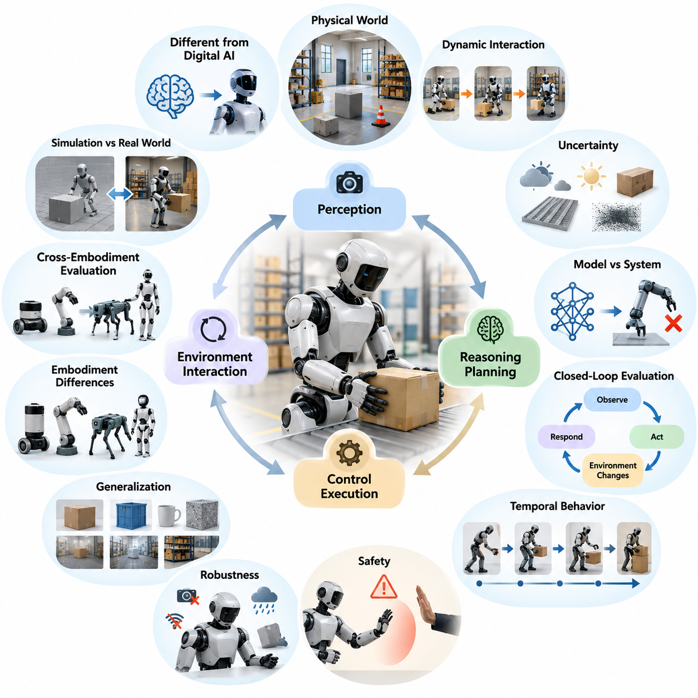
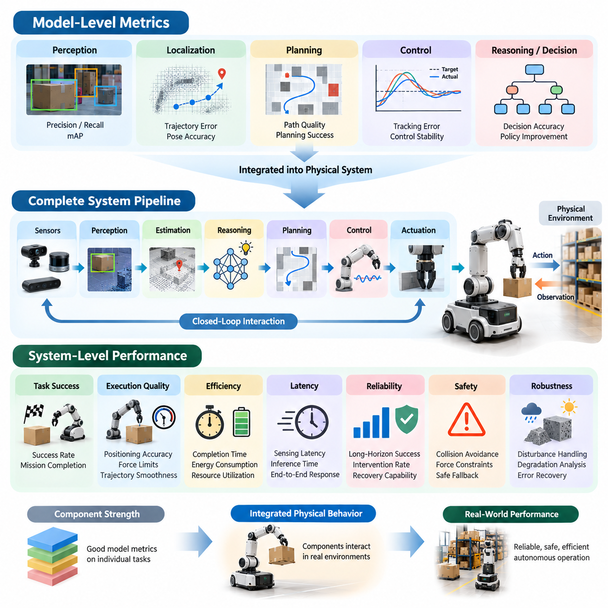
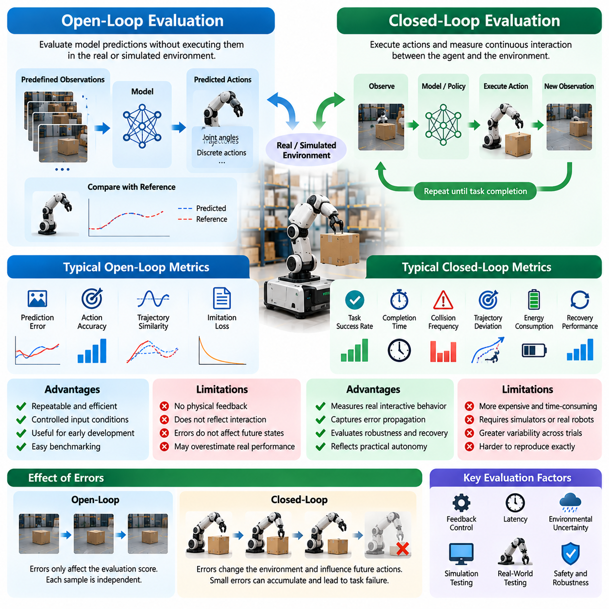
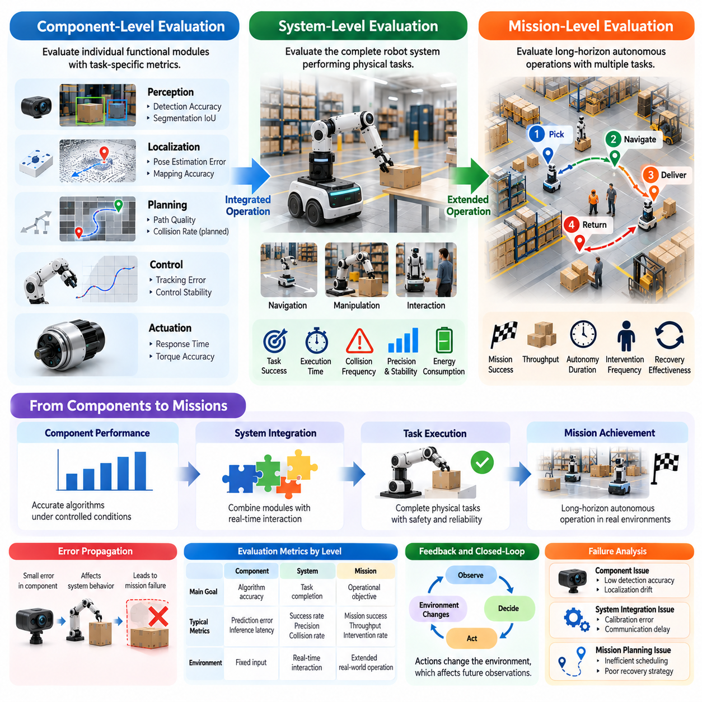
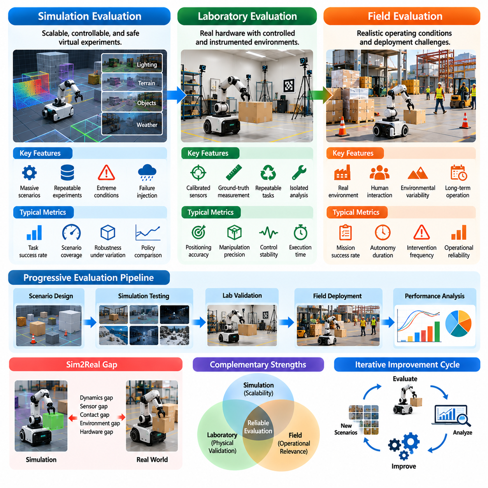
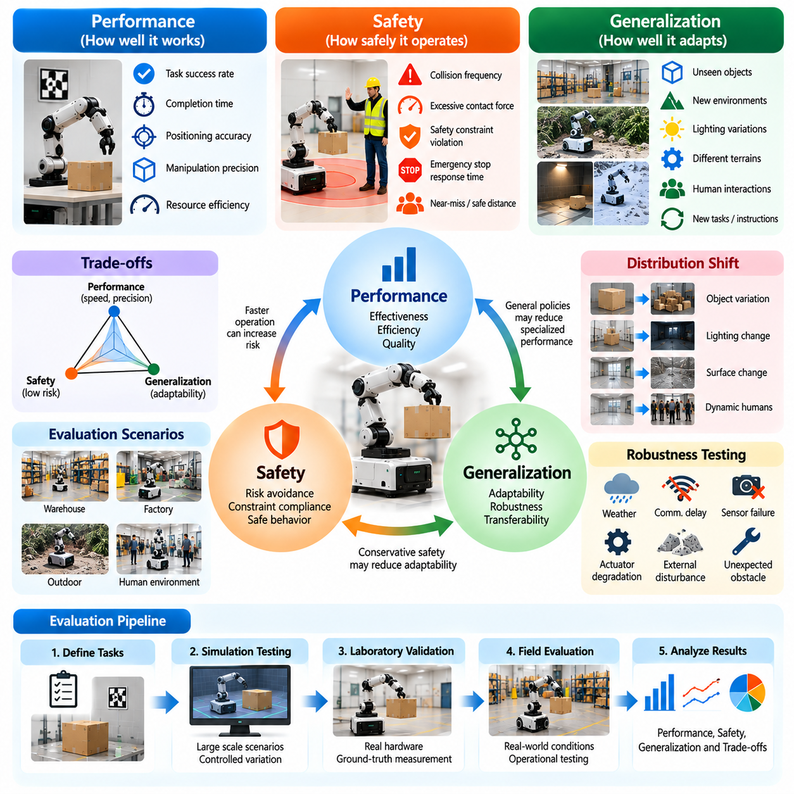
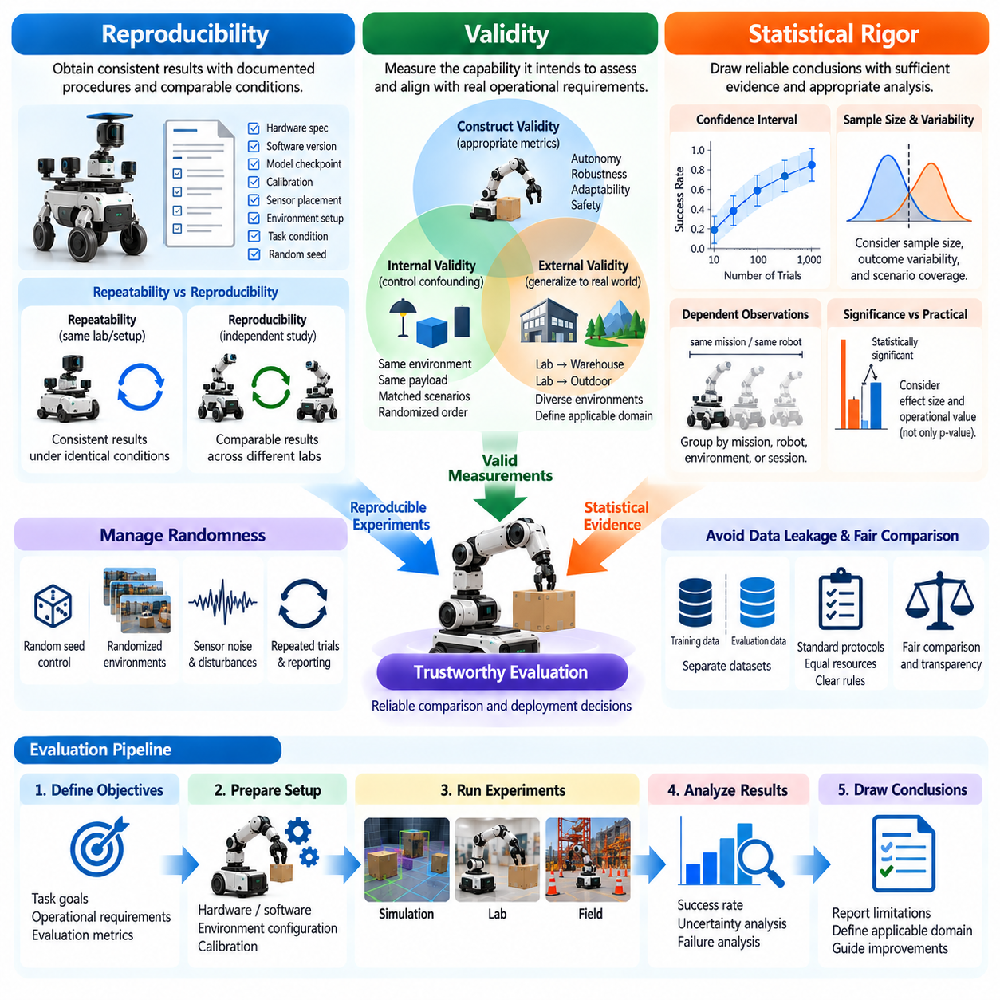
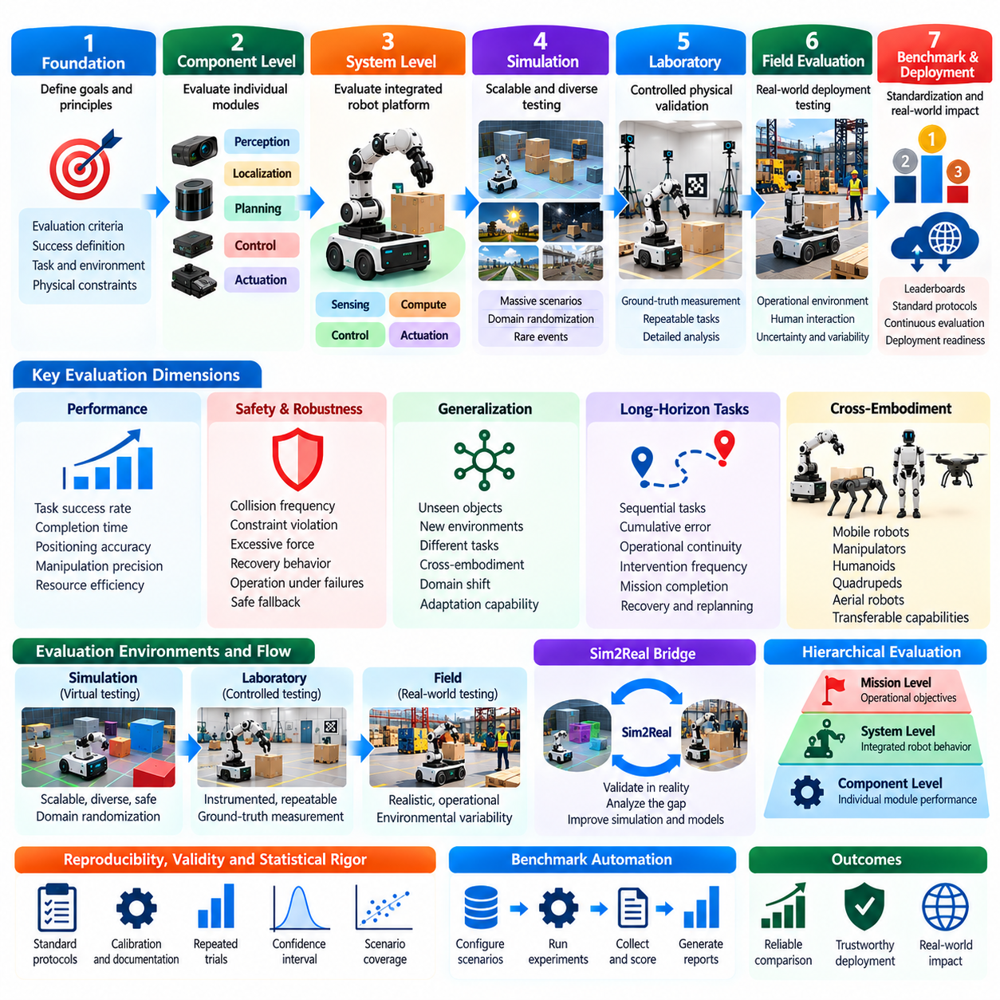

**Volume 11. Physical AI Evaluation and Benchmarking**

# Chapter 00. Introduction

## 00.01. Why Physical AI Evaluation is Different

{width="7.268055555555556in" height="7.268055555555556in"}

피지컬 인공지능(Physical AI)의 평가는 지능적 의사결정(Intelligent Decision-Making)이 물리적 세계(Physical World)에서 신뢰할 수 있는 결과를 만들어야 한다는 점에서 기존 디지털 인공지능(Digital AI)의 평가와 근본적으로 다르다. 디지털 모델(Digital Model)은 예측 정확도(Prediction Accuracy)나 응답 품질(Response Quality)을 통해 평가할 수 있지만, 물리적 시스템(Physical System)은 주변 환경을 인식하고 의사결정을 수행하며 행동을 실행하고 환경 변화에 대응해야 한다. 따라서 성능은 지능, 하드웨어(Hardware), 물리적 현실(Physical Reality) 사이의 상호작용에 의해 결정된다.

전통적인 기계학습 벤치마크(Machine Learning Benchmark)는 일반적으로 평가 입력(Evaluation Input)이 고정되어 있으며 모델 출력(Model Output)을 사전에 정의된 참조값(Reference Value)과 비교할 수 있다고 가정한다. 반면 피지컬 인공지능은 행동이 후속 관측(Observation)을 변화시키고 미래 의사결정에 영향을 미치는 환경에서 작동한다. 예를 들어 창고를 이동하는 로봇은 자신의 위치를 변경하고 새로운 장애물을 만나며 추가적인 제어 요구사항(Control Requirements)에 직면한다. 따라서 평가는 독립적인 예측보다 동적 행동(Dynamic Behavior)을 포착해야 한다.

물리적 환경(Physical Environment)은 정적 데이터셋(Static Dataset)으로 완전히 표현할 수 없는 불확실성(Uncertainty)을 발생시킨다. 조명 조건(Lighting Conditions), 표면 마찰(Surface Friction), 물체 형상(Object Geometry), 센서 잡음(Sensor Noise), 사람의 움직임(Human Movement), 기계적 외란(Mechanical Disturbance)은 시스템 성능에 영향을 미칠 수 있다. 두 로봇이 동일한 명령을 실행하더라도 하드웨어와 환경 조건의 차이로 인해 이동 궤적(Trajectory)이 달라질 수 있다. 따라서 피지컬 인공지능 평가는 통제된 조건과 가변적인 조건에서 반복 실험(Repeated Experiments)을 수행해야 한다.

또 다른 중요한 차이점은 모델 수준 성능(Model-Level Performance)과 시스템 수준 효과성(System-Level Effectiveness)의 관계에 있다. 인식 모델(Perception Model)이 뛰어난 객체 검출 정확도(Object Detection Accuracy)를 달성하더라도 이를 사용하는 로봇은 조작 작업(Manipulation Task)을 완료하지 못할 수 있다. 검출 오류(Detection Error), 처리 지연(Processing Latency), 부정확한 보정(Calibration), 액추에이터(Actuator)의 한계가 실행 파이프라인(Execution Pipeline) 전체에서 상호작용하기 때문이다. 개별 구성요소(Component)의 평가는 필요하지만 통합 물리 시스템의 행동 측정을 대체할 수는 없다.

피지컬 인공지능 평가는 인식(Perception), 추론(Reasoning), 계획(Planning), 제어(Control) 사이의 폐루프 상호작용(Closed-Loop Interaction)을 고려해야 한다. 개루프 평가(Open-Loop Evaluation)에서는 행동의 결과가 후속 의사결정에 영향을 미치지 않는 상태에서 예측이나 행동을 검사한다. 반면 폐루프 평가(Closed-Loop Evaluation)는 변화하는 환경에 시스템이 어떻게 대응하는지를 측정한다. 작은 오류가 누적되거나 수정 행동(Corrective Action)을 유발하고 오프라인 평가(Offline Evaluation)에서는 드러나지 않는 실패를 발생시킬 수 있기 때문에 이러한 구분은 필수적이다.

시간적 행동(Temporal Behavior)은 물리적 지능(Physical Intelligence)을 정의하는 또 다른 핵심 특성이다. 많은 실제 작업은 단일 행동의 성공적인 실행보다 장시간에 걸친 연속적인 운영(Continuous Operation)을 요구한다. 이동형 매니퓰레이터(Mobile Manipulator)는 작업대로 이동하고 물체를 식별하며 파지(Grasping), 운반(Transportation), 정확한 배치(Placement)를 수행해야 할 수 있다. 따라서 평가는 중간 진행 상태(Intermediate Progress), 누적 불확실성(Accumulated Uncertainty), 복구 행동(Recovery Behavior), 개입 없이 전체 작업을 완료할 확률을 고려해야 한다.

안전성(Safety)은 기존 소프트웨어 벤치마크(Software Benchmark)보다 훨씬 중요한 추가 평가 요구사항을 발생시킨다. 피지컬 인공지능 시스템은 물리적 힘(Physical Force)을 가하거나 물체와 충돌하고 장비를 손상시키며 주변 사람을 위험에 노출시킬 수 있다. 따라서 의도한 목표를 달성했다는 이유만으로 작업이 성공했다고 판단할 수 없다. 시스템은 운영 제약조건(Operational Constraints)을 준수하고 적절한 이격 거리(Separation Distance)를 유지하며 위험한 힘을 제한하고 예상하지 못한 상황에서 안전한 행동(Safe Behavior)으로 전환해야 한다.

강건성(Robustness)은 정상 조건에서의 작업 성능(Nominal Task Performance)과 구분해야 한다. 이상적인 실험실 환경(Laboratory Environment)에서 반복적으로 성공하는 로봇도 센서가 부분적으로 가려지거나 통신이 중단되고 환경 조건이 변화하면 실패할 수 있다. 따라서 강건성 평가는 외란(Disturbance)과 구성요소 고장(Component Failure) 상황에서 발생하는 성능 저하(Performance Degradation)를 조사한다. 또한 시스템이 불확실성을 인식하고 행동을 조정하며 오류에서 복구하거나 작업을 안전하게 중단할 수 있는지를 평가한다.

일반화(Generalization)는 물리적 환경에 매우 다양한 변동성이 존재하기 때문에 특히 어려운 과제이다. 물체는 형상, 무게, 재질, 외관이 서로 다르며 작업 공간(Workspace)은 기하학적 구조, 조명, 접근성에서 차이를 보인다. 익숙한 환경 구성에서 학습한 로봇은 이전에 경험하지 못한 조합을 만나면 성능이 크게 저하될 수 있다. 따라서 의미 있는 평가는 학습된 능력(Learned Capability)이 훈련 조건(Training Conditions)을 넘어 전이되는지를 확인해야 하며 기존에 경험한 시나리오의 성공률만 측정해서는 안 된다.

물리적 에이전트(Physical Agent)의 신체적 구현 형태(Embodiment) 역시 성공적인 성능의 기준에 영향을 미친다. 바퀴형 이동 로봇(Wheeled Mobile Robot), 로봇 매니퓰레이터(Robotic Manipulator), 사족보행 로봇(Quadruped Robot), 휴머노이드(Humanoid), 비행 로봇(Aerial Robot)은 서로 다른 센싱 능력(Sensing Capability), 운동학적 제약조건(Kinematic Constraints), 구동 메커니즘(Actuation Mechanism)을 가진다. 따라서 평가 프레임워크(Evaluation Framework)는 일반적인 지능 능력과 특정 로봇의 신체적 구현 형태에 의존하는 성능 특성을 구분해야 한다.

교차 신체 평가(Cross-Embodiment Evaluation)는 파운데이션 모델(Foundation Model)과 범용 정책(Generalist Policy)이 다양한 로봇 플랫폼(Robot Platform)에 적용되면서 점점 중요해지고 있다. 공유 정책(Shared Policy)은 자유도(Degrees of Freedom), 운동 범위(Motion Range), 제어 인터페이스(Control Interface)가 서로 다른 로봇을 위한 행동을 생성할 수 있다. 원시 궤적(Raw Trajectory)이나 액추에이터 명령(Actuator Command)을 직접 비교하면 잘못된 결론을 얻을 수 있다. 따라서 작업 결과(Task Outcome), 능력 정규화 성능(Capability-Normalized Performance), 적응 요구사항(Adaptation Requirements), 학습 지식의 보존 여부를 고려해야 한다.

시뮬레이션(Simulation)은 실험을 반복하고 자동화하며 실제 장비를 불필요한 위험에 노출시키지 않고 평가할 수 있기 때문에 피지컬 인공지능 평가에 유용한 환경을 제공한다. 시뮬레이션 벤치마크(Simulation Benchmark)는 통제된 외란, 대규모 시나리오 생성(Large-Scale Scenario Generation), 희귀 사건 시험(Rare-Event Testing)을 지원한다. 그러나 시뮬레이션 결과는 물리 동역학(Physical Dynamics), 센싱(Sensing), 접촉 상호작용(Contact Interaction), 환경 표현(Environment Representation)의 충실도(Fidelity)에 의존한다. 따라서 높은 시뮬레이션 성능이 실제 환경의 신뢰성을 자동으로 보장하지는 않는다.

실세계 시험(Real-World Testing)은 시뮬레이션이 불완전하게 표현할 수 있는 현상들이 실제 물리 시스템에서 발생하기 때문에 필수적이다. 기계적 백래시(Mechanical Backlash), 액추에이터 발열(Actuator Heating), 재료 변형(Material Deformation), 센서 간섭(Sensor Interference), 예상하지 못한 사람의 행동은 운영 결과를 변화시킬 수 있다. 실험실 시험(Laboratory Testing)은 통제된 측정을 제공하며 현장 시험(Field Testing)은 실제 배치 환경(Deployment Environment)의 문제를 드러낸다. 이들을 결합하면 실제 능력을 더욱 신뢰성 있게 이해할 수 있다.

성능 측정(Performance Measurement)은 이진 작업 성공(Binary Task Success)을 넘어 확장되어야 한다. 두 로봇이 동일한 임무(Mission)를 완료하더라도 실행 시간(Execution Time), 에너지 소비(Energy Consumption), 궤적 평활도(Trajectory Smoothness), 계산 요구량(Computational Requirements), 물리적 상호작용 품질(Physical Interaction Quality)에서 상당한 차이를 보일 수 있다. 따라서 포괄적인 평가 프레임워크는 효율성(Efficiency), 정밀도(Precision), 신뢰성(Reliability), 자원 활용도(Resource Utilization), 실행 품질(Execution Quality)을 함께 고려해야 한다.

불확실성(Uncertainty)과 통계적 변동성(Statistical Variability)은 평가 결과의 해석을 복잡하게 만든다. 어떤 로봇은 우연히 유리한 환경 조건에서 여러 번 성공할 수 있지만 다른 시스템은 다양한 시나리오에서 더욱 일관된 행동을 보일 수 있다. 신뢰할 수 있는 비교를 위해서는 충분한 반복 시험(Repeated Trials), 명확하게 정의된 실험 조건(Experimental Conditions), 적절한 통계 분석(Statistical Analysis)이 필요하다. 신뢰구간(Confidence Interval)과 실패 분포(Failure Distribution)는 실제 능력 향상과 무작위 변동을 구분하는 데 도움이 된다.

재현성(Reproducibility)은 물리적 실험이 하드웨어 구성(Hardware Configuration), 보정 절차(Calibration Procedure), 환경 조건(Environmental Conditions), 운영 프로토콜(Operational Protocol)에 의존하기 때문에 특히 확보하기 어렵다. 센서 배치(Sensor Placement), 펌웨어 버전(Firmware Version), 액추에이터 특성(Actuator Characteristics), 시험 표면(Test Surface)의 차이가 측정 성능에 영향을 미칠 수 있다. 따라서 벤치마크 명세(Benchmark Specification)는 의미 있는 반복 검증을 지원할 수 있도록 이러한 요소를 충분히 문서화해야 한다.

평가는 모든 실패한 시험을 동일하게 취급하기보다 실패의 결과(Failure Consequence)도 고려해야 한다. 목적지에 도달하기 전에 안전하게 정지한 로봇과 장애물에 충돌하거나 제어력을 상실한 로봇은 본질적으로 다르다. 실패 분석(Failure Analysis)은 실패를 유발한 초기 조건(Initiating Conditions), 영향을 받은 하위 시스템(Subsystem), 결과의 심각도(Severity), 복구 메커니즘(Recovery Mechanism)의 효과를 식별해야 한다. 이러한 구분은 벤치마크 결과를 공학적 개선(Engineering Improvement)과 운영 위험 관리(Operational Risk Management)에 연결하는 데 도움이 된다.

인간 상호작용(Human Interaction)은 순수한 기계적 측정만으로 포착할 수 없는 또 다른 평가 차원을 도입한다. 피지컬 인공지능 시스템은 행동을 예측하기 어려운 작업자(Operator), 보행자(Pedestrian), 환자(Patient), 기타 사용자와 환경을 공유하는 경우가 많다. 성공적인 운영을 위해서는 사람의 존재, 지시, 개입에 적절하게 대응해야 한다. 따라서 평가는 상호작용 품질(Interaction Quality), 작업자 부담(Operator Workload), 개입 빈도(Intervention Frequency), 안전하고 이해 가능한 행동을 유지하는 시스템 능력을 고려해야 한다.

운영 설계 영역(Operational Design Domain, ODD)은 피지컬 인공지능 시스템이 작동하도록 의도된 조건을 정의한다. 이러한 조건에는 지형 특성(Terrain Characteristics), 환경 노출(Environmental Exposure), 물체 범주(Object Categories), 운영 속도(Operating Speed), 사람과의 근접성(Human Proximity), 통신 가용성(Communication Availability)이 포함될 수 있다. 성능에 관한 주장은 명확하게 정의된 운영 영역 안에서 해석할 때 의미가 있다. 따라서 평가는 시스템이 안정적으로 작동하는 조건과 능력이 저하되는 경계를 함께 식별해야 한다.

장기 자율성(Long-Term Autonomy)은 짧은 실험만으로 충분히 평가할 수 없는 신뢰성 문제를 발생시킨다. 시스템이 개별 작업을 성공적으로 완료하더라도 연속 운영 과정에서 빈번한 중단이 발생할 수 있다. 따라서 평가는 누적 오류(Cumulative Error), 메모리 일관성(Memory Consistency), 계획 안정성(Planning Stability), 유지보수 요구사항(Maintenance Requirements), 예상하지 못한 사건으로부터의 복구 능력을 조사해야 한다. 자율 운영 시간(Autonomy Duration), 개입 빈도(Intervention Frequency), 임무 완료 신뢰성(Mission Completion Reliability)은 장시간 지능적 행동의 지속 가능성을 보여준다.

피지컬 인공지능 벤치마킹(Physical AI Benchmarking)은 궁극적으로 과학적 비교 가능성(Scientific Comparability)과 실용적 관련성(Practical Relevance) 사이의 균형을 유지해야 한다. 고도로 표준화된 실험(Standardized Experiment)은 반복 가능한 비교를 가능하게 하지만 지나치게 단순화된 작업은 실제 배치 환경의 어려움을 충분히 반영하지 못할 수 있다. 반대로 현실적인 현장 실험(Field Experiment)은 운영에 관한 통찰을 제공하지만 직접적인 비교를 어렵게 하는 변동성을 도입한다. 효과적인 평가 프레임워크는 통제된 벤치마크와 대표적인 시나리오를 결합해야 한다.

피지컬 인공지능이 범용 자율 시스템(General-Purpose Autonomous System)으로 발전함에 따라 평가는 독립적인 알고리즘 지표(Algorithmic Metrics)에서 체화된 역량(Embodied Competence)에 대한 다차원 평가(Multidimensional Assessment)로 진화해야 한다. 핵심 질문은 모델이 정확한 예측을 생성하는지에만 있는 것이 아니라 통합 에이전트(Integrated Agent)가 물리적 불확실성 속에서 의도한 목표를 안전하고 효율적이며 일관되게 달성할 수 있는지에 있다. 이러한 관점은 의미 있는 벤치마킹, 능력 비교(Capability Comparison), 신뢰할 수 있는 실제 배치(Trustworthy Deployment)를 위한 기반을 확립한다.

## 00.02. From Model Metrics to System Level Performance

{width="7.268055555555556in" height="7.268055555555556in"}

피지컬 인공지능(Physical AI)의 평가는 개별 모델의 정확도(Model Accuracy)를 측정하는 방식에서 완전한 자율 시스템(Autonomous System)의 성능을 평가하는 방식으로 근본적인 전환이 필요하다. 기존 기계학습 벤치마크(Machine Learning Benchmark)는 예측 정확도(Prediction Accuracy), 분류 점수(Classification Score), 손실 함수(Loss Function)를 강조한다. 이러한 지표는 여전히 중요하지만 지능형 기계가 물리적 환경(Physical Environment)에서 어떻게 작동하는지를 완전히 설명하지는 못한다. 따라서 시스템 수준 평가(System-Level Evaluation)는 인식, 추론, 계획, 제어, 구동이 결합하여 신뢰할 수 있는 물리적 결과를 달성하는지를 검토해야 한다.

모델 수준 지표(Model-Level Metrics)는 개별 알고리즘의 능력(Algorithmic Capability)에 관한 필수적인 정보를 제공한다. 객체 검출 모델(Object Detection Model)은 정밀도(Precision), 재현율(Recall), 평균 정밀도(mAP, Mean Average Precision)로 평가할 수 있으며, 위치 추정 알고리즘(Localization Algorithm)은 궤적 오차(Trajectory Error)나 자세 추정 정확도(Pose Estimation Accuracy)를 사용할 수 있다. 계획 모델(Planning Model)은 예측 경로 품질(Predicted Path Quality)로, 제어 정책(Control Policy)은 추종 오차(Tracking Error)로 평가할 수 있다. 그러나 이러한 측정은 자율 물리 시스템 전체의 효과성보다 특정 구성요소의 성능을 설명한다.

구성요소 기반 평가(Component-Based Evaluation)의 핵심적인 한계는 개별 구성요소의 우수한 성능이 반드시 성공적인 작업 실행(Task Execution)으로 이어지지 않는다는 점이다. 로봇이 매우 정확한 시각 인식(Visual Perception) 능력을 갖추고 있더라도 보정 오류(Calibration Error), 지연된 제어 명령(Delayed Control Command), 부족한 액추에이터 정밀도(Actuator Precision)로 인해 물체 파지(Grasping)에 실패할 수 있다. 마찬가지로 내비게이션 알고리즘(Navigation Algorithm)이 최적 경로(Optimal Path)를 생성하더라도 실제 로봇 플랫폼이 이를 안정적으로 추종하지 못할 수 있다. 시스템 성능은 구성요소 사이의 상호작용에서 나타난다.

피지컬 인공지능 시스템은 일반적으로 인식(Perception), 상태 추정(State Estimation), 의사결정(Decision-Making), 계획(Planning), 제어(Control)가 상호 연결된 과정을 통해 작동한다. 센서 측정값(Sensor Measurement)은 환경 표현(Environmental Representation)으로 변환되고, 이를 바탕으로 의사결정이 이루어지며 액추에이터 명령(Actuator Command)이 생성된다. 각 단계에서는 불확실성(Uncertainty), 계산 지연(Computational Delay), 잠재적인 오류가 발생한다. 따라서 전체 파이프라인(Pipeline)의 평가는 국소적인 부정확성이 어떻게 전파되어 최종 물리적 결과에 영향을 미치는지를 이해해야 한다.

시스템 수준 평가(System-Level Evaluation)로의 전환은 측정의 기본 단위(Fundamental Unit of Measurement)를 변화시킨다. 개별 예측을 검사하는 대신 완전한 행동(Action), 작업(Task), 임무(Mission)를 중심으로 평가하게 된다. 예를 들어 창고 로봇(Warehouse Robot)은 장애물을 검출하거나 자신의 위치를 추정하는 능력만으로 평가해서는 안 된다. 실제 성능은 안전성(Safety), 효율성(Efficiency), 운영 신뢰성(Operational Reliability)을 유지하면서 물품을 올바른 목적지까지 운송할 수 있는지에 따라 결정된다.

작업 성공률(Task Success Rate)은 의도한 목표의 달성 여부를 측정하기 때문에 시스템 수준 평가의 유용한 출발점이다. 그러나 이진 성공 여부(Binary Success)만으로는 실행 품질(Execution Quality)에 관한 충분한 정보를 얻기 어렵다. 두 로봇이 동일한 작업을 완료하더라도 완료 시간(Completion Time), 위치 정확도(Positioning Accuracy), 에너지 소비(Energy Consumption), 복구 행동(Recovery Behavior)에서 상당한 차이를 보일 수 있다. 따라서 의미 있는 평가 프레임워크(Evaluation Framework)는 결과 기반 지표(Outcome-Based Metrics)와 실행 과정에 대한 측정을 결합해야 한다.

실행 품질(Execution Quality)은 로봇이 물체 및 환경과 물리적으로 상호작용할 때 특히 중요해진다. 매니퓰레이터(Manipulator)는 물체를 목표 위치에 성공적으로 배치하더라도 과도한 힘(Excessive Force)을 가하거나 불안정한 움직임(Unstable Motion)을 발생시키고 주변 재료를 손상시킬 수 있다. 이러한 행동은 단순화된 성공 기준(Success Criterion)을 충족하더라도 운영 요구사항(Operational Requirements)을 만족하지 못할 수 있다. 따라서 시스템 수준 평가는 힘 제한(Force Limits), 궤적 평활도(Trajectory Smoothness), 접촉 안정성(Contact Stability), 정밀도(Precision), 작업 제약조건 준수 여부를 포함해야 한다.

지연시간(Latency)은 알고리즘 성능과 물리적 행동을 연결하는 또 다른 핵심 요소이다. 인식 모델(Perception Model)이 정확한 예측을 생성하더라도 처리 시간이 지나치게 길다면 빠르게 움직이는 시스템에 적합하지 않을 수 있다. 지연된 관측(Delayed Observation)은 제어기(Controller)가 이미 오래된 환경 상태(Environmental State)에 반응하도록 만들 수 있다. 따라서 평가는 개별 계산 벤치마크(Computational Benchmark)뿐만 아니라 센싱 지연(Sensing Latency), 추론 시간(Inference Time), 통신 지연(Communication Delay), 제어 주파수(Control Frequency), 종단 간 응답시간(End-to-End Response Time)을 고려해야 한다.

하드웨어 특성(Hardware Characteristics)은 모델 지표와 시스템 성능 사이의 관계를 더욱 복잡하게 만든다. 액추에이터 대역폭(Actuator Bandwidth), 센서 해상도(Sensor Resolution), 기계적 순응성(Mechanical Compliance), 적재 용량(Payload Capacity), 온보드 컴퓨팅 자원(Onboard Computing Resources)은 어떤 행동을 안정적으로 실행할 수 있는지를 결정한다. 한 로봇에서 우수한 성능을 보이는 정책(Policy)도 다른 플랫폼에 배치하면 성능이 저하될 수 있다. 따라서 평가는 하드웨어 구성을 문서화하고 알고리즘의 한계와 물리적 구현의 제약을 구분해야 한다.

폐루프 평가(Closed-Loop Evaluation)는 행동의 결과가 후속 관측과 의사결정에 영향을 미치기 때문에 필수적이다. 작은 인식 오류(Perception Error)는 부정확한 움직임을 유발할 수 있으며, 이는 로봇의 위치를 변화시키고 새로운 센싱 조건(Sensing Conditions)을 만들어 낸다. 능력 있는 시스템은 피드백(Feedback), 재계획(Replanning), 수정 제어(Corrective Control)를 통해 이러한 문제를 보상할 수 있다. 오프라인 모델 평가(Offline Model Evaluation)는 에이전트(Agent)와 환경 사이의 연속적인 상호작용을 재현하지 못하기 때문에 이러한 동적 특성을 완전히 드러낼 수 없다.

시스템 수준 성능은 서로 다른 시간 척도(Timescale)에서 작동하는 여러 과정의 조정에도 의존한다. 저수준 모터 제어기(Low-Level Motor Controller)는 높은 주파수로 작동할 수 있지만 인식 모델, 운동 계획기(Motion Planner), 작업 수준 추론 모듈(Task-Level Reasoning Module)은 상대적으로 느리게 갱신된다. 이러한 과정은 불안정하거나 일관성이 없는 행동을 발생시키지 않으면서 정보를 교환해야 한다. 따라서 평가는 시간 동기화(Timing Synchronization), 명령 실행(Command Execution), 상태 일관성(State Consistency), 조정된 운영을 유지하는 시스템 능력을 검토해야 한다.

평가 범위가 개별 작업에서 장시간 임무(Extended Mission)로 확장되면 신뢰성(Reliability)의 중요성이 더욱 커진다. 로봇이 짧은 행동에서는 높은 성공률을 보이더라도 내비게이션(Navigation), 조작(Manipulation), 환경 상호작용(Environmental Interaction)이 필요한 연속 작업에서는 자주 실패할 수 있다. 오류는 여러 단계에 걸쳐 누적될 수 있으며 실패는 서로 의존하는 작업으로 전파될 수 있다. 따라서 시스템 수준 벤치마크(System-Level Benchmark)는 임무 완료 확률(Mission Completion Probability), 중단 빈도(Interruption Frequency), 복구 효과성(Recovery Effectiveness), 지속적인 자율 운영(Sustained Autonomous Operation)을 측정해야 한다.

안전성(Safety)은 별도의 사후 고려사항이 아니라 성능 평가(Performance Assessment)에 통합되어야 한다. 작업을 빠르게 완료하더라도 충돌 제약조건(Collision Constraints)을 반복적으로 위반하는 시스템은 운영상 우수하다고 판단할 수 없다. 안전 관련 지표(Safety-Related Metrics)에는 최소 이격 거리(Minimum Separation Distance), 충돌 빈도(Collision Frequency), 과도한 접촉력(Excessive Contact Force), 비상 정지 행동(Emergency Stop Behavior), 위험 조건에 대한 대응(Response to Hazardous Conditions)이 포함될 수 있다. 이러한 측정은 성능 향상이 허용할 수 없는 물리적 위험을 감추지 않도록 한다.

강건성 평가(Robustness Evaluation)는 이상적인 운영 조건을 넘어 시스템 수준 평가를 확장한다. 실제 환경에서는 조명(Lighting), 마찰(Friction), 물체 배치(Object Placement), 센서 품질(Sensor Quality), 통신 신뢰성(Communication Reliability)에 다양한 변화가 발생한다. 완전한 시스템은 외란(Disturbance)과 부분적인 고장(Partial Failure)에도 허용 가능한 행동을 유지해야 한다. 통제된 교란(Controlled Perturbation) 상황에서 성능 저하(Performance Degradation)를 측정하면 지능형 구성요소의 통합이 취약한 작업 특화 성공이 아니라 회복력 있는 행동(Resilient Behavior)을 만들어 내는지 판단할 수 있다.

일반화(Generalization) 역시 시스템 수준에서 평가해야 한다. 익숙하지 않은 데이터에 대해 정확한 예측을 생성하더라도 성공적인 물리적 상호작용이 보장되는 것은 아니기 때문이다. 로봇은 처음 보는 물체(Unseen Object)를 인식할 수 있지만 그 물체의 형상이나 무게를 다루는 데 필요한 조작 전략(Manipulation Strategy)이 부족할 수 있다. 마찬가지로 내비게이션 시스템이 익숙하지 않은 지형(Unfamiliar Terrain)을 식별하더라도 안전하게 통과하지 못할 수 있다. 따라서 시스템 수준 일반화(System-Level Generalization)는 작업과 환경 전반에서 완전한 운영 능력이 전이되는지를 측정한다.

효율성(Efficiency)은 모델 중심 벤치마크(Model-Centered Benchmark)에서는 드러나지 않는 추가적인 상충관계(Tradeoff)를 발생시킨다. 모델 복잡도(Model Complexity)를 높이면 예측 정확도가 향상될 수 있지만 계산 능력(Computing Power), 메모리(Memory), 에너지(Energy)를 더 많이 소비하게 된다. 배터리 기반 로봇(Battery-Powered Robot)에서는 이러한 비용이 운영 시간(Operating Duration)과 임무 생산성(Mission Productivity)을 감소시킬 수 있다. 따라서 평가는 계산 효율성(Computational Efficiency), 작업당 에너지 소비(Energy per Completed Task), 처리량(Throughput), 지능 품질(Intelligence Quality)과 가용 물리 자원 사이의 관계를 고려해야 한다.

인간 개입(Human Intervention)은 실제 자율성(Practical Autonomy)을 나타내는 또 다른 중요한 지표이다. 시스템이 높은 작업 완료율(Task Completion Rate)을 보고하더라도 실패를 해결하거나 어려운 행동을 안내하기 위해 원격 작업자(Remote Operator)에 크게 의존할 수 있다. 이러한 지원은 자율 의사결정(Autonomous Decision-Making)의 한계를 감출 수 있다. 따라서 시스템 수준 평가는 개입 빈도(Intervention Frequency), 지원 시간(Assistance Duration), 작업자 부담(Operator Workload), 인간의 개입이 필요한 조건을 명시적으로 기록하여 자율 능력과 지원을 받은 성능을 구분해야 한다.

시뮬레이션(Simulation)과 실세계 시험(Real-World Testing)은 모델 지표를 운영 결과와 연결하는 상호 보완적인 방법을 제공한다. 시뮬레이션은 통제된 비교(Controlled Comparison), 반복 시험(Repeated Trials), 내부 시스템 행동(Internal System Behavior)에 대한 상세한 검토를 가능하게 한다. 물리적 실험(Physical Experiment)은 불완전한 동역학(Imperfect Dynamics), 하드웨어 변동(Hardware Variation), 환경 불확실성(Environmental Uncertainty)으로 발생하는 한계를 드러낸다. 두 환경의 결과를 비교하면 성능 차이가 학습 모델(Learned Model), 시스템 통합(System Integration), 시뮬레이션과 현실 사이의 차이(Simulation-to-Reality Discrepancy) 중 어디에서 발생하는지 식별하는 데 도움이 된다.

통계적 엄밀성(Statistical Rigor)은 시스템 수준 결과가 여러 상호작용 변수(Interacting Variables)의 영향을 받기 때문에 필요하다. 성능은 환경 조건(Environmental Conditions), 하드웨어 보정(Hardware Calibration), 작업 난이도(Task Difficulty), 무작위 외란(Random Disturbance)에 따라 달라질 수 있다. 신뢰할 수 있는 평가를 위해서는 반복 시험, 명확하게 정의된 성공 기준(Success Criteria), 대표적인 시나리오(Representative Scenarios), 적절한 불확실성 보고(Uncertainty Reporting)가 필요하다. 신뢰구간(Confidence Interval)과 성능 분포(Performance Distribution)는 개별 시연이나 선택적으로 보고된 성공 사례보다 강력한 근거를 제공한다.

다차원 평가 점수표(Multidimensional Evaluation Scorecard)는 시스템 수준 측정값을 체계적으로 구성하는 실용적인 방법을 제공한다. 이러한 점수표는 작업 성공(Task Success), 실행 품질(Execution Quality), 안전성(Safety), 강건성(Robustness), 일반화(Generalization), 지연시간(Latency), 에너지 효율성(Energy Efficiency), 자율성(Autonomy)을 결합할 수 있다. 단일 종합 점수(Aggregate Score)는 중요한 약점을 감출 수 있으므로 각 평가 차원은 해석 가능성을 유지해야 한다. 가중치(Weighting)와 집계 방법(Aggregation Method)은 특정 차원의 높은 성능이 다른 차원의 허용할 수 없는 실패를 가리지 않도록 설계되어야 한다.

모델 지표(Model Metrics)에서 시스템 수준 성능(System-Level Performance)으로의 발전은 궁극적으로 피지컬 인공지능 자체의 목적을 반영한다. 지능형 기계(Intelligent Machine)는 단순히 정확한 예측을 생성하기 위해서가 아니라 불확실한 물리적 환경에서 유용한 행동(Useful Action)을 수행하기 위해 개발된다. 따라서 효과적인 평가는 알고리즘 역량(Algorithmic Competence)을 체화된 실행(Embodied Execution), 운영 제약조건(Operational Constraints), 임무 결과(Mission Outcomes)와 연결해야 한다. 이러한 통합적 관점(Integrated Perspective)은 자율 시스템을 비교하고 실제 배치 준비도(Deployment Readiness)를 판단하기 위한 기반을 제공한다.

## 00.03. Open Loop vs Closed Loop Evaluation

{width="7.268055555555556in" height="7.268055555555556in"}

개루프 평가(Open-Loop Evaluation)와 폐루프 평가(Closed-Loop Evaluation)는 피지컬 인공지능(Physical AI)의 성능을 측정하는 근본적으로 서로 다른 두 가지 접근방식이다. 개루프 평가는 모델의 예측이나 제안된 행동이 후속 관측에 영향을 미치지 않는 상태에서 이를 검사한다. 반면 폐루프 평가는 지능형 시스템(Intelligent System)이 환경과 지속적으로 상호작용하는 방식을 측정한다. 예측 정확도(Predictive Accuracy)가 반드시 신뢰할 수 있는 자율 행동(Autonomous Behavior)으로 이어지는 것은 아니기 때문에 이러한 차이를 이해하는 것이 필수적이다.

개루프 평가에서는 모델이 사전에 정의된 관측값(Predefined Observations)을 입력받아 출력을 생성하고, 이를 참조값(Reference Values)이나 기록된 전문가 행동(Expert Actions)과 비교한다. 평가 과정에서는 이러한 출력을 실제 환경에서 실행하지 않는다. 예를 들어 로봇 조작 정책(Robot Manipulation Policy)은 기록된 카메라 영상으로부터 관절 움직임(Joint Movements)을 예측하고, 시연 궤적(Demonstrated Trajectories)과 비교하여 정확도를 측정할 수 있다. 이러한 접근방식은 모델의 행동을 독립적으로 분석하고 효율적인 실험을 지원한다.

개루프 시험(Open-Loop Testing)은 동일한 입력 조건에서 반복 가능한 비교를 수행할 수 있기 때문에 초기 알고리즘 개발(Early Algorithm Development) 단계에서 특히 유용하다. 연구자는 고정 데이터셋(Fixed Dataset)을 사용하여 서로 다른 아키텍처(Architecture), 학습 전략(Training Strategy), 모델 구성(Model Configuration)을 평가할 수 있다. 모델의 예측이 미래 관측을 변화시키지 않으므로 실험 비용이 상대적으로 낮고 재현성(Reproducibility)이 높다. 그러나 이러한 편의성은 물리적 피드백(Physical Feedback)과 상호작용 동역학(Interaction Dynamics)을 평가에서 제외한다는 한계를 가진다.

폐루프 평가(Closed-Loop Evaluation)는 자율 에이전트(Autonomous Agent)와 환경 사이의 지속적인 상호작용(Continuous Interaction)을 도입한다. 시스템은 주변 환경을 관측하고 행동을 선택하며 해당 행동을 실행한 후 그 결과가 반영된 새로운 관측값을 수신한다. 이러한 피드백 순환(Feedback Cycle)은 작업이 완료되거나 중단 또는 종료될 때까지 계속된다. 따라서 성능은 개별 의사결정뿐만 아니라 시간에 따라 변화하는 조건에 시스템이 얼마나 효과적으로 대응하는지에 의해 결정된다.

이러한 차이는 오류가 미래 상태(Future State)에 영향을 미칠 때 특히 중요해진다. 개루프 시험에서는 잘못된 예측이 후속 샘플에 영향을 주지 않고 평가 점수(Evaluation Score)에만 반영될 수 있다. 반면 폐루프 운영(Closed-Loop Operation)에서는 동일한 오류가 로봇의 위치를 변화시키거나 물체의 배치(Object Configuration)를 수정하고 예상하지 못한 환경 조건을 만들어 낼 수 있다. 이러한 변화는 추가적인 오류를 발생시켜 의도한 행동으로부터의 편차가 누적되는 결과를 초래할 수 있다.

내비게이션(Navigation) 사례는 이러한 차이가 실제로 어떤 결과를 발생시키는지 보여준다. 자율 이동 로봇(Autonomous Mobile Robot)은 기록된 궤적을 기준으로 평가할 때 정확한 조향 명령(Steering Command)을 예측할 수 있다. 그러나 실제 이동 과정에서 작은 조향 오류(Steering Error)가 발생하면 로봇은 계획된 경로(Planned Route)에서 점진적으로 벗어날 수 있다. 폐루프 평가는 위치 추정(Localization), 장애물 회피(Obstacle Avoidance), 수정 제어(Corrective Control)가 이러한 편차를 보상하여 내비게이션 실패(Navigation Failure)를 방지할 수 있는지를 확인한다.

조작 작업(Manipulation Task) 역시 개루프 평가의 유사한 한계를 보여준다. 로봇 팔(Robotic Arm)은 전문가 시연(Expert Demonstration)과 매우 유사한 관절 궤적(Joint Trajectory)을 예측하더라도 실제 물리적 실행(Physical Execution)에서는 물체 파지(Grasping)에 실패할 수 있다. 물체 위치(Object Position), 마찰(Friction), 접촉 시점(Contact Timing)의 작은 변화도 결과에 상당한 영향을 미칠 수 있다. 폐루프 시험은 로봇이 접촉 변화를 감지하고 파지력(Grip Force)을 조정하며 실패한 조작 시도에서 복구할 수 있는지를 판단한다.

개루프 지표(Open-Loop Metrics)에는 일반적으로 예측 오차(Prediction Error), 행동 분류 정확도(Action Classification Accuracy), 궤적 유사도(Trajectory Similarity), 모방 손실(Imitation Loss)이 포함된다. 이러한 측정값은 고정된 관측 조건에서 모델이 예상 출력을 얼마나 정확하게 재현하는지를 정량화한다. 학습된 정책(Learned Policy)을 비교하는 데 유용하지만 작업 완료(Task Completion)나 환경적 결과(Environmental Consequences)를 직접 측정하지는 않는다. 정책은 낮은 예측 오차를 달성하더라도 지속적으로 변화하는 환경에 배치되면 불안정해질 수 있다.

폐루프 지표(Closed-Loop Metrics)는 운영 결과(Operational Outcomes)와 상호작용 행동(Interactive Behavior)을 강조한다. 작업 성공률(Task Success Rate), 완료 시간(Completion Time), 충돌 빈도(Collision Frequency), 궤적 편차(Trajectory Deviation), 개입률(Intervention Rate), 복구 성능(Recovery Performance)은 실제 자율성(Practical Autonomy)에 관한 정보를 제공한다. 추가적인 측정 항목에는 제어 안정성(Control Stability), 에너지 소비(Energy Consumption), 제약조건 위반(Constraint Violations)이 포함될 수 있다. 이러한 지표는 지능적 의사결정의 결과가 후속 관측과 행동에 영향을 미칠 때에도 효과적인지를 보여준다.

피드백 메커니즘(Feedback Mechanism)은 자율 시스템이 의도한 행동으로부터의 편차를 수정할 수 있도록 하기 때문에 폐루프 성능의 핵심 요소이다. 로봇은 추정된 상태(Estimated State)를 목표 궤적(Desired Trajectory)과 지속적으로 비교하고 그에 따라 액추에이터 명령(Actuator Command)을 조정할 수 있다. 이러한 과정의 효과성은 센싱 정확도(Sensing Accuracy), 제어기 응답성(Controller Responsiveness), 계산 지연시간(Computational Latency), 액추에이터 동역학(Actuator Dynamics)에 의존한다. 따라서 폐루프 평가는 독립적인 알고리즘 출력이 아니라 전체 피드백 경로(Feedback Pathway)를 검토해야 한다.

지연시간(Latency)은 개루프 평가와 폐루프 평가의 결과 사이에 상당한 차이를 발생시킬 수 있다. 인식 모델(Perception Model)은 기록된 영상에서 정확한 예측을 생성하더라도 실시간 운영(Real-Time Operation)에 필요한 계산 시간이 지나치게 길 수 있다. 실제 시스템에 배치되면 지연된 관측(Delayed Observation)으로 인해 의사결정이 이미 오래된 환경 상태(Environmental State)를 반영할 수 있다. 폐루프 시험은 처리 지연(Processing Delay)이 안정성(Stability), 응답성(Responsiveness), 작업 실행(Task Execution)에 미치는 영향을 측정하여 이러한 시간적 한계를 드러낸다.

환경 불확실성(Environmental Uncertainty)은 상호작용 평가(Interactive Evaluation)의 중요성을 더욱 높인다. 실제 로봇은 불균일한 지형(Uneven Terrain), 이동 장애물(Moving Obstacles), 센서 잡음(Sensor Noise), 예측하기 어려운 물체 상호작용(Object Interaction)과 같은 외란(Disturbance)을 경험한다. 개루프 데이터셋(Open-Loop Dataset)은 이러한 조건의 사례를 포함할 수 있지만 에이전트의 행동이 후속 환경 상태를 어떻게 변화시키는지는 완전히 표현하지 못한다. 폐루프 실험은 시스템이 운영 목표(Operational Objectives)를 유지하면서 행동을 적응시킬 수 있는지를 보여준다.

시뮬레이션(Simulation)은 실제 장비를 불필요한 위험에 노출시키지 않으면서 행동이 가상 환경(Simulated Environment)에 영향을 미치도록 할 수 있기 때문에 폐루프 평가에 효과적인 플랫폼을 제공한다. 연구자는 통제된 외란(Controlled Disturbances), 무작위화된 환경(Randomized Environments), 어려운 시나리오(Challenging Scenarios)에서 정책을 반복적으로 시험할 수 있다. 그러나 시뮬레이션 상호작용은 물리 엔진(Physics Engine)과 센서 모델(Sensor Model)의 정확도에 의존한다. 따라서 시뮬레이션 기반 폐루프 성공은 적절하게 설계된 실세계 실험(Real-World Experiment)을 통해 검증해야 한다.

실세계 폐루프 평가(Real-World Closed-Loop Evaluation)는 실험 통제(Experimental Control)와 재현성(Reproducibility)에 관한 문제를 발생시킨다. 초기 물체 배치(Initial Object Placement), 기계적 보정(Mechanical Calibration), 표면 조건(Surface Conditions), 센서 정렬(Sensor Alignment)의 작은 차이도 실행 결과를 변화시킬 수 있다. 따라서 성능 변동성(Performance Variability)을 파악하기 위해 반복 시험(Repeated Trials)이 필요하다. 표준화된 초기 조건(Standardized Starting Conditions), 보정된 측정 시스템(Calibrated Measurement Systems), 문서화된 환경 매개변수(Environmental Parameters)는 과학적으로 의미 있는 비교를 유지하는 데 도움이 된다.

안전성(Safety)은 평가 대상 행동이 실제 물리적 결과를 발생시키기 때문에 폐루프 실험에서 특히 중요하다. 성능이 부족한 정책(Poorly Performing Policy)은 충돌(Collision), 과도한 힘(Excessive Force), 불안정한 움직임(Unstable Movement)을 발생시킬 수 있다. 따라서 시험 환경에는 적절한 운영 한계(Operational Limits), 비상 정지 메커니즘(Emergency Stopping Mechanisms), 독립적인 안전 감독(Independent Safety Supervision)이 포함되어야 한다. 평가 프로토콜(Evaluation Protocol)은 성공적인 작업 실행과 허용할 수 없는 위험을 감수하여 목표를 달성한 행동을 구분해야 한다.

개루프 평가와 폐루프 평가는 서로 경쟁하는 대안으로 취급해서는 안 된다. 두 접근방식은 모델 역량(Model Competence)과 시스템 행동(System Behavior)에 관한 상호 보완적인 근거를 제공한다. 개루프 시험은 예측의 약점을 식별하고 신속한 모델 반복 개선(Model Iteration)을 지원하며 통제된 비교를 가능하게 한다. 폐루프 시험은 이러한 능력이 신뢰할 수 있는 물리적 행동(Reliable Physical Action)으로 전환되는지를 판단한다. 두 접근방식을 결합하면 자율 시스템 성능을 더욱 완전하게 이해할 수 있다.

실용적인 평가 워크플로(Evaluation Workflow)는 오프라인 데이터셋(Offline Dataset)에서 시작하여 상호작용 시뮬레이션(Interactive Simulation), 통제된 실험실 시험(Controlled Laboratory Testing), 현장 배치(Field Deployment)로 발전할 수 있다. 각 단계에서는 추가적인 복잡성과 물리적 현실성(Physical Realism)이 도입된다. 기본적인 예측 요구사항(Predictive Requirements)을 충족하지 못하는 모델은 비용이 많이 드는 상호작용 실험 전에 개선할 수 있으며, 유망한 모델은 점진적으로 더 까다로운 폐루프 검증(Closed-Loop Validation)을 거칠 수 있다. 이러한 단계적 과정은 운영 관련성(Operational Relevance)을 유지하면서 평가 효율성을 높인다.

개루프 성능과 폐루프 성능의 관계는 일반화(Generalization)에 관한 통찰도 제공한다. 모델은 처음 보는 기록된 관측값(Unseen Recorded Observations)에 대해서는 우수한 성능을 보이지만 자신의 행동이 생성한 익숙하지 않은 상태(Unfamiliar States)에서는 어려움을 겪을 수 있다. 이러한 실패는 학습 데이터(Training Data)와 상호작용 운영(Interactive Operation) 사이의 분포 이동(Distribution Shift)을 드러낸다. 두 환경을 모두 평가하면 정책이 전이 가능한 제어 행동(Transferable Control Behavior)을 학습했는지, 아니면 주로 시연 데이터셋(Demonstration Dataset)에 존재하는 패턴을 재현하는지를 판단하는 데 도움이 된다.

장기 자율성(Long-Horizon Autonomy)은 작은 오류가 긴 행동 시퀀스(Action Sequence)에 걸쳐 누적될 수 있기 때문에 폐루프 평가의 중요성을 더욱 높인다. 로봇은 개별 움직임을 정확하게 실행하더라도 내비게이션(Navigation), 조작(Manipulation), 반복적인 의사결정(Repeated Decision-Making)이 필요한 임무를 완료하지 못할 수 있다. 폐루프 벤치마크(Closed-Loop Benchmark)는 독립적인 예측 시험으로 충분히 표현하기 어려운 연속 행동 사이의 의존성(Action Dependencies), 상태 추정 일관성(State Estimation Consistency), 계획 갱신(Planning Updates), 복구 메커니즘(Recovery Mechanisms)을 포착한다.

두 평가 접근방식을 비교할 때에는 통계적 해석(Statistical Interpretation)이 필요하다. 개루프 지표는 일반적으로 고정 데이터셋(Fixed Dataset)을 기준으로 계산되지만 폐루프 결과는 초기 조건(Initial Conditions)과 환경적 무작위성(Environmental Randomness)에 따라 달라질 수 있다. 이러한 실험 구조(Experimental Structure)의 차이로 인해 시험 횟수(Trial Counts), 성공 분포(Success Distributions), 불확실성(Uncertainty), 시나리오 적용 범위(Scenario Coverage)를 신중하게 보고해야 한다. 오프라인 예측 점수(Offline Prediction Scores)와 상호작용 성공(Interactive Success) 사이의 직접적인 상관관계(Correlation)는 가정하기보다 실증적으로 검증해야 한다.

궁극적으로 개루프 평가(Open-Loop Evaluation)는 피지컬 인공지능 모델이 사전에 정의된 관측값에 얼마나 정확하게 반응하는지를 측정하는 반면, 폐루프 평가(Closed-Loop Evaluation)는 자율 시스템이 변화하는 물리적 환경에서 얼마나 효과적으로 행동하는지를 측정한다. 두 접근방식 모두 필수적이지만 지능(Intelligence)과 신뢰성(Reliability)에 관해 서로 다른 질문에 답한다. 포괄적인 벤치마킹 프레임워크(Comprehensive Benchmarking Framework)는 예측 역량(Predictive Competence)과 상호작용 작업 성능(Interactive Task Performance)을 연결하여 우수한 모델 지표가 의미 있는 물리적 능력(Physical Capabilities)으로 이어지는지를 확인해야 한다.

## 00.04. Component System and Mission Level Evaluation

{width="7.268055555555556in" height="7.268055555555556in"}

피지컬 인공지능(Physical AI)의 평가는 구성요소 수준(Component-Level), 시스템 수준(System-Level), 임무 수준(Mission-Level)의 성능을 구분하는 계층적 평가 프레임워크(Hierarchical Evaluation Framework)가 필요하다. 각 수준은 개별 알고리즘의 정확도부터 완전한 자율 운영(Autonomous Operation)의 신뢰성까지 지능형 물리적 행동(Intelligent Physical Behavior)에 관한 서로 다른 질문을 다룬다. 이러한 수준은 상호 연결되어 있지만 한 수준에서의 성공이 다른 수준에서의 성공을 보장하지는 않는다. 포괄적인 평가는 이들 사이의 관계를 분석하고 성능 한계가 어떻게 전파되는지 식별해야 한다.

구성요소 수준 평가(Component-Level Evaluation)는 인식(Perception), 위치 추정(Localization), 계획(Planning), 제어(Control), 센싱(Sensing), 구동(Actuation)과 같은 개별 기능 모듈(Functional Module)에 초점을 맞춘다. 각 구성요소는 기술적 목적에 적합한 지표를 사용하여 평가한다. 인식 알고리즘(Perception Algorithm)은 검출 정확도(Detection Accuracy), 위치 추정 모듈(Localization Module)은 자세 추정 오차(Pose Estimation Error), 제어기(Controller)는 궤적 추종 성능(Trajectory Tracking Performance)을 통해 측정할 수 있다. 이러한 측정은 특정 하위 시스템(Subsystem)의 능력과 한계에 관한 진단적 근거를 제공한다.

구성요소 수준 시험(Component-Level Testing)의 주요 장점은 통제된 조건(Controlled Conditions)에서 성능 특성을 독립적으로 분석할 수 있다는 점이다. 연구자는 동일한 데이터셋(Dataset), 센서 입력(Sensor Input), 참조 궤적(Reference Trajectory)을 사용하여 대안 알고리즘(Alternative Algorithm)을 비교할 수 있다. 이러한 접근방식은 재현 가능한 실험(Reproducible Experimentation), 효율적인 디버깅(Debugging), 목표 지향적 최적화(Targeted Optimization)를 지원한다. 그러나 독립적인 구성요소 성능만으로는 여러 모듈이 실시간 피드백(Real-Time Feedback)과 공통의 물리적 제약조건(Physical Constraints)을 통해 상호작용할 때의 행동을 완전히 예측할 수 없다.

시스템 수준 평가(System-Level Evaluation)는 하드웨어(Hardware), 소프트웨어(Software), 센싱(Sensing), 컴퓨팅(Computing), 제어(Control)가 통합된 운영을 검토한다. 개별 모듈을 독립적으로 시험하는 대신 이들의 결합된 행동이 지정된 작업을 달성하는지를 측정한다. 예를 들어 자율 이동 로봇(Autonomous Mobile Robot)은 위치 추정(Localization), 지도 작성(Mapping), 경로 계획(Path Planning), 장애물 회피(Obstacle Avoidance), 운동 제어(Motion Control)를 통합해야 한다. 로봇의 성공 여부는 실제 운영 조건에서 이러한 능력이 얼마나 잘 조정되는지에 따라 결정된다.

시스템 통합(System Integration)은 구성요소 시험에서 드러나지 않는 성능 한계를 발생시킨다. 통신 지연(Communication Delay), 일치하지 않는 좌표계(Coordinate Frame), 보정 오류(Calibration Error), 계산 병목현상(Computational Bottleneck), 액추에이터 포화(Actuator Saturation)는 전체적인 효과성을 감소시킬 수 있다. 정확도가 매우 높은 모듈이라도 실행 시점이나 인터페이스(Interface)가 호환되지 않으면 좋지 않은 결과를 생성할 수 있다. 따라서 시스템 수준 평가는 종단 간 지연시간(End-to-End Latency), 동기화(Synchronization), 안정성(Stability), 하위 시스템 경계(Subsystem Boundary)를 통한 오류 전파(Error Propagation)를 검토한다.

임무 수준 평가(Mission-Level Evaluation)는 개별 작업 실행을 넘어 완전한 운영 목표(Operational Objective)를 평가한다. 임무(Mission)에는 여러 위치, 순차적인 활동(Sequential Activities), 변화하는 우선순위(Changing Priorities), 사람 또는 다른 기계와의 상호작용이 포함될 수 있다. 예를 들어 창고 로봇(Warehouse Robot)은 물품을 수집하고 공용 통로를 이동하며 자재를 배송한 후 추가 작업을 위해 복귀해야 할 수 있다. 임무 성능은 지속적인 조정(Sustained Coordination), 적응성(Adaptability), 운영 연속성(Operational Continuity)에 의존한다.

시스템 수준 평가와 임무 수준 평가의 차이는 장기 자율성(Long-Horizon Autonomy)에서 특히 중요하다. 로봇은 개별 내비게이션(Navigation)이나 조작 작업(Manipulation Task)을 안정적으로 완료하더라도 이러한 행동을 장시간의 작업 흐름(Extended Workflow)으로 결합해야 할 때 어려움을 겪을 수 있다. 작업 전환(Task Transition) 과정에서 오류가 누적되고 환경 조건이 변화하며 예상하지 못한 사건으로 인해 재계획(Replanning)이 필요할 수 있다. 임무 수준 벤치마크(Mission-Level Benchmark)는 장시간 자율 운영(Prolonged Autonomous Operation)에서도 국소적인 능력이 효과적으로 유지되는지를 보여준다.

작업 성공(Task Success)은 모든 평가 수준에 공통적으로 적용할 수 있는 측정 기반을 제공하지만 그 의미는 평가 범위에 따라 달라진다. 구성요소 수준에서 성공은 정확한 예측이나 제어 출력을 생성하는 것을 의미할 수 있다. 시스템 수준에서는 정의된 제약조건(Defined Constraints) 안에서 물리적 작업을 완료하는 것을 의미한다. 임무 수준에서는 여러 활동을 조정하여 전체 운영 목표를 달성해야 한다. 따라서 평가 프로토콜(Evaluation Protocol)은 잘못된 비교를 방지하기 위해 이러한 차이를 명시적으로 정의해야 한다.

성능 지표(Performance Metrics)는 각 평가 수준의 책임을 반영하면서 수준 사이의 연관성을 유지해야 한다. 구성요소 지표(Component Metrics)에는 예측 오차(Prediction Error), 추론 지연시간(Inference Latency), 제어 추종 오차(Control Tracking Error), 액추에이터 응답(Actuator Response)이 포함될 수 있다. 시스템 지표(System Metrics)는 작업 완료(Task Completion), 실행 정밀도(Execution Precision), 충돌 빈도(Collision Frequency), 에너지 소비(Energy Consumption)를 강조한다. 임무 지표(Mission Metrics)는 임무 성공 확률(Mission Success Probability), 처리량(Throughput), 자율 운영 시간(Autonomy Duration), 개입 빈도(Intervention Frequency), 복구 효과성(Recovery Effectiveness)을 다룬다.

계층적 평가 프레임워크(Hierarchical Evaluation Framework)는 체계적인 실패 분석(Structured Failure Analysis)도 지원한다. 임무가 실패하면 조사자는 원인이 개별 구성요소에서 시작되었는지, 시스템 통합 과정에서 발생했는지, 임무 계획(Mission Planning)과 조정(Coordination)에서 비롯되었는지를 판단할 수 있다. 예를 들어 배송 실패(Delivery Failure)는 부정확한 위치 추정(Inaccurate Localization), 지연된 장애물 회피(Delayed Obstacle Avoidance), 비효율적인 작업 일정 관리(Ineffective Task Scheduling) 때문에 발생할 수 있다. 이러한 원인을 구분하면 방향성 없는 최적화 대신 목표가 명확한 공학적 개선(Targeted Engineering Improvement)이 가능해진다.

구성요소 사이의 의존성(Dependencies)은 국소 정확도(Local Accuracy)와 전체 결과(Global Outcomes) 사이에 복잡한 관계를 형성한다. 작은 위치 추정 오류(Localization Error)는 개방된 공간에서 이동할 때 거의 영향을 미치지 않을 수 있지만 좁은 통로에 접근할 때는 치명적일 수 있다. 마찬가지로 어느 정도의 인식 불확실성(Perception Uncertainty)은 물체 식별(Object Identification)에서는 허용될 수 있지만 정밀 조립(Precision Assembly)에서는 허용되지 않을 수 있다. 따라서 평가는 구성요소 오류가 작업 난이도(Task Difficulty), 환경 제약조건(Environmental Constraints), 운영 맥락(Operational Context)과 어떻게 상호작용하는지를 고려해야 한다.

폐루프 상호작용(Closed-Loop Interaction)은 계층 전반의 성능을 이해하는 데 필수적이다. 구성요소 시험(Component Test)은 사전에 정의된 입력을 사용하는 경우가 많지만 시스템 및 임무 평가는 행동과 관측 사이의 지속적인 피드백(Continuous Feedback)에 점점 더 의존한다. 로봇의 움직임은 환경을 변화시키고 새로운 센싱 조건(Sensing Conditions)과 계획 요구사항(Planning Requirements)을 만들어 낸다. 따라서 계층적 평가는 피드백 동역학(Feedback Dynamics)과 누적 오류(Accumulated Errors)를 드러내는 상호작용 실험(Interactive Experiment)을 오프라인 측정(Offline Measurement)과 결합해야 한다.

안전 요구사항(Safety Requirements) 역시 평가 범위에 따라 달라진다. 구성요소 수준의 안전 시험(Safety Testing)은 센서 고장 검출(Sensor Fault Detection), 액추에이터 제한(Actuator Limits), 제어기 안정성(Controller Stability)을 검토할 수 있다. 시스템 수준 시험은 충돌(Collision), 위험한 힘(Unsafe Force), 비상 정지(Emergency Stopping), 조정된 보호 행동(Coordinated Protective Behavior)을 고려한다. 임무 수준 평가는 지속적인 위험 노출(Sustained Risk Exposure), 운영 규칙 준수(Operational Rule Compliance), 인간 상호작용(Human Interaction), 장시간 활동 중 안전한 복구(Safe Recovery)를 검토한다. 안전성은 별도의 성능 범주가 아니라 모든 수준에서 준수해야 하는 제약조건으로 유지되어야 한다.

강건성 평가(Robustness Evaluation) 역시 독립적인 외란(Isolated Disturbance)에서 복잡한 운영 불확실성(Operational Uncertainty)으로 발전해야 한다. 개별 구성요소는 센서 잡음(Sensor Noise), 누락된 관측(Missing Observations), 계산 지연(Computational Delay)에 대해 시험할 수 있다. 통합 시스템(Integrated System)은 여러 외란의 조합을 견디면서 작업 성능을 유지해야 한다. 임무 수준에서는 변화하는 환경(Changing Environment), 장비 성능 저하(Equipment Degradation), 자원 제약(Resource Limitations), 예상하지 못한 중단(Unexpected Interruption)으로 추가적인 불확실성이 발생한다. 이러한 단계적 확장은 점점 더 현실적인 실패 유형(Failure Modes)을 드러낸다.

일반화(Generalization)는 전이 가능한 구성요소 능력(Transferable Component Capability)이 반드시 전이 가능한 운영 행동(Transferable Operational Behavior)을 만들어 내지는 않기 때문에 여러 수준에서 평가해야 한다. 인식 모델(Perception Model)은 익숙하지 않은 물체(Unfamiliar Object)를 인식할 수 있지만 통합 로봇(Integrated Robot)은 이를 성공적으로 조작하지 못할 수 있다. 시스템은 익숙하지 않은 작업을 개별적으로 완료하더라도 새로운 임무로 조정하는 데 실패할 수 있다. 따라서 계층적 일반화 시험(Hierarchical Generalization Testing)은 지식(Knowledge), 기술(Skills), 완전한 운영 역량(Operational Competence)의 전이를 검토한다.

자원 효율성(Resource Efficiency)은 평가 범위가 완전한 임무로 확장될수록 더욱 중요해진다. 구성요소는 추론 시간(Inference Time)을 최소화하면서 메모리 사용량(Memory Usage)을 증가시킬 수 있지만 통합 시스템은 계산(Computation), 구동(Actuation), 센싱 에너지(Sensing Energy) 사이의 균형을 유지해야 한다. 임무 수준의 효율성(Mission-Level Efficiency)은 작업 일정 관리(Task Scheduling), 이동 거리(Travel Distance), 충전 요구사항(Charging Requirements), 운영 중단 시간(Operational Downtime)에도 의존한다. 이러한 상호작용을 평가하면 국소 최적화(Local Optimization)가 전체 생산성(Overall Productivity)의 의미 있는 개선으로 이어지는지를 확인할 수 있다.

인간의 관여(Human Involvement)는 평가 수준 사이의 또 다른 중요한 차이를 보여준다. 구성요소는 수동 보정(Manual Calibration)이 필요할 수 있고 시스템은 어려운 작업에서 작업자 지원(Operator Assistance)에 의존할 수 있으며 임무는 주기적인 감독(Periodic Supervision)이나 복구 개입(Recovery Intervention)이 필요할 수 있다. 이러한 의존성은 실제 자율성(Practical Autonomy)과 운영 비용(Operating Costs)에 영향을 미친다. 따라서 평가는 외부 지원을 받은 작업 완료를 완전한 자율 성공(Fully Autonomous Success)으로 취급하기보다 인간 지원의 빈도(Frequency), 지속 시간(Duration), 목적(Purpose)을 문서화해야 한다.

시뮬레이션(Simulation), 실험실 시험(Laboratory Testing), 현장 실험(Field Experiment)은 서로 다른 수준의 현실성(Realism)을 제공하면서 세 가지 평가 수준을 모두 지원할 수 있다. 구성요소 시험은 통제된 데이터셋(Controlled Dataset)과 반복 가능한 시뮬레이션 입력(Repeatable Simulation Input)의 이점을 활용한다. 시스템 시험은 통합 하드웨어(Integrated Hardware) 또는 충분히 현실적인 상호작용 환경(Interactive Environment)이 필요하다. 임무 시험은 환경 변동성(Environmental Variability)과 장시간 실행(Extended Execution)을 포함하는 대표적인 운영 시나리오(Representative Operational Scenario)를 점점 더 요구한다. 단계적 평가 전략(Staged Evaluation Strategy)은 실험 통제, 비용, 안전성, 실용적 관련성 사이의 균형을 유지한다.

평가의 복잡성이 증가할수록 통계적 엄밀성(Statistical Rigor)을 확보하기가 더욱 어려워진다. 구성요소 벤치마크(Component Benchmark)는 수천 개의 독립적인 예측(Independent Predictions)을 포함할 수 있지만 임무 실험(Mission Experiment)은 비용이 많이 들고 순차적인 작업 사이에 상관관계가 있는 결과(Correlated Outcomes)를 생성하는 경우가 많다. 신뢰할 수 있는 비교를 위해서는 적절한 표본 추출(Sampling), 반복 시험(Repeated Trials), 문서화된 조건(Documented Conditions), 불확실성 추정(Uncertainty Estimates)이 필요하다. 통계 분석(Statistical Analysis)은 평가 단위(Evaluation Unit)를 고려하고 서로 의존하는 관측값(Dependent Observations)을 독립적인 근거로 취급하지 않아야 한다.

포괄적인 평가 점수표(Comprehensive Scorecard)는 구성요소, 시스템, 임무 결과를 오해의 소지가 있는 단일 점수로 축소하지 않으면서 연결할 수 있다. 구성요소 측정(Component Measurements)은 기술적 강점과 약점을 설명하고 시스템 측정(System Measurements)은 통합된 작업 능력(Integrated Task Capabilities)을 입증하며 임무 측정(Mission Measurements)은 운영 효과성(Operational Effectiveness)을 보여준다. 이러한 결과를 함께 보고하면 알고리즘 개선(Algorithmic Improvement)과 실제 결과(Practical Outcomes) 사이의 추적 가능성(Traceability)을 확보하면서 종합 순위(Aggregate Rankings)가 감출 수 있는 상충관계(Tradeoffs)를 드러낼 수 있다.

궁극적으로 계층적 평가(Hierarchical Evaluation)는 알고리즘 개발(Algorithm Development)에서 신뢰할 수 있는 피지컬 인공지능 배치(Dependable Physical AI Deployment)까지 이어지는 체계적인 경로를 제공한다. 구성요소 수준 시험(Component-Level Testing)은 기술적 역량(Technical Competence)을 확립하고 시스템 수준 시험(System-Level Testing)은 체화된 실행(Embodied Execution)을 검증하며 임무 수준 시험(Mission-Level Testing)은 지속적인 운영 가치(Sustained Operational Value)를 입증한다. 이들을 종합적으로 해석하면 실제 물리적 제약조건(Physical Constraints)에서도 지능적 능력이 효과적으로 유지되는지를 판단할 수 있다. 이러한 접근방식은 엄밀한 벤치마킹(Rigorous Benchmarking), 실패 진단(Failure Diagnosis), 실제 배치 준비도 평가(Deployment Readiness Assessment)를 위한 기반을 확립한다.

## 00.05. Simulation Lab and Field Evaluation

{width="7.268055555555556in" height="7.268055555555556in"}

피지컬 인공지능(Physical AI)의 평가는 실험 통제(Experimental Control), 물리적 현실성(Physical Realism), 안전성(Safety), 운영 관련성(Operational Relevance) 사이의 균형을 유지하는 상호 보완적인 시험 환경(Testing Environments)이 필요하다. 시뮬레이션(Simulation), 실험실 시험(Laboratory Testing), 현장 평가(Field Evaluation)는 자율 시스템 성능(Autonomous System Performance)에 대해 서로 다른 관점을 제공한다. 시뮬레이션은 확장 가능한 실험을 지원하고, 실험실은 통제된 물리적 검증(Controlled Physical Validation)을 가능하게 하며, 현장 시험(Field Trial)은 실제 배치 과정의 문제를 드러낸다. 이들을 결합하면 지능형 물리적 행동(Intelligent Physical Behavior)을 평가하기 위한 단계적 프레임워크(Progressive Framework)가 확립된다.

시뮬레이션 기반 평가(Simulation-Based Evaluation)는 계산 환경(Computational Environment)을 사용하여 로봇 동역학(Robot Dynamics), 센싱 과정(Sensing Process), 물체 상호작용(Object Interaction), 환경 조건(Environmental Conditions)을 재현한다. 가상 실험(Virtual Experiment)을 통해 연구자는 실제 하드웨어(Physical Hardware)에 지속적으로 접근하지 않고도 인식(Perception), 계획(Planning), 제어(Control), 의사결정(Decision-Making)을 검토할 수 있다. 시나리오(Scenario)는 동일한 조건에서 반복하거나 성능 민감도(Performance Sensitivity)를 조사하기 위해 체계적으로 수정할 수 있다. 이러한 유연성은 시뮬레이션을 초기 개발과 비교 벤치마킹(Comparative Benchmarking)에 유용하게 만든다.

시뮬레이션의 주요 장점은 많은 수의 평가 에피소드(Evaluation Episode)를 효율적으로 생성할 수 있다는 점이다. 병렬 시뮬레이션 환경(Parallel Simulation Environment)은 서로 다른 물체 배치(Object Placement), 지형 특성(Terrain Properties), 조명 조건(Lighting Conditions), 로봇 구성(Robot Configuration)을 포함하는 수천 개의 시나리오를 실행할 수 있다. 이러한 실험은 통계 분석(Statistical Analysis)과 운영 조건(Operating Conditions)의 체계적인 탐색을 지원한다. 또한 비용이 많이 드는 물리적 시험을 수행하기 전에 성능 경계(Performance Boundary)를 식별할 수 있도록 한다.

시뮬레이션은 실제 물리적 환경에서 안전하게 재현하기 어려운 위험하거나 비정상적인 상황을 평가할 기회를 제공한다. 연구자는 센서 고장(Sensor Failure), 액추에이터 오작동(Actuator Malfunction), 예상하지 못한 장애물(Unexpected Obstacle), 극단적인 환경 외란(Extreme Environmental Disturbance)을 도입할 수 있다. 이러한 실험은 자율 정책(Autonomous Policy)과 복구 메커니즘(Recovery Mechanism)의 잠재적인 약점을 드러낸다. 그러나 시뮬레이션된 실패(Simulated Failure)의 현실성은 기반이 되는 물리 모델(Physical Model)과 센서 모델(Sensor Model)에 의존하므로 결과를 신중하게 해석해야 한다.

시뮬레이션 충실도(Simulation Fidelity)는 가상 실험이 실제 물리적 행동을 얼마나 정확하게 표현하는지를 결정한다. 중요한 요소에는 강체 동역학(Rigid-Body Dynamics), 접촉 역학(Contact Mechanics), 마찰(Friction), 액추에이터 응답(Actuator Response), 센서 잡음(Sensor Noise), 통신 지연(Communication Delay)이 포함된다. 높은 시각적 현실성(Visual Realism)이 반드시 정확한 물리적 상호작용(Physical Interaction)을 의미하지는 않는다. 로봇은 시뮬레이션에서 물체 조작에 성공하더라도 부정확한 접촉 모델링(Contact Modeling)이나 표현되지 않은 기계적 특성(Mechanical Characteristics) 때문에 실제 환경에서는 실패할 수 있다.

시뮬레이션과 현실 사이의 격차(Simulation-to-Reality Gap)는 시뮬레이션 성능과 실제 물리적 결과 사이의 차이를 의미한다. 이러한 차이는 단순화된 동역학(Simplified Dynamics), 불완전한 센서 표현(Imperfect Sensor Representation), 하드웨어 변동성(Hardware Variability), 환경 불확실성(Environmental Uncertainty)에서 발생할 수 있다. 평가는 정책(Policy)이 가상 환경에서 실제 로봇으로 이전될 때 성능이 어떻게 변화하는지를 정량화해야 한다. 이러한 격차를 이해하면 어떤 시뮬레이션 결과가 실제 배치 행동(Deployment Behavior)을 예측하는 데 유효하고 어떤 결과에 추가 검증이 필요한지를 판단할 수 있다.

실험실 평가(Laboratory Evaluation)는 상당한 수준의 실험 통제(Experimental Control)를 유지하면서 실제 하드웨어(Real Hardware)를 도입한다. 로봇은 보정된 센서(Calibrated Sensor), 기준 측정 시스템(Reference Measurement System), 반복 가능한 작업 구성(Repeatable Task Configuration)을 갖춘 계측 환경(Instrumented Environment)에서 시험할 수 있다. 연구자는 위치 정확도(Positioning Accuracy), 접촉력(Contact Force), 액추에이터 행동(Actuator Behavior), 실행 품질(Execution Quality)을 직접 측정할 수 있다. 따라서 실험실 시험은 계산 기반 시뮬레이션과 통제되지 않은 운영 환경 사이의 중요한 중간 단계를 제공한다.

통제된 실험실 실험(Controlled Laboratory Experiment)은 시스템 성능 한계의 물리적 원인을 식별하는 데 특히 유용하다. 내비게이션 로봇(Navigation Robot)은 알려진 장애물이 배치된 표준화된 표면(Standardized Surface)에서 시험할 수 있으며, 매니퓰레이터(Manipulator)는 지정된 특성을 가진 물체를 사용하여 반복적인 파지 작업(Grasping Task)을 수행할 수 있다. 이러한 조건을 통해 연구자는 변수(Variable)를 분리하고 실패 메커니즘(Failure Mechanism)을 조사할 수 있다. 반복 시험(Repeated Trial)은 체계적인 약점(Systematic Weakness)과 무작위 실행 변동성(Random Execution Variability)을 구분하는 데 도움이 된다.

실측 기준값(Ground Truth)의 측정은 의미 있는 실험실 평가에 필수적이다. 외부 모션 캡처 시스템(External Motion Capture System), 보정된 카메라(Calibrated Camera), 힘 센서(Force Sensor), 정밀 측정 장비(Precision Measurement Equipment)는 로봇 내부 추정값(Internal Estimate)과 독립적인 참조 데이터(Reference Data)를 제공할 수 있다. 이러한 측정은 위치 추정(Localization), 궤적 추종(Trajectory Tracking), 조작 정확도(Manipulation Accuracy), 물리적 상호작용(Physical Interaction)에 대한 객관적인 평가를 지원한다. 신뢰할 수 있는 결론을 위해 측정 불확실성(Measurement Uncertainty)과 보정 품질(Calibration Quality)도 문서화해야 한다.

실험실 시험(Laboratory Testing)은 통제된 환경이 실제 배치 과정에서 마주치는 모든 조건을 재현할 수 없다는 한계를 가진다. 물체는 예측 가능한 방식으로 배치되고 표면은 깨끗하게 유지되며 사람의 활동은 제한될 수 있다. 이러한 조건에서 일관된 성능을 보이는 로봇도 예상하지 못한 장애물(Unexpected Clutter), 가변적인 조명(Variable Lighting), 변화하는 작업 흐름(Changing Workflow)에서는 어려움을 겪을 수 있다. 따라서 실험실에서의 성공은 제한 없는 운영 준비도(Unrestricted Operational Readiness)가 아니라 통제된 물리적 역량(Controlled Physical Competence)의 근거로 해석해야 한다.

현장 평가(Field Evaluation)는 대표적인 배치 조건(Representative Deployment Conditions) 또는 실제 운영 조건(Actual Operating Conditions)에서 피지컬 인공지능 시스템을 검토한다. 이러한 환경에는 창고(Warehouse), 공장(Factory), 건설 현장(Construction Site), 병원(Hospital), 농업 지역(Agricultural Area), 실외 교통망(Outdoor Transportation Network)이 포함될 수 있다. 현장 시험(Field Trial)은 자율 시스템을 지형, 장애물, 날씨, 인간 행동, 운영 요구사항의 현실적인 변동성(Realistic Variability)에 노출시킨다. 주요 목적은 통제된 환경에서 입증된 능력이 실제 운영에서도 효과적으로 유지되는지를 판단하는 것이다.

현장 시험(Field Testing)은 표준화된 실험실 절차(Standardized Laboratory Procedure)로 재현하기 어려운 불확실성을 도입한다. 실험 도중 환경 조건(Environmental Conditions)이 변화할 수 있으며 예상하지 못한 상호작용(Unexpected Interaction)이 작업 실행에 영향을 미칠 수 있다. 작업자는 이동 경로를 변경할 수 있고 물체는 익숙하지 않은 위치에 나타날 수 있으며 통신 품질(Communication Quality)은 변동될 수 있다. 이러한 요소는 강건성(Robustness), 적응성(Adaptability), 안전한 자율 행동(Safe Autonomous Behavior)을 유지하는 능력에 관한 중요한 근거를 제공한다.

운영 설계 영역(Operational Design Domain, ODD)은 현장 평가 결과를 해석하기 위한 중요한 프레임워크를 제공한다. 실내 물류(Indoor Logistics)를 위해 설계된 로봇은 지정된 바닥 조건(Floor Conditions), 교통 밀도(Traffic Density), 조명 범위(Lighting Range), 적재 요구사항(Payload Requirements)에서 평가할 수 있다. 실외 로봇(Outdoor Robot)은 지형 유형(Terrain Type), 기상 조건(Weather Conditions), 가시성 수준(Visibility Level)에 걸친 추가 시험이 필요할 수 있다. 이러한 경계를 명확하게 정의하면 실제로 검토한 조건을 넘어 성능 주장을 일반화하는 것을 방지할 수 있다.

시뮬레이션, 실험실, 현장 평가 사이의 관계는 엄격한 순차적 과정(Strictly Sequential Process)이 아니라 상호 보완적인 관계(Complementary Relationship)로 이해해야 한다. 시뮬레이션은 실험실 실험을 설계하는 데 필요한 어려운 시나리오를 식별할 수 있으며, 현장 실패(Field Failure)는 향후 시뮬레이션에 포함해야 할 누락된 조건을 드러낼 수 있다. 실험실 측정(Laboratory Measurement)은 물리 모델(Physical Model)을 개선하고 시뮬레이션 불일치(Simulation Discrepancy)를 줄일 수 있다. 이러한 반복적인 정보 교환(Iterative Exchange)은 평가 타당성(Evaluation Validity)을 강화하고 지속적인 시스템 개선(Continuous System Improvement)을 지원한다.

성능 지표(Performance Metrics)는 가능한 한 서로 다른 시험 환경 사이에서 연관성을 유지해야 한다. 작업 성공률(Task Success Rate), 완료 시간(Completion Time), 궤적 정확도(Trajectory Accuracy), 충돌 빈도(Collision Frequency), 에너지 소비(Energy Consumption), 개입률(Intervention Rate)은 공통의 비교 기준(Common Reference Points)을 제공할 수 있다. 그러나 가상 실험(Virtual Experiment)과 물리적 실험(Physical Experiment)은 측정 방법(Measurement Method)과 환경 제약조건(Environmental Constraints)이 다를 수 있다. 따라서 벤치마크 보고서(Benchmark Report)는 서로 호환되지 않는 조건에서 얻은 결과를 잘못 비교하지 않도록 이러한 차이를 문서화해야 한다.

평가가 현실적인 현장 조건으로 이동할수록 통계적 엄밀성(Statistical Rigor)을 확보하기가 더욱 어려워진다. 시뮬레이션은 큰 표본 크기(Large Sample Size)와 통제된 무작위화(Controlled Randomization)를 지원하지만 물리적 실험은 더 많은 시간, 자원, 감독(Supervision)이 필요하다. 현장 시험은 상관관계가 있는 관측값(Correlated Observations)과 변화하는 환경 조건을 포함할 수 있다. 따라서 신뢰할 수 있는 결론을 위해서는 대표성 있는 표본 추출(Representative Sampling), 반복 실험(Repeated Experiments), 불확실성 보고(Uncertainty Reporting), 각 결과가 발생한 상황에 대한 신중한 문서화가 필요하다.

안전 요구사항(Safety Requirements)은 평가 환경의 선택과 단계적 진행을 결정하는 기준이 되어야 한다. 고위험 행동(High-Risk Behavior)은 먼저 시뮬레이션을 통해 조사한 다음 적절한 안전장치(Safeguards)를 갖춘 통제된 물리적 시험(Controlled Physical Testing)으로 발전시킬 수 있다. 현장 시험은 정의된 안전 제약조건(Safety Constraints) 안에서 수행되어야 하며 비상 정지(Emergency Stopping), 모니터링(Monitoring), 개입 절차(Intervention Procedures)를 포함해야 한다. 평가 단계 사이의 성공적인 전환은 모델 능력에 대한 가정이 아니라 입증된 근거(Demonstrated Evidence)에 따라 결정되어야 한다.

자원 효율성(Resource Efficiency)은 평가 환경을 선택할 때 고려해야 할 또 다른 요소이다. 시뮬레이션은 높은 실험 처리량(Experimental Throughput)을 제공하지만 계산 자원(Computational Resources)과 모델 개발 노력(Model Development Effort)이 필요하다. 실험실 시험에는 물리적 장비(Physical Equipment), 계측 장치(Instrumentation), 통제된 시설(Controlled Facilities)이 필요하다. 현장 평가는 운영 비용(Operational Costs), 물류 조정(Logistical Coordination), 실제 활동에 대한 잠재적인 방해(Potential Disruption)를 발생시킨다. 효과적인 시험 전략(Effective Testing Strategy)은 각 환경이 해결할 수 있는 불확실성과 위험에 따라 자원을 배분한다.

일반화 평가(Generalization Evaluation)는 세 가지 환경을 결합할 때 더욱 효과적이다. 시뮬레이션은 물체 특성(Object Properties), 지형(Terrain), 환경 조건(Environmental Conditions)에 대한 광범위한 변화를 생성할 수 있다. 실험실 시험은 학습된 능력(Learned Capabilities)이 익숙하지 않은 물리적 구성(Unfamiliar Physical Configurations)으로 전이되는지를 검증할 수 있다. 현장 실험은 이러한 능력이 자연적으로 발생하는 변동성(Naturally Occurring Variability)에서도 신뢰할 수 있게 유지되는지를 판단한다. 이러한 접근방식을 결합하면 제한적인 벤치마크 성공(Narrow Benchmark Success)과 전이 가능한 물리적 역량(Transferable Physical Competence)을 구분하는 데 도움이 된다.

장기 자율성(Long-Horizon Autonomy)은 짧은 실험 에피소드(Short Experimental Episode)를 넘어서는 평가가 필요하다. 시뮬레이션은 반복적인 임무 시험(Mission Testing)을 가속할 수 있고 실험실은 통제된 조건에서 지속적인 운영(Sustained Operation)을 검토할 수 있으며 현장 시험은 실제 운영 연속성(Operational Continuity)을 측정할 수 있다. 관련 지표에는 임무 완료 확률(Mission Completion Probability), 개입 빈도(Intervention Frequency), 복구 효과성(Recovery Effectiveness), 장비 성능 저하(Equipment Degradation), 자율 운영 시간(Autonomy Duration)이 포함된다. 이러한 측정은 독립적인 작업 시연(Isolated Task Demonstration)에서는 나타나지 않을 수 있는 실패를 드러낸다.

성숙한 피지컬 인공지능 평가 프레임워크(Mature Physical AI Evaluation Framework)는 시뮬레이션, 실험실, 현장에서 확보한 근거를 실제 배치 준비도(Deployment Readiness)에 대한 일관된 평가로 통합한다. 각 환경은 능력(Capability), 신뢰성(Reliability), 안전성(Safety), 일반화(Generalization)에 관한 서로 다른 정보를 제공한다. 단일 시험 환경만으로는 완전한 운영 신뢰(Operational Confidence)를 확립할 수 없다. 확장 가능한 가상 실험(Scalable Virtual Experimentation)을 통제된 물리적 검증(Controlled Physical Validation) 및 현실적인 현장 성능(Realistic Field Performance)과 연결함으로써 평가는 신뢰할 수 있는 자율 시스템(Trustworthy Autonomous System)을 개발하기 위한 체계적인 과정이 된다.

## 00.06. Performance Safety and Generalization

{width="7.268055555555556in" height="7.268055555555556in"}

성능(Performance), 안전성(Safety), 일반화(Generalization)는 자율 시스템(Autonomous System)이 실제 환경에서 효과적으로 운영될 수 있는지를 결정하는 피지컬 인공지능(Physical AI) 평가의 세 가지 핵심 차원이다. 성능은 작업이 얼마나 잘 완료되는지를 측정하고, 안전성은 행동이 허용 가능한 위험 한계(Acceptable Risk Limits) 내에서 유지되는지를 검토하며, 일반화는 익숙하지 않은 조건에 대한 적응성(Adaptability)을 평가한다. 이러한 차원은 함께 평가해야 하며, 한 영역에서의 우수성이 다른 영역의 근본적인 약점을 보완할 수는 없다.

성능 평가(Performance Evaluation)는 작업 성공률(Task Success Rate), 완료 시간(Completion Time), 위치 정확도(Positioning Accuracy), 조작 정밀도(Manipulation Precision), 자원 효율성(Resource Efficiency)과 같은 측정 가능한 결과에 초점을 맞춘다. 이러한 지표는 지정된 조건에서 피지컬 인공지능 시스템이 의도한 목표를 얼마나 효과적으로 달성하는지를 설명한다. 그러나 높은 평균 성능(Average Performance)은 간헐적으로 발생하는 치명적인 실패(Catastrophic Failure)나 환경 변화에 대한 민감도(Sensitivity)를 감출 수 있다. 따라서 평가는 성능 분포(Performance Distribution), 실패 사례(Failure Cases), 운영 제약조건(Operational Constraints)을 함께 검토해야 한다.

안전성 평가(Safety Evaluation)는 자율 행동(Autonomous Action)이 인간, 장비, 기반시설(Infrastructure), 주변 환경에 미칠 수 있는 잠재적인 결과를 다룬다. 관련 측정 항목에는 충돌 빈도(Collision Frequency), 과도한 접촉력(Excessive Contact Force), 안전 제약조건 위반(Safety Constraint Violation), 비상 정지 작동(Emergency Stop Activation), 위험 상태 노출(Hazardous State Exposure)이 포함된다. 안전성은 성공적인 작업 완료만으로 입증할 수 없다. 로봇이 작업을 완료하더라도 위험한 운영 조건에 반복적으로 접근한다면 실제 배치(Deployment)에 적합하지 않을 수 있다.

일반화 평가(Generalization Evaluation)는 학습된 능력(Learned Capabilities)이 학습 과정에서 경험한 환경, 물체, 작업, 운영 조건을 벗어나서도 효과적으로 유지되는지를 측정한다. 로봇은 익숙한 실험실에서 우수한 성능을 보이더라도 낯선 조명(Lighting), 물체 형상(Object Geometry), 표면 마찰(Surface Friction), 인간 행동(Human Behavior)에 어려움을 겪을 수 있다. 따라서 일반화 시험(Generalization Testing)은 작업 매개변수(Task Parameters)와 환경 조건(Environmental Conditions)에 통제된 변화를 도입하여 전이 가능한 역량(Transferable Competence)의 한계를 식별한다.

이러한 세 가지 차원은 중요한 공학적 상충관계(Engineering Tradeoffs)를 통해 서로 영향을 미친다. 실행 속도(Execution Speed)를 높이면 생산성(Productivity)은 향상될 수 있지만 장애물 검출(Obstacle Detection)이나 수정 제어(Corrective Control)에 사용할 수 있는 시간은 감소할 수 있다. 보수적인 안전 정책(Conservative Safety Policy)은 충돌 위험을 줄이는 대신 작업 완료 시간을 증가시킬 수 있다. 범용 정책(General-Purpose Policy)은 다양한 조건에서 작동하지만 특수 작업(Specialized Task)의 정밀도를 희생할 수 있다. 평가는 이러한 상충관계를 단일 종합 점수(Aggregate Score)에 숨기지 않고 명확하게 제시해야 한다.

성능 지표(Performance Metrics)는 물리적 작업(Physical Task)과 운영 목표(Operational Objectives)에 따라 선택해야 한다. 내비게이션 시스템(Navigation System)은 경로 완료(Route Completion), 경로 효율성(Path Efficiency), 위치 추정 정확도(Localization Accuracy), 충돌 회피(Collision Avoidance)를 강조할 수 있다. 조작 시스템(Manipulation System)은 파지 성공률(Grasp Success), 배치 정밀도(Placement Precision), 접촉 안정성(Contact Stability), 사이클 시간(Cycle Time)을 우선시할 수 있다. 이동 조작 시스템(Mobile Manipulation System)은 내비게이션과 물리적 상호작용을 결합한 측정이 필요하다. 지표는 측정하기 편리한 알고리즘 대리 지표(Algorithmic Proxy)가 아니라 의미 있는 운영 결과를 반영해야 한다.

안전성 지표(Safety Metrics)는 실제로 발생한 사고(Observed Incident), 위험 조건(Hazardous Condition), 보호 메커니즘(Protective Mechanism)의 효과성을 구분해야 한다. 충돌 횟수(Collision Count)는 실제 발생한 사건을 측정하지만 최소 이격 거리(Minimum Separation Distance)나 과도한 힘의 지속 시간(Excessive Force Duration)은 사고 직전 상황(Near Miss)을 드러낼 수 있다. 비상 정지 응답시간(Emergency Stop Response Time)과 복구 행동(Recovery Behavior)은 위험 완화 능력(Mitigation Capability)에 관한 근거를 제공한다. 이러한 측정은 안전 여유도(Safety Margin)를 파악하는 데 도움이 되지만 유한한 횟수의 성공적인 시험만으로 위험이 완전히 없다는 사실을 입증할 수는 없다.

일반화(Generalization)를 평가하려면 학습 조건(Training Conditions)과 평가 조건(Evaluation Conditions)을 신중하게 분리해야 한다. 시험 시나리오(Test Scenario)에는 모델 개발 과정에서 직접적으로 표현되지 않은 변화가 포함되어야 하며, 학습 데이터셋(Training Dataset)과 평가 데이터셋(Evaluation Dataset) 사이의 의도하지 않은 중복도 방지해야 한다. 연구자는 물체 범주(Object Categories), 로봇 적재하중(Robot Payloads), 환경 배치(Environmental Layouts), 센서 특성(Sensor Characteristics), 작업 지시(Task Instructions)를 변화시킬 수 있다. 그에 따른 성능 변화는 시스템이 강건한 능력(Robust Capabilities)을 습득했는지, 익숙한 패턴을 암기했는지를 보여준다.

분포 이동(Distribution Shift)은 성능과 일반화를 연결하는 핵심 과제이다. 센서 관측(Sensor Observations), 환경 동역학(Environmental Dynamics), 작업 요구사항(Task Requirements)의 변화는 학습 과정에서 형성된 가정을 무효화할 수 있다. 일정한 조명 아래에서 학습된 인식 모델(Perception Model)은 그림자나 눈부심(Glare)이 있는 환경에서 신뢰할 수 없는 추정값을 생성할 수 있다. 이러한 오류는 계획(Planning)과 제어(Control)로 전파되어 작업 성공률을 낮추고 안전 위험(Safety Risk)을 증가시킬 수 있다. 평가는 분포 이동이 전체 물리적 시스템에 미치는 영향을 추적해야 한다.

강건성 시험(Robustness Testing)은 외란(Disturbance)과 불확실성(Uncertainty) 아래에서 성능을 검토함으로써 일반화 평가를 보완한다. 센서 잡음(Sensor Noise), 통신 지연(Communication Delay), 액추에이터 성능 저하(Actuator Degradation), 예상하지 못한 장애물(Unexpected Obstacle), 외력(External Force)은 자율 행동에 문제를 일으킬 수 있다. 일부 외란은 의도된 운영 영역(Operating Domain) 안에 있지만 다른 외란은 설계 가정(Design Assumptions)을 벗어난다. 평가는 일반적인 운영 변동성(Operational Variability)과 영역 외 조건(Out-of-Domain Conditions)을 구분하고 시스템이 성능을 유지하는지, 점진적으로 성능이 저하되는지, 안전한 상태로 전환하는지를 평가해야 한다.

안전성과 일반화는 자율 시스템이 익숙하지 않은 상황을 마주할 때 특히 중요해진다. 로봇은 모든 새로운 관측값(Novel Observation)을 제한 없는 실험(Unrestricted Experimentation)의 기회로 해석해서는 안 된다. 불확실성이 허용 가능한 한계(Acceptable Limits)를 초과하면 속도를 줄이거나, 지원을 요청하거나, 계획을 변경하거나, 안전 상태(Safe State)로 진입하는 것이 적절한 대응일 수 있다. 평가는 불확실성 추정(Uncertainty Estimation)과 보호 정책(Protective Policy)이 익숙하지 않은 조건에서도 신뢰할 수 있는 의사결정(Reliable Decision-Making)을 만들어 내는지를 검토해야 한다.

폐루프 평가(Closed-Loop Evaluation)는 성능, 안전성, 일반화가 실행된 행동의 결과에 의존하기 때문에 필요하다. 모델은 기록된 관측값(Recorded Observations)으로부터 정확한 예측을 생성하더라도 물리적 상호작용(Physical Interaction) 과정에서는 불안정한 행동을 발생시킬 수 있다. 작은 제어 오류(Control Error)는 미래 상태(Future State)를 변화시키고 새로운 위험(Hazard)을 만들어 낼 수 있다. 상호작용 시험(Interactive Testing)은 자율적 의사결정에 따라 환경이 변화할 때에도 인식(Perception), 계획(Planning), 제어(Control)가 조화롭게 유지되는지를 보여준다.

시뮬레이션(Simulation)은 통제된 시나리오 생성(Controlled Scenario Generation)을 통해 성능과 안전성의 경계(Performance and Safety Boundaries)를 폭넓게 탐색할 수 있도록 한다. 연구자는 실제 장비를 불필요한 위험에 노출시키지 않으면서 환경 매개변수(Environmental Parameters)를 변경하고 고장을 도입하며 어려운 상황을 반복할 수 있다. 이후 실험실 실험(Laboratory Experiment)은 실제 센서(Real Sensors), 액추에이터(Actuators), 접촉 동역학(Contact Dynamics)을 사용하여 선택된 시나리오를 검증한다. 현장 평가(Field Evaluation)는 그 결과로 확보된 능력이 대표적인 운영 불확실성(Representative Operational Uncertainty)에서도 신뢰할 수 있게 유지되는지를 판단한다.

평가 프로토콜(Evaluation Protocol)은 각 차원에 대해 명시적인 합격 기준(Acceptance Criteria)을 수립해야 한다. 성능 요구사항(Performance Requirements)은 최소 작업 성공률(Minimum Task Success Rate)이나 최대 완료 시간(Maximum Completion Time)을 지정할 수 있다. 안전 요구사항(Safety Requirements)은 금지 상태(Prohibited States), 허용 가능한 힘(Allowable Forces), 필수 보호 대응(Mandatory Protective Responses)을 정의할 수 있다. 일반화 요구사항(Generalization Requirements)은 사전에 정의된 환경 변화에 걸쳐 허용 가능한 성능 저하(Acceptable Degradation)를 규정할 수 있다. 이러한 기준은 의도된 운영 설계 영역(Operational Design Domain, ODD)과 실패의 결과를 반영해야 한다.

평균 점수(Average Score)만으로는 운영 신뢰성(Operational Reliability)을 설명할 수 없기 때문에 통계 분석(Statistical Analysis)이 필수적이다. 평가는 변동성(Variability), 신뢰구간(Confidence Interval), 실패 빈도(Failure Frequency), 서로 다른 시나리오 범주(Scenario Categories)에 따른 성능을 보고해야 한다. 드물지만 심각한 안전 사고(Rare but Severe Safety Event)는 제한된 시험으로 실제 발생률(True Occurrence Rate)을 파악하기 어려우므로 특별한 주의가 필요하다. 시나리오 적용 범위(Scenario Coverage), 노출 시간(Exposure Duration), 통계적 근거(Statistical Evidence)의 한계는 관측 결과와 함께 문서화해야 한다.

다목적 평가(Multiobjective Evaluation)는 모든 차원을 공통 단위(Common Unit)로 환산할 수 있다고 가정하지 않으면서 상충하는 요구사항을 분석하기 위한 프레임워크를 제공한다. 파레토 분석(Pareto Analysis)은 다른 목표를 불필요하게 희생하지 않으면서 특정 목표를 개선하는 시스템을 식별할 수 있다. 그러나 안전 필수 제약조건(Safety-Critical Constraints)은 일반적으로 자유롭게 교환할 수 있는 성능 페널티(Performance Penalty)가 아니라 반드시 충족해야 하는 요구사항(Mandatory Requirements)으로 취급해야 한다. 이러한 구분은 높은 생산성이 허용할 수 없는 물리적 위험(Unacceptable Physical Risk)을 감추는 것을 방지한다.

인간 상호작용(Human Interaction)은 자율 시스템이 작업자(Worker), 운영자(Operator), 일반 대중(Public)과 환경을 공유하는 경우가 많기 때문에 추가적인 평가 요구사항을 발생시킨다. 성능은 협업 효율성(Collaboration Efficiency)과 운영 중단(Operational Interruption)을 고려해야 하며, 안전성은 근접성(Proximity), 예측 가능성(Predictability), 비상 개입(Emergency Intervention)을 검토해야 한다. 일반화는 서로 다른 인간 행동(Human Behaviors)과 상호작용 패턴(Interaction Patterns)을 평가해야 한다. 또한 보고된 결과를 달성하기 위해 필요한 인간 감독(Human Supervision)의 정도를 문서화해야 한다.

장기 평가(Long-Horizon Evaluation)는 짧은 작업(Short Task)에서 간과될 수 있는 관계를 드러낸다. 반복적인 행동은 위치 추정 오류(Localization Error), 기계적 마모(Mechanical Wear), 계산 지연(Computational Delay), 환경 모델(Environmental Model)의 불확실성을 누적시킬 수 있다. 개별 에피소드(Individual Episode)에서 우수한 성능을 보이는 시스템도 장시간 임무(Extended Mission)에서는 신뢰성이 감소할 수 있다. 지속적인 성능(Sustained Performance), 안전 사고(Safety Incident), 복구 효과성(Recovery Effectiveness), 시간에 따른 적응성(Adaptation Over Time)을 평가하면 운영 준비도(Operational Readiness)에 관한 더욱 강력한 근거를 확보할 수 있다.

포괄적인 평가 점수표(Comprehensive Evaluation Scorecard)는 성능, 안전성, 일반화를 서로 구분되지만 연결된 차원으로 보고해야 한다. 작업 성공(Task Success)과 효율성(Efficiency)은 운영 효과성(Operational Effectiveness)을 설명하고, 안전성 지표(Safety Indicators)는 물리적 위험(Physical Risk)을 특성화하며, 일반화 측정(Generalization Measurements)은 적응성(Adaptability)을 보여준다. 강점과 약점이 명확하게 드러나도록 시나리오별 결과(Scenario-Specific Results)를 종합 통계(Aggregate Statistics)와 함께 제시해야 한다. 이러한 구조는 서로 다른 능력과 배치 목표(Deployment Objectives)를 가진 시스템 사이의 의미 있는 비교를 지원한다.

궁극적으로 피지컬 인공지능 평가는 시스템이 작업을 수행할 수 있는지만이 아니라 관련 운영 조건(Relevant Operating Conditions) 전반에서 안전하고 일관되게 수행할 수 있는지를 판단해야 한다. 성능(Performance)은 기능적 가치(Functional Value)를 확립하고, 안전성(Safety)은 허용 가능한 물리적 행동(Acceptable Physical Behavior)을 정의하며, 일반화(Generalization)는 신뢰할 수 있는 능력(Reliable Capability)의 적용 범위를 결정한다. 이러한 차원을 통합하면 벤치마킹(Benchmarking), 공학적 의사결정(Engineering Decisions), 근거 기반 배치 준비도(Evidence-Based Deployment Readiness)를 위한 엄밀한 기반이 형성된다.

## 00.07. Reproducibility Validity and Statistical Rigor

{width="7.268055555555556in" height="7.268055555555556in"}

재현성(Reproducibility), 타당성(Validity), 통계적 엄밀성(Statistical Rigor)은 신뢰할 수 있는 피지컬 인공지능(Physical AI) 평가를 위한 근본적인 요구사항이다. 자율 시스템(Autonomous System)은 알고리즘(Algorithm), 하드웨어(Hardware), 환경(Environment) 사이의 복잡한 상호작용을 통해 작동하므로 실험 결과는 수많은 변수(Variable)에 민감하게 반응한다. 따라서 신뢰할 수 있는 벤치마킹(Reliable Benchmarking)은 결과를 반복적으로 얻을 수 있는지, 측정값이 의도한 능력을 나타내는지, 결론이 충분한 통계적 근거(Statistical Evidence)에 의해 뒷받침되는지를 확인해야 한다.

재현성(Reproducibility)은 문서화된 절차(Documented Procedures)와 비교 가능한 조건(Comparable Conditions)을 사용하여 평가를 반복했을 때 일관된 결과를 얻을 수 있는 능력을 의미한다. 피지컬 인공지능에서는 모델 가중치(Model Weights)나 소프트웨어 구성(Software Configuration)을 보존하는 것만으로는 충분하지 않다. 로봇 보정(Robot Calibration), 센서 배치(Sensor Placement), 액추에이터 특성(Actuator Characteristics), 환경 기하구조(Environmental Geometry), 초기 작업 조건(Initial Task Conditions)은 모두 결과에 영향을 미칠 수 있다. 재현 가능한 실험(Reproducible Experiment)은 이러한 요소를 체계적으로 식별하고 문서화해야 한다.

반복성(Repeatability)과 재현성(Reproducibility)은 실험 신뢰성(Experimental Reliability)의 서로 관련되어 있지만 구별되는 측면을 다룬다. 반복성은 일반적으로 동일한 장비와 평가팀을 사용하여 거의 동일한 조건에서 일관된 결과를 얻는 것을 의미한다. 재현성은 독립적으로 구현하거나 반복한 연구에서 비교 가능한 결과를 얻을 수 있는지를 검토한다. 하나의 실험실에서 일관된 성능을 보인다고 해서 더 넓은 범위의 과학적 신뢰성(Scientific Reliability)이 자동으로 확립되는 것은 아니므로 두 가지 모두 필요하다.

실험 프로토콜(Experimental Protocol)은 작업 목표(Task Objectives), 초기 조건(Starting Conditions), 환경 제약조건(Environmental Constraints), 종료 기준(Termination Criteria), 측정 방법(Measurement Methods)을 포함한 전체 평가 절차를 정의해야 한다. 하드웨어 사양(Hardware Specifications), 소프트웨어 버전(Software Versions), 제어기 매개변수(Controller Parameters), 모델 체크포인트(Model Checkpoints)도 기록해야 한다. 이러한 문서화는 연구자가 실험 사이의 차이를 식별하고 관측된 성능 변화가 알고리즘 개선(Algorithmic Improvement)을 반영하는지, 시험 조건의 변화를 반영하는지를 판단할 수 있도록 한다.

피지컬 인공지능 실험에는 확률적 정책(Stochastic Policies), 무작위화된 환경(Randomized Environments), 가변적인 물리적 상호작용(Variable Physical Interactions)이 자주 포함되므로 무작위성(Randomness)을 신중하게 관리해야 한다. 난수 시드(Random Seed)를 기록하면 통제된 계산적 비교(Controlled Computational Comparison)를 지원할 수 있지만 동일한 시드가 동일한 물리적 결과를 보장하지는 않는다. 기계적 공차(Mechanical Tolerances), 센서 잡음(Sensor Noise), 환경 외란(Environmental Disturbances)은 추가적인 변동을 발생시킬 수 있다. 따라서 평가는 통제된 무작위화(Controlled Randomization)를 반복 시험(Repeated Trials) 및 투명한 결과 보고(Transparent Reporting)와 결합해야 한다.

타당성(Validity)은 평가가 측정한다고 주장하는 능력을 실제로 측정하는지를 의미한다. 벤치마크(Benchmark)는 반복성이 매우 높은 결과를 생성하더라도 실제 운영 요구사항(Operational Requirements)과의 연관성이 낮을 수 있다. 예를 들어 정확한 궤적 예측(Trajectory Prediction)이 반드시 성공적인 물리적 내비게이션(Physical Navigation)을 입증하는 것은 아니다. 평가 타당성(Evaluation Validity)을 확보하려면 측정 지표(Measured Indicators), 작업 목표(Task Objectives), 실제 배치(Deployment)에서 중요한 자율 행동(Autonomous Behaviors) 사이의 관계가 명확해야 한다.

구성개념 타당성(Construct Validity)은 선택한 지표가 자율성(Autonomy), 강건성(Robustness), 적응성(Adaptability), 안전성(Safety)과 같은 추상적인 능력을 적절하게 나타내는지를 검토한다. 단일 작업 성공률(Task Success Rate)만으로는 복구 능력(Recovery Ability)이나 인간 개입(Human Intervention)에 대한 의존성을 충분히 포착하지 못할 수 있다. 마찬가지로 로봇이 어려운 상황을 거의 경험하지 않는다면 낮은 충돌 빈도(Collision Frequency)가 안전한 행동을 입증하지는 않는다. 높은 구성개념 타당성을 확보하려면 의도한 능력을 반영하는 여러 상호 보완적인 지표(Complementary Indicators)가 필요하다.

내적 타당성(Internal Validity)은 관측된 성능 차이가 통제되지 않은 요인(Uncontrolled Factors)이 아니라 평가 대상 방법(Evaluated Method)에 기인한다고 합리적으로 판단할 수 있는지를 다룬다. 서로 다른 조명(Lighting), 적재하중(Payload), 보정 조건(Calibration Conditions)에서 두 로봇 정책(Robot Policies)을 비교하면 잘못된 결론을 얻을 수 있다. 통제된 실험 설계(Controlled Experimental Design)는 교란 변수(Confounding Variables)를 최소화하고 가능한 한 일치된 시나리오(Matched Scenarios)를 사용해야 한다. 시험 순서의 무작위화(Randomized Trial Ordering)는 시간에 따른 환경 변화로 발생하는 체계적인 영향(Systematic Effects)을 줄일 수도 있다.

외적 타당성(External Validity)은 평가 결과가 특정 실험 조건을 넘어 일반화될 수 있는지를 의미한다. 로봇은 통제된 실험실에서는 안정적으로 작동하지만 혼잡한 창고(Crowded Warehouse)나 변화하는 실외 환경(Changing Outdoor Environment)에서는 실패할 수 있다. 대표성 있는 시나리오 선택(Representative Scenario Selection), 환경 다양성(Environmental Diversity), 현장 검증(Field Validation)은 적용 가능성(Applicability)의 범위를 확립하는 데 도움이 된다. 평가 보고서(Evaluation Report)는 결론을 뒷받침하는 운영 영역(Operational Domains)을 명확하게 식별해야 한다.

통계적 엄밀성(Statistical Rigor)은 관측된 결과가 가능한 운영 조건의 더 넓은 분포(Broader Distribution)에서 추출된 표본(Samples)이기 때문에 필수적이다. 소수의 성공적인 시험만으로는 다양한 환경에서 신뢰할 수 있는 성능을 입증할 수 없다. 연구자는 결과를 해석할 때 표본 크기(Sample Size), 결과 변동성(Outcome Variability), 시나리오 적용 범위(Scenario Coverage), 불확실성(Uncertainty)을 고려해야 한다. 통계적 방법(Statistical Methods)은 편리하게 요약된 점수에 기계적으로 적용하기보다 실험 구조(Experimental Structure)에 적합해야 한다.

신뢰구간(Confidence Interval)은 추정된 성능 지표(Estimated Performance Metrics)를 둘러싼 불확실성에 관한 정보를 제공한다. 예를 들어 보고된 작업 성공률(Task Success Rate)에는 시험 횟수(Number of Trials)와 관측 결과(Observed Outcomes)를 반영하는 구간이 함께 제시되어야 한다. 평균 성공률(Average Success Rate)이 유사한 두 시스템은 불확실성을 고려하면 의미 있는 차이가 없을 수 있다. 점추정값(Point Estimate)과 신뢰구간을 함께 보고하면 규모가 작거나 변동성이 큰 실험 결과에 대해 지나치게 높은 확신을 갖는 것을 방지할 수 있다.

피지컬 인공지능 실험에는 통계 분석(Statistical Analysis)을 복잡하게 만드는 종속적인 관측값(Dependent Observations)이 자주 포함된다. 하나의 임무(Mission) 안에서 반복되는 행동, 동일한 로봇에서 수행한 시험, 공통 환경 조건(Shared Environmental Conditions)에서 수집한 측정값은 서로 상관관계(Correlation)를 가질 수 있다. 이러한 관측값을 독립적인 것으로 취급하면 불확실성을 과소평가할 수 있다. 적절한 분석을 위해서는 임무, 로봇, 환경 또는 실험 세션(Experimental Session)을 기준으로 관측값을 그룹화(Grouping)해야 할 수 있다.

통계적 유의성(Statistical Significance)을 실용적 중요성(Practical Importance)과 혼동해서는 안 된다. 궤적 정확도(Trajectory Accuracy)의 작은 개선은 통계적으로 검출할 수 있더라도 작업 완료(Task Completion)에는 의미 있는 차이를 만들지 못할 수 있다. 반대로 충돌 위험(Collision Risk)의 비교적 작은 감소는 상당한 운영 가치(Operational Value)를 가질 수 있다. 따라서 평가는 유의성 임계값(Significance Threshold)이나 개별 확률값(Probability Value)에만 의존하지 않고 효과 크기(Effect Size), 불확실성(Uncertainty), 운영상의 결과(Operational Consequences)를 보고해야 한다.

실패 분석(Failure Analysis)은 종합 성능 지표(Aggregate Performance Metrics)가 감추기 쉬운 필수적인 정보를 제공한다. 연구자는 실패한 시험(Unsuccessful Trials)을 문서화하고 실패 메커니즘(Failure Mechanisms)을 분류하며 오류가 인식(Perception), 계획(Planning), 제어(Control), 하드웨어(Hardware), 환경 상호작용(Environmental Interaction) 중 어디에서 시작되었는지를 검토해야 한다. 평균 성능이 높게 유지되더라도 드물게 발생하는 실패(Rare Failure)는 체계적인 약점(Systematic Weakness)을 드러낼 수 있다. 투명한 실패 보고(Transparent Failure Reporting)는 과학적 비교(Scientific Comparison)를 지원하고 중요한 한계를 해결하는 방향으로 공학적 개선(Engineering Improvement)을 유도한다.

벤치마크 설계(Benchmark Design)는 경쟁하는 방법(Competing Methods) 사이의 데이터 누출(Data Leakage)과 의도하지 않은 이점(Unintended Advantages)을 방지해야 한다. 학습 데이터셋(Training Dataset)과 평가 데이터셋(Evaluation Dataset)은 적절하게 분리해야 하며, 시험 조건이 사실상 암기될 정도로 시뮬레이션 시나리오(Simulation Scenarios)를 반복적으로 최적화해서는 안 된다. 평가 예산(Evaluation Budget), 외부 정보(External Information), 허용된 인간 지원(Permitted Human Assistance)도 문서화해야 한다. 공정한 비교(Fair Comparison)를 위해서는 관련 자원에 대한 동등한 접근(Equivalent Access)과 명확하게 정의된 시험 규칙(Testing Rules)이 필요하다.

측정 시스템(Measurement System)은 실제 로봇 성능과 구분해야 하는 불확실성을 발생시킨다. 모션 캡처 오류(Motion Capture Error), 카메라 보정 부정확성(Camera Calibration Inaccuracy), 시간 동기화 문제(Timing Synchronization Problem), 힘 센서 드리프트(Force Sensor Drift)는 평가 결과를 왜곡할 수 있다. 기준 측정 장비(Reference Instruments)는 보정되어야 하며 측정 한계(Measurement Limitations)는 가능한 범위에서 정량화해야 한다. 신뢰할 수 있는 측정 절차(Trustworthy Measurement Procedures)가 없다면 시스템 사이의 겉보기 차이(Apparent Differences)는 실제 능력의 차이가 아니라 계측 오류(Instrumentation Error)를 반영할 수 있다.

안전성 평가(Safety Evaluation)는 심각한 사고(Severe Incidents)가 드물게 발생하더라도 그 결과가 중대할 수 있기 때문에 특별한 통계적 문제를 제기한다. 제한된 횟수의 시험에서 충돌이 한 번도 관측되지 않았다고 해서 충돌 확률(Collision Probability)이 0이라는 사실이 입증되는 것은 아니다. 평가 근거에는 노출 시간(Exposure Duration), 운영 조건(Operating Conditions), 사고 직전 상황 지표(Near-Miss Indicators), 잠재적 결과의 심각도(Severity of Potential Outcomes)가 포함되어야 한다. 위험 평가(Risk Assessment)는 유한한 시험(Finite Testing)만으로 가능한 모든 물리적 상황에서의 안전성을 완전하게 입증할 수 없다는 사실을 인정해야 한다.

재현 가능한 벤치마킹(Reproducible Benchmarking)은 표준화된 데이터셋(Standardized Datasets), 공개 평가 프로토콜(Open Evaluation Protocols), 버전 관리된 소프트웨어(Version-Controlled Software), 문서화된 하드웨어 구성(Documented Hardware Configurations)의 이점을 활용한다. 자동화된 로깅(Automated Logging)은 관측값(Observations), 행동(Actions), 타임스탬프(Timestamps), 환경 상태(Environmental States), 개입 사건(Intervention Events)을 보존할 수 있다. 이러한 기록은 독립적인 분석(Independent Analysis)을 지원하고 조사자가 실패 과정(Failure Sequences)을 재구성할 수 있도록 한다. 그러나 표준화(Standardization)가 의미 있는 일반화 평가(Generalization Assessment)에 필요한 환경 다양성(Environmental Diversity)을 제거해서는 안 된다.

엄밀한 평가 보고서(Rigorous Evaluation Report)는 추적 가능한 근거 구조(Traceable Evidence Structure)를 통해 실험 목표(Experimental Objectives), 절차(Procedures), 측정값(Measurements), 결론(Conclusions)을 연결해야 한다. 결과에는 시험 횟수(Trial Counts), 시나리오 정의(Scenario Definitions), 성능 분포(Performance Distributions), 불확실성 추정값(Uncertainty Estimates), 확인된 한계(Identified Limitations)가 포함되어야 한다. 성능에 관한 주장(Claims)은 실제로 시험한 조건에 비례하는 범위에서 제시되어야 한다. 투명한 보고(Transparent Reporting)는 다른 연구자가 결과를 재현하고 대안적인 설명(Alternative Explanations)을 평가하며 시스템을 공정하게 비교할 수 있도록 한다.

궁극적으로 재현성(Reproducibility)은 연구 결과가 우연이 아니라는 신뢰를 확립하고, 타당성(Validity)은 측정값이 의미 있는 피지컬 인공지능 능력(Physical AI Capabilities)을 나타내는지를 결정하며, 통계적 엄밀성(Statistical Rigor)은 이를 뒷받침하는 근거의 강도(Strength of Evidence)를 정의한다. 이러한 원칙은 서로를 강화하며 신뢰할 수 있는 벤치마킹(Credible Benchmarking)에 필수적이다. 이들을 통합하면 개별적인 시연(Isolated Demonstrations)을 과학적으로 정당화할 수 있는 평가(Scientifically Defensible Evaluations)로 발전시켜 신뢰할 수 있는 공학적 의사결정(Reliable Engineering Decisions)과 책임 있는 자율 시스템 배치(Responsible Autonomous System Deployment)를 지원할 수 있다.

## 00.08. Roadmap of Physical AI Evaluation

{width="7.268055555555556in" height="7.268055555555556in"}

피지컬 인공지능 평가 로드맵(Roadmap of Physical AI Evaluation)은 개별 알고리즘 시험(Isolated Algorithm Testing)에서 자율 물리 시스템(Autonomous Physical Systems)의 포괄적인 평가로 발전하는 체계적인 과정을 확립한다. 로봇의 능력이 향상되고 운영 환경이 점점 복잡해짐에 따라 평가는 기존의 모델 정확도(Model Accuracy)를 넘어 확장되어야 한다. 성숙한 평가 프레임워크(Mature Evaluation Framework)는 명확하게 정의된 벤치마크(Benchmark)와 근거 기반 검증(Evidence-Based Validation)을 통해 구성요소 성능(Component Performance), 상호작용 행동(Interactive Behavior), 안전성(Safety), 일반화(Generalization), 운영 신뢰성(Operational Reliability)을 연결한다.

이 로드맵의 첫 번째 단계는 기본적인 평가 원칙(Fundamental Evaluation Principles)과 측정 가능한 목표(Measurable Objectives)를 확립하는 데 초점을 맞춘다. 연구자는 성공적인 물리적 지능(Physical Intelligence)의 의미를 정의하고 예측 역량(Predictive Competence)과 효과적인 자율 행동(Effective Autonomous Behavior)을 구분해야 한다. 평가 기준(Evaluation Criteria)은 작업 완료(Task Completion), 환경 상호작용(Environmental Interaction), 물리적 제약조건(Physical Constraints)을 반영해야 한다. 이러한 기초는 후속 벤치마크가 편리하지만 불완전한 알고리즘 지표(Algorithmic Indicators)가 아니라 의미 있는 능력을 측정하도록 보장한다.

구성요소 수준 평가(Component-Level Evaluation)는 인식(Perception), 위치 추정(Localization), 계획(Planning), 제어(Control), 구동(Actuation)을 독립적으로 검토하여 초기 기술적 기반을 제공한다. 표준화된 데이터셋(Standardized Datasets)과 통제된 실험(Controlled Experiments)은 알고리즘 사이의 재현 가능한 비교(Reproducible Comparison)를 지원한다. 예측 정확도(Prediction Accuracy), 궤적 오차(Trajectory Error), 추론 지연시간(Inference Latency), 제어 안정성(Control Stability)과 같은 지표는 개별적인 강점과 한계를 드러낸다. 이러한 결과는 초기 개발을 안내하지만 궁극적으로 통합 시스템 행동(Integrated System Behavior)과 연결되어야 한다.

시스템 수준 평가(System-Level Evaluation)는 폐루프 상호작용(Closed-Loop Interaction)을 통해 작동하는 완전한 로봇 플랫폼(Robotic Platform)으로 평가 범위를 확장한다. 센서(Sensors), 계산 모듈(Computational Modules), 제어기(Controllers), 액추에이터(Actuators)는 환경 변화에 대응하면서 지속적으로 조정되어야 한다. 종단 간 작업 성공(End-to-End Task Success), 실행 정확도(Execution Accuracy), 응답성(Responsiveness), 복구 행동(Recovery Behavior)이 핵심 지표가 된다. 이 단계에서는 우수한 구성요소 능력이 현실적인 운영 제약조건(Operating Constraints) 아래에서도 신뢰할 수 있는 물리적 성능으로 이어지는지를 판단한다.

시뮬레이션 벤치마킹(Simulation Benchmarking)은 광범위한 물리적 배치(Physical Deployment)에 앞서 복잡한 행동을 평가할 수 있는 확장 가능한 환경(Scalable Environment)을 제공한다. 연구자는 다양한 시나리오(Scenarios)를 생성하고 외란(Disturbances)을 도입하며 환경 매개변수(Environmental Parameters)를 체계적으로 변화시킬 수 있다. 시뮬레이션은 신속한 실험(Rapid Experimentation), 통계적 비교(Statistical Comparison), 어려운 실패 조건(Failure Conditions)의 조사를 지원한다. 그러나 예측 가치(Predictive Value)는 물리적 충실도(Physical Fidelity), 센서 모델링(Sensor Modeling), 시뮬레이션과 실세계 결과 사이의 관계에 의존한다.

실세계 벤치마킹(Real-World Benchmarking)은 시뮬레이션에서 입증된 능력이 실제 물리적 조건에 노출되었을 때에도 효과적으로 유지되는지를 검증한다. 실험실 실험(Laboratory Experiments)은 위치 결정(Positioning), 조작(Manipulation), 센싱(Sensing), 상호작용 동역학(Interaction Dynamics)에 대한 통제된 측정을 제공한다. 현장 시험(Field Trials)은 환경 변동성(Environmental Variability), 인간 활동(Human Activity), 운영 불확실성(Operational Uncertainty)을 도입한다. 이러한 환경 사이의 결과를 비교하면 시뮬레이션과 현실 사이의 격차(Simulation-to-Reality Gap)를 정량화하고 벤치마크 결론의 실용적 관련성(Practical Relevance)을 확립하는 데 도움이 된다.

일반화 평가(Generalization Evaluation)는 피지컬 인공지능 시스템이 익숙하지 않은 물체(Objects), 작업(Tasks), 환경(Environments), 로봇 구성(Robot Configurations)을 마주할수록 더욱 중요해진다. 벤치마크는 통제된 분포 이동(Controlled Distribution Shift)을 도입하여 암기된 행동(Memorized Behavior)과 전이 가능한 역량(Transferable Competence)을 구분해야 한다. 작업 간 평가(Cross-Task Evaluation), 환경 간 평가(Cross-Environment Evaluation), 서로 다른 로봇 형태 간 평가(Cross-Embodiment Evaluation)는 학습된 능력의 적용 범위를 드러낸다. 또한 평가는 성능이 저하되는 조건을 식별하고 시스템이 위험한 행동 없이 적응할 수 있는지를 판단해야 한다.

안전성 및 강건성 평가(Safety and Robustness Evaluation)는 최종 시험 단계가 아니라 로드맵 전반에 걸쳐 지속적으로 적용되어야 하는 요구사항이다. 자율 시스템은 센서 고장(Sensor Failures), 액추에이터 한계(Actuator Limitations), 통신 지연(Communication Delays), 예상하지 못한 장애물(Unexpected Obstacles), 위험한 상호작용(Hazardous Interactions) 아래에서 평가되어야 한다. 지표는 제약조건 위반(Constraint Violations), 충돌 위험(Collision Risks), 복구 효과성(Recovery Effectiveness), 안전한 대체 행동(Safe Fallback Behavior)을 포착해야 한다. 작업 성공이 허용할 수 없는 물리적 위험을 감추지 않도록 안전성 근거(Safety Evidence)는 성능 결과와 함께 제시되어야 한다.

장기 작업 평가(Long-Horizon Task Evaluation)는 서로 연결된 긴 행동 시퀀스(Action Sequences) 전반에서 자율 능력이 신뢰할 수 있게 유지되는지를 검토한다. 로봇은 개별 작업을 성공적으로 완료하더라도 반복적인 내비게이션(Navigation), 조작(Manipulation), 계획(Planning), 복구(Recovery)가 필요한 임무에서는 실패할 수 있다. 장시간 벤치마크(Long-Duration Benchmark)는 누적 오류(Cumulative Error), 운영 연속성(Operational Continuity), 개입 빈도(Intervention Frequency), 임무 완료(Mission Completion)를 측정한다. 이러한 평가는 짧은 시연(Short Demonstrations)과 독립적인 작업 평가(Isolated Task Evaluations)에서 자주 간과되는 한계를 드러낸다.

로봇 형태 간 평가(Cross-Embodiment Evaluation)는 이동 로봇(Mobile Robots), 매니퓰레이터(Manipulators), 휴머노이드(Humanoids), 사족보행 로봇(Quadrupeds), 기타 물리적 플랫폼(Physical Platforms)으로 벤치마킹을 확장한다. 서로 다른 로봇 형태(Embodiments)는 고유한 센싱(Sensing), 구동(Actuation), 이동성(Mobility), 상호작용(Interaction) 특성을 가진다. 평가는 어떤 능력이 플랫폼에 특화되어 있고 어떤 능력이 하드웨어 구성(Hardware Configurations) 사이에서 전이되는지를 식별해야 한다. 공통 작업 정의(Shared Task Definitions)와 정규화된 지표(Normalized Metrics)는 각 로봇 형태의 고유한 물리적 제약조건을 유지하면서 비교를 지원할 수 있다.

평가 프레임워크(Evaluation Framework)는 재현성(Reproducibility), 타당성(Validity), 통계적 엄밀성(Statistical Rigor)을 기본 요구사항으로 포함해야 한다. 표준화된 절차(Standardized Procedures), 문서화된 환경(Documented Environments), 보정된 계측 장비(Calibrated Instruments), 반복 시험(Repeated Trials)은 보고된 결과의 신뢰성을 확보하는 데 도움이 된다. 통계 분석(Statistical Analysis)에는 불확실성 추정(Uncertainty Estimates), 시나리오 적용 범위(Scenario Coverage), 실패 분포(Failure Distributions)가 포함되어야 한다. 벤치마크는 측정된 차이가 의미 있는지, 결론이 특정 시험 조건을 넘어 적용될 수 있는지를 확인해야 한다.

벤치마크 자동화(Benchmark Automation)는 평가 효율성(Evaluation Efficiency)과 일관성(Consistency)을 향상시키기 위한 중요한 발전 방향이다. 자동화된 파이프라인(Automated Pipelines)은 시나리오를 구성하고 시험을 실행하며 원격 측정 데이터(Telemetry)를 수집하고 지표를 계산하여 표준화된 보고서(Standardized Reports)를 생성할 수 있다. 지속적 통합(Continuous Integration)은 알고리즘이나 하드웨어 구성이 변경될 때 성능 회귀(Performance Regression)를 감지할 수 있다. 그러나 자동화된 채점(Automated Scoring)은 투명성을 유지해야 하며 검증되지 않은 평가 소프트웨어가 물리적 안전 감독(Physical Safety Supervision)을 대체해서는 안 된다.

리더보드(Leaderboard)와 표준화된 보고(Standardized Reporting)는 연구 그룹(Research Groups)과 산업 개발자(Industrial Developers) 사이의 비교 가능성(Comparability)을 향상시킬 수 있다. 공개 벤치마크(Public Benchmarks)는 작업 프로토콜(Task Protocols), 평가 예산(Evaluation Budgets), 허용된 지원(Permitted Assistance), 측정 절차(Measurement Procedures)를 정의해야 한다. 순위(Rankings)는 성능, 안전성, 일반화를 오해의 소지가 있는 단일 점수로 압축하기보다 여러 차원을 보고해야 한다. 벤치마크 과적합(Benchmark Overfitting)과 근거 없는 우수성 주장(Unsupported Claims of Superiority)을 방지하려면 투명한 문서화(Transparent Documentation)와 독립적인 검증(Independent Verification)이 필요하다.

사례 연구(Case Studies)는 추상적인 평가 원칙(Abstract Evaluation Principles)과 실제 공학적 의사결정(Engineering Decisions)을 연결하는 실용적인 가교 역할을 한다. 내비게이션(Navigation), 조작(Manipulation), 창고 자동화(Warehouse Automation), 건설 로보틱스(Construction Robotics), 인간-로봇 협업(Human-Robot Collaboration)은 서로 다른 성능 요구사항(Performance Requirements)과 실패 메커니즘(Failure Mechanisms)을 보여준다. 완전한 평가 파이프라인(Evaluation Pipeline)을 검토하면 벤치마크 결과가 시스템 설계(System Design), 위험 완화(Risk Mitigation), 배치 결정(Deployment Decisions)에 어떤 영향을 미치는지 알 수 있다. 이러한 사례는 평가 방법이 운영 맥락(Operational Context)에 맞게 조정되어야 하는 이유도 보여준다.

효과적인 로드맵(Effective Roadmap)은 오프라인 시험(Offline Testing), 상호작용 시뮬레이션(Interactive Simulation), 통제된 실험실 검증(Controlled Laboratory Validation), 대표적인 현장 배치(Representative Field Deployment)를 단계적으로 연결해야 한다. 각 환경은 서로 다른 불확실성을 해결하고 추가적인 현실성(Realism)을 도입한다. 평가 통과 기준(Evaluation Gates)은 시스템이 더욱 까다로운 실험으로 진행할 수 있을 만큼 충분한 근거를 확보했는지를 판단할 수 있다. 실패한 시험은 모델 개선(Model Improvement), 하드웨어 재설계(Hardware Redesign), 운영 제약조건(Operational Constraints)의 변경을 안내하는 진단 정보(Diagnostic Information)를 제공해야 한다.

피지컬 인공지능 평가의 발전(Evolution of Physical AI Evaluation)은 고정된 작업 실행(Fixed Task Execution)뿐만 아니라 적응적 행동(Adaptive Behavior)을 평가하는 벤치마크를 점점 더 요구할 것이다. 경험으로부터 학습하고 계획을 갱신하며 예상하지 못한 조건에서 복구할 수 있는 시스템은 새로운 검증 과제(Validation Challenges)를 제기한다. 평가는 적응(Adaptation)이 이전에 신뢰할 수 있었던 행동을 불안정하게 만들지 않으면서 역량을 향상시키는지를 판단해야 한다. 이를 위해 변화하는 환경에서 반복 시험을 수행하고 시간에 따른 성능(Performance Over Time)을 신중하게 모니터링해야 한다.

파운데이션 모델(Foundation Models)과 범용 로봇 정책(General-Purpose Robot Policies)은 평가 표준화(Evaluation Standardization)에 추가적인 요구사항을 발생시킨다. 시각-언어-행동 시스템(Vision-Language-Action Systems, VLA)은 다양한 지시를 해석하고 여러 작업에서 행동을 생성할 수 있지만 언어적 이해(Linguistic Understanding)가 물리적 실행(Physical Execution)을 보장하지는 않는다. 벤치마크는 지시 기반 행동 연결(Instruction Grounding), 행동 실행 가능성(Action Feasibility), 작업 완료(Task Completion), 안전성(Safety)을 개별적으로 검토해야 한다. 광범위한 능력 주장(Broad Capability Claims)을 뒷받침하려면 대표적인 작업, 환경, 로봇 형태 전반에 걸친 근거가 필요하다.

배치 준비도 평가(Deployment Readiness Assessment)는 기술적 벤치마크(Technical Benchmarks)를 운영 요구사항(Operational Requirements)과 통합한다. 시스템은 실험실에서 우수한 성능을 달성하더라도 유지보수 요구사항(Maintenance Demands), 인간 개입(Human Intervention), 신뢰할 수 없는 복구(Unreliable Recovery) 때문에 지속적인 사용에 적합하지 않을 수 있다. 준비도 평가는 가용성(Availability), 자원 소비(Resource Consumption), 실패 처리(Failure Handling), 안전 절차(Safety Procedures), 운영 영역의 한계(Operating-Domain Limitations)를 고려해야 한다. 이러한 요소는 연구 성능(Research Performance)을 실제 배치의 실질적인 책임(Practical Responsibilities)과 연결한다.

미래의 평가 생태계(Future Evaluation Ecosystems)는 공유 시나리오 라이브러리(Shared Scenario Libraries), 상호운용 가능한 지표(Interoperable Metrics), 표준화된 데이터 형식(Standardized Data Formats), 독립적으로 유지관리되는 벤치마크 모음(Independently Maintained Benchmark Suites)을 통해 발전할 수 있다. 이러한 기반시설(Infrastructure)은 중복된 노력을 줄이고 누적적인 과학적 발전(Cumulative Scientific Progress)을 지원할 수 있다. 그러나 표준화(Standardization)는 고정된 시험에 대한 제한적인 최적화(Narrow Optimization)를 방지할 수 있도록 충분한 다양성을 유지해야 한다. 벤치마크 모음은 자율 시스템이 새로운 능력을 습득하고 이전에 표현되지 않았던 운영 조건을 경험함에 따라 발전해야 한다.

궁극적으로 피지컬 인공지능 평가 로드맵(Roadmap of Physical AI Evaluation)은 독립적인 계산 역량(Isolated Computational Competence)의 측정에서 신뢰할 수 있는 물리적 자율성(Trustworthy Physical Autonomy)의 확립으로 이어진다. 시뮬레이션 벤치마크(Simulation Benchmarks), 실세계 실험(Real-World Experiments), 일반화 시험(Generalization Tests), 안전성 평가(Safety Assessments), 장기 임무(Long-Horizon Missions), 로봇 형태 간 비교(Cross-Embodiment Comparisons)는 상호 보완적인 근거를 제공한다. 재현 가능한 프로토콜(Reproducible Protocols)과 투명한 표준(Transparent Standards)을 통해 이러한 방법을 통합하면 의미 있는 발전(Meaningful Progress), 책임 있는 배치(Responsible Deployment), 더욱 높은 능력을 갖춘 피지컬 인공지능 시스템(Physical AI Systems)을 위한 기반이 형성된다.
