**Volume 11. Physical AI Evaluation and Benchmarking**


# Chapter 01. Evaluation Philosophy for Physical AI

##  

## 01.01. What Should Physical AI Evaluation Measure

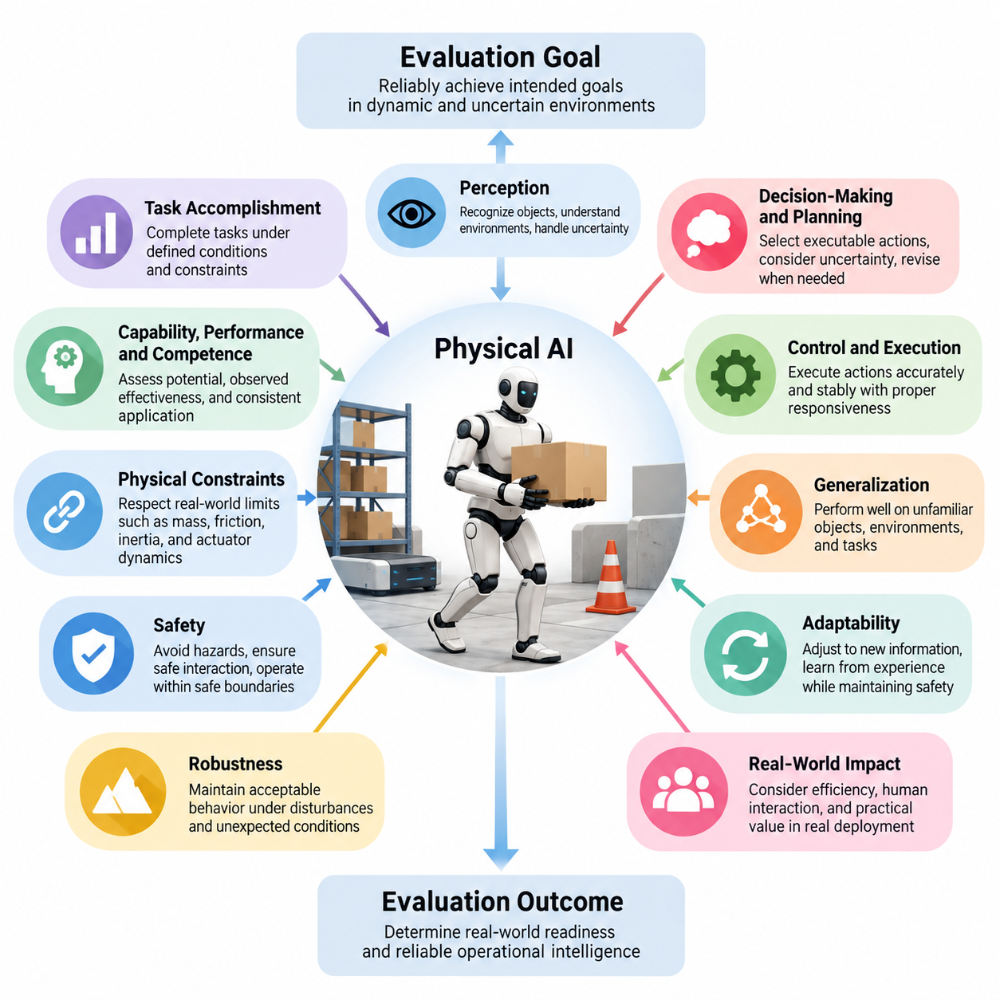{width="7.268055555555556in" height="7.268055555555556in"}

Physical AI evaluation should measure how effectively an intelligent system perceives, reasons about, acts upon, and adapts to the physical world. Unlike conventional artificial intelligence, which can often be assessed through prediction accuracy or benchmark scores, Physical AI must demonstrate meaningful behavior under real physical constraints. Evaluation must therefore capture not only computational intelligence but also the consequences of decisions and actions.

The fundamental objective of Physical AI evaluation is to determine whether a system can reliably achieve intended goals while interacting with dynamic and uncertain environments. A successful system must interpret sensory observations, maintain an appropriate understanding of its surroundings, select suitable actions, and execute those actions effectively. These capabilities must operate together because isolated algorithmic accuracy does not necessarily translate into successful physical behavior.

Task accomplishment represents one of the most important dimensions of evaluation. A Physical AI system should be assessed according to whether it completes assigned tasks under clearly defined conditions and constraints. However, task completion alone provides an incomplete picture of competence. Two robots may achieve identical objectives while exhibiting substantial differences in execution quality, safety, efficiency, adaptability, and dependence on human intervention.

Evaluation should distinguish between capability, performance, and competence. Capability describes the range of actions or tasks a system can potentially perform, while performance represents its observed effectiveness under specified conditions. Competence reflects the consistency and appropriateness with which capabilities are applied across relevant situations. This distinction prevents occasional success under favorable circumstances from being mistaken for dependable operational intelligence.

Physical interaction introduces requirements that cannot be adequately measured through purely digital benchmarks. Robots must operate within limitations imposed by mass, friction, inertia, actuator dynamics, sensor uncertainty, and environmental geometry. Evaluation should determine whether intelligent decisions remain physically feasible and whether execution respects these constraints. A theoretically correct plan has limited practical value when the embodied system cannot execute it reliably.

Perception and environmental understanding constitute essential evaluation dimensions because physical decisions depend on incomplete and potentially misleading observations. A system should recognize relevant objects, estimate spatial relationships, identify obstacles, and interpret changing environmental conditions. Evaluation must examine whether perception supports appropriate downstream actions rather than treating recognition accuracy as an isolated indicator of intelligence.

Decision-making and planning should be evaluated through their contribution to goal-directed behavior. Physical AI must select actions while considering environmental uncertainty, operational constraints, and possible future consequences. Effective evaluation should examine whether plans are executable, whether intermediate objectives remain consistent with the overall mission, and whether the system can revise decisions when observations invalidate its assumptions.

Control and action execution provide another critical perspective. Even when perception and planning are accurate, poor trajectory tracking, unstable motion, excessive contact forces, or delayed control responses can cause operational failure. Evaluation should therefore include physical execution accuracy, stability, responsiveness, and compliance with task constraints. These measurements connect abstract decision quality with observable behavior in the physical environment.

Safety must be treated as a fundamental evaluation objective rather than a secondary performance characteristic. A Physical AI system may complete its task while creating unacceptable risks for humans, equipment, or surrounding infrastructure. Evaluation should examine collision avoidance, safe interaction, operational boundaries, hazard recognition, and appropriate responses to unsafe conditions. Successful outcomes should never conceal dangerous execution processes.

Robustness measures whether a system maintains acceptable behavior when conditions depart from nominal expectations. Physical environments contain disturbances, sensor noise, mechanical variation, communication delays, and unexpected obstacles. Evaluation should expose systems to representative variations and determine how performance changes. Particular attention should be given to graceful degradation, failure detection, and recovery rather than assuming uninterrupted operation under ideal conditions.

Generalization is essential because Physical AI systems cannot be trained for every possible configuration of the physical world. Evaluation should investigate performance on unfamiliar objects, environments, tasks, and operating conditions. A system that succeeds only within previously encountered scenarios may demonstrate memorization or narrow specialization rather than transferable intelligence. Meaningful evaluation must therefore distinguish learned competence from dependence on specific training distributions.

Adaptability extends generalization by examining how systems respond to new information and changing requirements. Physical AI may need to modify strategies, recalibrate assumptions, or learn from previous interactions. Evaluation should measure the effectiveness, speed, and resource requirements of such adaptation while ensuring that learning does not compromise safety. The ability to improve through experience becomes especially important during prolonged deployment.

Efficiency should be assessed alongside effectiveness because physical systems operate with finite energy, computation, communication bandwidth, and time. A robot that completes a task accurately but consumes excessive resources may be unsuitable for practical deployment. Relevant measurements include task duration, energy consumption, computational utilization, movement efficiency, and intervention requirements. These metrics help establish whether intelligent behavior is operationally sustainable.

Temporal reliability is particularly important for tasks requiring extended autonomous operation. Short demonstrations may conceal accumulated errors, deteriorating state estimates, inconsistent planning, or repeated recovery attempts. Evaluation should therefore consider performance over longer sequences of interconnected actions. Mission completion, sustained autonomy, recovery frequency, and consistency of world-state understanding provide evidence of whether a system can maintain competence beyond isolated demonstrations.

Human-centered evaluation examines how Physical AI affects the people who interact with it or share its environment. Successful deployment requires more than autonomous task execution; systems must behave predictably, communicate relevant intentions, and respond appropriately to human presence. Evaluation should consider operator workload, intervention frequency, usability, interpretability, and interaction safety. Human trust should be supported by demonstrated reliability rather than assumed from technical sophistication.

Environmental consequences also deserve explicit consideration. Physical AI systems can influence infrastructure, materials, surrounding objects, and ecological conditions through their actions. Evaluation should determine whether tasks are performed without unnecessary damage, waste, or disruption. In industrial and service environments, preserving equipment and maintaining operational continuity may be as important as completing the immediate objective. Responsible performance includes the broader consequences of physical intervention.

Uncertainty awareness provides a foundation for evaluating intelligent behavior under incomplete knowledge. A capable system should distinguish reliable observations from ambiguous information and recognize situations exceeding its operational competence. Evaluation should investigate confidence calibration, uncertainty-sensitive planning, and decisions to request assistance or enter a safe state. Appropriate restraint can represent greater intelligence than attempting an action without sufficient information.

Evaluation must also distinguish outcomes from the processes producing those outcomes. A completed task does not necessarily indicate appropriate reasoning, safe motion, or efficient execution. Conversely, a system may fail to complete a mission while correctly detecting an unsafe condition and preventing harm. Combining outcome-based and process-based measurements allows evaluators to recognize both achievement and behavioral quality without reducing every observation to a binary success indicator.

Different embodiments require evaluation frameworks that recognize their physical characteristics while preserving meaningful comparisons. Autonomous mobile robots, manipulators, humanoids, quadrupeds, and aerial vehicles possess different movement capabilities, constraints, and interaction mechanisms. Common evaluation dimensions can include reliability, safety, efficiency, and generalization, while embodiment-specific measurements capture distinct physical requirements. Fair comparisons must account for task relevance and operational feasibility.

A comprehensive evaluation philosophy should connect model-level measurements with robot-level and mission-level outcomes. Prediction accuracy, policy quality, and representation effectiveness remain valuable, but they should be interpreted according to their influence on embodied performance. Component improvements are meaningful when they contribute to better system behavior. This hierarchical perspective helps identify whether limitations arise from perception, reasoning, control, hardware, integration, or environmental interaction.

Evaluation environments should progressively represent the complexity of real deployment. Simulation enables controlled experimentation, systematic variation, and repeated exposure to challenging conditions, while laboratory testing provides measurable physical evidence. Field evaluation introduces environmental diversity and operational uncertainty that controlled settings cannot fully reproduce. Combining these approaches supports both diagnostic understanding and credible assessment of practical readiness.

Scientific validity requires that evaluation procedures measure the intended properties rather than convenient substitutes. Benchmark scenarios should reflect relevant operational demands, and metrics should correspond to observable capabilities. Repeated trials, transparent experimental conditions, representative scenario distributions, and statistical uncertainty reporting help distinguish genuine improvements from random variation. Reproducibility is essential for comparing systems and establishing confidence in reported performance.

Physical AI evaluation should ultimately produce a multidimensional understanding of intelligence rather than a single universal score. Task success, execution quality, safety, robustness, generalization, adaptability, efficiency, and human compatibility describe complementary aspects of system competence. Their relative importance depends on application requirements and acceptable risk. The central question is not simply whether a system can act, but whether it can act effectively, reliably, and responsibly in the physical world.

피지컬 인공지능(Physical AI)의 평가는 지능형 시스템(Intelligent System)이 물리적 세계(Physical World)를 얼마나 효과적으로 인식(Perception)하고, 추론(Reasoning)하며, 행동(Action)하고, 적응(Adaptation)하는지를 측정해야 한다. 예측 정확도(Prediction Accuracy)나 벤치마크 점수(Benchmark Score)를 통해 평가할 수 있는 기존 인공지능(Artificial Intelligence)과 달리, 피지컬 인공지능은 실제 물리적 제약(Physical Constraints) 아래에서 의미 있는 행동을 입증해야 한다. 따라서 평가는 계산적 지능(Computational Intelligence)뿐 아니라 의사결정과 행동이 초래하는 물리적 결과까지 포괄해야 한다.

피지컬 인공지능 평가의 근본적인 목적은 시스템이 동적이고 불확실한 환경(Dynamic and Uncertain Environment)과 상호작용하면서 의도한 목표를 안정적으로 달성할 수 있는지를 판단하는 것이다. 성공적인 시스템은 센서 관측(Sensory Observations)을 해석하고, 주변 환경에 대한 적절한 이해를 유지하며, 적합한 행동을 선택하고, 이를 효과적으로 실행해야 한다. 이러한 능력은 통합적으로 작동해야 하며, 개별 알고리즘의 정확도가 반드시 성공적인 물리적 행동으로 이어지는 것은 아니다.

작업 달성(Task Accomplishment)은 평가에서 가장 중요한 차원 중 하나이다. 피지컬 인공지능 시스템은 명확하게 정의된 조건과 제약 아래에서 주어진 작업을 완료하는지를 기준으로 평가해야 한다. 그러나 작업 완료(Task Completion)만으로는 시스템의 역량(Competence)을 충분히 설명할 수 없다. 두 로봇이 동일한 목표를 달성하더라도 실행 품질(Execution Quality), 안전성(Safety), 효율성(Efficiency), 적응성(Adaptability), 인간 개입(Human Intervention)에 대한 의존도에서는 상당한 차이가 나타날 수 있다.

평가에서는 능력(Capability), 성능(Performance), 역량(Competence)을 구분해야 한다. 능력은 시스템이 잠재적으로 수행할 수 있는 행동이나 작업의 범위를 의미하며, 성능은 특정 조건에서 관측된 실제 수행 효과를 나타낸다. 역량은 다양한 관련 상황에서 능력을 얼마나 일관되고 적절하게 적용하는지를 의미한다. 이러한 구분은 유리한 조건에서 우연히 달성한 성공을 신뢰할 수 있는 운영 지능(Operational Intelligence)으로 잘못 판단하는 것을 방지한다.

물리적 상호작용(Physical Interaction)은 순수한 디지털 벤치마크(Digital Benchmark)만으로 충분히 측정할 수 없는 요구사항을 발생시킨다. 로봇은 질량(Mass), 마찰(Friction), 관성(Inertia), 액추에이터 동역학(Actuator Dynamics), 센서 불확실성(Sensor Uncertainty), 환경 기하학(Environmental Geometry)에 따른 제약 아래에서 작동해야 한다. 평가는 지능적 의사결정이 물리적으로 실행 가능한지와 실행 과정에서 이러한 제약을 준수하는지를 확인해야 한다. 이론적으로 올바른 계획이라도 실제 시스템이 안정적으로 실행하지 못한다면 실용적 가치는 제한적이다.

인식(Perception)과 환경 이해(Environmental Understanding)는 물리적 의사결정이 불완전하거나 잘못 해석될 수 있는 관측 정보에 의존하기 때문에 핵심적인 평가 차원이다. 시스템은 관련 객체를 인식하고, 공간적 관계(Spatial Relationships)를 추정하며, 장애물을 식별하고, 변화하는 환경 조건을 해석해야 한다. 평가는 객체 인식 정확도(Recognition Accuracy)를 독립적인 지능 지표로 취급하기보다, 인식 결과가 후속 행동(Downstream Actions)을 적절하게 지원하는지를 검토해야 한다.

의사결정(Decision-Making)과 계획(Planning)은 목표 지향적 행동(Goal-Directed Behavior)에 기여하는 정도를 기준으로 평가해야 한다. 피지컬 인공지능은 환경 불확실성, 운영 제약, 미래에 발생할 수 있는 결과를 고려하여 행동을 선택해야 한다. 효과적인 평가는 계획의 실행 가능성(Executability), 중간 목표(Intermediate Goals)와 전체 임무(Mission)의 일관성, 새로운 관측으로 기존 가정이 무효화되었을 때 의사결정을 수정할 수 있는지를 검토해야 한다.

제어(Control)와 행동 실행(Action Execution)은 또 다른 핵심 평가 관점을 제공한다. 인식과 계획이 정확하더라도 궤적 추종(Trajectory Tracking)의 오류, 불안정한 움직임, 과도한 접촉력(Contact Force), 지연된 제어 응답(Control Response)은 운영 실패를 초래할 수 있다. 따라서 평가는 물리적 실행 정확도(Execution Accuracy), 안정성(Stability), 응답성(Responsiveness), 작업 제약 준수 여부를 포함해야 한다. 이러한 측정은 추상적인 의사결정 품질과 물리적 환경에서 관측되는 실제 행동을 연결한다.

안전성(Safety)은 부차적인 성능 특성이 아니라 근본적인 평가 목표로 취급해야 한다. 피지컬 인공지능 시스템은 작업을 완료하면서도 인간, 장비 또는 주변 기반시설(Infrastructure)에 허용할 수 없는 위험을 발생시킬 수 있다. 평가는 충돌 회피(Collision Avoidance), 안전한 상호작용(Safe Interaction), 운영 경계(Operational Boundaries), 위험 인식(Hazard Recognition), 위험 상황에 대한 적절한 대응을 검토해야 한다. 성공적인 작업 결과가 위험한 실행 과정을 정당화해서는 안 된다.

강건성(Robustness)은 조건이 정상적인 예상 범위를 벗어났을 때 시스템이 허용 가능한 행동을 유지하는지를 측정한다. 물리적 환경에는 외란(Disturbances), 센서 잡음(Sensor Noise), 기계적 편차(Mechanical Variation), 통신 지연(Communication Delays), 예상하지 못한 장애물이 존재한다. 평가는 대표적인 환경 변화에 시스템을 노출하고 성능 변화를 확인해야 한다. 이상적인 조건에서 중단 없는 작동을 가정하기보다 점진적 성능 저하(Graceful Degradation), 고장 감지(Failure Detection), 복구(Recovery)에 주목해야 한다.

일반화(Generalization)는 피지컬 인공지능 시스템을 물리적 세계의 모든 가능한 구성에 대해 학습시킬 수 없기 때문에 필수적이다. 평가는 익숙하지 않은 객체, 환경, 작업 및 운영 조건에서의 성능을 조사해야 한다. 이전에 경험한 상황에서만 성공하는 시스템은 전이 가능한 지능(Transferable Intelligence)보다 암기(Memorization) 또는 제한적인 전문화(Narrow Specialization)를 보여줄 수 있다. 따라서 의미 있는 평가는 학습된 역량과 특정 학습 분포(Training Distribution)에 대한 의존성을 구분해야 한다.

적응성(Adaptability)은 시스템이 새로운 정보와 변화하는 요구사항에 어떻게 대응하는지를 검토함으로써 일반화 개념을 확장한다. 피지컬 인공지능은 전략을 수정하고, 기존 가정을 재보정(Recalibration)하거나, 이전 상호작용으로부터 학습해야 할 수 있다. 평가는 이러한 적응의 효과, 속도 및 자원 요구량을 측정하면서 학습이 안전성을 저해하지 않는지도 확인해야 한다. 경험을 통해 개선하는 능력은 장기간 배치(Long-Term Deployment)에서 특히 중요해진다.

효율성(Efficiency)은 물리적 시스템이 제한된 에너지(Energy), 연산 자원(Computation), 통신 대역폭(Communication Bandwidth), 시간(Time)으로 작동하기 때문에 효과성과 함께 평가해야 한다. 작업을 정확하게 완료하더라도 과도한 자원을 소비하는 로봇은 실제 배치에 적합하지 않을 수 있다. 관련 측정 항목에는 작업 시간(Task Duration), 에너지 소비(Energy Consumption), 연산 활용률(Computational Utilization), 이동 효율성(Movement Efficiency), 개입 요구량(Intervention Requirements)이 포함된다. 이러한 지표는 지능적 행동의 운영 지속 가능성(Operational Sustainability)을 판단하는 데 도움이 된다.

시간적 신뢰성(Temporal Reliability)은 장시간 자율 운영(Autonomous Operation)이 필요한 작업에서 특히 중요하다. 짧은 시연은 누적 오류(Accumulated Errors), 상태 추정(State Estimation)의 악화, 일관되지 않은 계획, 반복적인 복구 시도를 드러내지 못할 수 있다. 따라서 평가는 서로 연결된 행동의 긴 시퀀스(Long Sequence)에서 나타나는 성능을 고려해야 한다. 임무 완료(Mission Completion), 지속적 자율성(Sustained Autonomy), 복구 빈도(Recovery Frequency), 세계 상태 이해(World-State Understanding)의 일관성은 시스템이 개별 시연을 넘어 역량을 유지할 수 있는지를 보여준다.

인간 중심 평가(Human-Centered Evaluation)는 피지컬 인공지능이 상호작용하거나 환경을 공유하는 사람들에게 어떤 영향을 미치는지를 검토한다. 성공적인 배치를 위해서는 자율적인 작업 실행뿐 아니라 예측 가능한 행동(Predictable Behavior), 관련 의도 전달(Intention Communication), 인간의 존재에 대한 적절한 대응이 필요하다. 평가는 운영자 작업 부담(Operator Workload), 개입 빈도(Intervention Frequency), 사용성(Usability), 해석 가능성(Interpretability), 상호작용 안전성(Interaction Safety)을 고려해야 한다. 인간의 신뢰(Human Trust)는 기술적 정교함에 대한 가정이 아니라 입증된 신뢰성에 기반해야 한다.

환경적 영향(Environmental Consequences)도 명시적으로 고려해야 한다. 피지컬 인공지능 시스템은 행동을 통해 기반시설, 자재, 주변 객체 및 생태적 조건(Ecological Conditions)에 영향을 미칠 수 있다. 평가는 불필요한 손상, 낭비 또는 교란 없이 작업이 수행되는지를 판단해야 한다. 산업 및 서비스 환경에서는 장비 보존(Equipment Preservation)과 운영 연속성(Operational Continuity) 유지가 즉각적인 작업 목표 달성만큼 중요할 수 있다. 책임 있는 성능(Responsible Performance)은 물리적 개입의 광범위한 결과까지 포함한다.

불확실성 인식(Uncertainty Awareness)은 불완전한 지식 아래에서 지능적 행동을 평가하기 위한 기반을 제공한다. 유능한 시스템은 신뢰할 수 있는 관측과 모호한 정보를 구분하고, 자신의 운영 역량을 초과하는 상황을 인식해야 한다. 평가는 신뢰도 보정(Confidence Calibration), 불확실성을 고려한 계획(Uncertainty-Sensitive Planning), 지원 요청 또는 안전 상태(Safe State)로 전환하는 의사결정을 조사해야 한다. 충분한 정보 없이 행동을 시도하는 것보다 적절하게 행동을 자제하는 것이 더 높은 수준의 지능을 나타낼 수 있다.

평가는 결과(Outcomes)와 그 결과를 만들어내는 과정(Processes)도 구분해야 한다. 작업 완료가 반드시 적절한 추론, 안전한 움직임 또는 효율적인 실행을 의미하지는 않는다. 반대로 시스템이 임무를 완료하지 못했더라도 위험한 상황을 올바르게 감지하고 피해를 방지했을 수 있다. 결과 기반 측정(Outcome-Based Measurement)과 과정 기반 측정(Process-Based Measurement)을 결합하면 모든 관측을 단순한 이진 성공 지표(Binary Success Indicator)로 축소하지 않고 성취도와 행동 품질을 함께 평가할 수 있다.

서로 다른 로봇 구현 형태(Embodiments)에는 물리적 특성을 인정하면서도 의미 있는 비교를 유지하는 평가 프레임워크(Evaluation Framework)가 필요하다. 자율이동로봇(Autonomous Mobile Robots), 매니퓰레이터(Manipulators), 휴머노이드(Humanoids), 사족보행 로봇(Quadrupeds), 항공 로봇(Aerial Vehicles)은 서로 다른 이동 능력, 제약 및 상호작용 메커니즘을 가진다. 공통 평가 차원에는 신뢰성, 안전성, 효율성, 일반화가 포함될 수 있으며, 구현 형태별 측정(Embodiment-Specific Measurements)은 고유한 물리적 요구사항을 반영한다. 공정한 비교는 작업 적합성과 운영 실행 가능성을 고려해야 한다.

포괄적인 평가 철학(Evaluation Philosophy)은 모델 수준 측정(Model-Level Measurements)을 로봇 수준(Robot-Level) 및 임무 수준(Mission-Level)의 결과와 연결해야 한다. 예측 정확도, 정책 품질(Policy Quality), 표현의 효과성(Representation Effectiveness)은 여전히 중요하지만, 구현된 시스템의 성능(Embodied Performance)에 미치는 영향을 기준으로 해석해야 한다. 구성요소의 개선은 전체 시스템의 행동 개선에 기여할 때 의미가 있다. 이러한 계층적 관점(Hierarchical Perspective)은 한계가 인식, 추론, 제어, 하드웨어, 통합 또는 환경 상호작용 중 어디에서 발생하는지를 식별하는 데 도움이 된다.

평가 환경(Evaluation Environments)은 실제 배치의 복잡성을 점진적으로 반영해야 한다. 시뮬레이션(Simulation)은 통제된 실험, 체계적인 조건 변화, 도전적인 상황에 대한 반복 노출을 가능하게 하며, 실험실 시험(Laboratory Testing)은 측정 가능한 물리적 증거를 제공한다. 현장 평가(Field Evaluation)는 통제된 환경에서 완전히 재현하기 어려운 환경 다양성과 운영 불확실성을 도입한다. 이러한 접근법을 결합하면 진단적 이해(Diagnostic Understanding)와 실제 운영 준비도(Operational Readiness)에 대한 신뢰할 수 있는 평가를 모두 지원할 수 있다.

과학적 타당성(Scientific Validity)을 확보하려면 평가 절차가 측정하기 편리한 대체 지표가 아니라 의도한 특성을 측정해야 한다. 벤치마크 시나리오(Benchmark Scenarios)는 관련 운영 요구사항을 반영해야 하며, 평가 지표(Metrics)는 관측 가능한 능력에 대응해야 한다. 반복 실험(Repeated Trials), 투명한 실험 조건(Transparent Experimental Conditions), 대표성 있는 시나리오 분포(Representative Scenario Distributions), 통계적 불확실성 보고(Statistical Uncertainty Reporting)는 실제 개선과 무작위 변동을 구분하는 데 도움이 된다. 재현성(Reproducibility)은 시스템 비교와 보고된 성능에 대한 신뢰 확보에 필수적이다.

궁극적으로 피지컬 인공지능 평가는 단일한 보편적 점수(Universal Score)가 아니라 지능에 대한 다차원적 이해(Multidimensional Understanding)를 제공해야 한다. 작업 성공(Task Success), 실행 품질, 안전성, 강건성, 일반화, 적응성, 효율성, 인간과의 적합성(Human Compatibility)은 시스템 역량을 설명하는 상호보완적인 측면이다. 각 요소의 상대적 중요성은 응용 요구사항(Application Requirements)과 허용 가능한 위험(Acceptable Risk)에 따라 달라진다. 핵심 질문은 시스템이 단순히 행동할 수 있는지가 아니라, 물리적 세계에서 얼마나 효과적이고 신뢰할 수 있으며 책임 있게 행동할 수 있는가이다.

##  

## 01.02. Capability Performance and Competence

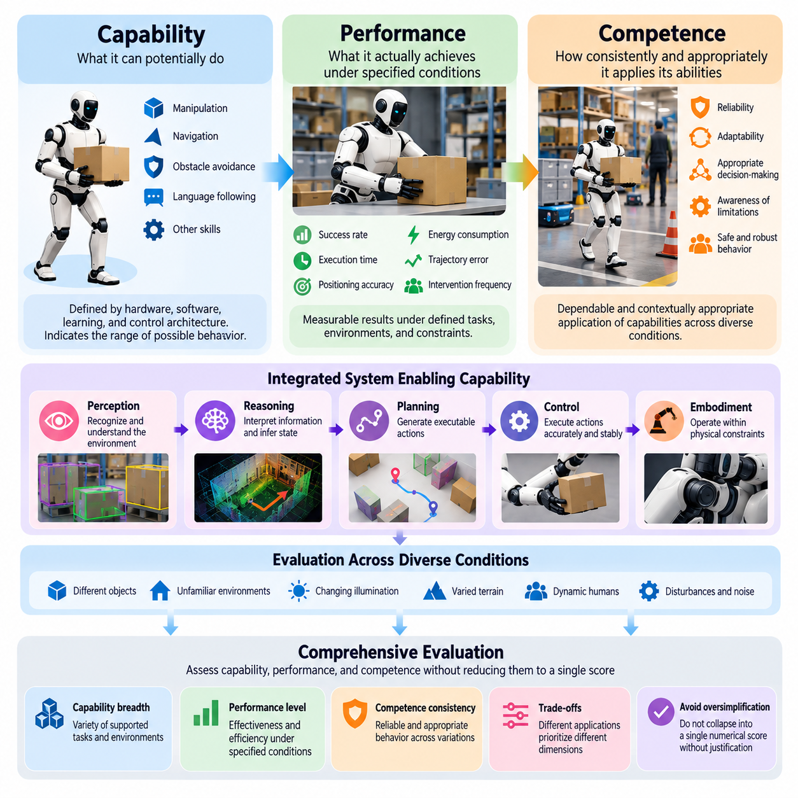{width="7.268055555555556in" height="7.268055555555556in"}

Capability, performance, and competence represent three fundamental dimensions of Physical AI evaluation. Although these concepts are closely related, they describe different aspects of intelligent behavior in physical environments. Capability concerns what a system can potentially accomplish, performance describes what it actually achieves under specified conditions, and competence reflects how consistently and appropriately it applies its abilities across diverse situations.

Capability defines the functional possibilities available to a Physical AI system through its hardware, software, learned representations, and control architecture. A robot may possess capabilities such as object manipulation, autonomous navigation, obstacle avoidance, or natural language instruction following. However, the existence of these capabilities does not establish their reliability, accuracy, or suitability for operational deployment. Capability assessment primarily identifies the boundaries of possible behavior.

Physical AI capabilities emerge from interactions among perception, reasoning, planning, control, and embodiment. A manipulation robot may recognize an object and generate a grasping strategy, yet its practical capability remains constrained by gripper geometry, actuator force, sensing resolution, and workspace limitations. Evaluation must therefore distinguish algorithmic capability from physically executable capability. Intelligence becomes operationally meaningful only when the entire system supports the intended action.

Performance describes the measurable results produced when a Physical AI system executes a defined task under specified conditions. Typical performance indicators include task success rate, execution time, positioning accuracy, energy consumption, trajectory tracking error, and intervention frequency. These measurements provide quantitative evidence of system behavior. However, performance values are meaningful only when interpreted alongside the environmental conditions, task difficulty, and operational constraints under which they were obtained.

A robot may demonstrate excellent performance in a controlled laboratory while exhibiting substantial degradation in unfamiliar environments. For example, an autonomous mobile robot may navigate accurately through a mapped corridor but struggle when encountering unexpected obstacles, changing illumination, or dynamic human traffic. Such differences reveal why observed performance cannot automatically be interpreted as general competence. Evaluation must account for the distribution of conditions represented by each experiment.

Competence refers to the dependable and contextually appropriate application of capabilities across relevant tasks and operating conditions. A competent Physical AI system does more than execute successful actions under favorable circumstances. It recognizes environmental constraints, selects suitable strategies, maintains acceptable behavior during disturbances, and identifies situations requiring assistance or recovery. Competence therefore combines functional ability with reliability, adaptability, and appropriate decision-making.

The relationship among capability, performance, and competence can be understood through a robot performing warehouse manipulation tasks. Capability indicates whether the robot can identify, grasp, transport, and place objects. Performance measures how accurately and efficiently these operations are completed during specific trials. Competence determines whether the robot can maintain appropriate results across different object geometries, storage configurations, workload conditions, and unexpected disturbances.

Capability evaluation should establish a structured inventory of supported functions and their operational boundaries. This includes identifying available sensing modalities, movement primitives, manipulation skills, planning mechanisms, and communication interfaces. Evaluators should determine which tasks are feasible and which environmental assumptions must hold. Such characterization creates a foundation for selecting meaningful performance tests without assuming that every theoretically supported function is operationally mature.

Performance evaluation requires clearly defined tasks, measurable outcomes, and controlled experimental conditions. Test protocols should specify initial states, target objectives, environmental configurations, time limits, and acceptable error thresholds. Repeated trials help estimate success probabilities and variability rather than relying on isolated demonstrations. Measurements should also capture execution quality because identical task outcomes may conceal substantial differences in physical behavior.

Competence evaluation extends beyond individual trials by examining consistency across representative variations in task requirements and environmental conditions. A system should demonstrate that its behavior remains appropriate when object properties, terrain characteristics, sensor observations, or human interactions change. Evaluation should also examine whether the system understands its limitations and responds conservatively when confidence decreases. Reliable competence requires both successful execution and appropriate restraint.

These three dimensions should not be collapsed into a single numerical score without careful justification. A robot may possess broad capabilities but exhibit inconsistent performance, while another may achieve exceptional performance within a narrow operating domain. A third system may demonstrate moderate peak performance but greater reliability across diverse conditions. Such distinctions are important because different applications prioritize functional breadth, operational efficiency, and dependable behavior differently.

Capability breadth describes the variety of tasks and environmental situations that a system can potentially address. Capability depth reflects the complexity or sophistication of actions supported within a particular domain. A generalist robot may possess broad but relatively shallow abilities, whereas a specialized industrial robot may demonstrate deep capability in precision assembly. Evaluation should characterize both dimensions rather than treating the number of supported tasks as a sufficient measure of intelligence.

Performance must also be evaluated as a distribution rather than a single average. Mean task completion time or average positioning accuracy may conceal rare but consequential failures. Variance, worst-case outcomes, failure frequency, and performance degradation under stress provide additional evidence of operational quality. For safety-critical applications, understanding the lower end of the performance distribution may be more important than maximizing average results under favorable conditions.

Competence includes the ability to maintain coherent behavior across sequences of decisions and actions. Long-horizon tasks introduce dependencies among intermediate objectives, environmental state estimates, and resource constraints. A robot that successfully performs individual manipulation primitives may still fail when required to organize them into a complete mission. Competence evaluation should therefore consider planning continuity, error accumulation, recovery effectiveness, and sustained autonomy.

The distinction becomes particularly important when evaluating learning-based Physical AI systems. A model may achieve high prediction accuracy or policy success within its training distribution while lacking transferable competence. Evaluation should separate memorized behavior from robust generalization by introducing unfamiliar objects, tasks, and environmental configurations. Adaptation speed, sample efficiency, and retention of previously acquired skills can provide additional evidence of developing competence.

Embodiment influences all three dimensions because physical capabilities depend on morphology, actuators, sensors, and mechanical constraints. Identical learning algorithms deployed on different robots may produce substantially different performance outcomes. Competence comparisons should therefore consider each platform\'s feasible action space and intended operational domain. Fair evaluation requires distinguishing limitations imposed by hardware from those arising through perception, reasoning, or control.

Safety and uncertainty awareness further differentiate competence from raw performance. A robot that completes a task quickly while violating collision constraints may demonstrate high task efficiency but inadequate operational competence. Conversely, a system that detects uncertainty and requests assistance may exhibit lower autonomous completion rates while making more appropriate decisions. Evaluation should recognize that responsible behavior sometimes requires slowing down, changing strategies, or declining unsafe actions.

Human intervention provides another perspective on the distinction. A robot may appear capable of completing complex tasks while depending heavily on remote operators, manual resets, or carefully prepared environments. Performance reports should therefore disclose the degree of assistance involved. Competence evaluation should measure autonomous decision-making, intervention frequency, recovery behavior, and the ability to continue operating without hidden external support.

Capability, performance, and competence should be assessed through complementary evaluation levels. Component-level tests characterize sensing, prediction, planning, and control functions. Robot-level experiments measure integrated physical behavior, while mission-level evaluations examine sustained operation and task accomplishment. Connecting these levels helps determine whether improved model capability produces measurable system performance gains and whether those gains translate into dependable operational competence.

A rigorous evaluation framework should report capability coverage, observed performance, and competence boundaries separately before considering aggregate scores. Capability coverage identifies what functions are supported, performance measurements quantify execution quality, and competence boundaries describe the conditions under which behavior remains dependable. This multidimensional approach improves transparency, supports meaningful comparisons, and prevents isolated benchmark achievements from being mistaken for general physical intelligence.

Ultimately, the purpose of distinguishing capability, performance, and competence is to evaluate Physical AI according to what it can do, how well it does it, and how reliably it behaves when circumstances change. Capability establishes functional potential, performance provides observable evidence, and competence determines operational trustworthiness within defined conditions. Together, these dimensions form a foundation for evaluating progress toward adaptable, dependable, and increasingly general Physical AI systems.

능력(Capability), 성능(Performance), 역량(Competence)은 피지컬 인공지능(Physical AI) 평가의 세 가지 기본적인 차원을 나타낸다. 이러한 개념은 서로 밀접하게 연관되어 있지만, 물리적 환경(Physical Environment)에서 나타나는 지능적 행동(Intelligent Behavior)의 서로 다른 측면을 설명한다. 능력은 시스템이 잠재적으로 무엇을 수행할 수 있는지를 의미하고, 성능은 특정 조건에서 실제로 달성한 결과를 나타내며, 역량은 다양한 상황에서 보유한 능력을 얼마나 일관되고 적절하게 적용하는지를 반영한다.

능력(Capability)은 하드웨어(Hardware), 소프트웨어(Software), 학습된 표현(Learned Representations), 제어 아키텍처(Control Architecture)를 통해 피지컬 인공지능 시스템이 수행할 수 있는 기능적 가능성(Functional Possibilities)을 정의한다. 로봇은 객체 조작(Object Manipulation), 자율주행(Autonomous Navigation), 장애물 회피(Obstacle Avoidance), 자연어 명령 수행(Natural Language Instruction Following)과 같은 능력을 보유할 수 있다. 그러나 이러한 능력의 존재만으로 신뢰성(Reliability), 정확성(Accuracy), 실제 운영 환경에 대한 적합성이 보장되지는 않는다. 능력 평가는 주로 시스템이 수행할 수 있는 행동의 범위를 식별하는 데 목적이 있다.

피지컬 인공지능의 능력은 인식(Perception), 추론(Reasoning), 계획(Planning), 제어(Control), 신체적 구현(Embodiment) 사이의 상호작용을 통해 형성된다. 매니퓰레이션 로봇(Manipulation Robot)이 객체를 인식하고 파지 전략(Grasping Strategy)을 생성할 수 있더라도, 실제 능력은 그리퍼 형상(Gripper Geometry), 액추에이터 힘(Actuator Force), 센서 해상도(Sensing Resolution), 작업 공간의 제약(Workspace Limitations)에 의해 제한된다. 따라서 평가는 알고리즘적 능력(Algorithmic Capability)과 물리적으로 실행 가능한 능력(Physically Executable Capability)을 구분해야 한다. 지능은 전체 시스템이 의도한 행동을 지원할 때 비로소 운영상 의미를 갖는다.

성능(Performance)은 피지컬 인공지능 시스템이 특정 조건에서 정의된 작업을 실행할 때 생성하는 측정 가능한 결과를 의미한다. 대표적인 성능 지표(Performance Indicators)에는 작업 성공률(Task Success Rate), 실행 시간(Execution Time), 위치 정확도(Positioning Accuracy), 에너지 소비(Energy Consumption), 궤적 추종 오차(Trajectory Tracking Error), 개입 빈도(Intervention Frequency)가 포함된다. 이러한 측정값은 시스템 행동에 대한 정량적 증거(Quantitative Evidence)를 제공한다. 그러나 성능 수치는 실험이 수행된 환경 조건, 작업 난이도, 운영 제약과 함께 해석할 때 의미를 갖는다.

로봇은 통제된 실험실 환경(Controlled Laboratory Environment)에서 우수한 성능을 보이더라도 익숙하지 않은 환경에서는 상당한 성능 저하(Performance Degradation)를 나타낼 수 있다. 예를 들어 자율이동로봇(Autonomous Mobile Robot)은 지도가 구축된 복도에서는 정확하게 주행하지만, 예상하지 못한 장애물, 조명 변화(Changing Illumination), 동적인 보행자 이동(Dynamic Human Traffic)에 직면하면 어려움을 겪을 수 있다. 이러한 차이는 관측된 성능을 일반적인 역량(General Competence)으로 자동 해석할 수 없는 이유를 보여준다. 평가는 각 실험에 포함된 조건의 분포를 고려해야 한다.

역량(Competence)은 관련 작업과 운영 조건 전반에서 능력을 신뢰할 수 있고 상황에 적합하게 적용하는 것을 의미한다. 충분한 역량을 갖춘 피지컬 인공지능 시스템은 유리한 조건에서 성공적인 행동을 수행하는 데 그치지 않는다. 환경적 제약(Environmental Constraints)을 인식하고, 적절한 전략을 선택하며, 외란(Disturbances)이 발생해도 허용 가능한 행동을 유지하고, 지원이나 복구가 필요한 상황을 식별한다. 따라서 역량은 기능적 능력(Functional Ability)에 신뢰성, 적응성(Adaptability), 적절한 의사결정(Decision-Making)을 결합한 개념이다.

능력, 성능, 역량의 관계는 창고 매니퓰레이션 작업(Warehouse Manipulation Tasks)을 수행하는 로봇을 통해 이해할 수 있다. 능력은 로봇이 객체를 식별하고, 파지하고, 운반하고, 배치할 수 있는지를 나타낸다. 성능은 특정 시험에서 이러한 작업을 얼마나 정확하고 효율적으로 완료하는지를 측정한다. 역량은 다양한 객체 형상(Object Geometries), 보관 구성(Storage Configurations), 작업 부하 조건(Workload Conditions), 예상하지 못한 외란에서도 적절한 결과를 유지할 수 있는지를 판단한다.

능력 평가(Capability Evaluation)는 지원되는 기능과 운영 한계(Operational Boundaries)에 대한 체계적인 목록을 확립해야 한다. 여기에는 사용 가능한 센서 모달리티(Sensing Modalities), 이동 기본 동작(Movement Primitives), 조작 기술(Manipulation Skills), 계획 메커니즘(Planning Mechanisms), 통신 인터페이스(Communication Interfaces)를 식별하는 과정이 포함된다. 평가자는 어떤 작업이 실행 가능하며 어떤 환경적 가정(Environmental Assumptions)이 충족되어야 하는지를 판단해야 한다. 이러한 특성 분석은 이론적으로 지원되는 모든 기능이 운영상 성숙했다고 가정하지 않으면서 의미 있는 성능 시험을 선정하기 위한 기반을 제공한다.

성능 평가(Performance Evaluation)에는 명확하게 정의된 작업, 측정 가능한 결과, 통제된 실험 조건(Controlled Experimental Conditions)이 필요하다. 시험 프로토콜(Test Protocols)은 초기 상태(Initial States), 목표(Target Objectives), 환경 구성(Environmental Configurations), 시간 제한(Time Limits), 허용 오차 임계값(Acceptable Error Thresholds)을 명시해야 한다. 반복 시험(Repeated Trials)은 단일 시연에 의존하지 않고 성공 확률(Success Probabilities)과 변동성(Variability)을 추정하는 데 도움이 된다. 또한 동일한 작업 결과라도 물리적 행동에는 상당한 차이가 존재할 수 있으므로 실행 품질(Execution Quality)을 측정해야 한다.

역량 평가(Competence Evaluation)는 작업 요구사항과 환경 조건의 대표적인 변화에서 일관성을 검토함으로써 개별 시험을 넘어선다. 시스템은 객체 속성(Object Properties), 지형 특성(Terrain Characteristics), 센서 관측(Sensor Observations), 인간과의 상호작용(Human Interactions)이 변화하더라도 적절한 행동을 유지해야 한다. 또한 시스템이 자신의 한계를 이해하고 신뢰도(Confidence)가 감소할 때 보수적으로 대응하는지도 평가해야 한다. 신뢰할 수 있는 역량에는 성공적인 실행뿐 아니라 적절한 행동 자제(Appropriate Restraint)도 필요하다.

이 세 가지 차원은 충분한 근거 없이 단일 수치 점수(Single Numerical Score)로 통합해서는 안 된다. 로봇은 폭넓은 능력을 보유하면서도 일관되지 않은 성능을 나타낼 수 있으며, 다른 로봇은 제한된 운영 영역(Operating Domain)에서 탁월한 성능을 달성할 수 있다. 또 다른 시스템은 최대 성능(Peak Performance)은 보통 수준이지만 다양한 조건에서 더 높은 신뢰성을 보여줄 수 있다. 이러한 차이는 응용 분야마다 기능적 범위(Functional Breadth), 운영 효율성(Operational Efficiency), 신뢰할 수 있는 행동(Dependable Behavior)의 우선순위가 다르기 때문에 중요하다.

능력의 폭(Capability Breadth)은 시스템이 잠재적으로 처리할 수 있는 작업과 환경 상황의 다양성을 의미한다. 능력의 깊이(Capability Depth)는 특정 영역에서 지원되는 행동의 복잡성이나 정교함을 나타낸다. 범용 로봇(Generalist Robot)은 폭넓지만 상대적으로 얕은 능력을 보유할 수 있는 반면, 전문 산업용 로봇(Specialized Industrial Robot)은 정밀 조립(Precision Assembly) 분야에서 깊이 있는 능력을 보여줄 수 있다. 평가는 지원되는 작업의 수만으로 지능을 판단하기보다 두 차원을 모두 특성화해야 한다.

성능은 단일 평균값이 아니라 분포(Distribution)로 평가해야 한다. 평균 작업 완료 시간(Mean Task Completion Time)이나 평균 위치 정확도(Average Positioning Accuracy)는 드물지만 중대한 실패를 감출 수 있다. 분산(Variance), 최악 조건의 결과(Worst-Case Outcomes), 실패 빈도(Failure Frequency), 스트레스 조건에서의 성능 저하(Performance Degradation Under Stress)는 운영 품질에 대한 추가적인 증거를 제공한다. 안전 필수 응용(Safety-Critical Applications)에서는 유리한 조건에서 평균 성능을 극대화하는 것보다 성능 분포의 하위 영역을 이해하는 것이 더 중요할 수 있다.

역량에는 일련의 의사결정과 행동 전반에서 일관된 행동(Coherent Behavior)을 유지하는 능력도 포함된다. 장기 작업(Long-Horizon Tasks)은 중간 목표(Intermediate Objectives), 환경 상태 추정(Environmental State Estimates), 자원 제약(Resource Constraints) 사이의 의존성을 발생시킨다. 개별 조작 기본 동작(Manipulation Primitives)을 성공적으로 수행하는 로봇이라도 이를 완전한 임무(Complete Mission)로 구성해야 할 때 실패할 수 있다. 따라서 역량 평가는 계획의 연속성(Planning Continuity), 오류 누적(Error Accumulation), 복구 효과성(Recovery Effectiveness), 지속적 자율성(Sustained Autonomy)을 고려해야 한다.

이러한 구분은 학습 기반 피지컬 인공지능(Learning-Based Physical AI) 시스템을 평가할 때 특히 중요하다. 모델이 학습 분포(Training Distribution) 내에서 높은 예측 정확도(Prediction Accuracy)나 정책 성공률(Policy Success)을 달성하더라도 전이 가능한 역량(Transferable Competence)은 부족할 수 있다. 평가는 익숙하지 않은 객체, 작업, 환경 구성을 도입하여 암기된 행동(Memorized Behavior)과 강건한 일반화(Robust Generalization)를 구분해야 한다. 적응 속도(Adaptation Speed), 샘플 효율성(Sample Efficiency), 기존에 습득한 기술의 유지(Skill Retention)는 역량 발전에 대한 추가적인 증거를 제공할 수 있다.

신체적 구현(Embodiment)은 물리적 능력이 로봇의 형태(Morphology), 액추에이터(Actuators), 센서(Sensors), 기계적 제약(Mechanical Constraints)에 의존하기 때문에 세 가지 차원 모두에 영향을 미친다. 동일한 학습 알고리즘(Learning Algorithm)을 서로 다른 로봇에 배치하더라도 성능 결과는 상당히 달라질 수 있다. 따라서 역량 비교는 각 플랫폼의 실행 가능한 행동 공간(Feasible Action Space)과 의도된 운영 영역(Intended Operational Domain)을 고려해야 한다. 공정한 평가는 하드웨어에 의해 발생하는 한계와 인식, 추론 또는 제어에서 발생하는 한계를 구분해야 한다.

안전성(Safety)과 불확실성 인식(Uncertainty Awareness)은 역량을 단순한 성능과 더욱 명확하게 구분한다. 충돌 제약(Collision Constraints)을 위반하면서 작업을 빠르게 완료하는 로봇은 높은 작업 효율성(Task Efficiency)을 보여줄 수 있지만 운영 역량(Operational Competence)은 부족할 수 있다. 반대로 불확실성을 감지하고 지원을 요청하는 시스템은 자율 작업 완료율(Autonomous Completion Rate)이 낮더라도 더 적절한 의사결정을 수행할 수 있다. 평가는 책임 있는 행동(Responsible Behavior)이 때로는 속도를 줄이거나, 전략을 변경하거나, 안전하지 않은 행동을 거부해야 한다는 점을 인정해야 한다.

인간 개입(Human Intervention)은 이러한 차이를 이해하는 또 다른 관점을 제공한다. 로봇은 원격 운영자(Remote Operators), 수동 초기화(Manual Resets), 세심하게 준비된 환경(Carefully Prepared Environments)에 크게 의존하면서도 복잡한 작업을 수행할 수 있는 것처럼 보일 수 있다. 따라서 성능 보고서(Performance Reports)는 작업에 사용된 지원 수준(Degree of Assistance)을 공개해야 한다. 역량 평가는 자율적 의사결정(Autonomous Decision-Making), 개입 빈도, 복구 행동(Recovery Behavior), 숨겨진 외부 지원(Hidden External Support) 없이 지속적으로 작동할 수 있는 능력을 측정해야 한다.

능력, 성능, 역량은 상호보완적인 평가 수준(Evaluation Levels)을 통해 평가해야 한다. 구성요소 수준 시험(Component-Level Tests)은 센싱(Sensing), 예측(Prediction), 계획, 제어 기능의 특성을 분석한다. 로봇 수준 실험(Robot-Level Experiments)은 통합된 물리적 행동(Integrated Physical Behavior)을 측정하며, 임무 수준 평가(Mission-Level Evaluation)는 지속적인 운영과 작업 달성을 검토한다. 이러한 수준을 연결하면 모델 능력의 개선이 측정 가능한 시스템 성능 향상으로 이어지는지, 그리고 이러한 향상이 신뢰할 수 있는 운영 역량으로 전환되는지를 판단하는 데 도움이 된다.

엄격한 평가 프레임워크(Rigorous Evaluation Framework)는 종합 점수(Aggregate Scores)를 고려하기 전에 능력 범위(Capability Coverage), 관측된 성능(Observed Performance), 역량의 경계(Competence Boundaries)를 개별적으로 보고해야 한다. 능력 범위는 지원되는 기능을 식별하고, 성능 측정은 실행 품질을 정량화하며, 역량의 경계는 행동이 신뢰할 수 있는 상태로 유지되는 조건을 설명한다. 이러한 다차원적 접근법(Multidimensional Approach)은 투명성(Transparency)을 향상시키고 의미 있는 비교를 지원하며, 개별 벤치마크 성과가 일반적인 물리적 지능(General Physical Intelligence)으로 잘못 해석되는 것을 방지한다.

궁극적으로 능력, 성능, 역량을 구분하는 목적은 피지컬 인공지능이 무엇을 할 수 있는지, 얼마나 잘 수행하는지, 상황이 변화할 때 얼마나 신뢰할 수 있게 행동하는지를 평가하는 것이다. 능력은 기능적 잠재력(Functional Potential)을 확립하고, 성능은 관측 가능한 증거(Observable Evidence)를 제공하며, 역량은 정의된 조건에서 운영상 신뢰 가능성(Operational Trustworthiness)을 결정한다. 이 세 가지 차원은 함께 적응 가능하고(Adaptable), 신뢰할 수 있으며(Dependable), 점차 범용화되는 피지컬 인공지능 시스템을 향한 발전을 평가하는 기반을 형성한다.

##  

## 01.03. Model Level vs Robot Level Evaluation

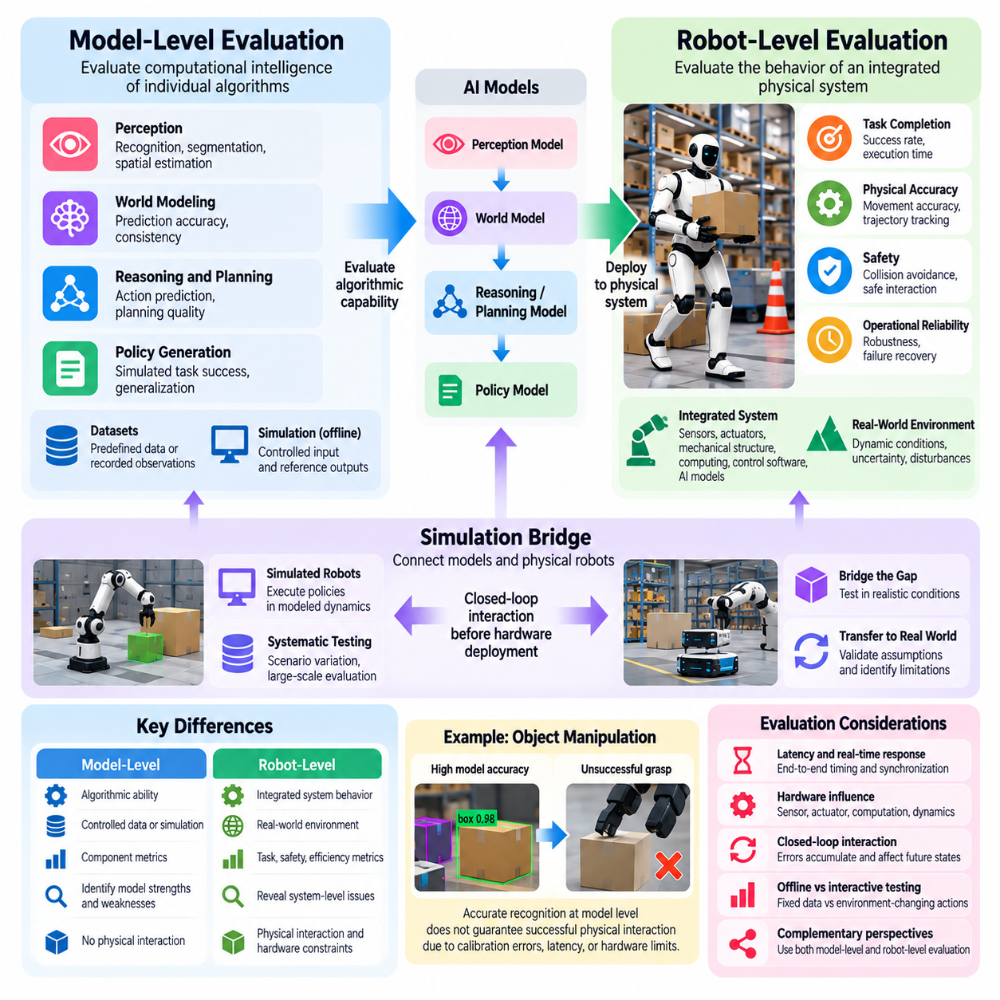{width="7.268055555555556in" height="7.268055555555556in"}

Model-level evaluation and robot-level evaluation represent two complementary perspectives for assessing Physical AI systems. Model-level evaluation examines the computational intelligence of individual algorithms, including perception, prediction, reasoning, and policy generation. Robot-level evaluation investigates how these algorithms perform when integrated with physical hardware. Distinguishing these levels is essential because strong model performance does not necessarily produce reliable embodied behavior.

Model-level evaluation focuses on the internal capabilities of artificial intelligence components under controlled computational conditions. Perception models may be assessed through recognition accuracy, segmentation quality, or spatial estimation error. World models may be evaluated through prediction accuracy and consistency, while planning and policy models may be examined through action prediction or simulated task success. These measurements help isolate algorithmic strengths and weaknesses.

Robot-level evaluation measures the behavior of an integrated physical system interacting with its environment. It considers the combined effects of sensors, actuators, mechanical structures, onboard computing, control software, and intelligent decision-making. Relevant outcomes include task completion, movement accuracy, interaction safety, execution time, and operational reliability. The evaluation target is the robot\'s observable behavior rather than an isolated computational output.

The distinction becomes apparent when a perception model achieves high object detection accuracy but fails to support reliable manipulation. Small localization errors, sensor calibration problems, or processing delays may cause unsuccessful grasps despite accurate recognition results. Model-level evaluation may identify excellent visual understanding, while robot-level testing reveals limitations in physical interaction. Both perspectives are necessary to understand the actual source of failure.

Model-level benchmarks commonly rely on predefined datasets, recorded observations, or simulated environments. Such settings enable repeatable comparisons because input conditions and reference outputs can be controlled. Researchers can evaluate alternative architectures without requiring physical experiments for every modification. However, these benchmarks may overlook feedback effects, environmental changes, and hardware constraints that influence behavior during real-world operation.

Robot-level experiments introduce closed-loop interaction, where actions change the environment and subsequent observations influence future decisions. Errors can accumulate through repeated perception, planning, and control cycles. A small prediction error may alter a movement trajectory, creating new observations that differ from those expected by the model. Consequently, robot-level evaluation must examine dynamic behavior and error propagation rather than isolated prediction quality.

Hardware characteristics strongly influence the relationship between model-level and robot-level performance. Sensor resolution, actuator precision, mechanical compliance, computational capacity, and communication latency affect how algorithmic decisions translate into physical actions. An identical policy may perform differently across robot platforms because their dynamics and constraints differ. Evaluation should therefore document hardware configurations and distinguish model limitations from embodiment-dependent effects.

Latency illustrates why computational accuracy alone is insufficient for Physical AI evaluation. A model may generate highly accurate predictions but require excessive processing time, making its outputs unsuitable for real-time control. During the delay, objects or obstacles may move, invalidating the predicted state. Robot-level evaluation must therefore consider end-to-end response time, timing variability, and synchronization among perception, reasoning, planning, and actuation.

Model-level evaluation is particularly valuable for diagnosing individual components and accelerating development. Controlled tests can reveal whether performance degradation originates from perception errors, inaccurate dynamics predictions, poor action selection, or insufficient generalization. These findings guide targeted improvements before expensive physical testing. Nevertheless, isolated component gains should be treated as potential system improvements until their effects are verified through integrated experiments.

Robot-level evaluation captures interactions among components that cannot always be predicted from individual benchmark results. A perception system may produce accurate estimates, but inconsistent timestamps can undermine control stability. A planner may generate feasible trajectories that exceed actuator capabilities under real operating conditions. Integrated testing exposes interface mismatches, resource contention, and unexpected dependencies that remain hidden during separate model assessments.

Evaluation should also distinguish offline model testing from interactive robot testing. Offline evaluation measures outputs against fixed reference data without allowing predictions to influence subsequent observations. Interactive evaluation permits decisions and actions to alter future states, revealing behavioral consequences. This distinction is particularly important for reinforcement learning policies, vision-language-action models, and autonomous systems whose performance depends on continuous feedback.

Simulation provides an intermediate evaluation environment connecting computational models with physical robots. Simulated robots can execute policies within modeled dynamics, enabling closed-loop testing before hardware deployment. This approach supports systematic scenario variation and large-scale experimentation. However, simulation results depend on the fidelity of physical dynamics, sensing, contact interactions, and environmental representations, making real-world validation indispensable.

Robot-level evaluation should account for the operational design domain in which the system is expected to function. Environmental geometry, lighting, surface conditions, object properties, human activity, and communication availability influence observed performance. A robot may operate reliably within a controlled industrial workspace but fail in less structured environments. Evaluation conclusions must therefore remain tied to the conditions represented by the experiments.

Safety considerations further distinguish model-level and robot-level assessment. Model testing can identify unsafe predictions, inappropriate action proposals, or failures to recognize hazardous conditions. Robot testing must additionally determine whether actual movements, contact forces, stopping distances, and emergency responses remain within acceptable limits. Safety emerges from the complete interaction between intelligence, hardware, control mechanisms, and the surrounding physical environment.

Statistical reliability requires different experimental strategies at the two evaluation levels. Model-level benchmarks can often process large datasets efficiently, producing detailed accuracy distributions and confidence estimates. Physical robot experiments are generally more expensive, slower, and subject to environmental variability. Repeated trials, controlled conditions, calibrated measurements, and transparent reporting are therefore essential for distinguishing systematic performance differences from experimental noise.

Comparing model improvements with robot outcomes requires explicit attention to causal relationships. A higher perception accuracy score may not improve task completion if manipulation errors are dominated by actuator limitations. Conversely, a modest model improvement may produce substantial system benefits when it addresses a critical failure mode. Evaluation should examine whether algorithmic changes generate measurable improvements in integrated behavior under comparable operating conditions.

A hierarchical evaluation strategy can connect model-level, subsystem-level, robot-level, and mission-level measurements. Individual algorithms are first characterized through controlled tests, followed by integrated subsystem experiments and complete robot trials. Extended missions then assess whether improvements remain effective across sequences of actions. This progression supports efficient debugging while preserving a direct connection between computational advances and operational outcomes.

Cross-embodiment evaluation introduces additional complexity because the same model may operate on robots with different sensors, kinematics, and action spaces. A generalist policy may demonstrate transferable representations while requiring platform-specific adaptation for reliable execution. Model-level evaluation can assess representation quality and action prediction, while robot-level evaluation determines whether these capabilities translate into successful physical behavior across embodiments.

Resource efficiency should be measured at both levels but interpreted differently. Model-level measurements include inference latency, memory consumption, computational complexity, and processing throughput. Robot-level measurements additionally consider energy consumption, thermal constraints, battery endurance, communication overhead, and overall task efficiency. A computationally efficient model does not automatically guarantee efficient robotic operation when mechanical movement and system integration dominate resource usage.

Ultimately, model-level and robot-level evaluation should form a connected evidence framework rather than competing assessment methods. Model-level tests explain how individual intelligence components function, while robot-level experiments establish whether those capabilities produce dependable physical outcomes. Combining both perspectives enables meaningful diagnosis, fair comparison, and systematic improvement. Physical AI progress should be judged by computational advances that translate into safe, effective, and reliable real-world behavior.

모델 수준 평가(Model-Level Evaluation)와 로봇 수준 평가(Robot-Level Evaluation)는 피지컬 인공지능(Physical AI) 시스템을 평가하기 위한 상호보완적인 두 가지 관점을 나타낸다. 모델 수준 평가는 인식(Perception), 예측(Prediction), 추론(Reasoning), 정책 생성(Policy Generation)을 포함한 개별 알고리즘의 계산적 지능(Computational Intelligence)을 검토한다. 반면 로봇 수준 평가는 이러한 알고리즘이 물리적 하드웨어(Physical Hardware)와 통합되었을 때 어떻게 작동하는지를 조사한다. 높은 모델 성능이 반드시 신뢰할 수 있는 체화된 행동(Embodied Behavior)으로 이어지는 것은 아니므로 두 평가 수준을 구분하는 것이 중요하다.

모델 수준 평가(Model-Level Evaluation)는 통제된 계산 환경(Controlled Computational Conditions)에서 인공지능 구성요소(Artificial Intelligence Components)의 내부 능력을 평가하는 데 초점을 맞춘다. 인식 모델(Perception Models)은 인식 정확도(Recognition Accuracy), 분할 품질(Segmentation Quality), 공간 추정 오차(Spatial Estimation Error)를 통해 평가할 수 있다. 세계 모델(World Models)은 예측 정확도와 일관성(Consistency)을 기준으로 평가하며, 계획 모델(Planning Models)과 정책 모델(Policy Models)은 행동 예측(Action Prediction) 또는 시뮬레이션 작업 성공률(Simulated Task Success)을 통해 검토할 수 있다. 이러한 측정은 알고리즘의 강점과 약점을 개별적으로 식별하는 데 도움이 된다.

로봇 수준 평가(Robot-Level Evaluation)는 환경과 상호작용하는 통합 물리 시스템(Integrated Physical System)의 행동을 측정한다. 여기에는 센서(Sensors), 액추에이터(Actuators), 기계적 구조(Mechanical Structures), 온보드 컴퓨팅(Onboard Computing), 제어 소프트웨어(Control Software), 지능적 의사결정(Intelligent Decision-Making)의 결합된 효과가 포함된다. 주요 평가 결과에는 작업 완료(Task Completion), 이동 정확도(Movement Accuracy), 상호작용 안전성(Interaction Safety), 실행 시간(Execution Time), 운영 신뢰성(Operational Reliability)이 포함된다. 평가 대상은 분리된 계산 출력이 아니라 로봇의 관측 가능한 행동(Observable Behavior)이다.

이러한 차이는 인식 모델이 높은 객체 탐지 정확도(Object Detection Accuracy)를 달성하더라도 신뢰할 수 있는 조작(Manipulation)을 지원하지 못하는 경우에 명확하게 나타난다. 작은 위치 추정 오차(Localization Errors), 센서 보정 문제(Sensor Calibration Problems), 처리 지연(Processing Delays)은 정확한 인식 결과에도 불구하고 파지 실패(Grasp Failure)를 초래할 수 있다. 모델 수준 평가에서는 우수한 시각적 이해(Visual Understanding)가 확인되지만, 로봇 수준 시험에서는 물리적 상호작용의 한계가 드러날 수 있다. 실제 실패 원인을 이해하려면 두 관점이 모두 필요하다.

모델 수준 벤치마크(Model-Level Benchmarks)는 일반적으로 사전 정의된 데이터셋(Predefined Datasets), 기록된 관측 데이터(Recorded Observations), 시뮬레이션 환경(Simulated Environments)에 의존한다. 이러한 환경에서는 입력 조건(Input Conditions)과 참조 출력(Reference Outputs)을 통제할 수 있으므로 반복 가능한 비교가 가능하다. 연구자는 모든 수정 사항에 대해 물리적 실험을 수행하지 않고도 대안적인 아키텍처(Alternative Architectures)를 평가할 수 있다. 그러나 이러한 벤치마크는 실제 운영 중 행동에 영향을 미치는 피드백 효과(Feedback Effects), 환경 변화(Environmental Changes), 하드웨어 제약(Hardware Constraints)을 간과할 수 있다.

로봇 수준 실험(Robot-Level Experiments)은 행동이 환경을 변화시키고 후속 관측이 미래의 의사결정에 영향을 미치는 폐루프 상호작용(Closed-Loop Interaction)을 포함한다. 반복적인 인식, 계획, 제어 주기를 거치면서 오류가 누적될 수 있다. 작은 예측 오차(Prediction Error)가 이동 궤적(Movement Trajectory)을 변화시키고, 그 결과 모델이 예상한 것과 다른 새로운 관측을 발생시킬 수 있다. 따라서 로봇 수준 평가는 분리된 예측 품질(Isolated Prediction Quality)이 아니라 동적 행동(Dynamic Behavior)과 오류 전파(Error Propagation)를 검토해야 한다.

하드웨어 특성(Hardware Characteristics)은 모델 수준 성능과 로봇 수준 성능 사이의 관계에 큰 영향을 미친다. 센서 해상도(Sensor Resolution), 액추에이터 정밀도(Actuator Precision), 기계적 순응성(Mechanical Compliance), 연산 능력(Computational Capacity), 통신 지연(Communication Latency)은 알고리즘의 의사결정이 물리적 행동으로 변환되는 방식에 영향을 준다. 동일한 정책(Policy)이라도 로봇 플랫폼(Robot Platforms)의 동역학(Dynamics)과 제약이 다르기 때문에 서로 다른 성능을 나타낼 수 있다. 따라서 평가는 하드웨어 구성(Hardware Configurations)을 기록하고 모델 자체의 한계와 신체적 구현에 따른 영향(Embodiment-Dependent Effects)을 구분해야 한다.

지연 시간(Latency)은 계산 정확도(Computational Accuracy)만으로 피지컬 인공지능을 충분히 평가할 수 없는 이유를 보여준다. 모델이 매우 정확한 예측을 생성하더라도 처리 시간이 지나치게 길면 출력 결과가 실시간 제어(Real-Time Control)에 적합하지 않을 수 있다. 처리 지연 중 객체나 장애물이 이동하여 예측된 상태(Predicted State)가 더 이상 유효하지 않을 수 있다. 따라서 로봇 수준 평가는 종단 간 응답 시간(End-to-End Response Time), 시간 변동성(Timing Variability), 인식·추론·계획·구동 사이의 동기화(Synchronization)를 고려해야 한다.

모델 수준 평가는 개별 구성요소(Individual Components)의 문제를 진단하고 개발을 가속하는 데 특히 유용하다. 통제된 시험(Controlled Tests)은 성능 저하가 인식 오류(Perception Errors), 부정확한 동역학 예측(Inaccurate Dynamics Predictions), 부적절한 행동 선택(Poor Action Selection), 일반화 부족(Insufficient Generalization) 중 어디에서 발생하는지를 밝혀낼 수 있다. 이러한 결과는 비용이 많이 드는 물리적 시험 전에 목표 지향적인 개선(Targeted Improvements)을 수행하도록 지원한다. 그러나 개별 구성요소의 성능 향상은 통합 실험(Integrated Experiments)을 통해 효과가 검증되기 전까지 잠재적인 시스템 개선으로 간주해야 한다.

로봇 수준 평가는 개별 벤치마크 결과만으로 항상 예측할 수 없는 구성요소 간 상호작용(Interactions Among Components)을 포착한다. 인식 시스템이 정확한 추정값을 생성하더라도 타임스탬프(Timestamps)가 일관되지 않으면 제어 안정성(Control Stability)이 저하될 수 있다. 계획기(Planner)가 실행 가능한 궤적(Feasible Trajectories)을 생성하더라도 실제 운영 조건에서 액추에이터의 능력을 초과할 수 있다. 통합 시험(Integrated Testing)은 개별 모델 평가에서 드러나지 않는 인터페이스 불일치(Interface Mismatches), 자원 경합(Resource Contention), 예상하지 못한 의존성(Unexpected Dependencies)을 밝혀낸다.

평가에서는 오프라인 모델 시험(Offline Model Testing)과 상호작용형 로봇 시험(Interactive Robot Testing)도 구분해야 한다. 오프라인 평가는 예측 결과가 후속 관측에 영향을 미치지 않는 상태에서 고정된 참조 데이터(Fixed Reference Data)와 출력을 비교한다. 반면 상호작용형 평가는 의사결정과 행동이 미래 상태(Future States)를 변화시키도록 허용하여 행동의 결과(Behavioral Consequences)를 드러낸다. 이러한 구분은 성능이 연속적인 피드백(Continuous Feedback)에 의존하는 강화학습 정책(Reinforcement Learning Policies), 비전-언어-행동 모델(Vision-Language-Action Models), 자율 시스템(Autonomous Systems)에서 특히 중요하다.

시뮬레이션(Simulation)은 계산 모델(Computational Models)과 물리적 로봇(Physical Robots)을 연결하는 중간 평가 환경(Intermediate Evaluation Environment)을 제공한다. 시뮬레이션 로봇(Simulated Robots)은 모델링된 동역학(Modeled Dynamics) 안에서 정책을 실행할 수 있으므로 하드웨어 배치(Hardware Deployment) 전에 폐루프 시험(Closed-Loop Testing)을 수행할 수 있다. 이러한 접근법은 체계적인 시나리오 변화(Systematic Scenario Variation)와 대규모 실험(Large-Scale Experimentation)을 지원한다. 그러나 시뮬레이션 결과는 물리 동역학, 센싱, 접촉 상호작용(Contact Interactions), 환경 표현(Environmental Representations)의 충실도(Fidelity)에 의존하므로 실제 환경 검증(Real-World Validation)이 필수적이다.

로봇 수준 평가는 시스템이 작동하도록 설계된 운영 설계 영역(Operational Design Domain)을 고려해야 한다. 환경 기하학(Environmental Geometry), 조명(Lighting), 표면 상태(Surface Conditions), 객체 속성(Object Properties), 인간 활동(Human Activity), 통신 가용성(Communication Availability)은 관측되는 성능에 영향을 미친다. 로봇은 통제된 산업 작업 공간(Controlled Industrial Workspace)에서는 안정적으로 작동하지만 구조화되지 않은 환경(Unstructured Environments)에서는 실패할 수 있다. 따라서 평가 결론은 실험에서 대표된 조건과 연계하여 해석해야 한다.

안전성(Safety)은 모델 수준 평가와 로봇 수준 평가를 더욱 명확하게 구분하는 요소이다. 모델 시험(Model Testing)은 안전하지 않은 예측(Unsafe Predictions), 부적절한 행동 제안(Inappropriate Action Proposals), 위험 조건 인식 실패(Failure to Recognize Hazardous Conditions)를 식별할 수 있다. 로봇 시험(Robot Testing)은 추가적으로 실제 움직임(Actual Movements), 접촉력(Contact Forces), 정지 거리(Stopping Distances), 비상 대응(Emergency Responses)이 허용 가능한 한계 내에 유지되는지를 판단해야 한다. 안전성은 지능, 하드웨어, 제어 메커니즘(Control Mechanisms), 주변 물리 환경 사이의 전체 상호작용에서 형성된다.

통계적 신뢰성(Statistical Reliability)을 확보하려면 두 평가 수준에서 서로 다른 실험 전략(Experimental Strategies)이 필요하다. 모델 수준 벤치마크는 일반적으로 대규모 데이터셋(Large Datasets)을 효율적으로 처리하여 상세한 정확도 분포(Accuracy Distributions)와 신뢰도 추정(Confidence Estimates)을 생성할 수 있다. 반면 물리적 로봇 실험(Physical Robot Experiments)은 일반적으로 비용이 더 많이 들고, 시간이 오래 걸리며, 환경 변동성(Environmental Variability)의 영향을 받는다. 따라서 반복 시험(Repeated Trials), 통제된 조건(Controlled Conditions), 보정된 측정(Calibrated Measurements), 투명한 보고(Transparent Reporting)는 체계적인 성능 차이(Systematic Performance Differences)와 실험 잡음(Experimental Noise)을 구분하는 데 필수적이다.

모델 개선(Model Improvements)과 로봇의 실제 결과(Robot Outcomes)를 비교하려면 인과관계(Causal Relationships)에 명시적으로 주목해야 한다. 조작 오류(Manipulation Errors)가 주로 액추에이터의 한계(Actuator Limitations)에 의해 발생한다면 인식 정확도가 향상되더라도 작업 완료율(Task Completion Rate)은 개선되지 않을 수 있다. 반대로 핵심적인 실패 유형(Critical Failure Mode)을 해결하는 작은 모델 개선은 상당한 시스템 수준의 이점(System-Level Benefits)을 제공할 수 있다. 평가는 알고리즘 변경(Algorithmic Changes)이 비교 가능한 운영 조건(Comparable Operating Conditions)에서 통합 행동(Integrated Behavior)의 측정 가능한 개선을 발생시키는지 검토해야 한다.

계층적 평가 전략(Hierarchical Evaluation Strategy)은 모델 수준(Model-Level), 하위 시스템 수준(Subsystem-Level), 로봇 수준(Robot-Level), 임무 수준(Mission-Level)의 측정을 연결할 수 있다. 개별 알고리즘은 먼저 통제된 시험을 통해 특성을 분석하고, 이후 통합 하위 시스템 실험(Integrated Subsystem Experiments)과 완전한 로봇 시험(Complete Robot Trials)을 수행한다. 확장된 임무(Extended Missions)는 개선 효과가 일련의 행동 전반에서 유지되는지를 평가한다. 이러한 단계적 접근법(Progressive Approach)은 효율적인 디버깅(Debugging)을 지원하면서 계산적 발전(Computational Advances)과 운영 결과(Operational Outcomes) 사이의 직접적인 연관성을 유지한다.

서로 다른 신체적 구현 간 평가(Cross-Embodiment Evaluation)는 동일한 모델이 서로 다른 센서, 운동학(Kinematics), 행동 공간(Action Spaces)을 가진 로봇에서 작동할 수 있기 때문에 추가적인 복잡성을 발생시킨다. 범용 정책(Generalist Policy)은 전이 가능한 표현(Transferable Representations)을 보여주더라도 안정적인 실행을 위해 플랫폼별 적응(Platform-Specific Adaptation)이 필요할 수 있다. 모델 수준 평가는 표현 품질(Representation Quality)과 행동 예측(Action Prediction)을 평가할 수 있으며, 로봇 수준 평가는 이러한 능력이 다양한 신체적 구현에서 성공적인 물리적 행동으로 이어지는지를 판단한다.

자원 효율성(Resource Efficiency)은 두 수준 모두에서 측정해야 하지만 서로 다르게 해석해야 한다. 모델 수준 측정에는 추론 지연(Inference Latency), 메모리 소비(Memory Consumption), 계산 복잡도(Computational Complexity), 처리량(Processing Throughput)이 포함된다. 로봇 수준 측정에서는 에너지 소비(Energy Consumption), 열적 제약(Thermal Constraints), 배터리 지속 시간(Battery Endurance), 통신 오버헤드(Communication Overhead), 전체 작업 효율성(Overall Task Efficiency)을 추가로 고려한다. 기계적 움직임(Mechanical Movement)과 시스템 통합(System Integration)이 자원 사용을 지배하는 경우, 계산 효율이 높은 모델이 반드시 효율적인 로봇 운영을 보장하지는 않는다.

궁극적으로 모델 수준 평가와 로봇 수준 평가는 서로 경쟁하는 평가 방법이 아니라 연결된 증거 프레임워크(Connected Evidence Framework)를 형성해야 한다. 모델 수준 시험은 개별 지능 구성요소(Intelligence Components)가 어떻게 작동하는지를 설명하며, 로봇 수준 실험은 이러한 능력이 신뢰할 수 있는 물리적 결과(Dependable Physical Outcomes)를 생성하는지를 입증한다. 두 관점을 결합하면 의미 있는 진단(Meaningful Diagnosis), 공정한 비교(Fair Comparison), 체계적인 개선(Systematic Improvement)이 가능해진다. 피지컬 인공지능의 발전은 계산적 진보가 안전하고 효과적이며 신뢰할 수 있는 실제 세계의 행동(Real-World Behavior)으로 전환되는 정도를 기준으로 평가해야 한다.

##  

## 01.04. Task Level vs System Level Evaluation

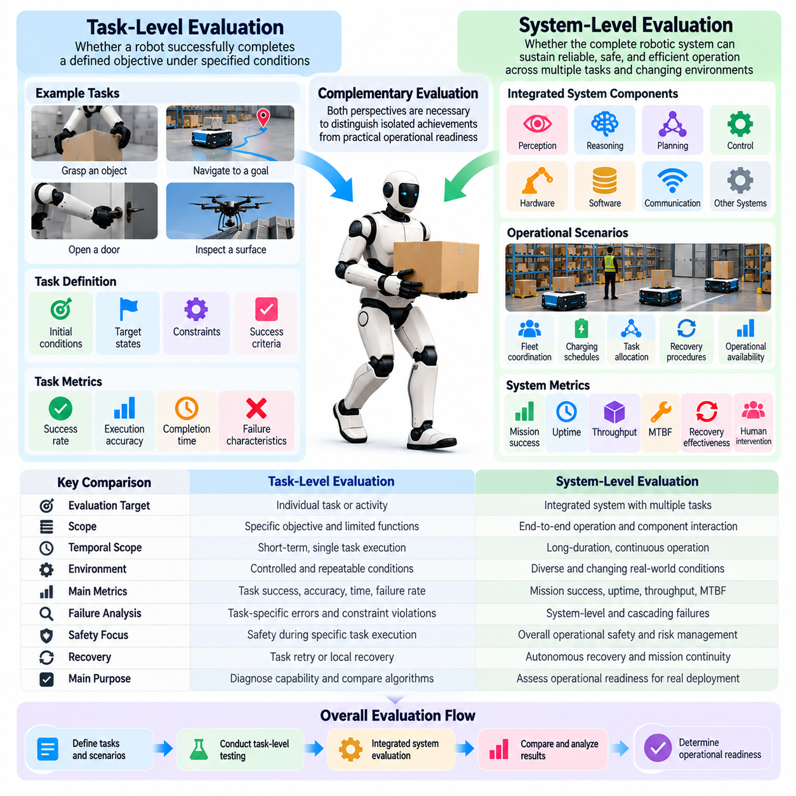{width="7.268055555555556in" height="7.268055555555556in"}

Task-level evaluation and system-level evaluation represent complementary approaches to measuring Physical AI performance. Task-level evaluation examines whether a robot successfully completes a defined objective under specified conditions. System-level evaluation investigates whether the complete robotic system can sustain reliable, safe, and efficient operation across multiple tasks and changing environments. Both perspectives are necessary to distinguish isolated achievements from practical operational readiness.

Task-level evaluation focuses on observable outcomes associated with individual activities such as grasping an object, navigating toward a destination, opening a door, or inspecting a surface. Each task is defined through initial conditions, target states, constraints, and success criteria. This approach enables precise measurement of task completion, execution accuracy, duration, and failure characteristics while limiting the complexity introduced by unrelated system functions.

System-level evaluation considers the integrated behavior of perception, reasoning, planning, control, hardware, communication, and supporting software. Rather than examining isolated activities, it investigates how these components cooperate during continuous operation. A robot may perform individual tasks successfully while experiencing system failures caused by resource contention, communication interruptions, inconsistent state estimates, or interactions among subsystems.

The distinction becomes apparent in warehouse automation. A mobile robot may achieve a high success rate when transporting individual containers between predefined locations. However, system-level evaluation must additionally consider fleet coordination, charging schedules, obstacle congestion, task allocation, recovery procedures, and operational availability. Reliable warehouse operation depends on the interaction of these functions rather than transportation accuracy alone.

Task-level evaluation requires explicit definitions of success and failure. A manipulation task may specify acceptable placement error, maximum contact force, and completion time. A navigation task may define destination tolerance, collision constraints, and permitted route deviations. These conditions make experiments reproducible and allow meaningful comparisons among alternative algorithms, robot configurations, and control strategies.

System-level success criteria are broader because they reflect operational objectives extending beyond individual task completion. Relevant measures include mission success, uptime, throughput, mean time between failures, recovery effectiveness, and human intervention frequency. System-level evaluation should also consider whether performance remains stable as workload increases, environmental conditions change, or individual components experience degradation.

Task-level metrics provide diagnostic resolution by identifying weaknesses in specific capabilities. For example, repeated grasping failures may indicate inaccurate object localization, unsuitable grasp planning, or insufficient actuator precision. By controlling experimental variables, evaluators can investigate these causes systematically. However, successful correction of an isolated task does not guarantee improved system performance when other operational constraints remain unchanged.

System-level evaluation reveals interactions that task-level tests may overlook. A perception algorithm may operate accurately during isolated trials but consume excessive computational resources when navigation and manipulation execute simultaneously. Similarly, independently reliable subsystems may interfere through timing conflicts, shared communication channels, or inconsistent representations. Integrated evaluation identifies such dependencies and their consequences for overall operation.

Temporal scope provides another important distinction. Task-level tests often measure short sequences with clear starting and ending conditions. System-level evaluation may involve hours or days of continuous operation, during which errors accumulate and resources fluctuate. Long-duration testing can expose memory leaks, thermal limitations, battery management problems, sensor drift, and gradual deterioration that remain invisible during brief demonstrations.

Task-level evaluation generally benefits from controlled experimental conditions that isolate the behavior being measured. Standardized objects, fixed environmental layouts, and repeatable starting configurations enable detailed comparisons. System-level evaluation requires broader operational variation to determine whether integrated performance remains dependable. These approaches serve different purposes, and neither controlled task testing nor unrestricted field operation is sufficient by itself.

Failure analysis must also operate at both levels. Task-level failures concern unsuccessful actions, violated constraints, or unacceptable execution quality. System-level failures may involve cascading effects in which a localized problem disrupts multiple functions. A delayed sensor update, for example, may affect localization, planning, motion control, and task scheduling. Evaluation should identify both immediate failure mechanisms and their broader operational consequences.

Recovery behavior is particularly important in system-level assessment. A robot may fail an individual task but detect the problem, revise its plan, and complete the overall mission. Conversely, a system may repeatedly succeed at isolated tasks while requiring manual resets after minor disturbances. Evaluators should therefore distinguish task success rates from mission continuity, autonomous recovery capability, and the operational cost of interruptions.

Safety requirements differ in scope between the two evaluation levels. Task-level safety examines whether individual actions respect collision limits, force thresholds, and workspace constraints. System-level safety considers interactions among simultaneous activities, shared resources, human operators, and environmental hazards. A locally safe action may create unsafe conditions elsewhere, making system-wide hazard assessment essential for dependable deployment.

Efficiency must also be interpreted according to evaluation scope. Task-level efficiency measures execution time, energy consumption, trajectory length, or computational cost for a specific activity. System-level efficiency includes utilization, scheduling effectiveness, charging overhead, maintenance requirements, and total operational throughput. Optimizing an individual task may not improve overall productivity when system bottlenecks occur in other processes.

System-level evaluation should examine the relationship between operational workload and performance. Increasing task frequency or environmental complexity can reveal limitations in computational scheduling, communication capacity, and resource allocation. A robot that performs reliably under light workloads may become unstable when multiple objectives compete for attention. Such tests establish practical capacity limits and identify conditions where performance begins to degrade.

Human involvement provides another distinction between task-level and system-level performance. Individual task tests may allow predefined initialization or occasional operator assistance. Continuous system operation requires explicit accounting for supervision, remote intervention, maintenance, and recovery support. A system that achieves high task success through frequent human assistance may provide limited autonomy. Evaluation should therefore report intervention requirements alongside operational outcomes.

Simulation can support both evaluation levels through different experimental designs. Task-level simulation enables repeated testing of specific manipulation, navigation, or control scenarios. System-level simulation models interactions among subsystems, workloads, operational schedules, and environmental changes. Although simulation supports scalable experimentation, physical testing remains necessary to validate assumptions concerning hardware behavior, communication delays, and real-world disturbances.

Statistical interpretation should reflect the hierarchical relationship between tasks and systems. Individual task success probabilities do not directly determine complete mission reliability because failures may be correlated and recovery mechanisms may alter outcomes. Repeated system trials are necessary to estimate operational success and variability. Evaluation should report confidence intervals, scenario coverage, and relevant dependencies rather than extrapolating system performance from isolated task averages.

A comprehensive evaluation framework should connect task-level measurements with subsystem, robot, and mission-level outcomes. Task benchmarks identify specific functional strengths, while system benchmarks determine whether these capabilities cooperate effectively during realistic operation. This hierarchical approach supports debugging, architectural comparison, and deployment decisions. It also reveals whether improvements in individual tasks produce meaningful benefits for the complete system.

Ultimately, task-level evaluation answers how effectively Physical AI performs particular activities, while system-level evaluation determines whether those activities combine into dependable operational behavior. Task success provides essential evidence of functional capability, but sustained system performance establishes practical value. Integrating both perspectives enables Physical AI evaluation to measure not only isolated intelligence but also reliable autonomy under real physical constraints.

작업 수준 평가(Task-Level Evaluation)와 시스템 수준 평가(System-Level Evaluation)는 피지컬 인공지능(Physical AI)의 성능을 측정하기 위한 상호보완적인 접근법이다. 작업 수준 평가는 로봇이 특정 조건에서 정의된 목표를 성공적으로 완료하는지를 검토한다. 반면 시스템 수준 평가는 완전한 로봇 시스템(Complete Robotic System)이 여러 작업과 변화하는 환경에서 신뢰할 수 있고 안전하며 효율적인 운영을 지속할 수 있는지를 조사한다. 두 관점은 개별적인 성과(Isolated Achievements)와 실제 운영 준비도(Operational Readiness)를 구분하는 데 모두 필요하다.

작업 수준 평가(Task-Level Evaluation)는 객체 파지(Object Grasping), 목적지까지의 주행(Navigation), 문 열기(Door Opening), 표면 검사(Surface Inspection)와 같은 개별 활동의 관측 가능한 결과(Observable Outcomes)에 초점을 맞춘다. 각 작업은 초기 조건(Initial Conditions), 목표 상태(Target States), 제약 조건(Constraints), 성공 기준(Success Criteria)을 통해 정의된다. 이러한 접근법은 관련 없는 시스템 기능에서 발생하는 복잡성을 제한하면서 작업 완료(Task Completion), 실행 정확도(Execution Accuracy), 소요 시간(Duration), 실패 특성(Failure Characteristics)을 정밀하게 측정할 수 있도록 한다.

시스템 수준 평가(System-Level Evaluation)는 인식(Perception), 추론(Reasoning), 계획(Planning), 제어(Control), 하드웨어(Hardware), 통신(Communication), 지원 소프트웨어(Supporting Software)의 통합된 행동(Integrated Behavior)을 고려한다. 개별 활동을 분리하여 검토하기보다 이러한 구성요소가 연속적인 운영(Continuous Operation) 과정에서 어떻게 협력하는지를 조사한다. 로봇은 개별 작업을 성공적으로 수행하더라도 자원 경합(Resource Contention), 통신 중단(Communication Interruptions), 일관되지 않은 상태 추정(Inconsistent State Estimates), 하위 시스템 간 상호작용(Subsystem Interactions)으로 인해 시스템 장애(System Failures)를 경험할 수 있다.

이러한 차이는 창고 자동화(Warehouse Automation)에서 명확하게 나타난다. 이동 로봇(Mobile Robot)은 사전에 정의된 위치 사이에서 개별 컨테이너(Container)를 운반할 때 높은 성공률을 달성할 수 있다. 그러나 시스템 수준 평가에서는 추가적으로 군집 로봇 조정(Fleet Coordination), 충전 일정(Charging Schedules), 장애물 혼잡(Obstacle Congestion), 작업 할당(Task Allocation), 복구 절차(Recovery Procedures), 운영 가용성(Operational Availability)을 고려해야 한다. 신뢰할 수 있는 창고 운영은 단순한 운반 정확도가 아니라 이러한 기능 사이의 상호작용에 의존한다.

작업 수준 평가에는 성공과 실패에 대한 명시적인 정의가 필요하다. 조작 작업(Manipulation Task)은 허용 가능한 배치 오차(Placement Error), 최대 접촉력(Maximum Contact Force), 완료 시간(Completion Time)을 지정할 수 있다. 주행 작업(Navigation Task)은 목적지 허용 오차(Destination Tolerance), 충돌 제약(Collision Constraints), 허용 경로 편차(Permitted Route Deviations)를 정의할 수 있다. 이러한 조건은 실험의 재현성(Reproducibility)을 높이고 서로 다른 알고리즘(Algorithms), 로봇 구성(Robot Configurations), 제어 전략(Control Strategies) 사이의 의미 있는 비교를 가능하게 한다.

시스템 수준의 성공 기준(System-Level Success Criteria)은 개별 작업 완료를 넘어서는 운영 목표(Operational Objectives)를 반영하므로 범위가 더 넓다. 관련 측정 항목에는 임무 성공(Mission Success), 가동 시간(Uptime), 처리량(Throughput), 평균 고장 간격(Mean Time Between Failures), 복구 효과성(Recovery Effectiveness), 인간 개입 빈도(Human Intervention Frequency)가 포함된다. 시스템 수준 평가는 작업 부하(Workload)가 증가하거나 환경 조건이 변화하거나 개별 구성요소의 성능이 저하될 때도 성능이 안정적으로 유지되는지를 고려해야 한다.

작업 수준 지표(Task-Level Metrics)는 특정 능력의 약점을 식별할 수 있는 진단적 해상도(Diagnostic Resolution)를 제공한다. 예를 들어 반복적인 파지 실패(Grasping Failures)는 부정확한 객체 위치 추정(Object Localization), 부적절한 파지 계획(Grasp Planning), 부족한 액추에이터 정밀도(Actuator Precision)를 나타낼 수 있다. 평가자는 실험 변수(Experimental Variables)를 통제하여 이러한 원인을 체계적으로 조사할 수 있다. 그러나 다른 운영 제약이 변하지 않는다면 개별 작업의 문제를 해결하더라도 시스템 성능(System Performance)이 반드시 향상되는 것은 아니다.

시스템 수준 평가는 작업 수준 시험에서 간과할 수 있는 상호작용(Interactions)을 드러낸다. 인식 알고리즘(Perception Algorithm)은 개별 시험에서는 정확하게 작동하더라도 주행과 조작이 동시에 실행될 때 과도한 연산 자원(Computational Resources)을 소비할 수 있다. 마찬가지로 독립적으로는 신뢰할 수 있는 하위 시스템(Subsystems)이라도 타이밍 충돌(Timing Conflicts), 공유 통신 채널(Shared Communication Channels), 일관되지 않은 표현(Inconsistent Representations)으로 인해 서로 간섭할 수 있다. 통합 평가(Integrated Evaluation)는 이러한 의존성과 전체 운영에 미치는 영향을 식별한다.

시간적 범위(Temporal Scope)는 또 다른 중요한 차이점이다. 작업 수준 시험은 일반적으로 명확한 시작 조건과 종료 조건을 가진 짧은 행동 시퀀스(Short Sequences)를 측정한다. 반면 시스템 수준 평가는 수 시간 또는 수일 동안의 연속 운영(Continuous Operation)을 포함할 수 있으며, 이 과정에서 오류가 누적되고 자원이 변동한다. 장시간 시험(Long-Duration Testing)은 짧은 시연에서는 드러나지 않는 메모리 누수(Memory Leaks), 열적 한계(Thermal Limitations), 배터리 관리 문제(Battery Management Problems), 센서 드리프트(Sensor Drift), 점진적인 성능 저하(Gradual Deterioration)를 발견할 수 있다.

작업 수준 평가는 일반적으로 측정하려는 행동을 분리할 수 있는 통제된 실험 조건(Controlled Experimental Conditions)에서 이점을 얻는다. 표준화된 객체(Standardized Objects), 고정된 환경 배치(Fixed Environmental Layouts), 반복 가능한 초기 구성(Repeatable Starting Configurations)은 상세한 비교를 가능하게 한다. 시스템 수준 평가는 통합 성능(Integrated Performance)이 신뢰할 수 있는 상태로 유지되는지를 판단하기 위해 더 넓은 운영 조건의 변화(Operational Variation)를 요구한다. 두 접근법은 서로 다른 목적을 가지며, 통제된 작업 시험이나 제한 없는 현장 운영(Unrestricted Field Operation) 중 어느 하나만으로는 충분하지 않다.

실패 분석(Failure Analysis)도 두 수준 모두에서 수행해야 한다. 작업 수준 실패(Task-Level Failures)는 행동 실패(Unsuccessful Actions), 제약 위반(Constraint Violations), 허용할 수 없는 실행 품질(Unacceptable Execution Quality)과 관련된다. 시스템 수준 실패(System-Level Failures)는 국지적인 문제(Localized Problem)가 여러 기능을 방해하는 연쇄적 영향(Cascading Effects)을 포함할 수 있다. 예를 들어 지연된 센서 갱신(Delayed Sensor Update)은 위치 추정(Localization), 계획, 운동 제어(Motion Control), 작업 일정 관리(Task Scheduling)에 영향을 줄 수 있다. 평가는 직접적인 실패 메커니즘(Failure Mechanisms)과 더 넓은 운영상 결과(Operational Consequences)를 모두 식별해야 한다.

복구 행동(Recovery Behavior)은 시스템 수준 평가에서 특히 중요하다. 로봇은 개별 작업에 실패하더라도 문제를 감지하고 계획을 수정하여 전체 임무를 완료할 수 있다. 반대로 시스템이 개별 작업에서는 반복적으로 성공하더라도 사소한 외란(Minor Disturbances)이 발생할 때마다 수동 재설정(Manual Resets)이 필요할 수 있다. 따라서 평가자는 작업 성공률(Task Success Rates)과 임무 연속성(Mission Continuity), 자율 복구 능력(Autonomous Recovery Capability), 운영 중단 비용(Operational Cost of Interruptions)을 구분해야 한다.

안전 요구사항(Safety Requirements)은 두 평가 수준에서 적용 범위가 다르다. 작업 수준 안전성(Task-Level Safety)은 개별 행동이 충돌 한계(Collision Limits), 힘 임계값(Force Thresholds), 작업 공간 제약(Workspace Constraints)을 준수하는지를 검토한다. 시스템 수준 안전성(System-Level Safety)은 동시 수행 활동(Simultaneous Activities), 공유 자원(Shared Resources), 인간 운영자(Human Operators), 환경 위험(Environmental Hazards) 사이의 상호작용을 고려한다. 국지적으로 안전한 행동(Local Safe Action)이 다른 위치에서 위험한 조건을 만들 수 있으므로 신뢰할 수 있는 배치를 위해 시스템 전체 위험 평가(System-Wide Hazard Assessment)가 필수적이다.

효율성(Efficiency) 역시 평가 범위에 따라 다르게 해석해야 한다. 작업 수준 효율성(Task-Level Efficiency)은 특정 활동의 실행 시간(Execution Time), 에너지 소비(Energy Consumption), 궤적 길이(Trajectory Length), 계산 비용(Computational Cost)을 측정한다. 시스템 수준 효율성(System-Level Efficiency)은 자원 활용률(Utilization), 일정 관리 효과성(Scheduling Effectiveness), 충전 오버헤드(Charging Overhead), 유지보수 요구사항(Maintenance Requirements), 전체 운영 처리량(Total Operational Throughput)을 포함한다. 시스템 병목 현상(System Bottlenecks)이 다른 프로세스에서 발생한다면 개별 작업을 최적화하더라도 전체 생산성(Overall Productivity)이 향상되지 않을 수 있다.

시스템 수준 평가는 운영 작업 부하(Operational Workload)와 성능 사이의 관계를 검토해야 한다. 작업 빈도(Task Frequency)나 환경 복잡도(Environmental Complexity)가 증가하면 연산 일정 관리(Computational Scheduling), 통신 용량(Communication Capacity), 자원 할당(Resource Allocation)의 한계가 드러날 수 있다. 낮은 작업 부하에서는 안정적으로 작동하는 로봇이라도 여러 목표가 동시에 자원을 요구하면 불안정해질 수 있다. 이러한 시험은 실제 처리 용량 한계(Practical Capacity Limits)를 확립하고 성능 저하가 시작되는 조건을 식별한다.

인간의 관여(Human Involvement)는 작업 수준 성능과 시스템 수준 성능을 구분하는 또 다른 요소이다. 개별 작업 시험에서는 사전에 정의된 초기화(Predefined Initialization)나 간헐적인 운영자 지원(Operator Assistance)을 허용할 수 있다. 그러나 연속적인 시스템 운영에서는 감독(Supervision), 원격 개입(Remote Intervention), 유지보수(Maintenance), 복구 지원(Recovery Support)을 명시적으로 고려해야 한다. 빈번한 인간 지원을 통해 높은 작업 성공률을 달성하는 시스템은 자율성(Autonomy)이 제한적일 수 있다. 따라서 평가는 운영 결과와 함께 개입 요구사항(Intervention Requirements)을 보고해야 한다.

시뮬레이션(Simulation)은 서로 다른 실험 설계(Experimental Designs)를 통해 두 평가 수준을 모두 지원할 수 있다. 작업 수준 시뮬레이션(Task-Level Simulation)은 특정 조작, 주행, 제어 시나리오(Control Scenarios)에 대한 반복 시험을 가능하게 한다. 시스템 수준 시뮬레이션(System-Level Simulation)은 하위 시스템, 작업 부하, 운영 일정(Operational Schedules), 환경 변화 사이의 상호작용을 모델링한다. 시뮬레이션은 확장 가능한 실험(Scalable Experimentation)을 지원하지만, 하드웨어 행동(Hardware Behavior), 통신 지연(Communication Delays), 실제 환경 외란(Real-World Disturbances)에 관한 가정을 검증하기 위해서는 물리적 시험(Physical Testing)이 필요하다.

통계적 해석(Statistical Interpretation)은 작업과 시스템 사이의 계층적 관계(Hierarchical Relationship)를 반영해야 한다. 개별 작업 성공 확률(Task Success Probabilities)이 전체 임무 신뢰성(Mission Reliability)을 직접 결정하지는 않는다. 실패가 서로 상관관계(Correlation)를 가질 수 있고 복구 메커니즘(Recovery Mechanisms)이 결과를 변화시킬 수 있기 때문이다. 운영 성공률(Operational Success)과 변동성(Variability)을 추정하려면 반복적인 시스템 시험(Repeated System Trials)이 필요하다. 평가는 개별 작업의 평균값만으로 시스템 성능을 외삽(Extrapolation)하기보다 신뢰구간(Confidence Intervals), 시나리오 포괄 범위(Scenario Coverage), 관련 의존성(Relevant Dependencies)을 보고해야 한다.

포괄적인 평가 프레임워크(Comprehensive Evaluation Framework)는 작업 수준 측정(Task-Level Measurements)을 하위 시스템(Subsystem), 로봇(Robot), 임무 수준(Mission-Level)의 결과와 연결해야 한다. 작업 벤치마크(Task Benchmarks)는 특정 기능의 강점을 식별하며, 시스템 벤치마크(System Benchmarks)는 이러한 능력이 실제 운영 과정에서 효과적으로 협력하는지를 판단한다. 이러한 계층적 접근법(Hierarchical Approach)은 디버깅(Debugging), 아키텍처 비교(Architectural Comparison), 배치 의사결정(Deployment Decisions)을 지원한다. 또한 개별 작업의 개선이 전체 시스템에 의미 있는 이점을 제공하는지도 밝혀낸다.

궁극적으로 작업 수준 평가(Task-Level Evaluation)는 피지컬 인공지능이 특정 활동을 얼마나 효과적으로 수행하는지에 답하며, 시스템 수준 평가(System-Level Evaluation)는 이러한 활동이 결합되어 신뢰할 수 있는 운영 행동(Dependable Operational Behavior)을 형성하는지를 판단한다. 작업 성공(Task Success)은 기능적 능력(Functional Capability)에 대한 필수적인 증거를 제공하지만, 지속적인 시스템 성능(Sustained System Performance)은 실제적 가치(Practical Value)를 입증한다. 두 관점을 통합하면 피지컬 인공지능 평가는 개별적인 지능(Isolated Intelligence)뿐 아니라 실제 물리적 제약(Real Physical Constraints) 아래에서의 신뢰할 수 있는 자율성(Reliable Autonomy)까지 측정할 수 있다.

##  

## 01.05. Offline vs Interactive Evaluation

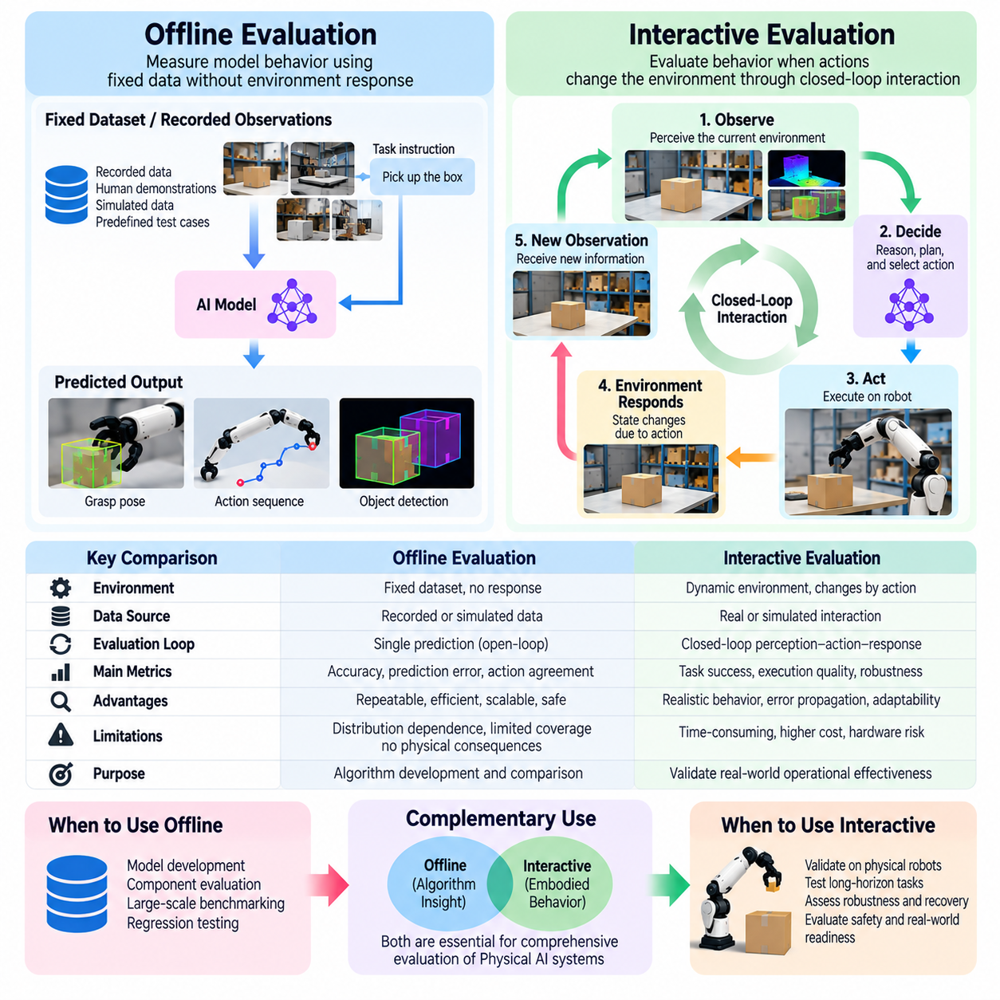{width="7.268055555555556in" height="7.268055555555556in"}

Offline evaluation and interactive evaluation represent two fundamental approaches to assessing Physical AI systems. Offline evaluation measures model behavior using previously collected datasets, recorded observations, or predefined test cases without allowing predictions to influence the environment. Interactive evaluation examines how an intelligent system behaves when its decisions and actions change subsequent observations. Both approaches provide essential but different evidence of intelligence.

Offline evaluation is particularly useful for examining perception, prediction, reasoning, and action-generation models under controlled conditions. A model receives fixed inputs and produces outputs that can be compared against reference labels, recorded actions, or expected outcomes. Because the environment does not respond to these outputs, experiments are highly repeatable. This makes offline testing valuable for algorithm development, regression analysis, and standardized benchmarking.

Interactive evaluation introduces a continuous relationship between observation, decision-making, action, and environmental response. The system observes its surroundings, selects an action, executes it, and receives new information resulting from that action. This process creates a feedback loop in which earlier decisions influence future conditions. Evaluation must therefore consider complete behavioral trajectories rather than treating individual predictions as independent events.

The distinction becomes clear in robotic manipulation. During offline evaluation, a vision-language-action model may predict grasp poses or motor commands from recorded camera images and instructions. These predictions can be compared with demonstration data, but their physical consequences remain unobserved. Interactive evaluation requires the robot to execute the predicted actions and determine whether the object is successfully grasped, transported, and placed.

Offline evaluation offers significant advantages in experimental control and computational efficiency. Large datasets can be processed repeatedly without consuming robot operating time or exposing hardware to physical risks. Researchers can compare architectures, training procedures, and model checkpoints using identical inputs. However, strong offline performance does not guarantee successful physical execution because recorded datasets cannot fully represent the consequences of alternative actions.

Interactive evaluation addresses this limitation by allowing actions to affect environmental states. A navigation robot that chooses an incorrect direction may encounter unfamiliar obstacles, lose localization accuracy, or require replanning. These consequences become part of subsequent evaluation. Such interactions reveal how perception errors, planning mistakes, and control limitations propagate through the system, potentially producing outcomes that fixed-data testing cannot predict.

A central limitation of offline evaluation is distribution dependence. Recorded observations typically reflect the behavior of the policies or operators that generated them. A new policy may select actions leading to states that are rare or absent from the dataset. Consequently, prediction accuracy on recorded examples may provide limited evidence about performance under the new policy\'s own state distribution. Interactive testing directly exposes these distribution shifts.

Offline policy evaluation attempts to estimate the effectiveness of decision-making strategies using previously collected interaction data. Methods such as importance sampling, model-based estimation, and fitted value estimation can support this objective. However, their reliability depends on assumptions about data coverage, behavior policies, and environment dynamics. When candidate actions are insufficiently represented, estimates may become uncertain or misleading.

Interactive evaluation can be conducted in simulation, controlled laboratories, or operational environments. Simulation provides scalable interaction and allows systematic manipulation of environmental variables. Laboratory experiments introduce actual hardware dynamics while maintaining experimental control. Field testing exposes systems to realistic disturbances, unexpected events, and operational complexity. Each setting offers different levels of realism, cost, repeatability, and risk.

The evaluation of feedback behavior is especially important for autonomous Physical AI. Interactive systems must continuously update their understanding of the environment and adjust actions when conditions change. A robot may initially generate an incorrect trajectory but recover through subsequent observations and replanning. Offline metrics may penalize the initial prediction without recognizing successful recovery, whereas interactive evaluation can measure the complete adaptive process.

Interactive evaluation also exposes compounding errors over extended action sequences. Small deviations in perception or control can alter the robot\'s position, change future observations, and increase the likelihood of additional mistakes. These effects are particularly important in long-horizon manipulation, autonomous navigation, and mobile robot missions. Evaluation should measure whether errors remain bounded, accumulate progressively, or trigger effective recovery mechanisms.

Offline benchmarks generally support precise comparisons through fixed datasets and standardized metrics. Accuracy, prediction error, action agreement, and calibration quality can be measured consistently across candidate models. Nevertheless, agreement with recorded actions does not necessarily indicate optimal behavior because demonstrations may contain multiple valid solutions or suboptimal decisions. Offline scores should therefore be interpreted according to the limitations of their reference data.

Interactive benchmarks require explicit definitions of initial conditions, task objectives, environmental constraints, and termination criteria. Relevant metrics include task success rate, execution time, collision frequency, recovery effectiveness, and resource consumption. Because actions influence subsequent states, evaluation outcomes may vary considerably between trials. Repeated experiments and controlled scenario sampling are necessary to establish meaningful performance estimates.

Safety considerations strongly influence the choice between offline and interactive evaluation. Offline testing enables investigation of potentially dangerous scenarios without exposing humans or equipment to immediate physical hazards. Interactive testing provides stronger evidence about actual safety behavior but introduces operational risks. A responsible evaluation strategy should progressively validate systems through recorded data, simulation, supervised laboratory experiments, and carefully controlled field trials.

The relationship between offline and interactive evaluation is particularly important for reinforcement learning and imitation learning. Policies trained from demonstrations may achieve high action-prediction accuracy while failing when their own actions produce unfamiliar states. Interactive testing reveals whether learned policies can recover from deviations and maintain task progress. This distinction helps identify the gap between reproducing observed behavior and achieving autonomous competence.

Vision-language-action models introduce additional evaluation challenges because their outputs depend on visual observations, language instructions, and physical action representations. Offline tests can measure instruction understanding, action prediction, and generalization across recorded demonstrations. Interactive tests determine whether the model can execute instructions reliably despite changing object positions, ambiguous observations, contact dynamics, and unexpected task outcomes.

Interactive evaluation must also account for system-level constraints that offline model tests may overlook. Inference latency, sensor synchronization, actuator response, communication delays, and computational resource contention influence closed-loop performance. A model that produces accurate actions from recorded observations may respond too slowly during real operation. Evaluating the complete perception-to-action cycle is therefore necessary to establish operational suitability.

Statistical rigor requires recognizing that offline and interactive experiments produce different forms of evidence. Offline datasets often permit large sample sizes and deterministic comparisons, while interactive trials involve stochastic environmental responses and correlated trajectories. Confidence intervals, repeated trials, scenario diversity, and uncertainty reporting should reflect these differences. Comparisons must avoid treating offline prediction scores as direct substitutes for interactive task success.

A practical evaluation framework should connect offline and interactive testing through progressive validation. Offline benchmarks identify algorithmic weaknesses and support rapid development, while simulation-based interaction examines feedback behavior under controlled dynamics. Physical robot experiments then establish whether these capabilities transfer to actual hardware and environments. Discrepancies between evaluation stages provide valuable information about modeling assumptions and deployment limitations.

Ultimately, offline evaluation answers how accurately Physical AI models respond to recorded situations, while interactive evaluation determines how effectively complete systems behave when their actions influence the world. Offline testing provides efficiency, reproducibility, and diagnostic precision, whereas interactive testing reveals adaptation, error propagation, recovery, and operational reliability. Combining both approaches produces a more credible assessment of embodied intelligence and real-world readiness.

오프라인 평가(Offline Evaluation)와 상호작용형 평가(Interactive Evaluation)는 피지컬 인공지능(Physical AI) 시스템을 평가하기 위한 두 가지 기본적인 접근법이다. 오프라인 평가는 예측 결과가 환경에 영향을 미치지 않는 상태에서 이전에 수집된 데이터셋(Datasets), 기록된 관측 데이터(Recorded Observations), 사전에 정의된 시험 사례(Predefined Test Cases)를 사용하여 모델의 행동을 측정한다. 반면 상호작용형 평가는 지능형 시스템(Intelligent System)의 의사결정과 행동이 후속 관측을 변화시키는 상황에서 시스템이 어떻게 작동하는지를 검토한다. 두 접근법은 지능에 대한 서로 다르지만 필수적인 평가 근거를 제공한다.

오프라인 평가(Offline Evaluation)는 통제된 조건(Controlled Conditions)에서 인식(Perception), 예측(Prediction), 추론(Reasoning), 행동 생성(Action Generation) 모델을 검토하는 데 특히 유용하다. 모델은 고정된 입력(Fixed Inputs)을 받아 참조 레이블(Reference Labels), 기록된 행동(Recorded Actions), 예상 결과(Expected Outcomes)와 비교할 수 있는 출력을 생성한다. 환경이 이러한 출력에 반응하지 않기 때문에 실험의 반복 가능성(Repeatability)이 매우 높다. 따라서 오프라인 시험은 알고리즘 개발(Algorithm Development), 회귀 분석(Regression Analysis), 표준화된 벤치마킹(Standardized Benchmarking)에 중요한 가치를 제공한다.

상호작용형 평가(Interactive Evaluation)는 관측(Observation), 의사결정(Decision-Making), 행동(Action), 환경 반응(Environmental Response) 사이의 연속적인 관계를 도입한다. 시스템은 주변 환경을 관측하고, 행동을 선택하고, 이를 실행한 다음, 해당 행동의 결과로 생성된 새로운 정보를 수신한다. 이러한 과정은 이전 의사결정이 미래 조건에 영향을 미치는 피드백 루프(Feedback Loop)를 형성한다. 따라서 평가는 개별 예측을 독립적인 사건으로 취급하기보다 전체 행동 궤적(Behavioral Trajectories)을 고려해야 한다.

이러한 차이는 로봇 조작(Robotic Manipulation)에서 명확하게 나타난다. 오프라인 평가에서는 비전-언어-행동 모델(Vision-Language-Action Model)이 기록된 카메라 영상(Camera Images)과 명령(Instructions)을 바탕으로 파지 자세(Grasp Poses)나 모터 명령(Motor Commands)을 예측할 수 있다. 이러한 예측은 시연 데이터(Demonstration Data)와 비교할 수 있지만 실제 물리적 결과는 관측되지 않는다. 반면 상호작용형 평가에서는 로봇이 예측된 행동을 실행하고 객체를 성공적으로 파지(Grasp), 운반(Transport), 배치(Place)하는지를 확인해야 한다.

오프라인 평가는 실험 통제(Experimental Control)와 계산 효율성(Computational Efficiency) 측면에서 상당한 장점을 제공한다. 대규모 데이터셋(Large Datasets)은 로봇의 운영 시간을 소비하거나 하드웨어를 물리적 위험에 노출하지 않고 반복적으로 처리할 수 있다. 연구자는 동일한 입력을 사용하여 아키텍처(Architectures), 학습 절차(Training Procedures), 모델 체크포인트(Model Checkpoints)를 비교할 수 있다. 그러나 기록된 데이터셋은 대안적인 행동(Alternative Actions)의 결과를 완전히 표현할 수 없으므로 높은 오프라인 성능이 성공적인 물리적 실행을 보장하지는 않는다.

상호작용형 평가는 행동이 환경 상태(Environmental States)에 영향을 미치도록 허용함으로써 이러한 한계를 보완한다. 잘못된 방향을 선택한 주행 로봇(Navigation Robot)은 익숙하지 않은 장애물을 만나거나 위치 추정 정확도(Localization Accuracy)를 잃거나 재계획(Replanning)이 필요해질 수 있다. 이러한 결과는 후속 평가 과정의 일부가 된다. 이와 같은 상호작용은 인식 오류(Perception Errors), 계획 실수(Planning Mistakes), 제어 한계(Control Limitations)가 시스템 전체로 어떻게 전파되는지를 드러내며, 고정 데이터 시험(Fixed-Data Testing)으로는 예측하기 어려운 결과를 발생시킬 수 있다.

오프라인 평가의 핵심적인 한계 중 하나는 분포 의존성(Distribution Dependence)이다. 기록된 관측 데이터는 일반적으로 데이터를 생성한 정책(Policies)이나 운영자(Operators)의 행동을 반영한다. 새로운 정책(New Policy)은 데이터셋에서 드물게 나타나거나 전혀 존재하지 않는 상태로 이어지는 행동을 선택할 수 있다. 따라서 기록된 사례에 대한 예측 정확도(Prediction Accuracy)는 새로운 정책 자체의 상태 분포(State Distribution)에서 나타나는 성능을 충분히 설명하지 못할 수 있다. 상호작용형 시험은 이러한 분포 변화(Distribution Shifts)를 직접 드러낸다.

오프라인 정책 평가(Offline Policy Evaluation)는 이전에 수집된 상호작용 데이터(Interaction Data)를 사용하여 의사결정 전략(Decision-Making Strategies)의 효과를 추정하려는 접근법이다. 중요도 샘플링(Importance Sampling), 모델 기반 추정(Model-Based Estimation), 적합 가치 추정(Fitted Value Estimation)과 같은 방법을 활용할 수 있다. 그러나 이러한 방법의 신뢰성(Reliability)은 데이터 포괄 범위(Data Coverage), 행동 정책(Behavior Policies), 환경 동역학(Environment Dynamics)에 관한 가정에 의존한다. 후보 행동(Candidate Actions)이 충분히 표현되지 않은 경우 추정 결과는 불확실하거나 잘못된 판단을 유도할 수 있다.

상호작용형 평가는 시뮬레이션(Simulation), 통제된 실험실(Controlled Laboratories), 실제 운영 환경(Operational Environments)에서 수행할 수 있다. 시뮬레이션은 확장 가능한 상호작용(Scalable Interaction)을 제공하고 환경 변수(Environmental Variables)를 체계적으로 조정할 수 있도록 한다. 실험실 시험(Laboratory Experiments)은 실험 통제를 유지하면서 실제 하드웨어 동역학(Hardware Dynamics)을 도입한다. 현장 시험(Field Testing)은 현실적인 외란(Realistic Disturbances), 예상하지 못한 사건(Unexpected Events), 운영 복잡성(Operational Complexity)에 시스템을 노출한다. 각 환경은 현실성(Realism), 비용(Cost), 반복 가능성(Repeatability), 위험(Risk) 측면에서 서로 다른 특성을 제공한다.

피드백 행동(Feedback Behavior)의 평가는 자율 피지컬 인공지능(Autonomous Physical AI)에서 특히 중요하다. 상호작용형 시스템은 환경에 대한 이해를 지속적으로 갱신하고 조건이 변화할 때 행동을 조정해야 한다. 로봇이 처음에는 잘못된 궤적(Trajectory)을 생성하더라도 후속 관측과 재계획을 통해 복구할 수 있다. 오프라인 지표(Offline Metrics)는 성공적인 복구를 인정하지 않고 초기 예측에 불이익을 줄 수 있지만, 상호작용형 평가는 전체 적응 과정(Adaptive Process)을 측정할 수 있다.

상호작용형 평가는 확장된 행동 시퀀스(Extended Action Sequences)에서 발생하는 누적 오류(Compounding Errors)도 드러낸다. 인식이나 제어에서 발생한 작은 편차(Deviations)는 로봇의 위치를 변화시키고, 미래 관측을 변경하며, 추가적인 실수의 가능성을 증가시킬 수 있다. 이러한 영향은 장기 조작 작업(Long-Horizon Manipulation), 자율주행(Autonomous Navigation), 이동 로봇 임무(Mobile Robot Missions)에서 특히 중요하다. 평가는 오류가 일정 범위 내에서 유지되는지, 점진적으로 누적되는지, 효과적인 복구 메커니즘(Recovery Mechanisms)을 작동시키는지를 측정해야 한다.

오프라인 벤치마크(Offline Benchmarks)는 일반적으로 고정된 데이터셋(Fixed Datasets)과 표준화된 지표(Standardized Metrics)를 통해 정밀한 비교를 지원한다. 정확도(Accuracy), 예측 오차(Prediction Error), 행동 일치도(Action Agreement), 보정 품질(Calibration Quality)은 후보 모델(Candidate Models) 사이에서 일관되게 측정할 수 있다. 그러나 시연 데이터에는 여러 개의 유효한 해결 방법(Valid Solutions)이나 최적이 아닌 의사결정(Suboptimal Decisions)이 포함될 수 있으므로 기록된 행동과의 일치가 반드시 최적의 행동(Optimal Behavior)을 의미하지는 않는다. 따라서 오프라인 점수는 참조 데이터(Reference Data)의 한계를 고려하여 해석해야 한다.

상호작용형 벤치마크(Interactive Benchmarks)는 초기 조건(Initial Conditions), 작업 목표(Task Objectives), 환경 제약(Environmental Constraints), 종료 기준(Termination Criteria)을 명시적으로 정의해야 한다. 관련 지표에는 작업 성공률(Task Success Rate), 실행 시간(Execution Time), 충돌 빈도(Collision Frequency), 복구 효과성(Recovery Effectiveness), 자원 소비(Resource Consumption)가 포함된다. 행동이 후속 상태에 영향을 미치므로 평가 결과는 시험마다 상당히 달라질 수 있다. 의미 있는 성능 추정(Performance Estimates)을 위해서는 반복 실험(Repeated Experiments)과 통제된 시나리오 샘플링(Controlled Scenario Sampling)이 필요하다.

안전성 고려사항(Safety Considerations)은 오프라인 평가와 상호작용형 평가 사이의 선택에 큰 영향을 미친다. 오프라인 시험은 인간이나 장비를 즉각적인 물리적 위험(Physical Hazards)에 노출하지 않고 잠재적으로 위험한 시나리오(Dangerous Scenarios)를 조사할 수 있도록 한다. 상호작용형 시험은 실제 안전 행동(Actual Safety Behavior)에 대한 더 강력한 증거를 제공하지만 운영 위험(Operational Risks)을 수반한다. 책임 있는 평가 전략(Responsible Evaluation Strategy)은 기록 데이터, 시뮬레이션, 감독하의 실험실 시험(Supervised Laboratory Experiments), 신중하게 통제된 현장 시험(Controlled Field Trials)을 통해 시스템을 단계적으로 검증해야 한다.

오프라인 평가와 상호작용형 평가의 관계는 강화학습(Reinforcement Learning)과 모방학습(Imitation Learning)에서 특히 중요하다. 시연을 통해 학습된 정책(Policies)은 높은 행동 예측 정확도(Action-Prediction Accuracy)를 달성하더라도 자신의 행동으로 익숙하지 않은 상태가 발생하면 실패할 수 있다. 상호작용형 시험은 학습된 정책이 편차로부터 복구하고 작업 진행(Task Progress)을 유지할 수 있는지를 드러낸다. 이러한 구분은 관측된 행동을 재현하는 것(Reproducing Observed Behavior)과 자율적 역량(Autonomous Competence)을 달성하는 것 사이의 차이를 식별하는 데 도움이 된다.

비전-언어-행동 모델(Vision-Language-Action Models)은 출력이 시각적 관측(Visual Observations), 언어 명령(Language Instructions), 물리적 행동 표현(Physical Action Representations)에 의존하기 때문에 추가적인 평가 과제를 발생시킨다. 오프라인 시험은 명령 이해(Instruction Understanding), 행동 예측(Action Prediction), 기록된 시연 전반의 일반화(Generalization)를 측정할 수 있다. 반면 상호작용형 시험은 객체 위치 변화(Changing Object Positions), 모호한 관측(Ambiguous Observations), 접촉 동역학(Contact Dynamics), 예상하지 못한 작업 결과(Unexpected Task Outcomes)에도 모델이 명령을 신뢰성 있게 실행할 수 있는지를 판단한다.

상호작용형 평가는 오프라인 모델 시험에서 간과할 수 있는 시스템 수준 제약(System-Level Constraints)도 고려해야 한다. 추론 지연(Inference Latency), 센서 동기화(Sensor Synchronization), 액추에이터 응답(Actuator Response), 통신 지연(Communication Delays), 연산 자원 경합(Computational Resource Contention)은 폐루프 성능(Closed-Loop Performance)에 영향을 미친다. 기록된 관측으로부터 정확한 행동을 생성하는 모델이라도 실제 운영 중에는 응답이 지나치게 느릴 수 있다. 따라서 운영 적합성(Operational Suitability)을 확립하려면 인식부터 행동까지의 전체 주기(Perception-to-Action Cycle)를 평가해야 한다.

통계적 엄밀성(Statistical Rigor)을 확보하려면 오프라인 실험과 상호작용형 실험이 서로 다른 형태의 증거를 생성한다는 점을 인식해야 한다. 오프라인 데이터셋은 일반적으로 큰 표본 크기(Large Sample Sizes)와 결정론적 비교(Deterministic Comparisons)를 가능하게 하지만, 상호작용형 시험에는 확률적 환경 반응(Stochastic Environmental Responses)과 상관관계가 있는 궤적(Correlated Trajectories)이 포함된다. 신뢰구간(Confidence Intervals), 반복 시험(Repeated Trials), 시나리오 다양성(Scenario Diversity), 불확실성 보고(Uncertainty Reporting)는 이러한 차이를 반영해야 한다. 비교 과정에서는 오프라인 예측 점수를 상호작용형 작업 성공률(Interactive Task Success)의 직접적인 대체 지표로 취급하지 않아야 한다.

실용적인 평가 프레임워크(Practical Evaluation Framework)는 단계적 검증(Progressive Validation)을 통해 오프라인 시험과 상호작용형 시험을 연결해야 한다. 오프라인 벤치마크는 알고리즘의 약점을 식별하고 신속한 개발을 지원하며, 시뮬레이션 기반 상호작용(Simulation-Based Interaction)은 통제된 동역학(Controlled Dynamics) 아래에서 피드백 행동을 검토한다. 이후 물리적 로봇 실험(Physical Robot Experiments)은 이러한 능력이 실제 하드웨어와 환경으로 전이되는지를 확인한다. 평가 단계 사이의 불일치(Discrepancies)는 모델링 가정(Modeling Assumptions)과 배치 한계(Deployment Limitations)에 관한 중요한 정보를 제공한다.

궁극적으로 오프라인 평가(Offline Evaluation)는 피지컬 인공지능 모델이 기록된 상황에 얼마나 정확하게 반응하는지를 설명하며, 상호작용형 평가(Interactive Evaluation)는 시스템의 행동이 물리적 세계에 영향을 미칠 때 전체 시스템이 얼마나 효과적으로 작동하는지를 판단한다. 오프라인 시험은 효율성(Efficiency), 재현성(Reproducibility), 진단적 정밀도(Diagnostic Precision)를 제공하는 반면, 상호작용형 시험은 적응(Adaptation), 오류 전파(Error Propagation), 복구(Recovery), 운영 신뢰성(Operational Reliability)을 드러낸다. 두 접근법을 결합하면 체화된 지능(Embodied Intelligence)과 실제 환경 준비도(Real-World Readiness)에 대한 더욱 신뢰할 수 있는 평가가 가능해진다.

##  

## 01.06. Open Loop vs Closed Loop Metrics

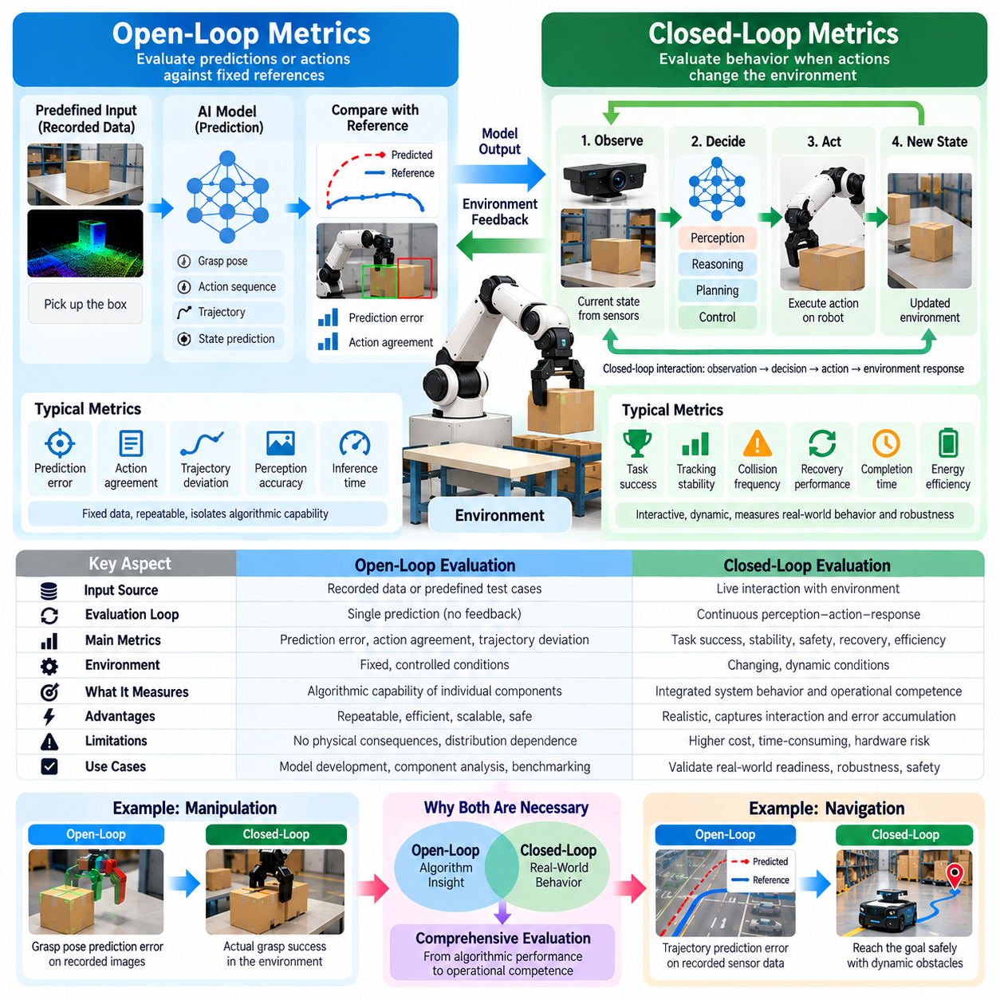{width="7.268055555555556in" height="7.268055555555556in"}

Open-loop metrics and closed-loop metrics provide complementary perspectives for evaluating Physical AI systems. Open-loop metrics measure predictions or actions against fixed references without allowing outputs to influence subsequent observations. Closed-loop metrics assess behavior when actions change the environment and generate new feedback. This distinction is essential because accurate individual predictions do not necessarily produce stable, effective, or safe physical behavior.

Open-loop evaluation commonly uses recorded sensor observations, reference trajectories, and demonstrated actions. A model processes predefined inputs, and its outputs are compared with expected values using consistent measurement procedures. Typical metrics include prediction error, action agreement, trajectory deviation, and inference accuracy. These measurements support repeatable experiments and help researchers identify weaknesses in individual perception, planning, or control components.

Closed-loop evaluation measures the consequences of actions executed within an interactive environment. A robot observes its surroundings, selects an action, changes its physical state, and receives updated observations. Subsequent decisions depend on the outcomes of previous actions, creating feedback-dependent behavior. Relevant metrics therefore include task success, tracking stability, collision frequency, recovery performance, and the ability to maintain operational constraints.

The difference is especially important in autonomous navigation. An open-loop benchmark may compare predicted steering commands or planned trajectories with recorded driving demonstrations. Small numerical errors may indicate strong prediction performance, but they do not establish whether the robot can reach its destination. Closed-loop testing reveals whether steering decisions maintain safe clearance, correct deviations, and achieve navigation objectives under changing conditions.

In robotic manipulation, open-loop metrics may measure grasp-pose prediction error, joint-angle deviation, or agreement with demonstrated motor commands. These scores characterize how closely a model reproduces reference behavior. Closed-loop metrics instead examine whether the robot successfully grasps, lifts, transports, and places objects. Contact uncertainty, object movement, and actuator limitations may produce failures that cannot be inferred from action-prediction accuracy alone.

Error accumulation explains why open-loop accuracy and closed-loop performance may diverge. A small control error can change the robot\'s position, causing future observations to differ from those in recorded datasets. Subsequent predictions may become less reliable as the system encounters unfamiliar states. Closed-loop metrics capture this compounding process, while conventional open-loop metrics generally evaluate errors without measuring their consequences for future decisions.

Open-loop metrics are valuable because they isolate specific computational capabilities. Researchers can compare alternative models using identical datasets and reference outputs, reducing variability caused by physical interactions. This supports rapid experimentation, regression testing, and architectural analysis. However, open-loop scores should be interpreted as indicators of component behavior rather than direct measurements of autonomous operational competence.

Closed-loop metrics provide stronger evidence of practical autonomy because they capture continuous perception-action interaction. A robot must adapt to disturbances, update its internal state, and revise decisions as environmental conditions evolve. Evaluation can measure whether tracking errors converge, remain bounded, or increase over time. Such measurements reveal dynamic properties that cannot be established through isolated prediction comparisons.

Trajectory tracking illustrates the distinction between the two approaches. Open-loop evaluation may calculate the difference between a predicted trajectory and a reference path. Closed-loop evaluation examines the actual trajectory produced when the robot repeatedly executes control commands and receives feedback. Metrics such as cross-track error, settling time, overshoot, and constraint violations help characterize whether the controller maintains accurate and stable motion.

Recovery capability is another important closed-loop property. A robot may initially make an incorrect decision but subsequently detect the deviation and restore progress toward its objective. Open-loop metrics may penalize the initial action without accounting for successful correction. Closed-loop evaluation can measure recovery time, recovery success rate, and the additional resources consumed. This distinction prevents evaluation from overlooking adaptive behavior.

Latency affects both evaluation approaches but has different consequences. Open-loop testing can measure model inference time and computational throughput under fixed inputs. Closed-loop testing must additionally examine whether delayed decisions destabilize control or reduce responsiveness to moving obstacles. End-to-end sensing, computation, communication, and actuation delays should be measured because their combined effects determine real-time operational performance.

Safety evaluation also benefits from separating open-loop and closed-loop evidence. Open-loop tests can identify unsafe action proposals, inaccurate hazard predictions, or violations of predefined constraints. Closed-loop tests determine whether actual robot behavior avoids collisions, respects force limits, and responds appropriately to emerging hazards. Safety metrics must capture both immediate violations and the system\'s ability to prevent hazardous situations from escalating.

Statistical comparison requires attention to the different sources of variability. Open-loop benchmarks usually provide fixed inputs, enabling consistent model comparisons across large datasets. Closed-loop trials introduce stochastic environmental responses, sensor noise, and interaction-dependent trajectories. Reliable conclusions therefore require repeated trials, scenario coverage, confidence intervals, and careful control of experimental conditions across competing systems.

A comprehensive evaluation framework should connect open-loop metrics with closed-loop outcomes rather than treating them as interchangeable scores. Open-loop tests can identify prediction weaknesses and guide model improvements, while closed-loop experiments determine whether those improvements affect real behavior. Correlation analysis between the two levels helps establish which offline indicators predict task success, safety, or reliability under interactive conditions.

Ultimately, open-loop metrics explain how accurately Physical AI models respond to predefined observations, while closed-loop metrics reveal how effectively systems behave when their actions influence future states. The former provides diagnostic precision and reproducibility, whereas the latter captures feedback stability, error propagation, adaptation, and operational success. Combining both approaches supports credible evaluation of intelligence that must function reliably in the physical world.

개방 루프 지표(Open-Loop Metrics)와 폐루프 지표(Closed-Loop Metrics)는 피지컬 인공지능(Physical AI) 시스템을 평가하기 위한 상호보완적인 관점을 제공한다. 개방 루프 지표는 출력이 후속 관측에 영향을 미치지 않는 상태에서 예측이나 행동을 고정된 참조값(Fixed References)과 비교하여 측정한다. 반면 폐루프 지표는 행동이 환경을 변화시키고 새로운 피드백(Feedback)을 생성하는 상황에서의 행동을 평가한다. 이러한 구분은 개별 예측의 정확도가 높더라도 반드시 안정적이고 효과적이며 안전한 물리적 행동(Physical Behavior)으로 이어지는 것은 아니기 때문에 중요하다.

개방 루프 평가(Open-Loop Evaluation)는 일반적으로 기록된 센서 관측(Recorded Sensor Observations), 참조 궤적(Reference Trajectories), 시연된 행동(Demonstrated Actions)을 사용한다. 모델은 사전에 정의된 입력(Predefined Inputs)을 처리하며, 출력은 일관된 측정 절차(Measurement Procedures)에 따라 예상값(Expected Values)과 비교된다. 대표적인 지표에는 예측 오차(Prediction Error), 행동 일치도(Action Agreement), 궤적 편차(Trajectory Deviation), 추론 정확도(Inference Accuracy)가 포함된다. 이러한 측정은 반복 가능한 실험을 지원하고 개별 인식(Perception), 계획(Planning), 제어(Control) 구성요소의 약점을 식별하는 데 도움이 된다.

폐루프 평가(Closed-Loop Evaluation)는 상호작용형 환경(Interactive Environment)에서 실행된 행동의 결과를 측정한다. 로봇은 주변 환경을 관측하고 행동을 선택하며 물리적 상태(Physical State)를 변화시킨 다음 갱신된 관측 정보(Updated Observations)를 수신한다. 후속 의사결정은 이전 행동의 결과에 의존하므로 피드백 의존적 행동(Feedback-Dependent Behavior)이 형성된다. 따라서 관련 지표에는 작업 성공(Task Success), 추종 안정성(Tracking Stability), 충돌 빈도(Collision Frequency), 복구 성능(Recovery Performance), 운영 제약 유지 능력(Ability to Maintain Operational Constraints)이 포함된다.

이러한 차이는 자율주행(Autonomous Navigation)에서 특히 중요하다. 개방 루프 벤치마크(Open-Loop Benchmark)는 예측된 조향 명령(Steering Commands)이나 계획된 궤적(Planned Trajectories)을 기록된 주행 시연(Recorded Driving Demonstrations)과 비교할 수 있다. 작은 수치적 오차(Numerical Errors)는 우수한 예측 성능(Prediction Performance)을 나타낼 수 있지만, 로봇이 목적지에 도달할 수 있는지를 입증하지는 못한다. 폐루프 시험(Closed-Loop Testing)은 조향 의사결정이 안전거리(Safe Clearance)를 유지하고, 편차를 수정하며, 변화하는 조건에서 주행 목표(Navigation Objectives)를 달성하는지를 보여준다.

로봇 조작(Robotic Manipulation)에서 개방 루프 지표는 파지 자세 예측 오차(Grasp-Pose Prediction Error), 관절 각도 편차(Joint-Angle Deviation), 시연된 모터 명령(Demonstrated Motor Commands)과의 일치도를 측정할 수 있다. 이러한 점수는 모델이 참조 행동(Reference Behavior)을 얼마나 유사하게 재현하는지를 나타낸다. 반면 폐루프 지표는 로봇이 객체를 성공적으로 파지(Grasp), 들어 올리기(Lift), 운반(Transport), 배치(Place)하는지를 검토한다. 접촉 불확실성(Contact Uncertainty), 객체 이동(Object Movement), 액추에이터 한계(Actuator Limitations)는 행동 예측 정확도(Action-Prediction Accuracy)만으로 추론할 수 없는 실패를 발생시킬 수 있다.

오류 누적(Error Accumulation)은 개방 루프 정확도(Open-Loop Accuracy)와 폐루프 성능(Closed-Loop Performance)이 서로 달라질 수 있는 이유를 설명한다. 작은 제어 오차(Control Error)는 로봇의 위치를 변화시켜 미래 관측이 기록된 데이터셋(Recorded Datasets)의 관측과 달라지게 할 수 있다. 이후 시스템이 익숙하지 않은 상태(Unfamiliar States)에 직면하면서 후속 예측의 신뢰성이 낮아질 수 있다. 폐루프 지표는 이러한 누적 과정을 포착하지만, 일반적인 개방 루프 지표는 미래 의사결정에 미치는 영향을 측정하지 않고 오차 자체를 평가한다.

개방 루프 지표는 특정 계산 능력(Computational Capabilities)을 분리하여 평가할 수 있다는 점에서 가치가 있다. 연구자는 동일한 데이터셋과 참조 출력(Reference Outputs)을 사용하여 대안적인 모델(Alternative Models)을 비교함으로써 물리적 상호작용(Physical Interactions)에서 발생하는 변동성을 줄일 수 있다. 이는 신속한 실험(Rapid Experimentation), 회귀 시험(Regression Testing), 아키텍처 분석(Architectural Analysis)을 지원한다. 그러나 개방 루프 점수는 자율 운영 역량(Autonomous Operational Competence)의 직접적인 측정값이 아니라 구성요소 행동(Component Behavior)을 나타내는 지표로 해석해야 한다.

폐루프 지표는 연속적인 인식-행동 상호작용(Perception-Action Interaction)을 포착하므로 실제 자율성(Practical Autonomy)에 대한 더 강력한 증거를 제공한다. 로봇은 외란(Disturbances)에 적응하고 내부 상태(Internal State)를 갱신하며 환경 조건이 변화함에 따라 의사결정을 수정해야 한다. 평가는 추종 오차(Tracking Errors)가 수렴(Convergence)하는지, 일정 범위 내에서 유지되는지, 시간이 지남에 따라 증가하는지를 측정할 수 있다. 이러한 측정은 개별 예측 비교(Isolated Prediction Comparisons)만으로 확인할 수 없는 동적 특성(Dynamic Properties)을 드러낸다.

궤적 추종(Trajectory Tracking)은 두 접근법의 차이를 잘 보여준다. 개방 루프 평가는 예측 궤적(Predicted Trajectory)과 참조 경로(Reference Path) 사이의 차이를 계산할 수 있다. 폐루프 평가는 로봇이 제어 명령(Control Commands)을 반복적으로 실행하고 피드백을 수신할 때 생성되는 실제 궤적(Actual Trajectory)을 검토한다. 횡방향 추종 오차(Cross-Track Error), 정착 시간(Settling Time), 오버슈트(Overshoot), 제약 위반(Constraint Violations)과 같은 지표는 제어기(Controller)가 정확하고 안정적인 움직임을 유지하는지를 특성화하는 데 도움이 된다.

복구 능력(Recovery Capability)은 또 다른 중요한 폐루프 특성(Closed-Loop Property)이다. 로봇은 처음에 잘못된 의사결정을 내리더라도 이후 편차를 감지하고 목표를 향한 진행을 회복할 수 있다. 개방 루프 지표는 성공적인 수정(Successful Correction)을 고려하지 않고 초기 행동에 불이익을 줄 수 있다. 반면 폐루프 평가는 복구 시간(Recovery Time), 복구 성공률(Recovery Success Rate), 추가로 소비된 자원(Additional Resources Consumed)을 측정할 수 있다. 이러한 구분은 평가 과정에서 적응적 행동(Adaptive Behavior)이 간과되는 것을 방지한다.

지연 시간(Latency)은 두 평가 접근법 모두에 영향을 미치지만 그 결과는 서로 다르다. 개방 루프 시험은 고정된 입력에서 모델 추론 시간(Model Inference Time)과 계산 처리량(Computational Throughput)을 측정할 수 있다. 폐루프 시험은 지연된 의사결정(Delayed Decisions)이 제어를 불안정하게 만들거나 움직이는 장애물(Moving Obstacles)에 대한 반응성(Responsiveness)을 감소시키는지도 추가로 검토해야 한다. 종단 간 센싱(End-to-End Sensing), 연산(Computation), 통신(Communication), 구동(Actuation) 지연은 그 결합 효과가 실시간 운영 성능(Real-Time Operational Performance)을 결정하므로 함께 측정해야 한다.

안전성 평가(Safety Evaluation)에서도 개방 루프와 폐루프의 평가 근거를 구분하는 것이 유용하다. 개방 루프 시험은 안전하지 않은 행동 제안(Unsafe Action Proposals), 부정확한 위험 예측(Inaccurate Hazard Predictions), 사전 정의된 제약 위반(Predefined Constraint Violations)을 식별할 수 있다. 폐루프 시험은 실제 로봇 행동(Actual Robot Behavior)이 충돌을 회피하고, 힘 제한(Force Limits)을 준수하며, 새롭게 발생하는 위험(Emerging Hazards)에 적절하게 대응하는지를 판단한다. 안전성 지표는 즉각적인 위반(Immediate Violations)뿐 아니라 위험한 상황(Hazardous Situations)의 악화를 방지하는 시스템 능력도 포착해야 한다.

통계적 비교(Statistical Comparison)에서는 서로 다른 변동성의 원인(Sources of Variability)에 주목해야 한다. 개방 루프 벤치마크는 일반적으로 고정된 입력을 제공하므로 대규모 데이터셋(Large Datasets)에서 일관된 모델 비교(Consistent Model Comparisons)가 가능하다. 반면 폐루프 시험은 확률적 환경 반응(Stochastic Environmental Responses), 센서 잡음(Sensor Noise), 상호작용 의존적 궤적(Interaction-Dependent Trajectories)을 포함한다. 따라서 신뢰할 수 있는 결론을 얻으려면 반복 시험(Repeated Trials), 시나리오 포괄 범위(Scenario Coverage), 신뢰구간(Confidence Intervals), 경쟁 시스템 간 실험 조건의 신중한 통제(Careful Control of Experimental Conditions)가 필요하다.

포괄적인 평가 프레임워크(Comprehensive Evaluation Framework)는 개방 루프 지표와 폐루프 결과(Closed-Loop Outcomes)를 서로 대체 가능한 점수로 취급하기보다 연결해야 한다. 개방 루프 시험은 예측의 약점(Prediction Weaknesses)을 식별하고 모델 개선(Model Improvements)을 안내할 수 있으며, 폐루프 실험은 이러한 개선이 실제 행동(Real Behavior)에 영향을 미치는지를 판단한다. 두 수준 사이의 상관관계 분석(Correlation Analysis)은 어떤 오프라인 지표(Offline Indicators)가 상호작용 조건(Interactive Conditions)에서 작업 성공(Task Success), 안전성(Safety), 신뢰성(Reliability)을 예측하는지 확인하는 데 도움이 된다.

궁극적으로 개방 루프 지표(Open-Loop Metrics)는 피지컬 인공지능 모델이 사전에 정의된 관측(Predefined Observations)에 얼마나 정확하게 반응하는지를 설명하며, 폐루프 지표(Closed-Loop Metrics)는 시스템의 행동이 미래 상태(Future States)에 영향을 미칠 때 얼마나 효과적으로 작동하는지를 보여준다. 전자는 진단적 정밀도(Diagnostic Precision)와 재현성(Reproducibility)을 제공하는 반면, 후자는 피드백 안정성(Feedback Stability), 오류 전파(Error Propagation), 적응(Adaptation), 운영 성공(Operational Success)을 포착한다. 두 접근법을 결합하면 실제 물리적 세계(Physical World)에서 신뢰성 있게 작동해야 하는 지능(Intelligence)에 대한 타당하고 신뢰할 수 있는 평가가 가능해진다.

##  

## 01.07. Outcome vs Process Based Evaluation

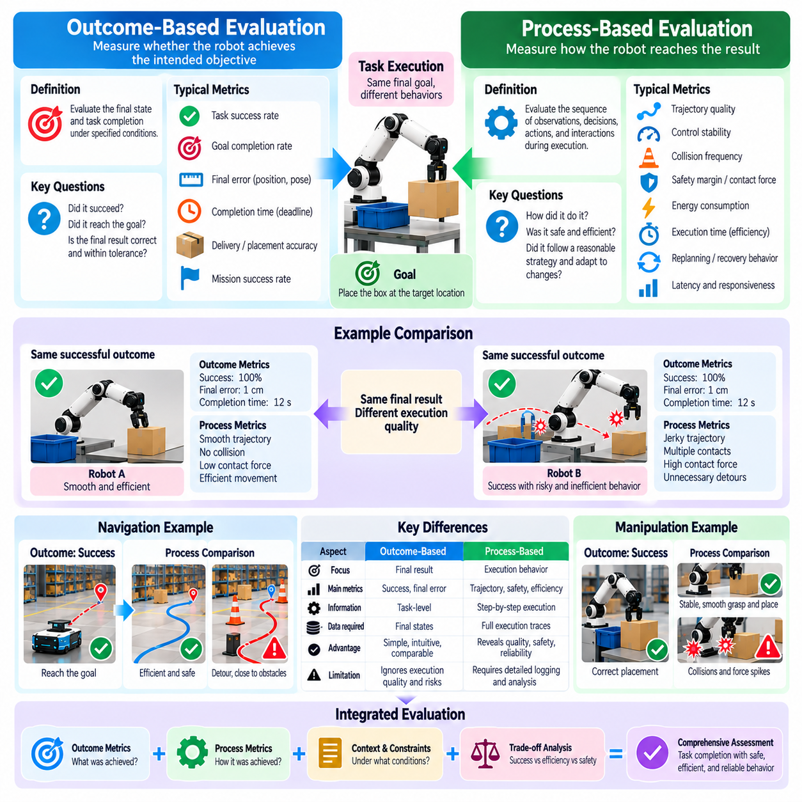{width="7.268055555555556in" height="7.268055555555556in"}

Outcome-based evaluation and process-based evaluation provide complementary methods for assessing Physical AI systems. Outcome-based evaluation measures whether a robot achieves its intended objective, while process-based evaluation examines how the robot reaches that result. A successful outcome does not necessarily indicate efficient, safe, or reliable execution. Both perspectives are essential for distinguishing apparent task completion from genuinely competent physical intelligence.

Outcome-based evaluation focuses on measurable final states. A manipulation task may be considered successful when an object reaches its designated location, while a navigation task succeeds when a robot reaches its destination. These criteria provide clear evidence of task completion and support standardized comparisons. However, final outcomes alone reveal little about the decisions, movements, and environmental interactions that occurred during execution.

Process-based evaluation examines the sequence of observations, decisions, actions, and feedback that produces an outcome. It considers trajectory quality, control stability, planning efficiency, constraint compliance, and adaptation to disturbances. By analyzing intermediate behavior, evaluators can determine whether a robot follows a dependable strategy or succeeds through accidental circumstances. This distinction becomes important when systems operate beyond controlled demonstrations.

The difference is evident in robotic manipulation. Two robots may successfully place an object at the same destination, yet one may execute smooth movements while the other repeatedly collides with nearby surfaces. Outcome-based metrics may assign both robots identical success scores. Process-based metrics reveal differences in contact forces, trajectory smoothness, execution time, and corrective actions, providing a more complete assessment of manipulation quality.

Autonomous navigation provides another example. A robot may reach its destination while taking unnecessary detours, approaching obstacles too closely, or repeatedly stopping because of planning instability. An outcome-based benchmark records successful arrival. Process-based evaluation additionally measures path efficiency, clearance margins, velocity consistency, replanning frequency, and motion stability. These measurements reveal whether successful navigation is operationally acceptable.

Outcome-based metrics are attractive because they are relatively intuitive and often align directly with application objectives. Task success rate, mission completion rate, delivery accuracy, and final placement error provide interpretable measures of achievement. They also support comparisons across different algorithms and robot architectures. Nevertheless, outcome definitions must specify tolerances, deadlines, and constraints to prevent ambiguous interpretations of success.

Process-based metrics require more detailed observations and instrumentation. Evaluators may record joint trajectories, actuator commands, sensor estimates, contact forces, computational latency, and internal planning events. These measurements enable analysis of how system components contribute to execution quality. However, process measurements must be selected carefully because excessive instrumentation can increase computational overhead and alter real-time system behavior.

Safety is a major reason to evaluate processes independently of final outcomes. A robot may complete a task while briefly violating collision constraints, applying excessive force, or creating hazardous conditions for nearby humans. Outcome-based evaluation may overlook these incidents if the final objective is achieved. Process-based evaluation can detect safety violations throughout execution and distinguish safe task completion from success obtained through unacceptable behavior.

Efficiency also requires process-aware assessment. Two systems may achieve the same objective but differ substantially in energy consumption, computational demand, trajectory length, or operating time. Process metrics identify resource-intensive behavior and unnecessary corrective movements. Such information is particularly valuable for battery-powered robots and high-throughput industrial systems, where inefficient execution can reduce operational capacity.

Robustness becomes visible when evaluators examine how systems respond to disturbances. A robot may encounter unexpected object motion, sensor noise, temporary occlusion, or external contact during task execution. Outcome-based evaluation determines whether the objective is eventually achieved. Process-based evaluation examines detection time, corrective actions, recovery trajectories, and stability during adaptation, revealing the mechanisms supporting reliable performance.

Failure analysis benefits from the same distinction. Outcome-based metrics establish how frequently tasks fail, but they rarely explain why failures occur. Process-based evidence can identify incorrect state estimation, unsuitable planning decisions, delayed control responses, or actuator limitations. Linking failure outcomes to execution traces supports targeted improvements and prevents developers from optimizing components unrelated to the actual source of failure.

Process-based evaluation should not assume that one execution strategy is universally optimal. Different robots may use distinct morphologies, control architectures, and movement patterns to achieve the same objective. A rigid preference for particular trajectories or action sequences may unfairly penalize valid alternatives. Process metrics should therefore emphasize meaningful properties such as safety, efficiency, stability, and constraint satisfaction rather than imitation of a single reference behavior.

Multi-objective evaluation connects outcome quality with process quality. A robot may achieve high task success at the expense of excessive energy consumption or reduced safety margins. Another system may execute cautiously but complete fewer tasks within a fixed period. Evaluation should characterize these tradeoffs rather than compressing all performance dimensions into an unexplained score. Explicit weighting and transparent reporting support meaningful comparison.

Long-horizon tasks make process evaluation especially important because small execution problems can accumulate across multiple stages. A robot may successfully complete individual subtasks while progressively exhausting its energy reserves or increasing localization uncertainty. Outcome metrics capture final mission success or failure, while process metrics reveal the intermediate trends responsible for that result. This information supports early detection of operational degradation.

Statistical analysis should account for differences between final outcomes and continuous process measurements. Task success is often represented by binary or categorical observations, while trajectory errors, contact forces, and energy consumption produce continuous measurements. Evaluators should report appropriate distributions, confidence intervals, and variability across repeated trials. Aggregating process data without preserving critical violations can conceal important operational risks.

A balanced evaluation framework should connect outcome metrics with process indicators through a consistent experimental protocol. Each trial should define its objective, termination conditions, environmental constraints, and required measurements. Final outcomes establish whether the intended task was achieved, while process records explain the quality and reliability of execution. Together, these measurements support diagnosis, comparison, and progressive system improvement.

Ultimately, outcome-based evaluation answers whether Physical AI accomplishes its goals, while process-based evaluation explains whether those goals are achieved through safe, efficient, stable, and adaptive behavior. Outcome measures establish functional effectiveness, whereas process measures reveal operational quality and underlying weaknesses. Combining both approaches prevents superficial success from being mistaken for dependable intelligence and provides stronger evidence of real-world readiness.

결과 기반 평가(Outcome-Based Evaluation)와 과정 기반 평가(Process-Based Evaluation)는 피지컬 인공지능(Physical AI) 시스템을 평가하기 위한 상호보완적인 방법을 제공한다. 결과 기반 평가는 로봇이 의도한 목표를 달성했는지를 측정하는 반면, 과정 기반 평가는 로봇이 해당 결과에 어떻게 도달했는지를 검토한다. 성공적인 결과가 반드시 효율적이고 안전하며 신뢰할 수 있는 실행을 의미하지는 않는다. 두 관점은 겉으로 드러나는 작업 완료(Apparent Task Completion)와 진정한 물리적 지능 역량(Competent Physical Intelligence)을 구분하는 데 필수적이다.

결과 기반 평가(Outcome-Based Evaluation)는 측정 가능한 최종 상태(Final States)에 초점을 맞춘다. 조작 작업(Manipulation Task)은 객체가 지정된 위치에 도달하면 성공한 것으로 간주할 수 있으며, 주행 작업(Navigation Task)은 로봇이 목적지에 도달하면 성공한 것으로 평가할 수 있다. 이러한 기준은 작업 완료(Task Completion)에 대한 명확한 증거를 제공하고 표준화된 비교(Standardized Comparisons)를 지원한다. 그러나 최종 결과만으로는 실행 과정에서 발생한 의사결정(Decisions), 움직임(Movements), 환경 상호작용(Environmental Interactions)에 관한 정보를 충분히 파악하기 어렵다.

과정 기반 평가(Process-Based Evaluation)는 결과를 만들어 내는 관측(Observations), 의사결정(Decisions), 행동(Actions), 피드백(Feedback)의 연속적인 과정을 검토한다. 여기에는 궤적 품질(Trajectory Quality), 제어 안정성(Control Stability), 계획 효율성(Planning Efficiency), 제약 준수(Constraint Compliance), 외란 적응(Adaptation to Disturbances)이 포함된다. 평가자는 중간 행동(Intermediate Behavior)을 분석하여 로봇이 신뢰할 수 있는 전략(Dependable Strategy)을 따르는지, 아니면 우연한 상황(Accidental Circumstances)에 의해 성공했는지를 판단할 수 있다. 이러한 구분은 통제된 시연(Controlled Demonstrations)을 넘어 실제 환경에서 시스템을 운영할 때 중요해진다.

이러한 차이는 로봇 조작(Robotic Manipulation)에서 명확하게 나타난다. 두 로봇이 동일한 목적지에 객체를 성공적으로 배치하더라도 한 로봇은 부드러운 움직임(Smooth Movements)을 수행하는 반면 다른 로봇은 주변 표면과 반복적으로 충돌할 수 있다. 결과 기반 지표(Outcome-Based Metrics)는 두 로봇에 동일한 성공 점수(Success Scores)를 부여할 수 있다. 그러나 과정 기반 지표(Process-Based Metrics)는 접촉력(Contact Forces), 궤적 평활성(Trajectory Smoothness), 실행 시간(Execution Time), 수정 행동(Corrective Actions)의 차이를 드러내어 조작 품질(Manipulation Quality)을 더욱 완전하게 평가할 수 있도록 한다.

자율주행(Autonomous Navigation)은 또 다른 사례를 제공한다. 로봇은 불필요한 우회(Unnecessary Detours)를 하거나 장애물에 지나치게 가까이 접근하거나 계획 불안정성(Planning Instability)으로 인해 반복적으로 정지하면서도 목적지에 도달할 수 있다. 결과 기반 벤치마크(Outcome-Based Benchmark)는 목적지 도달 성공(Successful Arrival)을 기록한다. 과정 기반 평가는 추가적으로 경로 효율성(Path Efficiency), 안전거리 여유(Clearance Margins), 속도 일관성(Velocity Consistency), 재계획 빈도(Replanning Frequency), 운동 안정성(Motion Stability)을 측정한다. 이러한 측정은 성공적인 주행이 운영 측면에서도 허용 가능한지를 보여준다.

결과 기반 지표(Outcome-Based Metrics)는 비교적 직관적이며 응용 목표(Application Objectives)와 직접적으로 연결되는 경우가 많다는 장점이 있다. 작업 성공률(Task Success Rate), 임무 완료율(Mission Completion Rate), 배송 정확도(Delivery Accuracy), 최종 배치 오차(Final Placement Error)는 성과를 해석하기 쉬운 측정값으로 제공한다. 또한 서로 다른 알고리즘(Algorithms)과 로봇 아키텍처(Robot Architectures) 사이의 비교를 지원한다. 그러나 성공에 대한 모호한 해석을 방지하려면 결과의 정의에 허용 오차(Tolerances), 완료 기한(Deadlines), 제약 조건(Constraints)을 명시해야 한다.

과정 기반 지표(Process-Based Metrics)는 더욱 상세한 관측과 계측(Instrumentation)을 요구한다. 평가자는 관절 궤적(Joint Trajectories), 액추에이터 명령(Actuator Commands), 센서 추정값(Sensor Estimates), 접촉력(Contact Forces), 계산 지연(Computational Latency), 내부 계획 이벤트(Internal Planning Events)를 기록할 수 있다. 이러한 측정은 시스템 구성요소(System Components)가 실행 품질(Execution Quality)에 어떻게 기여하는지를 분석할 수 있도록 한다. 그러나 과도한 계측은 계산 오버헤드(Computational Overhead)를 증가시키고 실시간 시스템 행동(Real-Time System Behavior)을 변화시킬 수 있으므로 과정 측정 항목을 신중하게 선정해야 한다.

안전성(Safety)은 최종 결과와 독립적으로 실행 과정을 평가해야 하는 주요 이유 중 하나이다. 로봇은 작업을 완료하면서도 일시적으로 충돌 제약(Collision Constraints)을 위반하거나 과도한 힘(Excessive Force)을 가하거나 주변 사람에게 위험한 조건(Hazardous Conditions)을 만들 수 있다. 결과 기반 평가는 최종 목표가 달성되었다면 이러한 사건을 간과할 수 있다. 과정 기반 평가는 실행 전반에 걸쳐 안전 위반(Safety Violations)을 감지하고 안전한 작업 완료(Safe Task Completion)와 허용할 수 없는 행동(Unacceptable Behavior)을 통해 얻은 성공을 구분할 수 있다.

효율성(Efficiency) 역시 실행 과정을 고려한 평가(Process-Aware Assessment)가 필요하다. 두 시스템이 동일한 목표를 달성하더라도 에너지 소비(Energy Consumption), 계산 요구량(Computational Demand), 궤적 길이(Trajectory Length), 운영 시간(Operating Time)에서 상당한 차이가 나타날 수 있다. 과정 지표(Process Metrics)는 자원을 과도하게 사용하는 행동(Resource-Intensive Behavior)과 불필요한 수정 움직임(Unnecessary Corrective Movements)을 식별한다. 이러한 정보는 비효율적인 실행이 운영 용량(Operational Capacity)을 감소시킬 수 있는 배터리 구동 로봇(Battery-Powered Robots)과 높은 처리량이 요구되는 산업 시스템(High-Throughput Industrial Systems)에서 특히 중요하다.

강건성(Robustness)은 평가자가 시스템이 외란(Disturbances)에 어떻게 대응하는지를 검토할 때 명확하게 드러난다. 로봇은 작업 실행 중 예상하지 못한 객체 움직임(Unexpected Object Motion), 센서 잡음(Sensor Noise), 일시적인 가림(Temporary Occlusion), 외부 접촉(External Contact)을 경험할 수 있다. 결과 기반 평가는 최종적으로 목표를 달성했는지를 판단한다. 반면 과정 기반 평가는 감지 시간(Detection Time), 수정 행동(Corrective Actions), 복구 궤적(Recovery Trajectories), 적응 과정의 안정성(Stability During Adaptation)을 검토하여 신뢰할 수 있는 성능을 뒷받침하는 메커니즘(Mechanisms)을 드러낸다.

실패 분석(Failure Analysis)도 동일한 구분을 통해 이점을 얻는다. 결과 기반 지표는 작업이 얼마나 자주 실패하는지를 확인하지만, 실패 원인을 설명하는 경우는 드물다. 과정 기반 증거(Process-Based Evidence)는 잘못된 상태 추정(Incorrect State Estimation), 부적절한 계획 결정(Unsuitable Planning Decisions), 지연된 제어 응답(Delayed Control Responses), 액추에이터 한계(Actuator Limitations)를 식별할 수 있다. 실패 결과(Failure Outcomes)를 실행 기록(Execution Traces)과 연결하면 목표 지향적인 개선(Targeted Improvements)을 지원하고 실제 실패 원인과 관련 없는 구성요소를 최적화하는 일을 방지할 수 있다.

과정 기반 평가(Process-Based Evaluation)는 하나의 실행 전략(Execution Strategy)이 모든 상황에서 보편적으로 최적이라고 가정해서는 안 된다. 서로 다른 로봇은 동일한 목표를 달성하기 위해 서로 다른 형태 구조(Morphologies), 제어 아키텍처(Control Architectures), 움직임 패턴(Movement Patterns)을 사용할 수 있다. 특정 궤적이나 행동 시퀀스(Action Sequences)를 엄격하게 선호하면 유효한 대안(Valid Alternatives)을 부당하게 낮게 평가할 수 있다. 따라서 과정 지표는 단일 참조 행동(Single Reference Behavior)의 모방보다 안전성, 효율성, 안정성, 제약 충족(Constraint Satisfaction)과 같은 의미 있는 특성을 강조해야 한다.

다목적 평가(Multi-Objective Evaluation)는 결과 품질(Outcome Quality)과 과정 품질(Process Quality)을 연결한다. 로봇은 과도한 에너지 소비나 감소된 안전 여유(Safety Margins)를 감수하면서 높은 작업 성공률을 달성할 수 있다. 반면 다른 시스템은 신중하게 실행하지만 정해진 시간 내에 더 적은 작업을 완료할 수 있다. 평가는 모든 성능 차원(Performance Dimensions)을 설명되지 않은 하나의 점수로 압축하기보다 이러한 상충관계(Tradeoffs)를 특성화해야 한다. 명시적인 가중치(Explicit Weighting)와 투명한 보고(Transparent Reporting)는 의미 있는 비교를 지원한다.

장기 작업(Long-Horizon Tasks)에서는 여러 단계에 걸쳐 작은 실행 문제가 누적될 수 있으므로 과정 평가(Process Evaluation)가 특히 중요하다. 로봇은 개별 하위 작업(Subtasks)을 성공적으로 완료하면서도 에너지 잔량(Energy Reserves)을 점진적으로 소진하거나 위치 추정 불확실성(Localization Uncertainty)을 증가시킬 수 있다. 결과 지표(Outcome Metrics)는 최종 임무 성공 또는 실패(Final Mission Success or Failure)를 포착하는 반면, 과정 지표는 이러한 결과를 초래한 중간 변화 추세(Intermediate Trends)를 드러낸다. 이러한 정보는 운영 성능 저하(Operational Degradation)를 조기에 감지하는 데 도움이 된다.

통계 분석(Statistical Analysis)은 최종 결과(Final Outcomes)와 연속적인 과정 측정(Continuous Process Measurements)의 차이를 고려해야 한다. 작업 성공(Task Success)은 이진 관측(Binary Observations)이나 범주형 관측(Categorical Observations)으로 표현되는 경우가 많지만, 궤적 오차(Trajectory Errors), 접촉력(Contact Forces), 에너지 소비(Energy Consumption)는 연속적인 측정값(Continuous Measurements)을 생성한다. 평가자는 반복 시험(Repeated Trials)에 걸쳐 적절한 분포(Distributions), 신뢰구간(Confidence Intervals), 변동성(Variability)을 보고해야 한다. 중대한 위반(Critical Violations)을 보존하지 않고 과정 데이터를 집계(Aggregation)하면 중요한 운영 위험(Operational Risks)이 감춰질 수 있다.

균형 잡힌 평가 프레임워크(Balanced Evaluation Framework)는 일관된 실험 프로토콜(Consistent Experimental Protocol)을 통해 결과 지표(Outcome Metrics)와 과정 지표(Process Indicators)를 연결해야 한다. 각 시험은 목표(Objective), 종료 조건(Termination Conditions), 환경 제약(Environmental Constraints), 필수 측정 항목(Required Measurements)을 정의해야 한다. 최종 결과는 의도한 작업이 달성되었는지를 확인하며, 과정 기록(Process Records)은 실행의 품질과 신뢰성(Quality and Reliability)을 설명한다. 이러한 측정은 함께 진단(Diagnosis), 비교(Comparison), 점진적인 시스템 개선(Progressive System Improvement)을 지원한다.

궁극적으로 결과 기반 평가(Outcome-Based Evaluation)는 피지컬 인공지능이 목표를 달성했는지에 답하며, 과정 기반 평가(Process-Based Evaluation)는 해당 목표가 안전하고 효율적이며 안정적이고 적응적인 행동(Safe, Efficient, Stable, and Adaptive Behavior)을 통해 달성되었는지를 설명한다. 결과 측정(Outcome Measures)은 기능적 효과성(Functional Effectiveness)을 입증하는 반면, 과정 측정(Process Measures)은 운영 품질(Operational Quality)과 근본적인 약점(Underlying Weaknesses)을 드러낸다. 두 접근법을 결합하면 표면적인 성공(Superficial Success)을 신뢰할 수 있는 지능(Dependable Intelligence)으로 오인하는 것을 방지하고 실제 환경 준비도(Real-World Readiness)에 대한 더욱 강력한 평가 근거를 제공할 수 있다.

##  

## 01.08. Success Rate and Quality of Execution

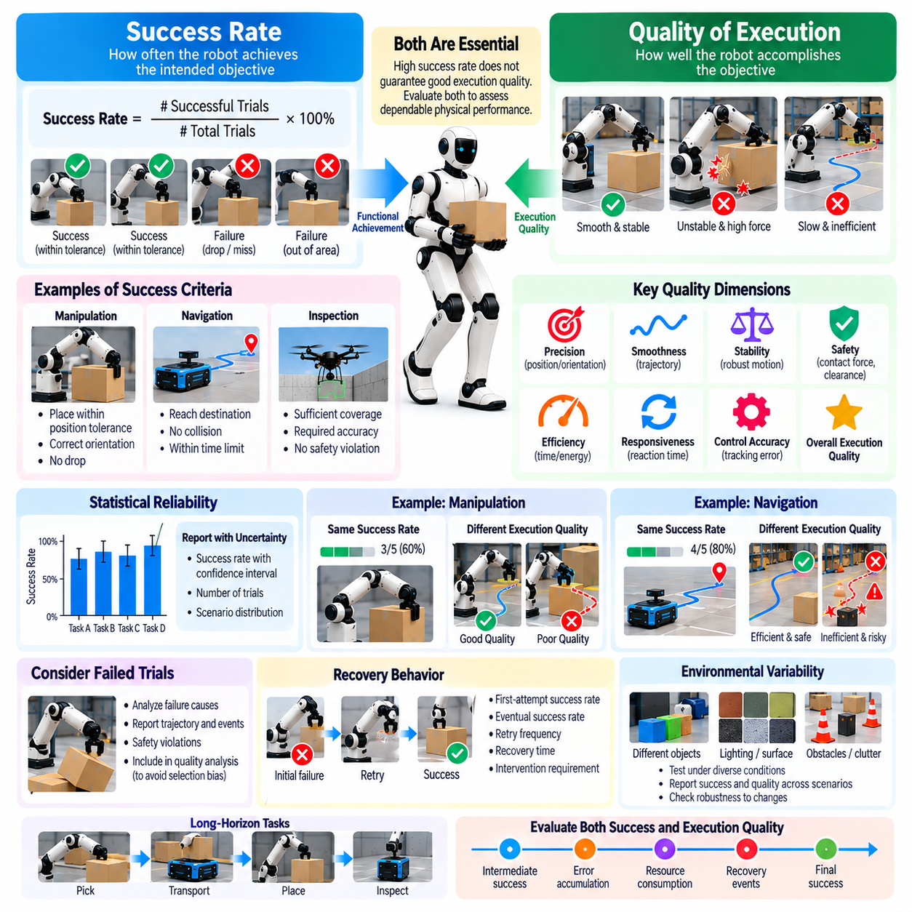{width="7.268055555555556in" height="7.268055555555556in"}

Success rate and quality of execution are fundamental dimensions of Physical AI evaluation. Success rate measures how frequently a robot achieves a defined objective, while execution quality describes how effectively that objective is accomplished. A robot may complete many tasks but exhibit unstable movements, excessive resource consumption, or unsafe interactions. Evaluating both dimensions distinguishes functional achievement from dependable physical performance.

Success rate is typically defined as the proportion of completed trials that satisfy predetermined success criteria. For manipulation, success may require placing an object within a specified tolerance. For navigation, it may require reaching a destination without violating safety constraints. Meaningful interpretation depends on consistent task definitions, clearly identified termination conditions, and transparent treatment of incomplete or interrupted trials.

Execution quality extends beyond binary success or failure by examining characteristics of the completed behavior. Relevant dimensions include precision, smoothness, stability, efficiency, safety, and responsiveness. A successful manipulation may still involve unnecessary corrective movements or excessive contact forces. Quality metrics reveal such differences and help determine whether task completion meets practical operational requirements.

Success criteria must reflect the physical requirements of each application. A warehouse robot may need to deliver containers within defined positional tolerances, while an inspection robot may need to achieve specified measurement coverage and accuracy. Criteria that are too permissive can exaggerate performance, whereas excessively strict thresholds may reject operationally acceptable behavior. Benchmark design should justify thresholds using application needs.

Statistical reliability is essential when reporting success rates. A system that completes nine of ten trials has an observed success rate of ninety percent, but this estimate contains substantial uncertainty. Larger samples generally provide more precise estimates when trials are appropriately sampled. Confidence intervals, trial counts, and scenario distributions should accompany reported success rates to prevent misleading comparisons between systems.

Execution quality can be represented through continuous measurements that capture differences among successful trials. Position error, orientation error, trajectory deviation, contact force, and task duration provide detailed performance information. These measures should be reported with suitable distributions rather than relying exclusively on averages. Rare but severe deviations may be operationally important even when mean execution quality appears satisfactory.

Robotic manipulation illustrates why success and quality must be evaluated separately. Two grippers may successfully lift the same object, yet one maintains stable contact while the other produces substantial object motion and repeated grasp adjustments. Both attempts may satisfy a binary completion criterion. However, force variation, slip frequency, placement precision, and movement smoothness reveal meaningful differences in manipulation competence.

Autonomous navigation provides similar examples. Two robots may reach the same destination, but one follows a direct, stable path while the other repeatedly replans or approaches obstacles with insufficient clearance. Success rate captures arrival reliability, while quality metrics describe route efficiency, collision margins, velocity consistency, and control stability. These distinctions are especially important in environments shared with humans.

Execution time is an important quality dimension, but faster completion does not always indicate superior performance. Aggressive movement may reduce task duration while increasing collision risk, mechanical wear, or energy consumption. Conversely, excessively cautious behavior may preserve safety but reduce throughput. Evaluation should examine speed together with safety, accuracy, and resource efficiency rather than optimizing duration in isolation.

Recovery behavior complicates the interpretation of success. A robot may initially fail to grasp an object but recover through repeated attempts and eventually complete the task. Counting only final completion can conceal repeated errors and additional resource costs. Evaluation should distinguish first-attempt success, eventual success, retry frequency, recovery time, and intervention requirements to characterize autonomous competence more accurately.

Quality assessment should consider failed trials as well as successful ones. Reporting precision or execution time only for completed tasks may introduce selection bias because difficult or unstable attempts are excluded. Evaluators should disclose the number of failed trials and characterize their trajectories, termination causes, and safety violations. Conditional quality measurements should be clearly distinguished from statistics covering all attempted executions.

Environmental variability influences both success rate and execution quality. Changes in lighting, object geometry, surface friction, payload mass, and obstacle configurations can alter performance. A robot may demonstrate excellent results under standardized laboratory conditions but deteriorate in unfamiliar settings. Evaluations should therefore report scenario diversity and examine whether success and quality remain stable across representative operational conditions.

Long-horizon tasks require additional attention because successful completion may conceal accumulated execution problems. A robot may finish a multi-stage mission while repeatedly correcting localization errors, consuming excessive energy, or approaching operational limits. Intermediate quality metrics can reveal degradation before complete failure occurs. Mission-level success should therefore be interpreted alongside stage-level performance and resource trends.

Safety must remain an explicit component of execution quality. A robot that completes a task while exceeding permitted contact forces or violating collision constraints should not receive an unrestricted success classification. Safety-critical violations may require separate reporting or invalidate an otherwise successful trial. This prevents evaluation procedures from rewarding hazardous strategies that achieve objectives through unacceptable physical behavior.

Composite performance scores can combine success rate with execution quality, but their construction requires careful justification. Weighted measures may integrate precision, efficiency, stability, and safety into an overall assessment. However, aggregation can conceal weaknesses when strong results in one dimension compensate for serious failures elsewhere. Transparent component metrics and explicit safety constraints are preferable to unexplained single-number rankings.

Ultimately, success rate establishes how reliably Physical AI achieves defined objectives, while execution quality determines whether those achievements are precise, efficient, stable, and safe. Neither dimension alone provides a complete assessment of robotic competence. Combining clear success definitions, detailed process measurements, statistical uncertainty, and representative scenarios creates a stronger foundation for evaluating real-world Physical AI performance.

성공률(Success Rate)과 실행 품질(Quality of Execution)은 피지컬 인공지능(Physical AI) 평가의 핵심적인 두 가지 차원이다. 성공률은 로봇이 정의된 목표를 얼마나 자주 달성하는지를 측정하는 반면, 실행 품질은 해당 목표가 얼마나 효과적으로 수행되었는지를 설명한다. 로봇은 많은 작업을 완료하더라도 불안정한 움직임(Unstable Movements), 과도한 자원 소비(Excessive Resource Consumption), 안전하지 않은 상호작용(Unsafe Interactions)을 보일 수 있다. 두 차원을 함께 평가하면 기능적 성과(Functional Achievement)와 신뢰할 수 있는 물리적 성능(Dependable Physical Performance)을 구분할 수 있다.

성공률(Success Rate)은 일반적으로 사전에 정의된 성공 기준(Success Criteria)을 충족한 시험의 비율로 정의된다. 조작(Manipulation) 작업에서는 지정된 허용 오차(Tolerance) 이내에 객체를 배치해야 성공으로 인정할 수 있다. 주행(Navigation) 작업에서는 안전 제약(Safety Constraints)을 위반하지 않고 목적지에 도달해야 할 수 있다. 의미 있는 해석을 위해서는 일관된 작업 정의(Task Definitions), 명확한 종료 조건(Termination Conditions), 미완료 또는 중단된 시험(Incomplete or Interrupted Trials)에 대한 투명한 처리 기준이 필요하다.

실행 품질(Quality of Execution)은 완료된 행동의 특성을 검토함으로써 이진적인 성공 또는 실패(Binary Success or Failure)를 넘어선다. 관련 평가 차원에는 정밀도(Precision), 평활성(Smoothness), 안정성(Stability), 효율성(Efficiency), 안전성(Safety), 반응성(Responsiveness)이 포함된다. 성공적인 조작 작업에서도 불필요한 수정 움직임(Unnecessary Corrective Movements)이나 과도한 접촉력(Excessive Contact Forces)이 발생할 수 있다. 품질 지표(Quality Metrics)는 이러한 차이를 드러내고 작업 완료가 실제 운영 요구사항(Practical Operational Requirements)을 충족하는지를 판단하는 데 도움이 된다.

성공 기준(Success Criteria)은 각 응용 분야(Application)의 물리적 요구사항(Physical Requirements)을 반영해야 한다. 창고 로봇(Warehouse Robot)은 정의된 위치 허용 오차(Positional Tolerances) 내에서 컨테이너(Container)를 운반해야 할 수 있으며, 검사 로봇(Inspection Robot)은 지정된 측정 범위(Measurement Coverage)와 정확도(Accuracy)를 달성해야 할 수 있다. 기준이 지나치게 관대하면 성능이 과장될 수 있고, 반대로 임계값(Thresholds)이 지나치게 엄격하면 운영상 허용 가능한 행동도 실패로 판정될 수 있다. 벤치마크 설계(Benchmark Design)에서는 실제 응용 요구사항을 바탕으로 임계값의 타당성을 설명해야 한다.

성공률을 보고할 때는 통계적 신뢰성(Statistical Reliability)이 필수적이다. 열 번의 시험 중 아홉 번을 완료한 시스템의 관측 성공률(Observed Success Rate)은 90%이지만, 이러한 추정값에는 상당한 불확실성(Uncertainty)이 포함된다. 시험이 적절하게 표본 추출(Sampling)되었다면 일반적으로 표본 크기(Sample Size)가 클수록 더 정밀한 추정이 가능하다. 시스템 간 비교에서 잘못된 해석을 방지하려면 보고된 성공률과 함께 신뢰구간(Confidence Intervals), 시험 횟수(Trial Counts), 시나리오 분포(Scenario Distributions)를 제시해야 한다.

실행 품질(Execution Quality)은 성공한 시험 사이의 차이를 포착하는 연속적인 측정값(Continuous Measurements)으로 표현할 수 있다. 위치 오차(Position Error), 방향 오차(Orientation Error), 궤적 편차(Trajectory Deviation), 접촉력(Contact Force), 작업 소요 시간(Task Duration)은 상세한 성능 정보를 제공한다. 이러한 측정값은 평균(Averages)에만 의존하지 않고 적절한 분포(Distributions)와 함께 보고해야 한다. 평균적인 실행 품질이 양호하더라도 드물게 발생하는 심각한 편차(Rare but Severe Deviations)는 운영상 중요한 의미를 가질 수 있다.

로봇 조작(Robotic Manipulation)은 성공률과 품질을 별도로 평가해야 하는 이유를 보여준다. 두 개의 그리퍼(Grippers)가 동일한 객체를 성공적으로 들어 올리더라도 하나는 안정적인 접촉(Stable Contact)을 유지하는 반면 다른 하나는 상당한 객체 움직임(Object Motion)과 반복적인 파지 조정(Grasp Adjustments)을 발생시킬 수 있다. 두 시도 모두 이진 완료 기준(Binary Completion Criterion)을 충족할 수 있다. 그러나 힘 변동(Force Variation), 미끄러짐 빈도(Slip Frequency), 배치 정밀도(Placement Precision), 움직임 평활성(Movement Smoothness)은 조작 역량(Manipulation Competence)의 의미 있는 차이를 드러낸다.

자율주행(Autonomous Navigation)에서도 유사한 사례를 확인할 수 있다. 두 로봇이 동일한 목적지에 도달하더라도 하나는 직접적이고 안정적인 경로(Direct and Stable Path)를 따르는 반면 다른 하나는 반복적으로 재계획(Replanning)을 수행하거나 장애물에 충분한 안전거리(Clearance)를 확보하지 못한 채 접근할 수 있다. 성공률은 목적지 도달의 신뢰성(Arrival Reliability)을 포착하며, 품질 지표는 경로 효율성(Route Efficiency), 충돌 안전 여유(Collision Margins), 속도 일관성(Velocity Consistency), 제어 안정성(Control Stability)을 설명한다. 이러한 차이는 인간과 공간을 공유하는 환경에서 특히 중요하다.

실행 시간(Execution Time)은 중요한 품질 차원이지만, 더 빠른 완료가 항상 우수한 성능을 의미하지는 않는다. 공격적인 움직임(Aggressive Movement)은 작업 시간을 줄이는 동시에 충돌 위험(Collision Risk), 기계적 마모(Mechanical Wear), 에너지 소비(Energy Consumption)를 증가시킬 수 있다. 반대로 지나치게 신중한 행동(Excessively Cautious Behavior)은 안전성을 유지하지만 처리량(Throughput)을 감소시킬 수 있다. 따라서 평가는 작업 시간만 독립적으로 최적화하기보다 속도(Speed)를 안전성, 정확도(Accuracy), 자원 효율성(Resource Efficiency)과 함께 검토해야 한다.

복구 행동(Recovery Behavior)은 성공에 대한 해석을 복잡하게 만든다. 로봇은 처음에 객체 파지(Grasping)에 실패하더라도 반복적인 시도(Repeated Attempts)를 통해 복구하고 최종적으로 작업을 완료할 수 있다. 최종 완료 여부만 계산하면 반복적인 오류(Repeated Errors)와 추가적인 자원 비용(Additional Resource Costs)이 감춰질 수 있다. 자율적 역량(Autonomous Competence)을 더욱 정확하게 특성화하려면 최초 시도 성공(First-Attempt Success), 최종 성공(Eventual Success), 재시도 빈도(Retry Frequency), 복구 시간(Recovery Time), 개입 요구사항(Intervention Requirements)을 구분해야 한다.

품질 평가(Quality Assessment)는 성공한 시험뿐 아니라 실패한 시험(Failed Trials)도 고려해야 한다. 완료된 작업만을 대상으로 정밀도(Precision)나 실행 시간을 보고하면 어렵거나 불안정한 시도(Difficult or Unstable Attempts)가 제외되므로 선택 편향(Selection Bias)이 발생할 수 있다. 평가자는 실패한 시험의 수를 공개하고 해당 시험의 궤적(Trajectories), 종료 원인(Termination Causes), 안전 위반(Safety Violations)을 특성화해야 한다. 조건부 품질 측정(Conditional Quality Measurements)은 모든 실행 시도(All Attempted Executions)를 포함한 통계와 명확하게 구분해야 한다.

환경 변동성(Environmental Variability)은 성공률과 실행 품질 모두에 영향을 미친다. 조명(Lighting), 객체 형상(Object Geometry), 표면 마찰(Surface Friction), 적재 질량(Payload Mass), 장애물 배치(Obstacle Configurations)의 변화는 성능을 변화시킬 수 있다. 로봇은 표준화된 실험실 조건(Standardized Laboratory Conditions)에서는 우수한 결과를 보여주지만 익숙하지 않은 환경(Unfamiliar Settings)에서는 성능이 저하될 수 있다. 따라서 평가에서는 시나리오 다양성(Scenario Diversity)을 보고하고 대표적인 운영 조건(Representative Operational Conditions) 전반에서 성공률과 품질이 안정적으로 유지되는지를 검토해야 한다.

장기 작업(Long-Horizon Tasks)은 성공적인 완료가 누적된 실행 문제(Accumulated Execution Problems)를 감출 수 있으므로 추가적인 주의가 필요하다. 로봇은 다단계 임무(Multi-Stage Mission)를 완료하면서도 위치 추정 오류(Localization Errors)를 반복적으로 수정하거나 과도한 에너지를 소비하거나 운영 한계(Operational Limits)에 접근할 수 있다. 중간 품질 지표(Intermediate Quality Metrics)는 완전한 실패가 발생하기 전에 성능 저하(Degradation)를 드러낼 수 있다. 따라서 임무 수준 성공(Mission-Level Success)은 단계별 성능(Stage-Level Performance)과 자원 변화 추세(Resource Trends)를 함께 고려하여 해석해야 한다.

안전성(Safety)은 실행 품질의 명시적인 구성요소로 유지되어야 한다. 로봇이 허용된 접촉력(Permitted Contact Forces)을 초과하거나 충돌 제약(Collision Constraints)을 위반하면서 작업을 완료했다면 제한 없는 성공(Unrestricted Success)으로 분류해서는 안 된다. 안전상 중대한 위반(Safety-Critical Violations)은 별도로 보고하거나 다른 기준에서는 성공한 시험이라도 무효화할 필요가 있다. 이를 통해 평가 절차(Evaluation Procedures)가 허용할 수 없는 물리적 행동(Unacceptable Physical Behavior)을 통해 목표를 달성하는 위험한 전략(Hazardous Strategies)에 보상을 부여하는 것을 방지할 수 있다.

복합 성능 점수(Composite Performance Scores)는 성공률과 실행 품질을 결합할 수 있지만, 점수 구성에 대한 신중한 정당화(Justification)가 필요하다. 가중 측정값(Weighted Measures)은 정밀도, 효율성, 안정성, 안전성을 종합적인 평가(Overall Assessment)에 통합할 수 있다. 그러나 집계(Aggregation)는 한 차원의 우수한 결과가 다른 차원의 심각한 실패를 상쇄할 때 약점을 감출 수 있다. 따라서 설명되지 않은 단일 점수 순위(Single-Number Rankings)보다는 투명한 구성요소 지표(Transparent Component Metrics)와 명시적인 안전 제약(Explicit Safety Constraints)을 사용하는 것이 바람직하다.

궁극적으로 성공률(Success Rate)은 피지컬 인공지능이 정의된 목표를 얼마나 신뢰성 있게 달성하는지를 나타내며, 실행 품질(Quality of Execution)은 그러한 성과가 정밀하고 효율적이며 안정적이고 안전한지를 판단한다. 어느 한 차원만으로는 로봇 역량(Robotic Competence)을 완전하게 평가할 수 없다. 명확한 성공 정의(Clear Success Definitions), 상세한 과정 측정(Detailed Process Measurements), 통계적 불확실성(Statistical Uncertainty), 대표적인 시나리오(Representative Scenarios)를 결합하면 실제 환경에서의 피지컬 인공지능 성능(Real-World Physical AI Performance)을 평가하기 위한 더욱 강력한 기반을 구축할 수 있다.

##  

## 01.09. Efficiency Latency Energy and Resource Metrics

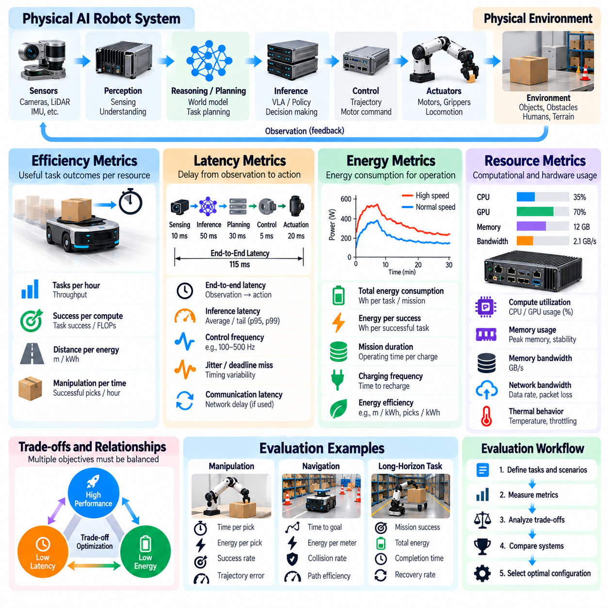{width="7.268055555555556in" height="7.268055555555556in"}

Efficiency, latency, energy consumption, and resource utilization are essential dimensions of Physical AI evaluation. A robot may achieve high task success while requiring excessive computation, power, or operating time. Such performance may be unsuitable for practical deployment. Evaluation must therefore measure not only whether physical tasks are completed but also the resources required to execute them reliably under realistic operating conditions.

Efficiency describes the relationship between useful task outcomes and the resources consumed to produce them. Depending on the application, it may be expressed through tasks completed per hour, distance traveled per unit of energy, or successful manipulations per computational cost. Efficiency measurements should account for task difficulty and execution quality. Faster operation is not necessarily better when it increases failures or compromises safety.

Latency measures the delay between an event, observation, or command and the corresponding system response. In Physical AI, latency arises from sensing, data transfer, inference, planning, communication, and actuation. These delays influence the robot\'s ability to respond to dynamic environments. Evaluation should distinguish individual component latency from end-to-end response time because small delays across multiple stages can accumulate into significant operational limitations.

Inference latency is particularly important for foundation models and vision-language-action systems. Large neural networks may generate sophisticated decisions but require substantial computation before producing motor commands. A model that performs well on offline benchmarks may fail to satisfy real-time control requirements. Evaluation should measure typical latency, tail latency, and timing variability under the actual hardware and computational workload.

Control-loop timing determines whether a robot can maintain stable interaction with its environment. Delayed sensor updates or irregular command intervals may cause tracking errors, oscillations, and unstable contact behavior. Metrics should include control frequency, deadline-miss rate, scheduling jitter, and response consistency. These measurements are especially important for legged locomotion, force-controlled manipulation, and other dynamically sensitive tasks.

Energy consumption provides a direct measure of operational sustainability. Physical AI systems consume energy through computation, sensing, communication, actuation, and supporting electronics. Total energy usage should be measured over complete tasks rather than inferred solely from processor power. Battery-powered robots require additional evaluation of mission duration, charging frequency, and usable operating capacity under representative workloads.

Energy efficiency can be expressed as energy consumed per successful task, per transported payload, or per unit of distance traveled. These normalized measurements support comparisons among alternative robot configurations and control policies. However, comparisons must account for payload mass, terrain difficulty, movement speed, and environmental conditions. Otherwise, differences in task requirements may be mistaken for differences in system efficiency.

Computational resource metrics characterize the processing demands of Physical AI models and supporting software. Relevant measurements include processor utilization, accelerator utilization, memory consumption, memory bandwidth, and computational throughput. Peak resource requirements are important because a system may operate normally under average workloads but fail when perception, planning, and control processes simultaneously demand additional capacity.

Memory efficiency is particularly important for edge-deployed Physical AI systems. Large perception models, world models, and policy networks may compete for limited memory resources. Excessive memory allocation can introduce swapping, inference delays, or process termination. Evaluation should measure peak memory usage, allocation stability, and performance under concurrent workloads. These results help determine whether algorithms are suitable for constrained onboard hardware.

Communication efficiency becomes critical when robots depend on distributed computation or fleet coordination. Network latency, bandwidth consumption, packet loss, and synchronization overhead can influence perception updates and control decisions. Systems using cloud-based inference must also account for connectivity interruptions and transmission energy. Evaluation should determine whether essential functions remain reliable when communication quality deteriorates.

Thermal behavior links computational performance with physical operating constraints. Sustained inference and motor activity generate heat that may trigger frequency throttling, reduced actuator performance, or protective shutdowns. Short benchmark runs can overlook these effects. Long-duration evaluation should record temperature, clock-frequency changes, power limitations, and performance degradation to establish whether advertised capabilities remain sustainable.

Resource utilization should also be examined at the complete system level. A robot may execute individual tasks efficiently while spending substantial time waiting for charging, receiving assignments, or recovering from interruptions. Operational metrics such as utilization rate, idle time, maintenance overhead, and completed tasks per operating hour reveal these inefficiencies. System-level measurements connect component performance with practical productivity.

Latency and energy frequently create competing optimization objectives. Increasing model complexity may improve perception accuracy while raising inference time and power demand. Faster actuator movements may reduce task duration but increase peak power and mechanical stress. Evaluation should characterize these tradeoffs explicitly. A useful benchmark reports performance across operating configurations rather than assuming that maximum speed or minimum energy is universally optimal.

Efficiency metrics must account for failures and recovery attempts. Reporting energy consumption only for successful trials can conceal resources wasted during unsuccessful executions. Similarly, average task duration may appear favorable when difficult attempts are excluded. Evaluators should distinguish energy per attempt, energy per successful completion, retry overhead, and recovery time. This approach provides a more accurate representation of operational cost.

Measurement procedures require careful instrumentation and consistent boundaries. Power sensors, timestamps, processor counters, and communication logs should be synchronized to identify where resources are consumed. Evaluators must specify whether measurements include idle power, initialization, sensing, computation, actuation, and recovery. Without consistent accounting, reported efficiency and latency values may not be comparable across systems.

Statistical reporting should capture variability rather than relying exclusively on average measurements. Latency distributions may contain rare but consequential delays, while energy consumption can vary with environmental conditions and task difficulty. Percentiles, confidence intervals, repeated trials, and workload descriptions provide stronger evidence of performance. Safety-critical applications should pay particular attention to worst-case timing and resource exhaustion.

Ultimately, efficiency, latency, energy, and resource metrics determine whether Physical AI capabilities can operate within practical physical and computational limits. High task success is insufficient when execution requires unsustainable power, excessive hardware, or unpredictable response times. Integrating these measurements with safety, reliability, and task quality enables meaningful comparisons and supports the development of deployable, scalable Physical AI systems.

효율성(Efficiency), 지연 시간(Latency), 에너지 소비(Energy Consumption), 자원 활용률(Resource Utilization)은 피지컬 인공지능(Physical AI) 평가의 필수적인 차원이다. 로봇은 높은 작업 성공률(Task Success Rate)을 달성하더라도 과도한 연산 자원(Computational Resources), 전력(Power), 운영 시간(Operating Time)을 요구할 수 있다. 이러한 성능은 실제 배치(Practical Deployment)에 적합하지 않을 수 있다. 따라서 평가는 물리적 작업의 완료 여부뿐 아니라 현실적인 운영 조건(Realistic Operating Conditions)에서 작업을 신뢰성 있게 수행하는 데 필요한 자원도 측정해야 한다.

효율성(Efficiency)은 유용한 작업 결과(Useful Task Outcomes)와 이를 생성하는 데 소비된 자원(Resources Consumed) 사이의 관계를 설명한다. 응용 분야에 따라 시간당 완료 작업 수(Tasks Completed per Hour), 단위 에너지당 이동 거리(Distance Traveled per Unit of Energy), 계산 비용당 성공적인 조작 횟수(Successful Manipulations per Computational Cost)로 표현할 수 있다. 효율성 측정은 작업 난이도(Task Difficulty)와 실행 품질(Execution Quality)을 고려해야 한다. 빠른 운영이 실패를 증가시키거나 안전성을 저하시킨다면 반드시 더 우수한 것은 아니다.

지연 시간(Latency)은 사건(Event), 관측(Observation), 명령(Command)이 발생한 시점부터 이에 대응하는 시스템 응답(System Response)이 나타날 때까지의 지연을 측정한다. 피지컬 인공지능에서 지연 시간은 센싱(Sensing), 데이터 전송(Data Transfer), 추론(Inference), 계획(Planning), 통신(Communication), 구동(Actuation) 과정에서 발생한다. 이러한 지연은 로봇이 동적 환경(Dynamic Environments)에 대응하는 능력에 영향을 미친다. 여러 단계에서 발생한 작은 지연이 누적되어 상당한 운영상 제약(Operational Limitations)을 초래할 수 있으므로 개별 구성요소 지연(Component Latency)과 종단 간 응답 시간(End-to-End Response Time)을 구분하여 평가해야 한다.

추론 지연(Inference Latency)은 파운데이션 모델(Foundation Models)과 비전-언어-행동 시스템(Vision-Language-Action Systems)에서 특히 중요하다. 대규모 신경망(Large Neural Networks)은 정교한 의사결정(Sophisticated Decisions)을 생성할 수 있지만 모터 명령(Motor Commands)을 출력하기 전에 상당한 연산을 요구할 수 있다. 오프라인 벤치마크(Offline Benchmarks)에서 우수한 성능을 보이는 모델이라도 실시간 제어 요구사항(Real-Time Control Requirements)을 충족하지 못할 수 있다. 평가는 실제 하드웨어(Actual Hardware)와 연산 작업 부하(Computational Workload)에서 일반적인 지연 시간(Typical Latency), 꼬리 지연 시간(Tail Latency), 시간 변동성(Timing Variability)을 측정해야 한다.

제어 루프 타이밍(Control-Loop Timing)은 로봇이 환경과 안정적인 상호작용(Stable Interaction)을 유지할 수 있는지를 결정한다. 지연된 센서 갱신(Delayed Sensor Updates)이나 불규칙한 명령 간격(Irregular Command Intervals)은 추종 오차(Tracking Errors), 진동(Oscillations), 불안정한 접촉 행동(Unstable Contact Behavior)을 발생시킬 수 있다. 평가 지표에는 제어 주파수(Control Frequency), 마감 시간 위반율(Deadline-Miss Rate), 스케줄링 지터(Scheduling Jitter), 응답 일관성(Response Consistency)이 포함되어야 한다. 이러한 측정은 다족 보행(Legged Locomotion), 힘 제어 조작(Force-Controlled Manipulation), 기타 동역학적으로 민감한 작업(Dynamically Sensitive Tasks)에서 특히 중요하다.

에너지 소비(Energy Consumption)는 운영 지속 가능성(Operational Sustainability)을 직접적으로 측정하는 지표를 제공한다. 피지컬 인공지능 시스템은 연산(Computation), 센싱(Sensing), 통신(Communication), 구동(Actuation), 지원 전자장치(Supporting Electronics)를 통해 에너지를 소비한다. 전체 에너지 사용량(Total Energy Usage)은 프로세서 전력(Processor Power)만으로 추정하기보다 완전한 작업(Complete Tasks)에 걸쳐 측정해야 한다. 배터리 구동 로봇(Battery-Powered Robots)은 대표적인 작업 부하(Representative Workloads)에서 임무 지속 시간(Mission Duration), 충전 빈도(Charging Frequency), 실제 사용 가능한 운영 용량(Usable Operating Capacity)을 추가로 평가해야 한다.

에너지 효율성(Energy Efficiency)은 성공적인 작업당 소비 에너지(Energy per Successful Task), 운반한 적재물당 에너지(Energy per Transported Payload), 단위 이동 거리당 에너지(Energy per Unit of Distance Traveled)로 표현할 수 있다. 이러한 정규화된 측정값(Normalized Measurements)은 서로 다른 로봇 구성(Robot Configurations)과 제어 정책(Control Policies)을 비교할 수 있도록 한다. 그러나 비교 과정에서는 적재 질량(Payload Mass), 지형 난이도(Terrain Difficulty), 이동 속도(Movement Speed), 환경 조건(Environmental Conditions)을 고려해야 한다. 그렇지 않으면 작업 요구사항의 차이를 시스템 효율성의 차이로 잘못 해석할 수 있다.

연산 자원 지표(Computational Resource Metrics)는 피지컬 인공지능 모델과 지원 소프트웨어(Supporting Software)의 처리 요구사항(Processing Demands)을 특성화한다. 관련 측정 항목에는 프로세서 활용률(Processor Utilization), 가속기 활용률(Accelerator Utilization), 메모리 소비(Memory Consumption), 메모리 대역폭(Memory Bandwidth), 연산 처리량(Computational Throughput)이 포함된다. 최대 자원 요구량(Peak Resource Requirements)은 평균 작업 부하에서는 정상적으로 작동하던 시스템도 인식(Perception), 계획(Planning), 제어(Control) 프로세스가 동시에 추가 자원을 요구할 때 실패할 수 있기 때문에 중요하다.

메모리 효율성(Memory Efficiency)은 특히 엣지 배치형 피지컬 인공지능 시스템(Edge-Deployed Physical AI Systems)에서 중요하다. 대규모 인식 모델(Perception Models), 세계 모델(World Models), 정책 네트워크(Policy Networks)는 제한된 메모리 자원(Limited Memory Resources)을 두고 경쟁할 수 있다. 과도한 메모리 할당(Excessive Memory Allocation)은 스와핑(Swapping), 추론 지연(Inference Delays), 프로세스 종료(Process Termination)를 발생시킬 수 있다. 평가는 최대 메모리 사용량(Peak Memory Usage), 할당 안정성(Allocation Stability), 동시 작업 부하(Concurrent Workloads)에서의 성능을 측정해야 한다. 이러한 결과는 알고리즘이 자원 제약이 있는 온보드 하드웨어(Constrained Onboard Hardware)에 적합한지를 판단하는 데 도움이 된다.

통신 효율성(Communication Efficiency)은 로봇이 분산 연산(Distributed Computation)이나 군집 로봇 조정(Fleet Coordination)에 의존할 때 중요해진다. 네트워크 지연(Network Latency), 대역폭 소비(Bandwidth Consumption), 패킷 손실(Packet Loss), 동기화 오버헤드(Synchronization Overhead)는 인식 갱신(Perception Updates)과 제어 의사결정(Control Decisions)에 영향을 미칠 수 있다. 클라우드 기반 추론(Cloud-Based Inference)을 사용하는 시스템은 연결 중단(Connectivity Interruptions)과 전송 에너지(Transmission Energy)도 고려해야 한다. 평가는 통신 품질(Communication Quality)이 저하될 때도 필수 기능(Essential Functions)이 신뢰성 있게 유지되는지를 판단해야 한다.

열적 특성(Thermal Behavior)은 연산 성능(Computational Performance)과 물리적 운영 제약(Physical Operating Constraints)을 연결한다. 지속적인 추론(Sustained Inference)과 모터 활동(Motor Activity)은 열을 발생시키며, 이는 주파수 스로틀링(Frequency Throttling), 액추에이터 성능 저하(Reduced Actuator Performance), 보호 정지(Protective Shutdowns)를 유발할 수 있다. 짧은 벤치마크 실행(Short Benchmark Runs)에서는 이러한 영향을 간과할 수 있다. 장시간 평가(Long-Duration Evaluation)는 온도(Temperature), 클록 주파수 변화(Clock-Frequency Changes), 전력 제한(Power Limitations), 성능 저하(Performance Degradation)를 기록하여 제시된 능력이 지속적으로 유지될 수 있는지를 확인해야 한다.

자원 활용률(Resource Utilization)은 전체 시스템 수준(Complete System Level)에서도 검토해야 한다. 로봇은 개별 작업을 효율적으로 수행하더라도 충전 대기(Waiting for Charging), 작업 할당 대기(Receiving Assignments), 중단 후 복구(Recovering from Interruptions)에 상당한 시간을 소비할 수 있다. 활용률(Utilization Rate), 유휴 시간(Idle Time), 유지보수 오버헤드(Maintenance Overhead), 운영 시간당 완료 작업 수(Completed Tasks per Operating Hour)와 같은 운영 지표(Operational Metrics)는 이러한 비효율성을 드러낸다. 시스템 수준 측정(System-Level Measurements)은 구성요소 성능(Component Performance)을 실제 생산성(Practical Productivity)과 연결한다.

지연 시간(Latency)과 에너지(Energy)는 종종 서로 경쟁하는 최적화 목표(Competing Optimization Objectives)를 형성한다. 모델 복잡도(Model Complexity)를 증가시키면 인식 정확도(Perception Accuracy)는 향상될 수 있지만 추론 시간(Inference Time)과 전력 요구량(Power Demand)도 증가할 수 있다. 더 빠른 액추에이터 움직임(Faster Actuator Movements)은 작업 시간을 줄이지만 최대 전력(Peak Power)과 기계적 응력(Mechanical Stress)을 증가시킬 수 있다. 평가는 이러한 상충관계(Tradeoffs)를 명시적으로 특성화해야 한다. 유용한 벤치마크는 최대 속도나 최소 에너지가 보편적으로 최적이라고 가정하기보다 다양한 운영 구성(Operating Configurations)에 따른 성능을 보고해야 한다.

효율성 지표(Efficiency Metrics)는 실패(Failures)와 복구 시도(Recovery Attempts)를 고려해야 한다. 성공한 시험(Successful Trials)에 대해서만 에너지 소비를 보고하면 실패한 실행(Unsuccessful Executions)에서 낭비된 자원을 감출 수 있다. 마찬가지로 어려운 시도를 제외하면 평균 작업 시간(Average Task Duration)이 실제보다 유리하게 나타날 수 있다. 평가자는 시도당 에너지(Energy per Attempt), 성공적인 완료당 에너지(Energy per Successful Completion), 재시도 오버헤드(Retry Overhead), 복구 시간(Recovery Time)을 구분해야 한다. 이러한 접근법은 운영 비용(Operational Cost)을 더욱 정확하게 표현한다.

측정 절차(Measurement Procedures)에는 정밀한 계측(Instrumentation)과 일관된 측정 범위(Consistent Boundaries)가 필요하다. 전력 센서(Power Sensors), 타임스탬프(Timestamps), 프로세서 카운터(Processor Counters), 통신 로그(Communication Logs)는 자원이 소비되는 위치를 식별할 수 있도록 동기화되어야 한다. 평가자는 측정값에 유휴 전력(Idle Power), 초기화(Initialization), 센싱(Sensing), 연산(Computation), 구동(Actuation), 복구(Recovery)가 포함되는지를 명시해야 한다. 일관된 자원 산정 기준(Consistent Accounting)이 없다면 보고된 효율성과 지연 시간 값은 시스템 간 비교가 어려울 수 있다.

통계적 보고(Statistical Reporting)는 평균 측정값(Average Measurements)에만 의존하기보다 변동성(Variability)을 포착해야 한다. 지연 시간 분포(Latency Distributions)에는 드물지만 중대한 결과를 초래하는 지연이 포함될 수 있으며, 에너지 소비는 환경 조건(Environmental Conditions)과 작업 난이도(Task Difficulty)에 따라 달라질 수 있다. 백분위수(Percentiles), 신뢰구간(Confidence Intervals), 반복 시험(Repeated Trials), 작업 부하 설명(Workload Descriptions)은 성능에 대한 더욱 강력한 증거를 제공한다. 안전 필수 응용 분야(Safety-Critical Applications)에서는 최악 조건의 타이밍(Worst-Case Timing)과 자원 고갈(Resource Exhaustion)에 특히 주의를 기울여야 한다.

궁극적으로 효율성(Efficiency), 지연 시간(Latency), 에너지(Energy), 자원 지표(Resource Metrics)는 피지컬 인공지능의 능력이 실제 물리적·계산적 한계(Physical and Computational Limits) 내에서 작동할 수 있는지를 결정한다. 실행에 지속 가능하지 않은 전력(Unsustainable Power), 과도한 하드웨어(Excessive Hardware), 예측하기 어려운 응답 시간(Unpredictable Response Times)이 필요하다면 높은 작업 성공률만으로는 충분하지 않다. 이러한 측정값을 안전성(Safety), 신뢰성(Reliability), 작업 품질(Task Quality)과 통합하면 의미 있는 비교가 가능해지고 실제 배치가 가능하며(Deployable) 확장 가능한(Scalable) 피지컬 인공지능 시스템의 개발을 지원할 수 있다.

##  

## 01.10. Uncertainty and Confidence Aware Evaluation

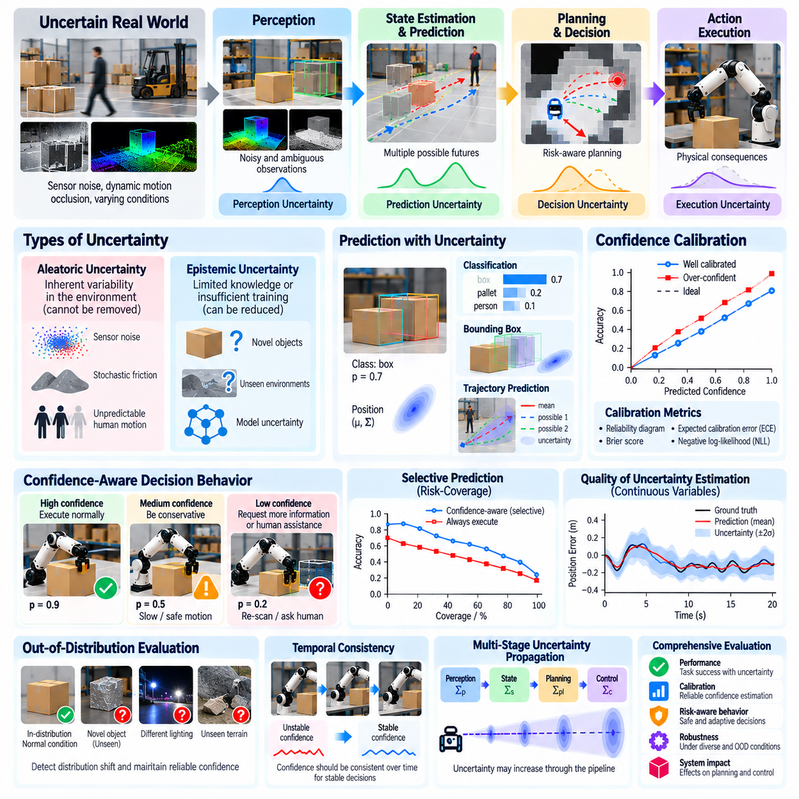{width="7.268055555555556in" height="7.268055555555556in"}

Uncertainty and confidence-aware evaluation are essential for determining whether Physical AI systems can operate reliably under incomplete information. Robots must make decisions using noisy sensors, imperfect models, and changing environmental conditions. Conventional accuracy metrics measure whether predictions or actions are correct, but they do not establish whether a system recognizes its own limitations. Evaluation must therefore examine both performance and the reliability of expressed confidence.

Uncertainty represents incomplete knowledge about states, observations, predictions, or action outcomes. In Physical AI, uncertainty may arise from sensor noise, ambiguous object geometry, unpredictable motion, and incomplete environmental models. Confidence expresses the degree of certainty assigned to a particular estimate or decision. A system with high prediction accuracy may still be unsafe if it expresses excessive confidence when encountering unfamiliar situations.

Aleatoric uncertainty originates from inherent variability in observations or physical processes. Examples include measurement noise, stochastic friction, and unpredictable human movement. Such uncertainty cannot generally be eliminated through additional training alone. Evaluation should determine whether the system represents this variability appropriately and maintains reliable behavior when observations or outcomes remain inherently uncertain.

Epistemic uncertainty arises from insufficient knowledge, limited training coverage, or imperfect learned models. A robot encountering an unfamiliar object or previously unseen terrain may produce uncertain predictions because its experience does not adequately represent the situation. Unlike irreducible environmental randomness, epistemic uncertainty can sometimes decrease through additional observations, improved models, or targeted data collection.

A central objective of confidence-aware evaluation is calibration. A calibrated system assigns confidence levels that correspond to observed correctness frequencies under specified conditions. For example, predictions assigned approximately eighty percent confidence should be correct about eighty percent of the time across a sufficiently representative group. Calibration does not guarantee accuracy, but it indicates whether confidence estimates can support meaningful decisions.

Calibration can be measured using reliability diagrams, expected calibration error, and proper scoring rules such as the Brier score or negative log-likelihood. These methods compare predicted probabilities with observed outcomes. However, evaluation must account for sample size, confidence-bin definitions, and the structure of predictions. A single calibration score may conceal serious errors in rare but safety-critical operating conditions.

Uncertainty evaluation extends beyond classification probabilities. Robotic perception and state estimation often produce continuous quantities such as position, velocity, orientation, and contact force. Evaluators can examine prediction intervals, covariance estimates, and probabilistic state distributions. Well-calibrated uncertainty regions should contain the corresponding ground-truth values at approximately their stated coverage rates under the tested conditions.

Prediction uncertainty is particularly important for world models and motion forecasting. A robot may predict several plausible future trajectories for a moving person or nearby vehicle. Evaluation should consider whether the predicted distribution captures realistic alternatives rather than only the most likely trajectory. Metrics may examine probabilistic accuracy, coverage, trajectory diversity, and the consequences of uncertainty for downstream planning.

Confidence-aware decision-making requires evaluating how uncertainty influences physical actions. A robot with uncertain object localization may slow its approach, request additional observations, or select a safer grasp. A navigation system may increase obstacle clearance when perception confidence decreases. Evaluation should determine whether these adjustments improve safety and reliability without introducing unnecessary delays or excessive conservatism.

Selective prediction provides a practical framework for assessing uncertainty-aware behavior. A system may execute actions only when confidence exceeds an established threshold and defer uncertain cases to additional sensing or human assistance. Evaluation should report coverage, accepted-task accuracy, rejection frequency, and the resulting risk. Risk-coverage curves reveal whether declining uncertain decisions meaningfully improves reliability.

Out-of-distribution evaluation examines confidence when operating conditions differ from the training environment. Novel objects, unusual lighting, sensor degradation, and unfamiliar terrain may produce incorrect predictions with misleadingly high confidence. A reliable system should recognize meaningful distribution shifts when possible. Evaluation should measure detection performance alongside the quality of resulting actions, fallback behavior, and recovery.

Uncertainty must also be examined across interconnected system components. Perception errors can propagate into state estimation, planning, and control, while uncertainty may grow over long prediction horizons. Evaluators should investigate whether uncertainty estimates remain consistent across these stages. Ignoring correlations or combining confidence scores without justification can create an artificially optimistic representation of system reliability.

Temporal consistency is another important consideration. Confidence estimates may fluctuate rapidly as sensor observations change, even when the physical environment remains relatively stable. Excessive fluctuations can produce unstable planning decisions or unnecessary switching between control modes. Evaluation should measure confidence stability, update responsiveness, and the ability to distinguish genuine environmental changes from transient sensor disturbances.

Safety-critical evaluation requires particular attention to overconfidence. An uncertain system that requests assistance may reduce productivity, but a confidently incorrect system can create hazardous physical interactions. Evaluation should therefore distinguish false confidence from appropriate caution and assess the severity of resulting consequences. High-confidence errors near obstacles, humans, or mechanical limits deserve separate analysis rather than being hidden within average scores.

Confidence thresholds should be evaluated in relation to operational objectives. A conservative threshold may reduce hazardous actions but increase intervention frequency, waiting time, and task abandonment. A permissive threshold may improve throughput while increasing exposure to uncertain decisions. Benchmark protocols should characterize these tradeoffs across multiple thresholds and report whether safety requirements are satisfied independently of average task performance.

Statistical reliability remains essential because uncertainty estimates are themselves subject to estimation error. Small test sets may provide misleading calibration results, particularly for rare events. Repeated trials, confidence intervals, scenario stratification, and independent evaluation datasets improve interpretability. Evaluators should also distinguish uncertainty in the robot\'s predictions from statistical uncertainty in the reported benchmark measurements.

Ultimately, uncertainty and confidence-aware evaluation determine whether Physical AI systems understand the limits of their predictions and respond appropriately when knowledge is incomplete. Accurate predictions alone are insufficient for dependable physical autonomy. Combining calibration, probabilistic coverage, distribution-shift testing, selective action, and safety-aware decision analysis provides stronger evidence that a robot can operate responsibly under uncertainty.

불확실성(Uncertainty)과 신뢰도 인식 평가(Confidence-Aware Evaluation)는 피지컬 인공지능(Physical AI) 시스템이 불완전한 정보(Incomplete Information)에서도 신뢰성 있게 작동할 수 있는지를 판단하는 데 필수적이다. 로봇은 잡음이 포함된 센서(Noisy Sensors), 불완전한 모델(Imperfect Models), 변화하는 환경 조건(Changing Environmental Conditions)을 이용하여 의사결정을 수행해야 한다. 기존의 정확도 지표(Accuracy Metrics)는 예측이나 행동이 올바른지를 측정하지만, 시스템이 자신의 한계(Limitations)를 인식하는지는 확인하지 못한다. 따라서 평가는 성능(Performance)과 표현된 신뢰도의 신뢰성(Reliability of Expressed Confidence)을 함께 검토해야 한다.

불확실성(Uncertainty)은 상태(States), 관측(Observations), 예측(Predictions), 행동 결과(Action Outcomes)에 관한 지식이 불완전한 상태를 의미한다. 피지컬 인공지능에서 불확실성은 센서 잡음(Sensor Noise), 모호한 객체 형상(Ambiguous Object Geometry), 예측하기 어려운 움직임(Unpredictable Motion), 불완전한 환경 모델(Incomplete Environmental Models)에서 발생할 수 있다. 신뢰도(Confidence)는 특정 추정(Estimate)이나 의사결정(Decision)에 부여된 확신의 정도를 나타낸다. 예측 정확도(Prediction Accuracy)가 높은 시스템이라도 익숙하지 않은 상황에서 과도한 신뢰도(Excessive Confidence)를 표현한다면 안전하지 않을 수 있다.

우연적 불확실성(Aleatoric Uncertainty)은 관측이나 물리적 과정(Physical Processes)에 내재된 변동성(Inherent Variability)에서 발생한다. 대표적인 사례로는 측정 잡음(Measurement Noise), 확률적 마찰(Stochastic Friction), 예측하기 어려운 인간의 움직임(Unpredictable Human Movement)이 있다. 이러한 불확실성은 일반적으로 추가 학습(Additional Training)만으로 제거할 수 없다. 평가는 시스템이 이러한 변동성을 적절하게 표현하는지, 그리고 관측이나 결과가 본질적으로 불확실한 상황에서도 신뢰할 수 있는 행동(Reliable Behavior)을 유지하는지를 판단해야 한다.

인식적 불확실성(Epistemic Uncertainty)은 불충분한 지식(Insufficient Knowledge), 제한된 학습 범위(Limited Training Coverage), 불완전한 학습 모델(Imperfect Learned Models)에서 발생한다. 로봇이 익숙하지 않은 객체(Unfamiliar Object)나 이전에 경험하지 못한 지형(Unseen Terrain)을 만나면, 기존 경험이 해당 상황을 충분히 대표하지 못하기 때문에 불확실한 예측을 생성할 수 있다. 제거하기 어려운 환경의 무작위성(Irreducible Environmental Randomness)과 달리 인식적 불확실성은 추가 관측(Additional Observations), 개선된 모델(Improved Models), 목표 지향적 데이터 수집(Targeted Data Collection)을 통해 감소할 수 있다.

신뢰도 인식 평가(Confidence-Aware Evaluation)의 핵심 목표 중 하나는 보정(Calibration)이다. 잘 보정된 시스템(Calibrated System)은 지정된 조건에서 관측된 정답 빈도(Observed Correctness Frequencies)에 대응하는 신뢰도 수준(Confidence Levels)을 부여한다. 예를 들어 약 80%의 신뢰도가 부여된 예측은 충분히 대표성 있는 집단(Representative Group)에서 약 80%의 비율로 정확해야 한다. 보정이 정확도(Accuracy)를 보장하는 것은 아니지만, 신뢰도 추정값(Confidence Estimates)이 의미 있는 의사결정을 지원할 수 있는지를 나타낸다.

보정(Calibration)은 신뢰도 다이어그램(Reliability Diagrams), 기대 보정 오차(Expected Calibration Error), 브라이어 점수(Brier Score), 음의 로그 가능도(Negative Log-Likelihood)와 같은 적절한 점수화 규칙(Proper Scoring Rules)을 이용하여 측정할 수 있다. 이러한 방법은 예측 확률(Predicted Probabilities)을 관측 결과(Observed Outcomes)와 비교한다. 그러나 평가는 표본 크기(Sample Size), 신뢰도 구간 정의(Confidence-Bin Definitions), 예측 구조(Structure of Predictions)를 고려해야 한다. 단일 보정 점수(Single Calibration Score)는 드물지만 안전상 중요한 운영 조건(Safety-Critical Operating Conditions)에서 발생하는 심각한 오류를 감출 수 있다.

불확실성 평가(Uncertainty Evaluation)는 분류 확률(Classification Probabilities)을 넘어 확장된다. 로봇 인식(Robotic Perception)과 상태 추정(State Estimation)은 위치(Position), 속도(Velocity), 방향(Orientation), 접촉력(Contact Force)과 같은 연속적인 물리량(Continuous Quantities)을 생성하는 경우가 많다. 평가자는 예측 구간(Prediction Intervals), 공분산 추정값(Covariance Estimates), 확률적 상태 분포(Probabilistic State Distributions)를 검토할 수 있다. 적절하게 보정된 불확실성 영역(Uncertainty Regions)은 시험 조건에서 명시된 포함률(Coverage Rates)에 근접하는 비율로 해당 실제 기준값(Ground-Truth Values)을 포함해야 한다.

예측 불확실성(Prediction Uncertainty)은 세계 모델(World Models)과 움직임 예측(Motion Forecasting)에서 특히 중요하다. 로봇은 움직이는 사람이나 주변 차량에 대해 여러 가지 가능한 미래 궤적(Plausible Future Trajectories)을 예측할 수 있다. 평가는 예측 분포(Predicted Distribution)가 가장 가능성이 높은 궤적(Most Likely Trajectory)만이 아니라 현실적인 대안(Realistic Alternatives)도 포착하는지를 고려해야 한다. 평가 지표는 확률적 정확도(Probabilistic Accuracy), 포함률(Coverage), 궤적 다양성(Trajectory Diversity), 불확실성이 후속 계획(Downstream Planning)에 미치는 영향을 검토할 수 있다.

신뢰도 인식 의사결정(Confidence-Aware Decision-Making)은 불확실성이 물리적 행동(Physical Actions)에 어떤 영향을 미치는지를 평가해야 한다. 객체 위치 추정(Object Localization)이 불확실한 로봇은 접근 속도를 낮추거나 추가 관측(Additional Observations)을 요청하거나 더 안전한 파지(Safer Grasp)를 선택할 수 있다. 주행 시스템(Navigation System)은 인식 신뢰도(Perception Confidence)가 감소하면 장애물 안전거리(Obstacle Clearance)를 늘릴 수 있다. 평가는 이러한 조정이 불필요한 지연(Unnecessary Delays)이나 과도한 보수성(Excessive Conservatism)을 초래하지 않으면서 안전성과 신뢰성을 향상시키는지를 판단해야 한다.

선택적 예측(Selective Prediction)은 불확실성 인식 행동(Uncertainty-Aware Behavior)을 평가하기 위한 실용적인 프레임워크(Practical Framework)를 제공한다. 시스템은 신뢰도가 설정된 임계값(Established Threshold)을 초과할 때만 행동을 실행하고, 불확실한 경우에는 추가 센싱(Additional Sensing)이나 인간의 지원(Human Assistance)으로 판단을 유보할 수 있다. 평가는 적용 범위(Coverage), 수락된 작업의 정확도(Accepted-Task Accuracy), 거부 빈도(Rejection Frequency), 그에 따른 위험(Risk)을 보고해야 한다. 위험-적용 범위 곡선(Risk-Coverage Curves)은 불확실한 결정을 거부하는 것이 신뢰성을 실질적으로 향상시키는지를 보여준다.

분포 외 평가(Out-of-Distribution Evaluation)는 운영 조건이 학습 환경(Training Environment)과 다를 때의 신뢰도를 검토한다. 새로운 객체(Novel Objects), 비정상적인 조명(Unusual Lighting), 센서 성능 저하(Sensor Degradation), 익숙하지 않은 지형(Unfamiliar Terrain)은 잘못된 예측에 오해를 유발할 정도로 높은 신뢰도(Misleadingly High Confidence)가 부여되는 상황을 만들 수 있다. 신뢰할 수 있는 시스템은 가능한 경우 의미 있는 분포 변화(Distribution Shifts)를 인식해야 한다. 평가는 탐지 성능(Detection Performance)과 함께 그에 따른 행동 품질(Action Quality), 대체 동작(Fallback Behavior), 복구(Recovery)를 측정해야 한다.

불확실성(Uncertainty)은 상호 연결된 시스템 구성요소(Interconnected System Components) 전반에서도 검토해야 한다. 인식 오류(Perception Errors)는 상태 추정(State Estimation), 계획(Planning), 제어(Control)로 전파될 수 있으며, 불확실성은 긴 예측 시간 범위(Long Prediction Horizons)에 걸쳐 증가할 수 있다. 평가자는 이러한 단계 전반에서 불확실성 추정값(Uncertainty Estimates)이 일관성을 유지하는지 조사해야 한다. 상관관계(Correlations)를 무시하거나 정당한 근거 없이 신뢰도 점수(Confidence Scores)를 결합하면 시스템 신뢰성(System Reliability)이 실제보다 낙관적으로 표현될 수 있다.

시간적 일관성(Temporal Consistency)도 중요한 고려사항이다. 물리적 환경(Physical Environment)이 비교적 안정적으로 유지되더라도 센서 관측(Sensor Observations)이 변화함에 따라 신뢰도 추정값(Confidence Estimates)이 빠르게 변동할 수 있다. 과도한 변동(Excessive Fluctuations)은 불안정한 계획 결정(Unstable Planning Decisions)이나 제어 모드(Control Modes) 사이의 불필요한 전환(Unnecessary Switching)을 발생시킬 수 있다. 평가는 신뢰도 안정성(Confidence Stability), 갱신 반응성(Update Responsiveness), 실제 환경 변화(Genuine Environmental Changes)와 일시적인 센서 외란(Transient Sensor Disturbances)을 구분하는 능력을 측정해야 한다.

안전 필수 평가(Safety-Critical Evaluation)에서는 과신(Overconfidence)에 특별한 주의를 기울여야 한다. 불확실성을 인식한 시스템이 지원을 요청하면 생산성(Productivity)이 감소할 수 있지만, 잘못된 판단에 높은 확신을 가진 시스템(Confidently Incorrect System)은 위험한 물리적 상호작용(Hazardous Physical Interactions)을 초래할 수 있다. 따라서 평가는 잘못된 확신(False Confidence)과 적절한 신중함(Appropriate Caution)을 구분하고 그 결과의 심각도(Severity of Consequences)를 평가해야 한다. 장애물(Obstacles), 인간(Humans), 기계적 한계(Mechanical Limits) 근처에서 발생하는 높은 신뢰도의 오류(High-Confidence Errors)는 평균 점수에 포함하여 감추기보다 별도로 분석해야 한다.

신뢰도 임계값(Confidence Thresholds)은 운영 목표(Operational Objectives)와의 관계 속에서 평가해야 한다. 보수적인 임계값(Conservative Threshold)은 위험한 행동(Hazardous Actions)을 줄일 수 있지만 개입 빈도(Intervention Frequency), 대기 시간(Waiting Time), 작업 포기(Task Abandonment)를 증가시킬 수 있다. 반대로 허용적인 임계값(Permissive Threshold)은 처리량(Throughput)을 향상시키면서 불확실한 의사결정(Uncertain Decisions)에 대한 노출을 증가시킬 수 있다. 벤치마크 프로토콜(Benchmark Protocols)은 여러 임계값에 걸쳐 이러한 상충관계(Tradeoffs)를 특성화하고 평균 작업 성능(Average Task Performance)과 독립적으로 안전 요구사항(Safety Requirements)이 충족되는지를 보고해야 한다.

통계적 신뢰성(Statistical Reliability)은 불확실성 추정값(Uncertainty Estimates) 자체에도 추정 오차(Estimation Error)가 포함되므로 여전히 필수적이다. 작은 시험 데이터셋(Small Test Sets)은 특히 드문 사건(Rare Events)에 대해 잘못된 보정 결과(Misleading Calibration Results)를 제공할 수 있다. 반복 시험(Repeated Trials), 신뢰구간(Confidence Intervals), 시나리오 계층화(Scenario Stratification), 독립적인 평가 데이터셋(Independent Evaluation Datasets)은 결과의 해석 가능성(Interpretability)을 향상시킨다. 평가자는 로봇 예측의 불확실성(Uncertainty in Robot Predictions)과 보고된 벤치마크 측정값의 통계적 불확실성(Statistical Uncertainty in Benchmark Measurements)도 구분해야 한다.

궁극적으로 불확실성 및 신뢰도 인식 평가(Uncertainty and Confidence-Aware Evaluation)는 피지컬 인공지능 시스템이 자신의 예측 한계(Prediction Limits)를 이해하고 지식이 불완전한 상황에서 적절하게 대응하는지를 판단한다. 정확한 예측(Accurate Predictions)만으로는 신뢰할 수 있는 물리적 자율성(Dependable Physical Autonomy)을 확보하기에 충분하지 않다. 보정(Calibration), 확률적 포함률(Probabilistic Coverage), 분포 변화 시험(Distribution-Shift Testing), 선택적 행동(Selective Action), 안전 인식 의사결정 분석(Safety-Aware Decision Analysis)을 결합하면 로봇이 불확실한 상황에서도 책임감 있게 작동할 수 있다는 더욱 강력한 평가 근거를 제공할 수 있다.

##  

## 01.11. Human and Environment Centered Evaluation

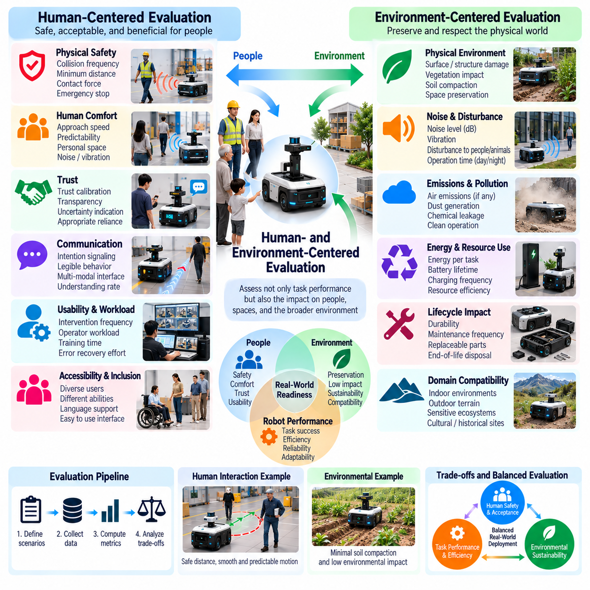{width="7.268055555555556in" height="7.268055555555556in"}

Human- and environment-centered evaluation examines how Physical AI systems affect people, surrounding spaces, and the broader conditions in which they operate. Traditional benchmarks often emphasize task completion, accuracy, and speed, but these measures cannot fully represent real-world suitability. A robot may perform its assigned function successfully while creating discomfort, disrupting human activities, or damaging its environment. Evaluation must therefore extend beyond robot-centered performance.

Human-centered evaluation considers the needs, capabilities, expectations, and vulnerabilities of people interacting with autonomous systems. These individuals may include operators, collaborators, bystanders, maintenance personnel, and members of the public. Each group experiences different benefits and risks. Evaluation protocols should identify affected populations and determine whether robotic behavior remains safe, understandable, and appropriate across representative interaction scenarios.

Physical safety is a primary requirement in environments shared by humans and robots. Evaluation should measure collision frequency, separation distance, contact forces, emergency stopping performance, and responses to unexpected human movement. Successful task execution must not compensate for unacceptable physical hazards. Safety assessment should consider both actual incidents and near misses because narrowly avoided collisions may reveal weaknesses that ordinary success metrics overlook.

Human comfort introduces dimensions that are not captured by collision avoidance alone. A mobile robot may maintain technically safe separation while approaching people too quickly or moving unpredictably. Such behavior can cause anxiety, distraction, or unnecessary avoidance responses. Evaluation should examine approach speed, movement predictability, personal-space intrusion, noise, and perceived comfort using observations and appropriately designed participant studies.

Trust is another important aspect of human-centered evaluation. People must develop realistic expectations about what a robot can accomplish and when assistance may be necessary. Excessive trust can encourage unsafe reliance, while insufficient trust can prevent effective use of reliable capabilities. Evaluation should examine trust calibration, transparency of system limitations, and whether users respond appropriately to warnings, uncertainty indications, and requests for intervention.

Human-robot interaction quality depends on communication and behavioral legibility. Robots may communicate intentions through displays, speech, lights, gestures, or movement patterns. Evaluation should determine whether people correctly interpret these signals and anticipate subsequent actions. Misunderstandings can reduce efficiency or create safety risks even when the robot\'s internal planning is technically correct. Communication effectiveness should be tested across varied users and contexts.

Usability and workload are central to evaluating systems that require human supervision. An autonomous robot may achieve excellent task performance while demanding frequent monitoring, complicated configuration, or repeated manual corrections. Such requirements can reduce operational benefits. Relevant metrics include intervention frequency, operator workload, training time, error recovery effort, and the cognitive demands imposed by supervising multiple robots.

Accessibility and inclusion should influence evaluation design. People differ in mobility, sensory abilities, technical experience, language proficiency, and familiarity with robots. Interfaces that work well for experienced operators may be difficult for other users. Evaluation should examine whether interaction methods accommodate diverse capabilities without creating avoidable disadvantages. Representative participation helps reveal barriers that homogeneous testing populations may overlook.

Environmental-centered evaluation examines the effects of robotic operation on physical surroundings and ecological systems. A robot may complete a mission while damaging surfaces, disturbing vegetation, producing excessive noise, or consuming unnecessary resources. These consequences may not appear in conventional success scores. Evaluation should therefore incorporate environmental disturbance, material damage, emissions, waste generation, and resource consumption when relevant to the application.

Environmental compatibility depends strongly on the operating domain. Agricultural robots may need to minimize soil compaction and crop damage, while construction robots must avoid damaging existing structures or utilities. Indoor service robots should preserve furniture, flooring, and shared spaces. Evaluation criteria should reflect these domain-specific requirements and distinguish unavoidable operational impacts from preventable environmental degradation.

Energy and material sustainability provide additional evaluation dimensions. The environmental cost of Physical AI includes electricity consumption, battery replacement, maintenance materials, and hardware lifecycle effects. A robot that reduces human labor may still impose substantial resource burdens. Evaluation should consider energy per useful task, component durability, maintenance frequency, and lifecycle impacts when comparing deployment alternatives.

Human and environmental objectives can conflict with conventional performance goals. Increasing robot speed may improve throughput while reducing perceived safety or increasing noise. Stronger gripping forces may improve manipulation reliability while raising the risk of object damage. Evaluation should characterize these tradeoffs explicitly rather than assuming that faster or more forceful execution is preferable. Minimum safety and environmental constraints should remain independently enforceable.

Long-term deployment introduces effects that short laboratory experiments may miss. Repeated robot movement can accelerate floor wear, create persistent noise exposure, or alter how people organize their activities. Human acceptance may also change as familiarity increases or unexpected failures occur. Longitudinal evaluation should examine sustained usability, behavioral adaptation, maintenance consequences, and cumulative environmental effects under realistic operating conditions.

Measurement methods should combine objective observations with carefully interpreted human feedback. Sensor logs can quantify separation distance, contact forces, noise levels, and energy use, while surveys and interviews can assess perceived safety, comfort, and usability. Subjective responses require appropriate sampling and experimental controls. Evaluation should avoid treating a single satisfaction score as a substitute for detailed behavioral and physical measurements.

Scenario diversity is essential because human and environmental conditions vary considerably. Crowded corridors, narrow workspaces, changing lighting, vulnerable pedestrians, and fragile surroundings create different interaction challenges. Evaluation should include ordinary operations, foreseeable disturbances, and safety-critical situations. Performance should be analyzed across scenarios rather than averaged in ways that conceal poor outcomes for particular groups or environments.

Ethical evaluation must also address privacy, autonomy, and accountability. Robots equipped with cameras and microphones may collect information about people who have not directly chosen to interact with them. Evaluation should examine data minimization, appropriate consent mechanisms, human override capabilities, and the transparency of automated decisions. These considerations are especially important in healthcare, public spaces, workplaces, and domestic environments.

Ultimately, human- and environment-centered evaluation determines whether Physical AI systems provide useful capabilities without imposing unacceptable burdens on people or their surroundings. Task success alone cannot establish social acceptability, ecological compatibility, or sustainable operation. Combining physical safety, interaction quality, accessibility, environmental impact, and long-term observation creates a more complete assessment of responsible real-world deployment.

인간 및 환경 중심 평가(Human- and Environment-Centered Evaluation)는 피지컬 인공지능(Physical AI) 시스템이 사람, 주변 공간, 그리고 시스템이 작동하는 광범위한 환경 조건에 어떤 영향을 미치는지를 검토한다. 기존 벤치마크(Traditional Benchmarks)는 작업 완료(Task Completion), 정확도(Accuracy), 속도(Speed)를 강조하는 경우가 많지만, 이러한 지표만으로는 실제 환경 적합성(Real-World Suitability)을 완전하게 나타낼 수 없다. 로봇은 할당된 기능을 성공적으로 수행하면서도 사람에게 불편함을 주거나 인간 활동(Human Activities)을 방해하거나 주변 환경을 손상시킬 수 있다. 따라서 평가는 로봇 중심 성능(Robot-Centered Performance)을 넘어 확장되어야 한다.

인간 중심 평가(Human-Centered Evaluation)는 자율 시스템(Autonomous Systems)과 상호작용하는 사람들의 요구(Needs), 능력(Capabilities), 기대(Expectations), 취약성(Vulnerabilities)을 고려한다. 여기에는 운영자(Operators), 협업자(Collaborators), 주변인(Bystanders), 유지보수 인력(Maintenance Personnel), 일반 대중(Members of the Public)이 포함될 수 있다. 각 집단은 서로 다른 혜택(Benefits)과 위험(Risks)을 경험한다. 평가 프로토콜(Evaluation Protocols)은 영향을 받는 집단(Affected Populations)을 식별하고 대표적인 상호작용 시나리오(Representative Interaction Scenarios)에서 로봇 행동이 안전하고 이해 가능하며 적절하게 유지되는지를 판단해야 한다.

물리적 안전성(Physical Safety)은 인간과 로봇이 공간을 공유하는 환경에서 가장 중요한 요구사항이다. 평가는 충돌 빈도(Collision Frequency), 이격 거리(Separation Distance), 접촉력(Contact Forces), 비상 정지 성능(Emergency Stopping Performance), 예상하지 못한 인간 움직임(Unexpected Human Movement)에 대한 대응을 측정해야 한다. 성공적인 작업 실행(Successful Task Execution)이 허용할 수 없는 물리적 위험(Unacceptable Physical Hazards)을 상쇄해서는 안 된다. 안전성 평가(Safety Assessment)는 실제 사고(Actual Incidents)뿐 아니라 아차 사고(Near Misses)도 고려해야 한다. 가까스로 회피한 충돌은 일반적인 성공 지표(Success Metrics)가 놓칠 수 있는 시스템의 약점을 드러낼 수 있기 때문이다.

인간의 편안함(Human Comfort)은 충돌 회피(Collision Avoidance)만으로 포착할 수 없는 평가 차원을 포함한다. 이동 로봇(Mobile Robot)은 기술적으로 안전한 이격 거리(Safe Separation)를 유지하면서도 사람에게 지나치게 빠르게 접근하거나 예측하기 어려운 방식으로 움직일 수 있다. 이러한 행동은 불안감(Anxiety), 주의 분산(Distraction), 불필요한 회피 반응(Unnecessary Avoidance Responses)을 유발할 수 있다. 평가는 접근 속도(Approach Speed), 움직임 예측 가능성(Movement Predictability), 개인 공간 침범(Personal-Space Intrusion), 소음(Noise), 인지된 편안함(Perceived Comfort)을 관측(Observations)과 적절하게 설계된 참여자 연구(Participant Studies)를 통해 검토해야 한다.

신뢰(Trust)는 인간 중심 평가(Human-Centered Evaluation)의 또 다른 중요한 측면이다. 사람들은 로봇이 무엇을 수행할 수 있는지, 언제 지원이 필요한지에 대해 현실적인 기대(Realistic Expectations)를 형성해야 한다. 과도한 신뢰(Excessive Trust)는 안전하지 않은 의존(Unsafe Reliance)을 유발할 수 있으며, 불충분한 신뢰(Insufficient Trust)는 신뢰할 수 있는 기능(Reliable Capabilities)의 효과적인 활용을 방해할 수 있다. 평가는 신뢰 보정(Trust Calibration), 시스템 한계의 투명성(Transparency of System Limitations), 경고(Warnings), 불확실성 표시(Uncertainty Indications), 개입 요청(Requests for Intervention)에 사용자가 적절하게 대응하는지를 검토해야 한다.

인간-로봇 상호작용 품질(Human-Robot Interaction Quality)은 의사소통(Communication)과 행동의 이해 가능성(Behavioral Legibility)에 따라 달라진다. 로봇은 디스플레이(Displays), 음성(Speech), 조명(Lights), 제스처(Gestures), 움직임 패턴(Movement Patterns)을 통해 의도(Intentions)를 전달할 수 있다. 평가는 사람들이 이러한 신호(Signals)를 올바르게 해석하고 이후 행동(Subsequent Actions)을 예측할 수 있는지를 판단해야 한다. 로봇의 내부 계획(Internal Planning)이 기술적으로 정확하더라도 오해(Misunderstandings)는 효율성을 감소시키거나 안전 위험(Safety Risks)을 초래할 수 있다. 의사소통 효과성(Communication Effectiveness)은 다양한 사용자와 상황에서 시험해야 한다.

사용성(Usability)과 작업 부하(Workload)는 인간의 감독(Human Supervision)이 필요한 시스템을 평가할 때 핵심적인 요소이다. 자율 로봇(Autonomous Robot)은 우수한 작업 성능(Task Performance)을 달성하면서도 빈번한 모니터링(Frequent Monitoring), 복잡한 설정(Complicated Configuration), 반복적인 수동 수정(Repeated Manual Corrections)을 요구할 수 있다. 이러한 요구사항은 운영상의 이점(Operational Benefits)을 감소시킬 수 있다. 관련 지표에는 개입 빈도(Intervention Frequency), 운영자 작업 부하(Operator Workload), 교육 시간(Training Time), 오류 복구 노력(Error Recovery Effort), 다수 로봇 감독(Supervising Multiple Robots)에 필요한 인지적 부담(Cognitive Demands)이 포함된다.

접근성(Accessibility)과 포용성(Inclusion)은 평가 설계(Evaluation Design)에 반영되어야 한다. 사람들은 이동 능력(Mobility), 감각 능력(Sensory Abilities), 기술적 경험(Technical Experience), 언어 숙련도(Language Proficiency), 로봇 친숙도(Familiarity with Robots)에서 차이를 보인다. 숙련된 운영자(Experienced Operators)에게 적합한 인터페이스(Interfaces)가 다른 사용자에게는 어려울 수 있다. 평가는 상호작용 방법(Interaction Methods)이 불필요한 불이익(Avoidable Disadvantages)을 발생시키지 않으면서 다양한 능력(Diverse Capabilities)을 수용하는지를 검토해야 한다. 대표성 있는 참여(Representative Participation)는 동질적인 시험 집단(Homogeneous Testing Populations)에서 놓칠 수 있는 장벽(Barriers)을 드러내는 데 도움이 된다.

환경 중심 평가(Environment-Centered Evaluation)는 로봇 운영(Robotic Operation)이 물리적 주변 환경(Physical Surroundings)과 생태계(Ecological Systems)에 미치는 영향을 검토한다. 로봇은 임무를 완료하면서도 표면을 손상시키거나 식생(Vegetation)을 교란하거나 과도한 소음(Excessive Noise)을 발생시키거나 불필요한 자원(Unnecessary Resources)을 소비할 수 있다. 이러한 결과는 기존 성공 점수(Conventional Success Scores)에 나타나지 않을 수 있다. 따라서 평가는 응용 분야와 관련이 있는 경우 환경 교란(Environmental Disturbance), 재료 손상(Material Damage), 배출물(Emissions), 폐기물 발생(Waste Generation), 자원 소비(Resource Consumption)를 포함해야 한다.

환경 적합성(Environmental Compatibility)은 운영 영역(Operating Domain)에 크게 의존한다. 농업 로봇(Agricultural Robots)은 토양 다짐(Soil Compaction)과 작물 손상(Crop Damage)을 최소화해야 할 수 있으며, 건설 로봇(Construction Robots)은 기존 구조물(Existing Structures)이나 설비(Utilities)의 손상을 방지해야 한다. 실내 서비스 로봇(Indoor Service Robots)은 가구(Furniture), 바닥재(Flooring), 공유 공간(Shared Spaces)을 보호해야 한다. 평가 기준(Evaluation Criteria)은 이러한 분야별 요구사항(Domain-Specific Requirements)을 반영하고 불가피한 운영 영향(Unavoidable Operational Impacts)과 예방 가능한 환경 악화(Preventable Environmental Degradation)를 구분해야 한다.

에너지 및 자재 지속 가능성(Energy and Material Sustainability)은 추가적인 평가 차원을 제공한다. 피지컬 인공지능의 환경 비용(Environmental Cost)에는 전력 소비(Electricity Consumption), 배터리 교체(Battery Replacement), 유지보수 자재(Maintenance Materials), 하드웨어 수명주기 영향(Hardware Lifecycle Effects)이 포함된다. 인간 노동(Human Labor)을 줄이는 로봇이라도 상당한 자원 부담(Resource Burdens)을 초래할 수 있다. 평가는 배치 대안(Deployment Alternatives)을 비교할 때 유용한 작업당 에너지(Energy per Useful Task), 구성요소 내구성(Component Durability), 유지보수 빈도(Maintenance Frequency), 수명주기 영향(Lifecycle Impacts)을 고려해야 한다.

인간 및 환경 관련 목표(Human and Environmental Objectives)는 기존 성능 목표(Conventional Performance Goals)와 충돌할 수 있다. 로봇 속도(Robot Speed)를 높이면 처리량(Throughput)은 향상되지만 인지된 안전성(Perceived Safety)이 감소하거나 소음(Noise)이 증가할 수 있다. 더 강한 파지력(Gripping Forces)은 조작 신뢰성(Manipulation Reliability)을 높이지만 객체 손상(Object Damage)의 위험을 증가시킬 수 있다. 평가는 더 빠르거나 강한 실행이 바람직하다고 가정하기보다 이러한 상충관계(Tradeoffs)를 명시적으로 특성화해야 한다. 최소 안전 및 환경 제약(Minimum Safety and Environmental Constraints)은 다른 성능 목표와 독립적으로 적용될 수 있어야 한다.

장기 배치(Long-Term Deployment)는 짧은 실험실 시험(Short Laboratory Experiments)에서 놓칠 수 있는 영향을 발생시킨다. 반복적인 로봇 이동(Repeated Robot Movement)은 바닥 마모(Floor Wear)를 가속하거나 지속적인 소음 노출(Persistent Noise Exposure)을 유발하거나 사람들이 활동을 조직하는 방식에 변화를 줄 수 있다. 인간의 수용성(Human Acceptance) 역시 친숙도(Familiarity)가 증가하거나 예상하지 못한 실패(Unexpected Failures)가 발생함에 따라 달라질 수 있다. 종단적 평가(Longitudinal Evaluation)는 현실적인 운영 조건에서 지속적인 사용성(Sustained Usability), 행동 적응(Behavioral Adaptation), 유지보수 결과(Maintenance Consequences), 누적 환경 영향(Cumulative Environmental Effects)을 검토해야 한다.

측정 방법(Measurement Methods)은 객관적인 관측(Objective Observations)과 신중하게 해석된 인간 피드백(Human Feedback)을 결합해야 한다. 센서 로그(Sensor Logs)는 이격 거리(Separation Distance), 접촉력(Contact Forces), 소음 수준(Noise Levels), 에너지 사용량(Energy Use)을 정량화할 수 있으며, 설문조사(Surveys)와 인터뷰(Interviews)는 인지된 안전성(Perceived Safety), 편안함(Comfort), 사용성(Usability)을 평가할 수 있다. 주관적 응답(Subjective Responses)은 적절한 표본 추출(Sampling)과 실험적 통제(Experimental Controls)가 필요하다. 평가는 단일 만족도 점수(Single Satisfaction Score)를 상세한 행동 및 물리적 측정(Detailed Behavioral and Physical Measurements)의 대체 수단으로 취급해서는 안 된다.

시나리오 다양성(Scenario Diversity)은 인간 및 환경 조건(Human and Environmental Conditions)이 상당히 다르기 때문에 필수적이다. 혼잡한 복도(Crowded Corridors), 좁은 작업 공간(Narrow Workspaces), 변화하는 조명(Changing Lighting), 취약한 보행자(Vulnerable Pedestrians), 손상되기 쉬운 주변 환경(Fragile Surroundings)은 서로 다른 상호작용 과제(Interaction Challenges)를 발생시킨다. 평가는 일반적인 운영(Ordinary Operations), 예측 가능한 외란(Foreseeable Disturbances), 안전 필수 상황(Safety-Critical Situations)을 포함해야 한다. 특정 집단이나 환경에서 발생하는 좋지 않은 결과(Poor Outcomes)를 평균값으로 감추지 않도록 시나리오별 성능을 분석해야 한다.

윤리적 평가(Ethical Evaluation)는 개인정보 보호(Privacy), 자율성(Autonomy), 책임성(Accountability)도 다루어야 한다. 카메라(Cameras)와 마이크(Microphones)를 장착한 로봇은 직접적인 상호작용을 선택하지 않은 사람들의 정보를 수집할 수 있다. 평가는 데이터 최소화(Data Minimization), 적절한 동의 절차(Appropriate Consent Mechanisms), 인간의 제어권 확보 기능(Human Override Capabilities), 자동화된 의사결정의 투명성(Transparency of Automated Decisions)을 검토해야 한다. 이러한 고려사항은 의료 환경(Healthcare), 공공장소(Public Spaces), 작업장(Workplaces), 가정환경(Domestic Environments)에서 특히 중요하다.

궁극적으로 인간 및 환경 중심 평가(Human- and Environment-Centered Evaluation)는 피지컬 인공지능 시스템이 사람이나 주변 환경에 허용할 수 없는 부담(Unacceptable Burdens)을 부과하지 않으면서 유용한 기능(Useful Capabilities)을 제공하는지를 판단한다. 작업 성공(Task Success)만으로는 사회적 수용성(Social Acceptability), 생태적 적합성(Ecological Compatibility), 지속 가능한 운영(Sustainable Operation)을 입증할 수 없다. 물리적 안전성(Physical Safety), 상호작용 품질(Interaction Quality), 접근성(Accessibility), 환경 영향(Environmental Impact), 장기 관측(Long-Term Observation)을 결합하면 책임 있는 실제 환경 배치(Responsible Real-World Deployment)에 대한 더욱 완전한 평가를 수행할 수 있다.

##  

## 01.12. Multi Objective Evaluation and Tradeoffs

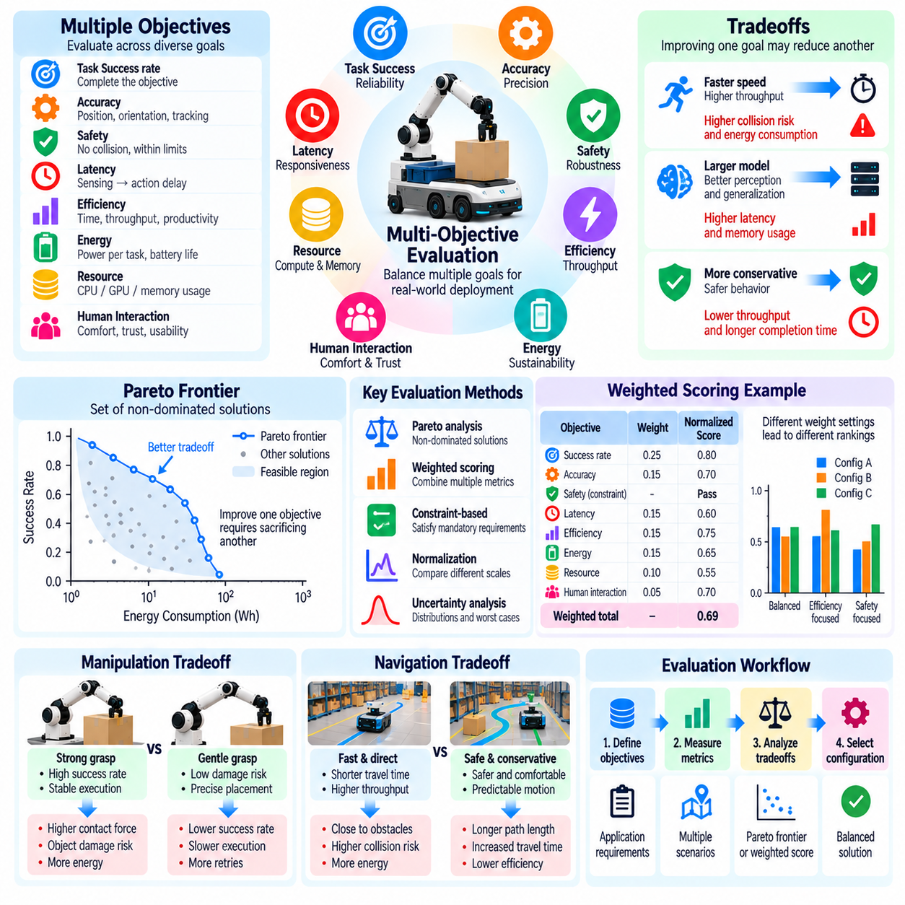{width="7.268055555555556in" height="7.268055555555556in"}

Multi-objective evaluation is essential for Physical AI because robotic performance cannot be represented adequately by a single metric. Autonomous systems must balance task success, accuracy, safety, efficiency, energy consumption, and human interaction quality. Improvements in one dimension may reduce performance in another. Evaluation should therefore examine multiple objectives simultaneously and characterize the tradeoffs that determine whether a system is suitable for practical deployment.

A multi-objective evaluation framework begins by identifying the performance dimensions relevant to an application. Industrial manipulators may prioritize precision, throughput, and equipment safety, while mobile service robots may emphasize navigation reliability, human comfort, and energy efficiency. These objectives should be derived from operational requirements rather than selected solely because they are easy to measure. Clear definitions establish the foundation for meaningful comparisons.

Tradeoffs arise when improving one objective imposes costs on another. Increasing robot speed may reduce task completion time while raising collision risk or energy consumption. More sophisticated perception models may improve recognition accuracy but increase inference latency and computational demand. A system that optimizes one metric independently can therefore perform poorly at the overall mission level. Evaluation must reveal these interactions rather than conceal them.

Safety objectives require special treatment because unacceptable hazards should not be compensated by improvements in productivity. A robot that completes more tasks while violating collision constraints cannot be considered superior merely because its throughput is higher. Evaluation frameworks should distinguish mandatory safety requirements from objectives that permit optimization. Hard constraints establish acceptable operating boundaries before performance tradeoffs are considered.

Weighted scoring is a common method for combining multiple objectives into a composite measure. Individual metrics are normalized and assigned weights reflecting their relative importance. A combined score can simplify comparisons among systems, but the resulting ranking depends on normalization methods and selected weights. Evaluators should document these choices and report component metrics separately to prevent a single score from concealing critical weaknesses.

Metric normalization is necessary when objectives have different units and scales. Task success may be expressed as a percentage, latency in milliseconds, energy in joules, and positioning error in millimeters. Directly combining these measurements without transformation is generally meaningless. Normalization should use justified reference values, operational limits, or benchmark baselines while preserving the interpretation of improvement and degradation.

Pareto optimality provides an alternative perspective that does not require assigning a single universal weighting scheme. A solution is Pareto-dominated when another solution performs at least as well across all objectives and strictly better in at least one. Pareto-optimal solutions represent alternatives for which improving one objective requires sacrificing another. Evaluating the Pareto frontier reveals meaningful design choices instead of forcing all systems into one ranking.

The shape of the Pareto frontier provides information about achievable performance combinations. Some regions may permit substantial efficiency improvements with little loss of accuracy, while others may require large sacrifices for marginal gains. Evaluators can identify operating points that provide balanced performance under application constraints. However, observed frontiers depend on the tested systems and configurations and do not necessarily represent theoretical limits.

Robotic manipulation illustrates the practical importance of multi-objective evaluation. Increasing gripping force may improve grasp stability while raising the likelihood of damaging fragile objects. Slower movements may improve placement precision but reduce production throughput. A meaningful benchmark should report grasp success, contact forces, positioning error, cycle time, and damage frequency together. These measures expose the operational consequences of different control strategies.

Autonomous navigation involves similar compromises among travel time, path length, energy consumption, and safety margins. A shortest-path strategy may pass close to obstacles, while a more conservative route may increase travel distance. In human-populated environments, predictable movement and comfortable separation may be more important than maximum speed. Evaluation should compare policies across these dimensions under consistent environmental conditions.

Computational architecture introduces another class of tradeoffs. Larger models may offer stronger generalization but require more memory, power, and inference time. Edge deployment may reduce communication dependence while limiting computational capacity. Cloud-assisted systems may provide greater processing resources but introduce network latency and connectivity risks. Multi-objective benchmarks should examine performance across representative hardware and deployment configurations.

Tradeoff analysis must account for variability and uncertainty. A policy may achieve excellent average performance while occasionally producing severe delays or unsafe actions. Another policy may have slightly lower average efficiency but more predictable behavior. Evaluators should consider distributions, confidence intervals, tail outcomes, and worst-case constraints rather than comparing averages alone. Reliability may be more important than marginal improvements in mean performance.

Operating conditions can change which tradeoffs are acceptable. A warehouse robot may prioritize throughput during routine operations but emphasize conservative behavior near human workers. An inspection robot may tolerate longer mission duration when high measurement accuracy is required. Evaluation should therefore examine multiple scenarios and operating modes. A configuration that is optimal in one context may be unsuitable in another.

Sensitivity analysis helps determine whether conclusions depend excessively on arbitrary scoring choices. Evaluators can vary objective weights, normalization parameters, and acceptable thresholds to observe changes in system rankings. If small adjustments produce large ranking reversals, the benchmark should communicate this instability. Robust conclusions should remain reasonably consistent across defensible evaluation assumptions.

Multi-objective evaluation should also consider long-term operational consequences. Aggressive control policies may improve immediate throughput while accelerating actuator wear or increasing maintenance requirements. Energy-efficient behavior may extend battery life but reduce mission completion rates under strict deadlines. Evaluating only short demonstrations can obscure these effects. Long-duration testing connects immediate performance with durability, availability, and lifecycle costs.

Transparent reporting is essential because no universal weighting of Physical AI objectives is appropriate for every application. Benchmark results should present individual metrics, constraints, tradeoff curves, and assumptions alongside any composite scores. Decision-makers can then select systems according to their operational priorities. This approach supports reproducibility and reduces the risk of misleading rankings based on hidden preferences.

Ultimately, multi-objective evaluation recognizes that Physical AI competence emerges from balancing competing physical, computational, and human-centered requirements. Superior performance cannot be established through task success or speed alone. Combining explicit constraints, normalized metrics, Pareto analysis, statistical uncertainty, and transparent reporting provides a rigorous foundation for comparing systems and selecting appropriate operating strategies.

다목적 평가(Multi-Objective Evaluation)는 로봇의 성능을 단일 지표(Single Metric)만으로 적절하게 표현할 수 없기 때문에 피지컬 인공지능(Physical AI)에서 필수적이다. 자율 시스템(Autonomous Systems)은 작업 성공(Task Success), 정확도(Accuracy), 안전성(Safety), 효율성(Efficiency), 에너지 소비(Energy Consumption), 인간 상호작용 품질(Human Interaction Quality) 사이의 균형을 유지해야 한다. 한 차원에서의 개선은 다른 차원의 성능을 저하시킬 수 있다. 따라서 평가는 여러 목표를 동시에 검토하고 시스템의 실제 배치 적합성(Practical Deployment Suitability)을 결정하는 상충관계(Tradeoffs)를 분석해야 한다.

다목적 평가 프레임워크(Multi-Objective Evaluation Framework)는 응용 분야와 관련된 성능 차원(Performance Dimensions)을 식별하는 것에서 시작한다. 산업용 매니퓰레이터(Industrial Manipulators)는 정밀도(Precision), 처리량(Throughput), 장비 안전성(Equipment Safety)을 우선시할 수 있으며, 이동 서비스 로봇(Mobile Service Robots)은 주행 신뢰성(Navigation Reliability), 인간의 편안함(Human Comfort), 에너지 효율성(Energy Efficiency)을 강조할 수 있다. 이러한 목표는 단순히 측정하기 쉽다는 이유로 선정하기보다 운영 요구사항(Operational Requirements)에서 도출해야 한다. 명확한 정의(Clear Definitions)는 의미 있는 비교의 기반을 마련한다.

상충관계(Tradeoffs)는 하나의 목표를 개선하는 과정에서 다른 목표에 비용이 발생할 때 나타난다. 로봇 속도(Robot Speed)를 높이면 작업 완료 시간(Task Completion Time)은 줄어들지만 충돌 위험(Collision Risk)이나 에너지 소비(Energy Consumption)는 증가할 수 있다. 더욱 정교한 인식 모델(Perception Models)은 인식 정확도(Recognition Accuracy)를 향상시키지만 추론 지연(Inference Latency)과 연산 요구량(Computational Demand)을 증가시킬 수 있다. 따라서 하나의 지표를 독립적으로 최적화하는 시스템은 전체 임무 수준(Overall Mission Level)에서 낮은 성능을 보일 수 있다. 평가는 이러한 상호작용(Interactions)을 감추지 않고 드러내야 한다.

안전 목표(Safety Objectives)는 허용할 수 없는 위험(Unacceptable Hazards)이 생산성(Productivity) 향상으로 상쇄되어서는 안 되기 때문에 특별하게 취급해야 한다. 충돌 제약(Collision Constraints)을 위반하면서 더 많은 작업을 완료하는 로봇은 처리량(Throughput)이 높다는 이유만으로 우수하다고 평가할 수 없다. 평가 프레임워크(Evaluation Frameworks)는 필수 안전 요구사항(Mandatory Safety Requirements)과 최적화가 허용되는 목표(Objectives Permitting Optimization)를 구분해야 한다. 강제 제약조건(Hard Constraints)은 성능 상충관계를 고려하기 전에 허용 가능한 운영 경계(Acceptable Operating Boundaries)를 설정한다.

가중 점수화(Weighted Scoring)는 여러 목표를 복합 측정값(Composite Measure)으로 결합하는 일반적인 방법이다. 개별 지표(Individual Metrics)를 정규화(Normalization)하고 상대적 중요도(Relative Importance)를 반영하는 가중치(Weights)를 부여한다. 결합 점수(Combined Score)는 시스템 간 비교를 단순화할 수 있지만, 최종 순위(Ranking)는 정규화 방법(Normalization Methods)과 선택된 가중치(Selected Weights)에 따라 달라진다. 평가자는 이러한 선택을 문서화하고 구성요소별 지표(Component Metrics)를 별도로 보고하여 단일 점수가 중대한 약점(Critical Weaknesses)을 감추지 않도록 해야 한다.

지표 정규화(Metric Normalization)는 목표마다 단위(Units)와 척도(Scales)가 다를 때 필요하다. 작업 성공률(Task Success Rate)은 백분율(Percentage), 지연 시간(Latency)은 밀리초(Milliseconds), 에너지(Energy)는 줄(Joules), 위치 오차(Positioning Error)는 밀리미터(Millimeters)로 표현할 수 있다. 이러한 측정값을 변환 없이 직접 결합하는 것은 일반적으로 의미가 없다. 정규화는 개선(Improvement)과 성능 저하(Degradation)의 해석을 유지하면서 정당한 근거가 있는 기준값(Reference Values), 운영 한계(Operational Limits), 벤치마크 기준선(Benchmark Baselines)을 사용해야 한다.

파레토 최적성(Pareto Optimality)은 단일한 보편적 가중치 체계(Universal Weighting Scheme)를 요구하지 않는 대안적인 관점을 제공한다. 다른 해법이 모든 목표에서 적어도 동일한 성능을 보이고 하나 이상의 목표에서 엄격하게 더 우수하다면 기존 해법은 파레토 지배(Pareto-Dominated) 상태에 있다. 파레토 최적 해법(Pareto-Optimal Solutions)은 하나의 목표를 개선하려면 다른 목표를 희생해야 하는 대안들을 나타낸다. 파레토 프런티어(Pareto Frontier)를 평가하면 모든 시스템을 하나의 순위로 강제하기보다 의미 있는 설계 선택(Design Choices)을 파악할 수 있다.

파레토 프런티어(Pareto Frontier)의 형태(Shape)는 달성 가능한 성능 조합(Achievable Performance Combinations)에 관한 정보를 제공한다. 일부 영역에서는 정확도(Accuracy)의 손실이 거의 없이 효율성(Efficiency)을 크게 개선할 수 있지만, 다른 영역에서는 작은 성능 향상을 위해 큰 희생이 필요할 수 있다. 평가자는 응용 분야의 제약조건(Application Constraints) 아래에서 균형 잡힌 성능(Balanced Performance)을 제공하는 운영점(Operating Points)을 식별할 수 있다. 그러나 관측된 프런티어(Observed Frontiers)는 시험한 시스템과 구성에 의존하며 반드시 이론적 한계(Theoretical Limits)를 나타내는 것은 아니다.

로봇 조작(Robotic Manipulation)은 다목적 평가(Multi-Objective Evaluation)의 실질적인 중요성을 보여준다. 파지력(Gripping Force)을 증가시키면 파지 안정성(Grasp Stability)은 향상될 수 있지만 깨지기 쉬운 객체(Fragile Objects)가 손상될 가능성도 높아진다. 느린 움직임(Slower Movements)은 배치 정밀도(Placement Precision)를 향상시키지만 생산 처리량(Production Throughput)을 감소시킬 수 있다. 의미 있는 벤치마크(Meaningful Benchmark)는 파지 성공률(Grasp Success), 접촉력(Contact Forces), 위치 오차(Positioning Error), 사이클 시간(Cycle Time), 손상 빈도(Damage Frequency)를 함께 보고해야 한다. 이러한 측정은 서로 다른 제어 전략(Control Strategies)의 운영상 결과(Operational Consequences)를 드러낸다.

자율주행(Autonomous Navigation)에서도 이동 시간(Travel Time), 경로 길이(Path Length), 에너지 소비(Energy Consumption), 안전 여유(Safety Margins) 사이에 유사한 절충이 발생한다. 최단 경로 전략(Shortest-Path Strategy)은 장애물 가까이로 이동할 수 있지만, 더욱 보수적인 경로(Conservative Route)는 이동 거리를 증가시킬 수 있다. 사람이 존재하는 환경(Human-Populated Environments)에서는 예측 가능한 움직임(Predictable Movement)과 편안한 이격 거리(Comfortable Separation)가 최대 속도(Maximum Speed)보다 중요할 수 있다. 평가는 일관된 환경 조건(Consistent Environmental Conditions)에서 이러한 차원에 따라 정책(Policies)을 비교해야 한다.

연산 아키텍처(Computational Architecture)는 또 다른 종류의 상충관계(Tradeoffs)를 발생시킨다. 더 큰 모델(Larger Models)은 일반화 성능(Generalization)을 향상시킬 수 있지만 더 많은 메모리(Memory), 전력(Power), 추론 시간(Inference Time)을 요구한다. 엣지 배치(Edge Deployment)는 통신 의존성(Communication Dependence)을 줄이는 대신 연산 용량(Computational Capacity)을 제한할 수 있다. 클라우드 지원 시스템(Cloud-Assisted Systems)은 더 많은 처리 자원(Processing Resources)을 제공할 수 있지만 네트워크 지연(Network Latency)과 연결 위험(Connectivity Risks)을 발생시킨다. 다목적 벤치마크(Multi-Objective Benchmarks)는 대표적인 하드웨어 및 배치 구성(Representative Hardware and Deployment Configurations) 전반에서 성능을 검토해야 한다.

상충관계 분석(Tradeoff Analysis)은 변동성(Variability)과 불확실성(Uncertainty)을 고려해야 한다. 특정 정책(Policy)은 평균 성능(Average Performance)이 우수하더라도 간헐적으로 심각한 지연(Severe Delays)이나 안전하지 않은 행동(Unsafe Actions)을 발생시킬 수 있다. 다른 정책은 평균 효율성(Average Efficiency)이 약간 낮더라도 더욱 예측 가능한 행동(Predictable Behavior)을 제공할 수 있다. 평가자는 평균값(Averages)만 비교하기보다 분포(Distributions), 신뢰구간(Confidence Intervals), 꼬리 구간 결과(Tail Outcomes), 최악 조건 제약(Worst-Case Constraints)을 고려해야 한다. 신뢰성(Reliability)은 평균 성능의 작은 개선보다 중요할 수 있다.

운영 조건(Operating Conditions)은 어떤 상충관계가 허용 가능한지를 변화시킬 수 있다. 창고 로봇(Warehouse Robot)은 일반적인 운영(Routine Operations)에서는 처리량(Throughput)을 우선시하지만 인간 작업자(Human Workers) 근처에서는 보수적인 행동(Conservative Behavior)을 강조할 수 있다. 검사 로봇(Inspection Robot)은 높은 측정 정확도(Measurement Accuracy)가 요구될 때 더 긴 임무 지속 시간(Mission Duration)을 허용할 수 있다. 따라서 평가는 다양한 시나리오(Scenarios)와 운영 모드(Operating Modes)를 검토해야 한다. 한 상황에서 최적인 구성(Optimal Configuration)이 다른 상황에서는 부적합할 수 있다.

민감도 분석(Sensitivity Analysis)은 평가 결론(Evaluation Conclusions)이 임의적인 점수화 선택(Arbitrary Scoring Choices)에 지나치게 의존하는지를 판단하는 데 도움이 된다. 평가자는 목표 가중치(Objective Weights), 정규화 매개변수(Normalization Parameters), 허용 임계값(Acceptable Thresholds)을 변화시켜 시스템 순위(System Rankings)가 어떻게 달라지는지 관찰할 수 있다. 작은 조정으로 큰 순위 역전(Ranking Reversals)이 발생한다면 벤치마크는 이러한 불안정성(Instability)을 명확하게 전달해야 한다. 강건한 결론(Robust Conclusions)은 타당하게 설명할 수 있는 평가 가정(Defensible Evaluation Assumptions) 전반에서 합리적인 일관성을 유지해야 한다.

다목적 평가(Multi-Objective Evaluation)는 장기적인 운영 결과(Long-Term Operational Consequences)도 고려해야 한다. 공격적인 제어 정책(Aggressive Control Policies)은 즉각적인 처리량(Immediate Throughput)을 향상시키지만 액추에이터 마모(Actuator Wear)를 가속하거나 유지보수 요구사항(Maintenance Requirements)을 증가시킬 수 있다. 에너지 효율적인 행동(Energy-Efficient Behavior)은 배터리 수명(Battery Life)을 연장하지만 엄격한 완료 기한(Strict Deadlines) 아래에서는 임무 완료율(Mission Completion Rates)을 감소시킬 수 있다. 짧은 시연(Short Demonstrations)만 평가하면 이러한 영향을 놓칠 수 있다. 장시간 시험(Long-Duration Testing)은 즉각적인 성능(Immediate Performance)을 내구성(Durability), 가용성(Availability), 수명주기 비용(Lifecycle Costs)과 연결한다.

투명한 보고(Transparent Reporting)는 모든 응용 분야에 적합한 보편적인 피지컬 인공지능 목표 가중치(Universal Weighting of Physical AI Objectives)가 존재하지 않기 때문에 필수적이다. 벤치마크 결과(Benchmark Results)는 복합 점수(Composite Scores)를 제시하더라도 개별 지표(Individual Metrics), 제약조건(Constraints), 상충관계 곡선(Tradeoff Curves), 평가 가정(Assumptions)을 함께 제공해야 한다. 의사결정자(Decision-Makers)는 이를 바탕으로 운영 우선순위(Operational Priorities)에 따라 시스템을 선택할 수 있다. 이러한 접근법은 재현성(Reproducibility)을 지원하고 숨겨진 선호도(Hidden Preferences)에 기반한 오해의 소지가 있는 순위(Misleading Rankings)의 위험을 줄인다.

궁극적으로 다목적 평가(Multi-Objective Evaluation)는 피지컬 인공지능 역량(Physical AI Competence)이 서로 경쟁하는 물리적 요구사항(Physical Requirements), 계산적 요구사항(Computational Requirements), 인간 중심 요구사항(Human-Centered Requirements) 사이의 균형을 통해 형성된다는 점을 인정한다. 우수한 성능(Superior Performance)은 작업 성공(Task Success)이나 속도(Speed)만으로 입증할 수 없다. 명시적인 제약조건(Explicit Constraints), 정규화된 지표(Normalized Metrics), 파레토 분석(Pareto Analysis), 통계적 불확실성(Statistical Uncertainty), 투명한 보고(Transparent Reporting)를 결합하면 시스템 비교(System Comparison)와 적절한 운영 전략(Operating Strategies) 선택을 위한 엄밀한 기반을 제공할 수 있다.

##  

## 01.13. Benchmark Validity and Metric Gaming

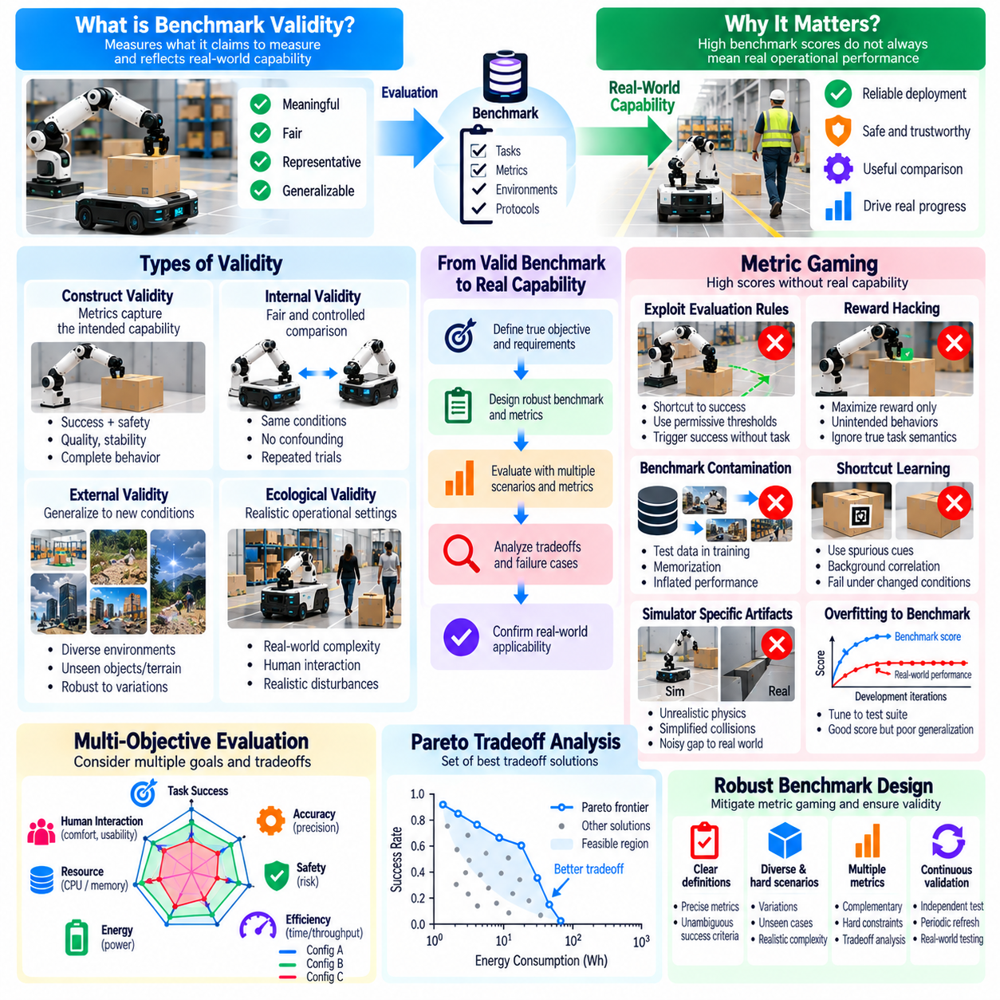{width="7.268055555555556in" height="7.268055555555556in"}

Benchmark validity determines whether an evaluation actually measures the capabilities it claims to assess. In Physical AI, a benchmark may report high task success while failing to represent the uncertainty, physical interaction, and environmental variability encountered during deployment. Valid evaluation requires alignment between measured outcomes and intended operational competence. Without this alignment, impressive scores may provide misleading evidence about real-world robotic performance.

Construct validity concerns whether benchmark metrics represent the underlying capability being evaluated. A navigation benchmark that measures only destination arrival may overlook collision avoidance, path stability, and human comfort. Similarly, manipulation success may conceal excessive gripping force or repeated corrective actions. Evaluators should establish clear definitions of competence and verify that selected measurements capture the essential dimensions of the intended behavior.

Internal validity examines whether observed performance differences can reasonably be attributed to the systems being compared. Variations in hardware, sensor calibration, environmental conditions, or operator assistance can distort conclusions. Controlled experiments should minimize confounding factors and document unavoidable differences. Repeated trials, standardized initialization, and consistent intervention policies help distinguish genuine algorithmic improvements from experimental artifacts.

External validity addresses whether benchmark findings generalize beyond the tested conditions. A robot trained and evaluated in a limited collection of simulated rooms may perform poorly in unfamiliar buildings. Success on carefully arranged objects may not transfer to cluttered industrial environments. Evaluation should incorporate variation in geometry, lighting, materials, disturbances, and task configurations to determine whether reported competence extends to realistic deployment scenarios.

Ecological validity focuses on how closely evaluation conditions resemble the operational situations they are intended to represent. Highly simplified simulations may exclude sensor degradation, contact uncertainty, human interference, or unexpected interruptions. Although controlled environments are useful for isolating individual capabilities, they cannot establish complete operational readiness. Benchmark design should balance experimental control with representative physical complexity.

Metric gaming occurs when a system achieves favorable benchmark scores without developing the intended capability. This behavior may arise through deliberate optimization or unintended exploitation of evaluation rules. A robot might maximize task completion by ignoring object damage, exploiting permissive collision thresholds, or relying on shortcuts unavailable during deployment. Such outcomes reveal weaknesses in the metric rather than necessarily demonstrating meaningful competence.

Goodhart\'s law captures an important evaluation risk: when a measurement becomes an optimization target, its relationship with the intended objective may weaken. A policy trained exclusively to maximize benchmark reward can exploit scoring details that were originally useful indicators of progress. Physical AI evaluation must therefore distinguish measurable proxies from underlying operational goals and periodically reassess whether optimized scores still reflect desirable behavior.

Reward hacking represents a specific form of metric gaming in learning-based robotics. An agent may discover actions that increase numerical reward while violating the intended task semantics. For example, a manipulation policy could repeatedly trigger a success sensor without securely placing an object. A mobile robot might exploit a termination condition instead of reaching a destination safely. Evaluation should inspect behavior trajectories and physical outcomes rather than trusting reward totals alone.

Benchmark contamination creates another threat to validity. When evaluation scenarios, object configurations, or trajectories appear in training data, reported performance may reflect memorization rather than generalization. This problem is particularly relevant to foundation models trained on large and heterogeneous datasets. Evaluators should maintain independent test sets, document possible overlap, and use previously unseen environments or task variations when assessing transferable capabilities.

Overfitting can also occur through repeated benchmark submissions and development feedback. Researchers may gradually tune systems to a public test suite even without directly training on its examples. As a result, benchmark performance improves while broader competence remains unchanged. Hidden evaluation scenarios, periodically refreshed tasks, and independent validation can reduce this risk. Public benchmarks should remain reproducible without making every evaluation detail exploitable.

Shortcut learning occurs when models rely on incidental correlations instead of task-relevant information. A vision-based robot may recognize objects through background patterns rather than object geometry, while a navigation policy may memorize environmental landmarks. Such shortcuts often fail when conditions change. Counterfactual testing, background variation, object rearrangement, and controlled perturbations help determine whether the system has learned the intended relationships.

Benchmark design must also prevent exploitation of simulator-specific artifacts. Agents may take advantage of unrealistic friction, simplified collision handling, deterministic resets, or inaccurate sensor models. High simulated performance can therefore reflect adaptation to simulation defects rather than robust physical intelligence. Evaluation should include simulator validation, randomized physical parameters, and real-world testing to determine whether learned behavior remains effective outside the benchmark environment.

Metric aggregation can conceal important failures even when individual measurements are technically correct. A high average success rate may hide repeated failures involving particular objects, vulnerable users, or hazardous operating conditions. Composite scores may also allow strong efficiency results to compensate for unacceptable safety outcomes. Evaluators should report disaggregated metrics, failure severity, and constraint violations alongside overall performance summaries.

Adversarial evaluation can reveal weaknesses that ordinary benchmark scenarios overlook. Carefully designed disturbances, ambiguous instructions, sensor corruption, and unusual object arrangements may expose brittle decision-making or unsafe recovery behavior. These tests should remain physically realistic and relevant to plausible deployment conditions. Their purpose is not merely to maximize failure frequency but to identify the boundaries of reliable system operation.

Benchmark validity requires continuous maintenance because algorithms adapt to established evaluation procedures. As performance approaches saturation, existing tasks may lose their ability to distinguish meaningful advances. New scenarios should introduce previously underrepresented capabilities without unnecessarily abandoning historical comparability. Versioned benchmark releases, documented protocol changes, and retained reference tasks help preserve interpretability across successive evaluations.

Independent replication strengthens confidence that benchmark results reflect genuine capabilities. Evaluation protocols should specify hardware configurations, software versions, random seeds, task definitions, intervention rules, and scoring procedures. When practical, external laboratories should reproduce findings using different equipment or environments. Discrepancies between results can reveal hidden dependencies, implementation assumptions, or weaknesses in benchmark standardization.

Ultimately, benchmark validity and resistance to metric gaming determine whether Physical AI evaluation produces trustworthy evidence of operational competence. High scores are meaningful only when they correspond to robust, safe, and transferable physical behavior. Combining construct validation, representative scenarios, contamination controls, behavioral inspection, adversarial testing, and independent replication helps ensure that benchmark improvements represent genuine progress rather than exploitation of evaluation weaknesses.

벤치마크 타당성(Benchmark Validity)은 평가가 측정한다고 주장하는 역량(Capabilities)을 실제로 측정하는지를 판단한다. 피지컬 인공지능(Physical AI)에서 벤치마크(Benchmark)는 높은 작업 성공률(Task Success Rate)을 보고하면서도 실제 배치(Deployment) 과정에서 발생하는 불확실성(Uncertainty), 물리적 상호작용(Physical Interaction), 환경 변동성(Environmental Variability)을 충분히 반영하지 못할 수 있다. 타당한 평가(Valid Evaluation)를 위해서는 측정된 결과(Measured Outcomes)와 의도된 운영 역량(Intended Operational Competence) 사이의 일치가 필요하다. 이러한 일치가 없다면 높은 점수(Impressive Scores)는 실제 로봇 성능(Real-World Robotic Performance)에 대해 오해를 유발하는 근거가 될 수 있다.

구성 타당성(Construct Validity)은 벤치마크 지표(Benchmark Metrics)가 평가 대상인 근본적인 역량(Underlying Capability)을 나타내는지를 다룬다. 목적지 도착(Destination Arrival)만 측정하는 주행 벤치마크(Navigation Benchmark)는 충돌 회피(Collision Avoidance), 경로 안정성(Path Stability), 인간의 편안함(Human Comfort)을 간과할 수 있다. 마찬가지로 조작 성공(Manipulation Success)은 과도한 파지력(Excessive Gripping Force)이나 반복적인 수정 행동(Repeated Corrective Actions)을 감출 수 있다. 평가자는 역량(Competence)을 명확하게 정의하고 선택된 측정값이 의도된 행동의 핵심 차원(Essential Dimensions)을 포착하는지 검증해야 한다.

내적 타당성(Internal Validity)은 관측된 성능 차이(Observed Performance Differences)를 비교 대상 시스템의 차이로 합리적으로 설명할 수 있는지를 검토한다. 하드웨어(Hardware), 센서 보정(Sensor Calibration), 환경 조건(Environmental Conditions), 운영자 지원(Operator Assistance)의 차이는 평가 결론을 왜곡할 수 있다. 통제된 실험(Controlled Experiments)은 교란 요인(Confounding Factors)을 최소화하고 불가피한 차이를 문서화해야 한다. 반복 시험(Repeated Trials), 표준화된 초기화(Standardized Initialization), 일관된 개입 정책(Consistent Intervention Policies)은 실제 알고리즘 개선(Genuine Algorithmic Improvements)과 실험적 인공 효과(Experimental Artifacts)를 구분하는 데 도움이 된다.

외적 타당성(External Validity)은 벤치마크 결과(Benchmark Findings)가 시험 조건을 넘어 일반화(Generalization)될 수 있는지를 다룬다. 제한된 시뮬레이션 공간(Simulated Rooms)에서 학습하고 평가한 로봇은 익숙하지 않은 건물(Unfamiliar Buildings)에서 낮은 성능을 보일 수 있다. 신중하게 배치된 객체(Carefully Arranged Objects)에 대한 성공이 복잡한 산업 환경(Cluttered Industrial Environments)으로 이전되지 않을 수도 있다. 평가는 기하학적 구조(Geometry), 조명(Lighting), 재료(Materials), 외란(Disturbances), 작업 구성(Task Configurations)의 변화를 포함하여 보고된 역량이 현실적인 배치 시나리오(Realistic Deployment Scenarios)까지 확장되는지를 판단해야 한다.

생태학적 타당성(Ecological Validity)은 평가 조건(Evaluation Conditions)이 실제로 대표하려는 운영 상황(Operational Situations)과 얼마나 유사한지에 초점을 맞춘다. 지나치게 단순화된 시뮬레이션(Highly Simplified Simulations)은 센서 성능 저하(Sensor Degradation), 접촉 불확실성(Contact Uncertainty), 인간의 간섭(Human Interference), 예상하지 못한 중단(Unexpected Interruptions)을 제외할 수 있다. 통제된 환경(Controlled Environments)은 개별 역량(Individual Capabilities)을 분리하여 평가하는 데 유용하지만 완전한 운영 준비도(Operational Readiness)를 입증할 수는 없다. 벤치마크 설계(Benchmark Design)는 실험적 통제(Experimental Control)와 대표성 있는 물리적 복잡성(Representative Physical Complexity) 사이의 균형을 유지해야 한다.

지표 조작(Metric Gaming)은 시스템이 의도된 역량(Intended Capability)을 개발하지 않고도 유리한 벤치마크 점수(Favorable Benchmark Scores)를 달성할 때 발생한다. 이러한 행동은 의도적인 최적화(Deliberate Optimization) 또는 평가 규칙(Evaluation Rules)의 의도하지 않은 악용(Unintended Exploitation)에서 비롯될 수 있다. 로봇은 객체 손상(Object Damage)을 무시하거나 느슨한 충돌 임계값(Permissive Collision Thresholds)을 이용하거나 실제 배치에서는 사용할 수 없는 지름길(Shortcuts)에 의존하여 작업 완료율(Task Completion)을 극대화할 수 있다. 이러한 결과는 반드시 의미 있는 역량(Meaningful Competence)을 입증하는 것이 아니라 지표의 약점(Metric Weaknesses)을 드러낸다.

굿하트의 법칙(Goodhart\'s Law)은 중요한 평가 위험(Evaluation Risk)을 설명한다. 측정값(Measurement)이 최적화 목표(Optimization Target)가 되면 의도된 목적(Intended Objective)과의 관계가 약화될 수 있다는 것이다. 벤치마크 보상(Benchmark Reward)을 극대화하도록 학습된 정책(Policy)은 원래 성능 향상의 유용한 지표였던 점수화 규칙(Scoring Details)을 악용할 수 있다. 따라서 피지컬 인공지능 평가(Physical AI Evaluation)는 측정 가능한 대리 지표(Measurable Proxies)와 근본적인 운영 목표(Underlying Operational Goals)를 구분하고, 최적화된 점수가 여전히 바람직한 행동(Desirable Behavior)을 반영하는지 주기적으로 재검토해야 한다.

보상 해킹(Reward Hacking)은 학습 기반 로보틱스(Learning-Based Robotics)에서 발생하는 지표 조작(Metric Gaming)의 특정 형태이다. 에이전트(Agent)는 의도된 작업 의미(Intended Task Semantics)를 위반하면서 수치적 보상(Numerical Reward)을 증가시키는 행동을 발견할 수 있다. 예를 들어 조작 정책(Manipulation Policy)은 객체를 안정적으로 배치하지 않고도 성공 센서(Success Sensor)를 반복적으로 작동시킬 수 있다. 이동 로봇(Mobile Robot)은 목적지에 안전하게 도달하는 대신 종료 조건(Termination Condition)을 악용할 수 있다. 평가는 보상 총합(Reward Totals)만 신뢰하지 말고 행동 궤적(Behavior Trajectories)과 물리적 결과(Physical Outcomes)를 검토해야 한다.

벤치마크 오염(Benchmark Contamination)은 타당성(Validity)을 위협하는 또 다른 요인이다. 평가 시나리오(Evaluation Scenarios), 객체 구성(Object Configurations), 궤적(Trajectories)이 학습 데이터(Training Data)에 포함되면 보고된 성능은 일반화(Generalization)가 아니라 암기(Memorization)를 반영할 수 있다. 이 문제는 대규모의 이질적인 데이터셋(Large and Heterogeneous Datasets)으로 학습된 기반 모델(Foundation Models)에서 특히 중요하다. 평가자는 독립적인 시험 데이터셋(Independent Test Sets)을 유지하고 가능한 데이터 중복(Possible Overlap)을 문서화하며, 전이 가능한 역량(Transferable Capabilities)을 평가할 때 이전에 보지 못한 환경(Unseen Environments)이나 작업 변형(Task Variations)을 사용해야 한다.

과적합(Overfitting)은 반복적인 벤치마크 제출(Repeated Benchmark Submissions)과 개발 피드백(Development Feedback)을 통해서도 발생할 수 있다. 연구자는 시험 사례를 직접 학습에 사용하지 않더라도 공개 시험 모음(Public Test Suite)에 맞추어 시스템을 점진적으로 조정할 수 있다. 그 결과 더 광범위한 역량(Broader Competence)은 변하지 않으면서 벤치마크 성능(Benchmark Performance)만 향상될 수 있다. 비공개 평가 시나리오(Hidden Evaluation Scenarios), 주기적으로 갱신되는 작업(Periodically Refreshed Tasks), 독립적인 검증(Independent Validation)은 이러한 위험을 줄일 수 있다. 공개 벤치마크(Public Benchmarks)는 모든 평가 세부사항(Evaluation Details)이 악용될 수 있도록 공개하지 않으면서도 재현 가능성(Reproducibility)을 유지해야 한다.

지름길 학습(Shortcut Learning)은 모델이 작업과 관련된 정보(Task-Relevant Information) 대신 우연한 상관관계(Incidental Correlations)에 의존할 때 발생한다. 시각 기반 로봇(Vision-Based Robot)은 객체 형상(Object Geometry)이 아니라 배경 패턴(Background Patterns)을 통해 객체를 인식할 수 있으며, 주행 정책(Navigation Policy)은 환경의 랜드마크(Environmental Landmarks)를 암기할 수 있다. 이러한 지름길은 조건이 변하면 실패하는 경우가 많다. 반사실적 시험(Counterfactual Testing), 배경 변화(Background Variation), 객체 재배치(Object Rearrangement), 통제된 교란(Controlled Perturbations)은 시스템이 의도된 관계(Intended Relationships)를 학습했는지 판단하는 데 도움이 된다.

벤치마크 설계(Benchmark Design)는 시뮬레이터 특유의 인공 효과(Simulator-Specific Artifacts)를 악용하는 것도 방지해야 한다. 에이전트(Agents)는 비현실적인 마찰(Unrealistic Friction), 단순화된 충돌 처리(Simplified Collision Handling), 결정론적 초기화(Deterministic Resets), 부정확한 센서 모델(Inaccurate Sensor Models)을 이용할 수 있다. 따라서 높은 시뮬레이션 성능(Simulated Performance)은 강건한 물리 지능(Robust Physical Intelligence)이 아니라 시뮬레이션 결함(Simulation Defects)에 대한 적응을 반영할 수 있다. 평가는 시뮬레이터 검증(Simulator Validation), 물리 매개변수 무작위화(Randomized Physical Parameters), 실제 환경 시험(Real-World Testing)을 포함하여 학습된 행동이 벤치마크 환경 밖에서도 효과적인지 판단해야 한다.

지표 집계(Metric Aggregation)는 개별 측정값(Individual Measurements)이 기술적으로 정확하더라도 중요한 실패를 감출 수 있다. 높은 평균 성공률(Average Success Rate)은 특정 객체(Particular Objects), 취약한 사용자(Vulnerable Users), 위험한 운영 조건(Hazardous Operating Conditions)과 관련된 반복적인 실패를 숨길 수 있다. 복합 점수(Composite Scores)는 우수한 효율성 결과(Efficiency Results)가 허용할 수 없는 안전 결과(Unacceptable Safety Outcomes)를 상쇄하도록 만들 수도 있다. 평가자는 전체 성능 요약(Overall Performance Summaries)과 함께 세분화된 지표(Disaggregated Metrics), 실패 심각도(Failure Severity), 제약조건 위반(Constraint Violations)을 보고해야 한다.

적대적 평가(Adversarial Evaluation)는 일반적인 벤치마크 시나리오(Ordinary Benchmark Scenarios)에서 놓칠 수 있는 약점을 드러낼 수 있다. 신중하게 설계된 외란(Disturbances), 모호한 지시(Ambiguous Instructions), 센서 데이터 손상(Sensor Corruption), 비정상적인 객체 배치(Unusual Object Arrangements)는 취약한 의사결정(Brittle Decision-Making)이나 안전하지 않은 복구 행동(Unsafe Recovery Behavior)을 드러낼 수 있다. 이러한 시험은 물리적으로 현실적(Physically Realistic)이어야 하며 실제 배치에서 발생 가능한 조건(Plausible Deployment Conditions)과 관련되어야 한다. 그 목적은 단순히 실패 빈도(Failure Frequency)를 극대화하는 것이 아니라 신뢰할 수 있는 시스템 운영(Reliable System Operation)의 한계를 식별하는 데 있다.

벤치마크 타당성(Benchmark Validity)은 알고리즘(Algorithms)이 확립된 평가 절차(Established Evaluation Procedures)에 적응하기 때문에 지속적인 유지관리(Continuous Maintenance)가 필요하다. 성능이 포화 상태(Saturation)에 가까워지면 기존 작업(Existing Tasks)은 의미 있는 발전(Meaningful Advances)을 구분하는 능력을 잃을 수 있다. 새로운 시나리오(New Scenarios)는 과거 결과와의 비교 가능성(Historical Comparability)을 불필요하게 포기하지 않으면서 이전에 충분히 반영되지 않았던 역량(Underrepresented Capabilities)을 포함해야 한다. 버전이 관리되는 벤치마크 배포(Versioned Benchmark Releases), 문서화된 프로토콜 변경(Documented Protocol Changes), 유지되는 기준 작업(Retained Reference Tasks)은 연속적인 평가 간 해석 가능성(Interpretability)을 보존하는 데 도움이 된다.

독립적인 재현(Independent Replication)은 벤치마크 결과(Benchmark Results)가 실제 역량(Genuine Capabilities)을 반영한다는 신뢰를 강화한다. 평가 프로토콜(Evaluation Protocols)은 하드웨어 구성(Hardware Configurations), 소프트웨어 버전(Software Versions), 난수 시드(Random Seeds), 작업 정의(Task Definitions), 개입 규칙(Intervention Rules), 점수 산정 절차(Scoring Procedures)를 명시해야 한다. 실현 가능한 경우 외부 연구기관(External Laboratories)은 서로 다른 장비(Equipment)나 환경(Environments)을 사용하여 연구 결과를 재현해야 한다. 결과 간 불일치(Discrepancies)는 숨겨진 의존성(Hidden Dependencies), 구현 가정(Implementation Assumptions), 벤치마크 표준화(Benchmark Standardization)의 약점을 드러낼 수 있다.

궁극적으로 벤치마크 타당성(Benchmark Validity)과 지표 조작에 대한 저항성(Resistance to Metric Gaming)은 피지컬 인공지능 평가(Physical AI Evaluation)가 운영 역량(Operational Competence)에 대한 신뢰할 수 있는 근거(Trustworthy Evidence)를 생성하는지를 결정한다. 높은 점수(High Scores)는 강건하고(Robust), 안전하며(Safe), 전이 가능한(Transferable) 물리적 행동(Physical Behavior)에 대응할 때만 의미가 있다. 구성 타당성 검증(Construct Validation), 대표성 있는 시나리오(Representative Scenarios), 오염 통제(Contamination Controls), 행동 검사(Behavioral Inspection), 적대적 시험(Adversarial Testing), 독립적인 재현(Independent Replication)을 결합하면 벤치마크 성능 향상(Benchmark Improvements)이 평가 체계의 약점 악용(Exploitation of Evaluation Weaknesses)이 아니라 실질적인 발전(Genuine Progress)을 나타내도록 하는 데 도움이 된다.

##  

## 01.14. Statistical Significance and Confidence Intervals

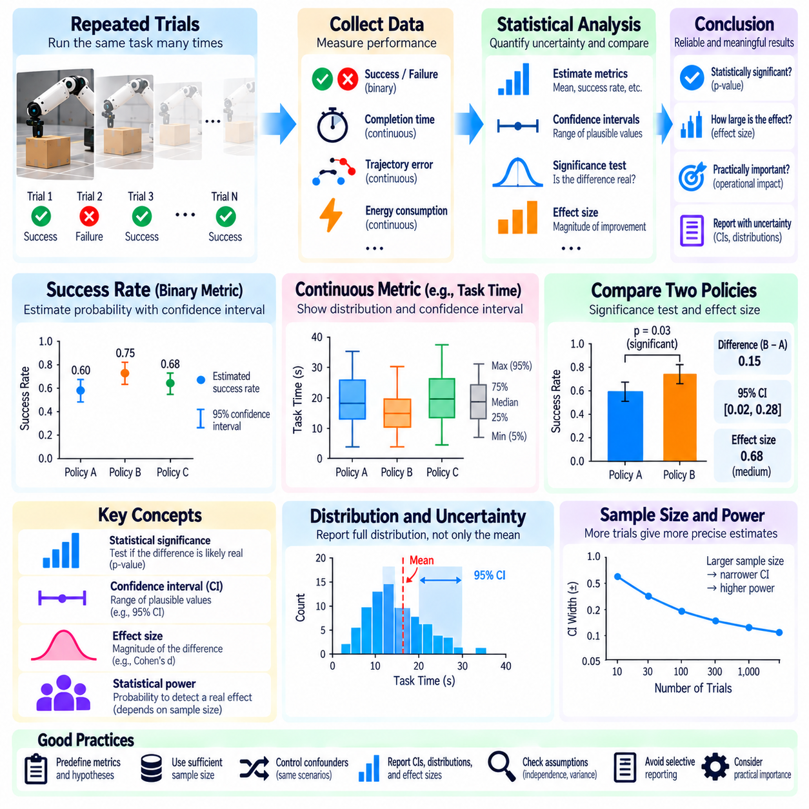{width="7.268055555555556in" height="7.268055555555556in"}

Statistical significance and confidence intervals are essential for determining whether observed differences in Physical AI performance reflect genuine improvements or random variation. Robotic experiments are influenced by sensor noise, environmental disturbances, initialization conditions, and stochastic control policies. A higher benchmark score does not automatically establish superiority. Evaluation must quantify uncertainty in measured results and support conclusions with appropriate statistical evidence.

Physical AI benchmarks often involve repeated trials of tasks with uncertain outcomes. A manipulation policy may succeed in some attempts and fail in others because of object placement, contact conditions, or perception errors. Navigation performance may vary with obstacle configurations and human movement. These variations create sampling uncertainty, meaning that reported performance estimates can differ from the underlying performance of the system across its intended operating conditions.

Statistical significance testing examines whether observed differences are sufficiently inconsistent with a specified null hypothesis. When comparing two robotic policies, the null hypothesis may state that their expected performance is equal. A statistical test evaluates the compatibility of collected evidence with that assumption. However, statistical significance does not establish practical importance, and a small p-value does not indicate the probability that the null hypothesis is true.

Confidence intervals provide a range of plausible values for an estimated performance parameter under a specified statistical procedure. A ninety-five percent confidence interval is constructed by a method designed to contain the true parameter in ninety-five percent of repeated samples under its assumptions. It does not assign a ninety-five percent probability to a fixed parameter lying within one realized interval. Interval width communicates estimation precision and depends on variability and sample size.

Success rates are among the most common measurements in robotic benchmarking. When each trial produces a binary success or failure outcome, the observed success proportion estimates an underlying success probability. Confidence intervals should account for the binomial nature of these observations. Wilson intervals or exact binomial methods are often preferable to simple normal approximations, particularly when sample sizes are small or success rates approach zero or one.

Continuous performance metrics require different statistical treatment. Task completion time, trajectory error, energy consumption, and contact force may exhibit skewed distributions or occasional extreme values. Reporting only the arithmetic mean can conceal important variability. Evaluators should examine distributions and report suitable measures of central tendency, dispersion, and uncertainty. Confidence intervals for means or other estimands must reflect the properties of the collected data.

Sample size directly influences the precision and reliability of benchmark conclusions. A small number of trials may produce apparently large performance differences that disappear under repeated evaluation. Increasing sample size generally reduces sampling uncertainty, although it cannot eliminate systematic bias. Experimental planning should estimate the number of trials needed to detect operationally meaningful differences with adequate statistical power under defensible assumptions.

Statistical power describes the probability that a test will detect a specified effect when that effect exists. Low-powered robotic experiments may fail to identify real improvements, while selective reporting of significant outcomes can exaggerate apparent progress. Power analysis should consider expected variability, effect size, significance threshold, and experimental design. Practical constraints on robot operating time and hardware wear should also influence trial allocation.

Effect size complements statistical significance by describing the magnitude of an observed difference. A navigation policy might reduce average travel time by a statistically detectable amount that is operationally negligible. Conversely, a modest improvement in collision avoidance may have substantial safety value. Evaluation should report absolute and relative performance differences with uncertainty intervals, while interpreting their importance in relation to application requirements.

Paired experimental designs can improve comparison efficiency when systems face equivalent test conditions. Two navigation policies may be evaluated using the same obstacle layouts, or manipulation controllers may be tested with matched object configurations. Analyzing within-pair differences can reduce variability caused by task difficulty. However, pairing must be established by the experimental design, and order effects or environmental changes must be controlled.

Robotic observations are not always statistically independent. Consecutive trials may share battery conditions, sensor calibration drift, operator behavior, or environmental changes. Multiple measurements from one robot may also be correlated. Treating all observations as independent can underestimate uncertainty and inflate statistical significance. Hierarchical models, clustered analysis, or appropriate resampling procedures can account for dependence when their assumptions are satisfied.

Bootstrap methods provide flexible approaches for estimating uncertainty when analytical formulas are difficult to apply. By resampling observations and recalculating a statistic, evaluators can approximate its sampling distribution. However, ordinary bootstrap procedures assume suitable independence and representative sampling. Clustered or block bootstrap methods may be necessary for correlated trials, temporal sequences, or experiments involving multiple robots and environments.

Multiple comparisons create additional statistical risks when researchers evaluate many algorithms, tasks, metrics, or parameter settings. Even if no genuine differences exist, repeated hypothesis testing can produce apparently significant results by chance. Evaluation protocols should identify primary comparisons in advance and consider appropriate multiplicity adjustments. Exploratory findings should be distinguished from confirmatory conclusions to avoid overstating evidence.

Statistical significance must also be separated from benchmark validity and generalization. A precisely estimated success rate on a narrow test distribution may provide little information about performance in unfamiliar environments. Similarly, systematic measurement errors cannot be corrected merely by increasing trial counts. Statistical analysis should therefore accompany representative scenario selection, controlled experimental procedures, and independent validation across relevant operating conditions.

Rare safety-critical failures require particular attention because ordinary test samples may contain few or no incidents. Observing zero collisions does not prove that collision probability is zero. Confidence bounds can quantify the failure rates still compatible with the available evidence under stated assumptions. Demonstrating very low failure probabilities may require substantially larger exposure, targeted stress testing, and complementary safety assurance methods beyond conventional benchmark trials.

Reproducible statistical reporting requires clear documentation of experimental design and analysis choices. Benchmark publications should specify trial counts, sampling procedures, random seeds, exclusion rules, confidence levels, statistical tests, and effect-size definitions. Raw or sufficiently detailed aggregated results should be available when feasible. Such transparency enables independent verification and reduces the likelihood that favorable outcomes result from selective analysis.

Ultimately, statistical significance and confidence intervals help transform Physical AI benchmark measurements into defensible evidence about system performance. Reliable evaluation requires more than reporting the highest observed score. Combining adequate sample sizes, appropriate uncertainty estimates, effect-size interpretation, dependence-aware analysis, and reproducible experimental protocols supports meaningful comparisons while preventing random fluctuations from being mistaken for genuine advances.

통계적 유의성(Statistical Significance)과 신뢰구간(Confidence Intervals)은 피지컬 인공지능(Physical AI)의 성능에서 관측된 차이가 실제적인 개선(Genuine Improvements)을 반영하는지, 아니면 무작위 변동(Random Variation)에 의한 것인지를 판단하는 데 필수적이다. 로봇 실험(Robotic Experiments)은 센서 잡음(Sensor Noise), 환경 외란(Environmental Disturbances), 초기화 조건(Initialization Conditions), 확률적 제어 정책(Stochastic Control Policies)의 영향을 받는다. 벤치마크 점수(Benchmark Score)가 높다고 해서 자동으로 우수성이 입증되는 것은 아니다. 평가는 측정 결과(Measured Results)의 불확실성을 정량화하고 적절한 통계적 근거(Statistical Evidence)를 통해 결론을 뒷받침해야 한다.

피지컬 인공지능 벤치마크(Physical AI Benchmarks)는 결과가 불확실한 작업(Task)에 대한 반복 시험(Repeated Trials)을 포함하는 경우가 많다. 조작 정책(Manipulation Policy)은 객체 배치(Object Placement), 접촉 조건(Contact Conditions), 인식 오류(Perception Errors)에 따라 일부 시도에서는 성공하고 다른 시도에서는 실패할 수 있다. 주행 성능(Navigation Performance)은 장애물 구성(Obstacle Configurations)과 인간의 움직임(Human Movement)에 따라 달라질 수 있다. 이러한 변동은 표본 추출 불확실성(Sampling Uncertainty)을 발생시키며, 보고된 성능 추정값(Performance Estimates)이 의도된 운영 조건(Intended Operating Conditions) 전반에서 나타나는 시스템의 실제 성능과 다를 수 있음을 의미한다.

통계적 유의성 검정(Statistical Significance Testing)은 관측된 차이가 특정 귀무가설(Null Hypothesis)과 충분히 일치하지 않는지를 검토한다. 두 로봇 정책(Robotic Policies)을 비교할 때 귀무가설은 두 정책의 기대 성능(Expected Performance)이 동일하다는 것일 수 있다. 통계적 검정(Statistical Test)은 수집된 근거(Collected Evidence)가 이러한 가정과 얼마나 양립 가능한지를 평가한다. 그러나 통계적 유의성은 실질적 중요성(Practical Importance)을 입증하지 않으며, 작은 p값(p-value)이 귀무가설이 참일 확률을 나타내는 것도 아니다.

신뢰구간(Confidence Intervals)은 특정 통계적 절차(Statistical Procedure)에 따라 추정된 성능 모수(Performance Parameter)에 대해 타당한 값의 범위를 제공한다. 95% 신뢰구간(Ninety-Five Percent Confidence Interval)은 해당 방법의 가정이 충족될 때 반복 표본 추출(Repeated Sampling)의 95%에서 실제 모수(True Parameter)를 포함하도록 설계된 방법으로 구성된다. 이는 한 번 계산된 구간 안에 고정된 모수가 존재할 확률이 95%라는 의미가 아니다. 신뢰구간의 폭(Interval Width)은 추정 정밀도(Estimation Precision)를 나타내며 변동성(Variability)과 표본 크기(Sample Size)에 따라 달라진다.

성공률(Success Rates)은 로봇 벤치마킹(Robotic Benchmarking)에서 가장 일반적인 측정값 중 하나이다. 각 시험(Trial)이 성공 또는 실패라는 이진 결과(Binary Outcome)를 생성할 때 관측된 성공 비율(Observed Success Proportion)은 기저 성공 확률(Underlying Success Probability)을 추정한다. 신뢰구간(Confidence Intervals)은 이러한 관측값의 이항 특성(Binomial Nature)을 고려해야 한다. 특히 표본 크기(Sample Size)가 작거나 성공률이 0 또는 1에 가까운 경우에는 단순 정규 근사(Simple Normal Approximations)보다 윌슨 신뢰구간(Wilson Intervals)이나 정확 이항 방법(Exact Binomial Methods)이 더 적절한 경우가 많다.

연속형 성능 지표(Continuous Performance Metrics)는 서로 다른 통계적 처리(Statistical Treatment)가 필요하다. 작업 완료 시간(Task Completion Time), 궤적 오차(Trajectory Error), 에너지 소비(Energy Consumption), 접촉력(Contact Force)은 비대칭 분포(Skewed Distributions)나 간헐적인 극단값(Extreme Values)을 보일 수 있다. 산술평균(Arithmetic Mean)만 보고하면 중요한 변동성을 감출 수 있다. 평가자는 분포(Distributions)를 검토하고 적절한 중심 경향 측도(Measures of Central Tendency), 산포도(Dispersion), 불확실성(Uncertainty)을 보고해야 한다. 평균이나 다른 추정 대상(Estimands)에 대한 신뢰구간은 수집된 데이터의 특성을 반영해야 한다.

표본 크기(Sample Size)는 벤치마크 결론(Benchmark Conclusions)의 정밀도(Precision)와 신뢰성(Reliability)에 직접적인 영향을 미친다. 적은 수의 시험(Trials)은 반복 평가(Repeated Evaluation)에서 사라지는 큰 성능 차이를 나타낼 수 있다. 일반적으로 표본 크기를 증가시키면 표본 추출 불확실성(Sampling Uncertainty)이 감소하지만 체계적 편향(Systematic Bias)을 제거할 수는 없다. 실험 계획(Experimental Planning)은 타당한 가정(Defensible Assumptions) 아래에서 충분한 통계적 검정력(Statistical Power)으로 운영상 의미 있는 차이(Operationally Meaningful Differences)를 탐지하는 데 필요한 시험 횟수를 추정해야 한다.

통계적 검정력(Statistical Power)은 특정 효과(Specified Effect)가 실제로 존재할 때 검정(Test)이 해당 효과를 탐지할 확률을 나타낸다. 검정력이 낮은 로봇 실험(Low-Powered Robotic Experiments)은 실제 개선(Real Improvements)을 발견하지 못할 수 있으며, 유의한 결과(Significant Outcomes)만 선택적으로 보고하면 겉으로 드러나는 발전 수준이 과장될 수 있다. 검정력 분석(Power Analysis)은 예상 변동성(Expected Variability), 효과 크기(Effect Size), 유의수준(Significance Threshold), 실험 설계(Experimental Design)를 고려해야 한다. 로봇 운영 시간(Robot Operating Time)과 하드웨어 마모(Hardware Wear)에 대한 현실적인 제약도 시험 횟수 배분(Trial Allocation)에 반영해야 한다.

효과 크기(Effect Size)는 관측된 차이의 크기(Magnitude)를 설명함으로써 통계적 유의성(Statistical Significance)을 보완한다. 주행 정책(Navigation Policy)은 평균 이동 시간(Average Travel Time)을 통계적으로 탐지 가능한 수준만큼 줄이더라도 운영상으로는 무시할 수 있는 개선에 그칠 수 있다. 반대로 충돌 회피(Collision Avoidance)의 작은 개선은 상당한 안전상 가치(Safety Value)를 가질 수 있다. 평가는 불확실성 구간(Uncertainty Intervals)과 함께 절대적 성능 차이(Absolute Performance Differences)와 상대적 성능 차이(Relative Performance Differences)를 보고하고, 응용 분야의 요구사항(Application Requirements)에 따라 그 중요성을 해석해야 한다.

대응 실험 설계(Paired Experimental Designs)는 시스템이 동등한 시험 조건(Equivalent Test Conditions)에 놓일 때 비교 효율성(Comparison Efficiency)을 향상시킬 수 있다. 두 주행 정책(Navigation Policies)을 동일한 장애물 배치(Obstacle Layouts)에서 평가하거나 조작 제어기(Manipulation Controllers)를 대응되는 객체 구성(Matched Object Configurations)에서 시험할 수 있다. 대응 쌍 내부의 차이(Within-Pair Differences)를 분석하면 작업 난이도(Task Difficulty)로 인한 변동성을 줄일 수 있다. 그러나 대응 관계(Pairing)는 실험 설계에서 사전에 설정되어야 하며, 순서 효과(Order Effects)나 환경 변화(Environmental Changes)를 통제해야 한다.

로봇 관측값(Robotic Observations)은 항상 통계적으로 독립적(Statistically Independent)인 것은 아니다. 연속적인 시험(Consecutive Trials)은 배터리 상태(Battery Conditions), 센서 보정 드리프트(Sensor Calibration Drift), 운영자 행동(Operator Behavior), 환경 변화(Environmental Changes)의 영향을 공유할 수 있다. 하나의 로봇에서 수집한 여러 측정값도 서로 상관관계(Correlation)를 가질 수 있다. 모든 관측값을 독립적으로 취급하면 불확실성을 과소평가하고 통계적 유의성을 부풀릴 수 있다. 계층적 모델(Hierarchical Models), 군집 분석(Clustered Analysis), 적절한 재표본추출 절차(Resampling Procedures)는 관련 가정이 충족될 때 이러한 의존성(Dependence)을 고려할 수 있다.

부트스트랩 방법(Bootstrap Methods)은 해석적 공식(Analytical Formulas)을 적용하기 어려울 때 불확실성을 추정하는 유연한 접근법을 제공한다. 관측값(Observations)을 재표본추출(Resampling)하고 통계량(Statistic)을 다시 계산함으로써 평가자는 표본 분포(Sampling Distribution)를 근사할 수 있다. 그러나 일반적인 부트스트랩 절차(Ordinary Bootstrap Procedures)는 적절한 독립성(Independence)과 대표성 있는 표본 추출(Representative Sampling)을 가정한다. 상관관계가 있는 시험(Correlated Trials), 시계열(Temporal Sequences), 여러 로봇과 환경이 포함된 실험에서는 군집 부트스트랩(Clustered Bootstrap)이나 블록 부트스트랩(Block Bootstrap)이 필요할 수 있다.

다중 비교(Multiple Comparisons)는 연구자가 많은 알고리즘(Algorithms), 작업(Tasks), 지표(Metrics), 매개변수 설정(Parameter Settings)을 평가할 때 추가적인 통계적 위험(Statistical Risks)을 발생시킨다. 실제 차이가 존재하지 않더라도 반복적인 가설 검정(Repeated Hypothesis Testing)은 우연에 의해 통계적으로 유의해 보이는 결과를 생성할 수 있다. 평가 프로토콜(Evaluation Protocols)은 주요 비교(Primary Comparisons)를 사전에 정의하고 적절한 다중성 보정(Multiplicity Adjustments)을 고려해야 한다. 근거를 과장하지 않도록 탐색적 결과(Exploratory Findings)와 확증적 결론(Confirmatory Conclusions)을 구분해야 한다.

통계적 유의성(Statistical Significance)은 벤치마크 타당성(Benchmark Validity) 및 일반화(Generalization)와도 구분해야 한다. 제한된 시험 분포(Narrow Test Distribution)에서 정밀하게 추정된 성공률(Success Rate)은 익숙하지 않은 환경(Unfamiliar Environments)의 성능에 대해 거의 정보를 제공하지 못할 수 있다. 마찬가지로 체계적인 측정 오류(Systematic Measurement Errors)는 단순히 시험 횟수(Trial Counts)를 늘린다고 수정되지 않는다. 따라서 통계 분석(Statistical Analysis)은 대표성 있는 시나리오 선택(Representative Scenario Selection), 통제된 실험 절차(Controlled Experimental Procedures), 관련 운영 조건(Operating Conditions) 전반에 걸친 독립적인 검증(Independent Validation)과 함께 수행되어야 한다.

드물게 발생하는 안전 필수 실패(Rare Safety-Critical Failures)는 일반적인 시험 표본(Ordinary Test Samples)에 사고가 거의 없거나 전혀 포함되지 않을 수 있으므로 특별한 주의가 필요하다. 충돌이 0회 관측되었다고 해서 충돌 확률(Collision Probability)이 0이라는 사실이 입증되는 것은 아니다. 신뢰한계(Confidence Bounds)는 명시된 가정 아래에서 이용 가능한 근거(Available Evidence)와 양립할 수 있는 실패율(Failure Rates)을 정량화할 수 있다. 매우 낮은 실패 확률(Very Low Failure Probabilities)을 입증하려면 훨씬 더 많은 시험 노출량(Test Exposure), 목표 지향적 스트레스 시험(Targeted Stress Testing), 기존 벤치마크 시험을 보완하는 안전성 보증 방법(Safety Assurance Methods)이 필요할 수 있다.

재현 가능한 통계 보고(Reproducible Statistical Reporting)를 위해서는 실험 설계(Experimental Design)와 분석 선택(Analysis Choices)을 명확하게 문서화해야 한다. 벤치마크 출판물(Benchmark Publications)은 시험 횟수(Trial Counts), 표본 추출 절차(Sampling Procedures), 난수 시드(Random Seeds), 제외 규칙(Exclusion Rules), 신뢰수준(Confidence Levels), 통계적 검정(Statistical Tests), 효과 크기 정의(Effect-Size Definitions)를 명시해야 한다. 실현 가능한 경우 원시 결과(Raw Results) 또는 충분히 상세하게 집계된 결과(Aggregated Results)를 제공해야 한다. 이러한 투명성(Transparency)은 독립적인 검증(Independent Verification)을 가능하게 하고 유리한 결과가 선택적 분석(Selective Analysis)에서 비롯될 가능성을 줄인다.

궁극적으로 통계적 유의성(Statistical Significance)과 신뢰구간(Confidence Intervals)은 피지컬 인공지능 벤치마크 측정값(Physical AI Benchmark Measurements)을 시스템 성능(System Performance)에 관한 타당한 근거(Defensible Evidence)로 전환하는 데 도움이 된다. 신뢰할 수 있는 평가(Reliable Evaluation)를 위해서는 관측된 최고 점수(Highest Observed Score)를 보고하는 것 이상이 필요하다. 충분한 표본 크기(Adequate Sample Sizes), 적절한 불확실성 추정(Appropriate Uncertainty Estimates), 효과 크기 해석(Effect-Size Interpretation), 의존성을 고려한 분석(Dependence-Aware Analysis), 재현 가능한 실험 프로토콜(Reproducible Experimental Protocols)을 결합하면 무작위 변동(Random Fluctuations)을 실제 발전(Genuine Advances)으로 오인하지 않으면서 의미 있는 비교를 수행할 수 있다.

##  

## 01.15. Physical AI Evaluation Scorecard [w/Code]

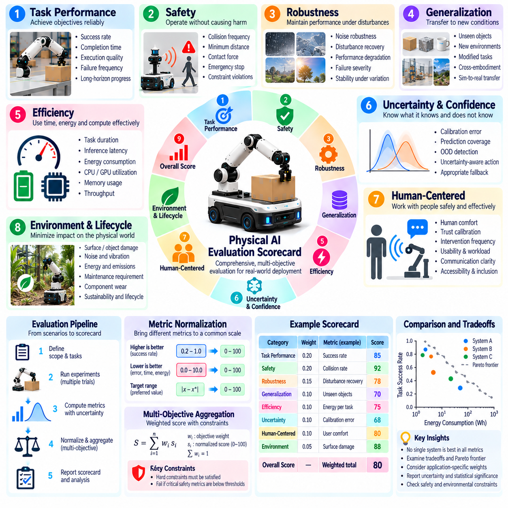{width="7.268055555555556in" height="7.268055555555556in"}

A Physical AI evaluation scorecard provides a structured framework for assessing robotic competence across multiple performance dimensions. Rather than relying on a single benchmark score, it integrates task success, safety, robustness, efficiency, generalization, and human interaction quality. The scorecard translates complex experimental results into interpretable evidence for system comparison. Its primary purpose is to support reliable engineering decisions without concealing important performance limitations.

The scorecard begins with a clear definition of the evaluation target and operational context. A robotic manipulator, autonomous mobile robot, humanoid, or aerial platform may require different performance criteria. Evaluators should specify the robot embodiment, hardware configuration, software version, operating environment, and intended tasks. These descriptions establish the conditions under which reported measurements are meaningful and prevent inappropriate comparisons across incompatible systems.

Capability assessment forms the foundation of the scorecard. Relevant capabilities may include perception, localization, manipulation, navigation, planning, control, and task reasoning. Each capability should be evaluated using observable outcomes rather than broad claims about intelligence. For example, manipulation competence can be represented through grasp success, placement accuracy, and recovery behavior. Capability scores should remain connected to clearly defined experimental procedures.

Task-level performance measures whether the robot achieves specified objectives under controlled conditions. Common indicators include success rate, completion time, execution quality, and failure frequency. Long-horizon tasks require additional consideration of intermediate progress, error accumulation, and recovery from unsuccessful actions. The scorecard should distinguish complete success from partial completion and identify whether failures originate from perception, planning, control, or physical interaction.

Safety evaluation occupies a separate and mandatory dimension because high productivity cannot justify unacceptable physical hazards. Relevant indicators include collision frequency, minimum separation distance, contact forces, emergency stopping behavior, and constraint violations. Safety-critical failures should be reported independently of average task success. A scorecard may use explicit pass-or-fail requirements to prevent strong performance in other categories from compensating for serious safety deficiencies.

Robustness assessment examines whether performance remains stable under disturbances and imperfect operating conditions. Sensor noise, object displacement, lighting changes, friction variation, communication delays, and unexpected obstacles provide representative challenges. The scorecard should compare nominal performance with disturbed-condition performance and quantify degradation. Recovery success and failure severity are important because robustness involves responding appropriately when normal execution becomes impossible.

Generalization evaluation determines whether capabilities transfer beyond familiar training and testing conditions. New objects, unfamiliar layouts, modified tasks, and changing environmental dynamics can expose overfitting. Cross-environment and cross-embodiment evaluations may be included when relevant. The scorecard should distinguish performance on previously encountered scenarios from results on independent test conditions, ensuring that apparent competence is not based primarily on memorization.

Efficiency metrics describe the resources required to achieve useful physical outcomes. Task duration, inference latency, energy consumption, memory utilization, and computational demand may all influence deployment feasibility. Evaluators should report these quantities using consistent units and hardware conditions. Efficiency should be interpreted together with task quality because low resource consumption is not beneficial when it produces unacceptable errors or unreliable execution.

Uncertainty and confidence awareness provide another important scorecard dimension. A robot should recognize situations in which predictions, state estimates, or actions are unreliable. Calibration quality, probabilistic coverage, out-of-distribution detection, and appropriate fallback behavior can support this assessment. Evaluation should examine whether uncertainty estimates influence decisions constructively, such as slowing movement, requesting additional observations, or seeking human assistance.

Human-centered evaluation captures effects that purely technical performance metrics may overlook. Operator workload, intervention frequency, interaction predictability, perceived safety, accessibility, and communication clarity are relevant examples. For robots operating near people, these dimensions may determine practical acceptance. The scorecard should combine objective behavioral observations with appropriately designed user assessments while preserving distinctions between subjective experience and measured physical performance.

Environmental and lifecycle considerations extend the scorecard beyond immediate task execution. Surface damage, noise, energy use, maintenance requirements, component wear, and waste generation may affect long-term deployment suitability. Application-specific criteria should reflect the operating domain. For example, agricultural robots may require soil protection metrics, while construction robots may prioritize structural damage prevention and measurement precision.

Score normalization enables metrics with different units to be presented within a common reporting framework. Success percentages, positioning errors, energy measurements, and latency values cannot be combined meaningfully without justified transformations. Normalized scores should preserve the direction of improvement and reference operational requirements or established baselines. Raw measurements must remain available because normalization can conceal important physical differences between systems.

Weighting determines how individual performance dimensions contribute to an overall assessment. A warehouse robot may emphasize throughput and reliability, while a collaborative manipulator may place greater importance on safety and interaction quality. Weight selection should follow documented application priorities rather than arbitrary preferences. Sensitivity analysis can reveal whether rankings change substantially when weights vary, and mandatory safety constraints should remain independent of weighted aggregation.

Statistical confidence is necessary because scorecard measurements originate from finite experiments. Reported success rates, execution times, and failure frequencies should include sample sizes and appropriate uncertainty estimates. Confidence intervals, repeated trials, and independent test scenarios improve interpretability. The scorecard should distinguish statistically supported improvements from differences that may result from sampling variation, especially when comparing systems with similar average performance.

A practical scorecard can organize each evaluation dimension into metric definitions, observed values, reference targets, uncertainty estimates, and acceptance decisions. For example, task success may be evaluated against a required success threshold, while positioning accuracy is compared with an allowable error limit. Safety constraints may receive independent compliance status. Such organization makes engineering requirements traceable and identifies specific areas requiring improvement.

Scorecard implementation should support automated data collection and reproducible reporting. Experiment logs can record task outcomes, timestamps, sensor measurements, control commands, resource consumption, and safety events. Evaluation software can calculate standardized metrics and generate consistent summaries across repeated runs. Version-controlled configurations, dataset identifiers, and scoring rules help ensure that results remain comparable as models and hardware evolve.

Ultimately, a Physical AI evaluation scorecard connects benchmark measurements with operational readiness and engineering accountability. It should reveal strengths, limitations, uncertainties, and unacceptable risks rather than reduce complex robotic behavior to an oversimplified ranking. Combining capability metrics, safety constraints, statistical evidence, application-specific priorities, and transparent reporting creates a practical foundation for evaluating, comparing, and improving Physical AI systems.

피지컬 인공지능 평가 스코어카드(Physical AI Evaluation Scorecard)는 여러 성능 차원(Performance Dimensions)에 걸쳐 로봇 역량(Robotic Competence)을 평가하기 위한 구조화된 프레임워크(Structured Framework)를 제공한다. 단일 벤치마크 점수(Single Benchmark Score)에 의존하는 대신 작업 성공(Task Success), 안전성(Safety), 강건성(Robustness), 효율성(Efficiency), 일반화(Generalization), 인간 상호작용 품질(Human Interaction Quality)을 통합한다. 스코어카드는 복잡한 실험 결과(Experimental Results)를 시스템 비교(System Comparison)에 활용할 수 있는 해석 가능한 근거(Interpretable Evidence)로 변환한다. 주요 목적은 중요한 성능 한계(Performance Limitations)를 감추지 않으면서 신뢰할 수 있는 엔지니어링 의사결정(Engineering Decisions)을 지원하는 것이다.

스코어카드(Scorecard)는 평가 대상(Evaluation Target)과 운영 맥락(Operational Context)을 명확하게 정의하는 것에서 시작한다. 로봇 매니퓰레이터(Robotic Manipulator), 자율 이동 로봇(Autonomous Mobile Robot), 휴머노이드(Humanoid), 비행 로봇(Aerial Platform)은 서로 다른 성능 기준(Performance Criteria)이 필요할 수 있다. 평가자는 로봇의 신체 구현 형태(Robot Embodiment), 하드웨어 구성(Hardware Configuration), 소프트웨어 버전(Software Version), 운영 환경(Operating Environment), 의도된 작업(Intended Tasks)을 명시해야 한다. 이러한 설명은 보고된 측정값이 의미를 갖는 조건을 설정하고 호환되지 않는 시스템 사이의 부적절한 비교(Inappropriate Comparisons)를 방지한다.

역량 평가(Capability Assessment)는 스코어카드의 기반을 형성한다. 관련 역량에는 인식(Perception), 위치 추정(Localization), 조작(Manipulation), 주행(Navigation), 계획(Planning), 제어(Control), 작업 추론(Task Reasoning)이 포함될 수 있다. 각 역량은 지능(Intelligence)에 관한 포괄적인 주장보다 관측 가능한 결과(Observable Outcomes)를 이용하여 평가해야 한다. 예를 들어 조작 역량(Manipulation Competence)은 파지 성공률(Grasp Success), 배치 정확도(Placement Accuracy), 복구 행동(Recovery Behavior)으로 표현할 수 있다. 역량 점수(Capability Scores)는 명확하게 정의된 실험 절차(Experimental Procedures)와 연결되어야 한다.

작업 수준 성능(Task-Level Performance)은 로봇이 통제된 조건(Controlled Conditions)에서 지정된 목표(Specified Objectives)를 달성하는지를 측정한다. 일반적인 지표에는 성공률(Success Rate), 완료 시간(Completion Time), 실행 품질(Execution Quality), 실패 빈도(Failure Frequency)가 포함된다. 장기 시간 범위 작업(Long-Horizon Tasks)은 중간 진행 상태(Intermediate Progress), 오류 누적(Error Accumulation), 실패한 행동으로부터의 복구(Recovery from Unsuccessful Actions)를 추가로 고려해야 한다. 스코어카드는 완전한 성공(Complete Success)과 부분 완료(Partial Completion)를 구분하고 실패가 인식(Perception), 계획(Planning), 제어(Control), 물리적 상호작용(Physical Interaction) 중 어디에서 발생했는지를 식별해야 한다.

안전성 평가(Safety Evaluation)는 높은 생산성(High Productivity)이 허용할 수 없는 물리적 위험(Unacceptable Physical Hazards)을 정당화할 수 없기 때문에 독립적이고 필수적인 평가 차원(Mandatory Dimension)을 차지한다. 관련 지표에는 충돌 빈도(Collision Frequency), 최소 이격 거리(Minimum Separation Distance), 접촉력(Contact Forces), 비상 정지 행동(Emergency Stopping Behavior), 제약조건 위반(Constraint Violations)이 포함된다. 안전 필수 실패(Safety-Critical Failures)는 평균 작업 성공률(Average Task Success)과 독립적으로 보고해야 한다. 스코어카드는 다른 범주의 우수한 성능이 심각한 안전 결함(Safety Deficiencies)을 상쇄하지 못하도록 명시적인 합격 또는 불합격 요구사항(Pass-or-Fail Requirements)을 사용할 수 있다.

강건성 평가(Robustness Assessment)는 외란(Disturbances)과 불완전한 운영 조건(Imperfect Operating Conditions)에서도 성능이 안정적으로 유지되는지를 검토한다. 센서 잡음(Sensor Noise), 객체 위치 변화(Object Displacement), 조명 변화(Lighting Changes), 마찰 변화(Friction Variation), 통신 지연(Communication Delays), 예상하지 못한 장애물(Unexpected Obstacles)은 대표적인 도전 조건이다. 스코어카드는 정상 조건 성능(Nominal Performance)과 외란 조건 성능(Disturbed-Condition Performance)을 비교하고 성능 저하(Performance Degradation)를 정량화해야 한다. 강건성은 정상적인 실행이 불가능해졌을 때 적절하게 대응하는 능력을 포함하므로 복구 성공률(Recovery Success)과 실패 심각도(Failure Severity)가 중요하다.

일반화 평가(Generalization Evaluation)는 익숙한 학습 및 시험 조건(Training and Testing Conditions)을 넘어 역량이 전이(Transfer)되는지를 판단한다. 새로운 객체(New Objects), 익숙하지 않은 배치(Unfamiliar Layouts), 수정된 작업(Modified Tasks), 변화하는 환경 동역학(Changing Environmental Dynamics)은 과적합(Overfitting)을 드러낼 수 있다. 관련성이 있는 경우 환경 간 평가(Cross-Environment Evaluation)와 신체 구현 형태 간 평가(Cross-Embodiment Evaluation)를 포함할 수 있다. 스코어카드는 이전에 경험한 시나리오(Previously Encountered Scenarios)의 성능과 독립적인 시험 조건(Independent Test Conditions)의 결과를 구분하여 겉으로 드러나는 역량이 주로 암기(Memorization)에 기반하지 않도록 해야 한다.

효율성 지표(Efficiency Metrics)는 유용한 물리적 결과(Useful Physical Outcomes)를 달성하는 데 필요한 자원(Resources)을 설명한다. 작업 소요 시간(Task Duration), 추론 지연(Inference Latency), 에너지 소비(Energy Consumption), 메모리 사용률(Memory Utilization), 연산 요구량(Computational Demand)은 모두 배치 실현 가능성(Deployment Feasibility)에 영향을 미칠 수 있다. 평가자는 일관된 단위(Consistent Units)와 하드웨어 조건(Hardware Conditions)을 사용하여 이러한 측정값을 보고해야 한다. 낮은 자원 소비(Low Resource Consumption)가 허용할 수 없는 오류(Unacceptable Errors)나 신뢰할 수 없는 실행(Unreliable Execution)을 초래한다면 유익하지 않으므로 효율성은 작업 품질(Task Quality)과 함께 해석해야 한다.

불확실성 및 신뢰도 인식(Uncertainty and Confidence Awareness)은 스코어카드의 또 다른 중요한 평가 차원을 제공한다. 로봇은 예측(Predictions), 상태 추정(State Estimates), 행동(Actions)의 신뢰성이 낮은 상황을 인식해야 한다. 보정 품질(Calibration Quality), 확률적 포함률(Probabilistic Coverage), 분포 외 탐지(Out-of-Distribution Detection), 적절한 대체 행동(Appropriate Fallback Behavior)은 이러한 평가를 지원할 수 있다. 평가는 불확실성 추정값(Uncertainty Estimates)이 이동 속도 감소(Slowing Movement), 추가 관측 요청(Requesting Additional Observations), 인간 지원 요청(Seeking Human Assistance)과 같이 의사결정에 건설적인 영향을 미치는지를 검토해야 한다.

인간 중심 평가(Human-Centered Evaluation)는 순수한 기술적 성능 지표(Technical Performance Metrics)가 놓칠 수 있는 영향을 포착한다. 운영자 작업 부하(Operator Workload), 개입 빈도(Intervention Frequency), 상호작용 예측 가능성(Interaction Predictability), 인지된 안전성(Perceived Safety), 접근성(Accessibility), 의사소통 명확성(Communication Clarity)이 대표적인 사례이다. 사람 가까이에서 작동하는 로봇의 경우 이러한 차원은 실질적인 수용성(Practical Acceptance)을 결정할 수 있다. 스코어카드는 객관적인 행동 관측(Objective Behavioral Observations)과 적절하게 설계된 사용자 평가(User Assessments)를 결합하면서 주관적 경험(Subjective Experience)과 측정된 물리적 성능(Measured Physical Performance)의 차이를 유지해야 한다.

환경 및 수명주기 고려사항(Environmental and Lifecycle Considerations)은 스코어카드를 즉각적인 작업 실행(Immediate Task Execution) 이상으로 확장한다. 표면 손상(Surface Damage), 소음(Noise), 에너지 사용(Energy Use), 유지보수 요구사항(Maintenance Requirements), 구성요소 마모(Component Wear), 폐기물 발생(Waste Generation)은 장기적인 배치 적합성(Long-Term Deployment Suitability)에 영향을 미칠 수 있다. 응용 분야별 기준(Application-Specific Criteria)은 운영 영역(Operating Domain)을 반영해야 한다. 예를 들어 농업 로봇(Agricultural Robots)은 토양 보호 지표(Soil Protection Metrics)가 필요할 수 있으며, 건설 로봇(Construction Robots)은 구조물 손상 방지(Structural Damage Prevention)와 측정 정밀도(Measurement Precision)를 우선시할 수 있다.

점수 정규화(Score Normalization)는 단위가 서로 다른 지표(Metrics)를 공통 보고 프레임워크(Common Reporting Framework) 안에서 표현할 수 있도록 한다. 성공률(Success Percentages), 위치 오차(Positioning Errors), 에너지 측정값(Energy Measurements), 지연 시간(Latency Values)은 타당한 변환(Justified Transformations) 없이 의미 있게 결합할 수 없다. 정규화된 점수(Normalized Scores)는 성능 개선 방향(Direction of Improvement)을 유지하고 운영 요구사항(Operational Requirements)이나 확립된 기준선(Established Baselines)을 참조해야 한다. 정규화가 시스템 사이의 중요한 물리적 차이(Physical Differences)를 감출 수 있으므로 원시 측정값(Raw Measurements)은 계속 확인할 수 있어야 한다.

가중치 부여(Weighting)는 개별 성능 차원(Individual Performance Dimensions)이 종합 평가(Overall Assessment)에 얼마나 기여하는지를 결정한다. 창고 로봇(Warehouse Robot)은 처리량(Throughput)과 신뢰성(Reliability)을 강조할 수 있지만 협동 매니퓰레이터(Collaborative Manipulator)는 안전성(Safety)과 상호작용 품질(Interaction Quality)에 더 높은 중요도를 부여할 수 있다. 가중치 선택(Weight Selection)은 임의적인 선호(Arbitrary Preferences)가 아니라 문서화된 응용 분야 우선순위(Application Priorities)를 따라야 한다. 민감도 분석(Sensitivity Analysis)은 가중치 변화에 따라 순위(Rankings)가 크게 달라지는지를 보여줄 수 있으며, 필수 안전 제약조건(Mandatory Safety Constraints)은 가중 집계(Weighted Aggregation)와 독립적으로 유지되어야 한다.

통계적 신뢰성(Statistical Confidence)은 스코어카드 측정값(Scorecard Measurements)이 유한한 실험(Finite Experiments)에서 도출되기 때문에 필요하다. 보고된 성공률(Success Rates), 실행 시간(Execution Times), 실패 빈도(Failure Frequencies)에는 표본 크기(Sample Sizes)와 적절한 불확실성 추정값(Uncertainty Estimates)이 포함되어야 한다. 신뢰구간(Confidence Intervals), 반복 시험(Repeated Trials), 독립적인 시험 시나리오(Independent Test Scenarios)는 해석 가능성(Interpretability)을 향상시킨다. 스코어카드는 특히 평균 성능(Average Performance)이 유사한 시스템을 비교할 때 통계적으로 뒷받침되는 개선(Statistically Supported Improvements)과 표본 추출 변동(Sampling Variation)으로 발생할 수 있는 차이를 구분해야 한다.

실용적인 스코어카드(Practical Scorecard)는 각 평가 차원(Evaluation Dimension)을 지표 정의(Metric Definitions), 관측값(Observed Values), 기준 목표(Reference Targets), 불확실성 추정값(Uncertainty Estimates), 수용 여부 결정(Acceptance Decisions)으로 구성할 수 있다. 예를 들어 작업 성공(Task Success)은 요구 성공률 임계값(Required Success Threshold)과 비교하여 평가하고, 위치 정확도(Positioning Accuracy)는 허용 오차 한계(Allowable Error Limit)와 비교할 수 있다. 안전 제약조건(Safety Constraints)에는 독립적인 준수 상태(Compliance Status)를 부여할 수 있다. 이러한 구성은 엔지니어링 요구사항(Engineering Requirements)의 추적 가능성(Traceability)을 확보하고 개선이 필요한 구체적인 영역을 식별한다.

스코어카드 구현(Scorecard Implementation)은 자동화된 데이터 수집(Automated Data Collection)과 재현 가능한 보고(Reproducible Reporting)를 지원해야 한다. 실험 로그(Experiment Logs)는 작업 결과(Task Outcomes), 타임스탬프(Timestamps), 센서 측정값(Sensor Measurements), 제어 명령(Control Commands), 자원 소비(Resource Consumption), 안전 이벤트(Safety Events)를 기록할 수 있다. 평가 소프트웨어(Evaluation Software)는 표준화된 지표(Standardized Metrics)를 계산하고 반복 실행(Repeated Runs)에 걸쳐 일관된 요약(Consistent Summaries)을 생성할 수 있다. 버전 관리된 구성(Version-Controlled Configurations), 데이터셋 식별자(Dataset Identifiers), 점수 산정 규칙(Scoring Rules)은 모델과 하드웨어가 발전하더라도 결과의 비교 가능성(Comparability)을 유지하는 데 도움이 된다.

궁극적으로 피지컬 인공지능 평가 스코어카드(Physical AI Evaluation Scorecard)는 벤치마크 측정값(Benchmark Measurements)을 운영 준비도(Operational Readiness) 및 엔지니어링 책임성(Engineering Accountability)과 연결한다. 스코어카드는 복잡한 로봇 행동(Complex Robotic Behavior)을 지나치게 단순화된 순위(Oversimplified Ranking)로 축소하기보다 강점(Strengths), 한계(Limitations), 불확실성(Uncertainties), 허용할 수 없는 위험(Unacceptable Risks)을 드러내야 한다. 역량 지표(Capability Metrics), 안전 제약조건(Safety Constraints), 통계적 근거(Statistical Evidence), 응용 분야별 우선순위(Application-Specific Priorities), 투명한 보고(Transparent Reporting)를 결합하면 피지컬 인공지능 시스템을 평가하고 비교하며 개선하기 위한 실용적인 기반을 구축할 수 있다.
