**Volume 11. Physical AI Evaluation and Benchmarking**

# Chapter 02. Simulation Benchmarks

## 02.01. Why Benchmark in Simulation

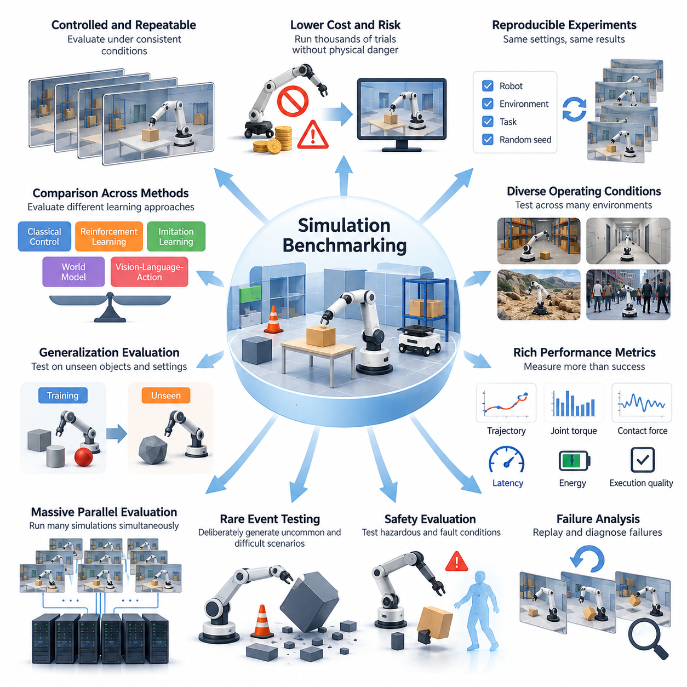{width="7.268055555555556in" height="7.268055555555556in"}

시뮬레이션 벤치마킹(Simulation Benchmarking)은 실제 환경에 배포하기 전에 피지컬 인공지능(Physical AI) 시스템을 평가하기 위한 통제 가능하고 반복 가능한 기반을 제공한다. 기존 소프트웨어와 달리 피지컬 인공지능은 물체, 표면, 센서, 액추에이터(Actuator), 동적 주변 환경과 상호작용한다. 시뮬레이션은 이러한 상호작용을 체계적으로 재현하면서 성능을 측정하고, 한계를 식별하며, 일관된 실험 조건에서 다양한 알고리즘을 비교할 수 있도록 한다.

실세계 테스트(Real-World Testing)는 물리적 지능(Physical Intelligence)을 검증하는 데 필수적이지만, 상당한 비용과 운영 위험, 실험적 변동성을 수반한다. 하드웨어 마모, 환경 변화, 인간의 개입, 제한된 시험 시설은 실험 횟수를 제약할 수 있다. 시뮬레이션은 로봇이 물리적 장비를 소모하거나 사람을 불필요한 위험에 노출하지 않고 수천 번의 실험을 수행할 수 있는 가상 환경(Virtual Environment)을 제공하여 이러한 제약을 줄인다.

시뮬레이션 벤치마킹의 주요 장점 중 하나는 실험 재현성(Experimental Reproducibility)이다. 연구자는 반복 평가에서 동일한 로봇 구성, 물체 배치, 환경 조건, 작업 목표를 초기화할 수 있다. 난수 시드(Random Seed)와 시뮬레이션 매개변수(Simulation Parameter)를 제어하면 높은 일관성으로 실험을 재현할 수 있다. 이를 통해 알고리즘 개선으로 발생한 성능 향상과 통제되지 않은 환경 요인으로 발생한 변화를 구별하기 쉬워진다.

시뮬레이션은 다양한 운영 조건(Operating Conditions)에 대한 체계적인 평가도 지원한다. 로봇 내비게이션 정책(Navigation Policy)은 별도의 물리적 시설을 구축하지 않고도 창고, 복도, 실외 지형, 혼잡한 환경에서 시험할 수 있다. 조작 알고리즘(Manipulation Algorithm)은 다양한 물체 형상, 질량, 마찰계수(Friction Coefficient), 접촉 특성(Contact Properties)을 경험할 수 있다. 이러한 변화는 지능형 시스템이 제한된 익숙한 시나리오를 넘어 안정적으로 작동하는지 조사할 수 있도록 한다.

피지컬 인공지능 평가는 작업이 목표에 도달했는지만 측정하는 것 이상을 요구한다. 시뮬레이션 환경은 상세한 궤적(Trajectory), 관절 토크(Joint Torque), 접촉력(Contact Force), 센서 관측값(Sensor Observation), 계산 지연시간(Computational Latency), 에너지 소비량(Energy Consumption)을 기록할 수 있다. 이러한 측정값은 작업 성공 여부뿐 아니라 수행 과정까지 보여준다. 따라서 시뮬레이션 벤치마크는 실행 품질, 자원 효율성, 안정성, 자율적 의사결정의 물리적 결과를 평가할 수 있다.

폐루프 평가(Closed-Loop Evaluation)는 지능형 로봇이 환경 피드백(Environmental Feedback)에 반응하여 지속적으로 행동을 수정하기 때문에 특히 중요하다. 작은 인식 오류(Perception Error)가 동작 계획(Motion Planning)에 영향을 미치고, 이후 센서 관측값과 미래 의사결정까지 변화시킬 수 있다. 시뮬레이션은 이러한 피드백 관계가 전체 작업에 걸쳐 전개되도록 한다. 이는 사전 기록된 데이터셋에 대한 개별 예측을 평가하는 것보다 상호작용 지능(Interactive Intelligence)을 더욱 현실적으로 평가할 수 있게 한다.

시뮬레이션 벤치마킹은 실패 메커니즘(Failure Mechanism)에 대한 정밀한 조사도 가능하게 한다. 로봇이 장애물과 충돌하거나 균형을 잃거나 물체를 떨어뜨리거나 임무를 완료하지 못하면, 시뮬레이터는 실패 이전의 전체 상태와 행동 순서를 보존할 수 있다. 연구자는 실패 상황을 재생하고 선택한 조건을 수정하여 근본 원인이 인식, 계획, 제어, 물리 모델링 또는 하위 시스템 간 상호작용에 있는지 확인할 수 있다.

안전성 평가(Safety Evaluation)는 시뮬레이션 실험을 통해 상당한 이점을 얻는다. 예상하지 못한 사람의 움직임, 센서 성능 저하, 액추에이터 오작동, 불안정한 접촉 상호작용을 포함한 잠재적 위험 상황을 실제 물리적 위험 없이 도입할 수 있다. 따라서 시뮬레이션은 물리적 플랫폼을 까다로운 운영 조건에 노출하기 전에 충돌 회피(Collision Avoidance), 비상 대응(Emergency Response), 대체 동작 전략(Fallback Strategy), 복구 동작(Recovery Behavior)을 검토할 수 있는 실용적인 환경을 제공한다.

희귀 사건(Rare Event)은 시뮬레이션 벤치마크가 필요한 또 다른 중요한 이유이다. 일부 실패는 매우 드물게 발생하기 때문에 통계적으로 의미 있는 실세계 사례를 수집하려면 상당한 운영 시간이 필요하다. 가상 환경은 비정상적인 장애물 배치, 극단적인 외란(Extreme Disturbance), 예상하지 못한 상호작용, 불리한 조건의 조합을 의도적으로 생성할 수 있다. 이러한 기능은 표적 스트레스 테스트(Targeted Stress Testing)를 지원하며 일반적인 평가 시나리오에서 발견하기 어려운 취약성을 드러내는 데 도움이 된다.

대규모 병렬 시뮬레이션(Massive Parallel Simulation)은 피지컬 인공지능 평가의 규모를 더욱 확장한다. 최신 컴퓨팅 플랫폼은 다수의 독립적인 로봇 환경을 동시에 실행하여 연구자가 작업, 구성, 환경 매개변수의 광범위한 조합을 조사할 수 있도록 한다. 병렬 벤치마킹(Parallel Benchmarking)은 통계 분석을 가속하고 소수의 성공 사례에 의존하지 않고 성능 분포(Performance Distribution)를 체계적으로 탐색할 수 있도록 한다.

환경 변동성(Environmental Variability)을 제어하는 능력은 일반화(Generalization)를 측정하는 데 특히 중요하다. 벤치마크 설계자는 익숙한 시나리오와 학습하지 않은 물체, 배치, 지형 조건, 물리적 특성을 구분할 수 있다. 이후 학습 환경에서 제외된 구성에 대해 정책을 평가할 수 있다. 이러한 구분은 시스템이 전이 가능한 물리적 능력(Transferable Physical Capability)을 습득했는지, 아니면 제한된 시뮬레이션 데이터셋의 반복적인 패턴에 적응했는지 판단하는 데 도움이 된다.

시뮬레이션은 서로 다른 학습 아키텍처(Learning Architecture)에 대한 비교 평가도 가능하게 한다. 고전적 제어기(Classical Controller), 강화학습 정책(Reinforcement Learning Policy), 모방학습 시스템(Imitation Learning System), 월드 모델(World Model), 비전-언어-행동 모델(Vision-Language-Action Model)을 공통 작업 명세(Common Task Specification)에 따라 시험할 수 있다. 표준화된 관측값, 행동 인터페이스, 초기화 절차, 점수 산정 프로토콜은 연구자가 조사하려는 아키텍처의 차이를 유지하면서 의미 있는 비교를 가능하게 한다.

그러나 시뮬레이션 결과를 자동으로 실세계 성능(Real-World Performance)으로 해석할 수는 없다. 시뮬레이터는 물리적 과정을 근사하며, 접촉 동역학(Contact Dynamics), 마찰, 변형, 센서 잡음, 액추에이터 응답의 부정확성이 잘못된 결과를 생성할 수 있다. 정책은 비현실적인 동역학이나 단순화된 환경 가정을 활용하여 높은 가상 성능을 달성할 수 있다. 따라서 벤치마크 결론은 시뮬레이션 충실도(Simulation Fidelity)와 기반 물리 모델의 한계를 고려해야 한다.

시뮬레이션과 현실 간 격차(Sim-to-Real Gap)는 조작, 이동 동작(Locomotion), 접촉이 많은 동작(Contact-Rich Behavior)을 평가할 때 특히 중요하다. 재료 특성, 액추에이터 지연, 충돌 모델링의 작은 차이가 실행 결과를 크게 변화시킬 수 있다. 벤치마크 설계자는 목표 응용 분야에서 중요한 물리적 가정을 식별하고 해당 가정에 대한 민감도를 평가해야 한다. 시뮬레이션 충실도는 시각적 사실성(Visual Realism)만이 아니라 평가 목표와의 관련성을 기준으로 판단해야 한다.

도메인 무작위화(Domain Randomization)는 시뮬레이션 환경의 불확실성을 해결하기 위한 접근법 중 하나이다. 벤치마크 설계자는 단일한 이상적 구성에서 정책을 평가하는 대신 조명, 마찰, 물체 형상, 센서 잡음, 액추에이터 특성과 같은 매개변수를 변화시킨다. 이러한 변화에 따른 성능은 모델링 가정에 대한 민감도를 드러내고 강건성(Robustness)에 관한 근거를 제공할 수 있다. 그러나 무작위화된 평가에서의 성공이 신뢰할 수 있는 실제 배포를 보장하지는 않는다.

또 다른 중요한 고려사항은 결정론적 평가(Deterministic Evaluation)와 확률적 평가(Stochastic Evaluation)의 구분이다. 결정론적 시나리오는 동일한 실험 조건을 재현하여 디버깅(Debugging), 회귀 테스트(Regression Testing), 통제된 비교를 지원한다. 확률적 시나리오는 운영 환경의 복잡성을 더 잘 반영하는 불확실성과 변동성을 도입한다. 포괄적인 시뮬레이션 벤치마크는 두 접근법을 모두 포함하여 반복 가능한 실패를 조사하면서 다양한 가능한 결과에 대한 성능을 추정할 수 있어야 한다.

벤치마크 타당성(Benchmark Validity)은 시뮬레이션 작업이 벤치마크 외부에서도 중요한 능력을 나타내는지에 달려 있다. 환경이 일관된 측정값을 제공하더라도 실제 활용과 관련성이 낮은 행동을 강조할 수 있다. 마찬가지로 알고리즘은 고정된 배치, 예측 가능한 물체 분포, 점수 산정 규칙에 과적합(Overfitting)될 수 있다. 따라서 효과적인 벤치마킹에는 신중하게 선택한 작업, 독립적인 평가 시나리오, 투명한 가정, 벤치마크 특유의 허점을 악용하지 못하도록 하는 주기적인 개정이 필요하다.

통계적 엄밀성(Statistical Rigor)은 초기화 조건과 무작위 실험에 따라 성능이 상당히 달라질 수 있기 때문에 필요하다. 단일 성공 에피소드(Successful Episode)는 신뢰할 수 있는 물리적 지능에 대한 충분한 근거를 제공하지 못한다. 시뮬레이션은 반복 실험을 통해 성공률 분포(Success Distribution), 신뢰구간(Confidence Interval), 실패 빈도(Failure Frequency), 완료 시간(Completion Time), 강건성 추세(Robustness Trend)를 보고할 수 있도록 한다. 이러한 보고는 보다 타당한 비교를 지원하고 예외적인 성공 사례를 일반적인 시스템 동작으로 오인하는 것을 방지한다.

시뮬레이션 벤치마크는 효율적인 개발 워크플로(Development Workflow)에도 기여한다. 엔지니어는 자동화된 테스트(Automated Test)를 사용하여 인식 모델, 계획 알고리즘, 제어 정책 또는 시스템 통합을 변경한 이후 발생하는 성능 저하를 감지할 수 있다. 표준화된 시나리오는 개발팀에 공통 평가 기준을 제공하고 소프트웨어 생명주기(Software Lifecycle) 전반에 걸친 지속적 평가(Continuous Evaluation)를 지원한다. 이를 통해 벤치마킹은 일회성 연구 활동에서 반복 가능한 엔지니어링 프로세스로 전환된다.

궁극적으로 시뮬레이션 벤치마킹은 실험실 평가(Laboratory Evaluation)와 현장 평가(Field Evaluation)를 대체하는 것이 아니라 보완해야 한다. 가상 실험은 확장성, 제어 가능성, 상세한 관측 가능성(Observability), 위험하거나 비정상적인 조건에 대한 접근성을 제공한다. 반면 물리적 테스트는 이러한 결과가 실제 운영 제약에서도 유효한지 확인한다. 두 접근법을 결합하면 피지컬 인공지능 시스템의 능력, 강건성, 안전성, 일반화를 평가하기 위한 더욱 강력한 실증적 근거를 구축할 수 있다.

따라서 시뮬레이션 벤치마킹의 근본적인 목적은 단순히 더 높은 수치 점수를 생성하는 것이 아니라, 통제된 조건과 변화하는 조건에서 지능형 물리 시스템이 어떻게 동작하는지에 대한 신뢰할 수 있는 근거를 확립하는 것이다. 현실적인 작업 정의, 엄격한 측정 프로토콜, 불확실성 분석(Uncertainty Analysis), 실세계 검증(Real-World Validation)이 뒷받침될 때 시뮬레이션은 측정 가능하고 비교 가능하며 신뢰할 수 있고 지속적으로 능력이 향상되는 피지컬 인공지능 시스템을 개발하기 위한 필수적인 기반이 된다.

## 02.02. Simulation Benchmark Design Principles

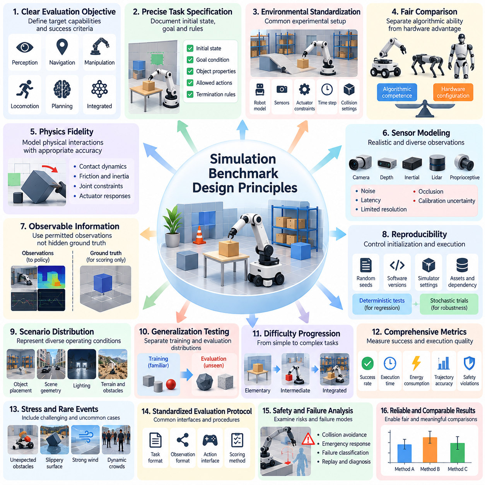{width="7.268055555555556in" height="7.268055555555556in"}

시뮬레이션 벤치마크 설계(Simulation Benchmark Design)는 평가 환경이 단순히 편리한 수치 점수를 생성하는 것이 아니라 의미 있는 피지컬 인공지능(Physical AI)의 능력을 측정해야 한다는 원칙에서 시작된다. 잘 설계된 벤치마크는 작업 목표, 환경 조건, 로봇 행동, 측정 가능한 결과를 연결한다. 그 목적은 시스템 역량(System Competence)에 대한 신뢰할 수 있는 근거를 제공하면서 알고리즘, 아키텍처, 구현 전략 간의 공정한 비교를 가능하게 하는 것이다.

첫 번째 요구사항은 명확하게 정의된 평가 목표(Evaluation Objective)이다. 벤치마크 설계자는 평가하려는 능력이 인식(Perception), 내비게이션(Navigation), 조작(Manipulation), 이동 동작(Locomotion), 계획(Planning), 통합 자율 행동(Integrated Autonomous Behavior) 중 무엇에 해당하는지 식별해야 한다. 각 목표는 관측 가능한 성능 기준과 명시적인 성공 조건에 대응해야 한다. 이러한 정렬이 없으면 벤치마크는 의도한 물리적 지능을 입증하지 못하면서 점수만 향상시키는 행동에 보상을 제공할 수 있다.

작업 명세(Task Specification)는 독립적인 재현을 지원할 만큼 정밀해야 한다. 초기 상태(Initial State), 목표 조건(Goal Condition), 물체 특성(Object Properties), 환경 경계(Environmental Boundary), 허용된 행동(Permitted Action), 종료 규칙(Termination Rule)을 일관되게 문서화해야 한다. 모호한 지침은 구현 간에 통제되지 않은 차이를 발생시킬 수 있다. 따라서 엄격한 벤치마크는 작업의 정의와 이를 해결하기 위해 사용하는 특정 알고리즘 또는 제어 전략을 분리한다.

환경 표준화(Environmental Standardization)는 공통의 실험 기반을 확립한다. 로봇 모델(Robot Model), 좌표계(Coordinate System), 센서 구성(Sensor Configuration), 액추에이터 제약조건(Actuator Constraint), 시뮬레이션 시간 간격(Simulation Time Step), 충돌 설정(Collision Setting)은 관련성이 있는 경우 명확하게 지정해야 한다. 이러한 매개변수는 평가 대상 시스템의 물리적 행동에 영향을 미치며 보고된 성능을 크게 변화시킬 수 있다. 표준화는 의도하지 않은 이점을 줄이면서 다양한 지능형 아키텍처를 조사하는 데 필요한 유연성을 유지한다.

공정한 비교(Fair Comparison)가 반드시 동일한 로봇 하드웨어나 행동 표현(Action Representation)을 요구하는 것은 아니다. 서로 다른 로봇 구현 형태(Embodiment)는 이동성, 조작, 감지, 제어 능력에서 차이를 가질 수 있다. 벤치마크 설계자는 평가 목표에 따라 어떤 특성을 고정하고 어떤 특성을 변경할 수 있는지 결정해야 한다. 비교 과정에서는 알고리즘 역량(Algorithmic Competence)과 하드웨어 구성, 특권적 정보(Privileged Information), 불균등한 계산 자원에서 발생하는 이점을 구별해야 한다.

물리 충실도(Physics Fidelity)는 또 다른 기본적인 설계 고려사항이다. 접촉 동역학(Contact Dynamics), 마찰(Friction), 관성(Inertia), 관절 제약조건(Joint Constraint), 액추에이터 응답(Actuator Response)은 평가 대상 행동에 충분한 정확도로 표현되어야 한다. 그러나 시뮬레이션 복잡성을 높인다고 해서 벤치마크 타당성(Benchmark Validity)이 자동으로 향상되는 것은 아니다. 적절한 충실도는 작업의 특성, 특히 성능이 물리적 상호작용, 시간 특성, 변형, 환경 외란에 얼마나 민감한지에 따라 달라진다.

센서 모델링(Sensor Modeling)에도 유사한 주의가 필요하다. 피지컬 인공지능 정책은 시뮬레이션 상태에 대한 완전한 지식이 아니라 관측값(Observation)에 의존하기 때문이다. 카메라 영상, 깊이 측정값(Depth Measurement), 관성 신호(Inertial Signal), 라이다 관측값(LiDAR Observation), 고유수용성 피드백(Proprioceptive Feedback)은 의도한 센서 구성을 반영해야 한다. 이상화된 가상 관측값에서 발생하는 비현실적인 이점을 방지하려면 잡음(Noise), 지연시간(Latency), 제한된 해상도, 가림 현상(Occlusion), 보정 불확실성(Calibration Uncertainty)을 포함해야 할 수 있다.

관측 가능한 정보(Observable Information)와 시뮬레이터의 실제 기준값(Ground Truth) 사이에는 근본적인 구분이 유지되어야 한다. 실제 기준 상태(Ground-Truth State)는 점수 산정, 진단, 실패 분석에 유용하지만, 제한 없이 접근할 수 있도록 하면 인식이나 자율 추론을 측정하려는 평가의 타당성이 훼손될 수 있다. 벤치마크 인터페이스는 허용된 관측값을 명확하게 정의하고, 특권적 접근이 의도적인 실험 조건이 아닌 경우 숨겨진 환경 정보가 정책 입력(Policy Input)에 포함되지 않도록 해야 한다.

재현성(Reproducibility)을 확보하려면 실험 초기화와 실행을 제어해야 한다. 난수 시드(Random Seed), 소프트웨어 버전, 시뮬레이터 설정, 자산 정의(Asset Definition), 의존성 구성(Dependency Configuration)을 기록해야 한다. 결정론적 테스트 사례(Deterministic Test Case)는 정밀한 회귀 분석(Regression Analysis)을 가능하게 하며, 확률적 실험(Stochastic Trial)은 성능 변동을 드러낸다. 반복 가능성은 과학적 비교를 지원하고 통제된 무작위성은 불확실성 속에서도 관측된 능력이 신뢰할 수 있는지 확인하는 데 도움이 되므로 두 접근법 모두 필요하다.

벤치마크 시나리오(Benchmark Scenario)는 고립된 시연 사례의 집합이 아니라 의미 있는 운영 조건 분포(Operating Condition Distribution)를 나타내야 한다. 물체 배치, 장면 기하구조(Scene Geometry), 조명, 지형, 장애물 움직임, 작업 복잡도는 체계적으로 변화시킬 수 있다. 평가 설계자는 시나리오가 어떻게 샘플링되는지 문서화하고 정상 조건(Nominal Condition)과 어렵거나 비정상적인 사례를 구분해야 한다. 이는 점점 더 까다로워지는 환경에서 해석 가능한 성능 분석을 지원한다.

일반화 테스트(Generalization Testing)를 위해서는 학습 분포(Training Distribution)와 평가 분포(Evaluation Distribution)를 분리해야 한다. 학습하지 않은 물체, 익숙하지 않은 배치, 변경된 물리 매개변수, 새로운 작업 조합은 정책이 전이 가능한 행동(Transferable Behavior)을 학습했는지 확인하는 데 도움이 된다. 비공개 평가 구성(Hidden Evaluation Configuration)은 테스트 시나리오에 대한 직접적인 최적화를 줄일 수 있다. 그러나 벤치마크 설계자는 분포 변화(Distribution Shift)가 실제 성능과 무관한 임의의 어려움을 도입하는 것이 아니라 평가하려는 능력과 관련되도록 해야 한다.

난이도 진행(Difficulty Progression)은 또 다른 중요한 설계 원칙이다. 작업은 기본 능력, 중간 수준의 상호작용, 여러 기술의 조정이 필요한 통합 과제까지 포함해야 한다. 이러한 단계적 구성은 시스템 성능이 어느 지점에서 저하되기 시작하는지 식별할 수 있도록 한다. 난이도는 주관적인 판단만으로 정의하기보다 환경 복잡도(Environmental Complexity), 불확실성(Uncertainty), 상호작용 요구사항(Interaction Requirement), 시간적 의존성(Temporal Dependency) 등 측정 가능한 요소를 통해 정의해야 한다.

평가 대상이 자율적인 물리적 행동인 경우 폐루프 상호작용(Closed-Loop Interaction)을 유지해야 한다. 정책은 관측값을 수신하고 행동을 생성하며, 그 결과로 발생하는 시뮬레이션 환경의 변화를 경험해야 한다. 사전에 기록된 행동 예측(Action Prediction)만 평가하면 실행 과정에서 누적되는 오류를 발견하지 못할 수 있다. 상호작용형 벤치마크(Interactive Benchmark)는 인식, 계획, 제어, 환경 피드백이 시간에 따라 서로 어떤 영향을 미치는지 보여준다.

평가지표 설계(Metric Design)는 작업 결과와 실행 품질을 모두 반영해야 한다. 성공률(Success Rate)만으로는 효율적이고 안정적인 행동과 느리거나 잠재적으로 안전하지 않은 작업 완료를 구분할 수 없다. 응용 분야에 따라 완료 시간(Completion Time), 궤적 편차(Trajectory Deviation), 충돌 빈도(Collision Frequency), 접촉력(Contact Force), 에너지 소비량(Energy Consumption), 제어 평활성(Control Smoothness), 개입 요구량(Intervention Requirement) 등을 추가로 측정할 수 있다. 평가지표는 독립적인 구현에서도 비교 가능한 결과를 생성하도록 조작적으로 정의(Operational Definition)되어야 한다.

다목적 평가(Multi-Objective Evaluation)는 피지컬 인공지능 성능에 서로 경쟁하는 요구사항이 포함되기 때문에 필요하다. 로봇은 더 많은 에너지를 소비하거나, 높은 충돌 위험을 감수하거나, 더 많은 계산 자원을 사용하여 작업 완료율을 높일 수 있다. 이러한 차원을 단일 점수(Single Score)로 결합하면 중요한 상충관계(Tradeoff)가 가려질 수 있다. 벤치마크 설계자는 개별 측정값을 유지하고 복합 성능 지표(Composite Performance Indicator)를 구성하는 데 사용된 가중치 또는 집계 절차(Aggregation Procedure)를 설명해야 한다.

안전성(Safety)과 강건성(Robustness)은 선택적인 확장 요소가 아니라 벤치마크 구성에 포함되어야 한다. 외란(Disturbance), 센서 성능 저하(Sensor Degradation), 예상하지 못한 장애물, 액추에이터 제한은 정상 조건에서 드러나지 않는 약점을 노출할 수 있다. 평가 시나리오는 시스템이 작업을 완료하는지뿐 아니라 실패를 인식하고, 운영 제약조건(Operational Constraint)을 유지하며, 적절한 복구 동작(Recovery Behavior) 또는 대체 동작(Fallback Behavior)으로 전환하는지도 조사해야 한다.

통계적 신뢰성(Statistical Reliability)을 확보하려면 대표적인 시나리오에 대해 충분한 반복 실험(Repeated Trial)이 필요하다. 보고된 결과에는 변동성 측정값(Measures of Variability), 적절한 경우 신뢰구간(Confidence Interval), 샘플링 절차(Sampling Procedure)에 대한 투명한 설명이 포함되어야 한다. 실험 간 변동이 상당할 때 작은 성능 차이는 의미가 없을 수 있다. 따라서 벤치마크 프로토콜(Benchmark Protocol)은 타당한 결론을 지원할 수 있도록 평가 예산(Evaluation Budget)과 통계적 보고 요구사항(Statistical Reporting Requirement)을 명시해야 한다.

확장성(Scalability)과 계산 효율성(Computational Efficiency)은 벤치마크의 실질적인 도입에 영향을 미친다. 평가 환경은 자동 실행(Automated Execution), 병렬 처리(Parallel Processing), 표준화된 로깅(Standardized Logging), 기계 판독 가능한 결과(Machine-Readable Result)를 지원해야 한다. 동시에 벤치마크 설계자는 시뮬레이션 속도, 하드웨어 가속(Hardware Acceleration), 자원 가용성(Resource Availability)의 차이를 고려해야 한다. 계산상의 편의성이 물리적 타당성을 훼손하거나 특정 구현에 숨겨진 이점을 제공해서는 안 된다.

벤치마크 무결성(Benchmark Integrity)은 과적합(Overfitting)과 평가지표 악용(Metric Exploitation)을 방지하는 데 달려 있다. 고정된 시나리오, 예측 가능한 초기화 패턴, 부적절하게 설계된 점수 산정 규칙은 정책이 의도한 작업을 해결하기보다 시뮬레이터의 인공적인 특성(Simulator Artifact)을 악용하도록 유도할 수 있다. 독립적인 테스트 구성, 통제된 벤치마크 업데이트, 진단 평가(Diagnostic Evaluation)는 이러한 위험을 줄일 수 있다. 투명한 문서화는 알려진 한계를 설명하고 입증된 역량과 벤치마크에 특화된 최적화를 구분해야 한다.

마지막으로 시뮬레이션 벤치마크 설계는 실세계 검증(Real-World Validation)과 명확한 관계를 유지해야 한다. 대표적인 물리적 실험(Physical Experiment)은 모델링 오류(Modeling Error), 비현실적인 가정, 시뮬레이션 동작과 실제 동작 사이의 불일치를 드러낼 수 있다. 이러한 결과는 벤치마크 시나리오와 충실도 요구사항(Fidelity Requirement)의 개정에 반영되어야 한다. 따라서 신뢰할 수 있는 벤치마크는 재현성, 공정성, 현실성, 통계적 엄밀성, 피지컬 인공지능 배포(Physical AI Deployment)에 대한 실질적 관련성 사이에서 균형을 유지하며 발전하는 평가 도구(Evaluation Instrument)이다.

## 02.03. Scenario Task and Environment Definition

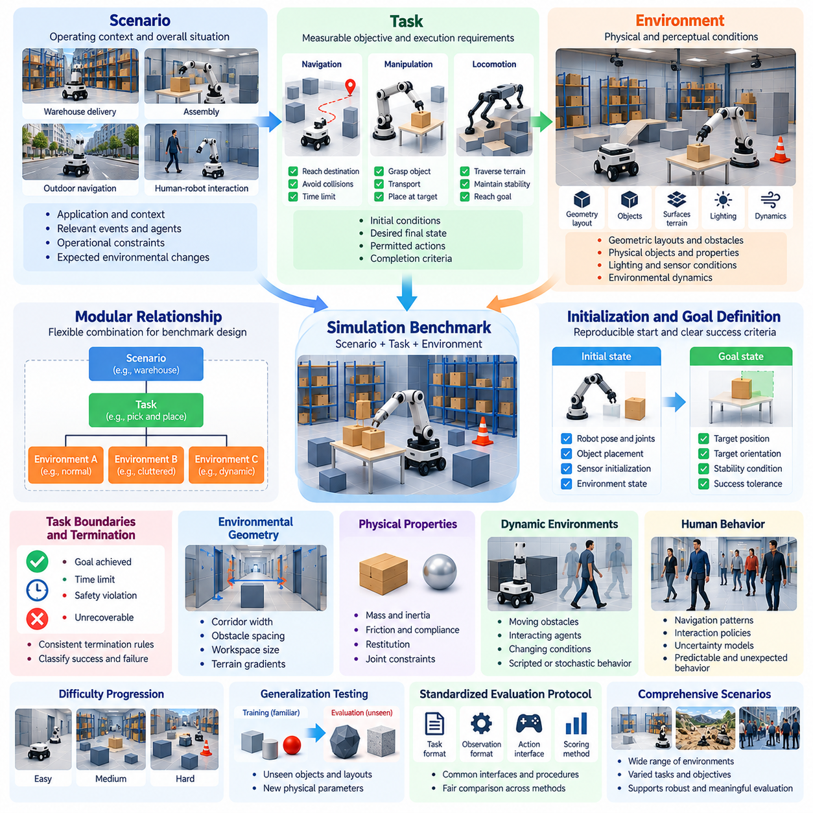{width="7.268055555555556in" height="7.268055555555556in"}

시나리오(Scenario), 작업(Task), 환경(Environment)의 정의는 피지컬 인공지능(Physical AI)을 위한 시뮬레이션 벤치마킹(Simulation Benchmarking)의 구조적 기반을 형성한다. 시나리오는 운영 상황을 설명하고, 작업은 달성해야 할 목표를 명시하며, 환경은 실행이 이루어지는 물리적 및 지각적 조건을 나타낸다. 이러한 요소를 명확하게 구분하면 체계적인 평가, 재현 가능한 실험, 서로 다른 로봇 시스템 간의 의미 있는 비교가 가능해진다.

시나리오(Scenario)는 자율 행동(Autonomous Behavior)이 평가되는 맥락을 설정한다. 창고 배송 작업, 로봇 조립 절차, 실외 내비게이션 임무(Outdoor Navigation Mission), 인간-로봇 상호작용(Human-Robot Interaction) 등을 설명할 수 있다. 시나리오는 응용 분야를 식별하는 것뿐 아니라 관련 사건, 참여 에이전트(Participating Agent), 운영 제약조건(Operational Constraint), 예상되는 환경 변화도 정의한다. 이러한 맥락 정보는 벤치마크가 어떤 능력을 평가할 것인지 결정한다.

작업 정의(Task Definition)는 시나리오를 측정 가능한 목표와 실행 요구사항으로 변환한다. 내비게이션 작업(Navigation Task)은 충돌 없이 지정된 목적지에 도달하도록 요구할 수 있으며, 조작 작업(Manipulation Task)은 물체를 파지하고 운반하여 배치하는 과정을 포함할 수 있다. 각 작업은 초기 조건(Initial Condition), 원하는 최종 상태(Desired Final State), 허용된 행동(Permitted Action), 완료 기준(Completion Criteria)을 명시해야 한다. 정밀한 정의는 성공과 실패에 대한 모호한 해석을 방지한다.

환경 정의(Environment Definition)는 작업이 수행되는 가상 세계(Virtual World)를 명시한다. 여기에는 기하학적 배치(Geometric Layout), 물리적 물체(Physical Object), 표면, 장애물, 조명 조건, 환경 동역학(Environmental Dynamics)이 포함된다. 이동 로봇(Mobile Robot)에서는 지형 특성과 주행 가능 영역(Traversable Region)이 중요할 수 있으며, 조작 벤치마크에서는 정확한 물체 형상과 접촉 특성(Contact Characteristics)이 요구된다. 환경 설명은 평가하려는 능력과 한계를 반영해야 한다.

시나리오, 작업, 환경 간의 관계는 모듈형 벤치마크 구성(Modular Benchmark Construction)을 지원해야 한다. 하나의 작업을 여러 환경에서 평가할 수 있으며, 하나의 환경에서 서로 다른 작업 목표를 수행할 수도 있다. 마찬가지로 하나의 시나리오는 여러 작업을 결합하여 조정된 임무(Coordinated Mission)를 구성할 수 있다. 이러한 모듈성(Modularity)은 특정 실험 조건이 변경될 때마다 전체 벤치마크를 다시 정의하지 않고도 체계적인 변화를 가능하게 한다.

초기 상태 명세(Initial-State Specification)는 재현 가능한 평가를 위해 필요하다. 로봇의 위치, 방향, 관절 구성(Joint Configuration), 물체 배치, 센서 초기화(Sensor Initialization), 관련 환경 상태를 명시적으로 정의해야 한다. 초기 조건은 결정론적 비교(Deterministic Comparison)를 위해 고정하거나 통제된 분포(Controlled Distribution)에서 샘플링할 수 있다. 초기화 매개변수(Initialization Parameter)를 기록하면 관측된 성능 차이를 일관된 실험 체계 안에서 해석할 수 있다.

목표 상태 정의(Goal-State Definition)는 성공적인 작업 완료를 구성하는 조건을 결정한다. 목표에는 공간 정확도(Spatial Accuracy), 물체 배치(Object Placement), 안정적인 이동 동작(Stable Locomotion), 안전한 내비게이션(Safe Navigation), 여러 종속 행동의 완료가 포함될 수 있다. 성공 기준(Success Criteria)은 관측 가능한 물리량과 명시적인 허용오차(Tolerance)를 사용해야 한다. 예를 들어 목표 영역에 물체를 배치하는 작업에는 위치, 방향, 안정성, 허용 접촉력에 대한 제약조건이 필요할 수 있다.

작업 경계(Task Boundary)와 종료 조건(Termination Condition)도 명시해야 한다. 에피소드(Episode)는 목표가 달성되거나, 시간제한이 만료되거나, 중요한 안전 제약조건이 위반되거나, 복구가 불가능해졌을 때 종료될 수 있다. 일관된 종료 규칙이 없으면 알고리즘마다 작업을 완료할 수 있는 기회가 달라질 수 있다. 벤치마크 프로토콜(Benchmark Protocol)은 성공적인 완료, 시간 초과(Timeout), 안전하지 않은 종료(Unsafe Termination), 기타 실패 범주를 구분해야 한다.

환경 기하구조(Environmental Geometry)는 피지컬 인공지능 성능에 큰 영향을 미친다. 복도 폭, 장애물 간격, 작업 공간 크기(Workspace Dimension), 물체 접근성(Object Accessibility), 지형 경사도(Terrain Gradient)는 작업의 실현 가능성(Task Feasibility)을 결정할 수 있다. 벤치마크 설계자는 관련 기하학적 매개변수와 변화 범위를 문서화해야 한다. 이러한 명세를 통해 연구자는 성능 한계가 추론, 인식, 제어 또는 물리적 접근성 중 어디에서 발생하는지 식별할 수 있다.

물리적 특성(Physical Properties)은 기하구조와 함께 표현되어야 한다. 물체 질량(Object Mass), 관성(Inertia), 마찰(Friction), 순응성(Compliance), 반발계수(Restitution), 관절 제약조건(Joint Constraint)은 로봇과 주변 환경 사이의 상호작용에 영향을 미친다. 이동 동작 벤치마크(Locomotion Benchmark)에서는 지면 접촉과 표면 마찰이 안정성과 접지력(Traction)에 영향을 미친다. 조작 벤치마크에서는 물체 동역학(Object Dynamics)과 접촉 거동(Contact Behavior)이 파지 신뢰성(Grasp Reliability)을 결정한다. 관련 매개변수는 평가 목표와 일관되게 정의해야 한다.

동적 환경(Dynamic Environment)은 정적 장면(Static Scene)으로 표현할 수 없는 시간적 복잡성(Temporal Complexity)을 도입한다. 움직이는 장애물, 상호작용하는 에이전트, 변화하는 물체 상태, 지속적으로 변하는 환경 조건은 연속적인 인식과 재계획(Replanning)을 요구한다. 시나리오 정의에서는 동적 개체(Dynamic Entity)가 어떻게 행동하는지, 그리고 그 행동이 사전 정의된 방식(Scripted), 확률적 방식(Stochastic), 평가 대상 로봇에 반응하는 방식(Responsive) 중 무엇인지 명시해야 한다. 이러한 구분은 반복 가능성과 폐루프 성능(Closed-Loop Performance)의 해석에 영향을 미친다.

공유 작업 공간(Shared Workspace)이나 사회적 상호작용(Social Interaction)이 포함된 시나리오에서는 인간 행동(Human Behavior)에 특별한 주의가 필요하다. 가상 인간(Virtual Human)은 내비게이션 경로를 따라 이동하거나 로봇에 접근하거나 협업 작업(Collaborative Task)을 수행할 수 있다. 이러한 행동은 명시적인 이동 규칙(Motion Rule), 상호작용 정책(Interaction Policy), 불확실성 모델(Uncertainty Model)을 통해 설명되어야 한다. 평가는 예측 가능한 인간 움직임과 인식, 의사결정, 안전성에 도전하는 예상하지 못한 행동을 구분해야 한다.

시나리오 복잡도(Scenario Complexity)는 식별 가능한 난이도 요소(Difficulty Factor)를 통해 제어해야 한다. 장애물 밀도를 높이거나, 사용 가능한 여유 공간(Clearance)을 줄이거나, 센서 불확실성(Sensor Uncertainty)을 도입하거나, 작업 지속시간(Task Duration)을 연장하면 점진적으로 어려워지는 조건을 구성할 수 있다. 난이도 수준(Difficulty Level)은 임의의 명칭이 아니라 측정 가능한 환경 또는 작업 매개변수에 대응해야 한다. 이러한 접근법은 성능 곡선(Performance Curve)을 작성하고 능력 한계(Capability Boundary)를 체계적으로 식별하도록 지원한다.

작업 다양성(Task Diversity)은 피지컬 인공지능 시스템이 제한된 시연 사례를 넘어 일반화할 수 있는지 평가하는 데 필수적이다. 벤치마크 집합(Benchmark Collection)에는 물체 범주(Object Category), 공간 구성(Spatial Configuration), 환경 조건, 목표 명세(Goal Specification)의 변화가 포함되어야 한다. 그러나 다양성은 의도한 운영 영역(Operational Domain)과 관련성을 유지해야 한다. 임의적인 변화는 실제 역량(Practical Competence)에 대한 의미 있는 근거를 제공하지 않으면서 벤치마크 복잡성만 증가시킬 수 있다.

시나리오 샘플링(Scenario Sampling)은 정의된 작업 및 환경 공간(Task and Environment Space)에서 평가 사례를 선택하는 방법을 결정한다. 균등 샘플링(Uniform Sampling)은 광범위한 범위를 제공할 수 있으며, 층화 샘플링(Stratified Sampling)은 중요한 난이도 범주가 충분히 대표되도록 할 수 있다. 위험 가중 샘플링(Risk-Weighted Sampling)은 안전 필수 조건(Safety-Critical Condition)을 강조할 수 있다. 벤치마크 문서에는 샘플링 분포(Sampling Distribution), 무작위화 절차(Randomization Procedure), 특정 운영 상황에 의도적으로 부여한 중요도를 설명해야 한다.

일반화(Generalization)를 정확하게 측정하려면 학습 시나리오(Training Scenario)와 평가 시나리오(Evaluation Scenario)를 분리해야 한다. 정책이 개발 과정에서 동일한 물체 배치나 환경 구조를 반복적으로 경험하면 보고된 성공률은 전이 가능한 역량(Transferable Competence)이 아니라 암기(Memorization)를 반영할 수 있다. 학습에서 제외된 시나리오(Held-Out Scenario), 학습하지 않은 조합(Unseen Combination), 통제된 분포 변화(Controlled Distribution Shift)는 적응성(Adaptability)에 대한 더 강력한 근거를 제공한다. 평가 구성은 학습 절차로부터 충분한 독립성을 유지해야 한다.

관측 가능성(Observability)은 환경 명세(Environment Specification)의 일부로 정의되어야 한다. 시뮬레이터는 물체 상태와 물리 동역학에 대한 완전한 정보를 포함할 수 있지만, 평가 대상 정책은 벤치마크에서 허용한 관측값만 수신해야 한다. 센서 시야각(Sensor Field of View), 측정 잡음(Measurement Noise), 갱신 주파수(Update Frequency), 통신 지연(Communication Delay)은 의사결정 품질에 영향을 미친다. 시뮬레이터의 특권적 정보(Privileged Simulator Information)를 정책 관측값(Policy Observation)과 분리하면 비현실적인 평가상의 이점을 방지할 수 있다.

시나리오 정의에는 운영 제약조건(Operational Constraint)과 안전 요구사항(Safety Requirement)도 명시해야 한다. 속도 제한(Speed Limit), 충돌 경계(Collision Boundary), 힘 임계값(Force Threshold), 제한 구역(Restricted Region), 상호작용 허가(Interaction Permission)는 허용 가능한 행동을 결정한다. 실행 과정에서 중요한 제약조건을 위반했다면 최종 목표에 도달했다는 이유만으로 작업이 성공한 것으로 간주해서는 안 된다. 명시적인 안전 조건은 벤치마크 결과에서 효과적인 자율성(Effective Autonomy)과 안전하지 않은 목표 달성(Unsafe Goal Achievement)을 구분할 수 있도록 한다.

포괄적인 벤치마크 명세(Benchmark Specification)에는 표준화된 문서화(Standardized Documentation)와 기계 판독 가능한 구성(Machine-Readable Configuration)이 필요하다. 시나리오 식별자(Scenario Identifier), 작업 매개변수(Task Parameter), 환경 자산(Environment Asset), 난수 시드(Random Seed), 시뮬레이터 버전(Simulator Version), 점수 산정 규칙(Scoring Rule)을 기록해야 한다. 구조화된 정의(Structured Definition)는 자동 실행(Automated Execution), 분산 평가(Distributed Evaluation), 독립적인 재현(Independent Reproduction)을 지원한다. 환경 자산이나 물리 모델이 벤치마크 릴리스 사이에 변경되는 경우 버전 관리(Version Control)가 특히 중요하다.

궁극적으로 정밀한 시나리오, 작업, 환경 정의는 시뮬레이션을 실험적 시연 플랫폼(Experimental Demonstration Platform)에서 엄격한 평가 프레임워크(Rigorous Evaluation Framework)로 전환한다. 이러한 정의는 무엇을 달성해야 하는지, 어떤 조건에서 수행해야 하는지, 어떤 측정 가능한 기준에 따라 평가해야 하는지를 확립한다. 모듈형 명세(Modular Specification), 통제된 변동성(Controlled Variability), 명시적인 제약조건(Explicit Constraint), 재현 가능한 실행(Reproducible Execution)을 결합함으로써 시뮬레이션 벤치마크는 피지컬 인공지능의 능력(Capability), 신뢰성(Reliability), 일반화(Generalization)에 대한 신뢰할 수 있는 근거를 제공한다.

## 02.04. Robot Sensor and Actuator Standardization

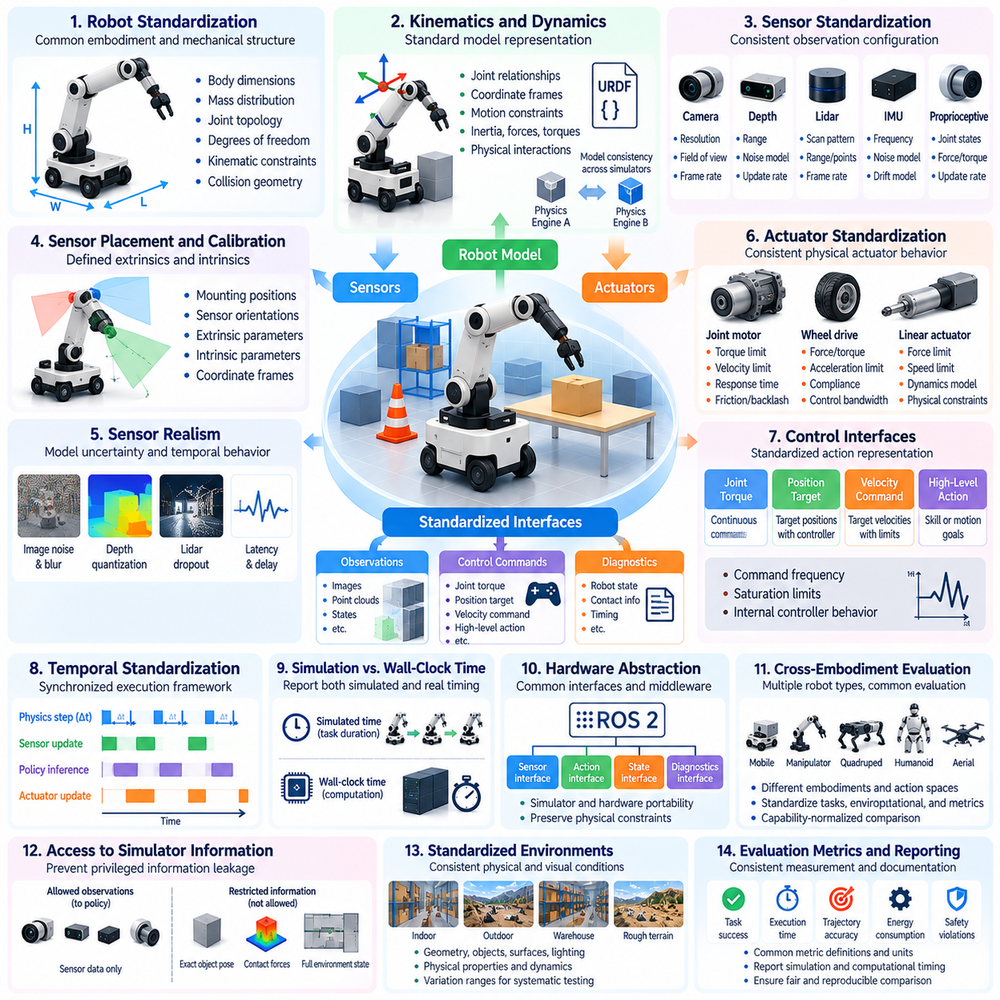{width="7.268055555555556in" height="7.268055555555556in"}

로봇, 센서, 액추에이터 표준화(Robot, Sensor, and Actuator Standardization)는 피지컬 인공지능(Physical AI)에서 공정하고 재현 가능한 시뮬레이션 벤치마크(Simulation Benchmark)를 구축하는 데 필수적이다. 로봇 형상, 감지 능력, 액추에이터 동역학(Actuator Dynamics), 제어 인터페이스(Control Interface)의 차이는 측정된 성능에 상당한 영향을 미칠 수 있다. 표준화는 평가 결과가 시뮬레이션 하드웨어 구성의 통제되지 않은 차이가 아니라 지능형 알고리즘의 능력을 반영하도록 공통 실험 조건을 정의한다.

로봇 표준화(Robot Standardization)는 물리적 구현 형태(Physical Embodiment)와 기계적 구조(Mechanical Structure)에 대한 명시적인 설명에서 시작된다. 관련 매개변수에는 본체 치수(Body Dimension), 질량 분포(Mass Distribution), 관절 토폴로지(Joint Topology), 자유도(Degrees of Freedom), 운동학적 제약조건(Kinematic Constraint), 충돌 형상(Collision Geometry)이 포함된다. 이러한 특성은 로봇이 주변 환경과 어떻게 움직이고 상호작용하는지 결정한다. 일관된 로봇 명세는 연구자가 실험을 재현하고 알고리즘 개선과 기계적 이점을 구분할 수 있도록 한다.

로봇 모델(Robot Model)은 표준화된 운동학적 표현(Kinematic Representation)과 동역학적 표현(Dynamic Representation)을 포함해야 한다. 운동학적 설명은 관절 관계, 좌표 프레임(Coordinate Frame), 운동 제약조건(Motion Constraint)을 정의하며, 동역학 모델(Dynamic Model)은 관성, 힘, 토크, 물리적 상호작용을 표현한다. URDF(Unified Robot Description Format)와 관련 시뮬레이션 기술 형식(Simulation Description Format)은 일관된 모델 교환을 지원한다. 그러나 동일한 모델 파일을 사용한다고 해서 서로 다른 물리 엔진(Physics Engine)에서 동일한 동작이 보장되는 것은 아니다.

센서 표준화(Sensor Standardization)는 평가 대상 정책에 일관된 관측 조건(Observation Condition)을 제공한다. 카메라 해상도(Camera Resolution), 시야각(Field of View), 깊이 범위(Depth Range), 라이다 스캐닝 특성(LiDAR Scanning Characteristics), 관성 측정 주파수(Inertial Measurement Frequency), 고유수용성 피드백(Proprioceptive Feedback)을 문서화해야 한다. 이러한 매개변수는 인식과 의사결정에 사용할 수 있는 정보에 영향을 미친다. 표준화된 센서 구성이 없으면 성능 차이가 우수한 지능이 아니라 불균등한 관측 품질에서 발생할 수 있다.

센서 배치(Sensor Placement)와 좌표 보정(Coordinate Calibration)도 마찬가지로 중요하다. 카메라 장착 위치, 라이다 방향, 센서 기준선(Sensor Baseline), 기준 좌표 프레임(Reference Frame) 사이의 변환은 환경 정보를 어떻게 인식하는지 결정한다. 작은 구성 차이도 물체 감지(Object Detection), 위치 추정(Localization), 조작 정확도(Manipulation Accuracy)에 영향을 미칠 수 있다. 따라서 벤치마크 명세에는 센서 외부 파라미터(Sensor Extrinsics), 내부 보정 매개변수(Intrinsic Calibration Parameter), 좌표 프레임 규약(Coordinate-Frame Convention)이 포함되어야 한다.

현실적인 센서 모델(Realistic Sensor Model)은 측정 불확실성(Measurement Uncertainty)과 시간적 동작(Temporal Behavior)을 고려해야 한다. 영상 잡음(Image Noise), 깊이 양자화(Depth Quantization), 움직임 흐림(Motion Blur), 라이다 데이터 누락(LiDAR Dropout), 관성 드리프트(Inertial Drift), 통신 지연(Communication Delay)은 자율적 의사결정에 영향을 미칠 수 있다. 표준화된 잡음 분포(Noise Distribution)와 갱신 주기(Update Rate)는 불완전한 관측 조건에서 일관된 평가를 가능하게 한다. 이상화된 센서(Idealized Sensor)는 진단 실험에 유용할 수 있지만, 잘못된 비교를 방지하기 위해 사용 여부를 명확하게 밝혀야 한다.

액추에이터 표준화(Actuator Standardization)는 제어 명령(Control Command)이 물리적 움직임을 생성하는 방식을 정의한다. 관절 모터(Joint Motor), 휠 구동장치(Wheel Drive), 유압 시스템(Hydraulic System), 기타 액추에이터에는 토크, 힘, 속도, 가속도, 응답시간(Response Time)에 대한 한계가 존재한다. 이러한 동작은 마찰, 백래시(Backlash), 순응성(Compliance), 제어 대역폭(Control Bandwidth)의 영향을 받을 수도 있다. 액추에이터의 차이는 안정성, 정밀도, 작업 완료에 영향을 미칠 수 있으므로 이러한 특성을 일관되게 표현해야 한다.

제어 인터페이스(Control Interface)는 서로 다른 정책이 다양한 행동 표현(Action Representation)을 통해 작동할 수 있기 때문에 특별한 주의가 필요하다. 일부 알고리즘은 관절 토크(Joint Torque)를 생성하고, 다른 알고리즘은 위치 목표(Position Target), 속도 명령(Velocity Command), 상위 수준의 동작 목표(High-Level Motion Goal)를 출력한다. 벤치마크는 허용된 제어 모드(Control Mode), 명령 주파수(Command Frequency), 포화 한계(Saturation Limit), 내부 제어기 동작(Internal Controller Behavior)을 명시해야 한다. 그렇지 않으면 저수준 제어(Low-Level Control)의 숨겨진 차이가 상당한 평가상의 이점을 만들어낼 수 있다.

시간적 표준화(Temporal Standardization)는 감지, 계산, 구동을 공통 실행 프레임워크(Common Execution Framework) 안에서 연결한다. 물리 적분 시간 간격(Physics Integration Step), 센서 샘플링 간격(Sensor Sampling Interval), 정책 추론 주파수(Policy Inference Frequency), 액추에이터 갱신 주기(Actuator Update Rate)를 명시적으로 정의해야 한다. 비동기 동작(Asynchronous Operation)은 지연과 오래된 관측값(Stale Observation)을 발생시킬 수 있다. 벤치마크 설계자는 시간 처리가 동기식(Synchronized)인지 이벤트 기반(Event-Driven)인지 결정하고 모든 평가 대상 시스템이 호환 가능한 시간 가정을 따르도록 해야 한다.

성능을 보고할 때 시뮬레이션 시간(Simulation Time)과 실제 경과시간(Wall-Clock Time)을 구분해야 한다. 정책이 가상 작업을 빠르게 완료하더라도 실제 하드웨어에서는 상당한 계산 시간이 필요할 수 있다. 반대로 가속 시뮬레이션(Accelerated Simulation)은 실시간 실행 제약조건(Real-Time Execution Constraint)을 숨길 수 있다. 표준화된 벤치마크는 특히 자원이 제한된 로봇 플랫폼(Resource-Constrained Robotic Platform)에 배포할 정책을 평가할 때 시뮬레이션 지속시간과 관련 계산 시간을 별도로 보고해야 한다.

하드웨어 추상화(Hardware Abstraction)는 로봇 플랫폼과 시뮬레이션 환경 사이의 이식성(Portability)을 향상시킬 수 있다. 센서 관측값, 액추에이터 명령, 로봇 상태(Robot State), 진단 정보(Diagnostic Information)에 대한 표준 인터페이스는 특정 시뮬레이터에 대한 의존성을 줄인다. ROS 2와 같은 미들웨어 시스템(Middleware System)은 인터페이스 일관성을 지원할 수 있지만 추가적인 규약이 여전히 필요하다. 추상화는 로봇 능력에 영향을 미치는 차이를 숨기는 것이 아니라 물리적으로 의미 있는 제약조건을 유지해야 한다.

서로 다른 로봇 구현 형태 간 평가(Cross-Embodiment Evaluation)는 추가적인 표준화 과제를 도입한다. 이동 로봇(Mobile Robot), 매니퓰레이터(Manipulator), 사족보행 로봇(Quadruped Robot), 휴머노이드(Humanoid), 비행 로봇(Aerial Robot)은 근본적으로 서로 다른 기계적 구조와 행동 공간(Action Space)을 가진다. 따라서 동일한 하드웨어 명세는 가능하지도 바람직하지도 않다. 대신 벤치마크는 구현 형태별 특성(Embodiment-Specific Characteristics)을 유지하면서 작업 목표, 환경 조건, 측정 정의, 능력 정규화 비교(Capability-Normalized Comparison)를 표준화할 수 있다.

표준화는 시뮬레이터의 특권적 정보(Privileged Simulator Information)에 대한 접근도 다루어야 한다. 명시적으로 허용되지 않는 한 정책은 정확한 물체 자세(Object Pose), 접촉 상태(Contact State), 전역 환경 지도(Global Environmental Map)를 제공받아서는 안 된다. 진단 시스템(Diagnostic System)은 점수 산정과 분석을 위해 실제 기준 데이터(Ground-Truth Data)를 사용할 수 있지만, 정책 관측값(Policy Observation)은 이와 분리되어야 한다. 이를 통해 알고리즘이 시뮬레이터 전용 인터페이스나 숨겨진 상태 정보를 이용하여 비현실적인 이점을 얻는 것을 방지할 수 있다.

모델 충실도(Model Fidelity)와 매개변수 불확실성(Parameter Uncertainty)은 표준화된 구성과 함께 문서화해야 한다. 명목상 동일한 로봇 모델이라도 마찰계수(Friction Coefficient), 접촉 해석기(Contact Solver), 액추에이터 지연(Actuator Delay), 수치 적분 방법(Numerical Integration Method)이 변경되면 다르게 동작할 수 있다. 벤치마크 설계자는 민감한 매개변수를 식별하고 허용 가능한 오차 범위(Acceptable Tolerance)를 정의해야 한다. 불확실성을 피할 수 없는 경우 통제된 매개변수 변화(Controlled Parameter Variation)를 통해 성능이 강건하게 유지되는지 확인할 수 있다.

보정 절차(Calibration Procedure)는 일관성을 유지하기 위한 실용적인 메커니즘을 제공한다. 표준 시험 동작(Standard Test Motion), 센서 기준 표적(Sensor Reference Target), 액추에이터 응답 측정(Actuator Response Measurement), 접촉 실험(Contact Experiment)을 통해 시뮬레이션 구성요소가 예상된 동작을 충족하는지 검증할 수 있다. 보정 결과는 모델 버전(Model Version)과 시뮬레이터 설정(Simulator Setting)과 함께 기록해야 한다. 이러한 절차는 벤치마크 점수를 알고리즘 역량(Algorithmic Competence)의 근거로 해석하기 전에 구성 오류(Configuration Error)를 식별하는 데 도움이 된다.

계산 집약적인 피지컬 인공지능 정책을 비교할 때는 자원 표준화(Resource Standardization)도 중요하다. 프로세서 성능(Processor Capability), GPU 가속(GPU Acceleration), 메모리 가용성(Memory Availability), 추론 스케줄링(Inference Scheduling)의 차이는 제어 지연시간(Control Latency)과 달성 가능한 행동 주파수(Action Frequency)에 영향을 미칠 수 있다. 벤치마크는 계산 자원(Computational Resource)을 문서화하고 필요한 경우 평가 예산(Evaluation Budget)을 설정해야 한다. 비교 과정에서는 지능적 행동의 개선과 추가 계산 능력으로 얻은 이점을 구분해야 한다.

강건한 벤치마크(Robust Benchmark)는 고정 참조 하드웨어 평가(Fixed-Reference Hardware Evaluation)와 구성 가능한 하드웨어 평가(Configurable Hardware Evaluation)를 모두 지원해야 한다. 고정 참조 구성은 동일한 로봇, 센서, 액추에이터 모델을 사용하여 통제된 비교를 제공한다. 구성 가능한 평가는 서로 다른 하드웨어 능력과 운영 제약조건에 대한 적응을 조사할 수 있도록 한다. 이러한 결과를 별도로 보고하면 공정성을 유지하면서 전이 가능성(Transferability)과 하드웨어-소프트웨어 공동 설계(Hardware-Software Co-Design)를 연구할 수 있다.

로봇 기술 파일(Robot Description), 센서 모델, 액추에이터 매개변수 또는 시뮬레이션 엔진(Simulation Engine)의 변경은 벤치마크 결과를 변화시킬 수 있으므로 버전 관리(Version Management)가 필요하다. 각 평가는 모델 버전, 구성 파일(Configuration File), 소프트웨어 의존성(Software Dependency), 관련 보정 설정(Calibration Setting)을 식별해야 한다. 자동 검증(Automated Validation)은 호환되지 않는 변경을 감지하고 서로 다른 실험 조건 사이에서 의도하지 않은 비교가 발생하는 것을 방지할 수 있다. 재현 가능한 구성 관리(Reproducible Configuration Management)는 벤치마크의 장기적인 신뢰성을 지원한다.

궁극적으로 로봇, 센서, 액추에이터 표준화는 피지컬 인공지능 시스템을 평가하기 위한 공통 기술 기반(Common Technical Foundation)을 형성한다. 이는 실험 전반에서 어떤 물리적 특성, 관측 인터페이스(Observation Interface), 제어 메커니즘(Control Mechanism), 시간적 가정(Timing Assumption)을 공유하는지 확립한다. 명시적인 명세, 보정된 모델(Calibrated Model), 통제된 변동성(Controlled Variability), 투명한 보고(Transparent Reporting)를 결합함으로써 시뮬레이션 벤치마크는 다양한 로봇 구현 형태와 지능형 제어 아키텍처(Intelligent Control Architecture)의 다양성을 유지하면서 더욱 신뢰할 수 있는 비교 결과를 제공할 수 있다.

## 02.05. Physics and Sensor Fidelity

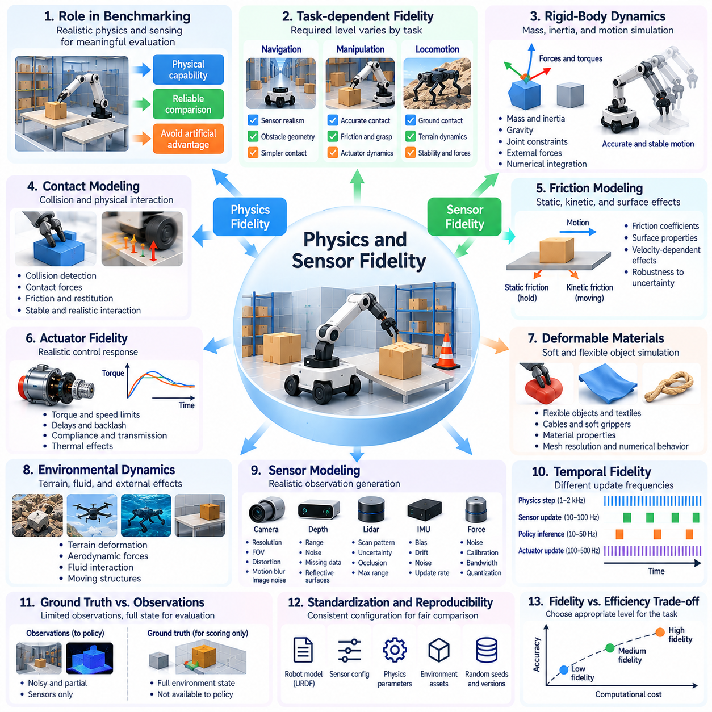{width="7.268055555555556in" height="7.268055555555556in"}

물리 충실도(Physics Fidelity)와 센서 충실도(Sensor Fidelity)는 피지컬 인공지능(Physical AI)을 위한 시뮬레이션 벤치마크(Simulation Benchmark)의 타당성을 결정하는 핵심 요소이다. 물리 충실도는 시뮬레이터가 기계적 상호작용(Mechanical Interaction)과 동적 거동(Dynamic Behavior)을 얼마나 정확하게 재현하는지를 나타내며, 센서 충실도는 가상 센싱 시스템(Virtual Sensing System)이 생성하는 관측값의 현실성을 의미한다. 두 요소 모두 벤치마크 결과가 의미 있는 물리적 능력을 나타내는지, 아니면 단순화된 시뮬레이션 모델에서 발생하는 인위적인 이점을 반영하는지에 영향을 미친다.

요구되는 충실도 수준(Fidelity Level)은 평가 목표(Evaluation Objective)와 관련된 물리적 과정(Physical Process)에 따라 달라진다. 내비게이션 작업(Navigation Task)은 단순화된 접촉 모델(Contact Model)을 허용할 수 있지만, 현실적인 센서 가시성(Sensor Visibility)과 장애물 형상(Obstacle Geometry)이 필요하다. 조작(Manipulation)과 이동 동작(Locomotion) 작업은 정확한 마찰, 접촉력(Contact Force), 액추에이터 동역학(Actuator Dynamics)을 요구하는 경우가 많다. 벤치마크 설계자는 측정 대상 행동에 직접적인 영향을 미치는 물리적 및 지각적 특성(Perceptual Characteristics)을 우선적으로 고려해야 한다.

강체 동역학(Rigid-Body Dynamics)은 많은 로봇 시뮬레이션 환경의 기반을 제공한다. 질량(Mass), 관성(Inertia), 중력(Gravity), 관절 제약조건(Joint Constraint), 외력(External Force)을 정확하게 표현하는 것은 로봇과 물체가 어떻게 가속하고 회전하며 상호작용하는지를 결정한다. 수치 적분 방법(Numerical Integration Method)은 이러한 동역학을 이산적인 시간 간격(Discrete Time Interval)으로 근사한다. 적분 오차(Integration Error)나 부적절한 해석기 설정(Solver Setting)은 특히 빠르거나 접촉이 많은 동작에서 불안정성을 유발하고 측정된 성능을 왜곡할 수 있다.

접촉 모델링(Contact Modeling)은 물리적 상호작용이 작업 성공을 결정하는 경우가 많기 때문에 특히 중요하다. 충돌 감지(Collision Detection), 접촉 침투(Contact Penetration), 수직 접촉력(Normal Force), 마찰력(Frictional Force), 반발계수(Restitution)는 파지(Grasping), 밀기(Pushing), 보행(Walking), 물체 배치(Object Placement)에 영향을 미친다. 단순화된 접촉 해석기(Contact Solver)는 비현실적인 안정성이나 과도한 에너지 소산(Energy Dissipation)을 발생시킬 수 있다. 따라서 벤치마크 명세(Benchmark Specification)에는 접촉 알고리즘과 관련 해석기 매개변수를 문서화해야 한다.

마찰 모델링(Friction Modeling)은 실제 표면이 정지 마찰(Static Friction), 운동 마찰(Kinetic Friction), 경우에 따라 속도 의존적 효과(Velocity-Dependent Effect)를 포함하는 복잡한 상호작용을 나타내기 때문에 신중하게 고려해야 한다. 로봇은 시뮬레이션에서는 안정적으로 보이지만 실제 재료에서는 미끄러질 수 있으며, 반대로 충분한 실제 접지력(Traction)을 가지고 있음에도 가상 환경에서는 실패할 수 있다. 평가는 마찰계수(Friction Coefficient)에 대한 민감도를 조사하고, 정상 조건에서의 성능과 불확실한 표면 조건에서의 강건성(Robustness)을 구분해야 한다.

액추에이터 충실도(Actuator Fidelity)는 시뮬레이션된 제어 명령(Control Command)을 현실적인 기계적 응답(Mechanical Response)과 연결한다. 모터(Motor)와 동력 전달장치(Transmission)는 토크 한계(Torque Limit), 속도 제약조건(Speed Constraint), 지연(Delay), 백래시(Backlash), 순응성(Compliance), 열적 효과(Thermal Effect)를 나타낸다. 이러한 특성을 무시하면 실제 하드웨어가 실행할 수 없는 공격적인 제어 정책(Aggressive Control Policy)이 실현 가능한 것처럼 보일 수 있다. 시뮬레이션 액추에이터는 불필요한 복잡성을 추가하지 않으면서 벤치마크와 관련된 주요 응답 특성을 재현해야 한다.

변형 가능한 재료(Deformable Material)는 강체 가정(Rigid-Body Assumption)만으로 모든 상호작용을 표현할 수 없기 때문에 추가적인 과제를 제시한다. 유연한 물체(Flexible Object), 케이블(Cable), 소프트 그리퍼(Soft Gripper), 직물(Textile), 순응성 표면(Compliant Surface)은 변형(Deformation)과 분산 접촉(Distributed Contact)에 대한 표현이 필요하다. 이러한 모델의 수치적 거동(Numerical Behavior)은 메시 해상도(Mesh Resolution)와 재료 매개변수(Material Parameter)에 크게 의존할 수 있다. 벤치마크 설계자는 단순화된 변형 모델이 의미 있는 평가에 필요한 작업 특성을 유지하는지 판단해야 한다.

환경 동역학(Environmental Dynamics)도 물리 충실도에 기여한다. 지형 변형(Terrain Deformation), 표면 불규칙성(Surface Irregularity), 공기역학적 힘(Aerodynamic Force), 유체 상호작용(Fluid Interaction), 움직이는 구조물(Moving Structure)은 로봇 행동에 영향을 미칠 수 있다. 이러한 요소의 중요성은 이동 로봇(Mobile Robot), 비행 시스템(Aerial System), 수중 플랫폼(Underwater Platform), 매니퓰레이터(Manipulator)에 따라 달라진다. 시뮬레이션 벤치마크는 어떤 환경적 과정이 명시적으로 모델링되고 어떤 과정이 근사되거나 평가 범위에서 제외되는지 식별해야 한다.

센서 충실도(Sensor Fidelity)는 자율 시스템(Autonomous System)이 시뮬레이션 환경을 얼마나 현실적으로 인식하는지를 결정한다. 가상 카메라(Virtual Camera), 깊이 센서(Depth Sensor), 라이다(LiDAR), 관성 측정 시스템(Inertial Measurement System), 힘 센서(Force Sensor)는 시뮬레이션된 물리적 상태를 관측값(Observation)으로 변환한다. 완벽한 관측값(Perfect Observation)은 인식과 계획을 비현실적으로 단순화할 수 있다. 의미 있는 벤치마크는 의도한 운영 영역(Operational Domain)에서 의사결정에 영향을 미치는 센싱 한계(Sensing Limitation)를 모델링해야 한다.

카메라 충실도(Camera Fidelity)는 시각적으로 설득력 있는 영상을 생성하는 것 이상의 의미를 가진다. 해상도(Resolution), 초점거리(Focal Length), 시야각(Field of View), 노출(Exposure), 렌즈 왜곡(Lens Distortion), 롤링 셔터(Rolling Shutter), 움직임 흐림(Motion Blur), 영상 잡음(Image Noise)은 컴퓨터 비전(Computer Vision) 성능에 영향을 미친다. 사실적 렌더링(Photorealistic Rendering)은 시각적 유사성을 높일 수 있지만 외형만으로 센서 정확도(Sensor Accuracy)가 보장되는 것은 아니다. 벤치마크 설계자는 렌더링 현실성(Rendering Realism)과 카메라 측정값의 통계적 및 기하학적 특성을 구분해야 한다.

깊이 센서와 라이다 충실도(Depth and LiDAR Fidelity)는 거리 측정 특성(Range Measurement Characteristics)을 정확하게 처리해야 한다. 각도 해상도(Angular Resolution), 측정 불확실성(Measurement Uncertainty), 최대 감지 거리(Maximum Sensing Distance), 반사 표면(Reflective Surface), 가림 현상(Occlusion), 반환 신호 누락(Missing Return)은 지도 작성(Mapping)과 장애물 감지(Obstacle Detection)에 영향을 미칠 수 있다. 단순화된 광선 기반 센싱(Ray-Based Sensing)은 중요한 재료 의존적 효과(Material-Dependent Effect)를 생략할 수 있다. 평가 프로토콜(Evaluation Protocol)은 이러한 한계가 표현되는지, 그리고 정책에 제공되는 관측값에 어떤 영향을 미치는지 명시해야 한다.

관성 센싱(Inertial Sensing)과 고유수용성 센싱(Proprioceptive Sensing)은 현실적인 시간 특성과 잡음 특성을 요구한다. 가속도계(Accelerometer), 자이로스코프(Gyroscope), 관절 엔코더(Joint Encoder), 힘 센서(Force Sensor)는 바이어스(Bias), 드리프트(Drift), 양자화(Quantization), 필터링(Filtering), 측정 지연(Measurement Delay)을 나타낼 수 있다. 이러한 효과는 위치 추정(Localization)과 피드백 제어(Feedback Control) 과정에서 누적된다. 표준화된 센서 모델(Standardized Sensor Model)은 평가 대상 시스템 전반에서 일관된 샘플링 주기(Sampling Rate)와 보정 가정(Calibration Assumption)을 유지하면서 관련 불확실성을 반영해야 한다.

시간적 충실도(Temporal Fidelity)는 물리적 과정, 센서 측정, 제어 결정이 서로 다른 주파수에서 발생하기 때문에 필수적이다. 시뮬레이션 시간 간격(Simulation Time Step), 센서 갱신 간격(Sensor Update Interval), 통신 지연(Communication Delay), 정책 추론 주기(Policy Inference Period)는 정보가 시스템을 통해 전달되는 방식을 결정한다. 비현실적으로 동기화된 관측값은 시간 관련 실패(Timing-Related Failure)를 숨길 수 있다. 벤치마크는 이러한 특성이 작업 실행에 영향을 미치는 경우 지연시간(Latency)과 비동기 동작(Asynchronous Behavior)을 명시적으로 표현해야 한다.

물리 충실도와 센서 충실도는 함께 고려해야 한다. 접촉 동역학(Contact Dynamics)은 힘 측정값(Force Measurement)에 영향을 미치고, 로봇 움직임은 카메라 관측값(Camera Observation)을 변화시키며, 진동(Vibration)은 관성 센싱에 영향을 미친다. 하나의 시뮬레이션 구성요소에서 발생한 오류는 폐루프 상호작용(Closed-Loop Interaction)을 통해 다른 구성요소로 전파될 수 있다. 따라서 물리 동역학과 센서 모델을 독립적으로 평가하면 자율 동작 중에 나타나는 중요한 시스템 수준의 불일치(System-Level Discrepancy)를 놓칠 수 있다.

충실도 검증(Fidelity Validation)에는 적절한 물리적 기준 측정값(Physical Reference Measurement)과의 비교가 필요하다. 로봇 궤적(Robot Trajectory), 접촉력(Contact Force), 액추에이터 응답(Actuator Response), 센서 잡음 분포(Sensor Noise Distribution), 시간적 동작(Timing Behavior)을 실험적으로 측정하고 시뮬레이션 출력과 비교할 수 있다. 검증은 벤치마크 목표와 관련된 물리량에 중점을 두어야 한다. 소수의 정상 조건(Nominal Condition)에서 결과가 일치한다고 해서 가능한 모든 운영 상황에서 정확성이 확보되는 것은 아니다.

매개변수 보정(Parameter Calibration)은 시뮬레이션 특성을 관측된 물리적 거동(Observed Physical Behavior)에 맞게 조정하여 충실도를 향상시킨다. 질량 분포(Mass Distribution), 마찰계수(Friction Coefficient), 모터 응답 매개변수(Motor Response Parameter), 센서 바이어스(Sensor Bias), 잡음 특성(Noise Characteristics)은 실험을 통해 추정할 수 있다. 보정은 문서화된 절차와 독립적인 검증 데이터(Independent Validation Data)를 사용해야 한다. 제한된 관측값에 지나치게 맞추면 보정 실험은 재현하지만 새로운 조건에는 일반화하지 못하는 모델이 생성될 수 있다.

민감도 분석(Sensitivity Analysis)은 어떤 모델링 오류(Modeling Error)가 벤치마크 결론에 실질적인 영향을 미치는지 판단하는 데 도움이 된다. 연구자는 불확실한 물리 및 센서 매개변수를 변화시키면서 성공률(Success Rate), 궤적(Trajectory), 안정성(Stability), 안전성 결과(Safety Outcome)의 변화를 관찰할 수 있다. 큰 성능 변화를 유발하는 매개변수에는 더 많은 모델링 노력이 필요하다. 이러한 접근법은 모든 구성요소에서 동일한 수준의 현실성을 추구하기보다 평가 관련성(Evaluation Relevance)에 따라 시뮬레이션 개발 노력을 배분한다.

높은 충실도(High Fidelity)는 계산상의 상충관계(Computational Tradeoff)를 발생시킨다. 상세한 접촉 해석기(Detailed Contact Solver), 변형체 모델(Deformable-Body Model), 고급 렌더링(Advanced Rendering), 현실적인 센서 처리는 시뮬레이션 처리량(Simulation Throughput)을 상당히 감소시킬 수 있다. 낮은 충실도의 환경(Lower-Fidelity Environment)은 대규모 통계적 평가(Large-Scale Statistical Evaluation)를 지원할 수 있으며, 높은 충실도 구성(Higher-Fidelity Configuration)은 민감한 행동에 대한 표적 검증(Targeted Validation)을 제공한다. 실용적인 벤치마크 프레임워크(Benchmark Framework)는 각 수준의 가정과 결과를 명확하게 구분한다는 조건에서 여러 충실도 수준을 활용할 수 있다.

시뮬레이션과 현실 간 격차(Sim-to-Real Gap)는 충실도 한계를 측정하는 중요한 기준을 제공한다. 시뮬레이션과 실제 작업 결과의 차이는 부정확한 동역학(Inaccurate Dynamics), 센서 모델(Sensor Model), 환경 가정(Environmental Assumption), 또는 이러한 요소 사이의 상호작용에서 발생할 수 있다. 벤치마크 설계자는 시각적으로 현실적인 환경이 전이 가능한 결과(Transferable Result)를 생성한다고 가정하기보다 이러한 불일치를 체계적으로 조사해야 한다. 외부적 신뢰성(External Credibility)을 확보하려면 실세계 검증(Real-World Validation)이 여전히 필요하다.

궁극적으로 물리 충실도와 센서 충실도는 현실성에 대한 추상적인 주장(Abstract Claim of Realism)이 아니라 평가 프레임워크(Evaluation Framework)의 측정 가능한 특성(Measurable Property)으로 다루어야 한다. 그 목적은 자율 행동(Autonomous Behavior)을 결정하는 물리적 및 지각적 관계(Physical and Perceptual Relationship)를 보존하는 것이다. 보정된 모델(Calibrated Model), 명시적인 가정(Explicit Assumption), 민감도 분석(Sensitivity Analysis), 시간적 일관성(Temporal Consistency), 물리적 검증(Physical Validation)을 결합함으로써 시뮬레이션 벤치마크는 불가피한 모델링 불확실성(Modeling Uncertainty)을 인정하면서 피지컬 인공지능 성능에 대한 신뢰할 수 있는 근거를 제공할 수 있다.

## 02.06. Deterministic and Stochastic Benchmarking

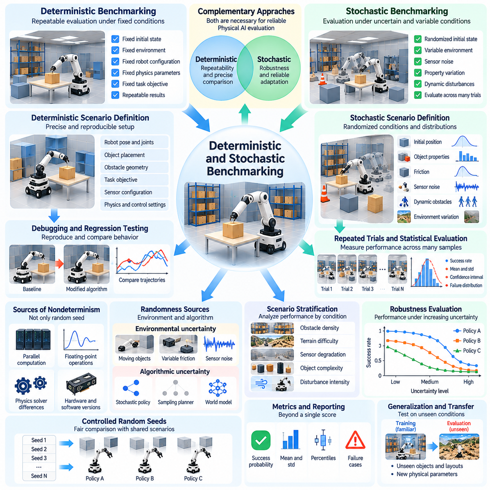{width="7.268055555555556in" height="7.268055555555556in"}

결정론적 벤치마킹(Deterministic Benchmarking)과 확률론적 벤치마킹(Stochastic Benchmarking)은 시뮬레이션 환경에서 피지컬 인공지능(Physical AI) 시스템을 평가하기 위한 상호보완적인 접근법을 제공한다. 결정론적 평가는 고정된 조건에서의 반복 가능성(Repeatability)을 강조하는 반면, 확률론적 평가는 불확실하고 가변적인 상황에서의 성능을 조사한다. 신뢰할 수 있는 물리적 지능(Physical Intelligence)은 알려진 환경에서 일관된 행동을 수행하는 동시에 운영 조건을 정확하게 예측할 수 없는 상황에서도 강건하게 적응해야 하므로 두 접근법 모두 필요하다.

결정론적 벤치마킹은 동일한 시스템이 동일한 행동을 실행할 때 반복 가능한 결과를 생성하는 실험 조건(Experimental Condition)을 확립한다. 로봇 구성(Robot Configuration), 초기 상태(Initial State), 환경 속성(Environmental Property), 시뮬레이션 매개변수(Simulation Parameter)는 고정된 상태로 유지된다. 이러한 접근법은 알고리즘 사이의 통제된 비교(Controlled Comparison)를 가능하게 하고 행동 차이에 대한 정밀한 조사를 지원한다. 재현성(Reproducibility)은 모든 관련 변동 요인(Source of Variation)을 통제하는 데 달려 있다.

결정론적 시나리오(Deterministic Scenario)는 일반적으로 로봇 위치(Robot Position), 관절 상태(Joint State), 물체 배치(Object Placement), 장애물 형상(Obstacle Geometry), 작업 목표(Task Objective)를 명시한다. 센서 구성(Sensor Configuration), 물리 적분 설정(Physics Integration Setting), 제어 주파수(Control Frequency)도 정의된다. 이러한 조건이 변경되지 않으면 연구자는 대안적인 정책(Policy)을 공통 기준(Common Reference)에 따라 비교할 수 있다. 이러한 실험은 소프트웨어 수정이 특정 능력을 개선하거나 저하시키는지 식별하는 데 특히 유용하다.

결정론적 평가(Deterministic Evaluation)는 피지컬 인공지능 개발 전반에서 디버깅(Debugging)과 회귀 테스트(Regression Testing)를 지원한다. 로봇이 물체를 파지하거나 내비게이션 작업(Navigation Task)을 완료하는 데 실패하면 엔지니어는 동일한 조건을 재현하고 결과 궤적(Trajectory)을 분석할 수 있다. 반복 실행은 인식 오류(Perception Error), 계획 실패(Planning Failure), 제어 불안정성(Control Instability)을 분리하여 식별하는 데 도움이 된다. 자동화된 회귀 테스트(Automated Regression Test)는 알고리즘 업데이트 이후 의도하지 않은 성능 변화를 감지할 수 있다.

그러나 난수 시드(Random Seed)를 고정하는 것만으로 결정론적 동작(Deterministic Behavior)이 보장되는 것은 아니다. 병렬 계산(Parallel Computation), 부동소수점 연산(Floating-Point Operation), 비동기 실행(Asynchronous Execution), 물리 해석기 구현(Physics Solver Implementation)은 비결정론적 차이(Nondeterministic Difference)를 발생시킬 수 있다. 하드웨어 플랫폼(Hardware Platform)과 소프트웨어 버전(Software Version)도 수치적 결과에 영향을 미칠 수 있다. 벤치마크 설계자는 실행 환경(Execution Environment)을 문서화하고 정확한 수치적 재현성(Exact Numerical Reproducibility)과 통계적으로 일관된 동작(Statistically Consistent Behavior)을 구분해야 한다.

확률론적 벤치마킹은 작업 실행과 환경 조건에 통제된 불확실성(Controlled Uncertainty)을 도입한다. 초기 위치, 물체 속성(Object Property), 센서 잡음(Sensor Noise), 장애물 움직임(Obstacle Movement), 물리적 매개변수(Physical Parameter)는 지정된 확률분포(Probability Distribution)에서 표본 추출될 수 있다. 확률론적 평가는 하나의 고정된 상황에서 성능을 측정하는 대신 여러 가능한 조건에서 정책이 어떻게 동작하는지 추정한다. 이를 통해 개별 시연을 넘어서는 신뢰성(Reliability)에 대한 근거를 제공한다.

확률분포(Probability Distribution)는 의미 있는 확률론적 평가의 핵심 요소이다. 벤치마크 설계자는 어떤 변수를 무작위화(Randomization)할 것인지, 허용 범위(Allowable Range)는 무엇인지, 변수 사이의 관계는 어떠한지 명시해야 한다. 균등분포(Uniform Distribution)는 광범위한 조건을 포괄할 수 있으며, 응용 분야를 반영한 분포(Application-Informed Distribution)는 예상 운영 조건(Expected Operating Condition)을 근사할 수 있다. 부적절하게 선택된 분포는 비현실적인 시나리오를 생성하거나 중요한 실패 유형(Failure Mode)을 감출 수 있다.

무작위성(Randomness)은 환경적 과정(Environmental Process)과 내부 알고리즘(Internal Algorithm)을 통해 피지컬 인공지능 시스템에 유입될 수 있다. 환경적 불확실성(Environmental Uncertainty)에는 예측하기 어려운 물체 움직임, 가변적인 마찰, 센서 교란(Sensor Disturbance), 인간 행동(Human Behavior)이 포함된다. 알고리즘적 불확실성(Algorithmic Uncertainty)은 확률적 행동 선택(Stochastic Action Selection), 샘플링 기반 계획(Sampling-Based Planning), 확률적 월드 모델(Probabilistic World Model)에서 발생할 수 있다. 평가 프로토콜(Evaluation Protocol)은 성능 변동성(Performance Variability)을 해석할 때 이러한 원인을 구분해야 한다.

반복 시행(Repeated Trial)은 확률론적 성능(Stochastic Performance)을 추정하는 데 필수적이다. 각 시행은 구성이나 교란의 실현값(Disturbance Realization)을 표본 추출하고 성공 여부, 완료 시간(Completion Time), 충돌 빈도(Collision Frequency), 에너지 소비(Energy Consumption)와 같은 측정 가능한 결과를 생성한다. 여러 시행의 결과를 집계하면 평균 성능(Average Performance)과 변동성을 파악할 수 있다. 유리하거나 불리한 무작위 결과에 의해 결론이 좌우되지 않도록 충분히 크고 대표성 있는 표본(Representative Sample)이 필요하다.

통계적 보고(Statistical Reporting)는 단일 평균 점수(Mean Score)를 넘어 확장되어야 한다. 성공 확률(Success Probability), 표준편차(Standard Deviation), 신뢰구간(Confidence Interval), 백분위수(Percentile), 실패 분포(Failure Distribution)는 시스템 동작에 대한 상호보완적인 정보를 제공한다. 두 정책이 유사한 평균 성공률(Average Success Rate)을 달성하더라도 최악 조건의 결과(Worst-Case Outcome)는 크게 다를 수 있다. 벤치마크 보고서는 특히 신뢰성과 안전성(Safety)이 중요한 경우 이러한 차이를 유지해야 한다.

통제된 난수 시드(Controlled Random Seed)는 결정론적 평가와 확률론적 평가를 연결하는 실용적인 수단을 제공한다. 벤치마크는 미리 정해진 시드를 사용하여 다양한 시나리오를 생성할 수 있으며, 이를 통해 서로 다른 알고리즘이 동일하게 표본 추출된 조건을 경험하도록 한다. 이러한 방식은 환경 변동성을 유지하면서 대응 비교(Paired Comparison)를 지원한다. 그러나 고정된 시드 집합(Seed Collection)에 대해 반복적으로 최적화하면 과적합(Overfitting)이 발생할 수 있으므로 독립적인 평가 시드(Independent Evaluation Seed)가 필요하다.

시나리오 계층화(Scenario Stratification)는 확률론적 벤치마크의 해석 가능성(Interpretability)을 향상시킨다. 시행은 장애물 밀도(Obstacle Density), 지형 난이도(Terrain Difficulty), 센서 성능 저하(Sensor Degradation), 물체 복잡도(Object Complexity), 교란 강도(Disturbance Intensity)에 따라 그룹화할 수 있다. 이후 전체 시험 분포(Test Distribution)뿐만 아니라 각 범주 내에서도 성능을 분석할 수 있다. 이를 통해 어떤 운영 조건에서 성능 저하가 발생하는지 확인하고 능력의 한계(Capability Boundary)를 식별할 수 있다.

강건성 평가(Robustness Evaluation)는 불확실성을 점진적으로 증가시키는 방법을 요구하는 경우가 많다. 센서 잡음, 액추에이터 지연(Actuator Delay), 마찰 변화(Friction Variation), 외부 교란(External Disturbance)을 통제된 범위에서 조정할 수 있다. 성능 저하 곡선(Performance Degradation Curve)은 조건이 더욱 까다로워질 때 알고리즘의 효과가 얼마나 빠르게 감소하는지 보여준다. 이러한 분석은 정상적인 가정(Nominal Assumption)에서 좋은 성능을 보이는 정책과 교란 상황에서도 신뢰할 수 있는 정책을 구분한다.

희귀 사건 평가(Rare-Event Evaluation)는 일반적인 무작위 표본 추출(Random Sampling)에서 치명적인 실패가 너무 드물게 발생할 수 있기 때문에 특별한 과제를 제시한다. 표적 시나리오 생성(Targeted Scenario Generation)과 중요도 샘플링(Importance Sampling)은 위험하거나 비정상적인 조건에 대한 노출을 증가시킬 수 있다. 이러한 방법은 실패 발견(Failure Discovery)을 지원하지만, 실제 사건 발생 확률(Real-World Event Probability)을 추정할 때는 사용된 표본 추출 분포(Sampling Distribution)를 고려해야 한다. 스트레스 테스트 실패율(Stress-Test Failure Rate)을 실제 운영 위험 추정치(Operational Risk Estimate)로 자동 해석해서는 안 된다.

결정론적 벤치마크와 확률론적 벤치마크는 폐루프 동작(Closed-Loop Behavior)도 평가해야 한다. 관측값이나 물리적 상태의 작은 차이는 이후 행동을 변화시키고 서로 다른 궤적(Divergent Trajectory)을 생성할 수 있다. 확률적 환경(Stochastic Environment)에서는 이러한 영향이 긴 작업 수행 구간(Long Task Horizon)에 걸쳐 누적될 수 있다. 최종 성공 여부만 측정하면 불안정한 제어(Unstable Control), 반복적인 복구 시도(Repeated Recovery Attempt), 과도한 수정 행동(Excessive Corrective Action)과 같은 중요한 약점을 놓칠 수 있다.

공정한 비교(Fair Comparison)를 위해서는 평가 대상 시스템 전반에 일관된 불확실성 노출(Uncertainty Exposure)이 필요하다. 정책은 동등한 시나리오 분포(Scenario Distribution), 관측 조건(Observation Condition), 행동 제약조건(Action Constraint), 계산 예산(Computational Budget)을 사용하여 시험해야 한다. 대응 시행(Paired Trial)이 적절한 경우 공통 난수(Common Random Number)를 사용하면 비교 분산(Comparison Variance)을 줄일 수 있다. 벤치마크 프로토콜은 인위적인 이점을 발생시킬 수 있는 무작위화 매개변수(Randomization Parameter)나 숨겨진 시뮬레이터 상태(Hidden Simulator State)에 대한 불균등한 접근도 방지해야 한다.

결정론적 평가와 확률론적 평가의 관계는 계층적 방법론(Layered Methodology)으로 이해하는 것이 가장 적절하다. 고정 시나리오(Fixed Scenario)는 기준 정확성(Baseline Correctness)을 확립하고 디버깅을 지원하며, 무작위화된 시나리오(Randomized Scenario)는 변동성, 일반화(Generalization), 강건성을 평가한다. 이후 표적 스트레스 테스트(Targeted Stress Test)는 까다로운 조건과 잠재적인 실패 메커니즘(Failure Mechanism)을 조사한다. 각 계층은 서로 다른 평가 질문에 답하며 시스템 역량(System Competence)에 대한 고유한 근거를 제공한다.

벤치마크 자동화(Benchmark Automation)는 이러한 평가 계층을 대규모로 운영할 수 있도록 한다. 표준화된 구성 파일(Standardized Configuration File)은 고정 시험 사례(Fixed Test Case), 무작위화 분포(Randomization Distribution), 시드 일정(Seed Schedule), 점수 산정 규칙(Scoring Rule)을 정의할 수 있다. 자동 실행 시스템(Automated Execution System)은 수많은 시행에서 궤적, 성능 지표(Performance Metric), 실패 기록(Failure Record)을 수집할 수 있다. 버전 관리된 구성(Versioned Configuration)과 구조화된 로그(Structured Log)는 재현성, 통계 분석(Statistical Analysis), 장기적인 비교를 지원한다.

시뮬레이션과 현실 간 검증(Simulation-to-Reality Validation)은 시뮬레이터 내부에서의 결정론적 반복 가능성과 확률론적 강건성이 실제 물리적 신뢰성을 보장하지 않기 때문에 여전히 필요하다. 실제 환경에는 모델링되지 않은 동역학(Unmodeled Dynamics), 상관된 교란(Correlated Disturbance), 시뮬레이션 분포 밖의 센서 불완전성(Sensor Imperfection)이 존재할 수 있다. 시뮬레이션 성능 분포(Simulated Performance Distribution)와 실제 물리 시험 결과(Physical Test Result)를 비교하면 모델링 결함(Modeling Deficiency)을 식별하고 불확실성 가정(Uncertainty Assumption)을 개선하는 데 도움이 된다.

궁극적으로 결정론적 벤치마킹과 확률론적 벤치마킹은 통합된 피지컬 인공지능 평가 프레임워크(Unified Physical AI Evaluation Framework)에 결합되어야 한다. 결정론적 시험(Deterministic Test)은 반복 가능한 기준 동작(Repeatable Reference Behavior)을 확립하고, 확률론적 실험(Stochastic Experiment)은 불확실성, 신뢰성, 성능 변동(Performance Variation)을 특성화한다. 이러한 방법을 통계적 엄밀성(Statistical Rigor), 통제된 무작위화(Controlled Randomization), 스트레스 테스트(Stress Testing), 실세계 검증(Real-World Validation)과 결합하면 자율적 물리 지능(Autonomous Physical Intelligence)을 평가하기 위한 더욱 견고한 기반을 제공할 수 있다.

## 02.07. Domain Randomized Evaluation

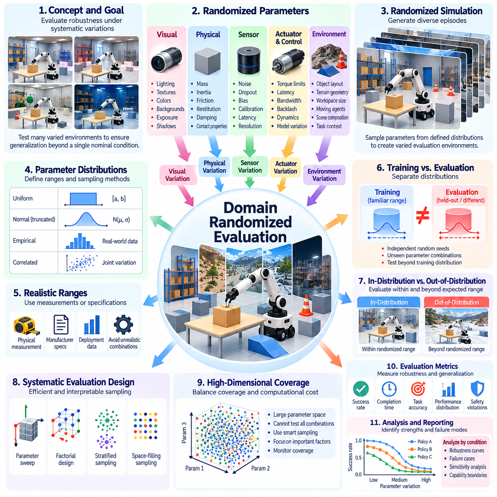{width="7.268055555555556in" height="7.268055555555556in"}

도메인 무작위화 평가(Domain-Randomized Evaluation)는 시뮬레이션된 운영 조건이 여러 차원에서 체계적으로 변화할 때 피지컬 인공지능(Physical AI) 시스템이 어떻게 작동하는지 조사한다. 이 접근법은 단일한 정상 환경(Nominal Environment)에 의존하는 대신 물리적, 시각적, 운영적 매개변수(Operational Parameter)의 다양한 조합을 생성한다. 주요 목적은 학습된 정책(Learned Policy)이 예상 배포 조건(Deployment Condition)과 유사하거나 이를 넘어서는 환경 변화에서도 신뢰할 수 있는 행동을 유지하는지 측정하는 것이다.

도메인 무작위화(Domain Randomization)는 환경 모델(Environment Model) 전반에 걸친 구조화된 변동(Structured Variation)을 강조한다는 점에서 일반적인 확률론적 시험(Stochastic Testing)과 구별된다. 무작위화되는 매개변수에는 물체 형상(Object Geometry), 표면 마찰(Surface Friction), 조명(Lighting), 센서 특성(Sensor Characteristics), 액추에이터 응답(Actuator Response), 장면 구성(Scene Composition)이 포함될 수 있다. 연구자는 평가 에피소드(Evaluation Episode)마다 이러한 속성을 변경하여 알고리즘이 제한된 시뮬레이션 가정에 의존하는지, 아니면 서로 다른 도메인에서도 효과적인 능력을 발휘하는지 조사할 수 있다.

시각적 도메인 무작위화(Visual Domain Randomization)는 반드시 기본적인 물리 구조를 변경하지 않으면서 시뮬레이션 환경의 외관을 변화시킨다. 조명 강도(Lighting Intensity), 그림자 방향(Shadow Direction), 텍스처(Texture), 색상(Color), 배경(Background), 카메라 노출(Camera Exposure)을 변경할 수 있다. 이러한 변화는 인식 시스템(Perception System)이 피상적인 시각 패턴(Superficial Visual Pattern)이 아니라 안정적인 기하학적 정보(Geometric Information)와 의미적 정보(Semantic Information)에 의존하는지 평가하는 데 도움이 된다. 그러나 과도한 시각적 변화는 실제 배포와 관련 없는 조건을 도입할 수 있다.

물리적 도메인 무작위화(Physical Domain Randomization)는 기계적 상호작용(Mechanical Interaction)과 동적 거동(Dynamic Behavior)을 지배하는 매개변수를 변경한다. 질량(Mass), 관성(Inertia), 마찰(Friction), 반발계수(Restitution), 관절 감쇠(Joint Damping), 액추에이터 출력(Actuator Strength), 접촉 특성(Contact Properties)을 정의된 범위에서 표본 추출할 수 있다. 이러한 변화는 운동 안정성(Motion Stability), 조작 정확도(Manipulation Accuracy), 제어 성능(Control Performance)에 영향을 미친다. 평가는 정책이 임의적인 매개변수 변화에서 단순히 살아남는 것이 아니라 물리적으로 타당한 불확실성을 견딜 수 있는지 판단해야 한다.

센서 도메인 무작위화(Sensor Domain Randomization)는 측정 품질(Measurement Quality)과 관측 특성(Observation Characteristics)에 변화를 도입한다. 카메라 잡음(Camera Noise), 깊이 불확실성(Depth Uncertainty), 라이다 데이터 누락(LiDAR Dropout), 관성 바이어스(Inertial Bias), 보정 오프셋(Calibration Offset), 센싱 지연(Sensing Delay)을 시행마다 조정할 수 있다. 이러한 교란(Perturbation)은 인식 및 제어 시스템이 비현실적으로 정밀한 측정값에 의존하는지 드러낸다. 무작위화 범위(Randomization Range)는 센서 명세(Sensor Specification), 실험적 불확실성(Empirical Uncertainty), 또는 명확하게 정의된 스트레스 테스트(Stress Testing) 목표를 반영해야 한다.

액추에이터 및 제어 무작위화(Actuator and Control Randomization)는 하드웨어 응답 차이(Hardware Response Difference)에 대한 민감도를 평가한다. 모터 토크 한계(Motor Torque Limit), 명령 지연시간(Command Latency), 제어 대역폭(Control Bandwidth), 백래시(Backlash), 액추에이터 동역학(Actuator Dynamics)은 시뮬레이션 에피소드마다 달라질 수 있다. 이러한 조건은 제조 공차(Manufacturing Tolerance), 부품 노화(Component Aging), 플랫폼 차이(Platform Difference)를 근사한다. 이러한 변화에서도 효과적인 정책은 더 높은 하드웨어 강건성(Hardware Robustness)을 보여줄 수 있지만, 시뮬레이션에서의 허용 능력이 실제 배포 신뢰성(Deployment Reliability)을 입증하는 것은 아니다.

환경 무작위화(Environmental Randomization)는 개별 물리 매개변수를 넘어 장면 구조(Scene Structure)와 작업 맥락(Task Context)까지 확장된다. 장애물 배치(Obstacle Arrangement), 물체 위치(Object Position), 지형 형상(Terrain Geometry), 작업 공간 치수(Workspace Dimension), 이동 에이전트 동작(Moving-Agent Behavior)을 변경할 수 있다. 이러한 변화는 인식(Perception), 계획(Planning), 물리적 상호작용(Physical Interaction)에 동시에 영향을 미친다. 잘 설계된 벤치마크는 의도한 작업을 유지하는 변화와 작업의 실현 가능성(Task Feasibility)을 근본적으로 변경하는 변화를 구분한다.

무작위화 분포(Randomization Distribution)는 평가 과정에서 어떤 운영 조건에 중점을 둘 것인지 결정한다. 균등 표본 추출(Uniform Sampling)은 광범위한 조건을 포괄하며, 절단 정규분포(Truncated Normal Distribution)나 경험적으로 추정된 분포(Empirically Estimated Distribution)는 예상 변동성을 표현할 수 있다. 실제 조건은 서로 독립적인 경우가 드물기 때문에 매개변수 사이의 상관관계(Correlation)도 고려해야 한다. 예를 들어 표면 재료(Surface Material), 마찰, 반사율(Reflectance), 센서 응답(Sensor Response)은 함께 변화할 수 있다.

매개변수 범위(Parameter Range)는 물리적 측정값(Physical Measurement), 제조업체 명세(Manufacturer Specification), 배포 환경 관측(Deployment Observation), 또는 명시적인 실험 가정(Experimental Assumption)을 통해 정당화해야 한다. 범위가 지나치게 좁으면 취약성(Brittleness)을 감출 수 있으며, 지나치게 넓으면 물리적으로 일관되지 않은 환경을 생성할 수 있다. 벤치마크 문서(Benchmark Documentation)는 정상값(Nominal Value), 허용 구간(Allowable Interval), 표본 추출 방법(Sampling Method), 유효하지 않은 매개변수 조합을 방지하는 제약조건(Constraint)을 명시해야 한다.

오해를 불러일으키는 일반화 주장(Generalization Claim)을 방지하려면 학습 무작위화(Training Randomization)와 평가 무작위화(Evaluation Randomization)를 분리해야 한다. 무작위화된 환경에서 학습한 정책은 실제로 익숙하지 않은 조건에 적응하지 못하더라도 동일한 매개변수 분포에서 높은 성능을 보일 수 있다. 따라서 평가에는 독립적인 난수 시드(Independent Random Seed), 학습에서 제외된 매개변수 조합(Held-Out Parameter Combination), 필요한 경우 학습과 다른 분포를 포함해야 한다. 이러한 분리는 보간(Interpolation) 능력과 더 광범위한 강건성을 구분하는 데 도움이 된다.

분포 내 평가(In-Distribution Evaluation)는 개발 과정에서 예상한 무작위화 범위 안에서 성능을 측정한다. 분포 외 평가(Out-of-Distribution Evaluation)는 해당 범위를 벗어난 조건이나 이전에 관측하지 못한 환경 요인의 조합을 조사한다. 두 평가는 서로 다르지만 모두 유용한 근거를 제공한다. 우수한 분포 내 성능은 예상 변동성 아래에서의 일관성을 나타내며, 성공적인 분포 외 동작(Out-of-Distribution Behavior)은 더 넓은 운영 능력(Operational Capability)을 시사한다.

체계적인 실험 설계(Systematic Experimental Design)는 무작위화 평가의 효율성과 해석 가능성(Interpretability)을 향상시킬 수 있다. 독립적인 매개변수 스윕(Independent Parameter Sweep)은 개별 효과를 분리하며, 요인 설계(Factorial Design)는 변수 사이의 상호작용(Interaction)을 드러낸다. 계층화 표본 추출(Stratified Sampling)과 공간 충전 방법(Space-Filling Method)은 다차원 매개변수 공간(Multidimensional Parameter Space)의 포괄 범위를 개선할 수 있다. 순수 무작위 표본 추출(Pure Random Sampling)도 유용하지만 중요한 조합을 충분히 포함하지 못할 수 있다.

고차원 무작위화(High-Dimensional Randomization)는 가능한 매개변수 조합의 수가 빠르게 증가하기 때문에 상당한 포괄 범위 문제(Coverage Challenge)를 발생시킨다. 모든 구성을 시험하는 것은 일반적으로 비현실적이다. 연구자는 매개변수 다양성(Parameter Diversity), 시행 횟수(Trial Count), 계산 자원(Computational Resource) 사이에서 균형을 유지해야 한다. 적응형 표본 추출(Adaptive Sampling)은 불확실하거나 실패 가능성이 높은 영역에 평가를 집중할 수 있지만, 종합 성능(Aggregate Performance)을 보고할 때는 이로 인해 발생하는 선택 편향(Selection Bias)을 고려해야 한다.

성능은 하나의 평균 점수(Average Score)로 축약하기보다 무작위화된 조건의 함수(Function of Randomized Conditions)로 분석해야 한다. 성공 확률(Success Probability), 완료 시간(Completion Time), 충돌 빈도(Collision Frequency), 추적 오차(Tracking Error), 복구 동작(Recovery Behavior)을 매개변수 범위에 따라 조사할 수 있다. 조건부 성능 분석(Conditional Performance Analysis)은 어떤 환경 요인이 성능 저하를 유발하는지 식별한다. 강건성 프로파일(Robustness Profile)과 최악 영역 통계(Worst-Region Statistics)는 전체 평균(Global Average)이 감출 수 있는 정보를 제공한다.

상관된 무작위화(Correlated Randomization)는 성능 변화의 원인을 불명확하게 만들 수 있으므로 인과적 해석(Causal Interpretation)에 특별한 주의가 필요하다. 내비게이션 실패(Navigation Failure)는 가시성 감소(Reduced Visibility), 마찰 변화(Altered Friction), 또는 두 요인의 결합 효과(Combined Effect)에서 발생할 수 있다. 통제된 제거 실험(Controlled Ablation Experiment)은 개별 요인을 분리하고 상호작용을 드러낼 수 있다. 이러한 분석은 인식 한계(Perception Limitation), 제어 취약점(Control Weakness), 통합 시스템 동작(Integrated System Behavior)에서 발생하는 실패를 구분하는 데 도움이 된다.

도메인 무작위화는 적응 메커니즘(Adaptation Mechanism)의 평가도 지원한다. 일부 정책은 내부 매개변수(Internal Parameter)를 수정하지 않고 작동하지만, 다른 정책은 온라인 시스템 식별(Online System Identification), 메모리(Memory), 적응 제어(Adaptive Control)를 사용하여 변화하는 조건에 대응한다. 벤치마크는 적응이 허용되는지, 어느 정도의 관측 이력(Observation History)을 사용할 수 있는지, 환경 매개변수가 에피소드 동안 고정되는지 또는 변화하는지 명시해야 한다.

동적 도메인 무작위화(Dynamic Domain Randomization)는 작업이 실행되는 동안 변화를 도입한다. 표면 마찰이 달라지거나 조명이 변하고, 센서 품질이 저하되거나 액추에이터 응답이 예기치 않게 변화할 수 있다. 이러한 실험은 비정상 조건(Nonstationary Condition)에서의 복구(Recovery)와 적응(Adaptation)을 평가한다. 이는 매개변수를 처음에 표본 추출한 뒤 실행 전체에서 일정하게 유지하는 에피소드 수준 무작위화(Episode-Level Randomization)와 구분해야 한다.

재현성(Reproducibility)을 확보하려면 무작위화 구성(Randomization Configuration)과 표본 추출된 매개변수 값(Sampled Parameter Value)을 완전하게 기록해야 한다. 평가 시스템(Evaluation System)은 분포 정의(Distribution Definition), 난수 시드(Random Seed), 시뮬레이터 버전(Simulator Version), 에피소드 식별자(Episode Identifier), 결과 성능 측정값(Performance Measurement)을 저장해야 한다. 공통 시나리오 집합(Common Scenario Set)은 대응 알고리즘 비교(Paired Algorithm Comparison)를 가능하게 한다. 독립적인 비공개 평가 집합(Hidden Evaluation Set)은 과적합(Overfitting)을 줄이면서 과학적 검증(Scientific Verification)에 필요한 투명성을 유지할 수 있다.

실세계 검증(Real-World Validation)은 무작위화된 시뮬레이션 조건이 의미 있는 물리적 불확실성(Physical Uncertainty)을 나타내는지 판단하는 데 필수적이다. 측정된 센서 오류(Sensor Error), 마찰 변화(Friction Variation), 환경 다양성(Environmental Diversity), 액추에이터 응답(Actuator Response)은 분포 설계(Distribution Design)에 활용될 수 있다. 대응되는 조건에서 시뮬레이션 성능과 실제 물리적 성능을 비교하면 누락된 요인을 식별하는 데 도움이 된다. 도메인 무작위화는 강건성 평가(Robustness Assessment)를 개선할 수 있지만, 중요한 실세계 효과가 모델링되지 않은 경우 현실로의 전이(Transfer)를 보장할 수 없다.

궁극적으로 도메인 무작위화 평가는 피지컬 인공지능 시스템의 환경 변화 허용 능력(Environmental Tolerance)과 일반화(Generalization)를 측정하기 위한 구조화된 방법을 제공한다. 그 가치는 물리적으로 정당화된 분포(Physically Justified Distribution), 충분한 매개변수 포괄 범위(Parameter Coverage), 독립적인 평가 조건(Independent Evaluation Condition), 투명한 통계적 보고(Statistical Reporting)에 달려 있다. 통제된 벤치마크(Controlled Benchmark)와 실세계 검증을 결합하면 자율 행동(Autonomous Behavior)이 제한적으로 정의된 시뮬레이션 환경을 벗어나서도 신뢰할 수 있는지 확인하는 데 도움이 된다.

## 02.08. Perception and State Estimation Benchmarks

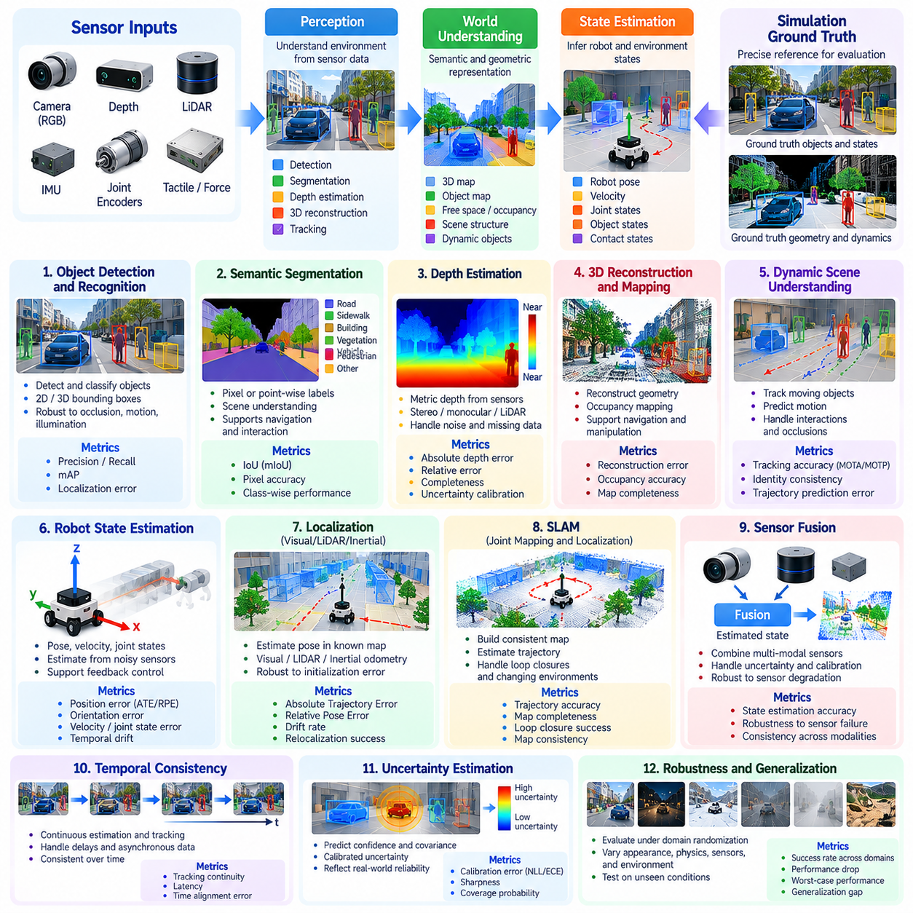{width="7.268055555555556in" height="7.268055555555556in"}

인식 및 상태 추정 벤치마크(Perception and State Estimation Benchmarks)는 피지컬 인공지능(Physical AI) 시스템이 센서 관측값(Sensory Observation)을 얼마나 정확하게 해석하고 로봇과 주변 환경의 상태를 추론하는지 평가한다. 인식(Perception)은 원시 센서 측정값(Raw Sensor Measurement)을 의미 있는 환경 표현(Environmental Representation)으로 변환하며, 상태 추정(State Estimation)은 직접 관측할 수 없는 물리량을 복원한다. 시뮬레이션(Simulation)은 다양한 운영 조건에서 정확도(Accuracy), 불확실성(Uncertainty), 시간적 일관성(Temporal Consistency), 강건성(Robustness)을 측정하기 위한 통제된 실제 기준 데이터(Ground Truth)를 제공한다.

인식 벤치마킹(Perception Benchmarking)은 로봇 시스템이 환경에서 추출해야 하는 정보를 정의하는 것에서 시작된다. 관련 작업에는 물체 감지(Object Detection), 의미론적 분할(Semantic Segmentation), 깊이 추정(Depth Estimation), 표면 재구성(Surface Reconstruction), 장애물 인식(Obstacle Recognition), 공간 관계 식별(Spatial Relationship Identification)이 포함된다. 각 작업에는 명시적인 입력 모달리티(Input Modality)와 기준 주석(Reference Annotation)이 필요하다. 벤치마크 설계는 시각적 인식 성능만이 아니라 물리적 상호작용에 필요한 정보를 반영해야 한다.

물체 감지 및 인식 벤치마크(Object Detection and Recognition Benchmarks)는 로봇이 관련 객체를 식별하고 위치를 결정할 수 있는지 측정한다. 일반적인 평가 지표(Metric)에는 정밀도(Precision), 재현율(Recall), 평균 정밀도(Average Precision), 위치 추정 오차(Localization Error)가 포함된다. 로봇 응용에서는 부분 가림(Partial Occlusion), 움직임(Motion), 비정상적인 관측 시점(Unusual Viewpoint), 조명 변화(Changing Illumination)에서도 감지 품질을 평가해야 한다. 시각적으로 정확한 감지 결과라도 공간적 및 시간적 특성이 신뢰할 수 있는 행동을 지원할 때만 실질적으로 유용하다.

의미론적 및 기하학적 인식 벤치마크(Semantic and Geometric Perception Benchmarks)는 시스템이 센서 데이터로부터 의미 있는 구조를 얼마나 정확하게 재구성하는지 평가한다. 의미론적 분할(Semantic Segmentation)은 영상 영역이나 공간 점(Spatial Point)에 범주를 할당하며, 기하학적 재구성(Geometric Reconstruction)은 표면, 점유 상태(Occupancy), 물체 경계(Object Boundary)를 추정한다. 교집합 대비 합집합(Intersection over Union), 재구성 오차(Reconstruction Error), 점유 정확도(Occupancy Accuracy)는 정량적 측정 기준을 제공한다. 이러한 결과는 내비게이션 여유 공간(Navigation Clearance), 충돌 회피(Collision Avoidance), 조작 가능성(Manipulation Feasibility)과 연결되어야 한다.

깊이 인식(Depth Perception)은 피지컬 인공지능 시스템이 3차원 공간(Three-Dimensional Space)을 추론해야 하므로 특히 중요하다. 스테레오 카메라(Stereo Camera), 깊이 센서(Depth Sensor), 라이다(LiDAR), 학습 기반 단안 모델(Learned Monocular Model)은 서로 다른 방식으로 장면 기하학(Scene Geometry)을 추정한다. 평가는 절대 깊이 오차(Absolute Depth Error), 상대 오차(Relative Error), 완전성(Completeness), 불확실성 보정(Uncertainty Calibration)을 측정할 수 있다. 벤치마크는 가시 표면(Visible Surface)의 오차와 반사체, 투명체, 원거리 물체 또는 가려진 물체에서 발생하는 실패를 구분해야 한다.

로봇 상태 추정(Robot State Estimation)은 불완전한 측정값으로부터 위치(Position), 방향(Orientation), 속도(Velocity), 관절 구성(Joint Configuration), 기타 동적 변수(Dynamic Variable)를 복원한다. 이러한 추정값은 내비게이션(Navigation), 조작(Manipulation), 이동 동작(Locomotion), 피드백 제어(Feedback Control)를 지원한다. 시뮬레이션 벤치마크는 추정 상태(Estimated State)를 정확한 기준 궤적(Reference Trajectory)과 비교할 수 있다. 위치 오차(Position Error), 방향 오차(Orientation Error), 속도 추정 오차(Velocity Estimation Error), 시간적 드리프트(Temporal Drift)는 서로 다른 운동 조건에서 추정기의 성능을 특성화하는 데 도움이 된다.

위치 추정 벤치마크(Localization Benchmarks)는 알려진 환경 또는 부분적으로 알려진 환경에서 로봇 자세(Robot Pose)를 결정하는 능력을 평가한다. 시각 주행거리 측정(Visual Odometry), 라이다 주행거리 측정(LiDAR Odometry), 관성 항법(Inertial Navigation), 센서 융합(Sensor Fusion) 접근법은 궤적 기반 지표(Trajectory-Based Metric)를 사용하여 평가할 수 있다. 절대 궤적 오차(Absolute Trajectory Error)와 상대 자세 오차(Relative Pose Error)는 정확도의 서로 다른 측면을 측정한다. 평가에서는 초기화 민감도(Initialization Sensitivity), 누적 드리프트(Accumulated Drift), 일시적인 관측 손실 이후의 복구(Recovery)도 조사해야 한다.

동시적 위치 추정 및 지도 작성 벤치마크(Simultaneous Localization and Mapping Benchmarks)는 로봇 움직임과 환경 구조를 공동으로 추정하는 능력을 평가한다. 시스템은 자신의 궤적을 추정하면서 일관된 지도(Consistent Map)를 구축해야 한다. 지도 완전성(Map Completeness), 기하학적 정합(Geometric Alignment), 궤적 정확도(Trajectory Accuracy), 루프 폐쇄 성능(Loop-Closure Performance)은 상호보완적인 근거를 제공한다. 벤치마크에는 반복 관측(Repeated Observation), 모호한 위치(Ambiguous Location), 변화하는 환경(Changing Environment)을 포함하여 지도 작성과 위치 추정의 취약점을 드러내야 한다.

센서 융합 벤치마크(Sensor Fusion Benchmarks)는 여러 모달리티(Multiple Modalities)의 정보를 결합하여 상태 추정을 개선하는 방식을 조사한다. 카메라(Camera), 라이다(LiDAR), 관성 측정 장치(Inertial Measurement Unit), 휠 엔코더(Wheel Encoder), 힘 센서(Force Sensor)는 서로 다른 측정 특성(Measurement Characteristics)을 제공한다. 융합 알고리즘(Fusion Algorithm)은 불확실성, 보정(Calibration), 동기화(Synchronization)를 고려해야 한다. 평가는 특히 개별 모달리티의 신뢰성이 저하되는 상황에서 센서 결합이 정확도와 강건성을 향상시키는지 판단해야 한다.

시간적 일관성(Temporal Consistency)은 인식과 상태 추정이 고립된 예측(Isolated Prediction)이 아니라 연속적으로 수행되기 때문에 필수적이다. 측정값은 서로 다른 주파수(Frequency)로 도착하며 지연(Delay), 관측 누락(Missing Observation), 비동기 타임스탬프(Asynchronous Timestamp)를 포함할 수 있다. 벤치마크는 추적 연속성(Tracking Continuity), 추정 지연시간(Estimation Latency), 시간 오차(Timing Error)에 대한 민감도를 평가해야 한다. 개별 추정값이 정확한 시스템이라도 시간에 따라 출력이 일관되지 않으면 실패할 수 있다.

동적 장면 이해(Dynamic Scene Understanding)는 정적인 환경 재구성(Static Environmental Reconstruction)을 넘어서는 과제를 도입한다. 움직이는 사람, 차량, 관절형 물체(Articulated Object), 조작 중인 물체(Manipulated Item)는 지속적인 추적(Continuous Tracking)과 움직임 해석(Motion Interpretation)이 필요하다. 평가 지표에는 추적 정확도(Tracking Accuracy), 식별 일관성(Identity Consistency), 속도 오차(Velocity Error), 궤적 예측 품질(Trajectory Prediction Quality)이 포함될 수 있다. 시뮬레이션은 물체 움직임, 상호작용 복잡도(Interaction Complexity), 가림 지속시간(Occlusion Duration)을 통제하여 변화시킬 수 있다.

접촉 및 상호작용 인식(Contact and Interaction Perception)은 조작과 전신 제어(Whole-Body Control)에 중요하다. 로봇은 접촉 위치(Contact Location), 상호작용 힘(Interaction Force), 물체 안정성(Object Stability), 파지(Grasping) 또는 배치(Placement)의 성공 여부를 추정해야 할 수 있다. 비전(Vision), 촉각 센싱(Tactile Sensing), 관절 피드백(Joint Feedback), 힘 측정(Force Measurement)은 이러한 추정에 기여할 수 있다. 벤치마크는 접촉 모델 불확실성(Contact-Model Uncertainty)을 고려하면서 추론된 접촉 상태(Inferred Contact State)를 시뮬레이션 기준 데이터(Simulated Reference Data)와 비교해야 한다.

불확실성 추정(Uncertainty Estimation)은 예측 정확도(Prediction Accuracy)와 함께 평가해야 한다. 확률적 인식(Probabilistic Perception) 및 상태 추정 시스템은 신뢰도 점수(Confidence Score), 공분산 행렬(Covariance Matrix), 예측 분포(Predictive Distribution)를 출력할 수 있다. 보정(Calibration)은 보고된 불확실성이 실제 관측된 추정 오차(Estimation Error)와 일치하는지 측정한다. 과도하게 확신하는 예측(Overconfident Prediction)은 하위 제어기(Downstream Controller)가 부정확한 추정값을 신뢰할 수 있는 정보로 취급할 수 있기 때문에 특히 위험하다.

강건성 벤치마킹(Robustness Benchmarking)은 통제된 센서 및 환경 교란(Controlled Sensor and Environmental Disturbance)을 도입한다. 영상 잡음(Image Noise), 조명 변화(Lighting Variation), 라이다 데이터 누락(LiDAR Dropout), 관성 바이어스(Inertial Bias), 움직임 흐림(Motion Blur), 보정 오류(Calibration Error), 일시적 가림(Temporary Occlusion)은 추정 품질(Estimation Quality)을 저하시킬 수 있다. 성능은 단일 정상 구성(Nominal Configuration)이 아니라 다양한 교란 강도(Disturbance Intensity)에 걸쳐 측정해야 한다. 이를 통해 실패 임계점(Failure Threshold)을 파악하고 신뢰성에 가장 큰 영향을 미치는 센싱 조건을 식별할 수 있다.

실제 기준 데이터의 품질(Ground-Truth Quality)은 시뮬레이션에서도 매우 중요하다. 시뮬레이터가 내부 상태(Internal State)에 대한 접근을 제공하더라도 좌표 규약(Coordinate Convention), 물체 정의(Object Definition), 보간 방법(Interpolation Method), 타임스탬프 정렬(Timestamp Alignment)은 평가 불일치(Evaluation Inconsistency)를 발생시킬 수 있다. 벤치마크 명세(Benchmark Specification)는 기준 좌표 프레임(Reference Frame), 주석 절차(Annotation Procedure), 동기화 규칙(Synchronization Rule)을 정의해야 한다. 점수 산정(Scoring)에 사용하는 실제 기준 정보(Ground-Truth Information)는 평가 대상 알고리즘이 사용할 수 있는 관측값과 분리되어야 한다.

인식 벤치마크는 구성요소 수준의 정확도(Component-Level Accuracy)와 후속 작업의 효과성(Downstream Task Effectiveness)을 구분해야 한다. 분할(Segmentation)이나 위치 추정 오차의 작은 개선이 로봇 행동을 개선하지 못할 수 있으며, 반대로 장애물 근처의 작은 인식 오류가 작업 실패를 초래할 수도 있다. 작업 인지형 평가(Task-Aware Evaluation)는 추정 상태가 계획(Planning), 제어(Control), 물리적 상호작용에 어떤 영향을 미치는지 측정할 수 있다. 이러한 접근법은 진단 지표(Diagnostic Metric)를 대체하지 않으면서 인식 품질을 실제 운영 결과(Operational Consequence)와 연결한다.

일반화 평가(Generalization Evaluation)는 익숙하지 않은 환경과 센싱 조건에서도 인식과 추정이 신뢰성을 유지하는지 조사한다. 기하학적 구조(Geometry), 텍스처(Texture), 물체 범주(Object Category), 센서 배치(Sensor Placement), 로봇 구현 형태(Robot Embodiment)의 변화는 학습된 의존성(Learned Dependency)을 드러낼 수 있다. 학습에서 제외된 장면(Held-Out Scene)과 독립적으로 표본 추출된 교란(Independently Sampled Disturbance)은 평가 과적합(Evaluation Overfitting)을 방지하는 데 도움이 된다. 결과는 알려진 변화에 대한 적응(Adaptation)과 실제로 관측하지 못한 조건(Unseen Condition)에서의 성능을 구분해야 한다.

계산 효율성(Computational Efficiency)도 실제 인식 성능에 영향을 미친다. 추론 지연시간(Inference Latency), 메모리 소비(Memory Consumption), 처리 주파수(Processing Frequency), 하드웨어 요구사항(Hardware Requirement)은 추정기가 실시간 로봇 제어(Real-Time Robotic Control)를 지원할 수 있는지 결정한다. 벤치마크는 정확도 및 강건성과 함께 계산 자원(Computational Resource)을 보고해야 한다. 과도한 처리 지연(Processing Delay)을 통해 달성한 높은 정밀도(High Precision)는 빠르게 움직이는 로봇이나 안전 필수 상호작용(Safety-Critical Interaction)에 적합하지 않을 수 있다.

자동화된 평가 파이프라인(Automated Evaluation Pipeline)은 다수의 시뮬레이션 에피소드(Simulation Episode)에서 센서 데이터 스트림(Sensor Stream), 기준 상태(Reference State), 추정 궤적(Estimated Trajectory), 불확실성 출력(Uncertainty Output), 실패 사건(Failure Event)을 수집할 수 있다. 표준화된 데이터셋(Standardized Dataset)과 점수 산정 절차(Scoring Procedure)는 알고리즘 간 재현 가능한 비교(Reproducible Comparison)를 가능하게 한다. 상세한 오류 분석(Error Analysis)은 체계적 편향(Systematic Bias), 시간적 드리프트(Temporal Drift), 환경 의존적 취약점(Environment-Dependent Weakness)을 식별해야 한다. 버전 관리된 구성(Versioned Configuration)은 시뮬레이션 플랫폼과 인식 모델이 발전하더라도 일관성을 유지하는 데 도움이 된다.

궁극적으로 인식 및 상태 추정 벤치마크는 개별 예측 정확도(Isolated Prediction Accuracy) 이상의 요소를 평가해야 한다. 피지컬 인공지능 시스템이 물리적 주변 환경에 대해 신뢰할 수 있고 시의적절하며 불확실성을 인식하는 표현(Uncertainty-Aware Representation)을 구축하는지 확인해야 한다. 기하학적 지표(Geometric Metric), 시간적 분석(Temporal Analysis), 강건성 시험(Robustness Testing), 계산 평가(Computational Evaluation), 후속 작업 측정(Downstream Task Measurement)을 결합함으로써 시뮬레이션 벤치마크는 인식 기반 자율 행동(Perception-Driven Autonomous Behavior)을 평가하기 위한 체계적인 기반을 제공한다.

## 02.09. Navigation and Mobility Benchmarks

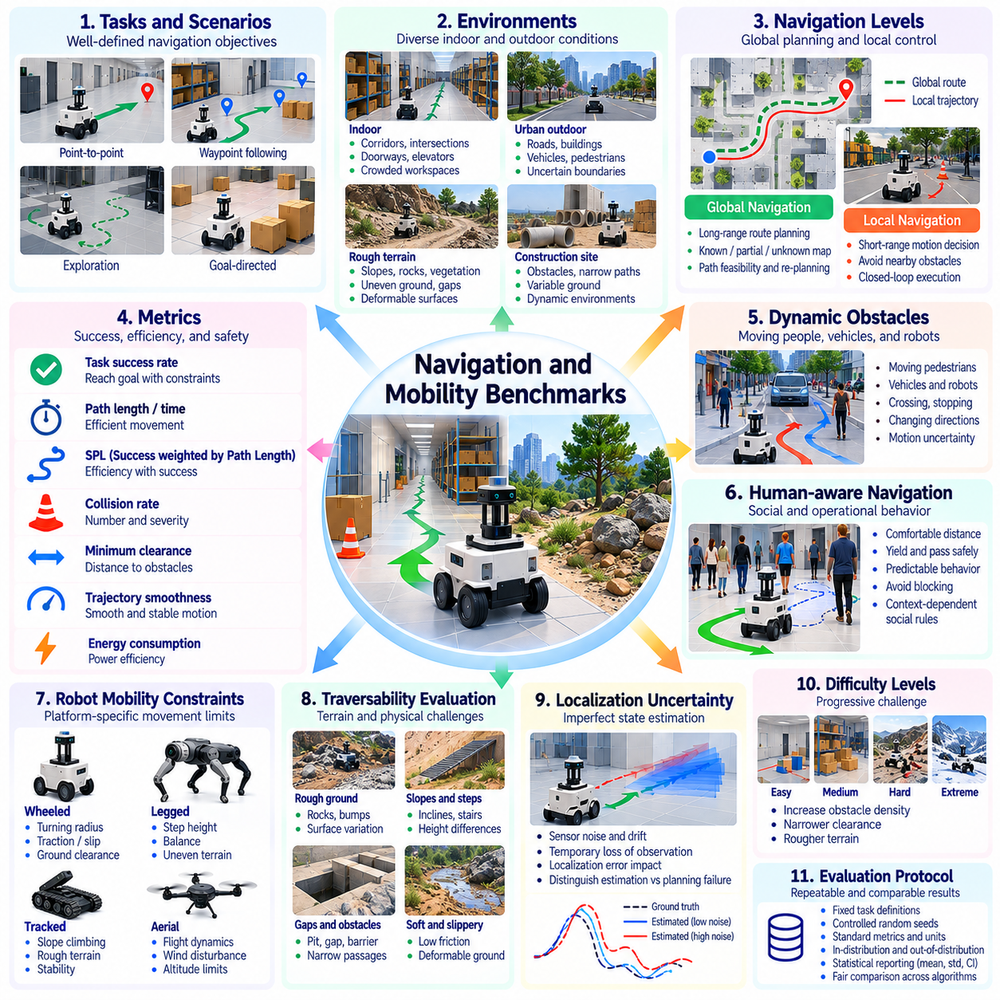{width="7.268055555555556in" height="7.268055555555556in"}

내비게이션 및 이동성 벤치마크(Navigation and Mobility Benchmarks)는 피지컬 인공지능(Physical AI) 시스템이 작업 목표(Task Objective), 물리적 제약조건(Physical Constraint), 운영 요구사항(Operational Requirement)을 충족하면서 시뮬레이션 환경에서 얼마나 효과적으로 이동하는지 평가한다. 내비게이션(Navigation)은 실행 가능한 경로를 선택하고 장애물을 회피하는 과정을 포함하며, 이동성(Mobility)은 다양한 표면과 공간 구성에서 실제 이동을 수행하는 능력을 의미한다. 시뮬레이션(Simulation)은 작업 성공(Task Success), 이동 효율성(Movement Efficiency), 충돌 회피(Collision Avoidance), 적응성(Adaptability)을 반복적으로 평가할 수 있도록 한다.

벤치마크 설계(Benchmark Design)는 명확하게 정의된 내비게이션 작업(Navigation Task)과 환경 조건(Environmental Condition)에서 시작된다. 대표적인 시나리오에는 지점 간 이동(Point-to-Point Travel), 경유점 추종(Waypoint Following), 복도 통과(Corridor Traversal), 탐색(Exploration), 익숙하지 않은 공간에서의 목표 지향 이동(Goal-Directed Movement)이 포함된다. 각 시나리오는 시작 위치(Starting Position), 목적지 영역(Destination Region), 장애물 구성(Obstacle Configuration), 완료 기준(Completion Criteria)을 명시한다. 일관된 정의는 측정된 성능이 작업 해석의 차이가 아니라 내비게이션 능력을 반영하도록 한다.

내비게이션 환경(Navigation Environment)은 다양한 공간 구조(Spatial Structure)와 운영 난이도(Operational Difficulty)를 표현해야 한다. 실내 시나리오(Indoor Scenario)에는 좁은 복도, 교차로, 출입문, 엘리베이터, 혼잡한 작업 공간(Crowded Workspace)이 포함될 수 있다. 실외 환경(Outdoor Environment)에서는 불규칙한 지형(Uneven Terrain), 경사면(Slope), 식생(Vegetation), 불확실한 경계(Uncertain Boundary)가 추가된다. 벤치마크 모음(Benchmark Suite)은 기하학적 복잡도(Geometric Complexity)와 인식 난이도(Perceptual Difficulty)를 구분하여 실패 원인을 특정 환경적 과제에 연결할 수 있도록 해야 한다.

전역 내비게이션(Global Navigation)은 멀리 떨어진 위치를 연결하는 경로를 선택하는 능력을 평가한다. 알고리즘은 알려진 지도(Known Map), 부분적으로 관측된 환경(Partially Observed Environment), 지속적으로 갱신되는 공간 표현(Spatial Representation)을 사용할 수 있다. 평가는 경로 실현 가능성(Route Feasibility), 경로 길이(Path Length), 계획 시간(Planning Time), 변화하는 조건에 대한 대응성(Responsiveness)을 측정한다. 성공적인 전역 경로 계획기(Global Planner)는 로봇의 치수, 이동 한계(Mobility Limitation), 운영 제약조건과 양립할 수 있는 경로를 생성해야 한다.

지역 내비게이션(Local Navigation)은 환경과 지속적으로 상호작용하는 동안 이루어지는 단거리 이동 의사결정(Short-Range Motion Decision)을 평가한다. 로봇은 목적지를 향해 이동하면서 주변 장애물, 움직이는 물체, 예상하지 못한 변화에 대응해야 한다. 벤치마크는 충돌 빈도(Collision Frequency), 장애물 이격거리(Obstacle Clearance), 궤적 평활도(Trajectory Smoothness), 제어 안정성(Control Stability)을 측정할 수 있다. 지역 경로 계획기(Local Planner)는 분리된 경로 예측(Isolated Path Prediction)이 아니라 폐루프 실행(Closed-Loop Execution)을 통해 평가해야 한다.

작업 성공률(Task Success Rate)은 기본적인 내비게이션 평가 지표(Navigation Metric)이지만, 성공에는 정확한 정의가 필요하다. 로봇은 안전 여유거리(Safety Margin)를 위반하거나 시간제한(Time Limit)을 초과하고 반복적인 충돌에 의존하면서도 목표에 도달할 수 있다. 벤치마크 프로토콜(Benchmark Protocol)은 허용 가능한 목표 위치 오차(Goal Tolerance), 방향 요구사항(Orientation Requirement), 시간 제약조건(Time Constraint), 실패 조건(Failure Condition)을 정의해야 한다. 따라서 성공적인 완료 여부는 실행 품질(Execution Quality) 및 제약조건 위반(Constraint Violation)과 함께 보고해야 한다.

경로 효율성(Path Efficiency)은 로봇이 목적지에 얼마나 경제적으로 도달하는지 측정한다. 일반적인 지표에는 이동 거리(Traveled Distance), 완료 시간(Completion Time), 경로 길이 가중 성공률(Success weighted by Path Length, SPL)이 포함된다. 기준 경로(Reference Path)는 기하학적으로 가장 짧은 거리만을 기준으로 하지 않고 로봇 형상(Robot Geometry)과 운동 제약조건(Motion Constraint)을 반영해야 한다. 효율성 비교에서는 더 안전하거나 강건한 경로를 선택하기 위해 의도적으로 이동 거리가 길어지는 상황도 고려해야 한다.

충돌 회피(Collision Avoidance)는 물리적 접촉이 장비를 손상시키거나 주변 에이전트(Nearby Agent)를 위험하게 만들 수 있기 때문에 내비게이션 평가의 핵심 요소이다. 벤치마크는 충돌(Collision), 최소 장애물 이격거리(Minimum Obstacle Clearance), 근접 사고(Near Miss), 제약조건 위반(Constraint Violation)을 기록해야 한다. 충돌 심각도(Collision Severity)는 상대속도(Relative Velocity), 접촉력(Contact Force), 물체 유형(Object Type)에 따라 달라질 수 있다. 이러한 측정값은 이진 충돌 횟수(Binary Collision Count)보다 풍부한 평가를 제공하며 신중한 행동과 안전하지 않은 지름길을 구분하는 데 도움이 된다.

동적 장애물 벤치마크(Dynamic Obstacle Benchmark)는 움직이는 사람, 차량, 로봇 에이전트(Robotic Agent) 사이에서 수행되는 내비게이션을 조사한다. 움직임 패턴(Motion Pattern)에는 교차 궤적(Crossing Trajectory), 갑작스러운 정지(Sudden Stop), 방향 변경(Changing Direction), 부분적으로 예측 가능한 상호작용(Partially Predictable Interaction)이 포함될 수 있다. 평가는 성공적인 통과(Successful Passage), 충돌 회피, 대기 행동(Waiting Behavior), 불필요한 우회(Unnecessary Detour)를 고려해야 한다. 시뮬레이션은 밀도(Density), 속도(Speed), 움직임 불확실성(Motion Uncertainty)을 통제하여 이러한 상황을 반복적으로 재현할 수 있도록 한다.

인간 인지형 내비게이션(Human-Aware Navigation)은 기하학적 충돌 회피를 넘어 사회적 및 운영적 기대(Social and Operational Expectation)를 고려해야 한다. 로봇은 적절한 개인 간 거리(Interpersonal Distance)를 유지하고, 필요한 경우 양보하며, 보행자의 이동을 방해하지 않아야 할 수 있다. 벤치마크는 대인 거리, 경로 예측 가능성(Path Predictability), 인간 활동에 대한 간섭(Interference with Human Activity)을 평가할 수 있다. 이러한 측정값은 보편적으로 적용되는 사회적 규칙(Universal Social Rule)으로 취급하기보다 명시적으로 정의된 맥락(Context) 안에서 해석해야 한다.

이동성 벤치마킹(Mobility Benchmarking)은 로봇의 물리적 이동 능력(Physical Movement Capability)을 고려해야 한다. 바퀴형 플랫폼(Wheeled Platform)은 회전반경(Turning Radius), 접지력(Traction), 지상고(Ground Clearance), 바퀴 동역학(Wheel Dynamics)의 제약을 받으며, 다른 플랫폼은 서로 다른 한계를 가질 수 있다. 시뮬레이션 시험(Simulated Test)은 현실적인 운동학적 제약조건(Kinematic Constraint)과 동역학적 제약조건(Dynamic Constraint)을 적용해야 한다. 그렇지 않으면 내비게이션 알고리즘이 실제 하드웨어에서 실행할 수 없는 궤적을 생성하면서도 성공한 것처럼 보일 수 있다.

주행 가능성 평가(Traversability Evaluation)는 로봇이 다양한 기하학적 및 물리적 특성을 가진 지형을 통과할 수 있는지 측정한다. 표면 거칠기(Surface Roughness), 경사면(Slope), 계단(Step), 틈새(Gap), 마찰(Friction), 변형 가능한 지면(Deformable Ground)은 이동 가능성(Movement Feasibility)에 영향을 미친다. 벤치마크는 통과 성공(Successful Traversal), 진행 정도(Progress), 미끄러짐(Slippage), 안정성 상실(Loss of Stability)을 측정해야 한다. 지형 난이도(Terrain Difficulty)는 통제된 난이도 수준에 따라 성능을 비교할 수 있도록 매개변수화(Parameterization)해야 한다.

위치 추정 불확실성(Localization Uncertainty)은 경로 계획(Planning)이 로봇 위치와 환경 구조에 대한 불완전한 추정값에 의존하기 때문에 추가적인 내비게이션 과제를 발생시킨다. 센서 잡음(Sensor Noise), 누적 드리프트(Accumulated Drift), 일시적인 관측 손실(Temporary Observation Loss)은 경로 이탈(Route Deviation)이나 안전하지 않은 의사결정(Unsafe Decision)을 초래할 수 있다. 평가는 부정확한 상태 추정(State Estimation)에서 발생한 내비게이션 실패와 계획 또는 제어에서 발생한 실패를 구분해야 한다. 이러한 구성요소는 실행 중 상호작용하므로 통합 시험(Integrated Test)도 필요하다.

지도 가용성(Map Availability)과 환경 지식(Environmental Knowledge)은 명시적으로 통제해야 한다. 일부 벤치마크는 완전한 지도(Complete Map)를 제공하지만, 다른 벤치마크는 온라인 지도 작성(Online Mapping)이나 탐색(Exploration)을 요구한다. 특권적 환경 정보(Privileged Environmental Information)를 사용하는 목표 지향 내비게이션(Goal-Directed Navigation)을 온보드 관측값(Onboard Observation)에만 기반한 내비게이션과 직접 비교해서는 안 된다. 허용된 정보와 지도 초기화 조건(Map Initialization Condition)을 보고하면 자율 능력(Autonomous Capability)에 대한 오해를 방지할 수 있다.

탐색 벤치마크(Exploration Benchmark)는 목적지, 장애물 또는 환경 구조가 처음에는 알려지지 않은 상황에서의 이동을 평가한다. 로봇은 정보 수집(Information Gathering)과 운영 목표를 향한 진행 사이에서 균형을 유지해야 한다. 탐색 범위(Coverage), 탐색 효율성(Exploration Efficiency), 지도 완전성(Mapping Completeness), 중복 이동(Redundant Travel)은 유용한 평가 지표를 제공한다. 또한 탐색 전략(Exploration Strategy)이 알려진 경로에 대한 안전한 접근을 유지하고 충분히 이해되지 않은 영역에 갇히지 않도록 하는지도 고려해야 한다.

복구 행동(Recovery Behavior)은 내비게이션 실패가 항상 즉각적인 작업 종료(Task Termination)를 요구하는 것은 아니기 때문에 중요하다. 로봇은 막힌 통로(Blocked Passage), 일시적인 위치 추정 손실(Temporary Localization Loss), 바퀴 미끄러짐(Wheel Slip), 예상하지 못한 장애물(Unexpected Obstacle)을 만날 수 있다. 벤치마크는 복구 성공률(Recovery Success), 복구 시간(Recovery Time), 재계획 빈도(Replanning Frequency), 추가 자원 소비(Additional Resource Consumption)를 측정해야 한다. 반복적인 진동 동작(Repeated Oscillation)이나 과도한 재시도(Excessive Retry)는 효과적인 자율 복구(Autonomous Recovery)와 구분해야 한다.

강건성 평가(Robustness Evaluation)는 장애물 배치(Obstacle Placement), 지형 특성(Terrain Property), 센서 품질(Sensor Quality), 환경 동역학(Environmental Dynamics)에 체계적인 변화를 도입한다. 이러한 조건에 따른 성능 저하(Performance Degradation)는 불확실성에 대한 민감도(Sensitivity)를 드러낸다. 해석 가능성(Interpretability)을 유지하려면 무작위화된 시나리오(Randomized Scenario)를 고정 기준 시험(Fixed Reference Test)과 구분해야 한다. 독립적인 평가 환경(Independent Evaluation Environment)은 내비게이션 정책(Navigation Policy)이 익숙한 배치와 이전에 경험한 장애물 패턴을 넘어 일반화(Generalization)할 수 있는지 판단하는 데 도움이 된다.

계산 효율성(Computational Efficiency)과 에너지 효율성(Energy Efficiency)도 내비게이션 성능에 영향을 미친다. 계획 지연시간(Planning Latency), 제어 주파수(Control Frequency), 메모리 요구사항(Memory Requirement), 이동 시간(Travel Time), 추정 에너지 소비(Estimated Energy Consumption)는 실제 배포(Practical Deployment)에 영향을 미친다. 벤치마크는 이러한 값을 작업 성공 및 이동 품질(Movement Quality)과 함께 보고해야 한다. 비교에서는 알고리즘 효율성(Algorithmic Efficiency)과 서로 다른 하드웨어 구성(Hardware Configuration) 또는 단순화된 액추에이터 모델(Actuator Model)에서 발생하는 이점을 구분해야 한다.

재현 가능한 평가(Reproducible Evaluation)를 위해서는 표준화된 로봇 모델(Robot Model), 좌표 프레임(Coordinate Frame), 충돌 형상(Collision Geometry), 시나리오 정의(Scenario Definition), 점수 산정 절차(Scoring Procedure)가 필요하다. 자동화된 시뮬레이션 파이프라인(Automated Simulation Pipeline)은 궤적(Trajectory), 사건(Event), 성능 지표(Performance Metric)를 기록하면서 반복적인 내비게이션 시험을 실행할 수 있다. 통계적 요약(Statistical Summary)에는 변동성(Variability)과 실패 분포(Failure Distribution)를 포함해야 한다. 상세한 로그(Detailed Log)는 성능 한계가 인식(Perception), 계획(Planning), 제어(Control), 환경 상호작용(Environmental Interaction) 중 어디에서 발생하는지 진단하는 데 도움이 된다.

궁극적으로 내비게이션 및 이동성 벤치마크는 단순한 목적지 도달(Destination Arrival)이 아니라 신뢰할 수 있는 이동(Dependable Movement)을 측정해야 한다. 효과적인 평가는 통제된 조건에서 목표 달성(Goal Achievement), 경로 효율성(Path Efficiency), 충돌 회피(Collision Avoidance), 주행 가능성(Traversability), 복구(Recovery), 자원 소비(Resource Consumption)를 결합한다. 정적 및 동적 환경(Static and Dynamic Environment), 현실적인 물리적 제약조건(Realistic Physical Constraint), 불확실성(Uncertainty), 재현 가능한 점수 산정(Reproducible Scoring)을 포함함으로써 시뮬레이션 벤치마크는 피지컬 인공지능의 내비게이션 역량(Navigation Competence)에 대한 체계적인 근거를 제공한다.

## 02.10. Manipulation and Interaction Benchmarks

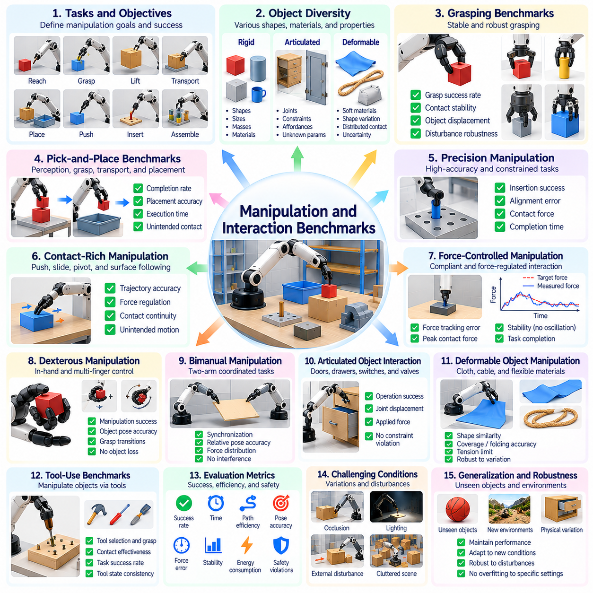{width="7.268055555555556in" height="7.268055555555556in"}

조작 및 상호작용 벤치마크(Manipulation and Interaction Benchmarks)는 피지컬 인공지능(Physical AI) 시스템이 물체를 얼마나 효과적으로 제어하고 주변 환경과 목적에 맞는 접촉을 형성하는지 평가한다. 내비게이션(Navigation)과 달리 조작(Manipulation)은 인식(Perception), 동작 계획(Motion Planning), 힘 조절(Force Regulation), 물리적 상호작용(Physical Interaction) 사이의 정밀한 협응이 필요하다. 시뮬레이션(Simulation)은 물체 움직임(Object Motion), 접촉력(Contact Force), 작업 결과(Task Outcome)에 대한 기준 측정값(Reference Measurement)을 제공하면서 파지(Grasping), 배치(Placement), 조립(Assembly), 도구 사용(Tool Use)을 반복적으로 시험할 수 있도록 한다.

벤치마크 설계(Benchmark Design)는 조작 목표(Manipulation Objective)와 허용 가능한 결과(Acceptable Outcome)를 명시적으로 정의하는 것에서 시작된다. 대표적인 작업에는 도달(Reaching), 파지(Grasping), 들어 올리기(Lifting), 운반(Transporting), 배치(Placing), 밀기(Pushing), 당기기(Pulling), 삽입(Inserting), 물체 조립(Assembling)이 포함된다. 각 시나리오는 초기 물체 구성(Initial Object Configuration), 로봇 능력(Robot Capability), 환경 제약조건(Environmental Constraint), 성공 기준(Success Criteria)을 명시한다. 평가는 단순한 작업 완료와 정확하고 안전하며 효율적인 작업 수행을 구분해야 한다.

물체 다양성(Object Diversity)은 조작 일반화(Manipulation Generalization)를 평가하는 데 필수적이다. 벤치마크 환경(Benchmark Environment)에는 서로 다른 형상(Geometry), 치수(Dimension), 질량(Mass), 표면 재료(Surface Material), 기계적 특성(Mechanical Property)을 가진 물체가 포함되어야 한다. 강체(Rigid Object), 관절형 물체(Articulated Object), 변형 가능한 물체(Deformable Object)는 서로 다른 상호작용 과제를 제시한다. 평가는 정책(Policy)이 암기된 물체 특성에 의존하는지, 아니면 익숙하지 않은 물리적 특성과 구성에 맞추어 행동을 적응시킬 수 있는지 판단해야 한다.

파지 벤치마크(Grasping Benchmark)는 물체와 안정적인 접촉(Stable Contact)을 형성하고 유지하는 능력을 측정한다. 평가에는 파지 성공률(Grasp Success Rate), 접촉 안정성(Contact Stability), 물체 변위(Object Displacement), 외부 교란(External Disturbance)에 대한 저항성이 포함될 수 있다. 파지 품질(Grasp Quality)은 형상, 마찰(Friction), 접촉 분포(Contact Distribution), 그리퍼 구성(Gripper Configuration)에 따라 달라진다. 성공적인 파지는 후속 이동이나 조작 과정에서 실패하는 일시적인 물체 유지(Temporary Object Retention)와 구분해야 한다.

집기 및 배치 벤치마크(Pick-and-Place Benchmark)는 인식, 파지 계획(Grasp Planning), 동작 실행(Motion Execution), 물체 해제(Object Release)의 협응을 평가한다. 작업에는 표면, 용기, 선반 또는 지정된 배치 영역(Designated Placement Region) 사이에서 물체를 이동하는 과정이 포함될 수 있다. 평가 지표에는 완료율(Completion Rate), 배치 정확도(Placement Accuracy), 실행 시간(Execution Time), 의도하지 않은 접촉(Unintended Contact)이 포함된다. 벤치마크는 명령된 배치 위치(Commanded Placement Position)만을 성공의 충분한 근거로 취급하지 않고, 물체가 해제된 이후에도 안정적으로 유지되는지 검증해야 한다.

정밀 조작 벤치마크(Precision Manipulation Benchmark)는 작은 위치 오차(Position Error)와 방향 오차(Orientation Error)가 요구되는 작업을 조사한다. 핀 삽입(Peg Insertion), 커넥터 결합(Connector Mating), 부품 정렬(Component Alignment), 제약된 조립(Constrained Assembly)이 대표적인 사례이다. 평가는 삽입 성공률(Insertion Success), 정렬 오차(Alignment Error), 접촉력(Contact Force), 완료 시간(Completion Time)을 측정한다. 이러한 작업은 제약이 없는 물체 운반 과정에서는 드러나지 않을 수 있는 보정(Calibration), 순응성(Compliance), 접촉 추론(Contact Reasoning)의 한계를 드러낸다.

접촉이 많은 조작(Contact-Rich Manipulation)은 마찰(Friction), 충격(Impact), 변형(Deformation), 변화하는 제약조건(Changing Constraint)이 관련된 복잡한 상호작용을 도입한다. 밀기(Pushing), 미끄러뜨리기(Sliding), 회전축을 중심으로 돌리기(Pivoting), 표면 추종(Surface Following)은 움직임과 힘을 지속적으로 조정해야 한다. 벤치마크는 궤적 정확도(Trajectory Accuracy), 힘 조절(Force Regulation), 접촉 연속성(Contact Continuity), 의도하지 않은 물체 움직임(Unintended Object Movement)을 측정해야 한다. 부정확한 접촉 모델(Contact Model)은 관측되는 정책 성능(Policy Performance)을 크게 변화시킬 수 있으므로 시뮬레이션 충실도(Simulation Fidelity)가 특히 중요하다.

힘 제어 조작(Force-Controlled Manipulation)은 로봇이 위치 명령(Position Command)에만 의존하지 않고 물리적 상호작용을 조절하는지 평가한다. 임피던스 제어(Impedance Control), 어드미턴스 제어(Admittance Control), 하이브리드 힘-위치 제어(Hybrid Force-Position Control)는 삽입(Insertion), 연마(Polishing), 순응 접촉(Compliant Contact) 과정에서 시험할 수 있다. 평가 지표에는 힘 추종 오차(Force Tracking Error), 최대 접촉력(Peak Contact Force), 진동(Oscillation), 작업 완료(Task Completion)가 포함된다. 평가는 제어된 순응성(Controlled Compliance)을 불안정성(Instability)이나 불충분한 액추에이터 제어 능력(Actuator Authority)과 구분해야 한다.

숙련 조작 벤치마크(Dexterous Manipulation Benchmark)는 여러 손가락과 접촉점(Contact Point)의 협응 제어(Coordinated Control)를 조사한다. 작업에는 물체 방향 변경(Object Reorientation), 손안 회전(In-Hand Rotation), 정밀 파지 조정(Precision Grasp Adjustment), 순차적 손가락 재배치(Sequential Finger Repositioning)가 포함될 수 있다. 성능은 촉각 정보(Tactile Information), 접촉 계획(Contact Planning), 미세 운동 협응(Fine Motor Coordination)에 따라 달라진다. 벤치마크는 조작 성공률(Manipulation Success), 물체 자세 정확도(Object Pose Accuracy), 파지 전환(Grasp Transition), 의도하지 않은 물체 이탈(Unintended Object Loss)을 측정해야 한다.

양팔 조작(Bimanual Manipulation)은 두 개의 로봇 팔 또는 손을 사용한 협응 상호작용(Coordinated Interaction)을 평가한다. 대표적인 작업에는 도구를 조작하면서 물체를 고정하기, 양손 사이에서 물체 전달하기, 상호보완적인 동작(Complementary Action)으로 부품 조립하기가 포함된다. 평가는 동기화(Synchronization), 상대 자세 정확도(Relative Pose Accuracy), 힘 분배(Force Distribution), 상호 간섭 회피(Interference Avoidance)를 고려해야 한다. 성공적인 협응은 두 조작기(Manipulator)가 움직이는 동안 작업 제약조건(Task Constraint)을 유지해야 한다.

관절형 물체 상호작용(Articulated Object Interaction)은 문(Door), 서랍(Drawer), 스위치(Switch), 밸브(Valve), 경첩 부품(Hinged Component)처럼 움직임이 제한된 기구(Mechanism)를 포함한다. 로봇은 관련 어포던스(Affordance)를 식별하고 기계적 구조(Mechanical Structure)에 부합하는 움직임을 실행해야 한다. 벤치마크는 개방 완료(Open Completion), 관절 변위(Joint Displacement), 가해진 힘(Applied Force), 제약조건 위반(Constraint Violation)을 측정할 수 있다. 평가는 고정된 기구를 넘어서는 일반화(Generalization)를 시험하기 위해 익숙하지 않은 관절 매개변수(Articulation Parameter)를 포함해야 한다.

변형 가능한 물체 조작(Deformable Object Manipulation)은 형상 변화(Shape Change)와 분산된 물리적 상호작용(Distributed Physical Interaction)에 대한 추론을 요구한다. 천 접기(Cloth Folding), 케이블 배선(Cable Routing), 유연 포장재 처리(Flexible Packaging), 연질 재료 취급(Soft-Material Handling)이 대표적인 과제이다. 성공 지표(Success Metric)에는 형상 유사도(Shape Similarity), 피복 범위(Coverage), 장력 한계(Tension Limit), 최종 구성 정확도(Final Configuration Accuracy)가 포함될 수 있다. 변형체 시뮬레이션(Deformable Simulation)은 여전히 어렵기 때문에 벤치마크 결과에는 재료 가정(Material Assumption)과 물리 모델링 불확실성(Physical Modeling Uncertainty)을 보고해야 한다.

도구 사용 벤치마크(Tool-Use Benchmark)는 로봇이 도구와 기구를 통해 물체를 간접적으로 조작할 수 있는지 평가한다. 작업에는 쓸기(Sweeping), 체결(Fastening), 절단 시뮬레이션(Cutting Simulation), 지렛대를 사용하여 다른 물체를 움직이는 동작이 포함될 수 있다. 평가는 도구 선택(Tool Selection), 파지 구성(Grasp Configuration), 접촉 효과(Contact Effectiveness), 작업 성공(Task Success)을 조사해야 한다. 이러한 벤치마크는 기본적인 물체 조작과 도구, 대상 물체, 환경 제약조건 사이의 기능적 관계(Functional Relationship)에 대한 이해를 구분한다.

상호작용 계획 벤치마크(Interaction Planning Benchmark)는 기하학적 및 물리적 제약조건(Geometric and Physical Constraint)을 충족하는 행동 순서(Action Sequence)를 선택하는 능력을 평가한다. 로봇은 장애물을 재배치하거나 파지를 변경하고, 물체를 안정화하거나 여러 접촉 사건(Contact Event)을 조정해야 할 수 있다. 평가는 계획 실현 가능성(Plan Feasibility), 실행 성공(Execution Success), 재계획 빈도(Replanning Frequency), 누적 오차(Accumulated Error)를 측정해야 한다. 긴 상호작용 순서(Long Interaction Sequence)는 개별 파지 지표(Isolated Grasping Metric)만으로 포착할 수 없는 의존관계를 드러낸다.

인식 불확실성(Perception Uncertainty)은 작은 추정 오차(Estimation Error)도 파지 실패(Failed Grasp)나 과도한 접촉력을 유발할 수 있기 때문에 조작에 큰 영향을 미친다. 벤치마크는 물체 자세 불확실성(Object Pose Uncertainty), 가림(Occlusion), 깊이 잡음(Depth Noise), 보정 정확도(Calibration Accuracy)를 변화시켜야 한다. 성능 분석(Performance Analysis)은 인식 관련 실패(Perception-Related Failure)를 동작 계획 및 제어의 한계와 구분할 수 있다. 로봇이 갱신된 센서 피드백(Sensory Feedback)을 사용하여 오류를 수정하는지 판단하려면 폐루프 평가(Closed-Loop Evaluation)가 필요하다.

강건성 평가(Robustness Evaluation)는 물체 질량(Object Mass), 마찰(Friction), 초기 자세(Initial Pose), 액추에이터 응답(Actuator Response), 외부 교란(External Disturbance)에 변화를 도입한다. 통제된 매개변수 범위(Controlled Parameter Range)에 걸친 반복 시험(Repeated Trial)은 물리적 불확실성(Physical Uncertainty)에 대한 민감도를 드러낸다. 복구 시험(Recovery Test)에는 파지 미끄러짐(Grasp Slippage), 예상하지 못한 물체 움직임(Unexpected Object Movement), 불완전한 삽입(Incomplete Insertion)이 포함될 수 있다. 벤치마크는 시스템이 실패를 감지하고 전략을 조정하여 외부 개입(External Intervention) 없이 작업을 완료하는지 기록해야 한다.

안전성(Safety)과 상호작용 품질(Interaction Quality)은 작업 성공과 함께 명시적으로 평가해야 한다. 과도한 접촉력(Excessive Contact Force), 불안정한 물체 움직임(Unstable Object Motion), 충돌(Collision), 의도하지 않은 환경 변화(Unintended Environmental Change)는 허용할 수 없는 행동을 나타낼 수 있다. 평가 지표는 힘 한계(Force Limit), 충격 심각도(Impact Severity), 물체 손상 대리지표(Object Damage Proxy), 제약조건 위반(Constraint Violation)을 포착해야 한다. 조작 정책(Manipulation Policy)이 물리적으로 공격적인 행동(Physically Aggressive Action)을 통해 작업을 완료했다는 이유만으로 높은 평가 점수를 받아서는 안 된다.

계산 효율성(Computational Efficiency)과 자원 소비(Resource Consumption)도 조작 성능에 영향을 미친다. 동작 계획 지연시간(Motion Planning Latency), 제어 주파수(Control Frequency), 에너지 사용량(Energy Usage), 실행 시간(Execution Duration)은 실제 적용 가능성(Practical Applicability)에 영향을 준다. 벤치마크는 정확도(Accuracy) 및 성공률(Success Rate)과 함께 이러한 측정값을 보고해야 한다. 잘못된 결론을 방지하려면 로봇 형태(Robot Morphology), 액추에이터 용량(Actuator Capacity), 센서 가용성(Sensor Availability), 계산 하드웨어(Computational Hardware)의 차이를 비교 과정에서 고려해야 한다.

재현 가능한 조작 벤치마킹(Reproducible Manipulation Benchmarking)을 위해서는 표준화된 물체 모델(Object Model), 접촉 매개변수(Contact Parameter), 로봇 구성(Robot Configuration), 작업 정의(Task Definition), 점수 산정 절차(Scoring Procedure)가 필요하다. 시뮬레이션 파이프라인(Simulation Pipeline)은 궤적(Trajectory), 접촉 사건(Contact Event), 힘 측정값(Force Measurement), 물체 상태(Object State), 실패 분류(Failure Classification)를 기록해야 한다. 독립적인 난수 시드(Independent Random Seed)를 사용하는 여러 시험은 통계적 분석(Statistical Analysis)을 지원한다. 시뮬레이션된 마찰, 순응성, 접촉 전환(Contact Transition)이 실제 물리적 거동과 다를 수 있으므로 실세계 검증(Real-World Validation)은 여전히 필요하다.

궁극적으로 조작 및 상호작용 벤치마크는 환경에 신뢰할 수 있는 물리적 변화(Reliable Physical Change)를 만들어내는 종합적인 능력을 평가해야 한다. 효과적인 평가는 파지 안정성(Grasp Stability), 배치 정밀도(Placement Precision), 힘 제어(Force Control), 작업 완료(Task Completion), 강건성(Robustness), 안전성(Safety), 자원 효율성(Resource Efficiency)을 결합한다. 다양한 물체, 현실적인 접촉 동역학(Realistic Contact Dynamics), 폐루프 실행(Closed-Loop Execution), 재현 가능한 프로토콜(Reproducible Protocol)을 통합함으로써 시뮬레이션 벤치마크는 피지컬 인공지능의 조작 역량(Manipulation Competence)에 대한 체계적인 근거를 제공한다.

## 02.11. Locomotion and Whole Body Benchmarks

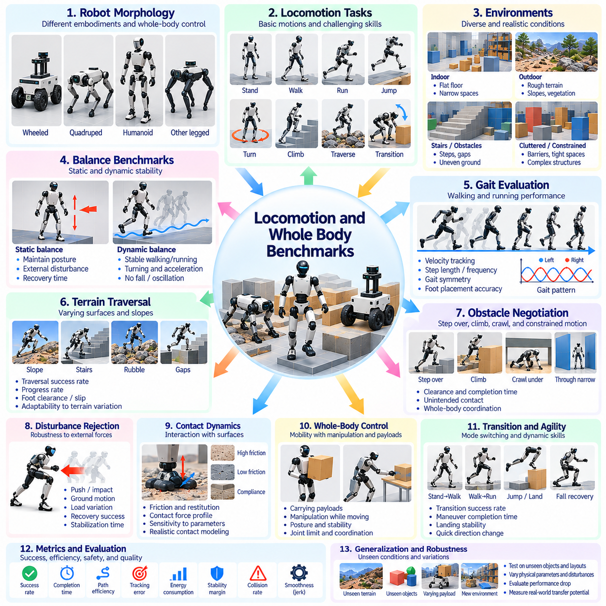{width="7.268055555555556in" height="7.268055555555556in"}

이동 동작 및 전신 제어 벤치마크(Locomotion and Whole-Body Benchmarks)는 피지컬 인공지능(Physical AI) 시스템이 다양한 환경에서 움직임을 조정하고 균형을 유지하며 물리적 상호작용을 얼마나 효과적으로 제어하는지 평가한다. 기존 내비게이션(Navigation)과 달리 이동 동작(Locomotion)은 관절(Joint), 접촉(Contact), 신체 동역학(Body Dynamics)의 협응을 통한 기계적 움직임 실행(Mechanical Execution of Movement)을 강조한다. 시뮬레이션(Simulation)은 로봇에 반복 가능한 물리적 과제를 부여하면서 안정성(Stability), 민첩성(Agility), 효율성(Efficiency), 복구 능력(Recovery)을 측정하기 위한 통제된 조건을 제공한다.

벤치마크 설계(Benchmark Design)는 이동 동작 작업(Locomotion Task), 로봇 형태(Robot Morphology), 환경 조건(Environmental Condition), 측정 가능한 결과(Measurable Outcome)를 정의하는 것에서 시작된다. 대표적인 작업에는 서 있기(Standing), 걷기(Walking), 달리기(Running), 오르기(Climbing), 방향 전환(Turning), 점프(Jumping), 장애물 통과(Obstacle Traversal)가 포함된다. 전신 평가(Whole-Body Evaluation)는 팔, 몸통, 다리의 협응 동작(Coordinated Movement)도 고려한다. 각 시나리오는 초기 상태(Initial State), 목표 동작(Target Motion), 허용 접촉(Permitted Contact), 물리적 제약조건(Physical Constraint), 성공적인 실행을 위한 객관적 기준(Objective Criteria)을 명시해야 한다.

정적 균형 벤치마크(Static Balance Benchmark)는 로봇이 중력(Gravity)과 외부 교란(External Disturbance) 아래에서 안정적인 자세를 유지하는지 평가한다. 휴머노이드(Humanoid)와 다족 보행 로봇(Legged Robot)은 접촉력(Contact Force)과 지지 기하학(Support Geometry)을 관리하면서 신체 자세(Body Posture)를 조절해야 한다. 평가는 질량중심 변위(Center-of-Mass Displacement), 신체 방향 오차(Body Orientation Error), 관절 움직임(Joint Motion), 복구 시간(Recovery Time)을 측정할 수 있다. 시험에는 다양한 지지 조건(Support Condition)과 교란 방향(Perturbation Direction)을 포함하여 균형 제어(Balance Control)의 한계를 드러내야 한다.

동적 균형 평가(Dynamic Balance Evaluation)는 연속적인 움직임과 변화하는 접촉 구성(Contact Configuration)에서의 안정성을 조사한다. 걷기, 달리기, 빠른 방향 전환에는 운동량(Momentum), 신체 자세, 지면 반력(Ground Reaction Force)의 협응 조정이 필요하다. 벤치마크는 넘어짐(Fall), 궤적 추종(Trajectory Tracking), 신체 진동(Body Oscillation), 안정성 여유(Stability Margin)를 측정해야 한다. 로봇은 정상 상태 움직임(Steady Movement)에서는 안정적으로 보이더라도 가속하거나 방향을 변경할 때 실패할 수 있으므로 동적 안정성(Dynamic Stability)은 전환 과정에서도 평가해야 한다.

보행 패턴 평가(Gait Evaluation)는 반복적인 이동 동작 패턴(Locomotion Pattern)의 품질과 적응성을 측정한다. 걷기 및 달리기 제어기(Controller)는 보행 주파수(Step Frequency), 보폭(Stride Length), 지지 비율(Duty Factor), 접촉 타이밍(Contact Timing)에서 차이를 보일 수 있다. 벤치마크는 명령 속도 추종(Commanded Velocity Tracking), 보행 대칭성(Gait Symmetry), 발 배치 정확도(Foot Placement Accuracy), 의도하지 않은 미끄러짐(Unwanted Slipping)을 평가할 수 있다. 평가는 제어기가 다양한 속도, 방향, 지형 조건에서 일관된 성능을 유지하는지 고려해야 한다.

지형 통과 벤치마크(Terrain Traversal Benchmark)는 다양한 기하학적 및 물리적 특성을 가진 표면에서의 이동 동작을 조사한다. 경사면(Slope), 계단(Stair), 디딤돌(Stepping Stone), 틈새(Gap), 잔해(Rubble), 불규칙한 지면(Uneven Ground)은 서로 다른 과제를 제시한다. 평가 지표에는 통과 성공률(Traversal Success), 진행률(Progress Rate), 발 이격거리(Foot Clearance), 미끄러짐 빈도(Slip Frequency), 균형 상실(Loss of Balance)이 포함된다. 지형 난이도(Terrain Difficulty)는 소수의 암기된 구성에서 나타나는 성능과 실제 적응성(Adaptability)을 구분할 수 있도록 매개변수화(Parameterization)해야 한다.

장애물 극복 평가(Obstacle Negotiation)는 로봇이 물리적 장벽을 극복하기 위해 신체 움직임을 어떻게 변경하는지 평가한다. 작업에는 물체를 넘어가기(Stepping Over Objects), 구조물 아래로 몸을 숙여 통과하기(Ducking Beneath Structures), 턱 오르기(Climbing Ledges), 제한된 공간 통과하기(Moving Through Constrained Spaces)가 포함될 수 있다. 팔과 몸통이 균형 유지나 환경 지지(Environmental Support)에 기여할 때 전신 협응(Whole-Body Coordination)이 중요해진다. 벤치마크는 이격거리(Clearance), 의도하지 않은 접촉(Unintended Contact), 완료 시간(Completion Time), 이동 전략 간 성공적인 전환(Successful Transition)을 측정해야 한다.

교란 억제 벤치마크(Disturbance Rejection Benchmark)는 예상하지 못한 외력(External Force)과 환경 변화(Environmental Change)에 대한 강건성(Robustness)을 평가한다. 시뮬레이션된 밀침(Push), 충격(Impact), 지면 움직임(Ground Motion), 갑작스러운 하중 변화(Sudden Load Variation)는 균형 제어기(Balance Controller)에 어려움을 줄 수 있다. 평가는 복구 가능한 최대 교란(Maximum Recoverable Disturbance), 안정화 시간(Stabilization Time), 발 재배치(Foot Repositioning), 실패 확률(Failure Probability)을 기록해야 한다. 교란의 크기(Magnitude)와 방향(Direction)은 단편적인 시연에 의존하지 않고 의미 있는 복구 한계(Recovery Boundary)를 설정할 수 있도록 통제해야 한다.

접촉 동역학(Contact Dynamics)은 움직임이 발, 바퀴, 팔다리와 지지 표면(Supporting Surface) 사이의 상호작용에 의존하기 때문에 이동 동작 성능에 큰 영향을 미친다. 마찰(Friction), 순응성(Compliance), 반발계수(Restitution), 접촉 타이밍(Contact Timing)은 안정성과 에너지 전달(Energy Transfer)에 영향을 준다. 벤치마크는 접촉 모델 매개변수(Contact-Model Parameter)와 수치 해석기 설정(Numerical Solver Setting)에 대한 민감도를 조사해야 한다. 시뮬레이션 인공 효과(Simulation Artifact)를 이용하는 정책(Policy)은 실제 물리 환경으로 전이 가능한 행동(Physically Transferable Behavior)을 보여주지 못하면서도 높은 점수를 얻을 수 있다.

전신 제어 벤치마크(Whole-Body Control Benchmark)는 여러 관절과 물리적 목표(Physical Objective)를 협응하여 조절하는 능력을 평가한다. 휴머노이드 로봇(Humanoid Robot)은 균형을 유지하면서 손을 뻗거나 물체를 운반하거나 주변 환경을 조작해야 할 수 있다. 평가는 작업 공간 정확도(Task-Space Accuracy), 자세 안정성(Posture Stability), 접촉 제약조건(Contact Constraint), 관절 한계 위반(Joint-Limit Violation)을 고려해야 한다. 성공적인 전신 행동(Whole-Body Behavior)은 필수적인 안정성이나 물리적 실현 가능성(Physical Feasibility)을 희생하지 않으면서 서로 경쟁하는 목표(Competing Objective)를 조정해야 한다.

적재물을 동반한 이동 동작(Locomotion with Payloads)은 질량 분포(Mass Distribution), 관성(Inertia), 접촉 요구사항(Contact Requirement)의 변화를 도입한다. 상자 운반(Carrying Boxes), 도구 운송(Transporting Tools), 외부 하중 지지(Supporting External Loads)는 보행 패턴(Gait)과 균형에 영향을 줄 수 있다. 벤치마크는 적재물 질량(Payload Mass), 위치(Location), 움직임(Movement)을 변화시키면서 추종 오차(Tracking Error), 안정성(Stability), 작업 완료(Task Completion)를 측정해야 한다. 이러한 시나리오는 제어기가 광범위한 수동 재조정(Manual Retuning) 없이 물리적 변화에 대응할 수 있는지 드러낸다.

동작 전환 벤치마크(Transition Benchmark)는 서로 다른 이동 동작 모드(Locomotion Mode)와 신체 구성(Body Configuration) 사이의 전환을 평가한다. 대표적인 사례에는 서기에서 걷기로의 전환(Standing to Walking), 걷기에서 달리기로의 전환(Walking to Running), 웅크리기에서 일어서기로의 전환(Crouching to Standing), 넘어짐 이후 복구(Recovering from a Fall)가 포함된다. 전환 과정은 정상 상태 평가(Steady-State Evaluation)에서 감춰진 취약점을 드러내는 경우가 많다. 평가 지표는 전환 성공률(Transition Success), 소요 시간(Time), 최대 관절 토크(Peak Joint Torque), 일시적인 안정성 상실(Temporary Stability Loss)을 포착해야 한다. 신뢰할 수 있는 자율성(Reliable Autonomy)을 위해서는 행동 사이의 부드럽고 통제된 전환이 필요하다.

민첩성 벤치마크(Agility Benchmark)는 빠르고 정밀하며 동역학적으로 까다로운 움직임(Dynamically Demanding Movement)을 실행하는 능력을 조사한다. 갑작스러운 방향 변경(Sudden Direction Change), 가속(Acceleration), 감속(Deceleration), 점프(Jumping), 착지(Landing)에는 정확한 운동량 조절(Momentum Regulation)이 필요하다. 평가는 기동 완료(Maneuver Completion), 착지 안정성(Landing Stability), 추종 정확도(Tracking Accuracy), 공격적인 움직임 이후 복구(Recovery)를 측정할 수 있다. 과도한 관절 하중(Excessive Joint Load)이나 반복적인 제어 상실(Loss of Control)을 통해 달성한 높은 민첩성에는 높은 점수를 부여해서는 안 된다.

에너지 효율성(Energy Efficiency)은 이동 동작이 상당한 액추에이터 전력(Actuator Power)을 소비할 수 있기 때문에 중요하다. 벤치마크는 기계적 일(Mechanical Work), 전기 에너지(Electrical Energy), 이동 비용(Cost of Transport), 단위 에너지당 이동 거리(Distance Traveled per Unit Energy)를 보고할 수 있다. 비교에서는 로봇 질량(Robot Mass), 속도(Speed), 지형(Terrain), 액추에이터 특성(Actuator Characteristic)을 고려해야 한다. 단순화된 시뮬레이션 모델(Simplified Simulation Model)에서 도출된 에너지 측정값은 실제 하드웨어 소비량(Actual Hardware Consumption)을 나타내지 않을 수 있으므로 이를 명확하게 밝혀야 한다.

액추에이터 및 구조적 제약조건(Actuator and Structural Constraints)은 시뮬레이션된 이동 동작이 실제로 실행 가능한지 결정한다. 관절 토크 한계(Joint Torque Limit), 속도 한계(Velocity Limit), 열적 거동(Thermal Behavior), 순응성(Compliance), 동력 전달 동역학(Transmission Dynamics)은 실행 가능한 움직임(Feasible Motion)에 영향을 준다. 벤치마크는 이러한 제약조건을 적용하고 포화 사건(Saturation Event)이나 과도한 하중(Excessive Loading)을 기록해야 한다. 비현실적인 토크(Unrealistic Torque)나 즉각적인 응답(Instantaneous Response)을 요구하여 성공하는 제어기는 실제 배포 준비가 완료된 것으로 간주해서는 안 된다.

인식 기반 이동 동작(Perception-Aware Locomotion)은 불완전한 관측값(Imperfect Observation)으로부터 지형과 접촉 조건(Contact Condition)을 추론해야 하는 상황에서의 움직임을 평가한다. 깊이 카메라(Depth Camera), 라이다(LiDAR), 고유수용감각(Proprioception), 촉각 피드백(Tactile Feedback)은 상호보완적인 정보를 제공한다. 벤치마크는 관측 잡음(Observation Noise), 가림(Occlusion), 지형 불확실성(Terrain Uncertainty)을 변화시키면서 안정성과 진행 정도(Progress)를 측정해야 한다. 폐루프 시험(Closed-Loop Test)은 환경 추정값(Environmental Estimate)이 부정확할 때 제어기가 발 배치(Foot Placement)와 신체 움직임(Body Motion)을 적응적으로 조정할 수 있는지 드러낸다.

일반화 평가(Generalization Evaluation)는 이동 동작 정책(Locomotion Policy)이 이전에 관측하지 못한 지형(Unseen Terrain), 물리적 매개변수(Physical Parameter), 로봇 구성(Robot Configuration)으로 전이될 수 있는지 조사한다. 마찰(Friction), 경사(Slope), 적재물(Payload), 액추에이터 응답(Actuator Response), 로봇 형태(Morphology)의 변화는 과적합(Overfitting)을 드러낼 수 있다. 학습에서 제외된 시나리오(Held-Out Scenario)와 독립적인 무작위화 분포(Independent Randomization Distribution)는 더욱 강력한 평가 근거를 제공한다. 결과는 예상된 조건에서의 강건성과 실제로 익숙하지 않은 환경에 대한 적응(Adaptation)을 구분해야 한다.

복구 및 실패 분석(Recovery and Failure Analysis)은 이진 넘어짐 감지(Binary Fall Detection)를 넘어 확장되어야 한다. 로봇은 비틀거리거나(Stumble), 미끄러지거나(Slip), 충돌하거나(Collide), 불안정한 자세(Unstable Posture)에 들어가거나, 명령된 움직임(Commanded Motion)을 일시적으로 수행하지 못할 수 있다. 벤치마크는 실패 인식(Failure Recognition), 교정 동작(Corrective Action), 복구 시간(Recovery Duration), 잔여 작업 수행 능력(Residual Task Capability)을 측정해야 한다. 통제된 실패 주입(Controlled Failure Injection)은 운영 한계(Operational Boundary)를 식별하고 외부 개입(External Intervention) 없이 복구 전략(Recovery Strategy)이 효과를 유지하는지 판단하는 데 도움이 된다.

재현 가능한 벤치마킹(Reproducible Benchmarking)을 위해서는 표준화된 로봇 모델(Robot Model), 접촉 정의(Contact Definition), 액추에이터 한계(Actuator Limit), 지형 구성(Terrain Configuration), 평가 프로토콜(Evaluation Protocol)이 필요하다. 자동화된 시뮬레이션(Automated Simulation)은 관절 상태(Joint State), 힘(Force), 궤적(Trajectory), 에너지 추정값(Energy Estimate), 실패 사건(Failure Event)을 기록하면서 반복 시험을 실행할 수 있다. 통계적 보고(Statistical Reporting)에는 변동성(Variability)과 최악 조건 결과(Worst-Case Outcome)를 포함해야 한다. 시뮬레이션된 접촉 및 액추에이터 동역학이 실제 하드웨어와 다를 수 있으므로 물리적 검증(Physical Validation)은 여전히 필요하다.

궁극적으로 이동 동작 및 전신 제어 벤치마크는 개별적인 동작 시연(Isolated Motion Demonstration)이 아니라 신뢰할 수 있는 물리적 이동(Reliable Physical Movement)을 평가해야 한다. 종합적인 평가는 균형(Balance), 보행 품질(Gait Quality), 지형 통과(Terrain Traversal), 교란 복구(Disturbance Recovery), 협응 제어(Coordinated Control), 에너지 효율성(Energy Efficiency), 물리적 실현 가능성(Physical Feasibility)을 결합한다. 현실적인 동역학(Realistic Dynamics), 다양한 환경(Diverse Environment), 통제된 교란(Controlled Perturbation), 재현 가능한 평가 지표(Reproducible Metric)를 통합함으로써 시뮬레이션 벤치마크는 피지컬 인공지능의 이동 동작 역량(Locomotion Competence)에 대한 체계적인 근거를 제공한다.

## 02.12. World Model and Prediction Benchmarks

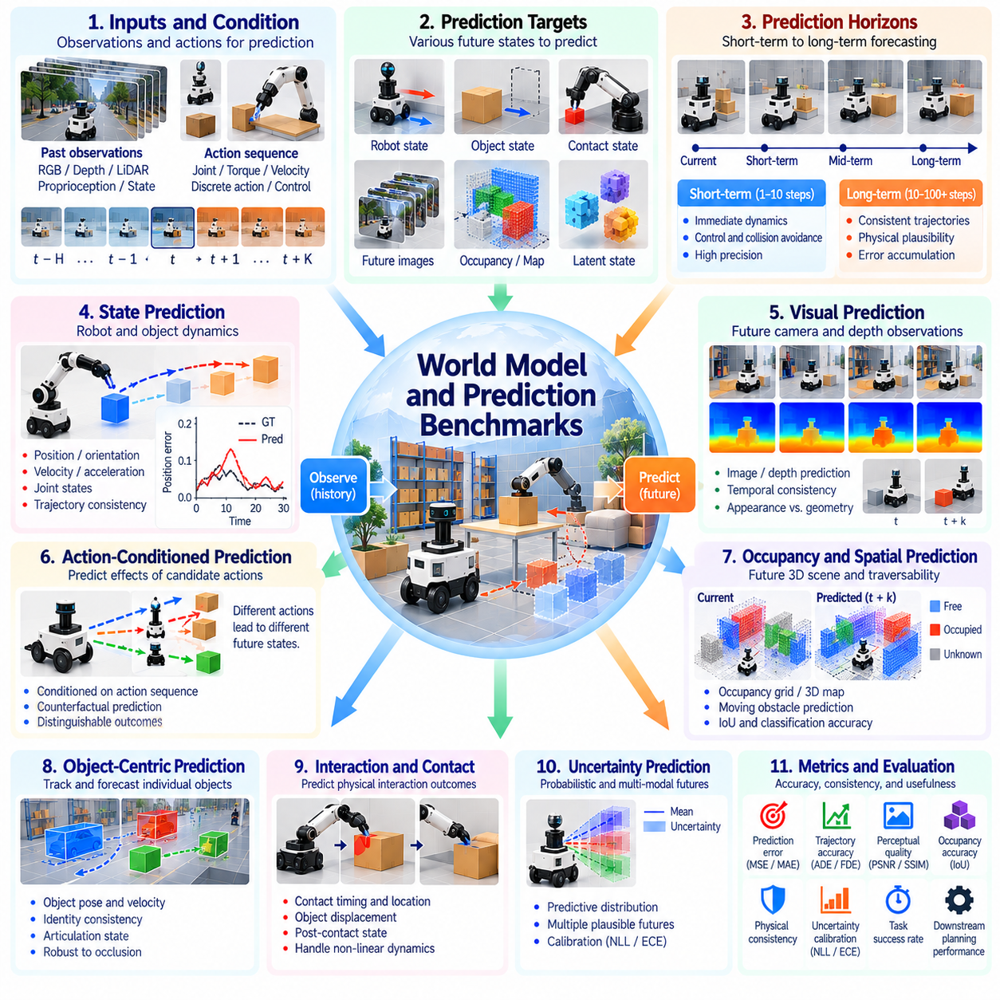{width="7.268055555555556in" height="7.268055555555556in"}

월드 모델 및 예측 벤치마크(World Model and Prediction Benchmarks)는 피지컬 인공지능(Physical AI) 시스템이 환경 동역학(Environmental Dynamics)을 얼마나 정확하게 표현하고 미래의 물리적 상태(Future Physical State)를 예측하는지 평가한다. 월드 모델(World Model)은 물체, 로봇, 주변 조건이 시간에 따라 어떻게 변화하는지 예측하며, 이러한 변화는 종종 행동(Action)에 의해 결정된다. 시뮬레이션(Simulation)은 통제된 기준 궤적(Reference Trajectory)과 관측 가능한 물리적 상태(Observable Physical State)를 제공한다. 평가는 예측 정확도(Predictive Accuracy), 시간적 일관성(Temporal Consistency), 불확실성(Uncertainty), 자율적 의사결정(Autonomous Decision-Making)에 대한 유용성을 측정해야 한다.

벤치마크 설계(Benchmark Design)는 예측 대상(Prediction Target), 관측 이력(Observation History), 행동 입력(Action Input), 예측 시간 범위(Forecasting Horizon)를 정의하는 것에서 시작된다. 예측 대상에는 로봇 상태(Robot State), 물체 자세(Object Pose), 속도(Velocity), 접촉 사건(Contact Event), 점유 지도(Occupancy Map), 미래 센서 관측값(Future Sensor Observation)이 포함될 수 있다. 각 작업에는 명시적인 초기 조건(Initial Condition)과 기준 결과(Reference Outcome)가 필요하다. 평가 프로토콜(Evaluation Protocol)은 알려진 미래 행동을 조건으로 하는 예측과 해당 행동에 접근하지 않고 생성되는 예측을 구분해야 한다.

상태 예측 벤치마크(State Prediction Benchmark)는 학습된 모델(Learned Model)이 물리적 변수(Physical Variable)의 시간적 변화를 재현하는지 측정한다. 위치(Position), 방향(Orientation), 속도(Velocity), 관절 구성(Joint Configuration), 물체 움직임(Object Motion)을 시뮬레이션 실제 기준 데이터(Simulated Ground Truth)와 비교할 수 있다. 일반적인 평가 지표(Metric)에는 평균 제곱 오차(Mean Squared Error), 절대 오차(Absolute Error), 궤적 편차(Trajectory Deviation)가 포함된다. 서로 다른 물리량은 단위와 운영상 중요성(Operational Significance)이 다르므로 이러한 측정값은 적절하게 정규화(Normalization)해야 한다.

단기 예측(Short-Horizon Prediction)은 행동이나 환경 상호작용 이후 발생하는 즉각적인 물리적 상태 변화를 평가한다. 정확한 단기 예측(Short-Term Forecast)은 피드백 제어(Feedback Control), 충돌 회피(Collision Avoidance), 신속한 재계획(Rapid Replanning)을 지원한다. 벤치마크는 다양한 행동 크기(Action Magnitude)와 접촉 조건(Contact Condition)에 따른 예측 오차(Prediction Error)를 조사해야 한다. 로봇이 장애물, 관절 한계(Joint Limit), 불안정한 구성(Unstable Configuration) 근처에서 작동하는 경우 작은 오차도 중요해질 수 있다.

장기 예측(Long-Horizon Prediction)은 모델이 확장된 행동 순서(Action Sequence)에 걸쳐 물리적으로 타당한 궤적(Plausible Trajectory)을 유지하는지 조사한다. 위치, 속도, 접촉 추정(Contact Estimation)의 작은 오차가 누적되어 비현실적인 미래 상태(Unrealistic Future State)를 생성할 수 있다. 평가는 예측 시간 범위(Prediction Horizon)에 따른 오차 증가(Error Growth)를 보고해야 한다. 장기 성능(Long-Term Performance)은 평균 수치 오차(Average Numerical Error)를 최소화하는 것뿐 아니라 생성된 궤적이 물리적 실현 가능성(Physical Feasibility)을 유지하는지도 고려해야 한다.

행동 조건부 예측(Action-Conditioned Prediction)은 로봇 계획(Robotic Planning)에 사용되는 월드 모델의 핵심 요소이다. 모델은 후보 행동(Candidate Action)을 입력받아 로봇과 환경에 미치는 결과를 추정한다. 벤치마크는 서로 다른 행동이 구별 가능하고 물리적으로 일관된 결과(Physically Consistent Outcome)를 생성하는지 시험해야 한다. 반사실적 행동 순서(Counterfactual Action Sequence)는 모델이 의미 있는 행동-결과 관계(Action-Effect Relationship)를 학습했는지, 아니면 주로 관측된 움직임 패턴(Observed Motion Pattern)을 외삽(Extrapolation)하는지 드러낼 수 있다.

시각적 예측 벤치마크(Visual Prediction Benchmark)는 미래 영상(Future Image), 깊이 지도(Depth Map), 기타 센서 관측값(Sensory Observation)의 생성을 평가한다. 평가에는 재구성 정확도(Reconstruction Accuracy), 지각적 유사도(Perceptual Similarity), 기하학적 일관성(Geometric Consistency), 시간적 정합성(Temporal Coherence)이 포함될 수 있다. 높은 시각적 충실도(Visual Fidelity)가 반드시 정확한 물리 동역학(Physical Dynamics)을 의미하지는 않는다. 따라서 벤치마크는 외관 품질(Appearance Quality)을 물체 움직임, 접촉 거동(Contact Behavior), 후속 계획 효과(Downstream Planning Effectiveness)와 구분해야 한다.

잠재 월드 모델 벤치마크(Latent World Model Benchmark)는 직접 관측 가능한 물리 좌표(Physical Coordinate)가 아니라 압축된 특징 공간(Compressed Feature Space)에서 표현되는 예측을 평가한다. 잠재 동역학(Latent Dynamics)은 효율적인 계획(Efficient Planning)과 표현 학습(Representation Learning)을 지원할 수 있지만, 수치적 오차(Numerical Error)는 해석하기 어려울 수 있다. 평가는 예측 일관성(Predictive Consistency), 상태 정보 보존(State Information Retention), 작업 관련성(Task Relevance)을 조사해야 한다. 잠재 표현(Latent Representation)을 디코딩(Decoding)하거나 탐침 분석(Probing)하면 추상적 예측(Abstract Prediction)을 측정 가능한 물리적 결과와 연결하는 데 도움이 된다.

점유 및 공간 예측 벤치마크(Occupancy and Spatial Prediction Benchmark)는 모델이 주변 환경의 변화를 어떻게 예측하는지 조사한다. 미래 점유 격자(Future Occupancy Grid), 조감도 표현(Bird\'s-Eye-View Representation), 3차원 장면 상태(Three-Dimensional Scene State)는 움직이는 장애물과 접근 가능한 영역(Accessible Region)을 나타낼 수 있다. 평가 지표에는 교집합 대비 합집합(Intersection over Union), 점유 분류 정확도(Occupancy Classification Accuracy), 공간 변위 오차(Spatial Displacement Error)가 포함될 수 있다. 평가는 자유 공간(Free Space), 점유 공간(Occupied Space), 불확실한 영역(Uncertain Region)을 구분해야 한다.

객체 중심 예측 벤치마크(Object-Centric Prediction Benchmark)는 모델이 개별 객체(Entity)를 추적하고 그 행동을 예측하는지 평가한다. 관련 물리량에는 물체 위치(Object Position), 방향(Orientation), 속도(Velocity), 관절 상태(Articulation State), 상호작용 관계(Interaction Relationship)가 포함된다. 평가는 가림(Occlusion)이나 물리적 접촉(Physical Contact)이 발생하는 동안 식별 일관성(Identity Consistency)과 예측 정확도(Prediction Accuracy)를 고려해야 한다. 객체 수준 분석(Object-Level Analysis)은 종합 영상 지표(Aggregate Image Metric)나 장면 전체 재구성 점수(Scene-Wide Reconstruction Score)에 가려진 실패를 드러낼 수 있다.

상호작용 예측(Interaction Prediction)은 월드 모델이 물체 사이의 접촉으로 발생하는 물리적 결과(Physical Consequence)를 예측하는지 평가한다. 밀기(Pushing), 파지(Grasping), 미끄러짐(Sliding), 충돌(Collision), 관절 운동(Articulated Motion)에는 불연속성(Discontinuity)과 변화하는 제약조건(Changing Constraint)이 수반된다. 벤치마크는 예측된 접촉 시점(Predicted Contact Timing), 물체 변위(Object Displacement), 힘 관련 결과(Force-Related Outcome), 접촉 이후 상태(Post-Contact State)를 측정해야 한다. 부정확한 기준 접촉 동역학(Reference Contact Dynamics)은 평가 결론을 왜곡할 수 있으므로 시뮬레이터 충실도(Simulator Fidelity)를 고려해야 한다.

물리적 일관성(Physical Consistency)은 통계적 예측 정확도(Statistical Prediction Accuracy)를 넘어서는 필수적인 평가 차원(Evaluation Dimension)이다. 예측된 궤적(Predicted Trajectory)은 기하학적 제약조건(Geometric Constraint), 타당한 동역학(Plausible Dynamics), 관련 보존 법칙(Conservation Principle)을 준수해야 한다. 벤치마크는 물체 상호 관통(Object Interpenetration), 불가능한 관절 움직임(Impossible Joint Motion), 비현실적인 가속도(Unrealistic Acceleration), 일관되지 않은 접촉 전환(Inconsistent Contact Transition)을 감지할 수 있다. 물리적 타당성 검사(Physical Plausibility Check)는 시각적으로 설득력 있지만 기계적으로 유효하지 않은 미래 상태(Mechanically Invalid Future)를 생성하는 모델을 식별하는 데 도움이 된다.

불확실성 인지형 예측 벤치마크(Uncertainty-Aware Prediction Benchmark)는 모델이 미래 결과의 모호성(Ambiguity)을 표현하는지 평가한다. 확률적 환경(Stochastic Environment)과 불완전한 관측(Incomplete Observation)에서는 물리적으로 타당한 여러 궤적(Physically Plausible Trajectory)이 가능할 수 있다. 확률 모델(Probabilistic Model)은 예측 분포(Predictive Distribution), 신뢰구간(Confidence Interval), 여러 후보 미래 상태(Candidate Future)를 표현할 수 있다. 평가는 단일 기준 궤적(Reference Trajectory)과 다른 유효한 대안을 부당하게 감점하지 않으면서 보정(Calibration), 분포 포괄 범위(Distributional Coverage), 우도(Likelihood)를 조사해야 한다.

다중모드 예측(Multimodal Prediction)은 여러 미래 결과가 가능한 상황에서 중요하다. 움직이는 에이전트(Moving Agent)는 회전하거나 정지하거나 계속 전진할 수 있으며, 물체는 불확실한 접촉 조건에 따라 미끄러지거나 정지 상태를 유지할 수 있다. 벤치마크는 모델이 물리적으로 불가능한 가능성을 생성하지 않으면서 의미 있는 대안(Meaningful Alternative)을 포착하는지 평가해야 한다. 다양성(Diversity)은 확률 보정(Probability Calibration) 및 결과 정확도(Outcome Accuracy)와 함께 평가해야 한다.

일반화 벤치마크(Generalization Benchmark)는 익숙하지 않은 물체(Unfamiliar Object), 환경(Environment), 행동(Action), 물리적 매개변수(Physical Parameter)에서의 예측을 조사한다. 질량(Mass), 마찰(Friction), 형상(Geometry), 액추에이터 응답(Actuator Response), 상호작용 패턴(Interaction Pattern)의 변화는 학습에 특화된 가정(Training-Specific Assumption)에 대한 의존성을 드러낼 수 있다. 학습에서 제외된 시나리오(Held-Out Scenario)와 독립적인 매개변수 분포(Independent Parameter Distribution)는 익숙한 조건을 넘어서는 전이(Transfer)를 측정하는 데 도움이 된다. 결과는 알려진 동역학 내 보간(Interpolation)과 새로운 물리적 상황으로의 실제 외삽(Genuine Extrapolation)을 구분해야 한다.

강건성 평가(Robustness Evaluation)는 관측 잡음(Observation Noise), 누락된 센서 데이터(Missing Sensor Data), 지연된 행동(Delayed Action), 불완전한 상태 추정값(Imperfect State Estimate)을 도입한다. 월드 모델은 정확한 시뮬레이터 상태(Exact Simulator State)가 아니라 불확실하거나 불완전한 정보로부터 예측해야 하는 경우가 많다. 벤치마크는 통제된 교란(Controlled Disturbance) 아래에서 성능 저하(Performance Degradation)를 측정하고 실패 임계점(Failure Threshold)을 식별해야 한다. 이를 통해 모델이 인식 시스템(Perception System)에서 제공하는 현실적인 입력(Realistic Input)을 받을 때도 예측 능력(Predictive Capability)이 유용하게 유지되는지 확인할 수 있다.

계획 지향 평가(Planning-Oriented Evaluation)는 월드 모델의 예측이 행동 선택(Action Selection)과 작업 실행(Task Execution)을 개선하는지 측정한다. 예측 오차가 낮은 모델이라도 후보 행동(Candidate Action)의 우선순위를 잘못 판단하거나 중요한 실패 상태(Critical Failure State)를 놓칠 수 있다. 벤치마크는 계획 성공률(Planning Success), 의사결정 후회도(Decision Regret), 제약조건 위반(Constraint Violation), 계산 비용(Computational Cost)을 비교해야 한다. 폐루프 실행(Closed-Loop Execution)은 개루프 예측 정확도(Open-Loop Forecasting Accuracy)만으로 평가하는 것보다 실제 유용성(Practical Value)에 대한 강력한 근거를 제공한다.

계산 효율성(Computational Efficiency)은 예측 모델(Predictive Model)이 실시간 자율 운영(Real-Time Autonomous Operation)을 지원할 수 있는지 결정한다. 추론 지연시간(Inference Latency), 메모리 사용량(Memory Usage), 예측 시간 범위(Prediction Horizon), 후보 행동 순서(Candidate Action Sequence)의 수는 계획 실현 가능성(Planning Feasibility)에 영향을 미친다. 벤치마크는 예측 품질(Prediction Quality)과 함께 이러한 요구사항을 보고해야 한다. 엄격한 제어 마감시간(Control Deadline) 안에서 충분히 정확한 예측을 제공한다면 효율적인 모델이 더 적합할 수 있다.

재현성(Reproducibility)을 확보하려면 표준화된 관측 인터페이스(Observation Interface), 행동 정의(Action Definition), 기준 궤적(Reference Trajectory), 예측 시간 범위(Prediction Horizon), 점수 산정 절차(Scoring Procedure)가 필요하다. 평가 파이프라인(Evaluation Pipeline)은 난수 시드(Random Seed), 시뮬레이터 버전(Simulator Version), 모델 구성(Model Configuration), 전체 예측 출력(Complete Prediction Output)을 보존해야 한다. 통계적 보고(Statistical Reporting)에는 예측 시간 범위에 따른 오차(Horizon-Dependent Error)와 실패 분포(Failure Distribution)를 포함해야 한다. 독립적인 시험 시나리오(Independent Test Scenario)는 과적합(Overfitting)을 줄이고 서로 다른 월드 모델 아키텍처(World Model Architecture) 사이의 의미 있는 비교를 지원한다.

궁극적으로 월드 모델 및 예측 벤치마크는 피지컬 인공지능 시스템이 행동을 안내할 만큼 신뢰성 있게 미래의 물리적 결과(Future Physical Consequence)를 예측하는지 판단해야 한다. 종합적인 평가(Comprehensive Evaluation)는 상태 정확도(State Accuracy), 시간적 일관성(Temporal Consistency), 물리적 타당성(Physical Plausibility), 불확실성 보정(Uncertainty Calibration), 일반화(Generalization), 계획 효과성(Planning Effectiveness)을 결합한다. 시뮬레이션은 체계적인 기반을 제공하지만, 예측 능력이 실제 물리 환경(Physical Environment)으로 전이되는지 확인하기 위해서는 실세계 검증(Real-World Validation)이 여전히 필요하다.

## 02.13. VLA and Generalist Policy Benchmarks

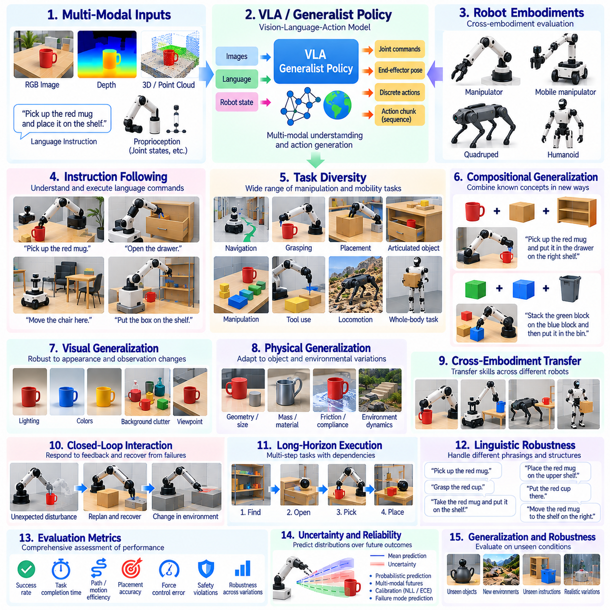{width="7.268055555555556in" height="7.268055555555556in"}

시각-언어-행동(Vision-Language-Action, VLA) 및 범용 정책 벤치마크(Generalist Policy Benchmarks)는 피지컬 인공지능(Physical AI) 시스템이 다중모달 관측(Multimodal Observation)과 자연어 명령(Natural-Language Instruction)을 물리적 행동(Physical Action)으로 얼마나 효과적으로 변환하는지 평가한다. 특정 작업 전용 제어기(Task-Specific Controller)와 달리 범용 정책(Generalist Policy)은 공유 표현(Shared Representation)과 학습된 행동(Learned Behavior)을 활용하여 다양한 작업을 수행하는 것을 목표로 한다. 시뮬레이션(Simulation)은 물체, 환경, 명령, 로봇 구성에 걸친 체계적인 평가를 가능하게 하며, 작업 실행(Task Execution)에 대한 재현 가능한 측정값을 제공한다.

벤치마크 설계(Benchmark Design)는 관측(Observation), 명령(Instruction), 행동 공간(Action Space), 작업 목표(Task Objective)에 대한 표준화된 정의에서 시작된다. VLA 시스템은 카메라 영상(Camera Image), 깊이 측정값(Depth Measurement), 고유수용감각 상태(Proprioceptive State), 텍스트 명령(Textual Command)을 입력받을 수 있다. 출력에는 관절 목표값(Joint Target), 말단효과기 자세(End-Effector Pose), 행동 순서(Action Sequence)가 포함될 수 있다. 평가 프로토콜(Evaluation Protocol)은 의미 있는 비교를 보장하기 위해 입력 가용성(Input Availability), 제어 주파수(Control Frequency), 실행 한계(Execution Limit), 성공 조건(Success Condition)을 명시해야 한다.

명령 수행 벤치마크(Instruction-Following Benchmark)는 정책이 자연어 명령을 정확하게 해석하고 의도된 물리적 행동을 실행하는지 평가한다. 작업에는 물체 선택(Object Selection), 공간적 관계(Spatial Relationship), 순차적 작업(Sequential Operation), 조건부 명령(Conditional Instruction)이 포함될 수 있다. 평가는 언어 이해(Linguistic Understanding)와 물리적 실행 능력(Physical Execution Capability)을 구분해야 한다. 정책이 요청된 행동을 올바르게 식별하더라도 부정확한 인식(Perception), 계획(Planning), 운동 제어(Motor Control)로 인해 실패할 수 있다.

언어 그라운딩 벤치마크(Language Grounding Benchmark)는 언어적 개념(Linguistic Concept)이 관측 가능한 물체, 위치, 행동과 올바르게 연결되는지 조사한다. 색상(Color), 형상(Shape), 상대적 위치(Relative Position), 기능(Function), 물체 식별(Object Identity)에 관한 명령은 언어와 물리적 장면(Physical Scene) 사이의 연결을 요구한다. 벤치마크는 목표 선택 정확도(Target Selection Accuracy), 참조 일관성(Referential Consistency), 행동 관련성(Action Relevance)을 측정해야 한다. 모호한 명령(Ambiguous Instruction)은 고유하게 식별 가능한 목표를 가진 명령과 구분하여 평가해야 한다.

작업 다양성(Task Diversity)은 범용 능력(Generalist Capability)을 평가하는 기본 요소이다. 벤치마크 모음(Benchmark Suite)에는 내비게이션(Navigation), 파지(Grasping), 배치(Placement), 조작(Manipulation), 관절형 물체 상호작용(Articulated Object Interaction), 협응 동작(Coordinated Movement)이 포함되어야 한다. 작업 범주별 성능은 공유 정책(Shared Policy)이 폭넓은 역량(Broad Competence)을 지원하는지, 아니면 익숙한 행동에서만 우수한 성능을 보이는지 드러낸다. 쉬운 작업에서의 높은 성능이 중요한 한계를 감추지 않도록 종합 성공률(Aggregate Success Rate)과 함께 범주별 결과(Category-Level Result)를 제시해야 한다.

조합적 일반화(Compositional Generalization)는 정책이 이전에 학습한 개념과 기술(Skill)을 익숙하지 않은 구성으로 결합할 수 있는지 평가한다. 로봇은 개별 물체, 공간 관계, 조작 기본 동작(Manipulation Primitive)을 이해하더라도 새로운 조합에서는 어려움을 겪을 수 있다. 벤치마크는 학습에서 관측하지 못한 명령 조합(Unseen Instruction Composition), 물체 조합(Object Pairing), 작업 순서(Task Sequence)를 도입해야 한다. 평가는 알려진 능력의 재조합(Recombination)과 완전한 학습 사례(Training Example)의 암기를 구분해야 한다.

장기 명령 실행(Long-Horizon Instruction Execution)은 상호 의존적인 여러 행동에 걸쳐 목표를 유지하는 능력을 요구한다. 작업에는 물체 찾기(Locating Objects), 용기 열기(Opening Containers), 부품 회수(Retrieving Components), 조립 순서 완료(Completing Assembly Sequences)가 포함될 수 있다. 벤치마크는 전체 완료율(Overall Completion), 중간 진행도(Intermediate Progress), 오차 누적(Error Accumulation), 실패한 단계로부터의 복구(Recovery)를 측정해야 한다. 개별 하위 작업(Subtask)을 안정적으로 수행하는 정책도 장시간 실행 과정에서 이를 조정하는 데 실패할 수 있다.

시각적 일반화 벤치마크(Visual Generalization Benchmark)는 외관(Appearance)과 관측 조건(Observation Condition)의 변화에 대한 강건성(Robustness)을 평가한다. 조명(Lighting), 카메라 시점(Camera Viewpoint), 텍스처(Texture), 배경의 복잡도(Background Clutter), 물체 색상(Object Color)을 독립적으로 변화시킬 수 있다. 평가는 정책이 학습 과정의 시각적 상관관계(Visual Correlation)를 이용하는 대신 작업과 관련된 특징(Task-Relevant Feature)을 인식하는지 판단해야 한다. 시각적 요소의 새로운 조합에서 나타나는 성능은 전이 가능한 인식(Transferable Perception)에 대한 더욱 강력한 근거를 제공한다.

물리적 일반화(Physical Generalization)는 VLA 및 범용 정책이 물체 특성(Object Property)과 환경 동역학(Environmental Dynamics)의 변화에 적응하는지 조사한다. 질량(Mass), 마찰(Friction), 순응성(Compliance), 형상(Geometry), 접촉 조건(Contact Condition)의 변화는 행동 결과(Action Outcome)를 바꿀 수 있다. 벤치마크는 통제된 매개변수 분포(Controlled Parameter Distribution)에 걸쳐 성공률과 제어 품질(Control Quality)을 측정해야 한다. 이러한 시험은 다중모달 추론(Multimodal Reasoning)이 시각적 패턴 인식(Visual Pattern Recognition)에만 의존하지 않고 물리적 근거를 갖춘 행동(Physically Grounded Behavior)으로 이어지는지 드러낸다.

교차 임바디먼트 벤치마크(Cross-Embodiment Benchmark)는 공유 정책이 서로 다른 로봇 형태(Morphology)와 행동 인터페이스(Action Interface)를 가진 로봇 사이에서 전이되는지 평가한다. 로봇 조작기(Manipulator), 이동형 조작 로봇(Mobile Manipulator), 휴머노이드(Humanoid), 기타 플랫폼은 관절 구조(Joint Structure), 도달 가능성(Reachability), 감지 능력(Sensing), 제어 한계(Control Limit)가 다를 수 있다. 평가는 직접 전이(Direct Transfer)와 적응(Adaptation) 또는 추가 학습(Additional Training)을 통해 얻은 성능을 구분해야 한다. 결과를 비교할 때는 로봇 형태별 제약조건(Embodiment-Specific Constraint)을 준수해야 한다.

행동 표현(Action Representation)은 일반화(Generalization)와 실행 품질(Execution Quality) 모두에 영향을 미친다. 정책은 연속적인 관절 명령(Continuous Joint Command), 데카르트 좌표계 목표값(Cartesian Target), 이산 행동 토큰(Discrete Action Token), 시간적으로 확장된 행동 청크(Temporally Extended Action Chunk)를 예측할 수 있다. 벤치마크는 행동 디코딩(Action Decoding), 제어 인터페이스(Control Interface), 실행 주파수(Execution Frequency)를 문서화해야 한다. 비교에서는 작업 성공률뿐 아니라 지연시간(Latency), 궤적 평활성(Trajectory Smoothness), 물리적 실현 가능성(Physical Feasibility), 서로 다른 행동 표현의 결과를 고려해야 한다.

폐루프 상호작용 벤치마크(Closed-Loop Interaction Benchmark)는 정책이 실행 중 수신한 관측값에 적절하게 대응하는지 평가한다. 물체 변위(Object Displacement), 파지 실패(Grasp Failure), 예상하지 못한 장애물(Unexpected Obstacle), 불완전한 행동(Incomplete Action)은 갱신된 의사결정(Updated Decision)을 요구한다. 평가는 교정 지연시간(Correction Latency), 재계획 효과성(Replanning Effectiveness), 복구 성공률(Recovery Success)을 측정해야 한다. 예측 가능한 조건에서 피드백 기반 적응(Feedback-Dependent Adaptation) 없이 정책을 시험하면 개루프 시연(Open-Loop Demonstration)이 실제 능력을 과대평가할 수 있다.

언어적 변형에 대한 강건성(Robustness to Linguistic Variation)은 사용자가 동일한 목표를 서로 다른 표현으로 전달할 수 있기 때문에 필요하다. 벤치마크에는 바꿔 말하기(Paraphrase), 동의어(Synonym), 대체 명령 구조(Alternative Instruction Structure), 설명 세부 수준의 변화(Variation in Descriptive Detail)가 포함되어야 한다. 의도된 물리적 작업(Intended Physical Task)이 변하지 않는다면 성능도 일관되게 유지되어야 한다. 평가는 무해한 언어적 변형(Harmless Linguistic Variation)과 실제로 작업 요구사항(Task Requirement)을 변경하는 명령을 구분해야 한다.

모호성 및 불확실성 벤치마크(Ambiguity and Uncertainty Benchmark)는 명령이나 관측값이 불완전할 때 정책이 어떻게 행동하는지 조사한다. 조건에 부합하는 물체가 여러 개 존재하거나, 목표가 가려져 있거나, 문맥적 단서(Contextual Cue)가 서로 충돌하면 확신 있는 행동 선택(Action Selection)이 어려울 수 있다. 평가는 시스템이 명확화 요청(Request for Clarification)을 수행하거나 추가 관측(Additional Observation)을 수집하거나 근거 없는 가정(Unsupported Assumption)을 피하는지 고려해야 한다. 모호한 명령의 특정 해석을 우연히 충족한 임의의 행동(Arbitrary Action)에 성공 점수를 부여해서는 안 된다.

안전성 평가(Safety Evaluation)는 범용 정책이 명령을 수행하면서 물리적 및 운영상 제약조건(Physical and Operational Constraint)을 준수하는지 조사한다. 안전하지 않은 명령(Unsafe Command), 장애물이 있는 작업 공간(Obstructed Workspace), 깨지기 쉬운 물체(Fragile Object), 사람과의 근접성(Human Proximity)은 서로 경쟁하는 목표(Competing Objective)를 만들어낼 수 있다. 벤치마크는 충돌(Collision), 과도한 힘(Excessive Force), 금지된 행동(Prohibited Action), 안전하지 않은 복구 행동(Unsafe Recovery Behavior)을 기록해야 한다. 요청된 작업을 수행할 수 있더라도 명령 준수(Instruction Compliance)가 필수적인 안전 요구사항(Safety Requirement)에 우선해서는 안 된다.

데이터 오염(Data Contamination)과 벤치마크 암기(Benchmark Memorization)는 사전 학습된 VLA 모델(Pretrained VLA Model)의 평가에서 중요한 과제이다. 학습 말뭉치(Training Corpus)에는 평가 시나리오와 유사한 작업 설명(Task Description), 시뮬레이션 장면(Simulated Scene), 시연 데이터(Demonstration)가 포함될 수 있다. 벤치마크 프로토콜은 학습 분포(Training Distribution)와 시험 분포(Testing Distribution)를 분리하고, 알려진 관련 데이터 중복(Data Overlap)을 공개해야 한다. 절차적 작업 생성(Procedural Task Generation)과 학습에서 제외된 조합(Held-Out Combination)은 암기 위험(Memorization Risk)을 줄일 수 있지만 완전한 독립성(Complete Independence)을 보장하지는 못한다.

범용 정책 평가(Generalist Policy Evaluation)는 전체 평균(Overall Average)에만 의존하지 않고 성능 분포(Performance Distribution)를 보고해야 한다. 작업 성공률(Task Success), 실행 시간(Execution Time), 행동 효율성(Action Efficiency), 개입 빈도(Intervention Frequency), 안전 위반(Safety Violation)은 상호보완적인 평가 근거를 제공한다. 결과는 작업 난이도(Task Difficulty), 명령 복잡도(Instruction Complexity), 환경 변화(Environmental Variation)에 따라 분류해야 한다. 통계적 신뢰구간(Statistical Confidence Interval)과 반복 시험(Repeated Trial)은 신뢰할 수 있는 역량(Reliable Competence)과 우연한 성공(Occasional Success)을 구분하는 데 도움이 된다.

계산 요구사항(Computational Requirement)은 VLA 시스템이 실제 로봇에서 작동할 수 있는지에 영향을 미친다. 다중모달 추론 지연시간(Multimodal Inference Latency), 메모리 소비량(Memory Consumption), 행동 생성 주파수(Action Generation Frequency), 하드웨어 가속(Hardware Acceleration)은 응답성(Responsiveness)을 결정한다. 벤치마크는 현실적인 제어 마감시간(Control Deadline) 아래에서 이러한 비용을 측정해야 한다. 대규모 모델(Large Model)은 뛰어난 의미 이해(Semantic Understanding)를 보여주더라도 효율적인 실행 아키텍처(Efficient Execution Architecture)가 없으면 시간에 민감한 조작(Time-Sensitive Manipulation)에 적합하지 않을 수 있다.

재현성(Reproducibility)을 확보하려면 표준화된 작업 설명(Task Description), 시뮬레이터 구성(Simulator Configuration), 관측 스트림(Observation Stream), 행동 인터페이스(Action Interface), 점수 산정 절차(Scoring Procedure)가 필요하다. 평가 파이프라인(Evaluation Pipeline)은 명령 변형(Instruction Variant), 난수 시드(Random Seed), 궤적(Trajectory), 모델 버전(Model Version), 실패 분류(Failure Classification)를 보존해야 한다. 공통 벤치마크 조건(Common Benchmark Condition)은 비교를 지원하며, 적응 과정(Adaptation)에 대한 명시적 보고는 오해를 유발하는 주장을 방지한다. 시뮬레이션 환경을 넘어서는 전이(Transfer)를 확인하기 위해서는 실세계 검증(Real-World Validation)이 여전히 필요하다.

궁극적으로 VLA 및 범용 정책 벤치마크는 다중모달 지능(Multimodal Intelligence)이 다양한 작업에서 신뢰할 수 있고 적응 가능하며 안전한 물리적 행동(Reliable, Adaptable, and Safe Physical Behavior)을 생성하는지 평가해야 한다. 종합적인 평가(Comprehensive Evaluation)는 언어 그라운딩(Language Grounding), 작업 일반화(Task Generalization), 폐루프 제어(Closed-Loop Control), 물리적 강건성(Physical Robustness), 안전성(Safety), 계산 효율성(Computational Efficiency)을 결합한다. 시뮬레이션은 비교를 위한 확장 가능한 기반(Scalable Foundation)을 제공하지만, 진정한 범용성(Genuine Generality)을 입증하려면 익숙하지 않은 상황(Unfamiliar Situation)과 실제 물리적 배포(Physical Deployment)에 걸친 검증 근거가 필요하다.

## 02.14. Stress Rare Event and Failure Injection

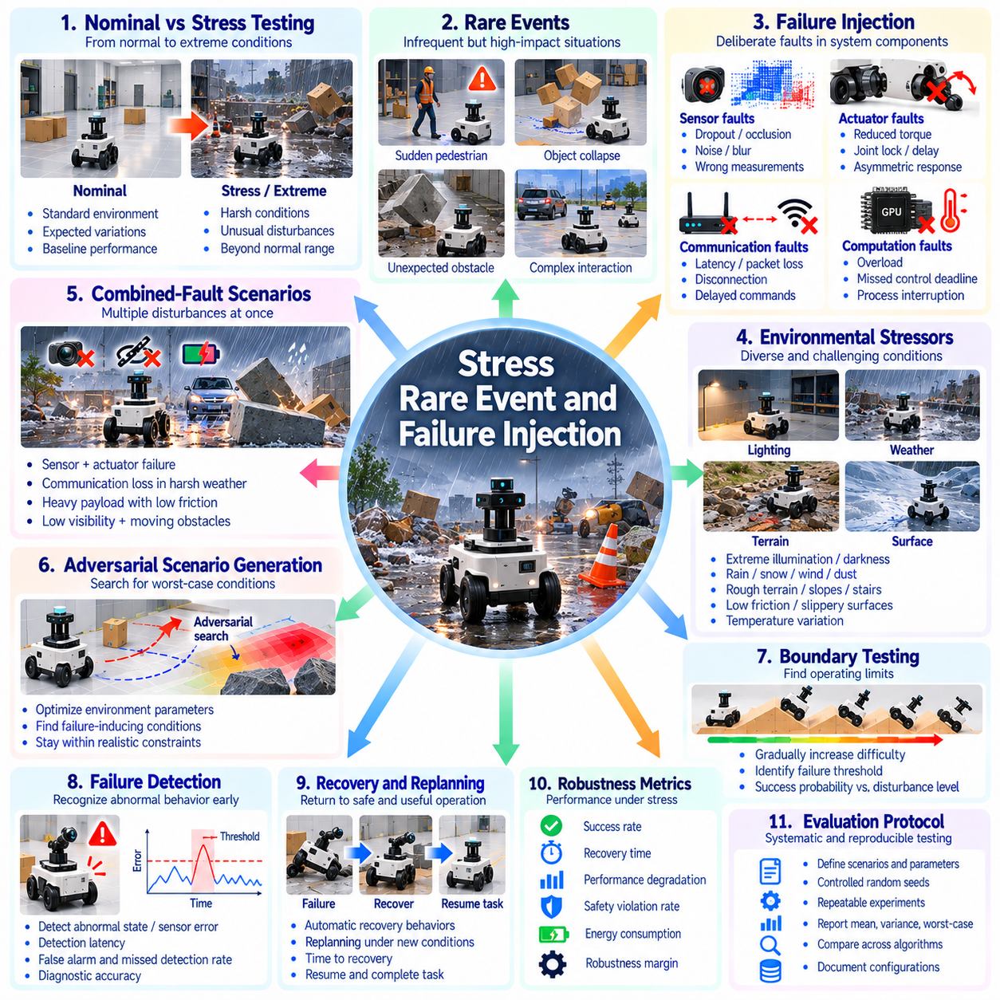{width="7.268055555555556in" height="7.268055555555556in"}

스트레스 시험(Stress Testing), 희귀 사건 평가(Rare-Event Evaluation), 고장 주입(Failure Injection)은 피지컬 인공지능(Physical AI) 시스템이 정상적인 예상 범위를 벗어나는 운영 조건에서도 신뢰성을 유지하는지 조사한다. 기존 벤치마크(Conventional Benchmark)는 익숙한 환경에서의 평균 작업 성공률(Average Task Success)을 강조하는 경우가 많아 중요한 취약점(Critical Weakness)을 발견하지 못할 수 있다. 시뮬레이션(Simulation)은 극한 조건(Extreme Condition), 발생 가능성이 낮은 사건(Unlikely Event), 구성요소 고장(Component Failure)에 대한 통제된 시험을 가능하게 한다. 평가는 성능 저하(Performance Degradation), 고장 한계(Failure Boundary), 복구 능력(Recovery Capability), 불리한 상황에서의 안전성(Safety)을 측정해야 한다.

스트레스 벤치마크 설계(Stress Benchmark Design)는 운영 한계(Operational Limit), 환경적 위험(Environmental Hazard), 발생 가능한 고장 메커니즘(Plausible Failure Mechanism)을 식별하는 것에서 시작된다. 시나리오는 교란 강도(Disturbance Intensity), 작업 복잡도(Task Complexity), 센서 품질(Sensor Quality), 액추에이터 성능(Actuator Capacity), 환경 불확실성(Environmental Uncertainty)을 변화시킬 수 있다. 각 시험은 정상 조건(Nominal Condition), 스트레스 매개변수(Stress Parameter), 단계적 강도 증가 절차(Escalation Procedure), 고장 판정 기준(Failure Criteria)을 정의해야 한다. 체계적인 조건 변화는 점진적인 성능 저하와 갑작스러운 기능 상실(Abrupt Loss of Functionality)을 구분할 수 있도록 한다.

희귀 사건 벤치마크(Rare-Event Benchmark)는 발생 빈도는 낮지만 심각한 결과(Severe Consequence)를 초래할 수 있는 상황을 대상으로 한다. 대표적인 사례에는 예상하지 못한 보행자 움직임(Unexpected Pedestrian Movement), 갑작스러운 장애물 출현(Sudden Obstacle Appearance), 불안정한 물체의 붕괴(Unstable Object Collapse), 여러 장비의 동시 고장(Simultaneous Equipment Malfunction)이 포함된다. 시뮬레이션은 사람이나 하드웨어를 불필요한 위험에 노출하지 않고 이러한 사건을 반복적으로 생성할 수 있다. 평가는 시스템이 비정상적인 조건을 인식하고 적절한 보호 행동(Protective Action)이나 복구 행동(Recovery Action)을 선택하는지 조사해야 한다.

고장 주입(Failure Injection)은 시뮬레이션된 구성요소(Component), 관측값(Observation), 통신 채널(Communication Channel)에 의도적으로 결함(Fault)을 발생시키는 방법이다. 센서 신호 손실(Sensor Dropout), 액추에이터 성능 저하(Actuator Degradation), 명령 지연(Delayed Command), 측정값 손상(Corrupted Measurement), 연결 중단(Interrupted Connectivity)이 대표적인 사례이다. 결함 매개변수(Fault Parameter)는 발생 시점(Onset Time), 지속시간(Duration), 심각도(Severity), 영향을 받는 하위 시스템(Affected Subsystem)을 명시해야 한다. 통제된 고장 주입은 개별 고장과 그에 따른 로봇 행동 변화 사이의 인과관계(Causal Relationship)를 분리하여 분석하는 데 도움이 된다.

센서 결함 벤치마크(Sensor Fault Benchmark)는 불완전하거나 지연되거나 잘못된 관측값에 대한 강건성(Robustness)을 평가한다. 카메라는 가림(Occlusion), 모션 블러(Motion Blur), 노출 변화(Exposure Change), 일시적인 신호 손실(Temporary Signal Loss)을 경험할 수 있다. 라이다(LiDAR)와 깊이 센서(Depth Sensor)는 누락된 반사 신호(Missing Return)나 왜곡된 측정값(Distorted Measurement)을 생성할 수 있다. 평가는 인식 성능 저하(Perception Degradation), 상태 추정 오차(State Estimation Error), 후속 작업 성능(Downstream Task Performance)을 측정해야 한다. 시스템이 손상된 데이터를 무조건 신뢰하지 않고 신뢰할 수 없는 입력(Unreliable Input)을 감지하는 능력을 시험해야 한다.

액추에이터 고장 벤치마크(Actuator Failure Benchmark)는 명령된 움직임(Commanded Motion)이 예상대로 실행되지 않을 때의 행동을 조사한다. 토크 감소(Reduced Torque), 관절 잠김(Joint Locking), 응답 지연(Response Delay), 비대칭 모터 성능(Asymmetric Motor Performance)은 로봇 동역학(Robot Dynamics)을 변화시킬 수 있다. 시험은 안정성(Stability), 제어 가능성(Controllability), 작업 완료(Task Completion), 비상 정지 행동(Emergency Stopping Behavior)을 평가해야 한다. 고장 심각도(Failure Severity)를 점진적으로 증가시켜 운영 한계(Operating Boundary)를 식별하고 제어기(Controller)가 구동 능력의 부분적 상실(Partial Loss of Actuation)에 적응할 수 있는지 판단해야 한다.

통신 및 계산 결함(Communication and Computational Fault)은 추가적인 운영 위험(Operational Risk)을 발생시킨다. 네트워크 지연시간(Network Latency), 패킷 손실(Packet Loss), 프로세서 과부하(Processor Overload), 제어 마감시간 미준수(Missed Control Deadline), 일시적인 계산 중단(Temporary Computation Interruption)은 자율 행동(Autonomous Behavior)을 불안정하게 만들 수 있다. 벤치마크는 이러한 조건을 재현하면서 명령 경과시간(Command Age), 응답 지연(Response Delay), 안전 결과(Safety Outcome)를 기록해야 한다. 평가는 통신이나 계산이 불안정해졌을 때 점진적인 기능 저하(Graceful Degradation)와 통제되지 않은 작동(Uncontrolled Operation)을 구분해야 한다.

환경 스트레스 시험(Environmental Stress Testing)은 표준 운영 분포(Standard Operating Distribution)를 벗어나는 조건에 대한 강건성을 평가한다. 극단적인 조명(Extreme Illumination), 낮은 마찰(Low Friction), 불규칙한 지형(Irregular Terrain), 강풍(Strong Wind), 온도 변화(Temperature Variation), 예상하지 못한 이동 장애물(Unexpected Moving Obstacle)은 인식과 제어에 어려움을 줄 수 있다. 시나리오 매개변수(Scenario Parameter)는 물리적으로 타당하고 실제 배포 환경(Intended Deployment)에 관련되어야 한다. 시험은 작업 성능과 안전성이 허용 가능한 수준으로 유지되는 조건의 범위를 규명해야 한다.

복합 결함 시나리오(Combined-Fault Scenario)는 실제 고장이 완전히 독립적으로 발생하는 경우가 드물기 때문에 중요하다. 로봇은 무거운 적재물(Heavy Payload)을 운반하는 동안 시야가 감소하거나 장애물 회피(Obstacle Avoidance) 중 통신 지연(Communication Delay)을 경험할 수 있다. 벤치마크는 결함과 환경 스트레스 요인(Environmental Stressor) 사이의 상호작용을 조사해야 한다. 복합 교란(Compound Disturbance)은 각 스트레스 요인을 독립적으로 평가할 때 관측할 수 없는 비선형 취약성(Nonlinear Vulnerability)을 드러낼 수 있다.

적대적 시나리오 생성(Adversarial Scenario Generation)은 정책(Policy)이나 제어 시스템(Control System)의 취약점을 드러내는 조건을 탐색한다. 최적화 방법(Optimization Method)은 장애물 배치(Obstacle Placement), 초기 상태(Initial State), 교란 발생 시점(Disturbance Timing), 환경 매개변수(Environmental Parameter)를 변화시켜 고장 발생 가능성(Failure Likelihood)을 최대화할 수 있다. 생성된 시나리오는 명확하게 정의된 물리적 및 운영상 제약조건(Physical and Operational Constraint) 안에 있어야 한다. 평가는 의미 있는 안전 취약성(Safety Vulnerability)과 시뮬레이터 한계(Simulator Limitation)만을 악용하도록 설계된 비현실적인 사례를 구분해야 한다.

경계 시험(Boundary Testing)은 신뢰할 수 있는 작동(Reliable Operation)과 허용할 수 없는 행동(Unacceptable Behavior)을 구분하는 임계값(Threshold)을 식별한다. 교란 크기(Disturbance Magnitude), 장애물 밀도(Obstacle Density), 센서 잡음(Sensor Noise), 액추에이터 성능 저하(Actuator Degradation)를 지정된 성능 요구사항이 충족되지 않을 때까지 증가시킬 수 있다. 평가 지표에는 임계 스트레스 수준(Critical Stress Threshold), 성공 확률(Success Probability), 안전 여유(Safety Margin)가 포함되어야 한다. 확률적 시스템(Stochastic System)은 거의 동일한 조건에서도 서로 다른 결과를 보일 수 있으므로 식별된 경계 근처에서 반복 시험(Repeated Trial)이 필요하다.

고장 감지 벤치마크(Failure Detection Benchmark)는 시스템이 비정상적인 행동(Abnormal Behavior)이 위험한 상황으로 발전하기 전에 이를 인식하는지 측정한다. 예상하지 못한 상태 편차(State Deviation), 일관되지 않은 센서 측정값(Inconsistent Sensor Reading), 비정상적인 접촉력(Abnormal Contact Force), 제어 포화(Control Saturation)는 조기 경고 신호(Early Warning Signal)를 제공할 수 있다. 평가는 감지 지연시간(Detection Latency), 오경보율(False Alarm Rate), 미검출률(Missed Detection Rate), 진단 정확도(Diagnostic Accuracy)를 측정해야 한다. 신속한 감지는 효과적인 보호 의사결정(Protective Decision)을 지원할 때에만 실질적인 가치를 가진다.

복구 벤치마크(Recovery Benchmark)는 교란이나 구성요소 고장 이후 안전하고 유용한 작동을 회복하는 능력을 평가한다. 로봇은 자세를 안정화하거나, 궤적을 재계획하거나, 물체를 해제하거나, 제어기를 전환하거나, 안전 상태(Safe State)로 진입해야 할 수 있다. 평가는 복구 성공률(Recovery Success), 복구 시간(Recovery Time), 잔여 수행 능력(Residual Capability), 복구 과정에서 발생하는 추가 위험(Additional Hazard)을 측정해야 한다. 모든 고장에서 작업을 계속할 수 있는 것은 아니므로 안전한 종료(Safe Termination)도 중요한 평가 결과이다.

안전 지향 스트레스 시험(Safety-Oriented Stress Testing)은 정상적인 작업 목표(Task Objective)를 달성할 수 없을 때에도 시스템이 중요한 제약조건(Critical Constraint)을 준수하는지 평가한다. 충돌 회피(Collision Avoidance), 힘 한계(Force Limit), 안정성 요구사항(Stability Requirement), 보호 작업 공간 경계(Protected Workspace Boundary)는 계속 적용될 수 있어야 한다. 작업 실행 실패가 적절한 행동을 의미할 수도 있으므로 벤치마크는 작업 실패(Task Failure)와 안전 실패(Safety Failure)를 구분해야 한다. 시스템이 안전하지 않은 행동(Unsafe Action)을 통해 작업을 완료했다는 이유로 높은 점수를 받아서는 안 된다.

희귀 사건 평가(Rare-Event Evaluation)는 심각한 고장의 발생 확률이 극도로 낮을 수 있기 때문에 통계적 과제(Statistical Challenge)를 수반한다. 균등 무작위 표본추출(Uniform Random Sampling)은 의미 있는 수의 중대한 사건(Critical Event)을 관측하기 위해 비현실적으로 많은 시험을 요구할 수 있다. 중요도 표본추출(Importance Sampling), 목표 지향 시나리오 생성(Targeted Scenario Generation), 층화 평가(Stratified Evaluation)는 시험 범위(Coverage)를 개선할 수 있다. 그러나 편향된 표본추출 분포(Biased Sampling Distribution)에서 얻은 결과를 적절한 보정(Correction) 없이 실제 고장 확률(Real-World Failure Probability)로 직접 해석해서는 안 된다.

시나리오 포괄 범위(Scenario Coverage)에는 다양한 결함 범주(Fault Category), 심각도 수준(Severity Level), 시간적 패턴(Temporal Pattern), 결함 조합(Fault Combination)이 포함되어야 한다. 짧은 일시적 결함(Transient Fault)은 지속적인 성능 저하(Persistent Degradation)나 간헐적 고장(Intermittent Failure)과 서로 다른 결과를 생성할 수 있다. 포괄 범위 지표(Coverage Metric)는 시험된 매개변수 범위(Parameter Range), 사건 다양성(Event Diversity), 스트레스 요인 사이의 상호작용을 설명할 수 있다. 포괄적인 시험 범위를 확보하는 것은 여전히 어려우므로 벤치마크 보고서(Benchmark Report)는 시험하지 않은 조건과 한계(Limitation)를 명시해야 한다.

고장 분석(Failure Analysis)을 위해서는 실패 결과 이전과 이후에 발생한 사건에 대한 상세한 기록(Detailed Record)이 필요하다. 시뮬레이션 로그(Simulation Log)는 로봇 상태(Robot State), 센서 관측값(Sensor Observation), 액추에이터 명령(Actuator Command), 접촉 사건(Contact Event), 주입된 결함(Injected Fault), 안전 개입(Safety Intervention)을 기록해야 한다. 시간적 재구성(Temporal Reconstruction)은 최초 고장(Initiating Fault)과 이차적 결과(Secondary Consequence)를 구분하는 데 도움이 된다. 일관된 고장 분류 체계(Failure Taxonomy)는 정책 간 비교를 지원하고 종합 성공률(Aggregate Success Rate)에 가려질 수 있는 반복적인 고장 메커니즘(Recurring Failure Mechanism)을 드러낸다.

자동화된 스트레스 시험(Automated Stress Testing)은 매개변수 전수 탐색(Parameter Sweep), 무작위 시나리오 생성(Randomized Scenario Generation), 목표 지향 고장 탐색(Targeted Failure Search)을 결합할 수 있다. 병렬 시뮬레이션(Parallel Simulation)은 다양한 초기 조건(Initial Condition)과 교란 구성(Disturbance Configuration)에 걸쳐 대규모 시험을 실행할 수 있도록 한다. 평가 파이프라인(Evaluation Pipeline)은 결과를 자동으로 분류하고 대표적인 고장 추적 기록(Failure Trace)을 보존해야 한다. 적응형 시험(Adaptive Testing)은 편향되지 않은 비교(Unbiased Comparison)를 위한 독립적인 시험 집합(Independent Test Set)을 유지하면서 운영 경계 근처의 미탐색 영역(Unexplored Region)을 우선적으로 조사할 수 있다.

재현성(Reproducibility)을 확보하려면 결함 모델(Fault Model), 시나리오 매개변수(Scenario Parameter), 난수 시드(Random Seed), 시뮬레이터 버전(Simulator Version), 평가 절차(Evaluation Procedure)를 문서화해야 한다. 결과에는 고장률(Failure Rate), 불확실성 구간(Uncertainty Interval), 최악 조건 결과(Worst-Case Outcome), 복구 특성(Recovery Characteristic)을 보고해야 한다. 비교에서는 스트레스 조건에 노출된 정도(Exposure to Stress Conditions)의 차이를 고려해야 한다. 시뮬레이션된 결함, 접촉 동역학(Contact Dynamics), 극한 환경 조건(Environmental Extreme)이 실제 고장 메커니즘을 모두 재현하지 못할 수 있으므로 물리적 검증(Physical Validation)은 필수적이다.

궁극적으로 스트레스, 희귀 사건 및 고장 주입 벤치마크는 피지컬 인공지능 시스템이 예측 가능한 방식으로 고장에 대응하고, 발생 중인 위험(Emerging Hazard)을 감지하며, 예외적인 조건(Exceptional Condition)에서도 안전성을 유지하는지 판단해야 한다. 효과적인 평가는 체계적인 스트레스 강도 증가(Systematic Stress Escalation), 목표 지향 희귀 사건(Targeted Rare Event), 통제된 고장 주입(Controlled Fault Injection), 복구 분석(Recovery Analysis), 통계적 엄밀성(Statistical Rigor)을 결합한다. 시뮬레이션은 확장 가능한 시험 기반(Scalable Testing Foundation)을 제공하지만, 운영 신뢰성(Operational Reliability)을 입증하기 위해서는 실세계 근거(Real-World Evidence)가 여전히 필요하다.

## 02.15. Massive Parallel Benchmarking

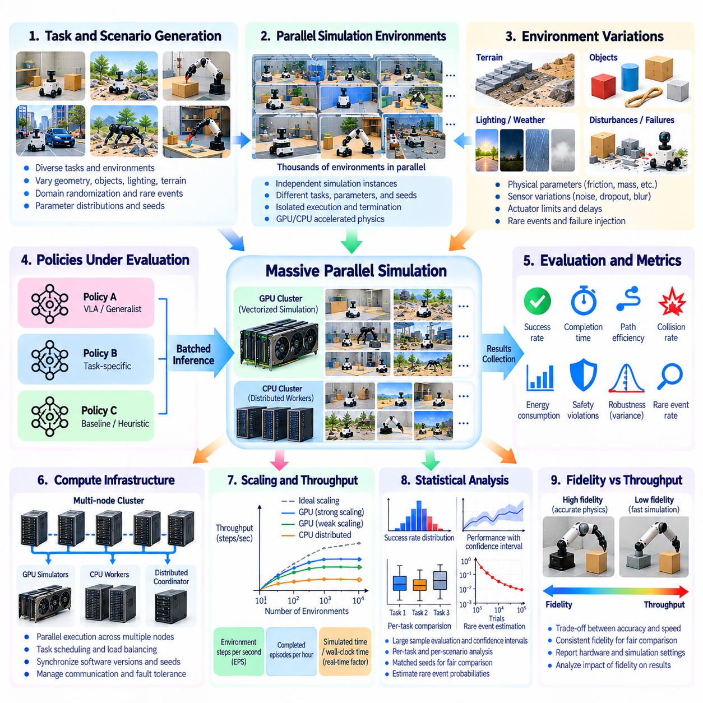{width="7.268055555555556in" height="7.268055555555556in"}

대규모 병렬 벤치마킹(Massive Parallel Benchmarking)은 다양한 작업, 환경, 운영 조건에서 수많은 시뮬레이션 시험(Simulation Trial)을 동시에 실행하여 피지컬 인공지능(Physical AI) 시스템을 평가한다. 순차적 평가(Sequential Evaluation)와 달리 병렬 실행(Parallel Execution)은 실험 처리량(Experimental Throughput)을 높이고 더욱 폭넓은 통계적 포괄 범위(Statistical Coverage)를 확보할 수 있도록 한다. 이러한 접근법은 희귀 고장(Rare Failure)을 식별하고 강건성(Robustness)을 측정하며 정책(Policy)을 비교하는 데 특히 유용하다. 신뢰할 수 있는 결과를 얻으려면 시뮬레이션 충실도(Simulation Fidelity), 계산 자원(Computational Resource), 평가 프로토콜(Evaluation Protocol)을 신중하게 관리해야 한다.

벤치마크 아키텍처(Benchmark Architecture)는 독립적인 시뮬레이션 환경(Independent Simulation Environment)을 병렬 실행 그룹(Parallel Execution Group)으로 구성하는 것에서 시작된다. 각 환경은 자체적인 로봇 상태(Robot State), 작업 구성(Task Configuration), 물리적 매개변수(Physical Parameter), 종료 조건(Termination Condition)을 유지한다. 중앙 집중식 평가 시스템(Centralized Evaluation System)은 개별 시험에 간섭하지 않으면서 정책을 배포하고 결과를 수집한다. 적절한 격리(Isolation)는 환경 사이의 정보 누출(Information Leakage)을 방지하고 동시 실행(Concurrent Execution)이 의도하지 않게 벤치마크 결과를 변경하지 않도록 보장한다.

GPU 가속 시뮬레이션(GPU-Accelerated Simulation)은 계산 자원이 허용하는 경우 수천 개의 경량 환경(Lightweight Environment)을 동시에 실행할 수 있도록 한다. 병렬 물리 엔진(Parallel Physics Engine)은 벡터화 연산(Vectorized Operation)을 사용하여 강체 동역학(Rigid-Body Dynamics), 충돌 감지(Collision Detection), 접촉 계산(Contact Calculation)을 처리할 수 있다. 성능은 장면 복잡도(Scene Complexity), 로봇 자유도(Robot Degrees of Freedom), 센서 요구사항(Sensor Requirement)에 따라 달라진다. 벤치마크 보고서는 이론적인 환경 수용 능력(Theoretical Environment Capacity)과 현실적인 작업 부하(Realistic Workload)에서 지속적으로 달성되는 실행 처리량(Sustained Execution Throughput)을 구분해야 한다.

CPU 기반 병렬 벤치마킹(CPU-Based Parallel Benchmarking)은 복잡한 논리(Complex Logic), 특수 물리 모델(Specialized Physics), 이기종 소프트웨어 구성요소(Heterogeneous Software Component)가 필요한 시뮬레이션에서 여전히 중요하다. 여러 프로세스(Process) 또는 분산 작업자(Distributed Worker)는 사용 가능한 프로세서 코어(Processor Core)에 걸쳐 독립적인 시나리오를 실행할 수 있다. 하이브리드 아키텍처(Hybrid Architecture)는 CPU 기반 작업 관리(Task Management)와 GPU 기반 물리 연산 및 추론(Inference)을 결합할 수 있다. 평가는 실제 처리량에 영향을 미치는 통신 오버헤드(Communication Overhead), 메모리 경합(Memory Contention), 스케줄링 지연(Scheduling Delay)을 고려해야 한다.

환경 벡터화(Environment Vectorization)는 여러 시뮬레이션 인스턴스(Simulation Instance)를 배치 형태의 상태 및 행동 배열(Batched State and Action Array)로 표현한다. 정책은 여러 환경으로부터 관측값(Observation)을 수신하고 공유 추론 파이프라인(Shared Inference Pipeline)을 통해 대응하는 행동(Action)을 생성한다. 벡터화 실행(Vectorized Execution)은 반복적인 소프트웨어 오버헤드(Software Overhead)를 줄이고 가속기 활용률(Accelerator Utilization)을 높인다. 그러나 벤치마크는 각 독립 환경에 대해 관측값, 행동, 보상(Reward), 종료 신호(Termination Signal) 사이의 올바른 대응 관계를 유지해야 한다.

분산 벤치마킹(Distributed Benchmarking)은 병렬 실행을 여러 컴퓨터 또는 계산 노드(Computing Node)로 확장한다. 조정기(Coordinator)는 시나리오를 할당하고 모델 구성(Model Configuration)을 배포하며 원격 작업자(Remote Worker)로부터 평가 기록(Evaluation Record)을 집계한다. 분산 시스템(Distributed System)은 소프트웨어 버전(Software Version), 난수 시드(Random Seed), 점수 산정 절차(Scoring Procedure)의 동기화(Synchronization)가 필요하다. 네트워크 통신(Network Communication), 작업자 고장(Worker Failure), 일관되지 않은 하드웨어 성능(Inconsistent Hardware Performance)을 관리하여 인프라 차이가 정책 비교 결과를 왜곡하지 않도록 해야 한다.

시나리오 다양성(Scenario Diversity)은 대규모 병렬 평가(Massive Parallel Evaluation)를 수행하는 주요 목적 중 하나이다. 수천 개의 환경에서 지형 형상(Terrain Geometry), 물체 구성(Object Configuration), 조명(Lighting), 마찰(Friction), 적재물(Payload), 교란(Disturbance)을 변화시킬 수 있다. 매개변수 분포(Parameter Distribution)는 임의적인 무작위 변화가 아니라 의도된 평가 목표(Evaluation Objective)를 반영해야 한다. 구조화된 시나리오 표본추출(Structured Scenario Sampling)은 정책이 단순히 높은 평균 점수를 얻는 것이 아니라 의미 있는 물리적 조건 전반에서 일반화(Generalization)되는지 판단하는 데 도움이 된다.

난수 시드 관리(Random Seed Management)는 재현성(Reproducibility)과 공정한 비교(Fair Comparison)를 위해 필수적이다. 각 시험에는 초기 상태(Initial State), 환경 변화(Environmental Variation), 확률적 사건(Stochastic Event)을 결정하는 고유하게 식별 가능한 시드(Unique Seed)를 부여해야 한다. 적절한 경우 경쟁 정책(Competing Policy)은 비교 분산(Comparison Variance)을 줄이기 위해 동일하게 대응되는 시나리오(Matched Scenario)에서 평가해야 한다. 벤치마크 시스템은 시드 할당(Seed Assignment)을 기록하고 통계적 신뢰도(Statistical Confidence)를 왜곡할 수 있는 의도하지 않은 재사용(Accidental Reuse)을 방지해야 한다.

통계적 효율성(Statistical Efficiency)은 다수의 독립적인 시험(Independent Trial)이 성능 분포(Performance Distribution)에 대한 신뢰할 수 있는 추정값을 제공할 때 향상된다. 성공률(Success Rate), 완료 시간(Completion Time), 충돌 빈도(Collision Frequency), 에너지 소비량(Energy Consumption)은 신뢰구간(Confidence Interval)과 함께 요약할 수 있다. 평가는 환경과 작업 범주(Task Category)에 따른 변동성(Variability)도 보고해야 한다. 시험 횟수가 많더라도 시험 사이에 상관관계(Correlation)가 존재하거나 시나리오 표본추출(Scenario Sampling)에 편향(Bias)이 있다면 타당한 결론을 보장할 수 없다.

희귀 사건 추정(Rare-Event Estimation)은 중대한 고장(Critical Failure)을 관측하기 위해 광범위한 시험이 필요할 수 있으므로 병렬 실행의 이점을 얻는다. 대규모 시뮬레이션(Large-Scale Simulation)은 환경 스트레스(Environmental Stress), 인식 불확실성(Perception Uncertainty), 액추에이터 한계(Actuator Limitation)의 조합을 탐색할 수 있다. 목표 지향 표본추출(Targeted Sampling)은 어려운 조건에 대한 시험 범위(Coverage)를 개선할 수 있다. 그러나 위험한 시나리오를 과도하게 표본추출(Oversampling)하면 평가 분포(Evaluation Distribution)가 변경되므로 추정된 고장 확률(Failure Probability)은 표본추출 절차(Sampling Procedure)를 고려해야 한다.

계산 처리량(Computational Throughput)은 명확하게 정의된 운영 지표(Operational Metric)를 사용하여 측정해야 한다. 초당 환경 단계 수(Environment Steps per Second), 시간당 완료된 에피소드 수(Completed Episodes per Hour), 실제 경과시간 대비 시뮬레이션 물리 시간(Simulated Physical Time per Wall-Clock Time)은 서로 다른 성능 측면을 설명한다. 벤치마크는 동시 실행 환경 수(Number of Concurrent Environments)와 사용 가능한 하드웨어 자원(Hardware Resource)을 보고해야 한다. 처리량 비교에서는 잘못된 효율성 주장(Misleading Efficiency Claim)을 방지하기 위해 동등한 시뮬레이션 충실도(Simulation Fidelity)와 센서 구성(Sensor Configuration)을 사용해야 한다.

확장 효율성(Scaling Efficiency)은 추가적인 환경이나 계산 자원(Computing Resource)을 도입할 때 평가 성능이 어떻게 변화하는지 설명한다. 동시 실행 수준(Concurrency)을 높이면 메모리 대역폭(Memory Bandwidth), 물리 연산(Physics Computation), 추론(Inference)이 포화(Saturation) 상태에 도달할 때까지 처리량이 향상될 수 있다. 강한 확장성(Strong Scaling)과 약한 확장성(Weak Scaling) 실험은 서로 다른 인프라 한계(Infrastructure Limitation)를 드러낸다. 벤치마크 설계는 포화 지점(Saturation Point)을 식별하고 하드웨어 용량을 두 배로 늘리면 평가 속도도 반드시 두 배가 된다고 가정해서는 안 된다.

공격적인 병렬화(Aggressive Parallelization)를 위해 단순화된 동역학(Simplified Dynamics)이나 낮은 센서 해상도(Reduced Sensor Resolution)를 사용해야 한다면 시뮬레이션 충실도(Simulation Fidelity)가 저하될 수 있다. 접촉 모델링(Contact Modeling), 충돌 처리(Collision Handling), 액추에이터 동역학(Actuator Dynamics), 렌더링 정확도(Rendering Accuracy)는 경량 구성(Lightweight Configuration)과 고충실도 구성(High-Fidelity Configuration) 사이에서 차이가 발생할 수 있다. 평가는 이러한 절충사항(Tradeoff)을 문서화하고 정책 순위(Policy Ranking)에 미치는 영향을 시험해야 한다. 시뮬레이션 단순화(Simulation Shortcut)가 비현실적인 제어 전략(Unrealistic Control Strategy)에 체계적으로 유리하게 작용한다면 높은 처리량은 유용하지 않다.

정책 추론(Policy Inference)은 많은 환경이 동시에 행동을 요청할 때 계산 병목 현상(Computational Bottleneck)이 될 수 있다. 배치 신경망 실행(Batched Neural Network Execution)은 자원 활용률(Utilization)을 높이지만 지연시간(Latency)이나 동기화 제약조건(Synchronization Constraint)을 발생시킬 수 있다. 벤치마크는 추론 시간(Inference Time), 행동 갱신 주파수(Action Update Frequency), 제어 마감시간 미준수(Missed Control Deadline)를 측정해야 한다. 비교에서는 정책에 동등한 계산 예산(Computational Budget)을 제공하고 배치 처리(Batching)가 의도된 제어 행동(Control Behavior)을 변경하지 않도록 보장해야 한다.

비동기 실행(Asynchronous Execution)은 가장 느린 시뮬레이션 인스턴스를 기다리지 않고 각 환경이 독립적으로 진행할 수 있도록 한다. 이러한 접근법은 에피소드 길이(Episode Length)나 장면 복잡도(Scene Complexity)가 크게 달라지는 경우 자원 활용률(Resource Utilization)을 향상시킨다. 그러나 비동기 스케줄링(Asynchronous Scheduling)은 결정론적 재실행(Deterministic Replay)과 정책 비교(Policy Comparison)를 복잡하게 만들 수 있다. 평가 시스템은 환경별 시간 정보(Environment-Specific Timing)를 추적하고 필요한 경우 사건 순서(Event Ordering)를 보존하며 불완전한 에피소드(Incomplete Episode)가 집계 결과(Aggregated Result)에 편향을 유발하지 않도록 해야 한다.

자동화된 에피소드 관리(Automated Episode Management)는 대규모 환경에서 신뢰할 수 있는 실행을 지원한다. 각 시뮬레이션 인스턴스에는 초기화(Initialization), 상태 재설정(State Reset), 성공 감지(Success Detection), 실패 분류(Failure Classification), 종료 처리(Termination Handling)가 필요하다. 재설정 절차(Reset Procedure)는 시험 사이에 의도하지 않은 정보가 전달되지 않도록 관련 물리적 상태(Physical State)와 확률적 상태(Stochastic State)를 복원해야 한다. 자동화된 검증(Automated Validation)은 결과가 벤치마크 데이터베이스(Benchmark Database)에 입력되기 전에 손상된 시뮬레이션(Corrupted Simulation), 수치적 불안정성(Numerical Instability), 불완전한 기록(Incomplete Record)을 감지할 수 있다.

수백만 개의 시뮬레이션 단계(Simulation Step)가 관측값(Observation), 궤적(Trajectory), 접촉 측정값(Contact Measurement), 진단 사건(Diagnostic Event)을 생성하면 데이터 수집(Data Collection)이 어려워진다. 모든 센서 프레임(Sensor Frame)을 기록하면 저장 용량(Storage Capacity)과 통신 용량(Communication Capacity)을 초과할 수 있다. 벤치마크 파이프라인(Benchmark Pipeline)은 간결한 요약 통계(Summary Statistic)와 선택적인 상세 추적 기록(Detailed Trace)을 결합해야 한다. 실패 에피소드(Failure Episode)와 대표 궤적(Representative Trajectory)은 분석을 위해 보존할 수 있으며, 메타데이터(Metadata)는 보고된 모든 결과의 출처 정보(Provenance)를 유지한다.

벤치마크 스케줄링(Benchmark Scheduling)은 계산 효율성(Computational Efficiency)과 과학적 비교 가능성(Scientific Comparability) 사이의 균형을 유지해야 한다. 시나리오 할당(Scenario Allocation)은 어려운 작업(Difficult Task), 충분히 대표되지 않은 조건(Underrepresented Condition), 성능이 불확실한 영역(Uncertain Performance Region)을 우선시할 수 있다. 적응형 평가(Adaptive Evaluation)는 불필요한 시험을 줄이면서 중요한 측정값(Critical Measurement)에 대한 신뢰도를 높일 수 있다. 그러나 최종 정책 순위(Final Policy Ranking)는 선택 편향(Selection Bias)과 불공정한 비교(Unfair Comparison)를 방지하기 위해 사전에 정의된 평가 규칙(Predefined Evaluation Rule)이나 통계적으로 정당화된 절차(Statistically Justified Procedure)에 근거해야 한다.

재현성(Reproducibility)을 확보하려면 버전 관리된 시뮬레이터 구성(Versioned Simulator Configuration), 로봇 모델(Robot Model), 작업 정의(Task Definition), 정책 체크포인트(Policy Checkpoint), 하드웨어 설명(Hardware Description), 실행 로그(Execution Log)가 필요하다. 병렬 시스템(Parallel System)은 반복 시험이 예상되는 수치적 허용오차(Numerical Tolerance) 안에서 일관된 결과를 생성하는지 검증해야 한다. 통계 보고서(Statistical Report)는 표본 크기(Sample Size), 독립 시험(Independent Trial), 신뢰구간(Confidence Interval), 제외된 실패(Excluded Failure)를 명시해야 한다. 이기종 계산 인프라(Heterogeneous Computing Infrastructure)에 걸쳐 결과가 집계되는 경우 독립적인 검증(Independent Verification)이 특히 중요하다.

궁극적으로 대규모 병렬 벤치마킹(Massive Parallel Benchmarking)은 단순히 시뮬레이션 속도(Simulation Speed)를 최대화하는 것이 아니라 피지컬 인공지능 평가(Physical AI Evaluation)의 폭넓은 범위(Breadth), 정밀도(Precision), 신뢰성(Reliability)을 향상시켜야 한다. 효과적인 시스템은 확장 가능한 실행(Scalable Execution), 통제된 시나리오 생성(Controlled Scenario Generation), 통계적 엄밀성(Statistical Rigor), 충실도 검증(Fidelity Validation), 자동화된 실패 분석(Automated Failure Analysis)을 결합한다. 계산 처리량(Computational Throughput)을 재현 가능한 물리적 측정값(Reproducible Physical Measurement)과 연결함으로써 병렬 벤치마킹은 점점 더 복잡하고 다양한 환경에서 정책을 체계적으로 비교할 수 있도록 한다.

## 02.16. Simulation Benchmark Automation [w/Code]

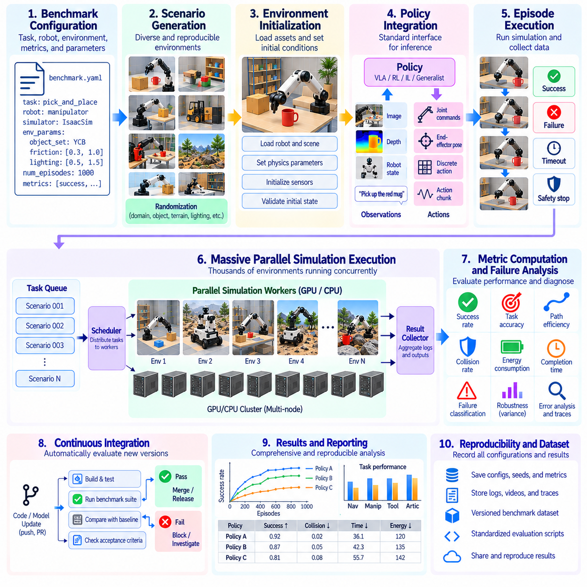{width="7.268055555555556in" height="7.268055555555556in"}

시뮬레이션 벤치마크 자동화(Simulation Benchmark Automation)는 반복 가능하고 설정 가능하며 지속적으로 실행할 수 있는 시험 워크플로(Testing Workflow)를 통해 피지컬 인공지능(Physical AI) 시스템을 평가하는 체계적인 프레임워크(Systematic Framework)를 제공한다. 작업 다양성(Task Diversity), 시뮬레이션 복잡도(Simulation Complexity), 정책 버전(Policy Version)이 증가함에 따라 수동 평가(Manual Evaluation)는 비현실적이 된다. 자동화된 파이프라인(Automated Pipeline)은 시나리오 생성(Scenario Generation), 환경 초기화(Environment Initialization), 정책 실행(Policy Execution), 평가 지표 수집(Metric Collection), 결과 분석(Result Analysis)을 조정한다. 주요 목표는 최소한의 인간 개입(Human Intervention)으로 시스템 성능에 대한 신뢰할 수 있는 근거를 생성하는 것이다.

자동화 아키텍처(Automation Architecture)는 벤치마크 정의(Benchmark Definition)와 실행 인프라(Execution Infrastructure)를 분리하는 것에서 시작된다. 작업 명세(Task Specification)는 목표(Objective), 초기 조건(Initial Condition), 로봇 구성(Robot Configuration), 환경 매개변수(Environmental Parameter), 성공 기준(Success Criteria)을 설명한다. 실행 서비스(Execution Service)는 이러한 명세를 해석하고 해당하는 시뮬레이션 인스턴스(Simulation Instance)를 실행한다. 이러한 분리는 기본 평가 방법론(Evaluation Methodology)을 수정하지 않고도 동일한 벤치마크를 사용하여 서로 다른 정책과 하드웨어 구성을 평가할 수 있도록 한다.

기계 판독 가능한 벤치마크 구성(Machine-Readable Benchmark Configuration)은 일관성(Consistency)과 재현성(Reproducibility)을 향상시킨다. 구조화된 파일(Structured File)은 시뮬레이터 버전(Simulator Version), 로봇 모델(Robot Model), 관측 인터페이스(Observation Interface), 행동 공간(Action Space), 에피소드 한계(Episode Limit), 무작위화 매개변수(Randomization Parameter)를 정의할 수 있다. 구성 검증(Configuration Validation)은 실행 전에 누락된 필드(Missing Field), 호환되지 않는 설정(Incompatible Setting), 지원되지 않는 조합(Unsupported Combination)을 감지해야 한다. 버전 관리된 명세(Version-Controlled Specification)는 실험을 재구성할 수 있도록 하며 문서화되지 않은 변경이 벤치마크 결과를 바꾸는 것을 방지한다.

자동화된 시나리오 생성(Automated Scenario Generation)은 사전에 정의된 매개변수 분포(Parameter Distribution)로부터 다양한 평가 조건(Evaluation Condition)을 생성한다. 초기 로봇 자세(Initial Robot Pose), 물체 배치(Object Arrangement), 지형 특성(Terrain Property), 조명(Lighting), 마찰(Friction), 교란(Disturbance)을 체계적으로 변화시킬 수 있다. 시나리오 생성기(Scenario Generator)는 물리적 타당성(Physical Plausibility)과 작업 실현 가능성(Task Feasibility)을 유지해야 한다. 생성된 각 인스턴스에는 고유 식별자(Unique Identifier)와 기록된 매개변수가 필요하며, 이를 통해 어렵거나 실패한 시험을 정확하게 재현할 수 있다.

환경 초기화(Environment Initialization)는 모든 시험에 대해 일관된 시작 조건(Starting Condition)을 설정해야 한다. 자동화된 절차(Automated Procedure)는 로봇 모델을 불러오고 센서를 구성하며 물리적 매개변수를 적용하고 환경 내 물체를 배치한다. 초기화 검사(Initialization Check)는 유효한 형상(Valid Geometry), 충돌 상태(Collision State), 액추에이터 준비 상태(Actuator Readiness), 센서 가용성(Sensor Availability)을 검증해야 한다. 초기화 실패(Failed Initialization)는 정책 실패(Policy Failure)와 별도로 분류해야 한다. 인프라 결함(Infrastructure Defect)이 성능 측정값을 왜곡해서는 안 되기 때문이다.

정책 통합(Policy Integration)을 위해서는 학습 시스템(Learning System)과 시뮬레이션 환경(Simulation Environment) 사이에 표준화된 인터페이스(Standardized Interface)가 필요하다. 정책은 영상(Image), 깊이 지도(Depth Map), 고유수용감각 측정값(Proprioceptive Measurement), 언어 명령(Language Instruction), 구조화된 상태 관측값(Structured State Observation)을 입력받을 수 있다. 출력에는 관절 명령(Joint Command), 말단효과기 목표값(End-Effector Target), 시간적으로 확장된 행동(Temporally Extended Action)이 포함될 수 있다. 인터페이스 어댑터(Interface Adapter)는 차원 일관성(Dimensional Consistency), 행동 한계(Action Limit), 시간 요구사항(Timing Requirement), 명확하게 정의된 제어 주파수(Control Frequency)를 준수하도록 해야 한다.

자동화된 에피소드 실행(Automated Episode Execution)은 각 평가 시험(Evaluation Trial)의 전체 생명주기(Lifecycle)를 관리한다. 벤치마크 실행기(Benchmark Runner)는 환경을 초기화하고 관측값(Observation)을 획득하며 정책에 행동(Action)을 요청하고 시뮬레이션을 진행한 후 종료 조건(Termination Condition)을 검사한다. 성공(Success), 실패(Failure), 시간 초과(Timeout), 안전 종료(Safety Termination)는 명시적으로 구분해야 한다. 실행 기록(Execution Record)은 관측값, 행동, 시뮬레이터 상태(Simulator State), 그 결과로 발생한 물리적 사건(Physical Event) 사이의 관계를 보존해야 한다.

평가 지표 계산(Metric Computation)은 가능한 한 정책 로직(Policy Logic)과 독립적으로 구현해야 한다. 작업 완료(Task Completion), 궤적 정확도(Trajectory Accuracy), 충돌 빈도(Collision Frequency), 에너지 소비량(Energy Consumption), 실행 시간(Execution Time), 안전 위반(Safety Violation)은 기록된 시뮬레이션 상태(Simulation State)로부터 계산할 수 있다. 평가 지표 정의(Metric Definition)에는 일관된 단위(Unit), 임계값(Threshold), 집계 규칙(Aggregation Rule)이 필요하다. 독립적인 점수 산정(Independent Scoring)은 정책이 평가 기준(Evaluation Criteria)에 영향을 주거나 구현상의 불일치(Implementation Inconsistency)를 악용할 가능성을 줄인다.

자동화된 실패 분류(Automated Failure Classification)는 벤치마크 결과의 해석 가능성(Interpretability)을 향상시킨다. 실패한 에피소드(Failed Episode)에는 인식 오류(Perception Error), 계획 실패(Planning Failure), 불안정한 제어(Unstable Control), 충돌(Collision), 시간 초과(Timeout), 시뮬레이터 오작동(Simulator Malfunction)이 포함될 수 있다. 분류 절차(Classification Procedure)는 사건 로그(Event Log), 물리적 제약조건(Physical Constraint), 작업별 조건(Task-Specific Condition)을 결합할 수 있다. 모호한 결과(Ambiguous Outcome)는 근거 없는 원인(Unsupported Cause)을 부여하지 않고 명시적으로 식별된 상태로 유지해야 한다. 상세한 실패 추적 기록(Failure Trace)은 후속 진단(Diagnosis)과 목표 지향 개선(Targeted Improvement)을 가능하게 한다.

병렬 오케스트레이션(Parallel Orchestration)은 자동화된 벤치마크를 여러 시뮬레이션 환경과 계산 자원(Computing Resource)에 걸쳐 실행할 수 있도록 한다. 스케줄러(Scheduler)는 시나리오를 작업자(Worker)에게 분배하고 실행 상태(Execution Status)를 추적하며 완료된 결과를 수집한다. 자원 할당(Resource Allocation)은 물리 연산 복잡도(Physics Complexity), 렌더링 요구사항(Rendering Requirement), 정책 추론 비용(Policy Inference Cost)을 고려해야 한다. 작업자 격리(Worker Isolation)와 통제된 재시도(Controlled Retry)는 개별 인프라 고장(Infrastructure Failure)이 전체 평가 작업(Evaluation Campaign)을 중단시키지 않도록 한다.

지속적 통합(Continuous Integration)은 시뮬레이션 벤치마킹을 소프트웨어 및 모델 개발 워크플로(Development Workflow)와 연결한다. 정책 체크포인트(Policy Checkpoint), 인식 모듈(Perception Module), 제어 알고리즘(Control Algorithm), 시뮬레이터 구성요소(Simulator Component)의 변경은 사전에 정의된 회귀 시험(Regression Test)을 실행하도록 할 수 있다. 자동화된 비교(Automated Comparison)는 작업 성공률(Task Success), 강건성(Robustness), 안전성(Safety)의 예상하지 못한 저하를 식별한다. 중요한 성능 회귀(Critical Regression)가 발견되면 실패 원인을 조사하고 승인 기준(Acceptance Criteria)을 충족할 때까지 모델의 승격(Model Promotion)을 차단해야 한다.

벤치마크 모음(Benchmark Suite)은 신속한 개발 시험(Rapid Development Test)과 포괄적인 출시 평가(Comprehensive Release Evaluation)를 구분해야 한다. 경량 스모크 시험(Lightweight Smoke Test)은 인터페이스 호환성(Interface Compatibility)과 기본적인 작업 실행(Basic Task Execution)을 검증하며, 회귀 시험 모음(Regression Suite)은 이전에 확립된 능력(Established Capability)을 조사한다. 전체 벤치마크 실행(Full Benchmark Campaign)은 환경, 교란, 희귀 사건(Rare Event)에 대한 더욱 폭넓은 시험 범위를 제공한다. 이러한 계층적 접근법(Layered Approach)은 피드백 속도(Feedback Speed), 통계적 신뢰도(Statistical Confidence), 계산 비용(Computational Cost) 사이의 균형을 유지한다.

통계 자동화(Statistical Automation)는 벤치마크 결론이 단편적인 결과(Isolated Outcome)가 아니라 반복된 관측(Repeated Observation)을 반영하도록 보장한다. 평가 파이프라인(Evaluation Pipeline)은 성공률(Success Rate), 신뢰구간(Confidence Interval), 변동성(Variability), 관련 분포 통계(Distributional Statistic)를 계산해야 한다. 대응되는 난수 시드(Matched Random Seed)는 정책 버전 사이의 공정한 비교(Fair Comparison)를 지원할 수 있다. 자동화된 보고(Automated Reporting)는 표본 크기(Sample Size)와 표본추출 가정(Sampling Assumption)을 공개해야 하며, 특히 적응형 또는 목표 지향 시나리오 선택(Adaptive or Targeted Scenario Selection)이 평가 분포(Evaluation Distribution)를 변경하는 경우 더욱 중요하다.

결과 저장(Result Storage)을 위해서는 모든 결과를 실험 맥락(Experimental Context)과 연결하는 구조화된 기록(Structured Record)이 필요하다. 데이터베이스(Database) 또는 산출물 저장소(Artifact Repository)는 벤치마크 식별자(Benchmark Identifier), 정책 버전(Policy Version), 시뮬레이터 빌드(Simulator Build), 시나리오 매개변수(Scenario Parameter), 난수 시드(Random Seed), 평가 지표 출력(Metric Output)을 보존해야 한다. 저장 비용(Storage Cost)을 제어하기 위해 상세 궤적(Detailed Trajectory)과 센서 기록(Sensor Recording)은 선택적으로 보관할 수 있다. 출처 추적(Provenance Tracking)은 결과를 재구성하고 평가 실행(Evaluation Run) 사이에서 발생하는 예상하지 못한 차이를 조사할 수 있도록 한다.

자동화된 대시보드(Automated Dashboard)와 보고서(Report)는 원시 시뮬레이션 출력(Raw Simulation Output)을 해석 가능한 성능 근거(Performance Evidence)로 변환한다. 시각적 요약(Visual Summary)은 정책 버전, 작업 범주(Task Category), 실패 분포(Failure Distribution), 강건성 임계값(Robustness Threshold)을 비교할 수 있다. 보고서는 종합 성능(Aggregate Performance)을 최악 조건 행동(Worst-Case Behavior) 및 안전에 중요한 실패(Safety-Critical Failure)와 구분해야 한다. 명확한 보고(Clear Reporting)는 평균 점수의 향상이 중요한 운영 조건(Operating Condition)에서 발생한 성능 회귀(Regression)를 감추지 않도록 하면서 공학적 의사결정(Engineering Decision)을 지원한다.

품질 보증(Quality Assurance)은 벤치마크 인프라(Benchmark Infrastructure) 자체도 조사해야 한다. 자동화된 검사(Automated Check)는 잘못된 재설정(Invalid Reset), 누락된 관측값(Missing Observation), 수치적 불안정성(Numerical Instability), 일관되지 않은 타임스탬프(Inconsistent Timestamp), 손상된 결과 파일(Corrupted Result File)을 감지해야 한다. 기준 정책(Reference Policy)과 알려진 시험 사례(Known Test Case)는 점수 산정 구현(Scoring Implementation)을 검증하는 데 사용할 수 있다. 고충실도 시뮬레이션(Higher-Fidelity Simulation)이나 물리적 실험(Physical Experiment)과의 주기적인 검증(Periodic Validation)은 소프트웨어 업데이트(Software Update)나 모델링 가정(Modeling Assumption)으로 인한 벤치마크 드리프트(Benchmark Drift)를 식별하는 데 도움이 된다.

보안(Security)과 격리(Isolation)는 외부에서 제공된 정책(Externally Supplied Policy)이나 실행 가능한 모델(Executable Model)을 평가할 때 중요해진다. 벤치마크 작업자(Benchmark Worker)는 승인되지 않은 파일 접근(Unauthorized File Access), 네트워크 통신(Network Communication), 점수 산정 로직(Scoring Logic)의 수정을 제한해야 한다. 실행 환경(Execution Environment)은 하나의 정책이 다른 시험에 영향을 미치거나 숨겨진 기준 상태(Hidden Reference State)에 접근하지 못하도록 해야 한다. 이러한 통제는 신뢰할 수 있는 비교(Trustworthy Comparison)를 지원하고 우발적인 오염(Accidental Contamination)이나 의도적인 벤치마크 조작(Deliberate Benchmark Manipulation)의 가능성을 줄인다.

재현성(Reproducibility)을 확보하려면 결정론적 구성 관리(Deterministic Configuration Management)와 확률적 거동(Stochastic Behavior)에 대한 명시적인 처리가 필요하다. 시뮬레이터 버전(Simulator Version), 의존성 패키지(Dependency Package), 하드웨어 특성(Hardware Characteristic), 난수 생성기(Random Number Generator), 실행 설정(Execution Setting)을 기록해야 한다. 병렬 스케줄링(Parallel Scheduling)이나 장치 간 수치적 차이(Numerical Difference)로 인해 정확한 재실행(Exact Replay)이 제한될 수 있다. 따라서 자동화된 검증(Automated Verification)은 비트 단위 재현성(Bitwise Reproducibility)과 문서화된 허용오차(Documented Tolerance) 내의 통계적 일관성(Statistical Consistency)을 구분해야 한다.

벤치마크 자동화(Benchmark Automation)는 시뮬레이션에서 실제 물리적 배포(Physical Deployment)로 이어지는 단계적 평가(Progressive Evaluation)를 지원해야 한다. 사전에 정의된 시뮬레이션 기준(Simulation Criteria)을 충족한 정책은 고충실도 시험(Higher-Fidelity Testing), 하드웨어 인 더 루프 평가(Hardware-in-the-Loop Evaluation), 통제된 실세계 시험(Controlled Real-World Trial)으로 진행할 수 있다. 단계별 승격 기준(Promotion Gate)은 작업 성능(Task Performance), 안전 제약조건(Safety Constraint), 강건성(Robustness), 해결되지 않은 실패(Unresolved Failure)를 고려해야 한다. 자동화된 워크플로는 이러한 진행 과정을 체계화할 수 있지만 운영 준비 상태(Operational Readiness)를 확립하기 위해서는 물리적 검증(Physical Validation)이 여전히 필요하다.

궁극적으로 시뮬레이션 벤치마크 자동화(Simulation Benchmark Automation)는 피지컬 인공지능 평가(Physical AI Evaluation)를 개별적인 실험의 집합이 아니라 재현 가능한 공학적 프로세스(Reproducible Engineering Process)로 전환해야 한다. 효과적인 시스템은 표준화된 명세(Standardized Specification), 자동화된 실행(Automated Execution), 독립적인 점수 산정(Independent Scoring), 실패 진단(Failure Diagnosis), 통계 분석(Statistical Analysis), 지속적인 회귀 모니터링(Continuous Regression Monitoring)을 통합한다. 시뮬레이션 근거(Simulation Evidence)를 개발 의사결정(Development Decision) 및 실세계 검증(Real-World Validation)과 연결함으로써 자동화된 벤치마킹은 실제 배포 가능한 피지컬 인공지능 시스템(Deployable Physical AI System)을 향한 신뢰할 수 있고 측정 가능한 발전을 지원한다.
