**Volume 11. Physical AI Evaluation and Benchmarking**

# Chapter 03. Real World Benchmarks

## 03.01. Why Real World Benchmarking is Essential

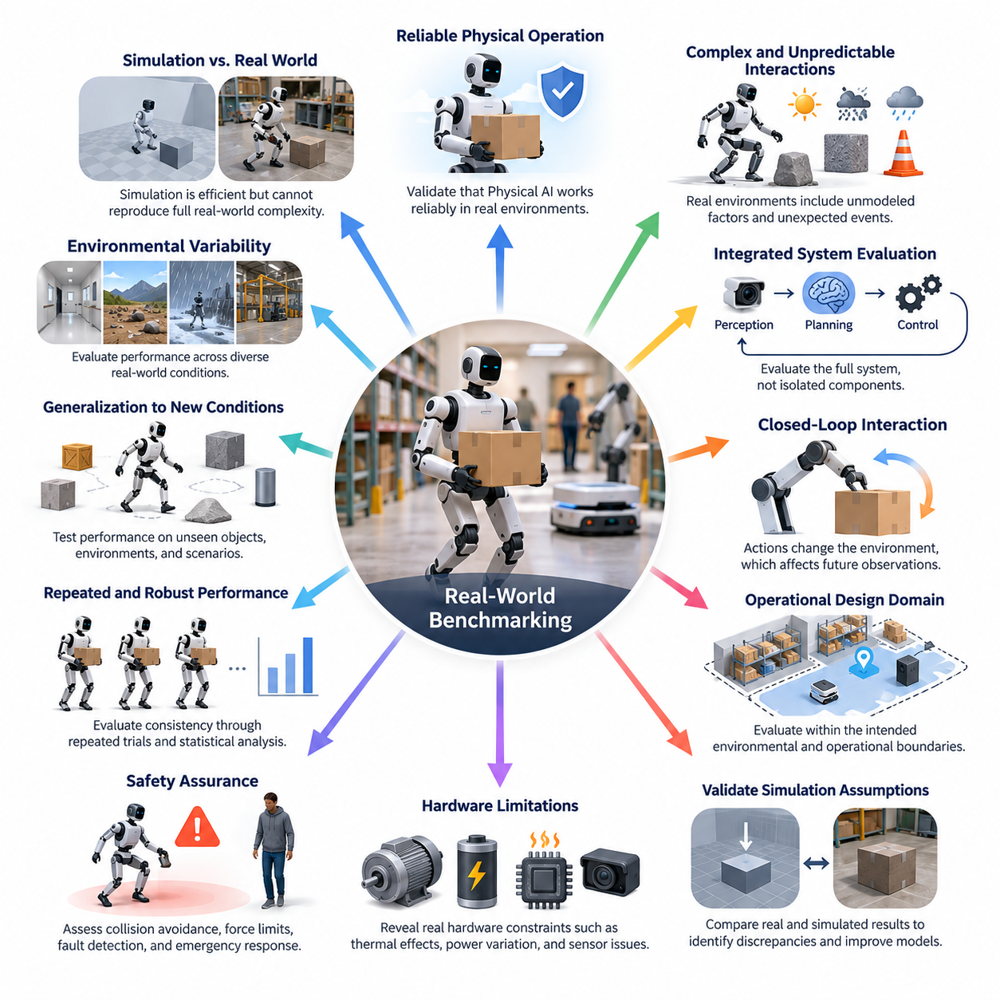{width="7.268055555555556in" height="7.268055555555556in"}

Real-world benchmarking is essential because Physical AI systems must demonstrate reliable performance in environments governed by actual physical constraints rather than idealized computational assumptions. Although simulation provides efficient and repeatable experimentation, it cannot reproduce every interaction among sensors, actuators, materials, humans, and environmental conditions. Physical deployment therefore requires empirical evidence that an intelligent system can perform its intended functions under realistic operating conditions.

The fundamental distinction between simulated and real-world evaluation lies in the complexity and unpredictability of physical interaction. Simulation environments represent selected properties of reality through mathematical models, approximations, and predefined parameters. Actual environments introduce unmodeled friction, mechanical wear, sensor interference, lighting variation, communication delays, and unexpected obstacles. These factors can significantly alter system behavior despite excellent simulated performance.

Real-world benchmarking provides a direct measurement of the integrated capabilities of Physical AI systems. A robot may achieve high perception accuracy, planning efficiency, and control stability when individual components are evaluated independently. However, successful physical operation depends on continuous coordination among these components. Small perception errors may propagate into localization inaccuracies, inappropriate motion decisions, or unstable manipulation, making integrated evaluation indispensable.

Closed-loop interaction is particularly important because Physical AI continuously modifies its environment while responding to environmental feedback. Unlike offline prediction tasks, physical actions change object positions, contact forces, robot configurations, and future observations. Real-world benchmarking evaluates whether the system can maintain stable perception, reasoning, planning, and control throughout these interactions, including situations where its previous actions produce unexpected consequences.

Another essential purpose is validating the assumptions embedded in simulation models and development datasets. Simulated environments often approximate contact mechanics, actuator dynamics, sensor noise, and environmental geometry. These approximations may introduce systematic differences between simulated and physical performance. By comparing equivalent tasks across both domains, researchers can identify discrepancies, quantify performance degradation, and prioritize improvements in simulation fidelity or control robustness.

Real-world testing also reveals the operational limitations of hardware components that are difficult to capture through algorithmic evaluation. Motors experience temperature-dependent behavior, batteries exhibit voltage variation, and embedded processors operate under computational and thermal constraints. Sensors may suffer from calibration drift, vibration, occlusion, or electromagnetic interference. Benchmarking the complete physical platform makes these hardware-dependent limitations visible within the context of actual task execution.

Environmental variability provides another compelling justification for physical evaluation. Indoor robots encounter reflective surfaces, changing illumination, moving pedestrians, and rearranged furniture. Outdoor robots face uneven terrain, precipitation, wind, dust, and changing visibility. Industrial robots must operate around variable workpieces, equipment vibrations, and dynamic production schedules. Real-world benchmarks establish whether Physical AI maintains acceptable performance across the conditions relevant to its intended deployment.

The operational design domain defines the environmental and operational boundaries within which a Physical AI system is expected to function. A meaningful benchmark must evaluate performance relative to these boundaries rather than assuming universal capability. For example, an autonomous mobile robot designed for structured warehouses should be evaluated against relevant floor conditions, pedestrian traffic, payload variations, and navigation requirements. Performance outside the declared domain should be investigated separately.

Real-world benchmarking is also necessary for assessing generalization beyond familiar training conditions. Machine learning models may perform well on datasets containing objects, scenes, and interaction patterns similar to their training examples. However, physical environments introduce unfamiliar geometries, object properties, spatial arrangements, and human behaviors. Evaluating previously unseen conditions helps determine whether a system has acquired transferable capabilities or merely specialized responses to a restricted distribution.

Reliable physical operation requires more than achieving a task objective once. A robot that successfully manipulates an object during a demonstration may fail when the object\'s orientation, mass, surface texture, or initial position changes slightly. Repeated trials under controlled variations distinguish consistent capability from accidental success. Statistical analysis of these trials provides estimates of performance variability, uncertainty, and the probability of successful execution under defined conditions.

Safety represents a particularly important reason for conducting real-world benchmarks. Physical AI systems can exert forces, move through shared spaces, manipulate potentially hazardous objects, and interact directly with people. Errors may produce collisions, equipment damage, or injuries. Controlled physical testing allows researchers to examine stopping behavior, collision avoidance, force limitation, fault detection, and emergency responses while implementing appropriate safeguards against unacceptable risks.

Robustness evaluation examines how Physical AI responds when operating conditions deviate from nominal expectations. A sensor may temporarily lose visibility, a mobile platform may experience wheel slip, or a manipulator may encounter unexpected resistance. Successful systems should detect such disturbances and respond through correction, replanning, safe interruption, or recovery. Real-world benchmarks provide observable evidence of these responses rather than relying exclusively on theoretical assumptions.

Human interaction introduces additional complexity because human behavior is adaptive, context-dependent, and not always predictable. Robots operating near people must interpret movement, maintain appropriate separation, communicate intentions, and respond to unexpected interventions. Evaluation should therefore consider both technical task performance and human-centered outcomes. Measures such as intervention frequency, interaction efficiency, operator workload, and perceived predictability help characterize practical usability.

Task success alone cannot adequately represent the quality of physical execution. Two robots may complete the same operation while exhibiting substantially different trajectories, energy consumption, contact forces, completion times, or levels of human assistance. Real-world benchmarking should capture these differences through multidimensional measurements. This approach prevents high completion rates from concealing inefficient, unstable, excessively aggressive, or operationally impractical behavior.

Resource efficiency is another critical dimension because physical systems operate with finite energy, computation, communication bandwidth, and mechanical endurance. A sophisticated policy may produce accurate actions but require excessive inference time or computational power. Similarly, a mobile robot may navigate successfully while consuming unnecessary battery energy. Physical benchmarking exposes these tradeoffs and supports comparisons based on practical operating costs rather than algorithmic performance alone.

Long-duration evaluation is necessary because many failures emerge only after extended operation. Calibration drift, accumulated localization errors, thermal stress, memory limitations, and repeated mechanical interactions may gradually reduce performance. Short demonstrations cannot reliably establish sustained autonomy. Real-world benchmarks should therefore include extended missions, repeated task cycles, and continuous operation to evaluate reliability, intervention requirements, and degradation over time.

Failure analysis is particularly valuable because unsuccessful physical trials reveal information that aggregate success rates cannot capture. A navigation failure may originate from perception uncertainty, map inconsistency, planning limitations, or actuator behavior. Systematic recording of sensor observations, control commands, environmental conditions, and recovery actions enables researchers to investigate these causal relationships. Near-miss events also provide evidence of vulnerabilities before they produce serious consequences.

Ground-truth measurement presents an important challenge in physical benchmarking. Simulated environments can expose exact object positions, velocities, and system states, whereas real environments require external measurement instruments or carefully calibrated reference systems. Motion capture, surveying equipment, reference sensors, and independent measurement procedures can provide estimates of physical truth. Their accuracy, synchronization, and uncertainty must be considered when interpreting benchmark results.

Experimental reproducibility is equally important for meaningful comparisons among Physical AI systems. Physical environments cannot always be reset perfectly because object placement, friction, battery condition, temperature, and human behavior may vary between trials. Standardized procedures, documented initial conditions, calibrated instruments, and repeated experiments help reduce these inconsistencies. Reporting environmental conditions and statistical uncertainty makes the resulting measurements more interpretable and comparable.

Real-world benchmarks should combine controlled laboratory testing with progressively more realistic field evaluation. Laboratory environments support precise measurement, experimental isolation, and repeatable scenarios. Field environments expose systems to operational complexity, environmental variation, and interactions that may not have been anticipated during development. Together, these evaluation stages provide complementary evidence, allowing developers to investigate fundamental capabilities before examining deployment readiness.

A staged evaluation process also improves development efficiency by identifying problems before systems enter demanding operating environments. Initial physical tests can verify sensing, actuation, calibration, and basic closed-loop stability. More complex scenarios can subsequently evaluate integrated tasks, environmental disturbances, human interaction, and prolonged autonomy. Progression between stages should depend on measurable performance and safety criteria rather than successful demonstrations alone.

Benchmarking results are essential for evaluating the credibility of claims about general-purpose Physical AI. A model capable of performing several demonstrations may not necessarily generalize across environments, tasks, or robotic platforms. Broad capability claims require evidence across representative scenarios, unfamiliar conditions, and appropriately diverse embodiments. Physical evaluation establishes the boundaries of demonstrated competence while revealing where additional adaptation, training, or hardware specialization remains necessary.

Real-world evaluation also supports the development of trustworthy comparison frameworks and industry standards. Without common task definitions, measurement procedures, and reporting conventions, performance claims from different organizations may be difficult to compare. Standardized physical benchmarks can establish consistent expectations for task completion, safety, efficiency, reliability, and generalization. Such frameworks improve transparency while helping researchers distinguish meaningful technical progress from benchmark-specific optimization.

The relationship between simulation and real-world benchmarking should be understood as complementary rather than competitive. Simulation enables extensive exploration, controlled experimentation, and efficient testing of rare conditions, while physical evaluation verifies whether those results transfer into reality. Observed discrepancies can guide improvements in digital twins, domain randomization, sensor models, and control policies. Repeated comparison creates a feedback process connecting virtual development with physical evidence.

Ultimately, real-world benchmarking transforms Physical AI evaluation from a measurement of predicted capability into an assessment of demonstrated physical competence. It establishes whether intelligent systems can act accurately, safely, efficiently, and consistently under the constraints of actual environments. By combining rigorous experimental design, representative operating conditions, multidimensional metrics, and systematic failure analysis, real-world benchmarks provide the empirical foundation for trustworthy deployment and continued technological advancement.

## 03.02. Controlled Lab vs Open World Testing

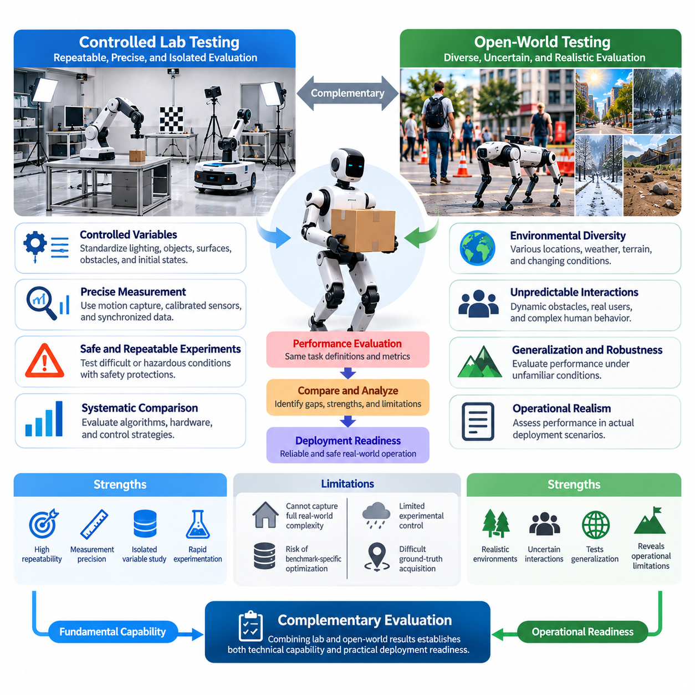{width="7.268055555555556in" height="7.268055555555556in"}

Controlled laboratory testing and open-world testing represent two complementary approaches to evaluating Physical AI systems under real physical conditions. Laboratory testing emphasizes repeatability, measurement precision, and experimental control, while open-world testing emphasizes environmental diversity, uncertainty, and operational realism. Understanding their differences is essential for designing evaluation programs that establish both fundamental technical capability and practical deployment readiness.

Controlled laboratory environments allow researchers to isolate specific variables that influence robotic performance. Lighting, object placement, surface properties, obstacle configurations, and initial robot states can be standardized across repeated trials. This consistency supports systematic comparisons between algorithms, hardware configurations, and control strategies. It also enables researchers to determine whether observed performance differences result from system modifications rather than uncontrolled environmental changes.

A major advantage of laboratory testing is the availability of precise measurement infrastructure. Motion capture systems, calibrated cameras, force sensors, reference localization systems, and synchronized data acquisition equipment can provide detailed ground-truth measurements. Such instrumentation enables quantitative evaluation of trajectory accuracy, manipulation precision, contact forces, latency, and control stability, supporting rigorous investigation of individual capabilities and integrated system behavior.

Laboratory testing also facilitates controlled experimentation with difficult or potentially hazardous conditions. Researchers can introduce artificial obstacles, sensor disturbances, mechanical perturbations, and communication interruptions while maintaining appropriate safety protections. These experiments help identify performance boundaries and failure mechanisms before exposing robots to less predictable environments. However, laboratory safety arrangements must remain representative enough to avoid concealing operational weaknesses.

Despite these advantages, controlled laboratories cannot reproduce the full complexity of actual deployment environments. Laboratory surfaces may be cleaner, lighting more stable, objects more predictable, and human behavior more constrained than in operational settings. Repeated exposure to familiar test arrangements may also encourage benchmark-specific optimization. Consequently, high laboratory performance should be interpreted as evidence of capability under defined conditions rather than proof of general operational competence.

Open-world testing evaluates Physical AI systems in environments where many relevant conditions cannot be fully specified or controlled. Warehouses, hospitals, construction sites, agricultural fields, public spaces, and outdoor infrastructure introduce dynamic obstacles, changing terrain, unpredictable interactions, and variable environmental conditions. These settings reveal whether robotic systems can maintain reliable operation when observations and physical interactions differ from their development assumptions.

Environmental diversity is a defining characteristic of open-world evaluation. A mobile robot may encounter reflective floors, narrow passages, unexpected pedestrian movements, or temporary obstructions. A manipulator may interact with objects exhibiting unfamiliar geometry, compliance, or friction. Outdoor robots must contend with weather, illumination changes, and uneven terrain. Such variation tests the ability of perception, planning, and control systems to adapt without extensive manual reconfiguration.

Open-world testing is especially important for evaluating generalization and robustness. Models trained on restricted datasets or simulated environments may depend on correlations that do not remain valid during deployment. Real-world variation exposes these dependencies and reveals performance degradation under unfamiliar conditions. Evaluation should therefore distinguish between ordinary operational variability, deliberately introduced disturbances, and conditions outside the system\'s declared operational design domain.

Human interaction further differentiates open-world testing from laboratory experiments. Real users and bystanders may behave unpredictably, misunderstand robot intentions, interrupt tasks, or create unexpected obstacles. Human-robot interaction must therefore be evaluated through observable operational outcomes, including safe separation, communication effectiveness, intervention frequency, and task continuity. These measurements help determine whether technical capabilities remain useful in shared environments.

The principal challenge of open-world testing is limited experimental control. Weather, traffic, human activity, environmental geometry, and operational workloads may differ substantially between trials. As a result, observed performance differences cannot always be attributed to a single cause. Reliable evaluation requires careful documentation of test conditions, sufficient repetitions, representative scenario sampling, and statistical methods that account for environmental variability.

Ground-truth acquisition also becomes more difficult outside controlled laboratories. Motion capture infrastructure may be unavailable, reference sensors may have limited coverage, and environmental conditions may degrade measurement accuracy. Evaluators may need to combine surveyed reference points, independent localization instruments, synchronized sensor recordings, and manual annotations. Measurement uncertainty must be documented to avoid interpreting imperfect reference data as exact physical truth.

A meaningful comparison between laboratory and open-world results requires consistent performance definitions. Task success, completion time, trajectory deviation, collision frequency, energy consumption, and intervention requirements should retain compatible interpretations across testing environments. However, identical numerical scores may represent different levels of difficulty. Evaluation reports should therefore include environmental context, task complexity, and operating conditions alongside quantitative results.

Controlled laboratory testing is particularly effective for identifying causal relationships between system design choices and performance. Researchers can modify a perception model, controller, sensor configuration, or actuator parameter while holding other conditions approximately constant. Open-world testing instead evaluates how these choices behave when multiple factors change simultaneously. Combining both approaches supports causal understanding without sacrificing operational relevance.

The transition from laboratory testing to open-world evaluation should follow a progressive validation strategy. Initial experiments establish basic functionality and measurement baselines under controlled conditions. Subsequent tests introduce environmental variability, dynamic obstacles, unfamiliar objects, and increasingly realistic operational workloads. Field trials then assess integrated performance under representative deployment conditions, with progression governed by explicit safety and performance requirements.

Intermediate testing environments are valuable because the distinction between laboratory and open-world evaluation is not strictly binary. Semi-structured test sites, configurable obstacle courses, pilot production areas, and supervised operational zones can combine repeatable scenarios with realistic physical complexity. These environments provide opportunities to investigate failure mechanisms while gradually reducing experimental control and increasing exposure to operational uncertainty.

Safety requirements become increasingly important as environmental control decreases. Laboratory experiments may rely on restricted access, protective barriers, emergency stopping systems, and closely supervised operation. Open-world trials require additional attention to bystander protection, environmental hazards, operational boundaries, and unexpected interactions. Risk assessments should determine permissible scenarios, intervention procedures, monitoring requirements, and conditions that require immediate termination of testing.

Open-world evaluation should not be interpreted as unrestricted experimentation in arbitrary environments. Every deployment-oriented test requires a defined operational design domain, authorized test conditions, and appropriate safety controls. Testing beyond validated boundaries should occur only through carefully managed procedures. This distinction allows researchers to investigate system limitations without confusing uncontrolled exposure with scientifically meaningful or responsible evaluation.

Repeated trials serve different but complementary purposes across the two testing approaches. Laboratory repetition estimates performance variability under approximately identical conditions, while open-world repetition measures consistency across changing conditions and operational circumstances. Both are necessary for characterizing reliability. Statistical reporting should include trial counts, uncertainty estimates, failure distributions, and relevant differences in scenario difficulty.

Long-duration operation provides another important comparison dimension. Laboratory endurance tests can isolate thermal behavior, actuator wear, computational stability, and accumulated estimation errors. Open-world endurance tests reveal how these effects interact with changing workloads, environmental disturbances, and human activity. Together, they establish whether short-term task success can translate into sustained autonomous performance during practical missions.

Failure analysis benefits from the complementary strengths of both environments. Open-world testing frequently reveals unexpected failure modes, while laboratory testing allows those failures to be reconstructed under controlled conditions. A navigation failure observed in a crowded facility, for example, may be reproduced using standardized obstacle movements and sensor disturbances. This process supports diagnosis, corrective development, and subsequent verification in realistic environments.

Simulation can connect laboratory and open-world testing by providing a common environment for scenario reconstruction and systematic variation. Field observations can inform simulation parameters, while simulated stress tests can identify conditions requiring physical validation. Laboratory experiments then verify selected mechanisms before additional field deployment. This iterative process reduces unnecessary physical experimentation while preserving the importance of empirical real-world evidence.

Evaluation programs should avoid treating either testing approach as universally superior. Laboratory benchmarks offer precision and reproducibility but may underestimate operational complexity. Open-world benchmarks provide ecological validity and practical relevance but introduce measurement uncertainty and experimental variability. Their relative importance depends on the system\'s maturity, intended application, risk profile, and evaluation objectives.

Ultimately, controlled laboratory testing establishes how and why Physical AI systems perform under defined physical conditions, while open-world testing determines whether those capabilities remain effective in realistic operational environments. A comprehensive benchmarking framework integrates both approaches through standardized metrics, progressive scenario complexity, rigorous measurement, and systematic failure analysis. This combination provides stronger evidence of capability, robustness, safety, and deployment readiness than either approach can provide independently.

## 03.03. Operational Design Domain and Test Conditions

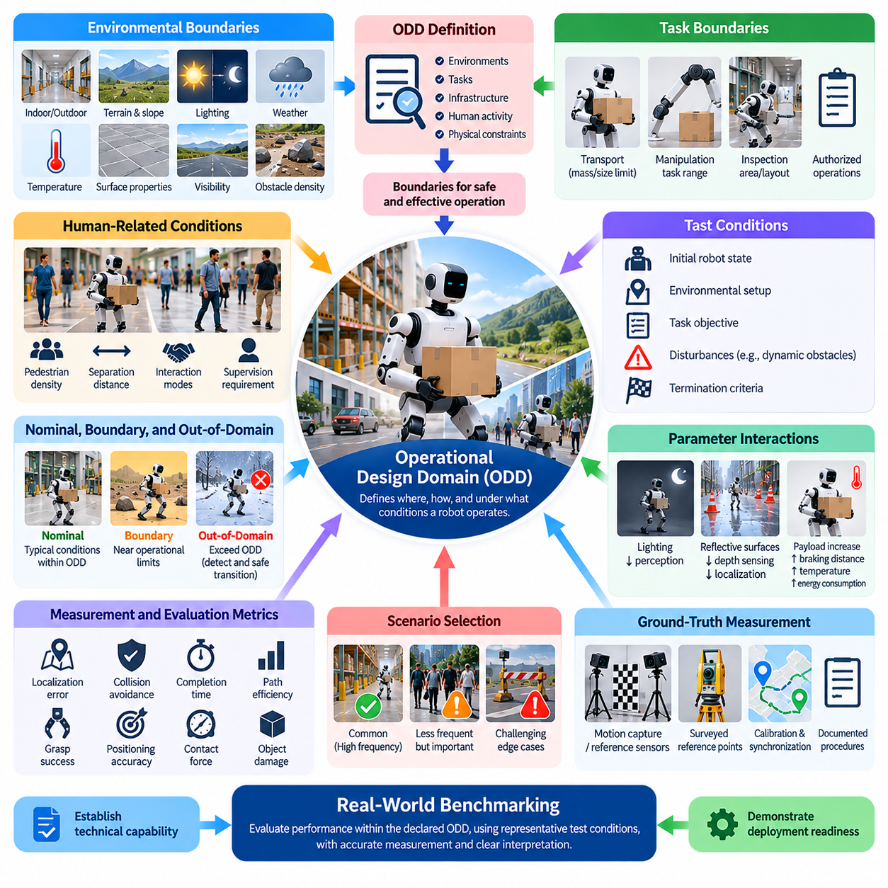{width="7.268055555555556in" height="7.268055555555556in"}

The Operational Design Domain (ODD) defines the conditions under which a Physical AI system is designed and expected to operate safely and effectively. It establishes explicit boundaries concerning environments, tasks, infrastructure, human activity, and physical constraints. In real-world benchmarking, the ODD provides the foundation for selecting representative test scenarios, interpreting performance results, and determining whether demonstrated capabilities support the intended deployment.

An ODD is not simply a description of where a robot operates. It specifies the combination of conditions that influence perception, decision-making, motion, and physical interaction. These conditions may include terrain geometry, illumination, weather, temperature, object characteristics, communication availability, and human proximity. A complete definition distinguishes supported operating conditions from situations requiring restricted operation, human intervention, or safe shutdown.

The importance of ODD specification arises from the context-dependent nature of Physical AI performance. A navigation system that operates reliably in a structured warehouse may behave differently in crowded public spaces or outdoor construction sites. Similarly, a manipulation policy developed for rigid industrial components may fail with deformable or fragile objects. Benchmark results therefore become meaningful only when interpreted relative to clearly documented operational assumptions.

Environmental boundaries form a major component of ODD definition. Indoor systems may specify floor flatness, surface friction, lighting intensity, corridor dimensions, and obstacle density. Outdoor systems may additionally specify terrain slope, precipitation, wind speed, visibility, and temperature ranges. These parameters influence sensing accuracy, mobility, mechanical stability, and energy consumption, making them essential variables for realistic physical evaluation.

Task boundaries describe the operations a Physical AI system is authorized and technically capable of performing. A mobile manipulator may be designed to transport objects within specified mass and size limits, while an autonomous inspection robot may operate only within defined infrastructure layouts. Benchmark scenarios should reflect these constraints while examining performance near their boundaries, where control errors and unexpected interactions become more likely.

Human-related operating conditions require particular attention because people introduce dynamic and partially unpredictable behavior. ODD definitions may specify pedestrian density, minimum separation distances, permitted interaction modes, and requirements for human supervision. Testing must determine whether the system maintains acceptable performance and safety when humans move unexpectedly, obstruct planned trajectories, or intervene during task execution.

Test conditions translate the ODD into measurable experimental configurations. Each benchmark trial should specify the initial robot state, environmental setup, task objective, relevant disturbances, and termination criteria. These specifications establish a consistent basis for comparing repeated trials and different systems. Without explicit test conditions, differences in task difficulty or environmental complexity may be incorrectly interpreted as differences in algorithmic capability.

A useful distinction exists between nominal, boundary, and out-of-domain conditions. Nominal conditions represent typical operating situations within the declared ODD. Boundary conditions approach the limits of supported operation, such as maximum payload, minimum visibility, or allowable terrain slope. Out-of-domain conditions exceed those limits and are primarily used to examine detection, graceful degradation, fallback behavior, and safe transition rather than ordinary task performance.

The selection of test conditions should reflect both operational frequency and potential consequences. Common scenarios establish baseline performance under representative workloads, while less frequent but consequential situations reveal vulnerabilities. A warehouse robot may routinely navigate clear aisles but occasionally encounter unexpected pallet placement or pedestrian congestion. Benchmark design should represent both conditions without assuming that rare events are unimportant.

ODD parameters often interact in ways that make isolated evaluation insufficient. Reduced lighting may degrade visual perception, while reflective surfaces simultaneously affect depth sensing and localization. Increased payload can alter braking distance, actuator temperature, and energy consumption. Real-world benchmarks should therefore include selected combinations of operating conditions to reveal coupled effects that may remain hidden in single-variable experiments.

Measurement requirements must be aligned with the declared ODD and intended application. Navigation benchmarks may emphasize localization error, collision avoidance, completion time, and path efficiency. Manipulation benchmarks may measure grasp success, positioning accuracy, contact force, and object damage. These metrics should be evaluated against predefined acceptance criteria, ensuring that performance claims correspond to practical operational requirements rather than arbitrary numerical scores.

Ground-truth measurement becomes especially important when evaluating ODD boundaries. Reference instruments must provide sufficient accuracy to distinguish genuine performance degradation from measurement uncertainty. For example, testing positioning performance near a specified tolerance requires measurement equipment with appropriately characterized uncertainty. Sensor calibration, time synchronization, reference coordinate frames, and measurement procedures should be documented before experiments begin.

Repeatability requires careful control of conditions that can influence benchmark outcomes. Robot software versions, controller parameters, battery charge, payload distribution, sensor calibration, and environmental configuration should be recorded. Where exact repetition is impossible, evaluators should document variations and incorporate them into statistical analysis. This approach supports reproducibility while acknowledging that physical experiments cannot eliminate every source of uncertainty.

The relationship between ODD and safety is fundamental because operational boundaries define where autonomous behavior is considered acceptable. A system approaching its limits should recognize deteriorating conditions and respond according to its safety architecture. Responses may include speed reduction, restricted task execution, human assistance requests, or transition to a minimum-risk condition. Benchmarking must evaluate these transitions as carefully as normal task completion.

ODD compliance should be assessed continuously rather than only at the beginning of a trial. Environmental conditions may change during operation as weather deteriorates, obstacles appear, communication quality decreases, or human activity increases. A capable Physical AI system should monitor relevant operating parameters and determine whether continued autonomous execution remains appropriate. Testing should examine both the accuracy of this monitoring and the timeliness of resulting decisions.

Operational boundaries also influence the interpretation of generalization. Successful performance under unfamiliar conditions within the declared ODD demonstrates a different capability from operation beyond that domain. Benchmark reports should distinguish in-domain variability, distribution shifts, and explicitly unsupported conditions. This separation prevents isolated demonstrations outside the intended operating envelope from being mistaken for evidence of unrestricted general-purpose intelligence.

A structured test matrix can organize ODD parameters into representative combinations of environmental, task, hardware, and interaction conditions. Each configuration can be associated with expected operating behavior, measurement requirements, and acceptance thresholds. Although exhaustive testing of every combination is generally impractical, systematic scenario selection can improve coverage while concentrating resources on high-risk or poorly understood operating regions.

Risk-based scenario selection provides a practical method for prioritizing benchmark conditions. Scenarios may be assessed according to their likelihood, severity of potential consequences, and difficulty of detecting emerging failures. Conditions involving vulnerable humans, high kinetic energy, unstable terrain, or uncertain perception may require additional scrutiny. This approach connects performance evaluation with safety engineering without reducing all evaluation objectives to a single risk score.

The ODD must also account for platform-specific hardware limitations. Wheel geometry, ground clearance, actuator capacity, sensor placement, compute availability, and thermal constraints influence which environments and tasks are physically achievable. Two robots executing the same benchmark may therefore operate within different valid domains. Meaningful comparisons should identify shared conditions while preserving the distinction between algorithmic limitations and embodiment-specific constraints.

Long-duration operation introduces temporal conditions that should be included in ODD specifications. Battery depletion, component heating, mechanical wear, accumulated localization errors, and changing environmental workloads may alter system behavior over time. A benchmark limited to short trials may overlook these effects. Extended testing should determine whether the system maintains acceptable performance throughout its intended operating duration and responds appropriately as resource limits approach.

ODD definitions should evolve through a controlled validation process as Physical AI capabilities improve. New sensors, revised policies, improved controllers, and additional training data may expand supported operating conditions. However, expanded claims require new evidence rather than assumptions based on previous benchmarks. Versioned ODD specifications and documented test results provide traceability between system changes, validated capabilities, and deployment authorization.

Ultimately, the Operational Design Domain connects Physical AI system requirements with measurable real-world evidence. By defining operating boundaries, translating them into representative test conditions, evaluating nominal and exceptional scenarios, and documenting uncertainty, ODD-based benchmarking establishes the scope of demonstrated competence. This framework supports scientifically meaningful comparisons, responsible capability expansion, and safer deployment of intelligent physical systems.

## 03.04. Test Site and Scenario Design

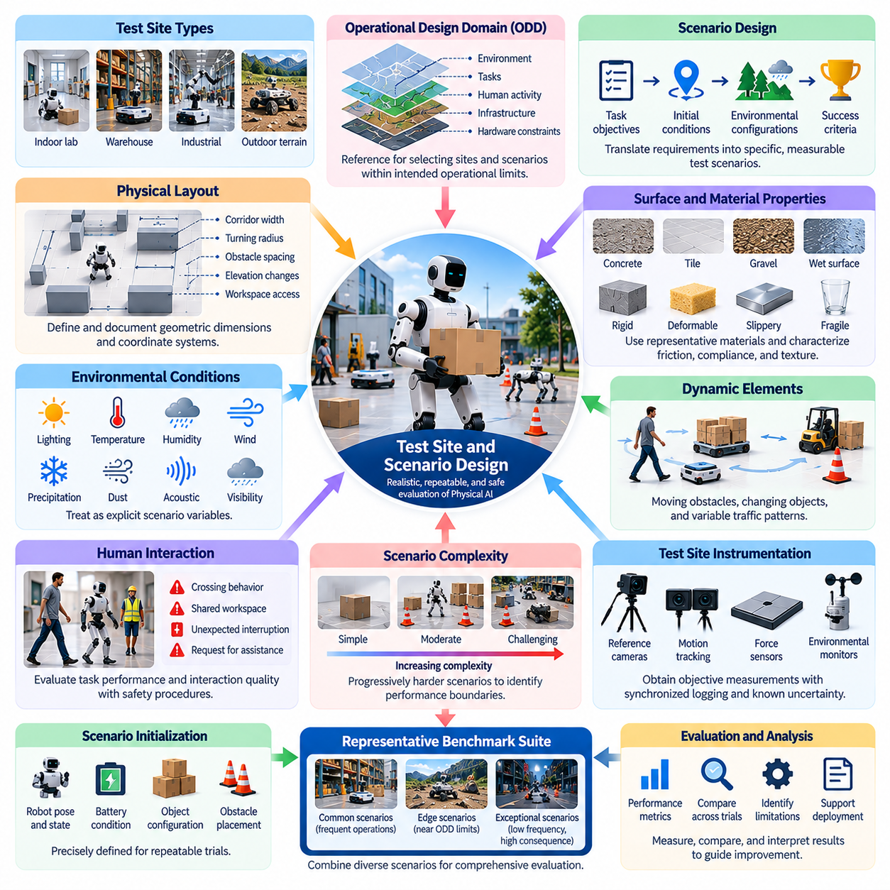{width="7.268055555555556in" height="7.268055555555556in"}

Test site and scenario design is a fundamental component of real-world benchmarking for Physical AI systems. A well-designed test environment must represent relevant operational conditions while supporting repeatable experiments, reliable measurement, and safe execution. The objective is not merely to demonstrate successful robotic behavior but to establish whether observed performance reflects capabilities that remain dependable across realistic physical situations.

A test site provides the physical infrastructure within which evaluation scenarios are executed. Its design should consider spatial layout, surface characteristics, environmental conditions, available instrumentation, and operational constraints. Depending on the application, test sites may include indoor laboratories, warehouses, industrial facilities, outdoor terrain courses, agricultural fields, or supervised public environments. Each setting introduces distinct evaluation opportunities and limitations.

Scenario design translates operational requirements into specific tasks, initial conditions, environmental configurations, and expected outcomes. A scenario should identify what the robot must accomplish, which conditions influence execution, and how success or failure will be determined. Clearly defined scenarios enable meaningful comparisons across repeated trials, different robotic platforms, and alternative algorithms without relying on subjective observations.

The Operational Design Domain provides the primary reference for selecting test sites and scenarios. Environmental boundaries, task limitations, human interaction requirements, and hardware constraints determine which conditions are representative of intended deployment. A benchmark should cover typical operating situations while also examining conditions near supported limits. Scenarios outside the declared domain require separate objectives and appropriate safety controls.

Physical layout strongly influences benchmark difficulty and interpretation. Corridor width, turning radius, obstacle spacing, elevation changes, workspace accessibility, and object placement can affect navigation and manipulation performance. Test sites should therefore document relevant geometric dimensions and coordinate systems. Standardized layouts improve reproducibility, while configurable layouts support systematic investigation of how environmental geometry affects behavior.

Surface and material properties are equally important because physical interaction depends on friction, compliance, texture, and mechanical resistance. Mobile robots may experience different traction on concrete, tile, gravel, or wet surfaces. Manipulators may encounter rigid, deformable, slippery, or fragile objects. Test site design should incorporate representative materials and characterize their properties sufficiently to support interpretation of performance differences.

Environmental conditions should be treated as explicit scenario variables rather than incidental background characteristics. Illumination, temperature, humidity, wind, precipitation, dust, and acoustic interference may influence sensing and control. Some variables can be controlled through dedicated facilities, while others require field observation and documentation. Scenario specifications should distinguish intentionally varied conditions from uncontrolled environmental changes.

Dynamic elements are necessary for evaluating robots operating in environments that evolve during task execution. Moving obstacles, changing object positions, temporary access restrictions, and variable traffic patterns can challenge perception, prediction, and planning. Dynamic scenarios should define relevant movement patterns and timing constraints while allowing controlled variability. This enables evaluation of adaptability without sacrificing experimental interpretability.

Human presence requires carefully designed interaction scenarios. Pedestrians, operators, collaborators, and bystanders may influence robot motion and task decisions. Test scenarios can examine crossing behavior, shared workspace coordination, unexpected interruptions, and requests for assistance. Human participation should follow appropriate safety procedures, and evaluation should consider both task outcomes and the quality of human-robot interaction.

Scenario complexity should increase progressively to reveal performance boundaries. Initial tests may involve simple environments, isolated tasks, and predictable conditions. More demanding scenarios can introduce multiple obstacles, uncertain observations, competing objectives, and interacting disturbances. Progressive complexity helps identify the point at which performance deteriorates and supports targeted investigation of the mechanisms responsible for failure.

A representative benchmark suite should contain both common operational scenarios and less frequent but consequential situations. Routine tasks establish expected performance under normal workloads, while exceptional scenarios reveal vulnerabilities and recovery limitations. Scenario selection should consider operational frequency, task importance, potential consequences, and uncertainty. This approach prevents evaluation results from being dominated by easy or unusually favorable conditions.

Test site instrumentation is essential for obtaining objective performance measurements. Reference cameras, motion tracking systems, force sensors, environmental monitors, and synchronized logging infrastructure can support measurement of position, velocity, contact forces, timing, and resource consumption. Instrument placement should minimize interference with robot operation, and measurement uncertainty should be characterized before benchmark execution.

Scenario initialization must be sufficiently precise to support repeated trials. Robot pose, battery condition, payload, object locations, software configuration, and environmental state can influence outcomes. Standardized initialization procedures reduce unwanted variation and make comparisons more reliable. When exact resetting is impractical, the actual initial conditions should be recorded and incorporated into subsequent statistical analysis.

Success criteria should be established before experiments begin. Task completion alone may not capture execution quality, safety, or operational efficiency. A navigation scenario may require reaching a destination within specified time and separation constraints, while manipulation may require accurate placement without excessive contact force or object damage. Explicit acceptance thresholds help prevent subjective interpretation and post hoc changes to evaluation criteria.

Failure conditions and termination rules must also be defined. Collisions, loss of localization, unsafe motion, excessive force, communication failures, and operator intervention may trigger different responses depending on the application. Benchmark protocols should distinguish task failure, safety-related termination, recoverable interruption, and infrastructure malfunction. These distinctions support meaningful failure analysis and prevent unrelated events from being combined into misleading scores.

Test site safety requires physical and procedural safeguards appropriate to the expected hazards. Protective barriers, emergency stopping devices, restricted access zones, supervision procedures, and equipment inspection may be necessary. Outdoor and shared environments introduce additional concerns involving bystanders, weather, and uncontrolled obstacles. Safety provisions should enable informative experimentation without exposing participants or surrounding infrastructure to unacceptable risks.

Scenario diversity is essential for evaluating generalization rather than memorization of fixed test arrangements. Variations in object identity, spatial configuration, obstacle placement, lighting, and task sequence can reveal dependence on familiar conditions. However, variation should be systematically documented so that performance changes remain interpretable. A combination of standardized scenarios and previously unseen configurations provides stronger evidence of transferable capability.

Statistical validity depends on how scenarios are sampled and repeated. A benchmark dominated by a narrow collection of easy tasks may overestimate practical performance. Balanced scenario selection, sufficient repetitions, and transparent reporting of difficulty distributions improve reliability. Results should identify the number of trials, environmental variations, failure frequencies, and uncertainty estimates rather than presenting only aggregate success rates.

Test site design must also account for differences among robotic embodiments. Wheeled platforms, manipulators, quadrupeds, humanoids, and aerial robots possess different physical capabilities and constraints. Common tasks can support cross-platform comparison, but identical physical configurations may unfairly favor particular morphologies. Evaluation should distinguish shared functional objectives from embodiment-specific requirements and limitations.

Long-duration scenarios extend evaluation beyond isolated demonstrations. Continuous navigation, repeated manipulation, sustained inspection, and multi-stage missions expose accumulated errors, thermal effects, mechanical wear, and resource limitations. Test sites should support extended operation and appropriate monitoring. Such scenarios help determine whether systems maintain reliable behavior as operating conditions and internal states evolve over time.

A systematic development cycle connects scenario design with observed benchmark failures. Field observations can reveal previously overlooked conditions, while laboratory reconstruction allows individual failure mechanisms to be examined. Revised scenarios can then verify whether corrective changes improve performance. Maintaining scenario versions and test records ensures that improvements are traceable and comparisons remain valid across system updates.

Ultimately, effective test site and scenario design connects Physical AI evaluation objectives with measurable physical evidence. Representative environments, controlled experimental procedures, calibrated instrumentation, explicit success criteria, and carefully selected disturbances create a foundation for trustworthy benchmarking. By combining repeatability with operational realism, test programs can assess capability, robustness, safety, and generalization while supporting responsible deployment decisions.

## 03.05. Ground Truth and Reference Measurement

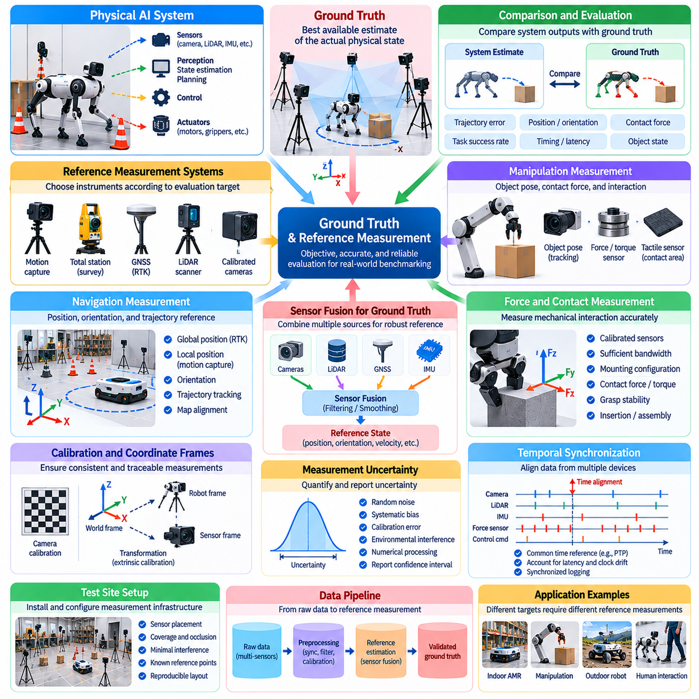{width="7.268055555555556in" height="7.268055555555556in"}

Ground truth and reference measurement are fundamental to reliable real-world benchmarking of Physical AI systems. Ground truth represents the best available estimate of the actual physical state, while reference measurement provides the procedures and instruments used to establish that estimate. Together, they enable objective comparison between system predictions, commanded actions, and observed outcomes under realistic operating conditions.

Unlike simulation, where exact states may be directly accessible, physical environments rarely provide perfectly known positions, velocities, forces, or object properties. Every real-world measurement contains uncertainty arising from sensors, calibration, environmental disturbances, and data processing. Consequently, ground truth should be treated as a carefully characterized reference estimate rather than an unquestionable representation of physical reality.

Reference measurement systems must be selected according to the quantities being evaluated and the required accuracy. Navigation benchmarks may require position, orientation, and trajectory references, while manipulation benchmarks may require object pose, contact force, and displacement measurements. The measurement method should provide sufficient resolution, repeatability, and uncertainty control to distinguish meaningful performance differences between competing systems.

Motion capture systems are commonly used to establish reference trajectories in controlled laboratory environments. Multiple calibrated cameras track markers or recognizable features to estimate three-dimensional position and orientation. These measurements support evaluation of localization, motion planning, and control accuracy. However, camera coverage, occlusion, marker placement, and calibration quality can influence reference reliability.

Outdoor and large-scale environments often require alternative reference technologies. Survey-grade positioning systems, robotic total stations, terrestrial laser scanners, and carefully surveyed landmarks can provide spatial references over extended areas. Satellite-based positioning may also contribute where reception conditions permit. Each technology introduces limitations involving visibility, multipath effects, coverage, synchronization, and environmental interference.

Ground truth for manipulation requires more than measuring robot joint positions. Successful physical interaction depends on object motion, contact geometry, applied forces, and final task outcomes. Reference cameras, force-torque sensors, tactile measurement devices, and precision fixtures can characterize these interactions. Measurements should distinguish commanded motion from actual object displacement and account for deformation, slip, and unintended contact.

Force and torque measurements are particularly important when evaluating contact-rich Physical AI tasks. Grasping, insertion, assembly, locomotion, and human interaction involve forces that cannot be inferred reliably from position measurements alone. Calibrated force sensors and instrumented interfaces provide direct observations of mechanical loading. Their bandwidth, mounting configuration, dynamic response, and measurement uncertainty must be considered.

Temporal synchronization is essential because Physical AI systems operate through continuous feedback loops. Sensor observations, reference measurements, control commands, and actuator responses may be recorded by different devices with independent clocks. Even small timestamp errors can distort estimated latency, trajectory deviation, and causal relationships. Benchmark protocols should therefore specify clock synchronization methods and characterize residual timing uncertainty.

Coordinate frame consistency is equally important for interpreting spatial measurements. Robot base frames, sensor frames, world frames, object frames, and external reference frames may use different origins and orientations. Accurate transformations are required to compare estimates and reference measurements. Calibration procedures should document transformation parameters, conventions, and uncertainties to prevent systematic errors from being mistaken for algorithmic failures.

Calibration establishes the relationship between instrument readings and recognized physical quantities. Camera calibration, sensor alignment, force sensor zeroing, and dimensional verification should be performed using documented procedures. Calibration must also be checked periodically because vibration, temperature changes, mechanical impacts, and component aging can alter measurement characteristics. Traceability to recognized measurement standards strengthens confidence in benchmark results.

Measurement uncertainty should be explicitly quantified rather than ignored. Random noise, systematic bias, calibration error, environmental interference, and numerical processing can contribute to the difference between measured and actual values. An uncertainty budget identifies these contributions and estimates their combined influence. Reported benchmark accuracy should reflect the uncertainty of the reference system, particularly when performance differences are small.

Reference measurement resolution must be appropriate for the intended acceptance criteria. A robot evaluated against millimeter-level positioning requirements cannot be meaningfully certified using a reference instrument with substantially larger uncertainty. Similarly, high-frequency control evaluation requires sufficient temporal sampling and sensor bandwidth. Measurement capability should be established before testing so that the benchmark can support its intended conclusions.

Ground truth may be constructed through sensor fusion when no single reference instrument provides adequate coverage or reliability. Independent cameras, inertial sensors, surveyed landmarks, and positioning instruments can contribute complementary observations. Fusion methods must account for correlated errors and inconsistent measurement quality. The resulting estimate should include uncertainty information and should not automatically be considered more accurate merely because multiple sensors are combined.

Independent reference measurement helps prevent circular evaluation. If a robot\'s own localization estimate is used as the sole ground truth for evaluating localization accuracy, systematic errors may remain undetected. Reference systems should therefore be sufficiently independent of the evaluated algorithm and its assumptions. When independence is incomplete, the shared dependencies and their potential influence on benchmark results should be documented.

Occlusion and missing measurements create additional challenges in dynamic environments. Moving objects, human participants, reflective surfaces, and restricted sensor visibility may interrupt reference tracking. Interpolation can sometimes reconstruct short gaps, but reconstructed values introduce additional uncertainty. Benchmark procedures should define how missing data are identified, excluded, estimated, or reported to avoid misleading performance statistics.

Reference measurements must also represent task outcomes rather than only intermediate physical states. A manipulation task may require verifying correct assembly, object integrity, or functional engagement. A navigation task may require confirming destination arrival without collision or prohibited boundary crossing. Outcome verification may combine geometric measurements, independent sensors, and predefined inspection procedures to establish whether the intended objective was achieved.

Experimental repeatability depends on the stability of the reference measurement infrastructure. Instrument placement, calibration status, environmental configuration, sampling frequency, and processing software should remain controlled or documented across trials. Reference system changes can produce apparent performance improvements or degradation even when the evaluated robot remains unchanged. Versioned measurement procedures support meaningful longitudinal comparisons.

Statistical analysis should distinguish variation in robot behavior from variation introduced by the measurement process. Repeated reference measurements can characterize instrument repeatability, while independent calibration checks can reveal systematic drift. Confidence intervals and performance distributions should incorporate relevant uncertainty sources. This distinction is essential when comparing algorithms whose measured differences approach the limits of reference accuracy.

Field benchmarking introduces practical constraints that may require balancing measurement precision against operational realism. Highly instrumented laboratories provide accurate references but may restrict natural behavior or environmental complexity. Portable reference systems support realistic deployment conditions but often introduce greater uncertainty. Evaluation reports should explain these tradeoffs and identify which conclusions remain justified by the available measurements.

Long-duration testing requires monitoring reference system stability throughout extended operation. Temperature variation, mechanical movement, clock drift, power interruptions, and environmental changes can gradually affect measurement accuracy. Periodic validation checks and independent reference observations help identify these effects. Without such monitoring, apparent robot performance degradation may partly reflect changes in the measurement infrastructure itself.

Ground-truth datasets should preserve raw observations, calibration parameters, timestamps, coordinate transformations, uncertainty estimates, and processing metadata. These records enable independent analysis, error investigation, and reproducibility. Derived reference trajectories or labels should remain traceable to their original measurements. Data governance procedures should also address integrity, version control, access permissions, and protection of sensitive environmental information.

Ultimately, trustworthy ground truth is not defined by an assumption of perfect accuracy but by transparent measurement methods, characterized uncertainty, and demonstrated suitability for the evaluation objective. Reference measurement connects observed physical behavior with quantitative performance claims. By combining calibrated instrumentation, independent verification, synchronization, uncertainty analysis, and reproducible procedures, Physical AI benchmarks can produce credible evidence of real-world capability and reliability.

## 03.06. Repeated Trials and Experimental Control

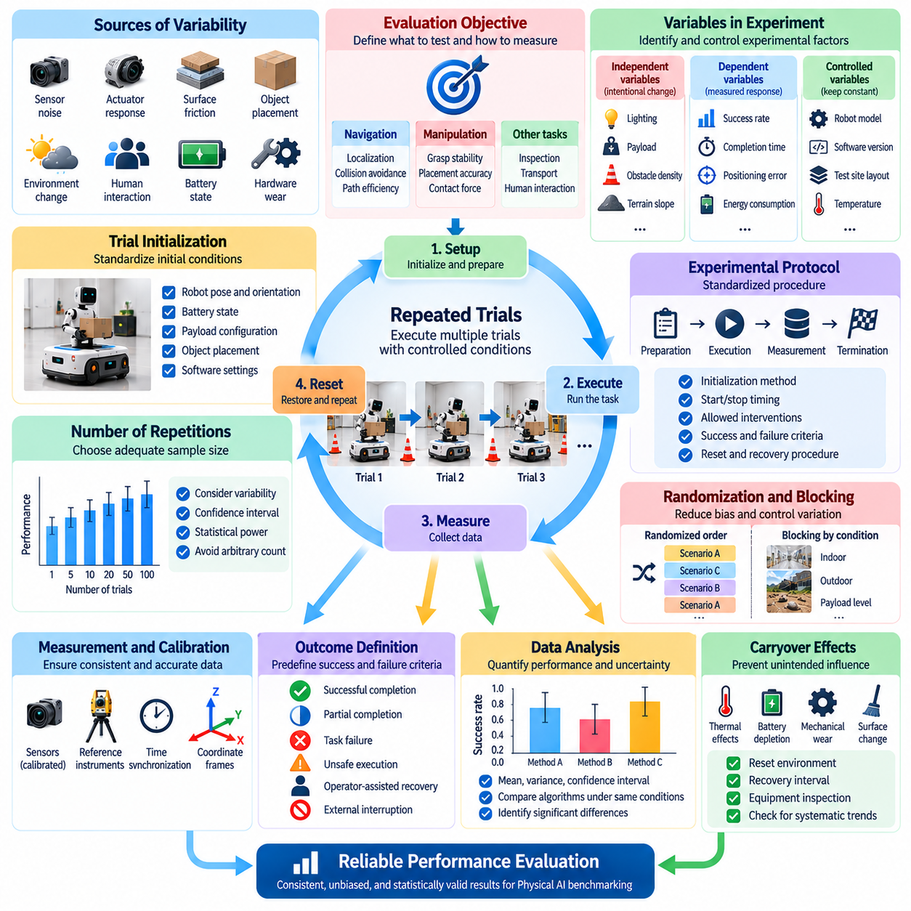{width="7.268055555555556in" height="7.268055555555556in"}

Repeated trials and experimental control are essential for establishing reliable performance evidence in real-world Physical AI benchmarking. A single successful demonstration cannot determine whether a robotic system performs consistently under comparable conditions. Repeated experiments reveal variability, identify intermittent failures, and support statistical conclusions. Experimental control ensures that observed differences can be attributed to meaningful system behavior rather than uncontrolled environmental changes.

Physical AI experiments involve numerous sources of variability that are difficult to eliminate completely. Sensor noise, actuator response, surface friction, object placement, environmental disturbances, and human interaction can influence task outcomes. Even when identical commands are issued, physical systems may follow slightly different trajectories. Repeated trials characterize these variations and help distinguish inherent system uncertainty from exceptional events.

Experimental control begins with a precise definition of the evaluation objective. Researchers must identify the capability being tested, the variables expected to influence performance, and the measurements required to assess outcomes. A navigation experiment may focus on localization accuracy or collision avoidance, while manipulation testing may examine grasp stability or placement precision. Clear objectives prevent unrelated factors from obscuring the interpretation of results.

Independent variables represent conditions intentionally changed during an experiment, such as payload mass, obstacle density, illumination, or terrain slope. Dependent variables represent measured responses, including success rate, completion time, positioning error, and energy consumption. Controlled variables are maintained within specified limits. Distinguishing these categories enables systematic investigation of how operating conditions influence Physical AI performance.

Trial initialization must be standardized to support meaningful repetition. Robot position, orientation, battery state, payload configuration, object placement, and software settings should be established before each execution. Differences in initial conditions can introduce systematic bias or increase outcome variability. When exact initialization is impractical, deviations should be measured and recorded rather than assumed to be negligible.

A repeatable experimental protocol specifies the sequence of preparation, execution, measurement, and termination. It should define how the robot is initialized, when timing begins, which interventions are permitted, and how completion or failure is determined. Standardized procedures reduce operator-dependent variation and support independent replication. Protocol changes should be documented because even minor adjustments may influence measured performance.

The number of repetitions should reflect the expected variability and the precision required for performance estimates. Highly consistent tasks may require fewer trials than tasks involving uncertain perception or dynamic interaction. Sample size planning can use preliminary experiments, confidence interval targets, or statistical power analysis. Arbitrary repetition counts may produce misleading confidence, especially when failures are uncommon.

Randomization reduces bias associated with trial order and uncontrolled temporal effects. Scenario configurations, obstacle arrangements, and algorithm testing order can be randomized within operational constraints. This prevents one system from consistently benefiting from favorable conditions or fresh equipment. Randomization procedures and seeds should be recorded to support reproducibility and later investigation of unusual results.

Blocking provides another method for controlling variation when environmental conditions cannot remain constant. Trials may be grouped according to surface type, lighting period, payload category, or test site. Different algorithms can then be compared within similar blocks rather than across unrelated conditions. This approach reduces confounding and helps separate treatment effects from predictable environmental differences.

Paired experimental designs are particularly useful when comparing competing Physical AI algorithms. Two controllers may execute equivalent tasks under closely matched conditions, allowing their performance differences to be evaluated directly. Pairing can reduce variability caused by task difficulty or environmental configuration. However, trial order should be balanced to prevent learning, wear, or changing conditions from favoring one method.

Physical experiments frequently exhibit carryover effects between successive trials. Actuator heating, battery depletion, mechanical wear, surface changes, and residual object displacement can alter subsequent outcomes. Experimental protocols should include appropriate reset procedures, recovery intervals, and equipment inspections. Without these precautions, later trials may become systematically more difficult or easier than earlier ones.

Measurement consistency is essential for experimental control. Sensors, reference instruments, timestamps, coordinate frames, and data processing procedures should remain consistent across repetitions. Calibration drift or changes in measurement software can create apparent performance differences unrelated to the robot. Reference measurement uncertainty must therefore be monitored and incorporated into statistical interpretation when relevant.

Success and failure criteria must be established before collecting benchmark results. Task completion should be distinguished from partial completion, unsafe execution, operator-assisted recovery, and infrastructure-related interruption. Consistent outcome definitions prevent subjective scoring and selective interpretation. Every trial should receive a documented outcome, including unsuccessful attempts and trials terminated for safety reasons.

Statistical analysis should describe both central performance and variation across trials. Mean completion time, median error, success probability, standard deviation, and confidence intervals provide complementary information. For highly skewed outcomes, robust statistics or distributional summaries may be more informative than averages alone. Performance claims should reflect the observed distribution rather than isolated best-case demonstrations.

Rare failures require special consideration because limited repetitions may not reveal them. A system completing every task in a small test series cannot automatically be considered failure-free. Confidence bounds on failure probability depend strongly on sample size and assumptions about trial independence. Safety-critical evaluation may therefore require extended testing, targeted stress scenarios, and additional evidence beyond ordinary success-rate measurements.

Independence between trials is an important statistical assumption that may not hold automatically. Repeated executions on the same surface, with the same objects, or under continuously changing environmental conditions can produce correlated outcomes. Such dependence reduces the effective information gained from additional repetitions. Analysis should account for clustering, temporal trends, or repeated-measure structures when these effects are significant.

Human involvement introduces additional experimental variability. Operators may differ in intervention timing, task instructions, supervision practices, and experience. Human participants may also adapt their behavior after repeated interactions with a robot. Standardized instructions, operator training, counterbalanced conditions, and documented interventions help control these influences while preserving realistic human-robot interaction.

Experimental control should not eliminate all environmental diversity. Excessively rigid conditions may produce highly repeatable results that fail to represent practical deployment. A balanced benchmark combines controlled trials for causal interpretation with varied trials for robustness and generalization assessment. The objective is to distinguish intentionally introduced variability from uncontrolled variation rather than artificially removing every source of uncertainty.

Long-duration experiments reveal effects that short repeated trials may overlook. Continuous operation can introduce thermal drift, accumulated localization error, battery degradation, and progressive mechanical changes. Repetitions should therefore be complemented by endurance testing when operational requirements demand sustained reliability. Analysis must distinguish gradual degradation from random fluctuations and identify conditions associated with emerging failures.

Data management supports both reproducibility and scientific accountability. Each trial should preserve configuration parameters, software versions, environmental measurements, raw sensor records, reference measurements, intervention logs, and outcome labels. Unique trial identifiers and versioned protocols enable systematic comparison across experiments. Complete records also support failure reconstruction and independent verification of reported conclusions.

Reporting should include unsuccessful trials, exclusions, protocol deviations, and missing observations. Removing difficult cases without justification can inflate measured performance and undermine benchmark credibility. Exclusion criteria should be defined in advance whenever possible, and sensitivity analysis can examine how alternative treatment of incomplete trials affects conclusions. Transparent reporting is essential for trustworthy comparison.

Ultimately, repeated trials and experimental control transform isolated robotic demonstrations into scientifically interpretable evidence. Standardized procedures, appropriate randomization, controlled variables, sufficient repetitions, calibrated measurements, and rigorous statistical analysis reveal both expected performance and its uncertainty. These practices enable Physical AI benchmarks to assess consistency, robustness, reliability, and readiness for real-world deployment.

## 03.07. Perception Localization and State Estimation

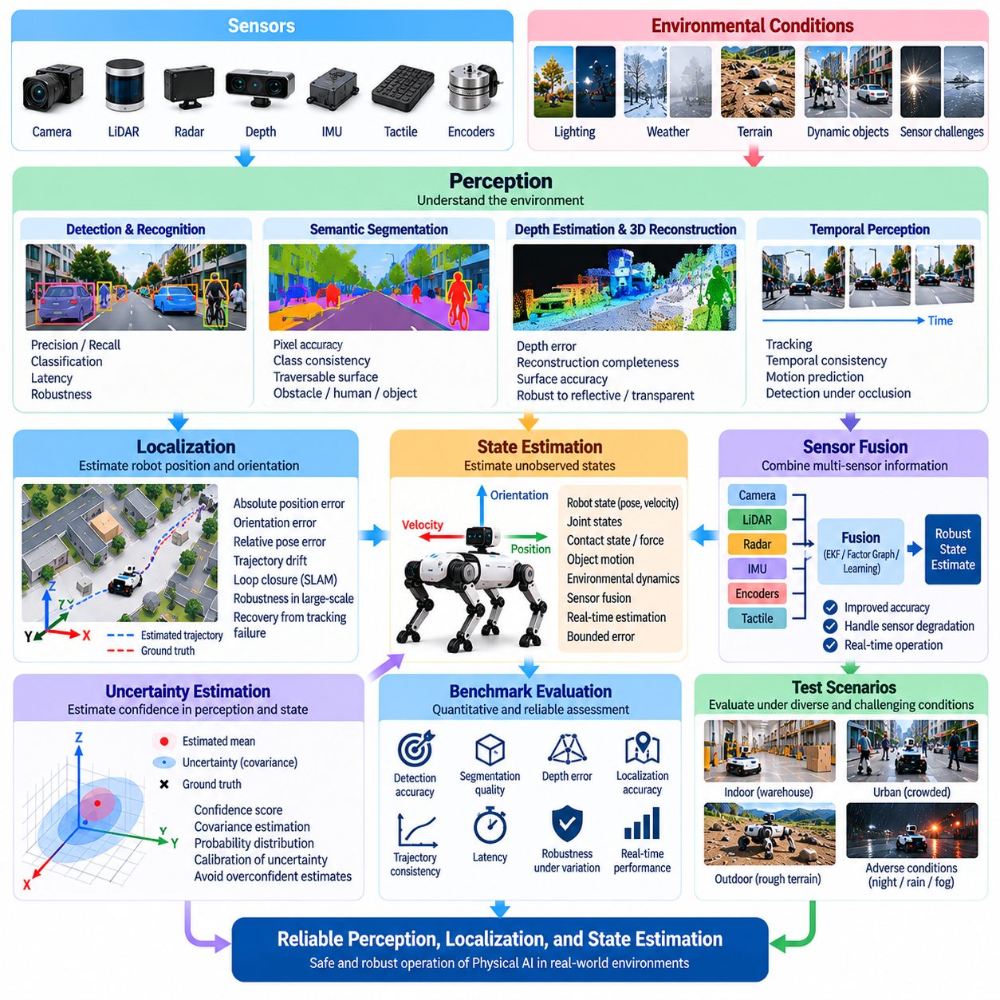{width="7.268055555555556in" height="7.268055555555556in"}

Perception, localization, and state estimation are fundamental capabilities of Physical AI systems operating in real-world environments. Perception transforms sensor observations into meaningful information about surrounding objects, surfaces, and activities. Localization determines the robot\'s position and orientation, while state estimation reconstructs quantities that cannot be directly observed. Real-world benchmarks must evaluate these capabilities under realistic uncertainty and changing operational conditions.

Physical AI perception relies on sensors such as cameras, LiDAR, radar, depth sensors, tactile arrays, and inertial measurement units. Each sensor captures different aspects of the physical environment and introduces characteristic limitations. Cameras are sensitive to illumination, LiDAR may encounter reflective surfaces, and inertial sensors accumulate drift. Benchmarking should assess both individual sensor performance and the reliability of integrated perception systems.

Object detection and recognition benchmarks evaluate whether robots correctly identify relevant entities within their operating environments. Performance measures may include precision, recall, detection latency, and classification accuracy. However, conventional image-level metrics alone cannot establish operational reliability. Evaluations should also consider object distance, occlusion, motion, unusual viewpoints, and the consequences of missed or incorrect detections.

Semantic segmentation and scene understanding provide richer representations of physical environments. Robots may need to distinguish traversable surfaces, obstacles, humans, machinery, and manipulable objects. Benchmark scenarios should measure segmentation quality alongside the consistency of semantic interpretations over time. Errors that appear minor in image space may become significant when they influence navigation decisions or physical contact.

Depth estimation and three-dimensional reconstruction are essential for spatial reasoning and physical interaction. Stereo vision, structured light, time-of-flight sensing, and LiDAR can estimate geometric relationships between robots and surrounding objects. Evaluation should consider depth error, reconstruction completeness, surface accuracy, and performance near discontinuities. Transparent, reflective, dark, and textureless surfaces provide particularly informative test conditions.

Localization benchmarks determine how accurately a robot estimates its pose relative to a defined reference frame. Absolute position error, orientation error, relative pose error, and trajectory drift are commonly examined. Reference measurements may be obtained through motion capture, surveyed landmarks, or precision positioning systems. Results should distinguish short-term accuracy from accumulated errors during extended operation.

Simultaneous Localization and Mapping combines pose estimation with the construction or updating of an environmental map. Real-world SLAM benchmarks should examine trajectory consistency, map accuracy, loop closure, and recovery from tracking failures. Dynamic objects, repetitive structures, and perceptual aliasing can produce incorrect associations. Evaluation must therefore investigate both geometric quality and the stability of mapping over time.

State estimation extends beyond robot pose to include velocity, acceleration, joint states, contact conditions, object motion, and environmental dynamics. These quantities are often inferred through models and sensor fusion rather than measured directly. Benchmarking should compare estimated states with independent references whenever feasible. It should also determine whether estimation errors remain bounded during rapid motion and unexpected interactions.

Sensor fusion combines complementary observations to improve state awareness. Visual, inertial, proprioceptive, tactile, and range measurements may provide different levels of accuracy and availability. Fusion performance depends on calibration, timing, noise models, and the treatment of correlated errors. Benchmarks should examine whether additional sensors improve reliability and how the estimator responds when individual sensing channels become degraded.

Temporal consistency is critical because perception and estimation operate continuously during robot execution. Delayed observations, irregular sampling, communication jitter, and asynchronous sensor updates can distort reconstructed states. Evaluation should measure end-to-end latency, update frequency, timestamp accuracy, and temporal alignment. A geometrically accurate estimate may still be operationally unsuitable if it arrives too late for safe control.

Uncertainty estimation provides information about the confidence associated with perceived objects and estimated states. Probabilistic filters, learned predictors, and Bayesian estimators may express uncertainty through covariance matrices, confidence scores, or predictive distributions. Benchmarks should assess whether reported uncertainty corresponds to observed errors. Overconfident estimates are particularly dangerous when downstream controllers assume reliable environmental knowledge.

Environmental variability should be systematically represented in perception benchmarks. Illumination changes, shadows, rain, fog, dust, vibration, reflective materials, and sensor contamination can degrade observation quality. Testing should characterize performance across defined condition ranges rather than relying on a single favorable environment. Combined disturbances are important because several moderate effects may produce substantial failures when encountered together.

Dynamic environments introduce additional difficulties for localization and scene interpretation. Moving pedestrians, vehicles, manipulators, and temporary obstacles can violate assumptions about static surroundings. Benchmark scenarios should examine object tracking, motion prediction, data association, and separation of static and dynamic features. These capabilities determine whether a robot can maintain reliable state estimates while its environment changes.

Perception failures should be evaluated according to their operational consequences. A missed obstacle may lead to unsafe navigation, while an incorrect object pose may cause a failed grasp or excessive contact force. Benchmarks should therefore connect perception metrics with downstream task outcomes. This approach distinguishes visually measurable errors from failures that materially affect physical safety, efficiency, and task completion.

Robust localization requires recovery mechanisms when tracking becomes unreliable. Feature-poor corridors, abrupt rotations, occlusions, and sensor interruptions may cause temporary or persistent pose estimation failures. Evaluation should measure failure detection, relocalization time, recovery success, and residual error after recovery. Systems that recognize uncertainty and recover safely may be more dependable than systems reporting uninterrupted but incorrect estimates.

Ground-truth quality directly influences the credibility of perception and estimation benchmarks. Independent reference cameras, precision tracking systems, surveyed geometry, and calibrated force or motion sensors can support evaluation. Reference uncertainty must be sufficiently small relative to the expected system error. Coordinate transformations, synchronization, calibration procedures, and missing measurements should be documented to avoid misleading comparisons.

Repeated trials are necessary because perception performance varies with viewpoint, motion, environmental conditions, and sensor noise. Benchmark protocols should standardize initial conditions while varying selected factors systematically. Statistical reporting should include error distributions, failure frequencies, confidence intervals, and difficult-case performance. Average accuracy alone may conceal rare but severe estimation failures.

Cross-embodiment evaluation introduces additional considerations because sensor placement and motion characteristics differ among robotic platforms. Wheeled robots, quadrupeds, humanoids, manipulators, and aerial systems experience different vibration, occlusion, and motion dynamics. Shared evaluation metrics can support comparison, but test conditions must reflect platform-specific constraints. Functional equivalence is often more meaningful than identical sensor configurations.

Long-duration benchmarks reveal accumulated errors and changes in estimation reliability that short experiments may overlook. Sensor heating, calibration drift, map inconsistency, mechanical vibration, and repeated environmental changes can affect perception over time. Extended trials should measure error growth, estimator stability, computational load, and recovery behavior. Such evaluation is essential for systems expected to operate autonomously for prolonged periods.

Resource efficiency must also be considered because perception and state estimation compete for limited onboard computation and energy. High-resolution sensing and complex neural networks may improve accuracy while increasing latency, memory use, and power consumption. Benchmarks should evaluate accuracy alongside processing throughput and resource requirements. This reveals whether a perception architecture is practical for deployment on constrained robotic hardware.

Benchmark datasets should preserve synchronized sensor streams, reference trajectories, object annotations, environmental metadata, calibration parameters, and failure records. Consistent formats and documented evaluation procedures support reproducibility and comparison across algorithms. Data should represent diverse operational conditions while preventing unintended overlap between training and evaluation scenarios. Transparent dataset construction strengthens confidence in reported generalization.

Ultimately, real-world benchmarking of perception, localization, and state estimation must evaluate more than isolated prediction accuracy. Reliable Physical AI requires consistent environmental understanding, bounded estimation errors, calibrated uncertainty, timely updates, and effective recovery from degraded sensing. By connecting measurement quality with downstream physical behavior, these benchmarks establish whether robots possess the situational awareness necessary for safe and dependable autonomous operation.

## 03.08. Navigation Mobility and Traversability

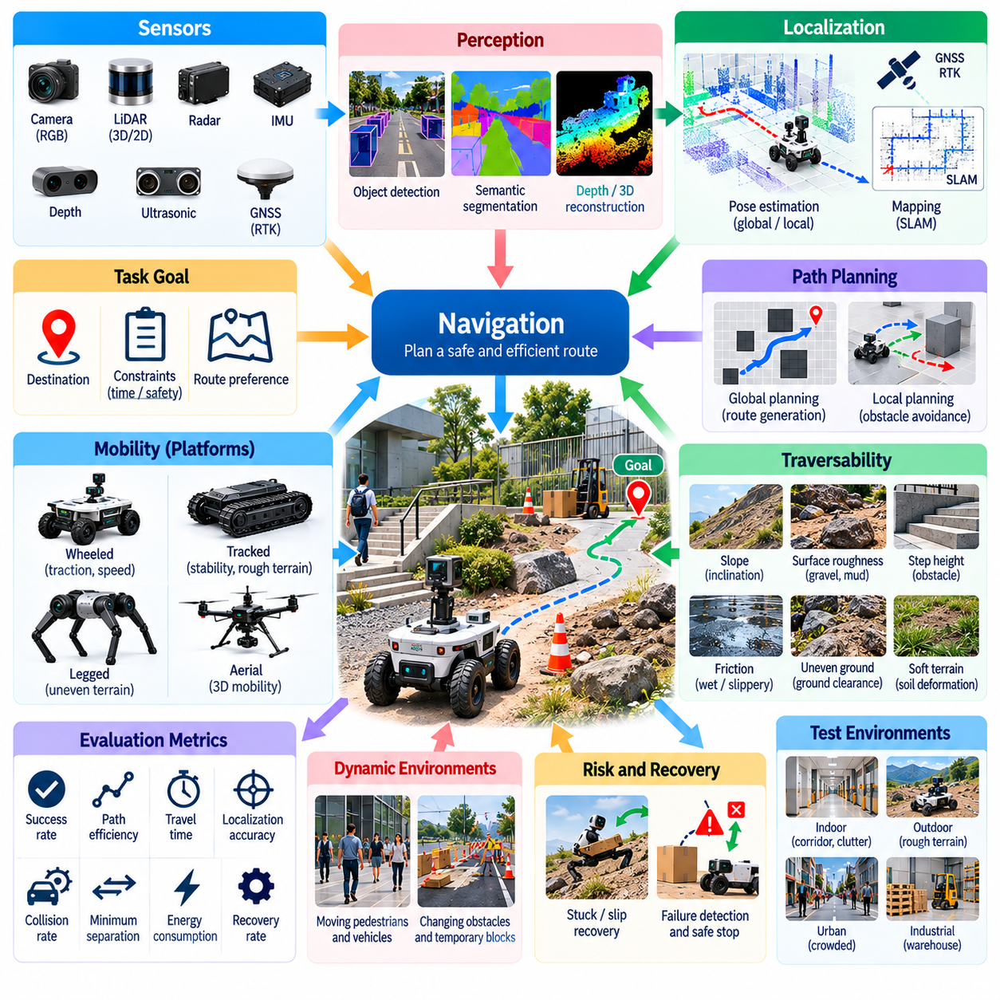{width="7.268055555555556in" height="7.268055555555556in"}

Navigation, mobility, and traversability are essential capabilities for Physical AI systems operating in real-world environments. Navigation determines how a robot reaches a destination, mobility describes its physical ability to move, and traversability indicates whether terrain or workspace conditions permit safe passage. Real-world benchmarks must evaluate these capabilities together because successful movement depends on perception, planning, control, mechanical design, and environmental interaction.

Navigation benchmarking examines whether a robot can reach specified goals while respecting spatial, temporal, and safety constraints. Evaluation should consider route completion, path efficiency, travel time, localization accuracy, and collision avoidance. A robot may reach its destination successfully while taking excessive detours or requiring frequent interventions. Therefore, task success alone cannot adequately represent navigation quality or operational effectiveness.

Mobility evaluation focuses on the physical mechanisms enabling movement across different environments. Wheeled, tracked, legged, and aerial platforms exhibit distinct capabilities and limitations. Wheel traction, suspension behavior, leg coordination, actuator capacity, and body stability influence movement performance. Benchmark conditions should reflect platform characteristics while maintaining comparable functional objectives across different robotic embodiments.

Traversability assessment determines whether a robot can safely negotiate particular surfaces, obstacles, and geometric constraints. Relevant factors include terrain slope, surface roughness, friction, ground clearance, step height, and obstacle spacing. A traversability model may predict accessible regions, but real-world evaluation must verify whether these predictions correspond to actual physical outcomes under representative operating conditions.

Test environments should include controlled geometric challenges and realistic operational terrain. Indoor benchmarks may use corridors, ramps, thresholds, narrow passages, and cluttered workspaces. Outdoor benchmarks may include gravel, grass, mud, uneven ground, slopes, and loose materials. Geometric dimensions and surface properties should be documented so that performance differences can be interpreted relative to measurable environmental difficulty.

Path planning performance should be evaluated through both solution quality and practical execution. Metrics may include path length, clearance from obstacles, curvature, computational latency, and deviation from the planned trajectory. A mathematically short route may be unsuitable if it requires unstable maneuvers or excessive energy. Benchmarking should therefore assess whether planned paths are feasible for the robot\'s dynamics and physical configuration.

Obstacle avoidance is a central requirement for safe autonomous mobility. Static obstacles challenge geometric planning, while moving pedestrians, vehicles, and other robots require prediction and adaptive control. Evaluation should measure collision frequency, minimum separation distance, avoidance success, and unnecessary stopping. Scenarios should include unexpected obstacle appearances and partially obstructed routes to assess reactive behavior.

Dynamic navigation requires continuous adaptation to changing environmental conditions. Temporary barriers, moving equipment, shifting traffic patterns, and changing task priorities may invalidate previously planned routes. Real-world benchmarks should examine replanning latency, route recovery, and the ability to maintain progress without unsafe motion. Successful systems must balance responsiveness with stability, avoiding excessive oscillation between alternative plans.

Terrain interaction introduces uncertainties that cannot be captured through geometry alone. Surface compliance, wheel slip, soil deformation, moisture, and friction variation can alter the relationship between commanded motion and actual displacement. Traversability benchmarks should measure slip ratio, traction loss, motion error, and recovery behavior. These measurements reveal whether mobility controllers remain effective when physical contact conditions differ from their assumptions.

Stability is particularly important for legged robots, mobile manipulators, and platforms carrying elevated payloads. Uneven terrain, sudden acceleration, external disturbances, and changing load distribution can reduce stability margins. Benchmarking may examine body orientation, support conditions, contact forces, and recovery from perturbations. Stability evaluation should distinguish temporary balance corrections from falls, collisions, or unsafe loss of control.

Localization quality directly affects navigation performance. Position drift, incorrect map alignment, and delayed state estimates can cause route deviation or unsafe obstacle clearance. Benchmarks should connect localization error with actual navigation outcomes rather than reporting estimation accuracy independently. Controlled degradation of sensing conditions can reveal whether navigation remains dependable when localization confidence decreases.

Mobility efficiency should be measured alongside task completion. Travel distance, energy consumption, average speed, acceleration profiles, and mechanical loading influence operational productivity. A faster robot may consume substantially more energy or generate excessive wear. Benchmark results should therefore characterize tradeoffs between speed, energy efficiency, path quality, and hardware stress under comparable workloads.

Recovery capability is essential when navigation or mobility encounters unexpected failures. Robots may become immobilized, lose traction, encounter blocked routes, or experience temporary localization loss. Evaluation should measure failure detection, recovery time, recovery success, and dependence on human assistance. Systems capable of recognizing limitations and executing safe recovery strategies may provide greater operational reliability than systems optimized only for nominal conditions.

Human-aware navigation introduces additional evaluation requirements in shared environments. Robots must account for pedestrian movement, personal space, crossing behavior, and unpredictable human actions. Benchmarks should assess collision avoidance, comfortable separation, motion predictability, and unnecessary interference with human activity. Human safety and interaction quality should remain distinct from purely geometric navigation efficiency.

Multi-robot environments create coordination challenges beyond individual navigation. Robots may compete for narrow passages, shared intersections, charging stations, or loading areas. Benchmark scenarios should examine congestion, deadlock, route coordination, and overall task throughput. Evaluation must distinguish individual robot performance from fleet-level behavior because locally efficient decisions may reduce system-wide productivity.

Cross-embodiment comparison requires careful treatment of physical differences. A wheeled robot may excel on smooth floors, while a quadruped may traverse irregular terrain more effectively. Identical obstacle courses do not necessarily provide equivalent difficulty across platforms. Benchmark design should compare shared mission objectives while documenting morphology-specific constraints, supported terrain classes, and operational limitations.

Environmental variability should be introduced systematically to evaluate robustness. Lighting changes, rain, dust, wind, surface contamination, and temperature variation may affect sensing, traction, and control simultaneously. Testing should include nominal conditions, boundary conditions, and selected combined disturbances. Performance degradation should be reported relative to environmental severity rather than reduced to a single aggregate score.

Repeated trials are necessary because navigation and mobility outcomes vary with initial pose, obstacle motion, surface conditions, and controller behavior. Standardized protocols should define starting conditions, destination criteria, intervention rules, and termination thresholds. Statistical reporting should include success distributions, completion times, collision events, and failure frequencies. Rare failures should not be hidden by favorable average performance.

Long-horizon mobility benchmarks reveal accumulated effects that short obstacle courses may overlook. Extended missions can expose battery depletion, actuator heating, mechanical wear, localization drift, and repeated recovery demands. Evaluation should measure sustained task completion, performance consistency, maintenance requirements, and resource consumption. Such evidence is necessary for robots expected to operate continuously in warehouses, factories, or outdoor facilities.

Safety assessment must accompany navigation performance measurement. Emergency stopping, speed limitation, obstacle clearance, stability protection, and safe fallback behavior should be evaluated under defined hazards. A robot that completes tasks quickly but violates safety constraints cannot be considered operationally successful. Benchmark protocols should distinguish ordinary task failures from safety-critical events and document the circumstances surrounding each occurrence.

Benchmark datasets should preserve reference trajectories, robot states, terrain characteristics, obstacle configurations, control commands, and intervention records. Synchronized measurements enable reconstruction of navigation decisions and physical interactions. Consistent scenario definitions and transparent evaluation procedures support reproducibility. Dataset diversity should reflect realistic operational domains while separating training conditions from independent evaluation scenarios.

Ultimately, real-world navigation, mobility, and traversability benchmarks must connect planned movement with actual physical execution. Reliable Physical AI requires accurate environmental understanding, feasible planning, stable locomotion, efficient resource use, and safe recovery from unexpected conditions. By evaluating these capabilities across representative terrain, dynamic obstacles, and extended missions, benchmarks establish credible evidence of autonomous mobility and operational readiness.

## 03.09. Manipulation and Physical Interaction

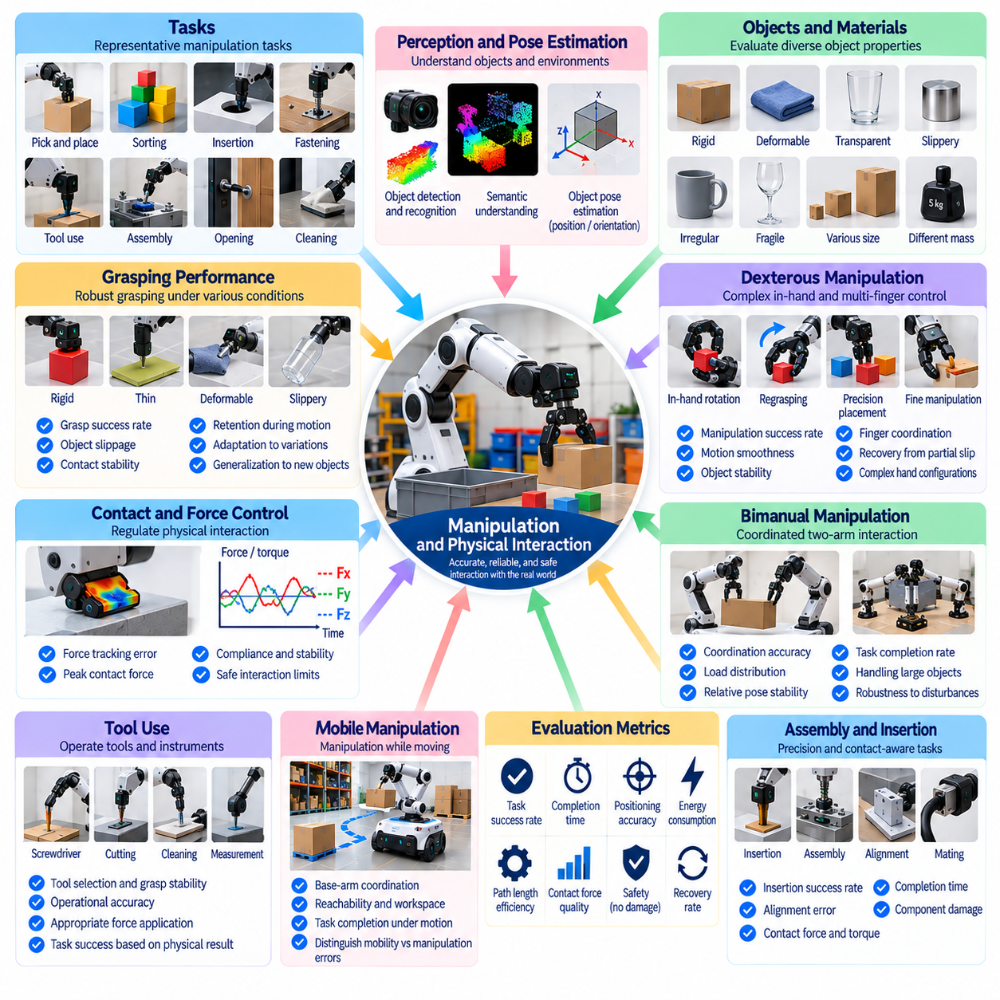{width="7.268055555555556in" height="7.268055555555556in"}

Manipulation and physical interaction are essential capabilities of Physical AI systems that must actively change their environments rather than merely observe them. Manipulation involves grasping, moving, positioning, assembling, and releasing objects, while physical interaction includes contact with surfaces, tools, and other mechanisms. Real-world benchmarks must evaluate whether robots can perform these operations accurately, reliably, and safely despite uncertainty in object properties and contact conditions.

Manipulation benchmarking begins with clearly defined tasks and measurable completion criteria. Representative tasks include pick-and-place operations, object sorting, insertion, fastening, tool use, and assembly. Each task introduces different requirements for perception, motion planning, force regulation, and coordination. Evaluation should distinguish successful task completion from partial execution, unintended contact, object damage, and operator-assisted recovery.

Grasping performance depends on object geometry, material properties, surface friction, mass distribution, and gripper configuration. A robot may successfully grasp a rigid object but struggle with transparent, deformable, slippery, or irregularly shaped items. Benchmarks should vary these properties systematically and measure grasp success, object slippage, contact stability, and retention during motion. Reliable grasping requires adaptation beyond memorized object configurations.

Pose estimation and spatial alignment strongly influence manipulation accuracy. Robots must determine object position, orientation, grasp locations, and target placement geometry before executing actions. Errors in perception or calibration can propagate into unsuccessful grasps and collisions. Benchmarking should measure object pose error, end-effector positioning accuracy, and final placement deviation using independent reference measurements.

Contact dynamics distinguish physical manipulation from purely geometric motion planning. During interaction, friction, compliance, impact, and deformation influence the relationship between commanded actions and actual outcomes. Real-world tests should measure contact forces, torque, displacement, and interaction stability. These observations reveal whether a robot can regulate physical contact instead of relying on idealized assumptions about rigid objects and predictable surfaces.

Force-controlled manipulation is particularly important for insertion, polishing, assembly, and delicate handling. Excessive force may damage objects or equipment, while insufficient force may prevent task completion. Benchmarks should evaluate force tracking error, peak contact force, force overshoot, and compliance during unexpected contact. Successful performance requires maintaining task effectiveness while respecting physical limits and safety constraints.

Dexterous manipulation introduces challenges involving multiple contact points, finger coordination, and continuous object repositioning. In-hand rotation, regrasping, and precision placement require coordinated control of complex hand configurations. Evaluation should examine manipulation success, motion smoothness, object stability, and recovery from partial contact loss. These tasks reveal capabilities that cannot be captured through simple binary grasp success.

Bimanual manipulation requires coordination between two robotic arms or hands. Tasks such as folding, carrying large objects, assembling components, and opening containers depend on synchronized motion and shared force regulation. Benchmarks should measure coordination accuracy, load distribution, relative pose stability, and task completion. Evaluation must also identify whether one manipulator compensates effectively when the other encounters unexpected resistance.

Tool use extends manipulation beyond direct object handling. Robots may operate screwdrivers, cutting tools, cleaning devices, or measurement instruments that introduce additional kinematic and dynamic constraints. Benchmark scenarios should evaluate tool selection, grasp stability, operational accuracy, and appropriate force application. Tool performance should be assessed through the physical result achieved rather than movement similarity to a demonstrated trajectory.

Deformable object manipulation presents substantial uncertainty because object shape changes during interaction. Cables, fabrics, packaging materials, and flexible components may exhibit complex deformation and unpredictable contact behavior. Benchmarks should evaluate shape control, tension regulation, entanglement avoidance, and final configuration accuracy. Reference measurements must account for deformation rather than assuming a single rigid object pose.

Assembly and insertion tasks provide sensitive tests of precision and contact-aware control. Small geometric tolerances, misalignment, friction, and manufacturing variation can prevent successful mating of components. Evaluation should measure insertion success, alignment error, completion time, contact force, and component damage. Controlled variation in clearance and initial pose helps identify the operational limits of manipulation strategies.

Mobile manipulation combines object interaction with movement of the robotic base. Errors in base localization, positioning, and stabilization can influence end-effector accuracy and contact forces. Benchmarks should evaluate coordinated base-arm motion, reachability, workspace coverage, and task completion under realistic constraints. Performance should distinguish failures caused by mobility from those arising in grasping or manipulation control.

Manipulation efficiency involves more than execution speed. Path length, actuator effort, energy consumption, unnecessary regrasping, and repeated corrective actions affect productivity and equipment wear. A fast manipulation policy may create excessive impact forces or increase failure frequency. Benchmarking should therefore characterize tradeoffs between completion time, precision, physical effort, and the quality of the resulting object state.

Safety evaluation is essential whenever robotic systems exert forces on physical objects or shared workspaces. Unexpected contact, dropped objects, excessive gripping pressure, and uncontrolled motion can create hazards. Benchmarks should monitor force limits, collision events, object integrity, and emergency response behavior. A task should not be classified as fully successful when its completion depends on unsafe or damaging interaction.

Recovery from manipulation failure is an important indicator of operational autonomy. Robots may encounter missed grasps, object slippage, insertion jams, unexpected resistance, or incorrect placement. Evaluation should measure failure detection, corrective action quality, recovery time, and recovery success. Systems capable of recognizing physical errors and adapting their actions may provide greater reliability than systems executing fixed sequences without feedback.

Environmental variability affects manipulation through illumination, surface contamination, temperature, vibration, and changes in object arrangement. Small differences in friction or object positioning may substantially alter task outcomes. Benchmarks should combine controlled parameter variation with representative operational conditions. Robustness should be reported across difficulty levels rather than inferred from a single favorable laboratory configuration.

Repeated trials are necessary to characterize manipulation reliability under physical uncertainty. Standardized procedures should define object initialization, gripper condition, calibration, task boundaries, and permitted interventions. Statistical reporting should include success probability, positioning error, force distributions, completion time, and failure categories. Rare damaging events deserve separate attention even when average task performance appears satisfactory.

Cross-embodiment evaluation must account for differences in manipulator morphology and actuation. Parallel grippers, multifingered hands, soft grippers, industrial arms, and humanoid manipulators offer different capabilities. Identical motion requirements may unfairly favor particular hardware configurations. Functional task outcomes, object compatibility, and embodiment-specific constraints provide a more meaningful basis for comparison.

Long-duration manipulation benchmarks reveal effects that isolated demonstrations may overlook. Repeated contact can cause gripper wear, calibration drift, actuator heating, and changes in surface friction. Extended testing should measure sustained success, maintenance requirements, recovery frequency, and performance degradation. These measurements are particularly important for industrial automation and continuous material-handling applications.

Benchmark datasets should preserve synchronized visual observations, robot states, joint trajectories, tactile signals, force measurements, object poses, and task outcomes. Calibration information and reference measurement uncertainty are necessary for meaningful comparison. Detailed contact and failure records support reconstruction of unsuccessful attempts. Consistent protocols enable independent evaluation of learning-based and conventional manipulation controllers.

Ultimately, real-world manipulation and physical interaction benchmarks must connect intelligent action selection with measurable physical consequences. Reliable Physical AI requires accurate object understanding, stable contact, precise motion, adaptive force regulation, and effective recovery. By evaluating complete interaction processes rather than isolated motion commands, benchmarks establish credible evidence of practical manipulation competence and readiness for deployment.

## 03.10. Human Robot Interaction

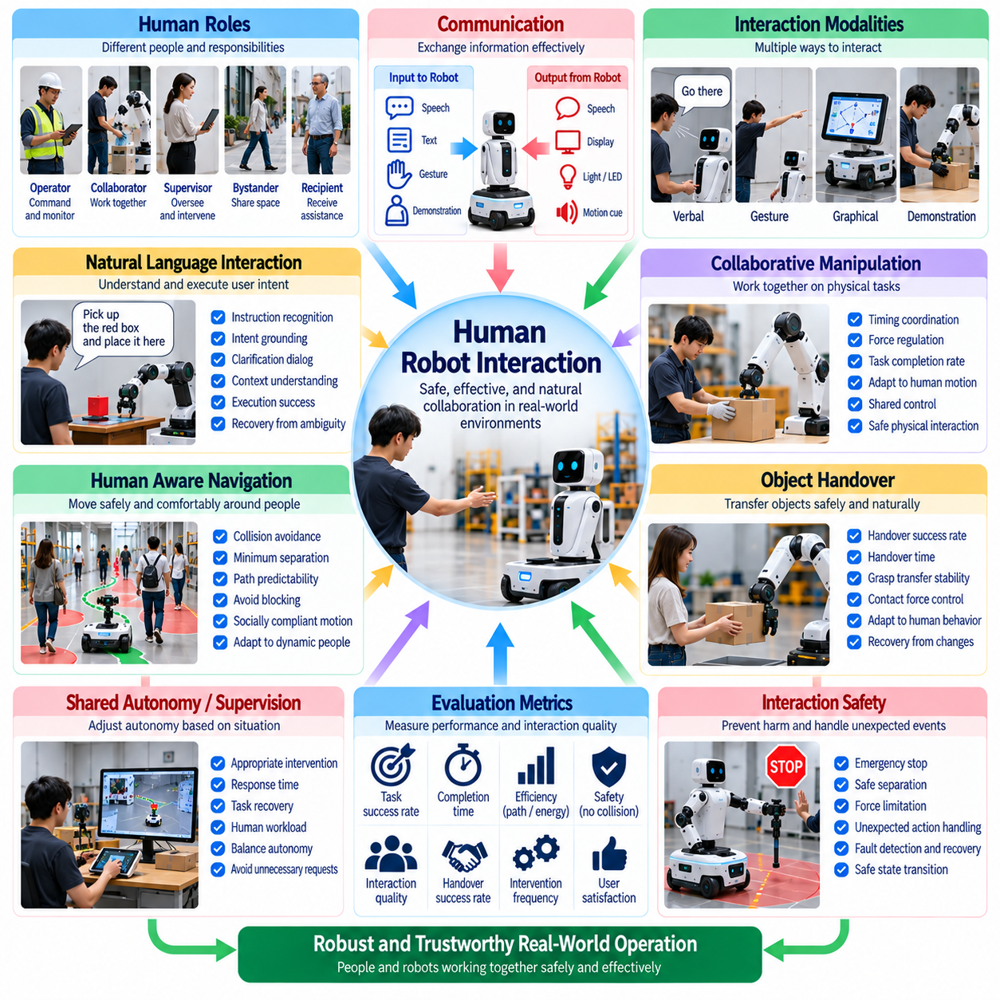{width="7.268055555555556in" height="7.268055555555556in"}

Human-robot interaction is a critical dimension of real-world Physical AI benchmarking because autonomous systems increasingly operate in environments shared with people. Interaction includes communication, cooperation, supervision, physical assistance, and responses to human behavior. Evaluation must determine whether robots can interpret human intentions, coordinate actions, and maintain safe, predictable behavior under realistic social and operational conditions.

Human-robot interaction benchmarks should begin with clearly defined roles, tasks, and interaction boundaries. Humans may act as operators, collaborators, supervisors, bystanders, or recipients of robotic assistance. Each role creates different expectations for autonomy, communication, and safety. Benchmark protocols should specify the responsibilities of participants and robots while distinguishing task performance from interaction quality and human experience.

Communication effectiveness is fundamental to successful interaction. Robots may receive spoken commands, gestures, graphical instructions, or demonstrations, while providing feedback through speech, displays, lights, and movement. Evaluation should measure instruction recognition, response accuracy, communication latency, and misunderstanding frequency. Successful communication requires conveying appropriate information at the correct time without overwhelming human participants.

Natural language interaction introduces ambiguity, incomplete instructions, and context-dependent meanings. A command such as placing an object nearby may require interpreting the user\'s location, task context, and environmental constraints. Benchmarks should assess instruction grounding, clarification behavior, dialogue consistency, and recovery from misunderstood requests. Evaluation should distinguish linguistic correctness from successful execution of the intended physical action.

Gesture recognition and nonverbal communication support interaction when speech is unavailable or inappropriate. Pointing, gaze direction, hand signals, and body posture may indicate targets, intentions, or requests for assistance. Real-world benchmarks should examine recognition accuracy across different viewpoints, distances, and lighting conditions. Robots should also communicate their intended movements through understandable and consistent behavioral cues.

Human-aware navigation requires robots to move safely and comfortably around people. Appropriate behavior depends on pedestrian trajectories, personal space, visibility, and social conventions. Benchmarks should measure collision avoidance, minimum separation, unnecessary obstruction, and movement predictability. A robot that avoids collisions but repeatedly interrupts human activity may satisfy basic safety requirements while delivering poor interaction quality.

Collaborative manipulation involves coordinated physical actions between humans and robots. Examples include jointly carrying objects, handing over tools, positioning components, and assisting assembly. Evaluation should examine timing coordination, handover success, force regulation, and adaptation to human movement. Physical cooperation requires maintaining task progress without creating excessive contact forces or requiring unnatural human compensation.

Object handover provides a useful benchmark for combining perception, intention prediction, and compliant control. Robots must identify when a person is ready, present an object in an accessible orientation, and release it at an appropriate moment. Metrics may include handover completion time, grasp transfer success, contact force, and user effort. Unexpected pauses or changes in human behavior should be included to assess adaptability.

Shared autonomy allows humans and robots to distribute decision-making responsibilities. A robot may execute routine actions independently while requesting assistance when uncertainty or risk exceeds acceptable limits. Benchmarks should measure intervention frequency, request appropriateness, response time, and task recovery. Excessive requests reduce productivity, while delayed requests may increase hazards or allow preventable failures to escalate.

Trust and reliance are important but must be evaluated through observable behavior and carefully designed participant measures. Human users may overtrust a robot that appears confident or underuse a reliable system after an isolated failure. Benchmarks can examine intervention choices, reliance patterns, and perceived reliability. Evaluation should distinguish justified trust from subjective preference and determine whether robot behavior supports appropriate human oversight.

Transparency and explainability influence how effectively people supervise autonomous systems. Robots may need to communicate current goals, planned actions, uncertainty, and reasons for requesting assistance. Evaluation should measure whether explanations improve human understanding and decision quality. Explanations must remain accurate and timely, since plausible but misleading descriptions can create false confidence in system capabilities.

Interaction safety extends beyond avoiding direct collisions. Unexpected motion, excessive contact force, dropped objects, delayed stopping, and confusing signals may create hazardous situations. Benchmark scenarios should evaluate protective responses, emergency stopping, safe separation, and recovery from unexpected human actions. Safety outcomes should be reported independently from task success so that efficient but unsafe behavior is not rewarded.

Human variability introduces significant challenges for benchmark reproducibility. Participants differ in height, movement speed, communication style, familiarity with robots, and task experience. Experimental protocols should document participant characteristics relevant to the task without collecting unnecessary personal information. Diverse participant groups and repeated trials help determine whether interaction performance generalizes beyond a narrow population.

Human adaptation can influence results during repeated interaction. Participants may learn how to phrase commands, anticipate robot movements, or compensate for recurring system limitations. Such adaptation can improve measured task success without reflecting equivalent improvements in robotic capability. Benchmarks should distinguish first-time interactions from experienced-user performance and account for learning effects through appropriate experimental design.

Workload and usability are essential when evaluating robots intended to assist human operators. Interaction may impose cognitive demands through monitoring, repeated confirmations, or complex control interfaces. Benchmarks should examine task completion, operator attention, intervention effort, and subjective workload using suitable instruments. A robot that completes assigned tasks but substantially increases human workload may provide limited practical value.

Accessibility and inclusive interaction should be considered across relevant deployment environments. Speech-only interfaces may disadvantage users in noisy workplaces or those who cannot reliably use voice commands. Alternative modalities, adjustable interaction timing, and understandable feedback can improve usability. Benchmarking should evaluate whether supported interaction methods remain effective for the intended range of users and operating conditions.

Multi-human environments create challenges involving attention allocation, conflicting instructions, and social coordination. Robots may need to identify authorized operators, prioritize urgent requests, and avoid interfering with unrelated activities. Benchmarks should assess instruction attribution, conflict resolution, and predictable behavior when several people interact simultaneously. Such scenarios reveal limitations that controlled one-to-one experiments may overlook.

Long-duration interaction benchmarks reveal effects associated with repeated exposure and sustained cooperation. Communication fatigue, changing trust, operator complacency, and accumulated misunderstandings may alter performance over time. Evaluation should examine interaction consistency, intervention trends, and recovery from recurring problems. Sustained reliability requires maintaining effective cooperation beyond brief demonstrations or scripted encounters.

Experimental control is necessary for meaningful comparison of interaction strategies. Scenarios should specify participant instructions, robot capabilities, task difficulty, environmental conditions, and permitted interventions. Randomized or counterbalanced trial order can reduce learning and sequence effects. Statistical analysis should consider participant-level variation and repeated observations rather than treating every interaction as an independent event.

Benchmark data should preserve synchronized robot actions, interaction events, communication records, task outcomes, and safety interventions. Video and audio may support detailed analysis but introduce privacy and consent requirements. Data collection should minimize unnecessary personal information and document retention and access procedures. Consistent annotation standards enable reproducible evaluation while respecting participants\' rights and expectations.

Cross-embodiment evaluation must account for differences in robot appearance, mobility, manipulation capability, and communication interfaces. Humanoids, mobile manipulators, service robots, and industrial collaborative systems may support different interaction styles. Identical scenarios may not provide equivalent difficulty across platforms. Functional objectives and human-centered outcomes offer a useful basis for comparison when physical capabilities differ.

Ultimately, real-world human-robot interaction benchmarks must evaluate the combined performance of autonomous systems and the people working around them. Reliable Physical AI requires understandable communication, appropriate assistance, safe physical behavior, calibrated trust, and effective recovery from misunderstanding. By measuring human experience alongside task outcomes and safety, benchmarks provide evidence of whether robots can operate responsibly and productively in shared environments.

## 03.11. Task Success Time and Execution Quality

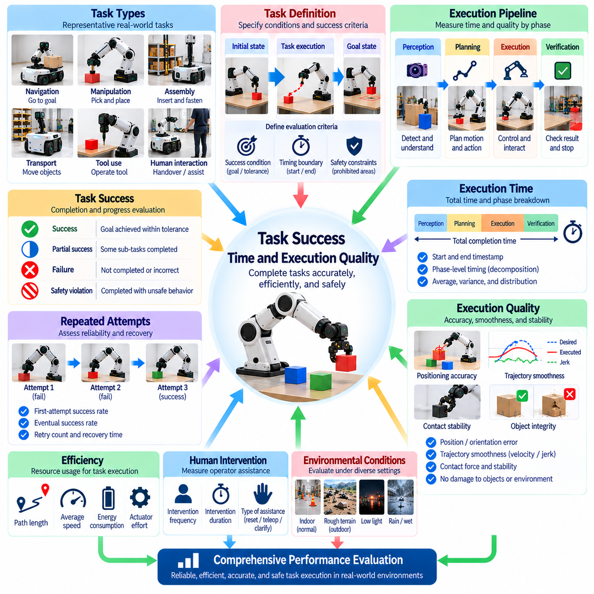{width="7.268055555555556in" height="7.268055555555556in"}

Task success, execution time, and execution quality are fundamental measures of real-world Physical AI performance. Task success indicates whether an intended objective is achieved, execution time describes the resources consumed in temporal terms, and execution quality characterizes how effectively the objective is accomplished. Reliable benchmarking must examine these dimensions together because completing a task does not necessarily imply efficient, accurate, or safe behavior.

Task success requires explicit definitions of initial conditions, expected outcomes, and acceptable completion states. A robot may move an object to a target location, navigate to a destination, or assemble a component, but each task demands different verification criteria. Benchmarks should define observable success conditions before testing begins. Ambiguous criteria can produce inconsistent judgments and undermine comparisons between systems.

Binary success metrics provide a simple distinction between completed and failed tasks. However, complex physical operations often contain intermediate achievements that binary scoring cannot represent. A robot may successfully grasp an object but fail during placement, or complete most assembly steps before encountering an error. Partial success metrics help characterize progress while preserving the distinction between incomplete and fully completed tasks.

Execution time measures how long a robot requires to accomplish a defined objective. Timing boundaries should specify whether measurement begins at instruction receipt, perception initialization, motion onset, or another event. Completion timestamps must also follow consistent rules. Without standardized timing definitions, differences in reported speed may reflect measurement procedures rather than actual system performance.

Task duration should be decomposed into meaningful operational phases whenever possible. Perception, planning, motion execution, interaction, verification, and recovery may contribute differently to total completion time. Phase-level measurements help identify performance bottlenecks and distinguish computational delays from physical limitations. Such decomposition is particularly useful when comparing learning-based controllers with conventional robotic systems.

Execution quality evaluates the physical and operational characteristics of task performance beyond successful completion. Relevant properties include positioning accuracy, trajectory smoothness, contact stability, object integrity, and compliance with operational constraints. A robot may complete a manipulation task while producing excessive vibration or damaging surrounding objects. Quality metrics capture these differences in practical usefulness.

Accuracy is a central dimension of execution quality. Navigation tasks may require final position and orientation tolerances, while manipulation tasks may demand precise placement or alignment. Measurement should compare achieved states against independently established reference values. Reporting mean error alone is insufficient when occasional large deviations create operational failures or unacceptable safety risks.

Motion quality reflects how smoothly and consistently robots execute physical actions. Excessive acceleration, abrupt direction changes, oscillation, and unnecessary corrective movements may increase wear or disturb nearby equipment. Benchmarks can measure velocity variation, acceleration, jerk, and trajectory deviation. These indicators should be interpreted relative to task requirements rather than assuming that smoother motion is always superior.

Efficiency metrics connect task outcomes with the resources required to produce them. Path length, actuator effort, energy consumption, and computational demand provide complementary perspectives on performance. A shorter completion time may require substantially greater energy or hardware stress. Benchmarking should therefore characterize tradeoffs instead of automatically rewarding the fastest execution regardless of operational cost.

Task success and execution quality must incorporate safety constraints. A robot that reaches a destination through prohibited areas or completes assembly by applying damaging forces should not receive an unrestricted success classification. Evaluation protocols should define safety violations and unacceptable outcomes separately. Safety-aware scoring prevents apparently efficient but hazardous behavior from being treated as superior performance.

Repeated attempts introduce important distinctions between initial success and eventual completion. A robot may fail several times before achieving the intended result through retries or corrective actions. Benchmarks should report first-attempt success, eventual success, retry count, and recovery time. These measures reveal whether high completion rates depend on repeated attempts that reduce productivity or increase equipment wear.

Human intervention can substantially affect measured task performance. Operator corrections, teleoperation assistance, manual resets, and clarification requests may enable completion that autonomous behavior alone could not achieve. Evaluation should document intervention frequency, duration, and purpose. Autonomous success should remain distinguishable from assisted success to avoid overstating the capabilities of the tested system.

Execution quality may depend on task-specific acceptance tolerances. Industrial assembly may require millimeter-scale alignment, while warehouse transport may permit substantially larger positioning errors. Benchmarks should derive tolerances from functional requirements rather than selecting arbitrary thresholds. Performance comparisons become meaningful when success criteria reflect the intended operational application and its acceptable error margins.

Environmental conditions influence success probability, execution duration, and quality simultaneously. Lighting variation, surface friction, object placement, clutter, and unexpected disturbances may introduce additional perception and control demands. Benchmarks should document these conditions and evaluate performance across representative difficulty levels. Results from favorable laboratory settings should not be generalized automatically to complex field environments.

Statistical evaluation is essential because physical task outcomes vary across repeated trials. Success rates should be accompanied by trial counts and uncertainty estimates, while execution times should include distributions rather than averages alone. Median, percentile, and worst-case measurements can expose delays hidden by aggregate statistics. Comparisons should account for scenario difficulty, repeated observations, and experimental variability.

Long-horizon tasks require evaluating success across sequences of dependent actions. A robot may complete individual subtasks reliably while accumulating errors that prevent final mission completion. Benchmarks should record intermediate milestones, subtask failures, recovery events, and overall mission success. This distinction reveals whether local execution quality translates into dependable performance over extended operational periods.

Quality assessment should also consider the final condition of manipulated objects and surrounding environments. A task may appear complete while leaving scratches, misplaced materials, residual debris, or unstable assemblies. Reference inspections and appropriate sensors can verify whether the resulting physical state meets operational expectations. Such outcome-based measurements prevent superficial completion from masking unacceptable consequences.

Comparisons across robotic embodiments require normalization of task objectives and physical constraints. Different platforms may achieve identical goals through distinct motion strategies, actuator configurations, and interaction methods. Evaluation should emphasize functional outcomes while documenting embodiment-specific capabilities and limitations. Identical timing or trajectory requirements may otherwise unfairly favor particular robot designs.

Multi-dimensional scorecards provide a practical method for presenting task success, execution time, and quality without concealing important tradeoffs. Individual metrics should remain visible even when an aggregate score is calculated. Weighting rules must be defined before evaluation and justified by operational priorities. A single ranking should not obscure differences in safety, precision, reliability, or resource efficiency.

Benchmark protocols should specify task initialization, timing rules, success verification, quality thresholds, and permitted recovery actions. Synchronized logs should preserve robot states, action sequences, timestamps, sensor observations, and final outcomes. Independent reference measurements support objective assessment. Reproducible procedures allow different systems and research groups to compare results under consistent experimental conditions.

Ultimately, task success, execution time, and execution quality must be treated as complementary dimensions of real-world Physical AI capability. Successful deployment requires robots to accomplish intended objectives within acceptable time, accuracy, safety, and resource limits. By measuring outcomes alongside execution processes, benchmarks provide credible evidence of operational effectiveness, reliability, and readiness for practical use.

## 03.12. Energy Compute and Resource Efficiency

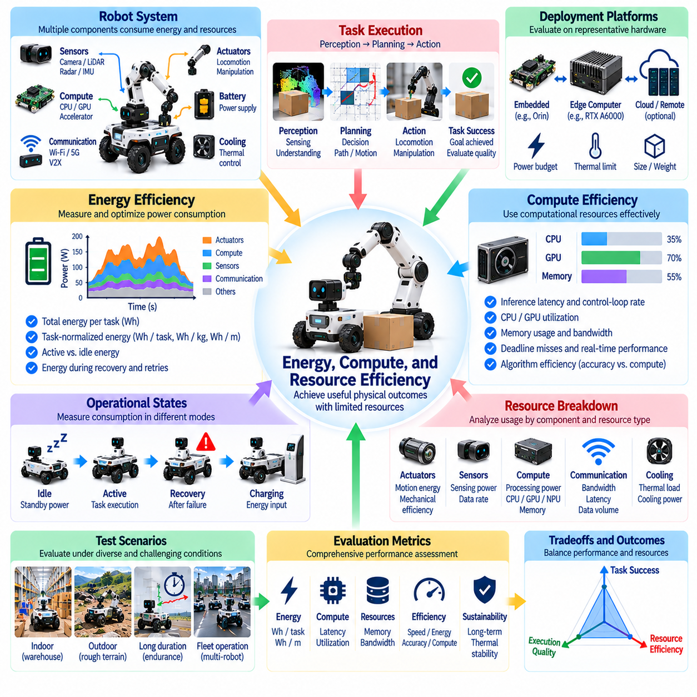{width="7.268055555555556in" height="7.268055555555556in"}

Energy, compute, and resource efficiency are essential dimensions of real-world Physical AI benchmarking because autonomous systems operate under finite power, processing, and hardware constraints. A robot may complete tasks accurately but remain impractical if it consumes excessive energy or computational resources. Evaluation must connect resource consumption with useful physical outcomes, operational reliability, and the ability to sustain autonomous behavior.

Energy efficiency measures how effectively a Physical AI system converts electrical or stored energy into productive task execution. Relevant consumption includes locomotion, manipulation, sensing, computation, communication, and auxiliary equipment. Benchmarks should measure total energy per task and distinguish productive consumption from idle or standby losses. Such separation reveals opportunities for improvement across hardware and software components.

Power measurement requires consistent instrumentation and clearly defined system boundaries. Battery voltage and current, actuator power, processor consumption, and external supply measurements provide complementary information. Sampling frequency must capture transient loads during acceleration, contact, and computation. Benchmark protocols should specify whether charging losses, cooling equipment, and supporting infrastructure are included in reported energy values.

Task-normalized energy metrics enable meaningful comparison across different workloads. Energy per completed task, energy per transported kilogram, and energy per traveled distance may be appropriate for different applications. However, normalization must preserve task difficulty and completion quality. A system should not appear efficient merely because it performs an easier operation or excludes unsuccessful attempts from its energy accounting.

Computational efficiency evaluates how effectively algorithms use processing resources to support physical action. Perception, localization, planning, prediction, and control may compete for limited CPU, GPU, or specialized accelerator capacity. Benchmarks should measure processing latency, utilization, memory demand, and computational throughput. These measurements must be connected to task performance rather than reported as isolated hardware statistics.

Real-time constraints make computational efficiency particularly important for Physical AI. A highly accurate perception model may become unsuitable if its inference latency delays obstacle avoidance or contact control. Evaluation should examine worst-case execution time, deadline misses, scheduling interference, and control-loop stability. Average inference speed alone cannot establish whether a system satisfies time-critical operational requirements.

Edge computing introduces tradeoffs between processing capability, energy consumption, thermal behavior, and physical size. Embedded processors often operate under tighter power budgets than laboratory computing platforms. Benchmarks should evaluate algorithms on representative deployment hardware rather than relying exclusively on powerful development workstations. Hardware specifications and operating configurations must accompany performance results.

Memory efficiency affects whether Physical AI models can execute reliably on constrained platforms. Large neural networks, high-resolution maps, temporal histories, and multimodal observations may require substantial memory capacity. Evaluation should measure peak memory usage, allocation behavior, bandwidth demand, and memory-related delays. Excessive memory pressure can reduce responsiveness even when nominal computation appears sufficient.

Communication resources become important when robots depend on remote computation, shared maps, or fleet coordination. Network bandwidth, transmission latency, packet loss, and connection interruptions may influence autonomous behavior. Benchmarks should measure communication volume and performance under degraded connectivity. Systems should also be evaluated for their ability to maintain essential functions when external services become unavailable.

Thermal efficiency links computational workload and actuator operation to sustained system performance. Continuous processing, motor loading, and power conversion generate heat that may trigger throttling or protective shutdowns. Benchmarks should record temperature trends, cooling demand, and performance degradation during extended operation. Short tests may conceal thermal limitations that become critical during realistic deployment.

Mechanical efficiency influences the energy required for locomotion and physical interaction. Robot mass, transmission losses, friction, actuator selection, and movement strategy affect overall consumption. Benchmarking should distinguish electrical input energy from useful mechanical output when suitable measurements are available. Such analysis helps identify whether inefficiency originates in motion planning, control behavior, or physical hardware.

Resource efficiency must account for unsuccessful attempts and recovery operations. Repeated grasp failures, navigation detours, unnecessary replanning, and manual resets consume resources without producing equivalent progress. Evaluation should include the energy, time, and computation required for recovery. Reporting only successful trials may systematically underestimate the operational cost of unreliable autonomous systems.

Idle consumption is especially important for robots that spend substantial time waiting for assignments or interacting intermittently with users. Sensors, processors, communication modules, and actuators may continue drawing power during inactivity. Benchmarks should measure active, idle, standby, and recovery states separately. Duty-cycle analysis can reveal whether reducing background consumption provides greater benefits than optimizing peak task execution.

Energy and computation should be evaluated alongside task quality and safety. Reducing processing frequency may save power but degrade perception accuracy, while aggressive motor commands may shorten execution time at greater energy cost. Benchmarks should identify operating points that satisfy performance requirements without violating safety constraints. Efficiency improvements are meaningful only when essential capabilities remain intact.

Adaptive resource management allows robots to allocate computation and energy according to changing operational demands. Systems may adjust sensing frequency, model complexity, processor operating modes, or motion speed based on uncertainty and task urgency. Evaluation should measure adaptation latency, resource savings, and resulting performance changes. Poorly designed adaptation may create unstable behavior or delayed responses to emerging hazards.

Long-duration benchmarks reveal resource limitations that brief experiments cannot capture. Battery discharge, thermal accumulation, memory fragmentation, and repeated computational peaks may progressively reduce performance. Evaluation should measure sustained throughput, energy consumption trends, and autonomy duration under representative workloads. Such tests are necessary for estimating whether robots can meet realistic operational schedules.

Battery performance requires careful interpretation because usable energy depends on temperature, discharge rate, aging, and battery management behavior. Reported capacity alone cannot establish practical operating endurance. Benchmarks should document initial charge state, battery condition, environmental temperature, and termination thresholds. Comparisons should avoid treating different battery configurations as equivalent without appropriate normalization.

Fleet-level resource efficiency introduces additional considerations involving charging infrastructure, shared computation, communication traffic, and scheduling. Multiple robots may compete for limited charging stations or network capacity. Benchmarks should examine aggregate energy consumption, resource contention, task throughput, and downtime. Optimizing individual robots does not necessarily minimize the resource requirements of an entire autonomous fleet.

Resource-aware benchmarking also supports evaluation across robotic embodiments. Wheeled platforms, manipulators, quadrupeds, and humanoids exhibit different energy profiles and computational demands. Direct comparison of absolute consumption may be misleading when physical capabilities and workloads differ. Functional normalization and explicit capability constraints provide a more meaningful basis for interpreting efficiency across platforms.

Experimental reproducibility requires consistent workload definitions, instrumentation calibration, environmental conditions, and software configurations. Processor frequency settings, background processes, battery condition, and communication infrastructure can influence results. Benchmark reports should include measurement uncertainty and repeated-trial statistics. Transparent protocols help distinguish genuine algorithmic improvements from favorable hardware or testing conditions.

Ultimately, energy, compute, and resource efficiency benchmarks must determine how effectively Physical AI systems transform limited resources into reliable physical work. Meaningful evaluation combines task outcomes, power measurements, computational performance, thermal behavior, and sustained operational capability. By exposing resource-performance tradeoffs, real-world benchmarks provide evidence of scalability, deployment feasibility, and long-term operational sustainability.

## 03.13. Environmental Variability and Disturbances

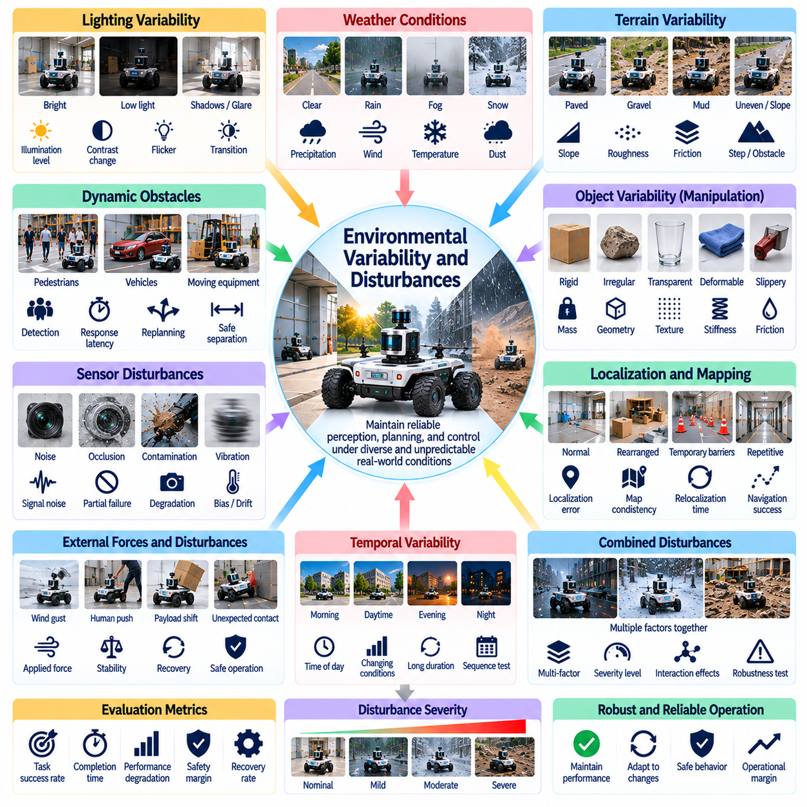{width="7.268055555555556in" height="7.268055555555556in"}

Environmental variability and disturbances are fundamental challenges in real-world Physical AI benchmarking because autonomous robots operate under conditions that cannot remain perfectly controlled. Lighting, temperature, terrain, obstacles, and human activity may change during task execution. Evaluation must determine whether systems maintain reliable perception, planning, and control when environmental conditions differ from those encountered during development.

Environmental variability refers to changes in operating conditions across locations, tasks, and time. Disturbances are external influences that interrupt or alter expected system behavior. Although related, these concepts require different evaluation methods. Variability tests examine performance across diverse conditions, while disturbance tests measure responses to unexpected events, including recovery time, stability, and continued task execution.

Benchmark design should begin by identifying environmental factors relevant to the robot\'s operational design domain. Indoor service robots may encounter reflective floors, crowded corridors, and changing illumination. Outdoor platforms must address weather, uneven terrain, and visibility limitations. Test conditions should reflect realistic deployment requirements rather than introducing arbitrary difficulty unrelated to intended applications.

Lighting variability can significantly influence camera-based perception and visual localization. Shadows, glare, low illumination, flickering lights, and abrupt brightness changes may reduce object detection or tracking accuracy. Benchmarks should measure perception performance and downstream task outcomes under controlled lighting variations. Testing should also consider transitions between conditions rather than evaluating only stable illumination levels.

Weather introduces complex disturbances for robots operating outdoors. Rain, fog, snow, wind, and airborne dust can affect sensing, traction, mechanical components, and communication. Evaluation should distinguish temporary performance degradation from complete functional failure. Weather conditions must be documented using measurable variables whenever possible, allowing results to be interpreted within clearly defined environmental limits.

Terrain variability affects locomotion efficiency, stability, and traversability. Surface roughness, friction, slope, compliance, and discontinuities may change the forces required for safe movement. Benchmarks should include representative terrain categories and measurable difficulty parameters. Performance metrics may include traversal success, slip frequency, energy consumption, path deviation, and recovery from loss of traction.

Dynamic obstacles create disturbances that require continuous perception and replanning. Pedestrians, vehicles, moving equipment, and displaced objects may alter previously valid routes. Benchmarks should assess obstacle detection, response latency, safe separation, and successful continuation. Scenarios should include both predictable motion and unexpected changes while ensuring that experimental disturbances remain safe and reproducible.

Physical interaction tasks are sensitive to variability in object properties and contact conditions. Differences in mass, geometry, surface texture, stiffness, and friction can affect grasping and manipulation. Benchmarks should vary these properties systematically and measure grasp stability, force regulation, placement accuracy, and object damage. Such testing reveals whether learned manipulation policies generalize beyond familiar objects.

Sensor disturbances include noise, occlusion, vibration, contamination, and partial sensor failure. Camera lenses may become obstructed, depth measurements may deteriorate, and inertial sensors may experience bias or vibration. Evaluation should examine how estimation uncertainty propagates into planning and control. Robust systems should detect degraded sensing and adjust behavior rather than continuing with unjustified confidence.

Localization and mapping performance may deteriorate when environmental structure changes. Rearranged furniture, temporary barriers, repetitive corridors, and moving machinery can invalidate previously reliable landmarks. Benchmarks should measure localization error, map consistency, relocalization time, and navigation success. Tests should distinguish adaptation to legitimate environmental changes from failures caused by inaccurate state estimation.

External forces can disrupt physical stability during locomotion or manipulation. Wind gusts, incidental contact, payload shifts, and unexpected resistance may require rapid corrective actions. Benchmarks should evaluate disturbance rejection, balance recovery, trajectory correction, and task continuation. Applied forces should be measured and bounded to prevent unsafe testing while preserving meaningful comparisons.

Temporal variability is important because environmental conditions may evolve during extended operations. Lighting changes throughout the day, traffic patterns fluctuate, and surfaces become wet or obstructed. Benchmarks should evaluate transitions and sequences of changing conditions. Systems that perform well in isolated scenarios may struggle when multiple environmental changes accumulate without opportunities for recalibration.

Disturbance severity should be defined using measurable intensity, duration, frequency, and spatial extent. Gradually increasing difficulty can reveal the boundary between normal operation, degraded performance, and failure. Benchmark protocols should record these thresholds rather than reporting only aggregate success rates. Performance degradation curves provide useful evidence of robustness and operational margins.

Combined disturbances are particularly challenging because environmental factors may interact. Poor lighting combined with reflective surfaces can degrade perception, while slippery terrain and unexpected obstacles may compromise navigation. Benchmarks should include selected combinations that reflect plausible operating conditions. Experimental designs must distinguish interaction effects from the influence of individual disturbance variables.

Adaptation mechanisms should be evaluated separately from immediate disturbance rejection. Robots may adjust perception thresholds, update maps, modify control gains, or select alternative plans after detecting changed conditions. Benchmarks should measure adaptation time, performance recovery, and additional resource consumption. Successful adaptation should restore acceptable operation without introducing new safety violations.

Failure and recovery behavior provide essential information about robustness. A robot may pause, request assistance, retreat to a safe location, or terminate a task when conditions exceed its capabilities. Evaluation should distinguish safe degradation from uncontrolled failure. Recovery success, intervention frequency, and time to resume operation help characterize whether systems respond appropriately to environmental uncertainty.

Experimental repeatability requires careful control of disturbance generation and measurement. Programmable lighting, calibrated obstacles, adjustable terrain, and instrumented force application can support consistent trials. Natural field conditions should be recorded with synchronized environmental measurements. Benchmark reports must distinguish controlled disturbance experiments from observational testing under uncontrolled conditions.

Statistical analysis should account for variability across environments, repeated trials, and disturbance intensities. Average performance may conceal rare but consequential failures under extreme conditions. Success distributions, confidence intervals, tail outcomes, and degradation trends provide a more complete picture. Comparisons should use matched environmental conditions whenever possible to avoid confounding system capability with test difficulty.

Cross-embodiment evaluation must recognize that identical environmental disturbances can affect platforms differently. Wind may challenge aerial robots, while uneven ground primarily affects terrestrial locomotion. Manipulators may be more sensitive to contact variation than mobile platforms performing transport tasks. Benchmark comparisons should preserve functional objectives while adapting disturbance parameters to relevant physical capabilities.

Environmental robustness also depends on the relationship between sensing, computation, and control. Increasing perception frequency or planning complexity may improve disturbance handling but raise energy demand and processing latency. Benchmarks should measure these tradeoffs alongside task success and safety. Robustness should represent sustained useful performance within realistic resource constraints rather than unrestricted computational compensation.

Ultimately, environmental variability and disturbance benchmarks must establish the conditions under which Physical AI systems remain reliable, degrade gracefully, or fail safely. Meaningful evaluation combines controlled perturbations, representative field exposure, quantitative performance measurements, and recovery analysis. These results define practical operational boundaries and provide evidence of readiness for unpredictable real-world environments.

## 03.14. Field Failure Near Miss and Recovery

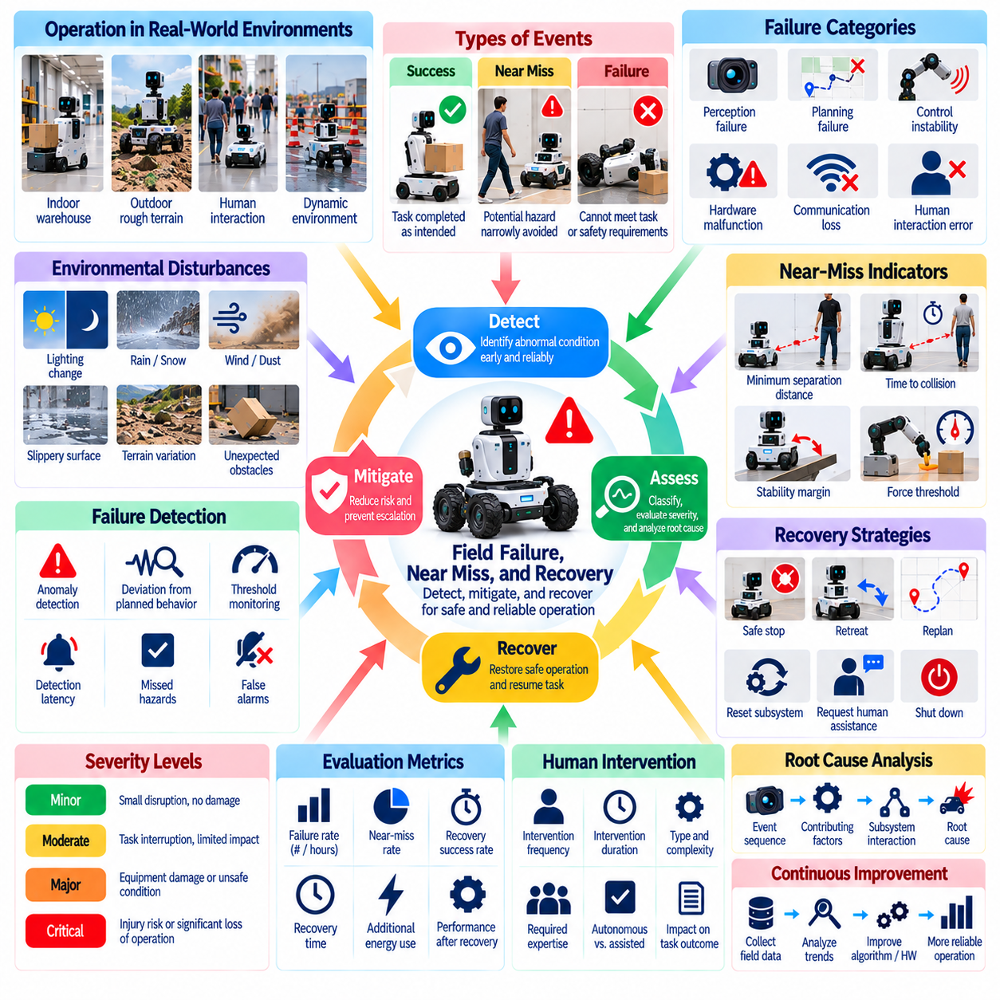{width="7.268055555555556in" height="7.268055555555556in"}

Field failures, near misses, and recovery events are essential elements of real-world Physical AI benchmarking because successful demonstrations alone cannot establish operational reliability. Autonomous robots may encounter unexpected obstacles, perception errors, mechanical faults, and unsafe interactions during deployment. Evaluation must examine not only whether failures occur, but also how systems detect emerging problems, limit consequences, and restore safe operation.

A field failure occurs when a robot cannot satisfy defined task, safety, or operational requirements under actual deployment conditions. Failures may involve incomplete tasks, loss of localization, unstable motion, damaged objects, or interrupted communication. Benchmark protocols should establish explicit failure criteria before testing. Consistent definitions prevent subjective judgments and support meaningful comparisons across platforms and operating environments.

Near misses are events in which hazardous consequences are narrowly avoided, even though no injury, collision, or equipment damage occurs. Examples include a robot passing unexpectedly close to a person, nearly dropping a payload, or approaching an unstable position. Such events reveal weaknesses that conventional success metrics may overlook. Benchmarks should document near misses independently from actual failures and successful task completion.

Failure classification helps identify the mechanisms responsible for unreliable behavior. Categories may include perception failure, planning failure, control instability, hardware malfunction, communication loss, and human interaction errors. Multiple causes may contribute to a single incident, making simplistic classifications insufficient. Benchmark records should distinguish observed symptoms, contributing factors, and confirmed root causes whenever evidence permits.

Failure detection is a fundamental capability of dependable autonomous systems. Robots must recognize abnormal sensor readings, unexpected motion, excessive contact forces, and deviations from planned behavior. Benchmarks should measure detection latency, detection accuracy, and missed hazardous conditions. False alarms also require attention because unnecessary emergency responses can interrupt operations and reduce productivity without improving actual safety.

Near-miss assessment requires measurable indicators of proximity to unsafe conditions. Minimum separation distance, time to collision, stability margins, force thresholds, and stopping distance may provide useful evidence. Thresholds must reflect robot capabilities and operational context rather than arbitrary universal values. Evaluation should preserve continuous measurements where possible because binary incident labels can conceal important differences in severity.

Recovery begins when a system recognizes that normal execution cannot continue reliably. Possible responses include stopping motion, retreating, replanning, resetting a subsystem, or requesting human assistance. The appropriate response depends on task urgency, environmental conditions, and remaining system capabilities. Benchmarks should assess whether recovery decisions reduce risk while preserving the possibility of completing the intended task.

Safe-state transitions are particularly important when failures involve uncertain perception or unstable control. A robot may need to reduce speed, release actuator commands safely, maintain a supported payload, or enter a protective stop. Evaluation should measure transition latency and the stability of the resulting state. A commanded stop should not automatically count as successful recovery if it introduces additional hazards or leaves equipment in an unsafe configuration.

Recovery effectiveness includes more than returning to the original task. Benchmarks should measure recovery success rate, time to resume operation, additional energy consumption, and residual performance degradation. Repeated recovery attempts may increase mechanical wear or expose nearby people to additional risks. Results should distinguish autonomous recovery, assisted recovery, and situations requiring complete system shutdown or manual intervention.

Human intervention is often necessary when autonomous recovery capabilities are exceeded. Operators may diagnose faults, reposition objects, authorize alternative actions, or perform emergency procedures. Benchmarks should record intervention frequency, duration, complexity, and required expertise. Systems that appear reliable only because skilled operators continuously compensate for weaknesses should not receive the same autonomy assessment as independently recovering robots.

Field incidents frequently emerge from interactions between multiple subsystems. A delayed perception update may trigger incorrect planning, followed by excessive corrective motion and eventual loss of stability. Root-cause analysis should therefore examine event sequences rather than isolated component errors. Synchronized sensor, control, planning, and communication logs help reconstruct how small deviations developed into significant operational failures.

Failure severity should be evaluated separately from failure frequency. A frequent minor interruption may have limited safety consequences but substantial productivity costs, while a rare collision can create unacceptable risk. Benchmarks should classify outcomes according to task disruption, equipment damage, human exposure, and recovery requirements. Severity classifications should remain consistent with the applicable operational safety framework.

Environmental disturbances can expose weaknesses that remain hidden during controlled laboratory testing. Lighting changes, slippery surfaces, unexpected human movement, and communication interruptions may cause failures in otherwise capable robots. Benchmark scenarios should include representative disturbances with clearly bounded severity. Field testing should also document naturally occurring incidents that cannot be reproduced reliably through scripted experiments.

Long-duration operation introduces failure mechanisms associated with accumulated stress and changing conditions. Battery depletion, thermal throttling, sensor contamination, mechanical wear, and software resource exhaustion may develop gradually. Benchmarks should track failure occurrence over operating time and completed tasks. Such measurements help distinguish short-term demonstration success from sustained operational dependability under realistic workloads.

Statistical analysis of field failures requires careful treatment of exposure and observation duration. Reporting ten failures without describing operating hours, distance traveled, or completed tasks provides limited information. Failure rates should be normalized using exposure measures appropriate to the application. Confidence intervals and uncertainty estimates are especially important when severe incidents are rare and available field data are limited.

Near-miss trends may provide early evidence of deteriorating safety margins before actual failures increase. Repeated close approaches, unstable grasps, and delayed obstacle responses can indicate emerging weaknesses. However, near-miss counts depend on detection sensitivity and reporting practices. Benchmarks should document observation methods and avoid interpreting higher reported counts automatically as evidence of poorer system safety.

Recovery testing should include both expected and unexpected fault conditions. Controlled fault injection can simulate sensor loss, actuator degradation, delayed communication, or corrupted state estimates within safe experimental limits. Unanticipated combinations of faults should also be examined where practical. Test procedures must protect participants and equipment while evaluating whether systems recognize and contain abnormal conditions.

Experimental reproducibility requires standardized incident definitions, event timestamps, severity criteria, and recovery completion rules. Video recordings, telemetry, operator reports, and independent observations may support incident reconstruction. Data should preserve the sequence leading to failure without collecting unnecessary personal information. Consistent annotation enables comparison across trials while supporting transparent investigation of disputed outcomes.

Cross-embodiment comparisons must account for differences in physical hazards and recovery mechanisms. A mobile robot may stop or reroute after losing localization, while a manipulator may need to secure a suspended object. Quadrupeds and humanoids face additional balance and fall-related risks. Benchmarks should compare functional safety outcomes while preserving embodiment-specific failure categories and recovery requirements.

Failure analysis should support continuous improvement without contaminating benchmark validity. Incident records can guide redesign, training data collection, and updates to safety mechanisms. However, revised systems should be evaluated on appropriately separated test conditions to avoid overfitting to previously observed incidents. Versioned configurations and traceable corrective actions make improvements measurable and reproducible.

Ultimately, field failure, near-miss, and recovery benchmarks establish whether Physical AI systems remain dependable when normal operation is disrupted. Meaningful evaluation combines incident frequency, severity, detection performance, recovery effectiveness, and human intervention requirements. By examining how robots fail and recover, real-world benchmarks provide essential evidence for operational safety, system resilience, and responsible deployment.

## 03.15. Sim to Real Performance Gap

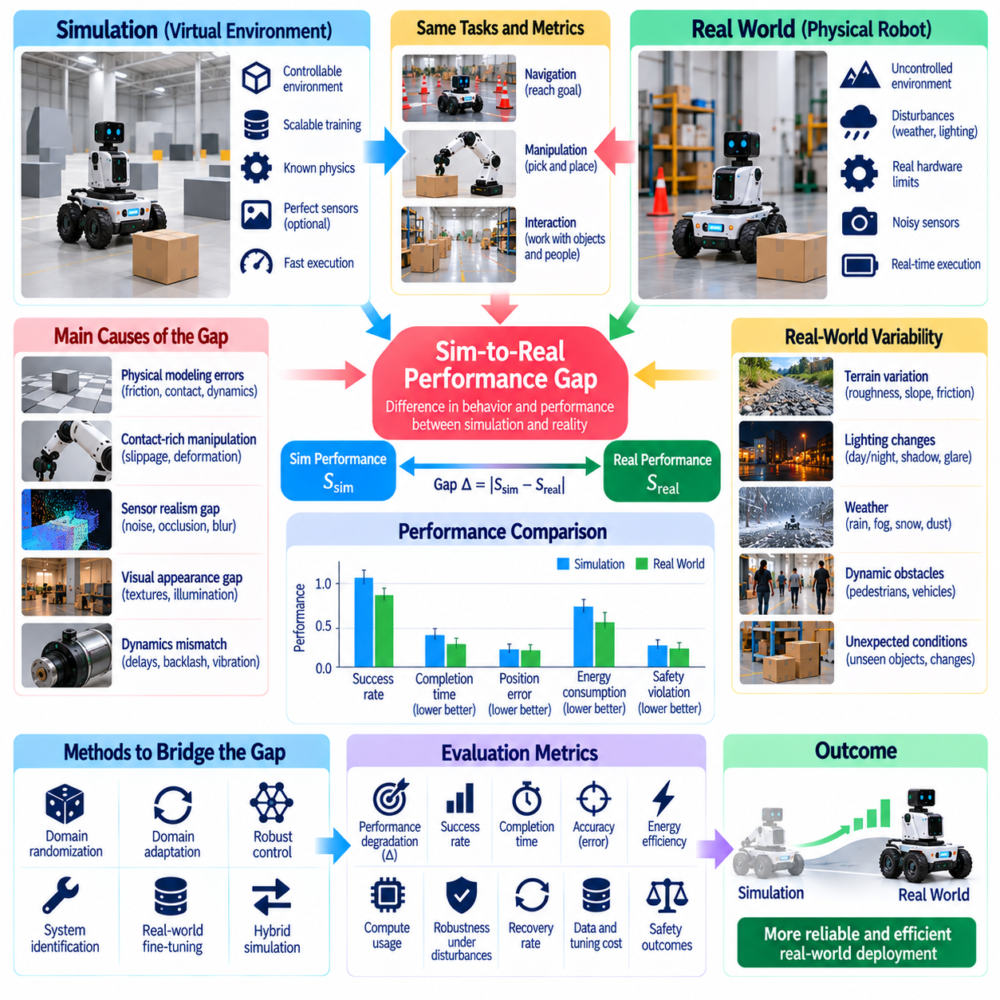{width="7.268055555555556in" height="7.268055555555556in"}

The simulation-to-real performance gap describes differences between a Physical AI system\'s behavior in simulated environments and its performance on physical hardware. Simulation enables rapid experimentation, scalable training, and controlled evaluation, but cannot reproduce every real-world condition. Benchmarking must quantify whether capabilities demonstrated virtually remain reliable when robots encounter physical uncertainty, hardware limitations, and operational disturbances.

The performance gap should be defined using comparable tasks, metrics, and operating conditions. Success rates, completion times, positioning errors, energy consumption, and safety outcomes may differ between simulation and reality. Evaluators should measure both absolute differences and relative performance degradation. A single aggregate score cannot explain whether discrepancies originate from perception, dynamics, planning, or control.

Physical modeling errors are major contributors to the gap. Simulators approximate friction, contact forces, actuator dynamics, structural compliance, and material properties. Small inaccuracies may accumulate during locomotion or manipulation, producing substantially different trajectories. Benchmarks should compare measured physical responses against simulated predictions and identify parameters responsible for systematic deviations.

Contact-rich manipulation presents particular difficulties because impacts, slipping, deformation, and changing contact geometry are challenging to model accurately. A grasp that succeeds consistently in simulation may fail on hardware because of surface friction or object compliance. Evaluation should measure grasp stability, force regulation, placement accuracy, and recovery behavior across both domains. Repeated trials help reveal discrepancies hidden by isolated demonstrations.

Sensor simulation introduces another source of mismatch. Synthetic camera images, depth measurements, and inertial signals may not capture realistic noise, calibration errors, reflections, occlusion, or motion blur. Perception models trained on synthetic observations can therefore degrade when exposed to physical sensors. Benchmarks should compare detection accuracy, state estimation uncertainty, and downstream task outcomes using matched scenarios.

Visual appearance differences are commonly described as the visual domain gap. Simulated textures, illumination, shadows, and object distributions may differ from deployment environments. Domain randomization can improve robustness by exposing models to diverse synthetic conditions, but excessive randomization may introduce unrealistic samples. Evaluation should determine whether appearance diversity improves real-world generalization rather than merely increasing simulated performance.

Dynamics mismatch affects robots that depend on accurate motion prediction. Motor delays, transmission backlash, battery voltage variation, joint friction, and structural vibration may be simplified or omitted in simulation. Controllers optimized under idealized dynamics can become unstable or inefficient on physical platforms. Benchmarking should examine trajectory tracking, response latency, disturbance rejection, and control stability under representative operating conditions.

System identification can reduce the gap by estimating physical parameters from measured robot behavior. Actuator response, mass distribution, friction coefficients, and sensor timing can be calibrated using controlled experiments. Updated simulation models should then be evaluated against independent physical measurements. Calibration effectiveness must be verified on held-out tasks to avoid fitting only the trajectories used during parameter estimation.

Timing differences are often underestimated during simulation-based evaluation. Simulators may execute faster than real time or assume synchronized observations and actions. Physical robots experience communication delays, asynchronous sensors, computation scheduling, and actuator command latency. Benchmarks should compare end-to-end timing and control-loop behavior, ensuring that simulated execution reflects realistic hardware constraints.

Environmental mismatch becomes significant when physical deployment introduces conditions absent from simulated training. Uneven terrain, changing lighting, unexpected obstacles, weather, and human activity may alter robot behavior. Evaluation should distinguish failures caused by missing environmental diversity from those caused by inaccurate physical models. Representative field scenarios are necessary to determine whether simulated robustness transfers to actual operation.

Simulation fidelity should be evaluated according to task relevance rather than visual realism alone. High-resolution rendering may contribute little to a controller that primarily depends on contact dynamics, while simplified geometry may be sufficient for some navigation tasks. Benchmarks should identify which modeled properties influence critical outcomes. This approach helps allocate simulation resources to factors that materially affect real-world performance.

Sim-to-real transfer methods attempt to reduce discrepancies through domain randomization, domain adaptation, robust control, and limited real-world fine-tuning. Each method introduces different computational and data requirements. Benchmarks should measure transferred performance together with training cost, physical data consumption, and adaptation time. Improved success rates must be interpreted alongside the resources required to achieve them.

Real-world fine-tuning may improve performance after initial deployment, but it complicates evaluation. A system tested after extensive physical adaptation should not be compared directly with a zero-shot transfer system without documenting the difference. Benchmarks should distinguish zero-shot performance, few-shot adaptation, and continued learning. Training exposure and test scenarios must remain appropriately separated to preserve evaluation validity.

Paired evaluation provides a useful experimental structure for measuring the gap. Identical task objectives, object configurations, initial states, and success criteria should be reproduced across simulation and physical testing whenever feasible. Differences that cannot be matched exactly must be documented. Multiple paired trials enable statistical estimates of performance degradation and help identify conditions where simulation predictions are unreliable.

Performance gaps may vary substantially across task difficulty. Simple navigation or object placement may transfer successfully, while contact-rich manipulation and long-horizon tasks expose larger discrepancies. Benchmarks should report gap measurements across difficulty levels rather than relying on average performance alone. Degradation curves can reveal operational boundaries and indicate where additional physical validation is necessary.

Safety evaluation is essential because simulated success does not guarantee safe physical behavior. Unexpected contact forces, unstable movements, delayed stopping, and incorrect obstacle responses may emerge only on hardware. Benchmarks should compare safety margins and failure modes across domains. Physical testing must use appropriate safeguards, particularly when validating controllers trained through unconstrained simulated exploration.

Long-duration testing can expose discrepancies that short simulations overlook. Thermal effects, battery depletion, actuator wear, sensor drift, and accumulated localization errors may alter performance over time. Evaluation should compare sustained task throughput, recovery frequency, and resource consumption. Such measurements reveal whether apparent transfer success persists beyond brief demonstrations under realistic operating workloads.

Uncertainty estimates can improve interpretation of simulation predictions. A simulator should not be treated as equally reliable across every operating condition. Benchmarks may compare predicted performance distributions with observed physical outcomes and evaluate calibration quality. Large prediction errors or overconfident estimates indicate conditions where simulated evidence should not substitute for direct physical testing.

Cross-embodiment comparisons require recognizing that simulation gaps depend on mechanical design, sensing configurations, and control architectures. Wheeled robots, manipulators, quadrupeds, and humanoids may exhibit different dominant sources of mismatch. Evaluation should preserve common functional objectives while reporting embodiment-specific discrepancies. A transfer method effective for one platform cannot automatically be assumed to generalize to another.

Reproducible benchmarking requires versioned simulation assets, physics engine settings, controller configurations, hardware specifications, and environmental measurements. Real-world reference data should include synchronized sensor logs, actuator commands, task outcomes, and safety events. Transparent reporting enables researchers to reproduce comparisons and determine whether improvements result from better simulation fidelity, transfer methods, or hardware changes.

Ultimately, sim-to-real performance gap benchmarking determines how reliably simulated evidence predicts physical robot behavior. Meaningful evaluation combines matched tasks, quantitative discrepancies, uncertainty analysis, safety validation, and sustained field testing. By identifying where virtual performance diverges from reality, benchmarks guide simulation improvement, transfer learning, and responsible deployment of Physical AI systems.

## 03.16. Real World Test Data Analysis [w/Code]

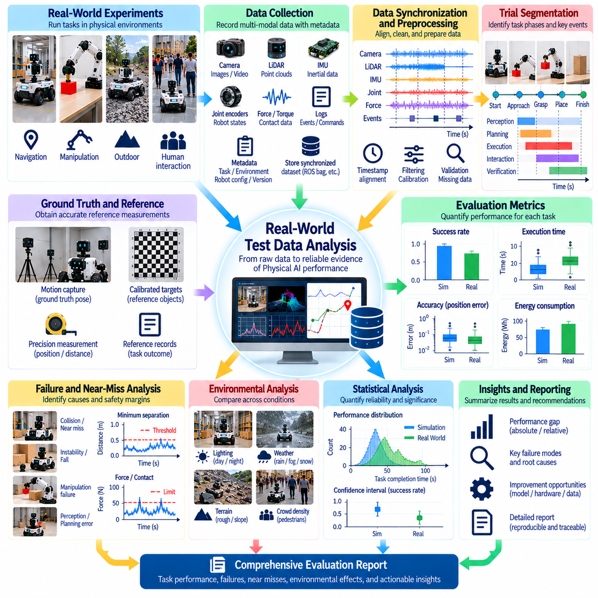{width="7.268055555555556in" height="7.268055555555556in"}

Real-world test data analysis transforms observations from physical robot experiments into measurable evidence of Physical AI capability. Unlike simulation, field testing produces heterogeneous data affected by sensor noise, environmental variability, hardware limitations, and human intervention. Reliable analysis must connect recorded measurements with task objectives, experimental conditions, and operational outcomes to determine whether observed performance is repeatable and meaningful.

A robust analysis pipeline begins with systematic data collection. Robot telemetry, sensor measurements, actuator commands, task events, environmental observations, and operator interventions should be recorded with consistent identifiers. Each trial requires metadata describing the robot configuration, software version, task scenario, and operating conditions. These records provide the context necessary to interpret performance differences across experiments.

Data synchronization is essential because Physical AI systems combine measurements from devices operating at different frequencies. Cameras, inertial sensors, joint encoders, force sensors, and control processes may produce asynchronous timestamps. Analysis should align these streams using a documented time reference while accounting for latency and clock drift. Incorrect synchronization can create misleading relationships between perception, decisions, and physical actions.

Data preprocessing prepares experimental records for reliable quantitative evaluation. Typical operations include format validation, unit conversion, timestamp correction, missing-value identification, and sensor calibration checks. Filtering may reduce measurement noise, but excessive smoothing can conceal abrupt failures or dangerous transients. Every transformation should be documented so that derived results remain traceable to original measurements.

Trial segmentation identifies the beginning, intermediate phases, and completion of each experimental task. Events such as instruction receipt, motion initiation, object contact, goal achievement, and recovery should be associated with timestamps. Consistent segmentation enables comparable measurements of execution duration and phase-specific performance. Automated event detection should be validated against independently annotated examples.

Ground truth provides the reference against which estimated states and task outcomes are evaluated. Motion capture, calibrated measurement devices, external cameras, and verified task records may supply reference information. Analysis should distinguish reference uncertainty from algorithmic error. Ground-truth measurements must be sufficiently accurate for the intended benchmark, especially when evaluating precision manipulation or safety-critical separation distances.

Performance metrics should reflect the functional requirements of each task. Navigation analysis may include success rate, localization error, path efficiency, and collision frequency. Manipulation analysis may examine grasp success, placement accuracy, contact force, and object damage. Long-horizon tasks require milestone completion and recovery statistics. Metrics must be defined before analysis to reduce selective reporting and inconsistent interpretation.

Success-rate estimation requires explicit treatment of trial outcomes. Completed tasks, partial completions, timeouts, safety violations, and operator-assisted recoveries should not be merged into a single category. Analysis should report denominators and exclusion rules alongside calculated rates. This distinction prevents systems from appearing more reliable simply because difficult or unsuccessful trials were removed from the dataset.

Execution-time analysis should characterize variability rather than relying exclusively on averages. Median duration, percentile distributions, recovery delays, and worst-case observations reveal operational behavior that mean values may conceal. Time measurements should use consistent start and completion definitions. Comparisons must also consider whether faster execution increases energy consumption, contact forces, or the probability of unsafe behavior.

Statistical uncertainty is unavoidable when evaluating physical systems with limited trials. Confidence intervals, bootstrap estimates, and appropriate hypothesis tests can quantify uncertainty in observed differences. Repeated measurements from the same robot, operator, or environment may be correlated. Statistical models should account for these dependencies rather than treating every recorded event as an independent experimental sample.

Environmental stratification helps explain performance changes across operating conditions. Results can be grouped by lighting, terrain, obstacle density, payload characteristics, or disturbance severity. Such analysis reveals whether aggregate performance conceals weaknesses in particular scenarios. Comparisons should preserve sufficient sample sizes within each condition and avoid interpreting correlations as established causal relationships.

Failure analysis connects unsuccessful outcomes with their preceding events. Sensor degradation, planning errors, actuator saturation, communication interruptions, and unexpected human actions may contribute to operational failures. Event timelines and synchronized logs support reconstruction of incident sequences. Root-cause conclusions should distinguish directly observed evidence from hypotheses that require additional controlled experiments.

Near-miss analysis extends evaluation beyond completed failures. Minimum separation distance, time-to-collision estimates, unstable contact, and delayed stopping may indicate declining safety margins. Continuous measurements are often more informative than binary incident labels. Analysis should document detection thresholds and observation coverage because near-miss counts depend on how events are identified and recorded.

Recovery analysis measures how systems respond after deviations or failures occur. Relevant quantities include detection latency, intervention frequency, recovery duration, retry count, and eventual task completion. Autonomous recovery should be distinguished from operator-assisted restoration. Combining these measures with energy and computation records reveals the operational cost of maintaining reliability under difficult conditions.

Comparative analysis requires matched tasks, consistent metrics, and documented experimental configurations. Different robots or algorithms may be tested under unequal workloads, making direct rankings misleading. Paired trials, randomized scenario ordering, and controlled environmental conditions can reduce confounding factors. Results should identify practical effect sizes alongside statistical significance to support meaningful engineering decisions.

Automated analysis pipelines improve reproducibility by applying identical calculations across datasets. Scripts can validate records, synchronize streams, calculate metrics, generate summary tables, and flag anomalous trials. Python-based workflows using numerical and data-analysis libraries are suitable for these operations. Analysis code should preserve configuration parameters and produce outputs that can be independently regenerated.

Data visualization supports interpretation when used alongside quantitative measurements. Time-series plots reveal sensor drift, control oscillations, and resource consumption trends, while distributions expose variability and outliers. Scenario comparisons can reveal systematic performance degradation. Visualizations should include units, uncertainty information, and clear definitions so that apparent patterns are not mistaken for verified causal explanations.

Data quality assessment is necessary before interpreting benchmark results. Missing telemetry, corrupted timestamps, inconsistent annotations, and incomplete trial records can bias performance estimates. Analysis should report completeness, measurement validity, and reasons for excluding observations. Sensitivity analysis can determine whether conclusions change when questionable records or alternative preprocessing choices are considered.

Privacy and governance requirements become important when field data contain human activity, video, audio, or location information. Collection should follow informed consent and applicable operational policies. Access controls, retention limits, and appropriate de-identification reduce unnecessary exposure of personal information. Reproducibility should be supported through documented datasets and analysis procedures without compromising participant privacy.

Cross-embodiment analysis requires distinguishing shared functional metrics from platform-specific measurements. Wheeled robots, manipulators, quadrupeds, and humanoids may differ in mobility, energy consumption, and failure mechanisms. Common task outcomes enable broad comparison, while embodiment-specific indicators explain operational differences. Normalization should reflect physical capabilities and task requirements rather than forcing artificial equivalence.

Ultimately, real-world test data analysis must convert experimental records into transparent, statistically defensible conclusions about Physical AI performance. Effective pipelines integrate synchronized measurements, verified outcomes, uncertainty estimates, failure investigation, and reproducible computation. By connecting data quality with operational evidence, benchmarking supports reliable system comparison, continuous improvement, and responsible physical deployment.
