**Volume 11. Physical AI Evaluation and Benchmarking**

# Chapter 04. Generalization Metrics

## 04.01. What is Generalization in Physical AI

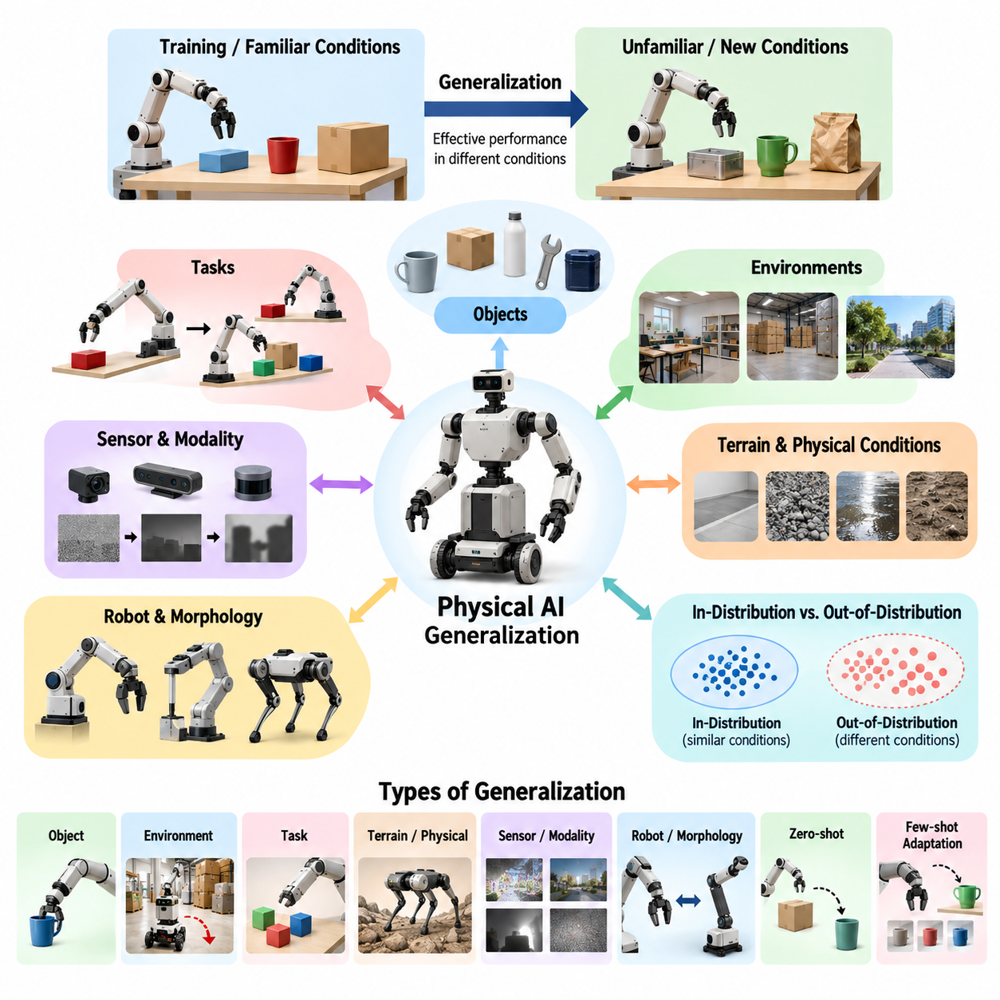{width="7.268055555555556in" height="7.268055555555556in"}

피지컬 AI(Physical AI)에서 일반화(Generalization)란 지능형 물리 시스템(Intelligent Physical System)이 학습(Training), 개발(Development), 검증(Validation) 과정에서 경험한 조건과 다른 상황에서도 효과적으로 작업을 수행할 수 있는 능력을 의미한다. 기존 소프트웨어와 달리 피지컬 AI는 센서(Sensor), 액추에이터(Actuator), 물리 동역학(Physical Dynamics)을 통해 불확실한 환경과 상호작용해야 한다. 따라서 일반화는 정보와 물리적 조건의 변화에 성공적으로 적응하는 능력을 요구한다.

피지컬 AI 시스템은 통제된 실험실 환경(Controlled Laboratory Environment)에서 우수한 성능을 달성하더라도 익숙하지 않은 환경에 배치되면 실패할 수 있다. 특정 물체를 이용해 학습한 조작 로봇(Manipulation Robot)은 형상, 재질, 표면 특성이 다른 물체를 다루는 데 어려움을 겪을 수 있다. 마찬가지로 자율이동로봇(Autonomous Mobile Robot)은 익숙한 창고에서는 정확하게 주행하지만 조명, 바닥 마찰, 장애물, 공간 배치가 달라지면 문제에 직면할 수 있다.

일반화 평가(Generalization Evaluation)의 근본적인 목적은 시스템이 특정 학습 조건을 암기한 것이 아니라 다른 상황으로 전이할 수 있는 능력(Transferable Capabilities)을 획득했는지 판단하는 것이다. 물체가 익숙한 위치에 있을 때만 작업에 성공하는 로봇은 제한적인 일반화 능력을 보여준다. 반면 더 높은 능력을 갖춘 시스템은 물체, 행동, 목표 사이의 근본적인 관계를 이해하고 환경 구성이 변경되더라도 적절하게 대응할 수 있다.

일반화는 이전에 경험한 조건을 벗어난 행동을 명시적으로 평가한다는 점에서 일반적인 작업 성능(Task Performance)과 구별된다. 작업 성능은 시스템이 정의된 목표를 얼마나 성공적으로 완료하는지 측정하지만, 일반화는 이러한 성능이 다양한 조건으로 얼마나 효과적으로 전이되는지 측정한다. 따라서 의미 있는 평가는 기존 운영 조건과 시험 과정에서 새롭게 도입되는 조건의 분포를 모두 고려해야 한다.

분포 내 평가(In-Distribution Evaluation)와 분포 외 평가(Out-of-Distribution Evaluation)의 구분은 일반화를 이해하기 위한 핵심적인 기반을 제공한다. 분포 내 평가는 학습 데이터(Training Data)와 유사한 조건을 조사하지만, 분포 외 평가는 의미 있는 차이가 존재하는 조건을 도입한다. 이러한 차이에는 익숙하지 않은 물체, 환경, 작업, 센서 특성, 로봇 구성 또는 이전에 관찰한 요소들의 새로운 조합이 포함될 수 있다.

피지컬 AI의 일반화는 여러 상호작용하는 능력에 의존하기 때문에 본질적으로 다차원적(Multidimensional)이다. 인지(Perception)는 익숙하지 않은 시각적·기하학적 패턴을 인식해야 하고, 추론(Reasoning)은 새로운 상황을 해석해야 하며, 계획(Planning)은 실행 가능한 행동을 결정해야 한다. 또한 제어(Control)는 변화하는 동역학 조건에서 이러한 행동을 실행해야 한다. 시스템은 인지에서는 일반화에 성공하더라도 조작이나 이동에서는 한계를 보일 수 있다.

물체 일반화(Object Generalization)는 학습 과정에서 명시적으로 다루지 않은 물체와 상호작용할 수 있는 능력을 의미한다. 로봇 그리퍼(Robotic Gripper)는 익숙하지 않은 용기, 도구, 포장물 또는 기계 부품을 다루어야 할 수 있다. 성공적인 작업 수행에는 시각적 인식 이상의 능력이 필요하다. 로봇은 관련 물리적 특성을 추정하고 적절한 접촉 영역을 식별하며 물체의 형상과 상호작용 제약조건에 따라 조작 전략을 조정해야 한다.

환경 일반화(Environment Generalization)는 시스템이 익숙하지 않은 장면, 공간 배치, 환경 조건에서도 작동할 수 있는지 평가한다. 조명, 질감, 복잡도, 공간 구성, 장애물 분포의 변화는 인지와 의사결정에 영향을 미칠 수 있다. 이러한 능력은 자율이동로봇에서 특히 중요하다. 실제 운영 환경은 학습 데이터셋(Training Dataset)에 포함된 구성과 완전히 동일한 상태로 유지되는 경우가 드물기 때문이다.

작업 일반화(Task Generalization)는 익숙하지 않은 물리적 조건을 인식하는 수준을 넘어 새로운 목표를 수행하는 능력까지 포함한다. 고정된 위치 사이에서 물체를 운반하도록 학습한 로봇이 새로운 지시에 따라 자재를 재배치해야 할 수 있다. 성공적인 일반화를 위해서는 새로운 목표를 해석하고 관련 기술을 식별하며 이전에 암기한 작업 궤적(Task Trajectory)에만 의존하지 않고 적절한 행동 순서를 구성해야 한다.

지형 및 물리적 조건 일반화(Terrain and Physical-Condition Generalization)는 이동로봇과 다족보행로봇(Legged Robot)에서 특히 중요하다. 경사, 마찰, 유연성, 표면 불규칙성, 환경 교란의 변화는 시스템 동역학에 상당한 영향을 미칠 수 있다. 매끄러운 실험실 바닥에서 안정적으로 작동하는 보행 정책(Locomotion Policy)이라도 자갈, 젖은 표면, 변형 가능한 지면에서 새로운 물리적 상호작용에 적응하지 못하면 실패할 수 있다.

센서 및 모달리티 일반화(Sensor and Modality Generalization)는 시스템이 사용할 수 있는 정보의 변화를 다룬다. 카메라 노출, 센서 잡음, 보정 오차, 부분적인 가림, 센서 하드웨어 변경은 관측 정보의 품질에 영향을 미칠 수 있다. 일반화 능력이 높은 피지컬 AI 시스템은 합리적인 범위의 센싱 변화에서도 유용한 성능을 유지해야 하며, 정보가 부족하여 신뢰할 수 있는 의사결정이나 안전한 실행이 불가능한 상황도 인식할 수 있어야 한다.

로봇 및 형태 일반화(Robot and Morphology Generalization)는 학습된 능력이 서로 다른 물리적 구조를 가진 플랫폼 사이에서 전이될 수 있는지 조사한다. 하나의 로봇 팔(Robotic Arm)을 위해 개발된 조작 전략은 관절 제한, 도달 가능 영역, 그리퍼 특성이 다른 로봇 팔로 전이할 때 조정이 필요할 수 있다. 교차 체화 일반화(Cross-Embodiment Generalization)는 동일한 작업 목표라도 서로 다른 물리적 행동을 요구할 수 있기 때문에 특히 어려운 문제이다.

제로샷 일반화(Zero-Shot Generalization)는 추가적인 작업별 학습이나 적응 없이 익숙하지 않은 상황에서 성공적으로 작업을 수행하는 능력을 의미한다. 반면 퓨샷 적응(Few-Shot Adaptation)은 성능 평가 전에 제한된 양의 새로운 경험을 허용한다. 두 능력은 유연성의 서로 다른 측면을 나타낸다. 제로샷 평가는 즉각적인 전이 능력을 측정하고, 퓨샷 평가는 새로운 환경이나 작업을 경험한 이후 시스템이 얼마나 효율적으로 개선되는지 측정한다.

조합적 일반화(Compositional Generalization)는 이전에 학습한 개념이나 기술을 익숙하지 않은 구성으로 결합하는 능력을 의미한다. 로봇은 물체 탐색, 용기 개방, 지정된 영역에 물체 배치하기를 각각 독립적으로 학습할 수 있다. 이러한 능력을 새로운 순서로 수행해야 하는 작업은 시스템이 학습된 지식을 재조합할 수 있는지, 아니면 학습 과정에서 경험한 완전한 행동 순서에 의존하는지를 평가한다.

체계적 일반화(Systematic Generalization)와 인과적 일반화(Causal Generalization)는 변화하는 조건에서도 유효하게 유지되는 관계에 대한 더 깊은 이해를 요구한다. 표면적인 시각적 상관관계에 의존하는 시스템은 물체의 외형이 바뀌면 실패할 수 있다. 반면 힘, 접촉, 운동, 결과 사이의 인과관계를 표현하는 시스템은 학습된 물리적 가정이 여전히 적용되는 범위에서 익숙하지 않은 외형에도 적절한 행동을 선택할 가능성이 높다.

일반화는 강건성(Robustness)과 일부 중복되지만 서로 구별해야 한다. 강건성은 일반적으로 교란, 불확실성, 구성요소 성능 저하 상황에서도 허용 가능한 성능을 유지하는 능력을 의미한다. 반면 일반화는 작업 또는 운영 분포의 변화 전반에서 성공적인 행동을 수행하는 능력을 강조한다. 시스템은 상당한 센서 잡음을 견디면서도 익숙하지 않은 물체를 다루는 데 실패할 수 있으며, 이는 높은 강건성이 반드시 폭넓은 일반화를 의미하지 않음을 보여준다.

일반화 격차(Generalization Gap)는 익숙한 평가 조건과 익숙하지 않은 평가 조건 사이에서 성능이 얼마나 변화하는지를 정량적으로 나타낸다. 이는 분포 내 성공률과 분포 외 성공률의 차이로 표현할 수 있지만 다른 측정 방식도 가능하다. 작은 격차는 성공적인 전이를 나타낼 수 있으나 절대적인 성능 수준과 함께 해석해야 한다. 두 조건 모두에서 성능이 낮더라도 격차 자체는 작게 나타날 수 있기 때문이다.

성능 저하 곡선(Performance Degradation Curve)은 평가 조건이 점차 달라지거나 어려워질 때 시스템의 행동이 어떻게 변화하는지 조사하여 추가적인 정보를 제공한다. 예를 들어 장애물 밀도나 위치추정 교란을 점진적으로 증가시키면서 주행 성공률을 측정할 수 있다. 이러한 곡선은 피지컬 AI 시스템이 허용 가능한 성능을 유지하는 운영 경계(Operating Boundary)와 신뢰성이 저하되기 시작하는 조건을 식별하는 데 도움이 된다.

엄격한 일반화 벤치마크(Generalization Benchmark)는 학습 조건과 시험 조건 사이의 관계를 통제해야 한다. 시험 환경에는 실제로 경험하지 않은 변형이 포함되어야 하며, 정보 누출(Data Leakage)을 방지하기 위해 평가 데이터는 모델 개발 과정과 분리되어야 한다. 이러한 예방 조치가 없다면 높은 벤치마크 점수는 전이 가능한 물리 지능보다 반복적인 노출, 암기 또는 벤치마크에 특화된 최적화의 결과일 수 있다.

통계적 신뢰성(Statistical Reliability)은 물리적 실험이 무작위성, 환경 변동성, 하드웨어 불확실성의 영향을 받기 때문에 필수적이다. 따라서 일반화에 대한 주장은 다양한 시나리오에서 반복 수행한 시험, 불확실성 추정, 명확하게 정의된 성공 기준에 근거해야 한다. 평균 성능만 보고하면 실제 배치에서 중요한 특정 환경, 물체 범주 또는 운영 조건에서 발생하는 심각한 실패가 가려질 수 있다.

일반화 평가는 작업 완료 여부뿐 아니라 효율성(Efficiency), 안전성(Safety), 복구 행동(Recovery Behavior)도 조사해야 한다. 로봇이 익숙하지 않은 작업을 결국 완료하더라도 과도한 에너지를 소비하거나 반복적인 개입이 필요하거나 위험한 움직임을 수행할 수 있다. 포괄적인 평가는 실행 품질, 적응 비용, 실패 빈도, 시스템의 신뢰 가능한 운영 능력을 벗어나는 상황을 인식하는 능력을 함께 고려한다.

시뮬레이션(Simulation)은 통제된 다양한 조건에서 일반화를 평가할 수 있는 확장성 높은 환경을 제공한다. 도메인 무작위화(Domain Randomization)는 형상, 외형, 동역학, 센서 특성을 체계적으로 변경하여 다양한 시험 조건을 생성할 수 있다. 그러나 단순화된 물리 모델은 실제 환경에서 발생하는 접촉 동역학, 재료 거동, 예측하기 어려운 교란을 충분히 재현하지 못할 수 있으므로 시뮬레이션 결과를 신중하게 해석해야 한다.

실세계 평가(Real-World Evaluation)는 일반화 능력이 실제 운영 능력으로 이어지는지 판단하기 위해 반드시 필요하다. 실험실 시험은 통제된 비교를 가능하게 하지만 현장 실험(Field Experiment)은 자연적으로 발생하는 환경 변동성에 시스템을 노출한다. 시뮬레이션, 실험실 시험, 실제 운영 배치를 결합하면 학습된 행동이 초기 개발 조건을 넘어 얼마나 효과적으로 전이되는지에 관한 상호보완적인 근거를 확보할 수 있다.

일반화는 비전-언어-행동 모델(Vision-Language-Action Model, VLA)과 범용 로봇 정책(Generalist Robot Policy)에서 특히 중요하다. 이러한 아키텍처는 다양한 관측, 지시, 물리적 행동을 연결하는 것을 목표로 하기 때문이다. 따라서 평가에서는 언어적 이해와 성공적인 물리적 실행을 구분해야 한다. 익숙하지 않은 지시를 올바르게 해석하더라도 로봇이 해당 작업을 안전하고 효과적으로 수행하지 못한다면 완전한 일반화를 입증했다고 볼 수 없다.

궁극적으로 일반화는 광범위한 능력을 갖춘 피지컬 AI로 발전하는 과정에서 핵심적인 평가 차원이다. 진정으로 일반화 가능한 시스템은 물체, 환경, 작업, 센싱 조건, 물리적 체화 형태 전반에서 지식을 전이하면서 실제 세계와의 신뢰할 수 있는 상호작용을 유지해야 한다. 이러한 능력을 측정하려면 시스템이 성공하는 조건뿐 아니라 지능의 전이 능력이 더 이상 유지되지 않는 조건까지 밝혀내는 다차원 벤치마크(Multidimensional Benchmark)가 필요하다.

## 04.02. In Distribution vs Out of Distribution Evaluation

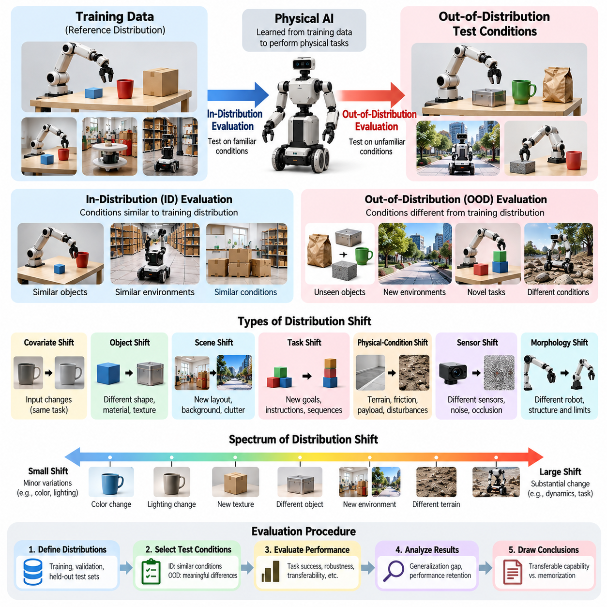{width="7.268055555555556in" height="7.268055555555556in"}

분포 내 평가(In-Distribution Evaluation)와 분포 외 평가(Out-of-Distribution Evaluation)는 피지컬 AI(Physical AI) 시스템이 익숙한 조건과 익숙하지 않은 조건에서 어떻게 작동하는지 측정하기 위한 기본적인 접근 방법이다. 분포 내 평가는 학습 과정에서 나타난 조건과 통계적으로 유사한 시나리오를 조사하지만, 분포 외 평가는 의미 있는 차이가 존재하는 조건을 도입한다. 두 접근 방법을 함께 사용하면 시스템이 전이 가능한 물리적 능력을 학습했는지, 아니면 특정 학습 조건에 의존하는지 파악할 수 있다.

일반적으로 ID 평가(ID Evaluation)라고 부르는 분포 내 평가는 학습 경험의 예상 범위 안에서 성능을 측정한다. 특정 공간 배치, 조명 조건, 장애물 패턴으로 학습한 창고 로봇은 동일한 환경 분포에서 추출한 다른 구성으로 시험할 수 있다. 이러한 시험은 기준 역량(Baseline Competence)을 설정하고 시스템이 의도한 운영 행동(Operational Behavior)을 성공적으로 학습했는지 판단하는 데 도움이 된다.

일반적으로 OOD 평가(OOD Evaluation)라고 부르는 분포 외 평가는 시험 조건이 학습 분포(Training Distribution)와 다를 때의 성능을 조사한다. 이러한 차이에는 익숙하지 않은 물체, 새로운 환경, 변경된 센서 특성, 예상하지 못한 물리적 특성 또는 새로운 작업 조합이 포함될 수 있다. 실제 환경에 배치된 피지컬 AI 시스템은 개발 과정에서 완전히 표현할 수 없는 상황에 자주 노출되기 때문에 OOD 평가는 필수적이다.

ID 조건과 OOD 조건의 구분이 항상 절대적인 것은 아니다. 환경적 차이는 작은 변형부터 근본적인 동역학이나 작업 요구사항의 상당한 변화까지 연속적인 범위에 존재한다. 로봇이 약간 다른 색상의 물체를 접하는 경우에는 비교적 작은 분포 이동(Distribution Shift)이 발생할 수 있지만, 익숙하지 않은 변형 가능 물체(Deformable Object)와 상호작용하는 경우에는 근본적으로 다른 인지 및 제어 전략이 필요할 수 있다.

분포 이동(Distribution Shift)은 학습과 평가 사이에서 관측(Observation), 행동(Action), 환경 상태(Environmental State) 또는 작업 결과(Task Outcome)의 통계적 특성이 변화하는 현상을 의미한다. 피지컬 AI에서는 이러한 변화가 시각적 외형, 기하학적 구조, 접촉 동역학(Contact Dynamics), 운동 패턴, 센서 측정값에 영향을 미칠 수 있다. 따라서 이러한 변화를 평가하려면 입력 데이터 분포뿐 아니라 관측을 생성하고 행동의 결과를 결정하는 물리적 과정까지 이해해야 한다.

공변량 이동(Covariate Shift)은 입력 관측의 분포가 변하지만 입력과 결과 사이의 관련 조건부 관계(Conditional Relationship)는 대체로 안정적으로 유지되는 경우를 의미한다. 예를 들어 주행 시스템은 기본적인 주행 목표가 변경되지 않은 상태에서 서로 다른 조명이나 시각적 질감을 경험할 수 있다. 요구되는 행동은 유사하게 유지되지만 변경된 관측 정보는 인지 정확도를 떨어뜨리고 이후 계획과 제어에도 영향을 미칠 수 있다.

다른 형태의 분포 이동은 관측, 행동, 결과 사이의 관계 자체를 변화시킬 수 있다. 익숙하지 않은 마찰계수(Friction Coefficient)나 물체 질량(Object Mass)을 가진 환경에서 작동하는 로봇 조작기(Robotic Manipulator)는 이전에 성공했던 행동에 대해 다른 물리적 반응을 경험할 수 있다. 이러한 변화는 단순한 시각적 불변성(Visual Invariance)만으로 해결하기 어렵다. 시스템이 변경된 동역학, 접촉력, 상호작용 제약조건을 고려해야 하기 때문이다.

물체 수준 OOD 평가(Object-Level OOD Evaluation)는 로봇이 학습 경험에서 제외된 물체와 상호작용할 수 있는지 조사한다. 평가 대상 물체는 형상, 크기, 재질, 질감 또는 기계적 특성에서 차이를 보일 수 있다. 조작 벤치마크(Manipulation Benchmark)는 단순한 외형 변화와 파지 안정성(Grasp Stability) 또는 필요한 접촉력을 변화시키는 조건을 구분해야 한다. 이러한 조건은 서로 다른 수준의 물리적 일반화 난이도를 나타내기 때문이다.

장면 수준 OOD 평가(Scene-Level OOD Evaluation)는 익숙하지 않은 공간 배치, 배경 구조, 장애물 구성, 환경 복잡도를 조사한다. 구조화된 복도에서 학습한 이동로봇은 시험 과정에서 혼잡한 작업 공간이나 불규칙한 통로를 마주할 수 있다. 성공적인 성능을 위해서는 학습 과정에서 경험한 공간 패턴이 변화하더라도 신뢰할 수 있는 인지(Perception), 위치추정(Localization), 주행(Navigation) 능력을 유지해야 한다.

작업 수준 OOD 평가(Task-Level OOD Evaluation)는 익숙하지 않은 목표, 지시 또는 행동 순서를 도입한다. 개별 물체를 집어 옮기도록 학습한 로봇이 새로운 기준에 따라 여러 물체를 분류하도록 요구받을 수 있다. 이러한 평가는 시스템이 단순히 암기한 작업 궤적(Task Trajectory)을 재현하는 것이 아니라 새로운 목표를 해석하고 이전에 획득한 능력을 재조합할 수 있는지 판단한다.

물리적 조건 OOD 평가(Physical-Condition OOD Evaluation)는 지형, 마찰, 적재하중(Payload), 유연성(Compliance), 온도, 외부 교란(External Disturbance)의 변화를 다룬다. 물리 시스템은 실제 기계적 제약조건(Mechanical Constraint)을 충족해야 하므로 이러한 변화가 특히 중요하다. 단단한 실험실 바닥에서 성공적으로 작동하는 보행 제어기(Locomotion Controller)라도 환경의 시각적 외형이 유사하더라도 미끄럽거나 변형 가능한 지형에서는 다르게 작동할 수 있다.

센서 수준 OOD 평가(Sensor-Level OOD Evaluation)는 카메라 특성, 보정(Calibration), 잡음(Noise), 가림(Occlusion), 센서 가용성(Sensor Availability)의 변화를 고려한다. 이러한 변화는 하드웨어 교체, 환경적 간섭 또는 점진적인 센서 성능 저하로 발생할 수 있다. 시험에서는 시스템이 허용 가능한 성능을 유지하는지, 변경된 관측에 적응하는지, 또는 정보 부족으로 신뢰할 수 있는 작동이 불가능한 상황을 인식하는지 판단해야 한다.

엄격한 평가 프로토콜(Evaluation Protocol)은 기준 학습 분포(Reference Training Distribution)와 의도된 운영 설계 영역(Operational Design Domain, ODD)을 정의하는 것에서 시작한다. 연구자는 학습 과정에 포함된 환경 요소, 물체 특성, 작업 구성, 로봇 특성을 식별해야 한다. 이러한 정보가 없으면 새로운 조건의 정도를 일관되게 판단할 수 없기 때문에 분포 외 성능에 대한 주장이 모호해진다.

평가 데이터셋(Evaluation Dataset)은 학습(Training), 검증(Validation), 시험(Testing) 사이의 정보 누출(Data Leakage)을 방지하면서 익숙한 조건과 익숙하지 않은 조건을 분리해야 한다. 단순히 서로 다른 무작위 표본을 각 데이터셋에 할당하는 것만으로 의미 있는 OOD 평가가 보장되지는 않는다. 동일한 물체, 환경 또는 기본 구성이 여러 데이터 분할에 나타난다면 측정된 성능은 성공적인 일반화보다 암기(Memorization)를 반영할 수 있다.

통제된 분포 이동(Controlled Distribution Shift)은 일반화 능력을 분리하여 분석하는 실용적인 방법을 제공한다. 연구자는 다른 조건을 대체로 일정하게 유지하면서 조명 강도나 물체 질량과 같은 하나의 요소를 변화시킬 수 있다. 이러한 접근 방법은 어떤 변화가 성능 저하를 유발하는지 식별하는 데 도움이 된다. 그러나 실제 환경에서는 익숙하지 않은 여러 요소가 동시에 나타나는 경우가 많으므로 복합 분포 이동(Combined Shift)도 시험해야 한다.

OOD 난이도(OOD Difficulty)는 단순한 이진 조건(Binary Condition)으로 취급하기보다 체계적으로 특성을 정의해야 한다. 평가 시나리오는 새로움의 정도(Novelty), 환경 복잡도(Environmental Complexity), 물리적 난이도(Physical Difficulty)가 증가하는 수준에 따라 구성할 수 있다. 이러한 수준에서 측정한 성능은 성능 저하 패턴을 보여주며, 중간 정도의 변화를 견디는 시스템과 상당히 익숙하지 않은 운영 조건까지 처리할 수 있는 시스템을 구분하는 데 도움이 된다.

작업 성공률(Task Success Rate)은 ID 성능과 OOD 성능을 비교하는 일반적인 지표이다. 일반화 격차(Generalization Gap)는 익숙한 조건과 익숙하지 않은 조건에서의 성공률 차이로 계산할 수 있다. 예를 들어 시스템이 ID 시나리오에서 95%의 성공률을 달성하고 OOD 시나리오에서 70%의 성공률을 달성했다면 일반화 격차는 25%포인트이다. 이는 시험한 분포 이동 조건에서 신뢰성이 감소했음을 의미한다.

절대적인 OOD 성능(Absolute OOD Performance)은 일반화 격차와 함께 고려해야 한다. 두 조건에서 모두 성공률이 낮은 시스템은 의미 있는 역량을 보여주지 못하더라도 작은 격차를 나타낼 수 있다. 반대로 높은 능력을 갖춘 시스템은 측정 가능한 성능 저하를 경험하더라도 다른 시스템보다 우수한 성능을 유지할 수 있다. 따라서 평가는 단일 종합 점수에만 의존하지 않고 ID 성능, OOD 성능, 두 성능 사이의 관계를 함께 보고해야 한다.

성능 저하 곡선(Performance Degradation Curve)은 점차 강해지는 분포 이동 조건에서 결과를 측정함으로써 이러한 분석을 확장한다. 주행 벤치마크는 장애물 밀도를 증가시킬 수 있고, 조작 벤치마크는 물체 질량이나 마찰을 변화시킬 수 있다. 이러한 곡선은 성능이 얼마나 빠르게 악화되는지 보여주며, 점점 익숙하지 않은 조건에서 신뢰할 수 있는 작동이 가능한 범위의 경계를 파악할 수 있는 근거를 제공한다.

OOD 평가는 작업 완료 여부뿐 아니라 실행 품질(Execution Quality)도 측정해야 한다. 관련 지표에는 완료 시간(Completion Time), 궤적 편차(Trajectory Deviation), 에너지 소비(Energy Consumption), 충돌 빈도(Collision Frequency), 개입률(Intervention Rate), 복구 효과(Recovery Effectiveness)가 포함된다. 로봇은 익숙하지 않은 작업을 완료하더라도 비효율적이거나 안전하지 않은 행동을 보일 수 있으므로 성공률만으로 실제 일반화 능력을 평가하기에는 충분하지 않다.

불확실성 추정(Uncertainty Estimation)은 OOD 평가의 또 다른 중요한 구성요소이다. 피지컬 AI 시스템은 관측이나 운영 조건이 기존 경험과 상당히 다른 상황을 인식할 수 있는 것이 바람직하다. 신뢰도 보정(Confidence Calibration), 새로움 탐지(Novelty Detection), 불확실성 인식 의사결정(Uncertainty-Aware Decision-Making)은 신중한 행동, 추가 센싱, 인간의 지원 또는 통제된 대체 절차(Fallback Procedure)가 필요한 상황을 식별하는 데 도움이 될 수 있다.

시뮬레이션(Simulation)은 다양한 환경을 생성하고 물리적 매개변수를 체계적으로 변경함으로써 확장 가능한 OOD 시험을 가능하게 한다. 도메인 무작위화(Domain Randomization)는 외형, 기하학적 구조, 동역학, 센서 동작의 변화를 생성할 수 있다. 그러나 시뮬레이션 기반 OOD 성능이 실세계 일반화(Real-World Generalization)를 보장하지는 않는다. 시뮬레이션 상호작용에서는 복잡한 재료 특성, 하드웨어 불완전성, 모델링되지 않은 교란이 누락될 수 있기 때문이다.

실세계 OOD 평가(Real-World OOD Evaluation)는 시스템을 자연적으로 발생하는 변동성에 노출함으로써 운영 일반화(Operational Generalization)에 대한 더 강한 근거를 제공한다. 통제된 실험실 시험은 개별 분포 이동을 분리하여 분석할 수 있지만, 현장 시험(Field Testing)은 서로 상호작용하는 환경 요소를 드러낸다. 두 접근 방법을 결합하면 특정 실패 메커니즘(Failure Mechanism)을 조사하고 관찰된 일반화가 실제 배치 조건까지 확장되는지 판단할 수 있다.

통계적 엄격성(Statistical Rigor)은 ID 결과와 OOD 결과를 비교할 때 필수적이다. 반복 시험(Repeated Trial), 대표성 있는 시나리오 표본 추출(Representative Scenario Sampling), 신뢰구간(Confidence Interval), 일관된 실험 절차는 체계적인 성능 저하와 무작위 변동을 구분하는 데 도움이 된다. 또한 종합 점수는 특정 물체, 환경 또는 물리적 조건에서 발생하는 심각한 약점을 숨길 수 있으므로 분포 이동 유형별로 결과를 보고해야 한다.

궁극적으로 ID 평가와 OOD 평가는 피지컬 AI의 능력에 대한 상호보완적인 근거를 제공한다. ID 시험은 익숙한 조건에서의 역량을 확립하고, OOD 시험은 그러한 조건을 넘어서는 전이 능력을 조사한다. 포괄적인 평가 프레임워크(Evaluation Framework)는 변화하는 물리적 환경에서 신뢰할 수 있는 배치를 지원하기 위해 분포 이동의 특성을 정의하고, 성능 저하를 정량화하며, 불확실성과 안전성을 평가하고, 운영 경계(Operational Boundary)를 식별해야 한다.

## 04.03. Unseen Object Generalization

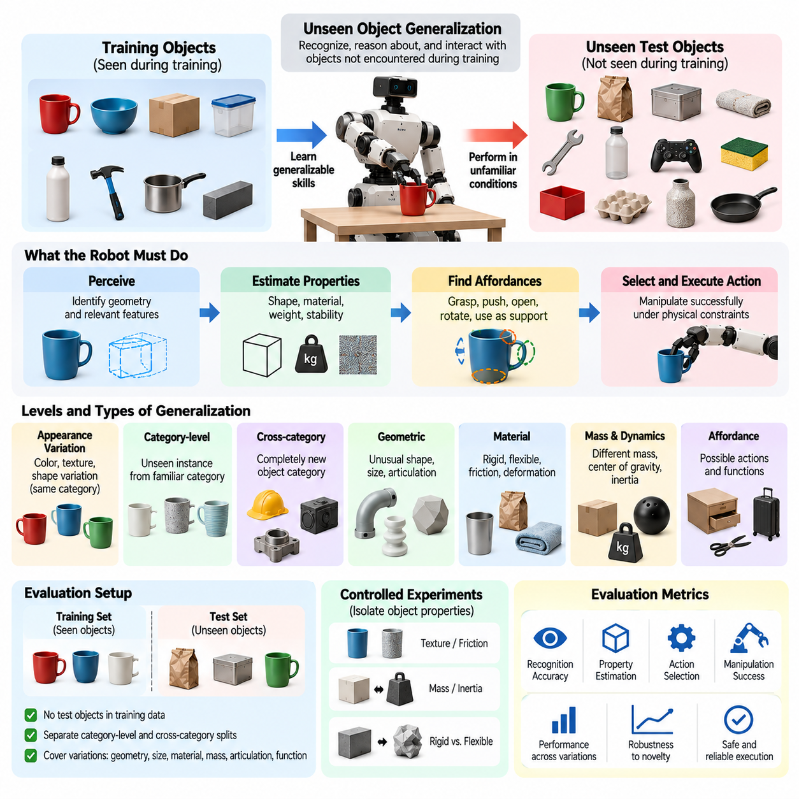{width="7.268055555555556in" height="7.268055555555556in"}

미학습 물체 일반화(Unseen Object Generalization)란 피지컬 AI(Physical AI) 시스템이 학습 과정에서 경험하지 않은 물체를 인식하고, 추론하며, 상호작용할 수 있는 능력을 의미한다. 이러한 능력은 물체의 종류, 기하학적 구조, 재질, 물리적 특성이 지속적으로 변화하는 개방형 환경(Open Environment)에서 작동하는 로봇에 필수적이다. 평가에서는 학습된 기술이 암기된 외형이나 사전에 정의된 조작 절차에 의존하지 않고 익숙하지 않은 물체로 전이될 수 있는지 판단해야 한다.

기존 로봇 시스템(Traditional Robotic System)은 명시적으로 모델링된 물체나 제한적으로 정의된 물체 범주(Object Category)에 의존하는 경우가 많다. 이러한 접근 방식은 통제된 환경에서 높은 신뢰성을 달성할 수 있지만 익숙하지 않은 물체를 만나면 어려움을 겪을 수 있다. 범용 피지컬 AI(Generalist Physical AI)는 원래 학습 분포(Training Distribution)에서 제외된 물체를 포함하여 다양한 물체에 적용할 수 있는 표현(Representation)과 상호작용 전략(Interaction Strategy)을 학습함으로써 이러한 한계를 극복하는 것을 목표로 한다.

미학습 물체 일반화는 시각적 인지(Visual Perception)를 통해 새로운 물체를 인식하는 것 이상의 능력을 포함한다. 로봇은 관련 기하학적 특징(Geometric Feature)을 식별하고, 물리적 특성을 추정하며, 가능한 상호작용을 이해하고, 작업에 적합한 행동을 선택해야 한다. 예를 들어 익숙하지 않은 용기를 성공적으로 파지하려면 형상, 가능한 접촉 표면, 무게 분포, 들어 올리는 동안의 안정성을 추정해야 한다.

물체의 신규성(Object Novelty)은 외형 변화부터 근본적으로 다른 물리적 구조까지 여러 수준에서 나타날 수 있다. 익숙한 물체 범주에서 색상만 다른 경우는 비교적 제한적인 분포 이동(Distribution Shift)에 해당하지만, 특이한 기하학적 구조나 변형 거동(Deformation Behavior)을 가진 물체는 더 높은 난이도를 발생시킨다. 평가 프로토콜(Evaluation Protocol)은 이러한 신규성 수준을 구분해야 한다. 각 수준이 인지, 추론, 물리적 제어의 서로 다른 측면에 도전하기 때문이다.

범주 수준 일반화(Category-Level Generalization)는 로봇이 익숙한 의미적 범주(Semantic Category)에 속하지만 이전에 경험하지 않은 물체 사례를 처리할 수 있는지 조사한다. 여러 종류의 컵으로 학습한 조작 시스템(Manipulation System)은 크기, 손잡이 형상, 표면 질감이 다른 새로운 컵을 접할 수 있다. 성공적인 성능은 시스템이 개별 학습 물체를 암기한 것이 아니라 전이 가능한 범주 특성(Category Characteristics)을 학습했음을 나타낸다.

범주 간 일반화(Cross-Category Generalization)는 학습 과정에 포함되지 않은 의미적 범주의 물체를 도입함으로써 더 어려운 과제를 제시한다. 용기와 가정용 도구에 익숙한 로봇이 새로운 산업용 부품(Industrial Component)을 조작해야 할 수 있다. 성공적인 상호작용은 이전에 학습한 의미적 레이블(Semantic Label)에만 의존하는 것이 아니라 작업과 관련된 물리적 특성과 행동 가능성(Affordance)을 식별하는 능력에 달려 있다.

기하학적 일반화(Geometric Generalization)는 익숙하지 않은 형상, 치수, 공간 구조를 해석하는 능력을 의미한다. 물체의 기하학적 구조(Object Geometry)는 파지 선택(Grasp Selection), 충돌 회피(Collision Avoidance), 배치 안정성(Placement Stability), 조작 궤적(Manipulation Trajectory)에 영향을 미친다. 평가에서는 로봇이 물리적 제약조건을 준수하고 작업 정확도를 유지하면서 불규칙하거나 비대칭적이거나 관절 구조를 가지거나 비정상적인 비율의 물체에 행동을 적응시킬 수 있는지 조사해야 한다.

재질 일반화(Material Generalization)는 표면 특성, 강성(Stiffness), 마찰(Friction), 변형 특성(Deformation Characteristics)의 변화를 다룬다. 기하학적 구조가 유사한 두 물체라도 하나는 강체(Rigid Body)이고 다른 하나는 유연체(Flexible Body)라면 상당히 다른 조작 전략이 필요할 수 있다. 로봇은 미끄러짐, 과도한 변형, 불안정한 접촉을 방지하기 위해 센싱(Sensing), 물리적 상호작용 또는 학습된 예측을 통해 이러한 차이를 고려해야 한다.

질량 및 관성 일반화(Mass and Inertia Generalization)는 동적 조작(Dynamic Manipulation)에서 특히 중요하다. 외형이 유사한 물체라도 질량, 무게중심(Center of Gravity), 회전 관성(Rotational Inertia)이 다를 수 있다. 이러한 차이는 필요한 힘, 가속도 제한, 운동 안정성에 영향을 미친다. 일반화 능력을 갖춘 제어기(Generalizable Controller)는 익숙하지 않은 물체가 학습 과정에서 경험한 물체와 다르게 반응할 때 행동을 조정할 수 있어야 한다.

행동 가능성 일반화(Affordance Generalization)는 시스템이 익숙하지 않은 물체의 특성으로부터 가능한 행동을 추론할 수 있는지 조사한다. 로봇은 알려지지 않은 물체를 파지하거나, 밀거나, 회전시키거나, 열거나, 지지대로 사용할 수 있음을 식별할 수 있다. 이러한 추론은 인지와 기능적 상호작용(Functional Interaction)을 연결하며, 시스템이 물체의 정체성에만 의존하지 않고 물리적으로 가능한 행동을 기준으로 적절한 행동을 선택할 수 있게 한다.

미학습 물체 평가는 시각적 인식(Visual Recognition)과 성공적인 물리적 상호작용(Physical Interaction)을 구분해야 한다. 시스템은 익숙하지 않은 물체의 범주를 정확하게 식별하면서도 해당 물체를 파지하거나 조작하는 데 실패할 수 있다. 반대로 로봇은 물체의 의미적 이름을 알지 못하더라도 성공적으로 조작할 수 있다. 따라서 벤치마크(Benchmark)는 인식, 물리적 특성 추정(Property Estimation), 행동 선택(Action Selection), 실행 결과(Execution Outcome)를 각각 구분하여 측정해야 한다.

엄격한 벤치마크는 학습 물체(Training Object)와 평가 물체(Evaluation Object)를 명확하게 분리해야 한다. 시험용으로 별도 확보한 물체 사례는 학습 시연(Training Demonstration), 합성 데이터셋(Synthetic Dataset), 검증 절차(Validation Procedure)에 포함되어서는 안 된다. 또한 범주 수준 분할(Category-Level Split)과 범주 간 분할(Cross-Category Split)을 문서화해야 한다. 익숙한 범주에 속한 새로운 물체와 완전히 익숙하지 않은 범주의 물체는 서로 다른 일반화 과제를 나타내기 때문이다.

물체 데이터셋(Object Dataset)은 기하학적 구조, 크기, 질감, 재질, 질량, 관절 구조(Articulation), 기능적 특성(Functional Property)의 의미 있는 변화를 포함해야 한다. 이러한 특성을 고려하지 않고 물체를 무작위로 선택하면 불균형한 평가 조건이 발생할 수 있다. 구조화된 물체 분류체계(Object Taxonomy)는 연구자가 어떤 신규성 차원(Novelty Dimension)을 시험하는지, 벤치마크가 실제 배치 요구사항(Deployment Requirement)을 반영하는지 식별하는 데 도움이 된다.

통제된 실험(Controlled Experiment)은 다른 조건을 대체로 일정하게 유지하면서 개별 물체 특성을 분리하여 분석할 수 있다. 예를 들어 연구자는 기하학적 구조는 유사하지만 표면 마찰이 다른 물체 또는 질량은 유사하지만 형상이 다른 물체를 비교할 수 있다. 이러한 실험은 성능 저하가 인지, 물리 모델링(Physical Modeling), 파지 계획(Grasp Planning), 피드백 제어(Feedback Control) 중 어디에서 발생하는지 판단하는 데 도움이 된다.

복합 물체 변화(Combined Object Variation)도 마찬가지로 중요하다. 실제 환경에서는 한 번에 하나의 특성만 변화하는 경우가 드물기 때문이다. 익숙하지 않은 물체는 특이한 기하학적 구조, 반사 표면(Reflective Surface), 불확실한 질량, 변형 가능한 구성요소를 동시에 가질 수 있다. 이러한 조합을 평가하면 피지컬 AI 시스템이 서로 상호작용하는 여러 불확실성 요인 아래에서 인지, 추론, 제어를 조정할 수 있는지 파악할 수 있다.

작업 성공률(Task Success Rate)은 미학습 물체 일반화를 측정하는 기본적인 지표를 제공한다. 이는 평가를 위해 별도로 확보한 물체(Held-Out Evaluation Object)에 대한 성공적인 상호작용의 비율로 계산할 수 있다. 그러나 성공 기준(Success Criteria)은 안정적인 파지, 정확한 배치, 성공적인 도구 사용 또는 물체와 주변 환경을 손상시키지 않는 조립 작업 완료와 같이 작업 특성에 따라 정의되어야 한다.

미학습 물체 일반화 격차(Unseen Object Generalization Gap)는 익숙한 학습 분포 물체에 대한 성능과 별도로 확보한 미학습 물체에 대한 성능을 비교한다. 큰 격차는 학습된 능력이 익숙하지 않은 물체 조건으로 제대로 전이되지 못함을 나타낸다. 그러나 익숙한 물체와 익숙하지 않은 물체 모두에서 성공률이 낮다면 작은 격차가 반드시 높은 일반화 능력을 의미하지는 않으므로 절대적인 성능(Absolute Performance)도 함께 보고해야 한다.

실행 품질(Execution Quality)은 이진적인 작업 완료 여부(Binary Task Completion)를 넘어 추가적인 평가 근거를 제공한다. 관련 지표에는 파지 안정성(Grasp Stability), 배치 정확도(Placement Accuracy), 접촉력(Contact Force), 물체 손상(Object Damage), 작업 시간(Task Duration), 에너지 소비(Energy Consumption), 복구 시도(Recovery Attempt)가 포함된다. 반복적이고 불안정한 접촉을 통해서만 익숙하지 않은 물체를 조작하는 로봇은 동일한 작업을 효율적이고 일관되게 완료하는 로봇보다 실제 일반화 능력이 낮을 수 있다.

제로샷 미학습 물체 일반화(Zero-Shot Unseen Object Generalization)는 추가적인 물체별 학습 없이 성능을 평가한다. 퓨샷 적응(Few-Shot Adaptation)은 시험 전에 제한된 수의 시연이나 상호작용을 허용한다. 이러한 조건을 비교하면 시스템이 기존 지식을 즉시 전이할 수 있는지, 아니면 익숙하지 않은 물리적 특성을 추정하고 효과적인 조작 전략을 개발하기 위해 추가 경험이 필요한지 파악할 수 있다.

능동적 인지(Active Perception)와 탐색적 상호작용(Exploratory Interaction)은 물체의 특성이 불확실할 때 일반화 능력을 향상시킬 수 있다. 로봇은 카메라 위치를 변경하거나 여러 시점에서 물체를 관찰하거나 작은 제어력을 가하여 유연성 또는 질량과 관련된 거동을 추정할 수 있다. 평가에서는 이러한 탐색 행동이 효율성을 유지하고 적절한 안전 한계(Safety Limit)를 준수하면서 작업 성공률을 향상시키는지 고려해야 한다.

시뮬레이션(Simulation)은 다양한 물체 변형을 생성하고 조작 정책(Manipulation Policy)을 평가할 수 있는 확장성 높은 방법을 제공한다. 절차적 기하학 생성(Procedural Geometry), 재질 무작위화(Material Randomization), 물리 기반 상호작용 모델(Physics-Based Interaction Model)은 실제로 수집하기 어려운 조합을 시스템에 경험시킬 수 있다. 그러나 시뮬레이션된 물체 거동은 특히 마찰, 변형, 복잡한 재질 상호작용에서 실제 접촉 동역학(Real Contact Dynamics)과 차이가 발생할 수 있다.

따라서 실세계 시험(Real-World Testing)은 미학습 물체 일반화를 검증하는 데 필수적이다. 물리적 평가(Physical Evaluation)에는 특성이 측정된 대표적인 물체, 일관된 실험 절차, 반복 시험(Repeated Trial)이 포함되어야 한다. 서로 다른 로봇 플랫폼(Robot Platform)과 센싱 구성(Sensing Configuration)에서 시험하면 관찰된 일반화가 특정 체화 형태(Embodiment)에 의존하는지, 아니면 더 폭넓게 전이 가능한 물리적 능력을 반영하는지 추가로 파악할 수 있다.

통계 분석(Statistical Analysis)은 물체 범주, 신규성 수준, 물리적 특성 범위에 따른 성능을 보고해야 한다. 종합 성공률(Aggregate Success Rate)은 투명하거나 반사성이 있거나 변형 가능하거나 특이한 형상의 물체에서 발생하는 심각한 약점을 숨길 수 있다. 신뢰구간(Confidence Interval)과 반복 시험은 체계적인 한계(Systematic Limitation)와 실험적 변동성(Experimental Variability)을 구분하고 서로 다른 피지컬 AI 시스템 사이의 의미 있는 비교를 지원한다.

궁극적으로 미학습 물체 일반화는 전이 가능한 물리 지능(Transferable Physical Intelligence)을 나타내는 핵심 지표이다. 높은 능력을 갖춘 피지컬 AI 시스템은 암기된 물체 정체성(Object Identity)을 넘어 기하학적 구조, 재질 거동, 행동 가능성, 상호작용 동역학(Interaction Dynamics)을 포착하는 표현을 학습해야 한다. 포괄적인 평가는 성공적인 전이와 실패 경계(Failure Boundary)를 모두 식별하여 다양하고 지속적으로 변화하는 환경에서 신뢰할 수 있는 물체 조작을 위한 기반을 제공해야 한다.

## 04.04. Unseen Scene and Environment Generalization

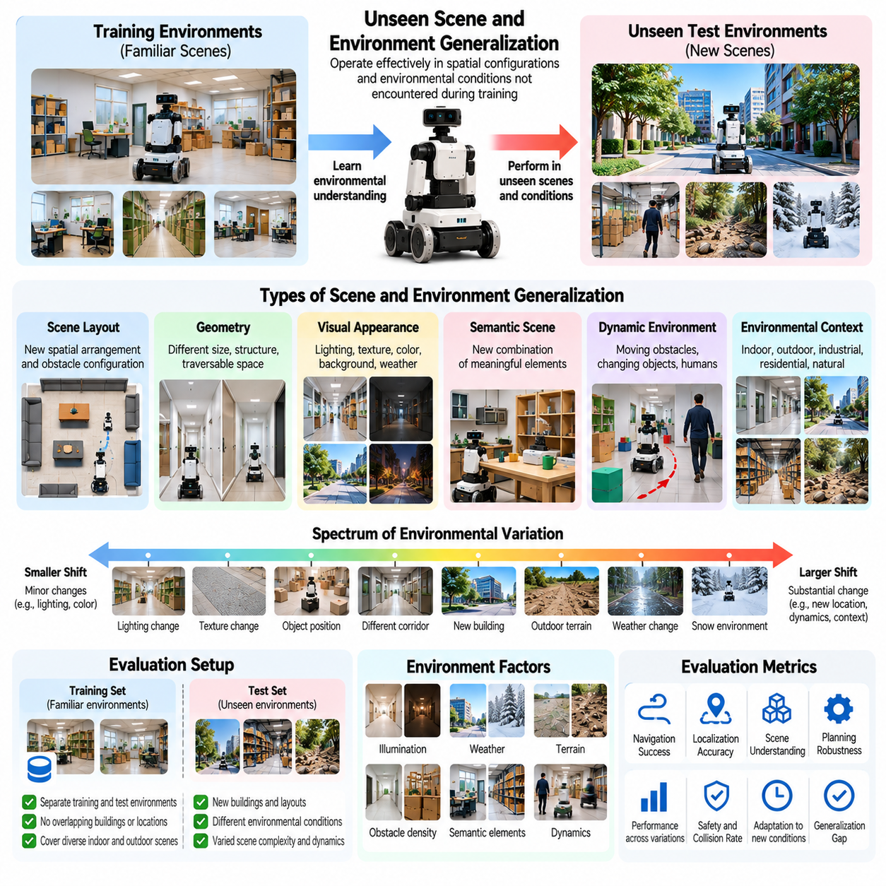{width="7.268055555555556in" height="7.268055555555556in"}

미학습 장면 및 환경 일반화(Unseen Scene and Environment Generalization)란 피지컬 AI(Physical AI) 시스템이 학습 과정에서 경험하지 않은 공간 구성과 환경 조건에서도 효과적으로 작동할 수 있는 능력을 의미한다. 익숙하지 않은 개별 물체에 초점을 맞추는 물체 일반화(Object Generalization)와 달리, 환경 일반화(Environment Generalization)는 기하학적 구조, 공간 배치, 외형, 장애물, 맥락적 관계(Contextual Relationship)를 포함하는 전체 장면의 변화를 평가한다. 이러한 능력은 통제된 개발 환경을 넘어 자율 시스템(Autonomous System)을 배치하는 데 필수적이다.

피지컬 AI 시스템은 익숙한 환경에서 우수한 성능을 달성하더라도 새로운 건물, 창고, 야외 장소 또는 산업 시설에 배치되면 실패할 수 있다. 이러한 실패는 학습된 정책(Learned Policy)이 특정 시각적 패턴이나 공간 배치에 의존하기 때문에 발생하는 경우가 많다. 일반화 평가(Generalization Evaluation)는 시스템이 지도(Map), 랜드마크(Landmark), 주행 궤적(Navigation Trajectory)을 암기한 것이 아니라 다른 환경으로 전이할 수 있는 환경 이해 능력(Transferable Environmental Understanding)을 획득했는지 판단한다.

장면 일반화(Scene Generalization)는 익숙한 요소들이 이전에 경험하지 않은 방식으로 배치된 상황을 인식하고 해석하는 능력을 포함한다. 로봇은 알려진 물체가 예상하지 못한 위치에 놓여 있거나, 복도의 치수가 다르거나, 작업 공간의 장애물 구성이 새로운 상황을 마주할 수 있다. 성공적인 행동을 위해서는 공간적 관계(Spatial Relationship)와 물리적 제약조건(Physical Constraint)을 이해하면서 인지(Perception), 계획(Planning), 제어(Control)를 새로운 배치에 맞게 조정해야 한다.

환경 일반화는 장면 배치를 넘어 조명, 날씨, 표면 외형, 배경 복잡도, 운영 맥락(Operational Context)의 변화까지 포함한다. 밝은 실내 조건에서 학습한 주행 정책(Navigation Policy)은 어두운 조명이나 강한 반사 조건에서 신뢰성이 저하될 수 있다. 평가에서는 환경 변화가 인지에만 영향을 미치는지, 아니면 위치추정(Localization), 의사결정(Decision-Making), 물리적 실행(Physical Execution)까지 연쇄적으로 영향을 미치는지 판단해야 한다.

기하학적 일반화(Geometric Generalization)는 익숙하지 않은 공간 구조를 해석하고 정확한 운동 계획(Motion Planning)을 유지하는 능력을 의미한다. 복도 폭, 출입구 치수, 장애물 밀도, 작업 공간 경계의 차이는 상당한 행동 조정을 요구할 수 있다. 일반화 능력을 갖춘 로봇은 이전에 경험한 기하학적 구성에만 의존하지 않고 주행 가능성(Traversability), 충돌 제약조건(Collision Constraint), 도달 가능 영역(Reachable Region)을 추론할 수 있어야 한다.

시각적 외형 일반화(Visual Appearance Generalization)는 질감, 색상, 조명, 그림자, 배경 패턴의 변화에 대한 민감도를 평가한다. 이러한 변화는 기본적인 물리적 구조를 변경하지 않으면서 카메라 관측(Camera Observation)을 변화시킬 수 있다. 표면적인 시각적 상관관계(Visual Correlation)에 의존하는 시스템은 작업 요구사항이 변하지 않았더라도 실패할 수 있지만, 더 우수한 시스템은 작업과 관련된 기하학적·의미적 정보를 보존하는 표현(Representation)을 유지한다.

의미적 장면 일반화(Semantic Scene Generalization)는 로봇이 의미 있는 환경 요소들의 익숙하지 않은 조합을 해석할 수 있는지 조사한다. 예를 들어 이동형 조작 로봇(Mobile Manipulator)은 익숙한 도구들이 이전에 경험하지 않은 방식으로 배치된 작업대를 마주할 수 있다. 성공적인 일반화를 위해서는 암기된 장면 템플릿(Scene Template)을 재현하는 것이 아니라 물체, 표면, 접근 가능한 영역 사이의 기능적 관계(Functional Relationship)를 인식해야 한다.

동적 환경 일반화(Dynamic Environment Generalization)는 움직이는 장애물, 변화하는 물체 위치, 예측하기 어려운 인간 활동을 포함한다. 창고에서 작동하는 로봇은 임시 보관 구역, 이동 장비 또는 예상하지 못한 보행자 이동을 마주할 수 있다. 평가에서는 시스템이 정적인 가정(Static Assumption)에 의존하지 않고 환경 표현(Environmental Representation)을 지속적으로 갱신하며 행동을 조정할 수 있는지 판단해야 한다.

실내 환경 일반화(Indoor Environment Generalization)는 서비스 로봇(Service Robot), 자율이동로봇(Autonomous Mobile Robot), 산업 자동화(Industrial Automation)에서 특히 중요하다. 서로 다른 건물은 익숙하지 않은 평면 구조, 출입구 배치, 반사 표면, 주행 제약조건을 가질 수 있다. 평가에는 학습에서 제외된 건물을 포함해야 하며, 이를 통해 성공적인 주행이 특정 장소에 대한 반복적인 노출이 아니라 전이 가능한 공간 추론(Spatial Reasoning)을 반영하는지 확인해야 한다.

실외 환경 일반화(Outdoor Environment Generalization)는 다양한 지형, 날씨, 식생(Vegetation), 자연 장애물, 변화하는 조명으로 인해 추가적인 복잡성을 갖는다. 자율 지상 차량(Autonomous Ground Vehicle)과 현장 로봇(Field Robot)은 통제된 실내 시설보다 구조를 예측하기 어려운 환경을 처리해야 한다. 평가에서는 익숙하지 않은 실외 장면에서도 인지, 위치추정, 주행 가능성 추정(Traversability Estimation), 운동 제어(Motion Control)가 신뢰성 있게 유지되는지 조사해야 한다.

미학습 환경 평가(Unseen Environment Evaluation)는 외형의 변화와 물리적 기능의 변화를 구분해야 한다. 벽의 색상이 다른 복도는 주행 가능성을 변경하지 않으면서 시각적 분포 이동(Visual Distribution Shift)을 발생시킬 수 있다. 반대로 시각적으로 익숙한 통로라도 미끄러운 바닥이나 예상하지 못한 장애물이 존재하면 다른 제어 판단이 필요할 수 있다. 이러한 구분은 환경 신규성(Environmental Novelty)의 어떤 측면이 시스템에 어려움을 주는지 식별하는 데 도움이 된다.

엄격한 벤치마크(Benchmark)는 학습 환경(Training Environment)과 평가 환경(Evaluation Environment)을 명확하게 분리해야 한다. 동일한 건물에서 서로 다른 카메라 시점을 사용하는 것만으로 반드시 독립적인 미학습 환경이 구성되는 것은 아니다. 더 강력한 평가 프로토콜(Evaluation Protocol)은 전체 건물, 지리적 위치, 장면 배치 또는 절차적으로 생성된 환경 계열(Procedurally Generated Environment Family)을 시험용으로 별도 확보하여 환경 암기(Environmental Memorization)의 가능성을 줄인다.

장면 다양성(Scene Diversity)은 공간 복잡도(Spatial Complexity), 장애물 밀도(Obstacle Density), 조명 범위(Illumination Range), 의미적 구성(Semantic Composition), 환경 동역학(Environmental Dynamics)과 같은 측정 가능한 요소를 통해 특성을 정의해야 한다. 이러한 특성을 통제하지 않고 시험 장면을 무작위로 선택하면 일관되지 않은 난이도가 발생할 수 있다. 구조화된 환경 분류체계(Environment Taxonomy)는 어떤 신규성 차원이 평가에 포함되었는지, 평가 조건이 의도된 배치 시나리오(Deployment Scenario)를 반영하는지 식별하는 데 도움이 된다.

통제된 장면 변화(Controlled Scene Variation)는 개별 일반화 요소를 체계적으로 조사할 수 있게 한다. 연구자는 기하학적 구조를 유지하면서 조명을 변경하거나 시각적 외형을 유사하게 유지하면서 장애물을 재배치할 수 있다. 이러한 실험은 인지, 위치추정, 계획, 제어 중 어느 부분에서 실패가 발생하는지 구분하는 데 도움이 된다. 실제 배치에서는 익숙하지 않은 여러 조건이 동시에 나타나는 경우가 많으므로 복합 변화(Combined Variation)도 필요하다.

환경 신규성(Environment Novelty)은 난이도가 점진적으로 증가하는 여러 수준에서 평가해야 한다. 초기 시험에서는 작은 시각적 변화를 도입하고, 이후 익숙하지 않은 공간 배치, 증가된 혼잡도(Clutter), 동적 교란(Dynamic Disturbance)을 추가할 수 있다. 이러한 수준에서 나타나는 성능 저하는 전이 가능한 환경 역량(Transferable Environmental Competence)의 한계를 보여주며 추가 학습, 적응(Adaptation) 또는 운영 제한(Operational Restriction)이 필요한 조건을 식별하는 데 도움이 된다.

작업 성공률(Task Success Rate)은 미학습 환경 일반화를 측정하는 기본적인 지표이다. 주행 작업에서는 충돌이나 허용되지 않은 개입 없이 목적지에 도달해야 성공으로 판단할 수 있다. 조작 작업에서는 익숙하지 않은 작업 공간에서 특정 작업을 완료하는 것이 성공 기준이 될 수 있다. 평가 기준(Evaluation Criteria)은 중간 단계의 인지 정확도나 위치추정 정확도에만 의존하지 않고 실제 임무(Mission)를 반영해야 한다.

환경 일반화 격차(Environment Generalization Gap)는 익숙한 장면에서의 성능과 시험용으로 별도 확보한 환경(Held-Out Environment)에서의 성능을 비교한다. 상당한 성능 저하는 학습된 능력이 학습 조건에 강하게 의존한다는 것을 나타낸다. 그러나 두 조건에서 모두 성공률이 낮다면 작은 격차가 의미 있는 일반화를 입증하지 못하므로 절대적인 성능(Absolute Performance)도 중요하다. 따라서 익숙한 환경과 익숙하지 않은 환경의 결과를 모두 보고해야 한다.

추가적인 지표는 환경 일반화에 대한 더욱 완전한 이해를 제공한다. 주행 효율성(Navigation Efficiency), 경로 길이(Path Length), 위치추정 오차(Localization Error), 충돌 빈도(Collision Frequency), 복구 시간(Recovery Time), 에너지 소비(Energy Consumption), 인간 개입률(Human Intervention Rate)은 실행 품질(Execution Quality)을 보여준다. 로봇이 익숙하지 않은 건물에서 목적지에 도달하더라도 과도한 우회나 반복적인 복구 행동이 필요하다면 운영 효율성(Operational Efficiency)이 제한적임을 의미한다.

제로샷 환경 일반화(Zero-Shot Environment Generalization)는 추가 학습이나 환경별 적응(Environment-Specific Adaptation) 없이 성능을 측정한다. 퓨샷 적응(Few-Shot Adaptation)은 평가 전에 제한된 탐색(Exploration), 시연(Demonstration) 또는 보정(Calibration)을 허용한다. 이러한 조건을 비교하면 시스템이 환경 이해 능력을 즉시 전이할 수 있는지, 아니면 유용한 표현을 구성하고 운영 성능을 개선하기 위해 추가 경험이 필요한지 파악할 수 있다.

능동적 인지(Active Perception)와 온라인 지도 작성(Online Mapping)은 익숙하지 않은 환경에서 일반화를 지원할 수 있다. 로봇은 알려지지 않은 영역을 탐색하고, 센서 관측 시점(Sensor Viewpoint)을 조정하며, 새로운 정보가 확보될 때 공간 표현(Spatial Representation)을 갱신할 수 있다. 평가에서는 정당한 온라인 지도 작성과 시험 환경에 대한 사전 노출을 구분하면서 탐색 비용(Exploration Cost), 지도 일관성(Map Consistency), 불확실성 감소(Uncertainty Reduction), 그에 따른 작업 실행 개선을 측정해야 한다.

시뮬레이션(Simulation)은 다양한 장면과 환경 조건을 생성할 수 있는 확장성 높은 기회를 제공한다. 절차적 배치 생성(Procedural Layout Generation), 도메인 무작위화(Domain Randomization), 동적 장애물 시뮬레이션(Dynamic Obstacle Simulation)은 실제 시험 장소에서 확보하기 어려운 구성에 시스템을 노출할 수 있다. 그러나 렌더링(Rendering), 센서 동작(Sensor Behavior), 접촉 동역학(Contact Dynamics), 환경 변동성(Environmental Variability)이 현실과 다를 수 있으므로 시뮬레이션에서의 성공이 실세계 일반화를 보장하지는 않는다.

실세계 평가(Real-World Evaluation)는 운영 타당성(Operational Validity)을 확립하는 데 여전히 필수적이다. 서로 독립적인 건물, 시설, 실외 장소에서 시험하면 학습된 능력이 개발 환경을 넘어 확장되는지 확인할 수 있다. 문서화된 조건에서 수행한 반복 시험(Repeated Trial)은 체계적인 약점(Systematic Weakness)과 우발적인 실패(Incidental Failure)를 구분하는 데 도움이 되며, 현장 시험(Field Testing)은 통제된 실험에서 놓칠 수 있는 환경 요소 사이의 상호작용을 드러낸다.

통계적 보고(Statistical Reporting)는 환경 범주(Environment Category), 신규성 수준(Novelty Level), 운영 조건(Operational Condition)에 따른 성능을 구분해야 한다. 종합 성공률(Aggregate Success Rate)은 반사가 심한 복도, 혼잡한 작업 공간, 저조도 환경(Low-Light Environment), 불규칙한 실외 지형에서 발생하는 약점을 숨길 수 있다. 신뢰구간(Confidence Interval), 반복 시험, 명확하게 정의된 시험 데이터 분할(Test Partition)은 재현 가능한 비교와 환경 일반화에 대한 더욱 신뢰할 수 있는 결론을 지원한다.

궁극적으로 미학습 장면 및 환경 일반화는 피지컬 AI 시스템이 익숙한 주변 환경을 넘어 공간 이해(Spatial Understanding)와 물리적 역량(Physical Competence)을 전이할 수 있는지 측정한다. 신뢰할 수 있는 시스템은 익숙하지 않은 기하학적 구조를 해석하고, 의미 있는 환경 관계를 인식하며, 동적 변화에 적응하고, 불확실성 아래에서 작업을 실행해야 한다. 포괄적인 평가는 성공적인 전이와 운영 경계(Operational Boundary)를 모두 식별하여 다양한 실세계 환경에서의 배치를 지원한다.

## 04.05. Unseen Task and Goal Generalization

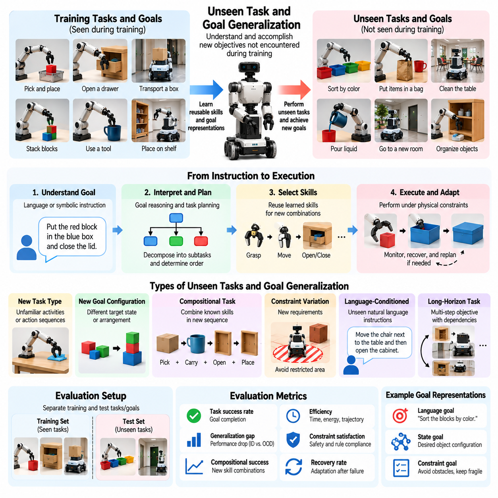{width="7.268055555555556in" height="7.268055555555556in"}

미학습 작업 및 목표 일반화(Unseen Task and Goal Generalization)란 피지컬 AI(Physical AI) 시스템이 학습 과정에서 명시적으로 경험하지 않은 목표를 해석하고 달성할 수 있는 능력을 의미한다. 물체 일반화(Object Generalization)나 환경 일반화(Environment Generalization)와 달리, 이러한 능력은 시스템이 어디에서 또는 어떤 물체를 사용하여 작업하는지가 아니라 무엇을 달성해야 하는지의 변화에 초점을 맞춘다. 이는 변화하는 운영 요구사항에 유연하게 대응할 수 있는 자율 에이전트(Autonomous Agent)를 개발하는 데 필수적이다.

기존 로봇 시스템(Traditional Robotic System)은 사전에 정의된 작업 순서(Predefined Task Sequence), 고정된 목표(Fixed Objective), 수동으로 설계된 제어 절차(Control Procedure)에 의존하는 경우가 많다. 이러한 시스템은 의도된 응용 분야에서 신뢰성 있게 작동할 수 있지만 목표가 변경되면 상당한 재프로그래밍(Reprogramming)이 필요하다. 범용 피지컬 AI(Generalist Physical AI)는 완전한 재학습 없이 익숙하지 않은 작업을 지원할 수 있는 재사용 가능한 기술(Reusable Skill), 목표 표현(Goal Representation), 계획 전략(Planning Strategy)을 학습하여 이러한 한계를 극복하고자 한다.

작업 일반화(Task Generalization)와 목표 일반화(Goal Generalization)는 밀접하게 관련되어 있지만 개념적으로 구별된다. 작업 일반화는 익숙하지 않은 활동이나 행동 순서를 실행하는 능력을 의미하며, 목표 일반화는 새로운 희망 상태(Desired State)나 결과를 달성하는 능력을 의미한다. 로봇은 익숙한 조작 절차를 이해하고 있더라도 이전에 경험하지 않은 물체 배치를 구현해야 할 수 있으며, 이를 위해 원하는 최종 상태(Final State)를 유연하게 해석해야 한다.

미학습 작업(Unseen Task)은 필요한 행동, 시간적 구조(Temporal Structure), 의존관계(Dependency), 환경적 제약조건(Environmental Constraint)에서 기존 학습 경험과 다를 수 있다. 개별 포장물을 운반하도록 학습한 로봇이 우선순위와 목적지에 따라 포장물을 정리하도록 요구받을 수 있다. 성공적인 수행을 위해서는 관련 하위 작업(Subtask)을 식별하고, 작업 간 의존관계를 결정하며, 학습된 능력을 새로운 실행 전략(Execution Strategy)으로 조정해야 한다.

사용 가능한 기본 행동(Action Primitive)이 변경되지 않더라도 목표 신규성(Goal Novelty)이 발생할 수 있다. 조작 로봇(Manipulation Robot)은 물체를 파지하고 이동시키며 배치하는 방법을 이미 알고 있지만 익숙하지 않은 목표 구성(Target Configuration)을 마주할 수 있다. 일반화를 위해서는 물리적 제약조건(Physical Constraint), 작업 의존관계(Task Dependency), 현재 환경 상태(Environment State)를 준수하면서 새로운 목표를 적절한 행동 선택으로 변환해야 한다.

핵심적인 요구사항 중 하나는 특정 시연(Demonstration)과 독립적으로 목표를 표현할 수 있는 능력이다. 지시를 암기된 궤적(Memorized Trajectory)과 연결하는 시스템은 동일한 목표를 다른 행동으로 달성해야 할 때 실패할 수 있다. 일반화 능력이 높은 시스템은 원하는 결과, 관련 제약조건, 가능한 상태 전이(State Transition)를 표현하여 여러 행동 순서가 동일한 목표를 충족할 수 있도록 한다.

언어 조건부 작업 일반화(Language-Conditioned Task Generalization)는 로봇이 이전에 경험하지 않은 자연어 지시(Natural-Language Instruction)를 해석할 수 있도록 한다. 비전-언어-행동 모델(Vision-Language-Action Model, VLA)은 언어적 설명을 시각적 관측(Visual Observation) 및 물리적 행동(Physical Action)과 연결할 수 있다. 그러나 지시를 정확하게 이해했다고 해서 성공적인 실행이 보장되는 것은 아니다. 평가에서는 의미적 해석(Semantic Interpretation), 행동 계획(Action Planning), 물리적 작업 완료(Physical Task Completion)를 각각 구분하여 조사해야 한다.

조합적 일반화(Compositional Generalization)는 익숙하지 않은 작업을 실행하는 데 중요한 역할을 한다. 로봇은 물체 탐색, 용기 개방, 물품 운반, 문 닫기를 각각 독립적으로 학습할 수 있다. 미학습 작업에서는 이러한 능력을 새로운 순서로 결합해야 할 수 있다. 성공적인 조합은 학습된 기술이 익숙한 조합에서만 재현되는 것이 아니라 변화하는 목표에 따라 재구성될 수 있음을 보여준다.

계층적 계획(Hierarchical Planning)은 익숙하지 않은 목표를 관리 가능한 하위 작업으로 분해함으로써 일반화를 지원한다. 상위 수준 추론(High-Level Reasoning)은 원하는 결과와 의존관계를 식별하고, 하위 수준 제어기(Low-Level Controller)는 물리적 행동을 실행한다. 평가에서는 시스템이 유효한 작업 분해(Task Decomposition)를 구성하고 적절한 기술을 선택하며 중간 행동이 실패하거나 환경 조건이 변경될 때 복구할 수 있는지 판단해야 한다.

작업 일반화는 전제조건(Precondition)과 효과(Effect)를 이해하는 능력에도 의존한다. 캐비닛을 열기 위해서는 손잡이에 접근하기 전에 장애물을 이동해야 할 수 있으며, 물체를 배치하려면 목적지 표면을 먼저 정리해야 할 수 있다. 높은 능력을 갖춘 시스템은 경직된 행동 순서를 실행하는 대신 현재 어떤 행동이 가능한지, 그 결과가 이후 단계에 어떤 영향을 미치는지 추론해야 한다.

인과적 추론(Causal Reasoning)은 행동과 물리적 결과를 연결함으로써 작업 일반화에 기여한다. 밀기(Pushing), 파지(Grasping), 들어 올리기(Lifting), 놓기(Releasing)가 물체 상태를 어떻게 변화시키는지 이해하는 로봇은 알려진 상호작용 원리(Interaction Principle)를 통해 익숙하지 않은 목표를 해결할 가능성이 있다. 평가에서는 성공적인 행동이 학습 시연의 표면적인 상관관계(Superficial Correlation)가 아니라 의미 있는 행동-결과 관계(Action-Outcome Relationship)를 반영하는지 조사해야 한다.

제약조건 일반화(Constraint Generalization)는 시간, 안전성, 자원 가용성(Resource Availability), 작업 순서(Task Ordering)와 관련된 익숙하지 않은 요구사항을 도입한다. 로봇은 제한 구역(Restricted Region)을 피하거나 깨지기 쉬운 물체를 보호하면서 익숙한 작업을 완료하도록 요구받을 수 있다. 이러한 변화는 기본 기술이 동일하더라도 계획 문제(Planning Problem)를 변화시킬 수 있다. 평가에서는 목표 달성과 새롭게 지정된 제약조건의 준수 여부를 모두 측정해야 한다.

엄격한 벤치마크(Benchmark)는 실제로 경험하지 않은 작업과 익숙한 지시의 표면적인 변형을 구분해야 한다. 이전에 학습한 명령을 다른 표현으로 바꾸는 것만으로 반드시 새로운 작업이 생성되는 것은 아니다. 더 강력한 평가 프로토콜(Evaluation Protocol)은 특정 목표 구조(Goal Structure), 행동 조합(Action Composition), 의존관계 패턴(Dependency Pattern), 작업 계열(Task Family)을 시험용으로 별도 확보하여 일반화로 보이는 결과가 암기된 사례에서 비롯될 가능성을 줄인다.

작업 및 목표 데이터셋(Task and Goal Dataset)은 명시적인 초기 상태(Initial State), 원하는 최종 상태(Desired Final State), 사용 가능한 행동(Available Action), 관련 제약조건(Relevant Constraint)을 사용하여 목표를 기술해야 한다. 이러한 명세(Specification)는 성공 기준의 재현성을 높이고 언어 이해 실패(Language Understanding Failure)를 계획 또는 실행 실패와 구분하는 데 도움이 된다. 평가 시나리오에는 익숙한 기술 조합과 서로 다른 수준의 추론을 요구하는 새로운 조합이 모두 포함되어야 한다.

신규성(Novelty)은 작업 복잡도(Task Complexity)가 증가하는 수준에 따라 구성할 수 있다. 단순한 사례에서는 목표 물체나 목적지만 변경할 수 있지만, 더 어려운 사례에서는 새로운 행동 순서, 조건부 의존관계(Conditional Dependency), 여러 상호작용하는 목표를 도입할 수 있다. 이러한 수준에서 성능을 평가하면 시스템이 작은 변형에만 일반화하는지, 아니면 상당히 다른 목표까지 해결할 수 있는지 파악할 수 있다.

제로샷 작업 일반화(Zero-Shot Task Generalization)는 추가적인 작업별 학습(Task-Specific Training) 없이 시스템이 익숙하지 않은 목표를 실행할 수 있는지 측정한다. 퓨샷 적응(Few-Shot Adaptation)은 평가 전에 제한된 시연, 수정(Correction), 상호작용(Interaction)을 허용한다. 이러한 조건을 비교하면 즉각적인 기술 전이(Immediate Skill Transfer)의 정도와 익숙하지 않은 작업에서 역량을 확보하는 데 필요한 경험의 양을 파악할 수 있다.

작업 성공률(Task Success Rate)은 여전히 기본적인 지표이지만 성공은 의도된 최종 결과(Intended Final Outcome)에 따라 정의되어야 한다. 예를 들어 분류 작업(Sorting Task)에서는 단순히 완료된 파지 행동의 수를 계산하는 것이 아니라 물체가 올바른 위치에 배치되었는지 확인해야 한다. 또한 금지되거나 안전하지 않은 행동을 통해 목표에 도달한 경우에는 유효한 작업 완료(Valid Task Completion)로 볼 수 없으므로 모든 필수 제약조건이 충족되었는지도 평가해야 한다.

작업 일반화 격차(Task Generalization Gap)는 익숙한 목표에서의 성능과 시험용으로 별도 확보한 작업(Held-Out Task)에서의 성능을 비교한다. 큰 격차는 학습 분포(Training Distribution)를 넘어서는 전이 능력이 제한적임을 나타낸다. 그러나 절대적인 성공률(Absolute Success Rate)과 작업 난이도(Task Difficulty)도 함께 고려해야 한다. 작은 격차는 전반적으로 낮은 성능을 반영할 수 있으며, 익숙하지 않은 작업이 훨씬 복잡한 추론을 요구하는 경우에는 더 큰 격차가 발생할 수 있다.

실행 품질(Execution Quality)은 이진적인 성공 여부(Binary Success)를 넘어 추가적인 정보를 제공한다. 관련 지표에는 계획 시간(Planning Time), 행동 효율성(Action Efficiency), 불필요한 움직임(Unnecessary Movement), 자원 소비(Resource Consumption), 제약조건 위반(Constraint Violation), 복구 시도(Recovery Attempt)가 포함된다. 반복적인 시행착오(Trial and Error)를 통해 익숙하지 않은 목표를 완료하는 로봇은 동일한 결과를 효율적이고 신뢰성 있게 달성하는 로봇보다 실제 일반화 능력이 낮을 수 있다.

장기 작업 일반화(Long-Horizon Task Generalization)는 익숙하지 않은 목표가 상호 의존적인 행동의 긴 순서를 요구할 수 있기 때문에 추가적인 어려움을 발생시킨다. 작은 계획 오류(Planning Error)나 실행 오류(Execution Error)가 시간이 지남에 따라 누적되어 임무 완료를 방해할 수 있다. 평가에서는 하위 목표 일관성(Subgoal Consistency), 진행 상황 추적(Progress Tracking), 재계획 효과(Replanning Effectiveness), 장시간 운영에서 목표 지향적 행동(Goal-Directed Behavior)을 유지하는 능력을 조사해야 한다.

상호작용적 적응(Interactive Adaptation)은 익숙하지 않은 작업에서 부족한 지식이 드러날 때 성능을 향상시킬 수 있다. 로봇은 명확한 설명을 요청하거나 관련 물체를 조사하고, 안전한 행동을 시험하거나, 예상하지 못한 결과를 관찰한 후 계획을 수정할 수 있다. 평가에서는 이러한 행동이 불필요한 개입을 제한하고 운영 안전성(Operational Safety)을 유지하면서 불확실성(Uncertainty)을 줄이고 작업 완료율을 향상시키는지 측정해야 한다.

시뮬레이션(Simulation)은 절차적으로 생성된 목표(Procedurally Generated Goal), 행동 조합, 환경 제약조건을 통해 익숙하지 않은 작업을 대규모로 평가할 수 있도록 한다. 이를 통해 통제된 비교와 작업 복잡도의 체계적인 변화가 가능하다. 그러나 접촉 동역학(Contact Dynamics), 센싱 불확실성(Sensing Uncertainty), 실행 실패(Execution Failure)가 추가적인 어려움을 발생시키는 실제 물리 환경에서는 시뮬레이션의 성공이 직접적으로 전이되지 않을 수 있다.

실세계 평가(Real-World Evaluation)는 작업 및 목표 일반화가 신뢰할 수 있는 자율 행동(Autonomous Behavior)으로 이어지는지 확인하기 위해 필요하다. 물리적 실험(Physical Experiment)에는 익숙하지 않은 목표, 독립적으로 정의된 성공 조건(Success Condition), 반복 시험(Repeated Trial), 문서화된 개입 요구사항(Intervention Requirement)이 포함되어야 한다. 서로 다른 환경과 로봇 플랫폼(Robot Platform)에서 시험하면 학습된 작업 역량이 특정 물리적 구성에 의존하는지도 추가로 파악할 수 있다.

통계적 보고(Statistical Reporting)는 작업 신규성(Task Novelty), 목표 복잡도(Goal Complexity), 계획 범위(Planning Horizon), 제약조건 난이도(Constraint Difficulty)에 따라 결과를 구분해야 한다. 종합 성공률(Aggregate Success Rate)은 조건부 계획(Conditional Planning), 익숙하지 않은 기술 조합, 긴 행동 순서에서 발생하는 약점을 숨길 수 있다. 신뢰구간(Confidence Interval), 표준화된 평가 절차(Standardized Evaluation Procedure), 투명한 작업 데이터 분할(Task Partition)은 피지컬 AI 시스템 사이의 의미 있는 비교를 지원한다.

궁극적으로 미학습 작업 및 목표 일반화는 피지컬 AI가 재사용 가능한 지식(Reusable Knowledge)을 유연한 목표 지향적 행동(Flexible Goal-Directed Behavior)으로 변환할 수 있는지 측정한다. 높은 일반화 능력을 갖춘 시스템은 새로운 목표를 해석하고, 기존 기술을 조합하며, 제약조건을 추론하고, 물리적 상호작용 중에 계획을 조정해야 한다. 포괄적인 평가는 이러한 유연성의 경계를 식별하고 다양한 실세계 임무(Real-World Mission)를 처리할 수 있는 자율 시스템의 발전을 지원한다.

## 04.06. Unseen Terrain and Condition Generalization

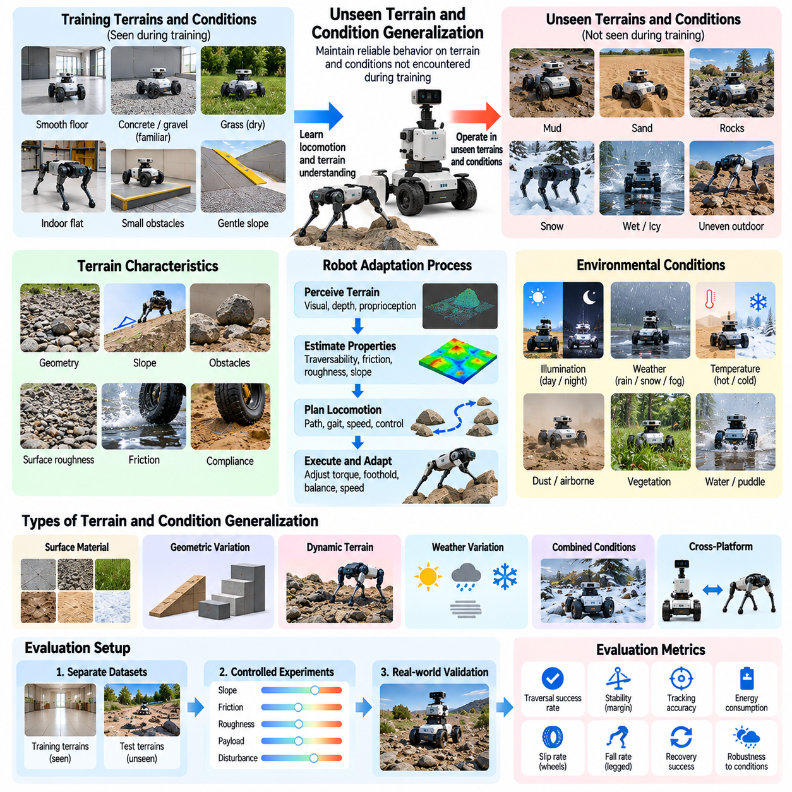{width="7.268055555555556in" height="7.268055555555556in"}

미학습 지형 및 조건 일반화(Unseen Terrain and Condition Generalization)란 피지컬 AI(Physical AI) 시스템이 학습 과정에서 경험하지 않은 지면과 운영 조건에서도 신뢰할 수 있는 행동을 유지하는 능력을 의미한다. 지형 변화는 접지력(Traction), 안정성(Stability), 이동성(Mobility), 에너지 소비(Energy Consumption)에 영향을 미치며, 환경 조건은 센싱(Sensing)과 제어(Control)에 영향을 준다. 평가에서는 로봇이 익숙한 운영 환경을 넘어 물리적 행동을 적응시킬 수 있는지 판단한다.

지형 일반화(Terrain Generalization)는 자율이동로봇(Autonomous Mobile Robot), 다족보행 로봇(Legged Robot), 농업 기계(Agricultural Machine), 현장 로보틱스(Field Robotics)에서 특히 중요하다. 매끄러운 실내 바닥에서 학습한 시스템은 자갈, 진흙, 모래, 잔디 또는 불규칙한 건설 현장 표면에서 어려움을 겪을 수 있다. 신뢰할 수 있는 현장 배치(Deployment)를 위해서는 이전에 학습한 접촉 조건이 계속 유효하다고 가정하지 않고 지형 특성을 인식하며 이동 전략(Locomotion Strategy)을 조정해야 한다.

지형 신규성(Terrain Novelty)은 표면 기하학적 구조(Surface Geometry), 재질 구성(Material Composition), 마찰(Friction), 순응성(Compliance), 구조적 안정성(Structural Stability)에서 나타날 수 있다. 시각적 외형이 유사한 두 표면이라도 하중이 가해지면 서로 다른 기계적 반응(Mechanical Response)을 보일 수 있다. 반대로 시각적으로 다른 표면이 유사한 접지력을 제공할 수도 있다. 평가에서는 외형 기반 인식(Appearance-Based Recognition)과 로봇과 지형 사이의 실제 물리적 상호작용을 예측하는 능력을 구분해야 한다.

기하학적 지형 일반화(Geometric Terrain Generalization)는 익숙하지 않은 경사면, 계단, 틈새, 장애물, 불균일한 지면에 적응하는 능력을 평가한다. 이러한 지형 요소는 실행 가능한 운동 궤적(Motion Trajectory), 지상고(Ground Clearance) 요구사항, 안정성 여유도(Stability Margin)를 변화시킨다. 높은 능력을 갖춘 로봇은 익숙한 지형 구조에 최적화된 이동 패턴을 반복하는 대신 기계적 한계(Mechanical Limitation)를 준수하면서 주행 가능성(Traversability)을 추정하고 적절한 움직임을 선택해야 한다.

표면 마찰 일반화(Surface Friction Generalization)는 접지 특성이 변화할 때 효과적인 이동을 유지하는 능력을 의미한다. 젖은 바닥, 느슨한 자갈, 연마된 콘크리트, 얼음 표면은 예상하지 못한 미끄러짐(Slip)이나 제동 능력(Braking Capability)의 저하를 발생시킬 수 있다. 평가에서는 제어기(Controller)가 접지력 변화를 감지하고 가속도와 접촉력(Contact Force)을 조정하며 고정된 마찰 가정(Friction Assumption)에 의존하지 않고 안정성을 유지할 수 있는지 측정해야 한다.

지형 순응성(Terrain Compliance)은 일반화의 또 다른 중요한 차원을 형성한다. 부드러운 토양, 변형 가능한 모래, 탄성 바닥재, 식생(Vegetation)은 가해지는 힘에 서로 다르게 반응할 수 있다. 바퀴는 지면에 가라앉을 수 있고, 발은 지지력을 잃을 수 있으며, 이동 중 접촉 기하학적 구조(Contact Geometry)가 변화할 수 있다. 일반화 가능한 이동(Generalizable Locomotion)을 위해서는 이러한 영향을 추정하고 힘 분배(Force Distribution), 자세(Posture), 이동 속도를 조정하여 효과적인 진행을 유지해야 한다.

환경 조건(Environmental Condition)은 기본적인 지면이 변하지 않더라도 지형의 거동을 변화시킬 수 있다. 비는 마찰을 감소시키고, 영하의 기온은 얼음을 형성하며, 축적된 먼지는 바퀴 접촉(Wheel Contact)에 영향을 줄 수 있다. 정적인 표면 범주만 인식하는 지형 분류 시스템(Terrain Classification System)은 이러한 변화를 놓칠 수 있다. 따라서 평가에서는 지형 특성과 변화하는 환경 조건 사이의 상호작용을 고려해야 한다.

기상 일반화(Weather Generalization)는 익숙하지 않은 비, 바람, 눈, 안개, 온도 조건에서 로봇의 성능을 평가한다. 이러한 요소는 인지(Perception), 이동성, 열 관리(Thermal Management), 기계적 신뢰성(Mechanical Reliability)에 영향을 줄 수 있다. 로봇은 환경 교란(Environmental Disturbance)이 안전 한계를 초과하면 속도를 줄이거나 경로를 수정하거나 작업을 중단해야 할 수 있다. 성공적인 일반화에는 지속적인 작업 수행이 부적절한 상황을 인식하는 능력도 포함된다.

조명 및 가시성 조건(Illumination and Visibility Condition)도 지형 해석에 영향을 미친다. 강한 햇빛, 그림자, 어둠, 반사, 공기 중 입자는 시각적 깊이 추정(Visual Depth Estimation)의 신뢰성을 저하시킬 수 있다. 평가에서는 카메라 관측(Camera Observation)이 불완전하거나 오해를 유발할 때 로봇이 대체 센싱 모달리티(Alternative Sensing Modality) 또는 불확실성 인식 추론(Uncertainty-Aware Reasoning)을 통해 주행 가능성 추정(Traversability Estimation)을 유지할 수 있는지 판단해야 한다.

바퀴형 로봇(Wheeled Robot)의 미학습 지형 일반화는 바퀴 토크(Wheel Torque), 조향 동작(Steering Behavior), 속도, 현가장치 반응(Suspension Response)을 조정하는 능력을 포함한다. 구름 저항(Rolling Resistance)과 미끄럼(Slip)의 변화는 경로 추종 정확도(Path Tracking Accuracy)와 에너지 소비를 변화시킬 수 있다. 평가에는 정상 상태 이동(Steady Movement)뿐 아니라 제동, 회전, 장애물 통과와 같은 까다로운 기동(Maneuver)도 포함해야 하며, 이러한 상황에서 익숙하지 않은 표면 특성이 제어 한계를 드러낼 수 있다.

다족보행 로봇의 지형 일반화는 발 디딤 위치 선택(Foothold Selection), 몸체 자세(Body Posture), 균형(Balance), 접촉력을 조정하는 능력을 요구한다. 불규칙한 바위, 순응성 지면, 예상하지 못한 높이 변화는 학습된 보행 패턴(Gait Pattern)을 방해할 수 있다. 평가에서는 로봇이 지형별 궤적(Terrain-Specific Trajectory)이나 광범위한 환경별 조정(Environment-Specific Tuning)에 의존하지 않고 불완전한 접촉에서 복구하며 안정적인 이동을 유지할 수 있는지 조사해야 한다.

지형 및 조건 일반화는 학습 분포(Training Distribution)와 시험 분포(Testing Distribution)를 명확하게 분리하여 평가해야 한다. 익숙한 표면의 서로 다른 사진만 시험용으로 별도 확보하는 것은 물리적 전이(Physical Transfer)를 평가하기에 충분하지 않다. 더 강력한 평가 프로토콜(Evaluation Protocol)은 서로 다른 지형 재질, 기하학적 구성, 기상 조건 또는 물리적 특성의 조합을 시험용으로 분리하여 로봇이 실제로 익숙하지 않은 상호작용을 처리할 수 있는지 확인한다.

통제된 지형 실험(Controlled Terrain Experiment)은 성능 저하의 원인을 분리하는 데 도움이 된다. 연구자는 표면 재질을 유지하면서 경사도를 변화시키거나 기하학적 구조를 보존하면서 마찰을 변경할 수 있다. 이러한 시험은 인지, 지형 추정(Terrain Estimation), 계획(Planning), 저수준 제어(Low-Level Control)에서 발생하는 실패를 구분한다. 실제 지형에서는 기하학적 구조, 접지력, 환경 교란이 동시에 변화하는 경우가 많으므로 복합 변화(Combined Variation)도 중요하다.

지형 난이도(Terrain Difficulty)는 가능한 경우 측정 가능한 물리적 매개변수(Physical Parameter)를 사용하여 특성을 정의해야 한다. 관련 변수에는 경사각(Slope Angle), 장애물 높이(Obstacle Height), 표면 거칠기(Surface Roughness), 마찰계수(Friction Coefficient), 지반 강성(Ground Stiffness), 변형 깊이(Deformation Depth)가 포함된다. 이러한 측정값은 재현 가능한 시험과 의미 있는 비교를 지원한다. 정량적 특성화(Quantitative Characterization)가 가능한 경우 어렵거나 미끄럽다는 정성적 표현만으로 문서화된 물리적 조건을 대체해서는 안 된다.

주행 성공률(Traversal Success Rate)은 지형 일반화를 측정하는 기본적인 지표이지만 성공 기준(Success Criteria)은 운영 요구사항(Operational Requirement)을 반영해야 한다. 로봇이 반복적으로 넘어지거나 과도한 바퀴 미끄럼(Wheel Slip) 또는 안전하지 않은 접촉력을 경험한다면 목적지에 도달하는 것만으로 충분하지 않을 수 있다. 평가에서는 전체 주행 과정에서 움직임이 제어 가능하고, 복구 가능하며, 정의된 안전 제약조건(Safety Constraint)을 준수하는지 고려해야 한다.

지형 일반화 격차(Terrain Generalization Gap)는 익숙한 표면에서의 성능과 시험용으로 별도 확보한 지형 조건(Held-Out Terrain Condition)에서의 성능을 비교한다. 큰 차이는 학습 분포 외부의 변화에 대한 민감도가 높음을 나타낸다. 그러나 까다로운 표면은 근본적인 기계적 한계(Mechanical Limitation)를 발생시킬 수 있으므로 절대적인 성능(Absolute Performance)과 지형 난이도도 함께 보고해야 한다. 일반화 지표(Generalization Metric)는 피할 수 없는 하드웨어 제약조건(Hardware Constraint)과 학습된 적응 능력의 실패를 혼동해서는 안 된다.

성능 저하 곡선(Performance Degradation Curve)은 지형 난이도가 증가함에 따라 신뢰성이 어떻게 변화하는지 보여준다. 성공 확률(Success Probability), 추종 정확도(Tracking Accuracy), 에너지 효율성(Energy Efficiency)을 경사도, 거칠기, 마찰 또는 장애물 크기에 따라 나타낼 수 있다. 점진적인 성능 저하는 예측 가능한 역량 한계(Capability Limit)를 의미하지만 급격한 실패 임계값(Failure Threshold)은 불안정한 제어 동작이나 변화하는 물리적 조건에 대한 부적절한 인식을 드러낼 수 있다.

추가적인 지표에는 주행 시간(Traversal Time), 경로 편차(Path Deviation), 미끄럼률(Slip Ratio), 안정성 여유도(Stability Margin), 단위 거리당 에너지(Energy per Distance), 복구 빈도(Recovery Frequency), 개입률(Intervention Rate)이 포함된다. 다족보행 플랫폼에서는 발 디딤 위치 정확도(Foot Placement Accuracy)와 낙상 빈도(Fall Frequency)가 특히 중요하다. 바퀴형 시스템에서는 접지력 활용도(Traction Utilization)와 바퀴 미끄럼이 중요한 평가 근거를 제공한다. 지표는 로봇 형태(Robot Morphology)와 의도된 운영 작업에 따라 선택해야 한다.

제로샷 지형 일반화(Zero-Shot Terrain Generalization)는 익숙하지 않은 표면에 대한 추가 학습 없이 성능을 평가한다. 퓨샷 적응(Few-Shot Adaptation)은 주요 작업 전에 제한된 탐색(Exploration)이나 통제된 상호작용(Controlled Interaction)을 허용한다. 이러한 조건을 비교하면 기존 이동 정책(Locomotion Policy)이 즉시 전이되는지, 아니면 지형 특성에 대한 온라인 식별(Online Identification)이 필요한지 파악할 수 있다. 적응 비용(Adaptation Cost)과 탐색 행동의 안전성도 이후 성능과 함께 측정해야 한다.

온라인 적응(Online Adaptation)은 운영 중 마찰, 순응성 또는 접촉 동역학(Contact Dynamics)의 추정값을 갱신하여 이동성을 개선할 수 있다. 로봇은 예상하지 못한 미끄럼을 감지하고 가속도를 줄이거나 불안정한 발 디딤을 관찰한 후 보행 패턴을 수정할 수 있다. 평가에서는 이러한 조정이 적응 과정에서 진동성 제어(Oscillatory Control), 과도한 탐색 또는 위험한 행동을 발생시키지 않으면서 성능을 향상시키는지 판단해야 한다.

시뮬레이션(Simulation)은 절차적 지형 생성(Procedural Terrain Generation), 무작위화된 물리적 매개변수(Randomized Physical Parameter), 모델링된 환경 교란(Modelled Environmental Disturbance)을 통해 확장성 높은 시험을 제공한다. 이러한 환경은 실제 시험 시설에서 확보하기 어려운 경사면, 장애물, 표면 조합에 로봇을 노출할 수 있다. 그러나 부정확한 접촉 모델(Contact Model), 단순화된 토양 변형(Soil Deformation), 불완전한 센서 시뮬레이션(Sensor Simulation)은 실세계 일반화에 대한 잘못된 추정 결과를 발생시킬 수 있다.

실세계 시험(Real-World Testing)은 지형 상호작용이 시뮬레이션에서 완벽하게 재현하기 어려운 복잡한 기계적 효과(Mechanical Effect)에 의존하기 때문에 필수적이다. 현장 실험(Field Experiment)에는 측정된 지형 특성, 반복 주행(Repeated Traversal), 일관된 환경 기록(Environmental Record)이 포함되어야 한다. 서로 독립적인 장소에서 시험하면 성공적인 행동이 특정 시험 트랙(Test Track)이나 정교하게 준비된 표면 구성을 넘어 전이되는지 확인할 수 있다.

통계적 평가(Statistical Evaluation)는 지형 범주(Terrain Category), 물리적 난이도 수준(Physical Difficulty Level), 환경 조건, 로봇 플랫폼에 따른 성능을 보고해야 한다. 종합 성공률(Aggregate Success Rate)은 저마찰 표면(Low-Friction Surface), 변형 가능한 표면(Deformable Surface), 불규칙한 표면에서 발생하는 심각한 약점을 숨길 수 있다. 신뢰구간(Confidence Interval), 문서화된 시험 데이터 분할(Test Partition), 실패 분류(Failure Classification)는 재현성을 높이고 인지 오류(Perception Error), 제어 실패(Control Failure), 기계적 한계를 구분하는 데 도움이 된다.

궁극적으로 미학습 지형 및 조건 일반화는 피지컬 AI 시스템이 익숙하지 않은 물리적 상호작용에서도 이동성, 안정성, 안전성을 유지할 수 있는지 측정한다. 높은 일반화 능력을 위해서는 지형 인지(Terrain Perception), 물리적 추론(Physical Reasoning), 적응형 제어(Adaptive Control), 불확실성 관리(Uncertainty Management)의 통합이 필요하다. 포괄적인 평가(Comprehensive Evaluation)는 신뢰할 수 있는 운영 영역(Reliable Operating Region)과 실패 경계(Failure Boundary)를 식별하여 다양하고 지속적으로 변화하는 실세계 조건에서 자율 시스템의 배치를 지원한다.

## 04.07. Sensor and Modality Generalization

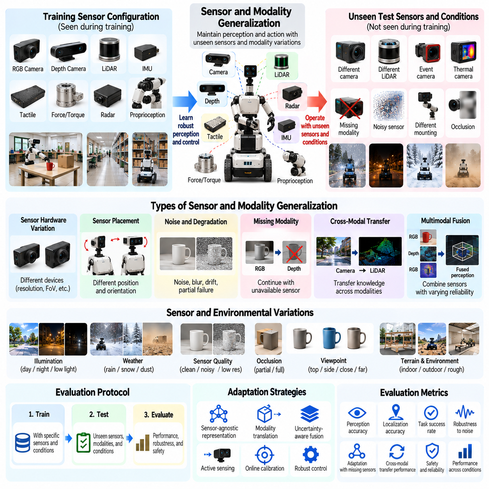{width="7.268055555555556in" height="7.268055555555556in"}

센서 및 모달리티 일반화(Sensor and Modality Generalization)란 피지컬 AI(Physical AI) 시스템이 학습 과정에서 경험한 것과 다른 센싱 구성(Sensing Configuration)이나 정보원(Information Source)을 사용하더라도 신뢰할 수 있는 인지와 행동을 유지하는 능력을 의미한다. 이러한 변화에는 센서 유형, 설치 위치, 해상도, 잡음, 가용성의 차이가 포함될 수 있다. 평가에서는 물리적 환경을 관측하는 방식이 달라지더라도 학습된 표현(Representation)과 제어 정책(Control Policy)이 효과적으로 유지되는지 판단한다.

피지컬 AI 시스템은 일반적으로 카메라(Camera), 라이다(LiDAR), 레이더(Radar), 깊이 센서(Depth Sensor), 촉각 센서(Tactile Sensor), 힘 센서(Force Sensor), 고유수용성 측정(Proprioceptive Measurement)을 통합한다. 각 모달리티(Modality)는 기하학적 구조, 움직임, 접촉, 환경 조건에 관한 서로 다른 정보를 제공한다. 일반화를 위해서는 고정된 센서 구성이나 특정 관측 형식(Observation Format)에만 의존하지 않고 이러한 정보원에서 작업과 관련된 정보를 추출해야 한다.

센서 일반화(Sensor Generalization)와 모달리티 일반화(Modality Generalization)는 서로 관련되어 있지만 구별되는 개념이다. 센서 일반화는 유사한 물리량을 측정하는 장치 사이의 변화를 다루며, 모달리티 일반화는 서로 다른 형태의 감각 정보 사이에서 능력을 전이하는 것을 의미한다. 하나의 카메라를 다른 카메라로 교체하는 것은 센서 강건성(Sensor Robustness)을 시험하는 반면, 시각적 깊이 추정(Visual Depth Estimation)을 라이다 기반 기하학적 인식(LiDAR-Based Geometry)으로 대체하는 것은 모달리티 수준의 과제를 도입한다.

센서 하드웨어 변화(Sensor Hardware Variation)는 관측 품질(Observation Quality)에 상당한 차이를 발생시킬 수 있다. 카메라는 해상도(Resolution), 시야각(Field of View), 노출 응답(Exposure Response), 렌즈 왜곡(Lens Distortion)이 서로 다를 수 있으며, 라이다 장치는 스캔 밀도(Scanning Density)와 측정 범위(Measurement Range)가 다를 수 있다. 평가에서는 피지컬 AI 모델이 광범위한 센서별 재학습(Sensor-Specific Retraining)이나 수동 매개변수 조정 없이 익숙하지 않은 장치에서도 성능을 유지하는지 조사해야 한다.

센서 배치 일반화(Sensor Placement Generalization)는 장착 위치, 방향, 로봇 본체와의 공간적 관계가 변화하는 상황을 다룬다. 서로 다른 높이에 설치된 카메라는 익숙한 물체를 이전에 경험하지 않은 시점(Viewpoint)에서 관측할 수 있다. 이러한 변화는 좌표 변환(Coordinate Transformation), 가시성(Visibility), 기하학적 해석(Geometric Interpretation)에 영향을 미친다. 평가에서는 실제 적응 능력과 이전에 보정된 구성(Previously Calibrated Configuration)에 의해 유지되는 성능을 구분해야 한다.

잡음 일반화(Noise Generalization)는 익숙하지 않은 측정 교란(Measurement Disturbance)에 대한 강건성을 평가한다. 영상 잡음(Image Noise), 깊이 불확실성(Depth Uncertainty), 관성 드리프트(Inertial Drift), 촉각 측정 오류(Tactile Measurement Error)는 실제 물리적 환경이 변하지 않더라도 감각 표현(Sensory Representation)을 변화시킬 수 있다. 일반화 능력을 갖춘 시스템은 의미 있는 환경 변화와 관측 아티팩트(Observation Artifact)를 구분하고 손상되거나 불확실한 측정값으로 인해 불안정한 행동이 발생하지 않도록 해야 한다.

센서 성능 저하(Sensor Degradation)는 일반적인 측정 잡음보다 더 어려운 조건을 발생시킨다. 카메라는 부분적으로 가려질 수 있고, 라이다 반사 신호(LiDAR Return)는 사라질 수 있으며, 촉각 센서는 드리프트(Drift)나 간헐적인 고장(Intermittent Failure)을 보일 수 있다. 평가에서는 시스템이 저하된 관측을 감지하고 신뢰도 추정(Confidence Estimation)을 조정하며 신뢰할 수 없는 센서 측정값을 정확한 정보로 취급하는 대신 안전한 행동을 유지하는지 판단해야 한다.

모달리티 결손 일반화(Missing Modality Generalization)는 예상했던 정보원을 사용할 수 없게 되었을 때 다중모달 피지컬 AI(Multimodal Physical AI) 시스템이 계속 작동할 수 있는지 조사한다. 시각 및 깊이 센싱(Vision and Depth Sensing)을 함께 사용하여 학습한 로봇은 깊이 카메라(Depth Camera)를 일시적으로 사용할 수 없게 될 수 있다. 성공적인 적응을 위해서는 대체 측정값에 의존하거나 운영 속도를 줄이거나 남아 있는 감각 정보에 적합한 작업을 선택해야 할 수 있다.

교차 모달 전이(Cross-Modal Transfer)는 하나의 감각 모달리티를 통해 획득한 지식을 다른 모달리티에서 재사용하는 능력을 의미한다. 카메라 관측을 통해 학습한 공간 이해(Spatial Understanding)는 깊이 지도(Depth Map)나 점군(Point Cloud)을 해석하는 데 도움이 될 수 있다. 그러나 모달리티마다 표현 방식, 관측 범위, 불확실성, 물리적 의미가 다르므로 직접적인 전이는 어렵다. 평가에서는 표면적인 특징 유사성(Feature Similarity)이 아니라 실제 작업 전이(Task Transfer)를 측정해야 한다.

다중모달 융합 일반화(Multimodal Fusion Generalization)는 시스템이 익숙하지 않거나 성능이 저하된 감각 입력을 효과적으로 결합하는지 조사한다. 융합 메커니즘(Fusion Mechanism)은 시각적 외형, 기하학적 깊이, 접촉력, 관절 측정값(Joint Measurement)을 통합할 수 있다. 강건한 융합(Robust Fusion)은 변화하는 조건에서 모든 센서가 동일한 수준의 정보를 제공한다고 가정하지 않고 각 모달리티의 신뢰성과 작업 관련성에 따라 기여도를 조정해야 한다.

시간적 센서 일반화(Temporal Sensor Generalization)는 샘플링 주파수(Sampling Frequency), 지연시간(Latency), 동기화(Synchronization), 통신 지연(Communication Delay)의 변화를 다룬다. 고주파 관측(High-Frequency Observation)으로 학습한 제어기는 측정값이 더 낮은 빈도나 불규칙한 시간 간격으로 도착하면 불안정해질 수 있다. 평가에서는 관측 간격(Observation Interval)이나 센서-행동 지연(Sensor-to-Action Delay)이 학습 조건과 달라지더라도 인지와 제어가 조화롭게 유지되는지 시험해야 한다.

보정 일반화(Calibration Generalization)는 센서 내부 및 외부 매개변수(Intrinsic and Extrinsic Sensor Parameter)의 변화에 대한 강건성을 의미한다. 작은 보정 오차(Calibration Error)도 기하학적 재구성(Geometric Reconstruction), 좌표 정렬(Coordinate Alignment), 접촉 추정(Contact Estimation)을 왜곡할 수 있다. 평가에서는 시스템이 제한된 범위의 오차를 허용하거나 보정 불일치를 식별하거나 정밀도가 중요한 작업(Precision-Sensitive Task)을 실행하기 전에 적절한 재보정(Recalibration)을 수행할 수 있는지 조사해야 한다.

능동적 센싱(Active Sensing)은 사용 가능한 측정값이 충분하지 않을 때 일반화 능력을 향상시킬 수 있다. 로봇은 추가 정보를 확보하기 위해 카메라 위치를 변경하거나 조작기(Manipulator)를 움직이거나 통제된 접촉(Controlled Contact)을 수행할 수 있다. 이러한 행동은 인지와 의사결정(Decision-Making)을 연결한다. 평가에서는 능동적 센싱이 시간, 에너지, 안전 제약조건(Safety Constraint)을 준수하면서 불확실성을 줄이고 작업 결과(Task Outcome)를 개선하는지 측정해야 한다.

엄격한 벤치마크(Benchmark)는 학습 센서 조건(Training Sensor Condition)과 평가 센서 조건(Evaluation Sensor Condition)을 명확하게 분리해야 한다. 동일한 하드웨어에서 관측값을 약간 변경하여 시험하는 것만으로는 의미 있는 센서 일반화를 입증하기 어려울 수 있다. 더 강력한 평가 프로토콜(Evaluation Protocol)은 익숙하지 않은 장치, 장착 구성, 잡음 분포(Noise Distribution), 모달리티 조합(Modality Combination)을 시험용으로 별도 확보하여 학습된 능력이 기존 센싱 구성을 넘어 전이되는지 판단한다.

센서 변화(Sensor Variation)는 가능한 경우 측정 가능한 매개변수(Measurable Parameter)를 사용하여 특성을 정의해야 한다. 관련 요소에는 해상도, 시야각, 신호대잡음비(Signal-to-Noise Ratio), 샘플링 속도(Sampling Rate), 지연시간, 보정 오차, 측정값 누락(Measurement Dropout)이 포함된다. 구조화된 변화(Structured Variation)는 재현 가능한 비교를 가능하게 하며 서로 다른 피지컬 AI 시스템에서 감각 신규성(Sensory Novelty)의 어떤 측면이 성능 저하를 유발하는지 식별하는 데 도움이 된다.

통제된 실험(Controlled Experiment)은 물리적 작업을 유지하면서 개별 센싱 요소를 분리할 수 있다. 연구자는 카메라 배치를 변경하지 않고 영상 해상도를 변화시키거나 관측 내용을 유지하면서 인위적인 지연시간(Artificial Latency)을 도입할 수 있다. 실제 배치에서는 가시성 저하(Reduced Visibility), 센서 잡음, 보정 드리프트(Calibration Drift), 간헐적인 통신 장애(Intermittent Communication Failure)가 동시에 발생할 수 있으므로 복합 교란(Combined Disturbance)도 필요하다.

인지 정확도(Perception Accuracy)는 센서 일반화를 측정하는 초기 지표를 제공하지만 물리적 역량(Physical Competence)을 완전히 나타내지는 못한다. 시스템은 정확한 물체 탐지(Object Detection)를 유지하면서도 불안정한 조작이나 주행 행동을 보일 수 있다. 따라서 평가에서는 중간 단계의 인지 벤치마크(Perception Benchmark)에만 의존하지 않고 감각 강건성(Sensory Robustness)을 후속 위치추정(Localization), 계획(Planning), 제어(Control), 작업 완료(Task Completion)와 연결해야 한다.

작업 성공률(Task Success Rate)은 피지컬 AI 시스템이 익숙하지 않은 센싱 조건에서 목표를 달성하는지 측정한다. 성공 기준(Success Criteria)은 운영 안전성(Operational Safety)과 작업별 정밀도(Task-Specific Precision)를 고려해야 한다. 예를 들어 조작 로봇은 시각적 품질이 저하된 상태에서도 파지를 완료할 수 있지만 과도한 접촉력이나 물체 손상이 발생했다면 해당 시험을 완전한 성공으로 분류해서는 안 된다.

센서 일반화 격차(Sensor Generalization Gap)는 익숙한 센싱 조건에서의 성능과 시험용으로 별도 확보한 센서 구성(Held-Out Sensor Configuration)에서의 성능을 비교한다. 큰 차이는 학습 과정에 특화된 관측(Training-Specific Observation)에 대한 의존성을 나타낸다. 그러나 일부 센서 고장은 학습이나 적응만으로 복구할 수 없는 정보를 제거할 수 있으므로 절대적인 성능(Absolute Performance)과 정보 가용성(Information Availability)도 함께 고려해야 한다.

성능 저하 곡선(Degradation Curve)은 센싱 품질이 감소함에 따라 시스템 성능이 어떻게 변화하는지 보여준다. 연구자는 영상 해상도, 측정 잡음, 지연시간, 측정값 누락 빈도(Dropout Frequency)에 따른 성공 확률(Success Probability)을 평가할 수 있다. 점진적인 성능 저하는 예측 가능한 강건성 한계(Robustness Limit)를 의미하지만 급격한 실패는 취약한 표현(Brittle Representation), 불안정한 융합(Unstable Fusion), 불충분한 불확실성 처리(Uncertainty Handling)를 드러낼 수 있다.

추가적인 지표에는 위치추정 오차(Localization Error), 탐지 신뢰성(Detection Reliability), 보정 민감도(Calibration Sensitivity), 제어 안정성(Control Stability), 복구 시간(Recovery Time), 계산 비용(Computational Cost), 개입 빈도(Intervention Frequency)가 포함된다. 다중모달 시스템에서는 모달리티 기여도(Modality Contribution)와 센서 제거 실험(Sensor Ablation)에서의 성능이 특히 유용하다. 지표는 센싱 품질과 신뢰할 수 없는 관측이 초래하는 물리적 결과를 모두 반영해야 한다.

제로샷 센서 일반화(Zero-Shot Sensor Generalization)는 추가 학습 없이 익숙하지 않은 센서 구성에서 성능을 평가한다. 퓨샷 적응(Few-Shot Adaptation)은 시험 전에 제한된 보정 데이터(Calibration Data), 시연(Demonstration), 상호작용(Interaction)을 허용한다. 이러한 조건을 비교하면 감각 표현(Sensory Representation)이 즉시 전이되는지 또는 추가적인 적응이 필요한지 파악할 수 있다. 평가에서는 적응 과정에서 소비된 시간, 데이터, 계산 자원(Computational Resource)도 보고해야 한다.

시뮬레이션(Simulation)은 센서 모델링(Sensor Modeling), 잡음 주입(Noise Injection), 모달리티 누락(Modality Dropout), 무작위화된 장착 구성(Randomized Mounting Configuration)을 통해 확장성 높은 평가를 지원한다. 이를 통해 실제로 재현하기에 비용이 많이 들거나 위험할 수 있는 교란을 체계적으로 조사할 수 있다. 그러나 시뮬레이션된 센싱은 실제 광학적 아티팩트(Optical Artifact), 다중경로 반사(Multipath Reflection), 하드웨어 드리프트(Hardware Drift), 복잡한 환경 간섭(Environmental Interference)을 충분히 반영하지 못할 수 있다.

실세계 검증(Real-World Validation)에는 여러 센서 장치, 장착 배치, 운영 환경(Operational Environment)이 포함되어야 한다. 문서화된 조건에서 수행하는 반복 시험(Repeated Trial)은 하드웨어별 약점(Hardware-Specific Weakness)을 식별하고 체계적인 실패(Systematic Failure)와 측정 변동성(Measurement Variability)을 구분하는 데 도움이 된다. 플랫폼 간 시험(Cross-Platform Testing)은 센서 일반화가 특정 로봇 체화 형태(Robot Embodiment)에 의존하는지 또는 전이 가능한 인지 능력(Transferable Perceptual Capability)을 반영하는지 추가로 파악할 수 있다.

궁극적으로 센서 및 모달리티 일반화는 감각 정보가 변화하더라도 피지컬 AI 시스템이 의미 있는 환경 이해(Environmental Understanding)와 신뢰할 수 있는 행동(Reliable Action)을 유지할 수 있는지 측정한다. 높은 일반화 능력을 위해서는 강건한 표현(Robust Representation), 적응형 융합(Adaptive Fusion), 불확실성 추정(Uncertainty Estimation), 관측 품질이 저하된 상황에서의 안전한 제어(Safe Control)가 필요하다. 포괄적인 평가(Comprehensive Evaluation)는 센싱 의존성(Sensing Dependency)과 운영 경계(Operational Boundary)를 식별하여 다양한 하드웨어와 환경에서 신뢰할 수 있는 시스템 배치를 지원한다.

## 04.08. Robot and Morphology Generalization

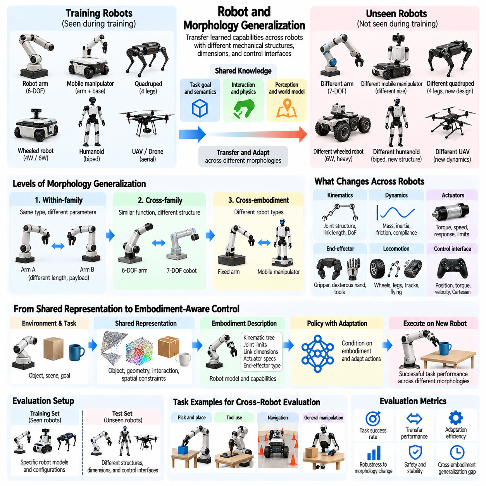{width="7.268055555555556in" height="7.268055555555556in"}

로봇 및 형태 일반화(Robot and Morphology Generalization)란 피지컬 AI(Physical AI) 시스템이 서로 다른 기계적 구조, 치수, 구동기(Actuator), 운동학적 구성(Kinematic Configuration)을 가진 로봇 사이에서 학습된 능력을 전이할 수 있는 능력을 의미한다. 물체나 환경에 대한 일반화와 달리, 이러한 능력은 행동을 실행하는 물리적 신체(Physical Body)의 변화에 초점을 맞춘다. 평가에서는 학습된 지능이 학습 과정에서 사용된 체화 형태(Embodiment)를 넘어 확장될 수 있는지 판단한다.

로봇 형태(Robot Morphology)는 지능형 시스템이 주변 환경을 인지하고, 이동하고, 조작하고, 상호작용하는 방식에 영향을 미친다. 관절 배치(Joint Arrangement), 팔다리 길이(Limb Length), 바퀴 구성(Wheel Configuration), 구동기 성능(Actuator Capability)의 차이는 명령과 물리적 결과 사이의 관계를 변화시킨다. 일반화 능력을 갖춘 피지컬 AI 시스템은 동일한 제어 출력(Control Output)이 모든 플랫폼에서 동일한 행동을 발생시킨다고 가정하지 않고 이러한 차이를 고려해야 한다.

형태 일반화(Morphology Generalization)는 여러 난이도 수준에서 평가할 수 있다. 가장 단순한 사례는 구조는 동일하지만 물리적 매개변수(Physical Parameter)가 다른 로봇을 포함한다. 더 어려운 사례에서는 관절 구성(Joint Configuration), 자유도(Degrees of Freedom), 이동 메커니즘(Locomotion Mechanism)이 변화한다. 가장 높은 수준의 일반화는 조작기(Manipulator), 이동 로봇(Mobile Robot), 휴머노이드 시스템(Humanoid System)처럼 근본적으로 다른 체화 형태 사이에서 기능적 능력을 전이하는 것을 요구한다.

동일 계열 내 일반화(Within-Family Generalization)는 동일한 형태 범주(Morphological Category)에 속하는 로봇 사이의 전이를 평가한다. 두 로봇 팔(Robotic Arm)은 유사한 운동학적 구조(Kinematic Structure)를 공유하더라도 링크 길이(Link Length), 가반하중(Payload Capacity), 관절 제한(Joint Limit)이 다를 수 있다. 성공적인 전이는 학습된 조작 전략(Manipulation Strategy)이 모든 로봇 구성에 대해 완전히 독립적인 정책(Policy)을 요구하지 않고 기계적 변화에 대응할 수 있음을 나타낸다.

계열 간 일반화(Cross-Family Generalization)는 더욱 큰 구조적 차이를 도입한다. 6축 산업용 로봇 팔(Six-Axis Industrial Arm)을 위해 개발된 조작 정책을 7축 협동로봇(Seven-Axis Collaborative Robot)으로 전이할 수 있다. 두 시스템은 유사한 작업을 수행하지만 관절 공간(Joint Space), 여유 자유도(Redundancy), 도달 가능한 구성(Reachable Configuration)이 다르다. 평가에서는 정책이 작업 정확도(Task Accuracy)와 안전성을 유지하면서 이러한 차이에 적응할 수 있는지 판단해야 한다.

체화 형태 간 일반화(Cross-Embodiment Generalization)는 관련된 로봇 계열을 넘어 확장된다. 시스템은 고정형 로봇 팔(Fixed Robotic Arm)에서 학습한 물체 조작 지식(Object Manipulation Knowledge)을 이동형 조작 로봇(Mobile Manipulator)이나 휴머노이드 로봇(Humanoid Robot)으로 전이할 수 있다. 이러한 전이를 위해서는 작업 수준 목표(Task-Level Objective)를 체화 형태별 실행(Embodiment-Specific Execution)과 분리해야 한다. 지식을 전달받는 로봇은 공유된 기능적 지식(Functional Knowledge)을 자신의 기계적 구조와 제어 능력에 적합한 행동으로 변환해야 한다.

운동학적 일반화(Kinematic Generalization)는 서로 다른 관절 구조, 링크 치수, 도달 가능 작업 공간(Reachable Workspace)에 적응하는 능력을 의미한다. 운동학(Kinematics)의 변화는 역운동학(Inverse Kinematics), 운동 계획(Motion Planning), 충돌 회피(Collision Avoidance), 말단효과기 위치결정(End-Effector Positioning)에 영향을 미친다. 평가에서는 원하는 움직임과 관절 명령(Joint Command) 사이의 대응 관계가 학습 조건과 달라지더라도 피지컬 AI 시스템이 작업 성능을 유지할 수 있는지 판단해야 한다.

동역학적 일반화(Dynamic Generalization)는 질량 분포(Mass Distribution), 관성(Inertia), 마찰(Friction), 구동기 출력(Actuator Strength), 기계적 순응성(Mechanical Compliance)의 변화를 다룬다. 운동학적 구조가 유사한 로봇이라도 물리적 동역학(Physical Dynamics)이 다르면 동일한 제어 명령에 서로 다르게 반응할 수 있다. 성공적인 전이를 위해서는 안정성을 유지하고 과도한 기계적 응력(Mechanical Stress)을 방지하면서 힘, 가속도, 피드백 동작(Feedback Behavior)을 조정해야 한다.

구동기 일반화(Actuator Generalization)는 학습된 제어기(Controller)가 서로 다른 모터 기술(Motor Technology), 동력 전달 메커니즘(Transmission Mechanism), 토크 제한(Torque Limit), 응답 특성(Response Characteristic)에서도 효과적으로 작동하는지 조사한다. 전기 서보모터(Electric Servomotor), 유압 구동기(Hydraulic Actuator), 순응형 구동장치(Compliant Drive)는 서로 다른 제어 동역학(Control Dynamics)을 나타낼 수 있다. 평가에서는 부적절한 정책 전이(Policy Transfer)로 인한 실패와 사용 가능한 구동 하드웨어(Actuation Hardware)의 한계로 인한 실패를 구분해야 한다.

이동 형태 일반화(Locomotion Morphology Generalization)는 이동 전략이 신체 구조에 크게 의존하기 때문에 특히 어렵다. 바퀴형 로봇(Wheeled Robot), 사족보행 로봇(Quadruped Robot), 이족보행 로봇(Biped Robot), 궤도형 플랫폼(Tracked Platform)은 서로 다른 접촉 메커니즘(Contact Mechanism)을 통해 지형과 상호작용한다. 전이 가능한 지능(Transferable Intelligence)은 공통된 지형 이해(Terrain Understanding)와 주행 목표(Navigation Objective)를 포함할 수 있지만 저수준 운동 생성(Low-Level Motion Generation)은 각 체화 형태에 특화되어야 한다.

조작 형태 일반화(Manipulation Morphology Generalization)는 그리퍼 설계(Gripper Design), 손가락 수(Finger Count), 관절 배치, 말단효과기 성능(End-Effector Capability)의 차이를 포함한다. 평행 조 그리퍼(Parallel-Jaw Gripper)와 다자유도 로봇 손(Dexterous Robotic Hand)은 서로 다른 접촉 전략(Contact Strategy)을 통해 유사한 물체 수준 목표(Object-Level Goal)를 달성할 수 있다. 평가에서는 공유된 조작 지식이 이러한 구성 사이에서 효과적인 파지(Grasping)와 물체 상호작용(Object Interaction)으로 변환될 수 있는지 측정해야 한다.

핵심적인 과제는 서로 다른 체화 형태에서도 의미를 유지하는 표현(Representation)을 식별하는 것이다. 관절각(Joint Angle)과 모터 명령(Motor Command)은 대체로 로봇에 특화되어 있지만 물체 자세(Object Pose), 접촉 관계(Contact Relationship), 작업 목표(Task Goal), 공간적 제약조건(Spatial Constraint)은 더 높은 전이 가능성을 제공할 수 있다. 일반화 평가에서는 학습된 표현이 체화 형태에 의존하는 행동 패턴(Embodiment-Dependent Action Pattern)을 암기하는 대신 기능적 관계(Functional Relationship)를 포착하는지 조사해야 한다.

체화 형태 인식 정책(Embodiment-Aware Policy)은 로봇의 구조적 설명을 의사결정(Decision-Making)에 명시적으로 반영한다. 이러한 설명에는 운동학적 트리(Kinematic Tree), 관절 제한, 구동기 사양(Actuator Specification), 기하학적 치수(Geometric Dimension)가 포함될 수 있다. 이러한 특성을 정책의 조건으로 사용하는 조건부 정책(Conditioned Policy)은 익숙하지 않은 로봇에 대한 적응을 지원할 수 있다. 그러나 평가에서는 성능이 알려진 로봇 정체성(Robot Identity)의 암기가 아니라 체화 형태 정보의 의미 있는 활용을 반영하는지 검증해야 한다.

행동 공간 차이(Action-Space Difference)는 로봇 간 전이에 추가적인 어려움을 발생시킨다. 하나의 플랫폼은 관절 위치 명령(Joint Position Command)을 사용하고, 다른 플랫폼은 관절 토크 명령(Joint Torque Command)을 사용하며, 또 다른 플랫폼은 직교좌표계 속도 목표(Cartesian Velocity Target)를 사용할 수 있다. 이러한 인터페이스 사이에서 수치적 행동(Numerical Action)을 직접 전이하는 것은 유효하지 않거나 위험할 수 있다. 평가에서는 공유 작업 공간 명령(Shared Task-Space Command), 학습된 행동 매핑(Learned Action Mapping), 로봇별 제어기(Robot-Specific Controller) 중 어떤 방식을 통해 전이가 이루어지는지 명시해야 한다.

엄격한 벤치마크(Benchmark)는 학습 체화 형태(Training Embodiment)와 평가 체화 형태(Evaluation Embodiment)를 명확하게 분리해야 한다. 동일한 로봇에서 서로 다른 매개변수 설정을 시험하는 것은 강건성(Robustness)을 측정할 수 있지만 폭넓은 형태 일반화를 입증하지는 못한다. 더 강력한 평가 프로토콜(Evaluation Protocol)은 로봇 모델(Robot Model), 운동학적 구조, 구동기 구성 또는 전체 체화 형태 계열(Embodiment Family)을 시험용으로 별도 확보하여 학습된 능력이 익숙한 물리적 설계를 넘어 확장되는지 판단한다.

형태 다양성(Morphological Diversity)은 자유도, 링크 비율(Link Proportion), 관절 위상구조(Joint Topology), 가반하중, 작업 공간 크기(Workspace Size), 구동기 대역폭(Actuator Bandwidth)과 같은 측정 가능한 특성으로 정의해야 한다. 이러한 매개변수는 로봇 사이의 구조적 차이(Structural Difference)를 정량화하는 데 도움이 된다. 형태 신규성(Morphological Novelty)의 정도는 전이 복잡도(Transfer Complexity)에 큰 영향을 미치므로 모든 미학습 체화 형태를 동일한 난이도로 취급해서는 안 된다.

통제된 실험(Controlled Experiment)은 공통 작업(Common Task)을 유지하면서 개별 형태 변화를 분리할 수 있다. 연구자는 관절 위상구조를 유지하면서 로봇 팔 길이를 변경하거나 기하학적 구조를 유지하면서 구동기 제한을 수정할 수 있다. 이러한 시험은 특정 기계적 매개변수(Mechanical Parameter)에 대한 민감도를 보여준다. 실제 로봇 플랫폼은 기하학적 구조, 동역학, 센싱(Sensing), 제어 인터페이스(Control Interface)가 동시에 다른 경우가 많으므로 복합 변화(Combined Variation)도 필요하다.

작업 성공률(Task Success Rate)은 로봇 및 형태 일반화를 측정하는 기본적인 지표이다. 조작 벤치마크(Manipulation Benchmark)는 서로 다른 로봇 팔이 동일한 배치 작업(Placement Task)을 완료하는지 평가할 수 있으며, 주행 벤치마크(Navigation Benchmark)는 동등한 목적지 도달 목표(Destination-Reaching Objective)를 평가할 수 있다. 성공 기준(Success Criteria)은 각 로봇의 물리적 성능과 안전 한계(Safety Limit)를 준수하면서 기능적 작업 수준(Functional Task Level)에서 정의되어야 한다.

형태 일반화 격차(Morphology Generalization Gap)는 학습에 사용된 체화 형태에서의 성능과 시험용으로 별도 확보한 로봇 구성(Held-Out Robot Configuration)에서의 성능을 비교한다. 큰 차이는 물리적 구조 사이의 전이 능력이 제한적임을 나타낸다. 그러나 성능 비교에서는 하드웨어 성능의 불균형(Unequal Hardware Capability)을 고려해야 한다. 작은 로봇이 작업에 실패하는 이유는 학습된 지능이 부족해서가 아니라 도달 거리(Reach)나 가반하중이 충분하지 않기 때문일 수 있다.

정규화된 성능 지표(Normalized Performance Metric)는 이종 플랫폼(Heterogeneous Platform) 사이의 비교를 개선할 수 있다. 작업 완료 시간(Task Completion Time), 에너지 소비(Energy Consumption), 추종 오차(Tracking Error), 제어 노력(Control Effort)은 로봇별 성능(Robot-Specific Capability)을 기준으로 해석할 수 있다. 평가에서는 절대적인 결과(Absolute Outcome)와 정규화된 측정값(Normalized Measure)을 모두 보고하여 지능의 차이로 보이는 결과가 단순히 기계적 장점이나 단점에서 비롯된 것이 아닌지 확인해야 한다.

제로샷 형태 일반화(Zero-Shot Morphology Generalization)는 추가 학습 없이 학습된 정책이 익숙하지 않은 로봇에서 작동할 수 있는지 평가한다. 퓨샷 적응(Few-Shot Adaptation)은 시험 전에 제한된 시연(Demonstration), 보정(Calibration), 물리적 상호작용(Physical Interaction)을 허용한다. 이러한 조건을 비교하면 즉각적인 전이(Immediate Transfer)의 정도와 적응에 필요한 자원을 파악할 수 있다. 초기 배치(Initial Deployment) 과정에서의 안전성은 명시적인 평가 요구사항으로 유지되어야 한다.

시뮬레이션(Simulation)은 절차적으로 생성된 로봇 형태(Procedurally Generated Robot Morphology) 전반에서 정책을 평가할 수 있는 확장성 높은 기회를 제공한다. 연구자는 통제된 작업 조건을 유지하면서 링크 치수, 관절 구조, 구동기 특성, 신체 구성을 변화시킬 수 있다. 그러나 구동기 동역학(Actuator Dynamics), 구조적 유연성(Structural Flexibility), 접촉 거동(Contact Behavior)이 부정확하게 모델링되면 시뮬레이션 전이(Simulated Transfer)가 실세계 성능(Real-World Performance)을 과대평가할 수 있다.

실세계 검증(Real-World Validation)에는 물리적으로 구별되는 로봇, 표준화된 기능적 목표(Standardized Functional Objective), 반복 시험(Repeated Trial)이 포함되어야 한다. 실험에서는 하드웨어 사양(Hardware Specification), 제어기 인터페이스(Controller Interface), 적응 절차(Adaptation Procedure), 작업 실행 가능성(Task Feasibility)을 문서화해야 한다. 플랫폼 간 시험(Cross-Platform Testing)은 관찰된 성능이 전이 가능한 물리 지능(Transferable Physical Intelligence)을 반영하는지, 아니면 특정 기계적 구성이나 소프트웨어 구성(Software Configuration)에 대한 숨겨진 의존성에서 비롯되는지 판단하는 데 도움이 된다.

통계적 보고(Statistical Reporting)는 형태적 거리(Morphological Distance), 로봇 계열(Robot Family), 작업 범주(Task Category), 적응 요구사항(Adaptation Requirement)에 따라 결과를 구분해야 한다. 종합 성공률(Aggregate Success Rate)은 매우 익숙하지 않은 체화 형태나 기계적으로 까다로운 작업에서 발생하는 실패를 숨길 수 있다. 신뢰구간(Confidence Interval), 문서화된 평가 데이터 분할(Evaluation Split), 실패 분류(Failure Classification)는 재현 가능한 비교를 지원하고 표현 실패(Representation Failure)와 하드웨어 제약조건(Hardware Constraint)을 구분하는 데 도움이 된다.

궁극적으로 로봇 및 형태 일반화는 피지컬 AI가 서로 다른 물리적 신체 사이에서 지식을 전이할 수 있는지 측정한다. 높은 일반화 능력을 위해서는 공유된 작업 이해(Shared Task Understanding)를 체화 형태별 실행(Embodiment-Specific Execution)과 분리하면서 운동학적 차이(Kinematic Difference), 동역학적 차이(Dynamic Difference), 구동 방식의 차이(Actuation Difference)에 적응해야 한다. 포괄적인 평가(Comprehensive Evaluation)는 전이 경계(Transfer Boundary)를 식별하고 이종 로봇 플랫폼 전반에서 재사용 가능한 지능(Reusable Intelligence)의 개발을 지원한다.

## 04.09. Zero Shot Generalization

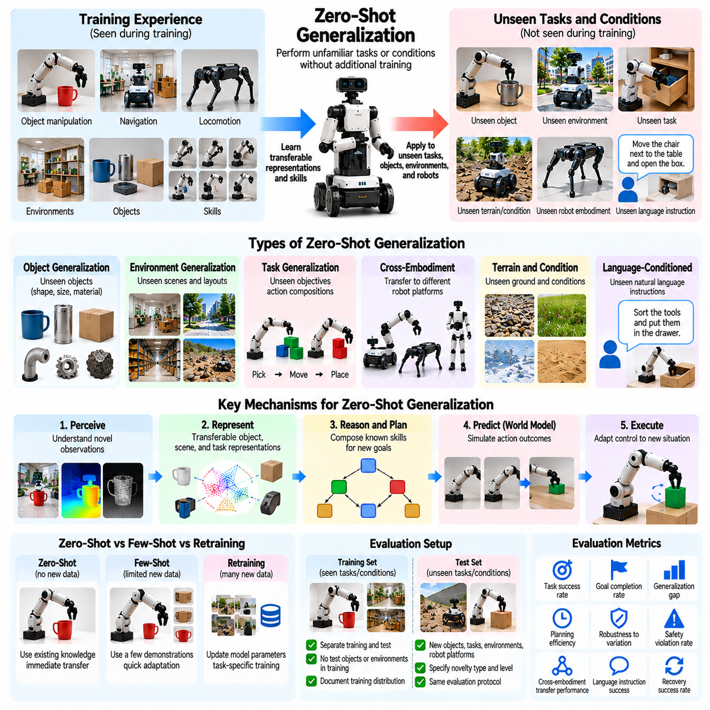{width="7.268055555555556in" height="7.268055555555556in"}

제로샷 일반화(Zero-Shot Generalization)란 피지컬 AI(Physical AI) 시스템이 추가적인 작업별 학습(Task-Specific Training) 없이 익숙하지 않은 작업을 수행하거나 학습 과정에서 경험하지 않은 조건에서 작동할 수 있는 능력을 의미한다. 시스템은 이전에 획득한 지식, 전이 가능한 표현(Transferable Representation), 기존 제어 능력(Control Capability)에 의존해야 한다. 평가에서는 학습된 지능이 반복적인 시연이나 재학습에 의존하지 않고 새로운 상황에 즉시 적응할 수 있는지 판단한다.

제로샷 일반화는 자율 물리 시스템(Autonomous Physical System)의 유연성을 나타내는 핵심 지표이다. 가정, 공장, 창고, 실외 환경에 배치되는 로봇은 학습 과정에서 모든 경우를 충분히 표현할 수 없는 조건을 자주 마주한다. 높은 제로샷 능력(Zero-Shot Capability)을 갖춘 시스템은 엔지니어가 가능한 모든 시나리오에 대해 별도의 정책(Policy)을 준비하지 않더라도 익숙하지 않은 상황을 해석하고 적절한 행동을 선택할 수 있다.

제로샷 성능(Zero-Shot Performance)을 정의하려면 평가 전에 어떤 정보를 사용할 수 있는지 신중하게 명시해야 한다. 로봇은 새로운 작업 지시(Task Instruction)를 받고 주변 환경을 관측하며 이전에 학습한 기술을 사용하더라도 제로샷 조건을 위반하지 않을 수 있다. 그러나 추가적인 시연이나 작업별 최적화(Task-Specific Optimization)를 통해 모델 매개변수(Model Parameter)를 갱신하는 것은 일반적으로 엄격한 제로샷 일반화가 아니라 적응(Adaptation)에 해당한다.

제로샷 일반화는 허용되는 새로운 경험의 양에서 퓨샷 적응(Few-Shot Adaptation)과 구별된다. 퓨샷 방법(Few-Shot Method)은 제한된 시연, 상호작용 또는 피드백(Feedback)을 활용하여 익숙하지 않은 조건에서 성능을 개선한다. 반면 제로샷 평가는 기존 능력의 즉각적인 전이(Immediate Transfer)를 측정한다. 이러한 구분은 적응 이후에 우수한 성능을 보이는 시스템이라도 익숙하지 않은 물리적 상황을 처음 마주할 때 어려움을 겪을 수 있기 때문에 중요하다.

미학습 물체 조작(Unseen Object Manipulation)은 대표적인 제로샷 평가 시나리오(Zero-Shot Evaluation Scenario)를 제공한다. 다양한 가정용 물체로 학습한 로봇이 추가적인 사례 없이 익숙하지 않은 산업용 부품(Industrial Component)을 파지하도록 요구받을 수 있다. 성공적인 수행을 위해서는 관련 기하학적 구조(Geometry)를 식별하고, 접촉 가능성(Contact Possibility)을 추정하며, 실행 가능한 파지(Feasible Grasp)를 선택해야 한다. 평가에서는 이러한 능력이 암기된 물체 정체성(Object Identity)을 넘어 전이되는지 판단해야 한다.

제로샷 환경 일반화(Zero-Shot Environment Generalization)는 이전에 경험하지 않은 건물, 작업 공간, 실외 장소에서의 성능을 조사한다. 이동 로봇(Mobile Robot)은 익숙하지 않은 시설에서 목적지 지시(Destination Instruction)를 받고 기존의 인지(Perception) 및 계획(Planning) 능력을 사용하여 주행해야 할 수 있다. 평가에서는 허용되는 온라인 지도 작성(Online Mapping)과 사전 환경별 학습(Environment-Specific Training)을 구분하면서 주행 성공률(Navigation Success Rate), 효율성(Efficiency), 안전성(Safety)을 측정해야 한다.

미학습 작업 일반화(Unseen Task Generalization)는 로봇이 학습 과정에서 명시적으로 시연되지 않은 목표를 해석해야 하므로 추가적인 어려움을 발생시킨다. 조작 시스템(Manipulation System)은 물체를 파지하고 운반하며 배치하는 방법을 알고 있지만 새로운 배치 목표(Arrangement Goal)를 마주할 수 있다. 성공적인 제로샷 행동(Zero-Shot Behavior)을 위해서는 새로운 작업 정책(Task Policy)을 학습하지 않고 사용 가능한 기술을 조합하며 원하는 결과에 대해 추론해야 한다.

체화 형태 간 제로샷 일반화(Cross-Embodiment Zero-Shot Generalization)는 추가적인 정책 학습 없이 익숙하지 않은 로봇 플랫폼(Robot Platform)으로 지식을 전이할 수 있는지 조사한다. 관절 구조(Joint Structure), 구동기 제한(Actuator Limit), 제어 인터페이스(Control Interface)의 차이는 직접적인 행동 전이(Action Transfer)를 어렵게 만든다. 평가에서는 로봇 설명(Robot Description), 보정 매개변수(Calibration Parameter), 사전 학습된 저수준 제어기(Pretrained Low-Level Controller)의 사용 가능 여부를 명시해야 한다. 이러한 자원은 제로샷 전이의 의미에 영향을 미치기 때문이다.

언어 조건부 피지컬 AI(Language-Conditioned Physical AI)는 제로샷 일반화를 평가하는 중요한 환경을 제공한다. 비전-언어-행동 모델(Vision-Language-Action Model, VLA)은 언어, 인지, 행동 표현(Action Representation)을 연결하여 새로운 지시를 해석할 가능성이 있다. 그러나 언어적 이해(Linguistic Understanding)만으로 물리적 역량(Physical Competence)이 입증되는 것은 아니다. 평가에서는 익숙하지 않은 지시가 그럴듯하지만 효과적이지 않은 행동 순서가 아니라 성공적이고 안전한 상호작용으로 이어지는지 검증해야 한다.

제로샷 일반화를 지원하는 핵심 메커니즘(Core Mechanism)은 전이 가능한 표현(Transferable Representation)의 학습이다. 물체의 기하학적 구조, 공간적 관계(Spatial Relationship), 물리적 제약조건(Physical Constraint), 작업 목표(Task Goal)는 익숙하지 않은 상황에서도 의미를 유지할 수 있다. 이러한 특성에 기반한 표현은 특정 학습 사례를 넘어 행동 선택(Action Selection)을 지원할 수 있다. 평가에서는 성능이 표면적인 시각적 상관관계(Visual Correlation)가 아니라 일반적인 물리적 관계(Physical Relationship)에 의존하는지 조사해야 한다.

조합적 추론(Compositional Reasoning)은 이전에 획득한 기술을 익숙하지 않은 조합으로 재구성함으로써 제로샷 성능을 지원한다. 로봇은 서랍을 열고, 물건을 꺼내고, 탁자 위에 배치하는 방법을 알고 있을 수 있다. 새로운 지시에서는 이러한 행동을 다른 순서로 결합해야 할 수 있다. 성공적인 실행은 기존 지식의 유연한 재사용(Flexible Knowledge Reuse)을 보여주지만 실제로 새로운 물리적 기술(Physical Skill)은 여전히 시스템의 능력 범위를 벗어날 수 있다.

월드 모델(World Model)은 후보 행동(Candidate Action)의 결과를 예측함으로써 제로샷 일반화에 기여할 수 있다. 로봇은 움직임이나 조작 전략을 선택하기 전에 가능한 상호작용을 내부적으로 시뮬레이션할 수 있다. 이러한 예측은 직접적인 시행착오 학습(Trial-and-Error Learning)에 대한 의존성을 줄일 수 있다. 평가에서는 예측적 추론(Predictive Reasoning)이 작업 성공률을 향상시키는지, 부정확한 예측이 추가적인 운영 위험(Operational Risk)을 발생시키는지 판단해야 한다.

제로샷 능력을 무제한적인 범용 지능(General Intelligence)과 혼동해서는 안 된다. 시스템은 익숙하지 않은 물체 외형에 대해서는 성공적으로 일반화하면서도 새로운 재질(Material), 동역학(Dynamics), 작업 구조(Task Structure)에서는 실패할 수 있다. 따라서 일반화는 다차원적(Multidimensional)이며 시험 대상이 되는 신규성(Novelty)에 따라 달라진다. 벤치마크(Benchmark)는 제로샷 역량(Zero-Shot Competence)에 대한 제한 없는 단일 주장 대신 관련된 구체적인 분포 이동(Distribution Shift)을 식별해야 한다.

엄격한 평가 프로토콜(Evaluation Protocol)은 학습 경험(Training Experience)과 시험 시나리오(Test Scenario)를 명확하게 분리해야 한다. 시험용으로 별도 확보한 작업(Held-Out Task), 물체, 환경, 로봇 구성을 문서화해야 한다. 연구자는 파운데이션 모델(Foundation Model)의 사전학습(Pretraining)에 관련 사례가 포함되었는지도 고려해야 한다. 학습 데이터 노출(Training Exposure)에 대한 투명성이 없다면 겉으로 드러난 제로샷 성공은 의미 있는 전이가 아니라 사전 친숙성(Prior Familiarity)을 반영할 수 있다.

데이터 오염(Data Contamination)은 대규모 사전학습 피지컬 AI 모델(Large Pretrained Physical AI Model)을 평가할 때 특히 중요한 문제이다. 학습 데이터에는 로봇 시연(Robot Demonstration), 시뮬레이션 궤적(Simulation Trajectory), 교육용 동영상(Instructional Video), 벤치마크 관련 자료가 포함될 수 있다. 평가 사례와 동일하거나 거의 중복되는 데이터는 보고된 성능을 부풀릴 수 있다. 따라서 벤치마크 관리(Benchmark Governance)에는 데이터 오염 검사(Contamination Check), 통제된 시험 접근(Controlled Test Access), 알려진 데이터 노출에 대한 투명한 보고가 포함되어야 한다.

평가 조건(Evaluation Condition)은 추론 시점 계산(Inference-Time Computation)과 상호작용(Interaction) 중 어떤 형태를 허용하는지 정의해야 한다. 시스템은 모델 가중치(Model Weight)를 갱신하지 않고 계획을 수행하거나 고정된 내부 메모리(Fixed Internal Memory)에서 정보를 검색하거나 주변 환경을 조사할 수 있다. 이러한 활동은 명시적으로 허용된다면 제로샷 평가와 양립할 수 있다. 그러나 시연을 수집하고 새로운 정책을 최적화하는 것은 평가 설정(Evaluation Setting)을 변화시킨다.

제로샷 작업 성공률(Zero-Shot Task Success Rate)은 즉각적인 일반화를 측정하는 기본적인 지표이다. 이는 작업별 적응 없이 완료한 익숙하지 않은 평가 작업의 비율을 나타낸다. 성공 기준(Success Criteria)에는 의도된 물리적 결과(Physical Outcome)와 관련 운영 제약조건(Operational Constraint)이 포함되어야 한다. 로봇이 안전하지 않은 접촉, 과도한 힘 또는 금지된 행동을 통해 목표에 도달했다면 제한 없는 성공으로 분류해서는 안 된다.

제로샷 일반화 격차(Zero-Shot Generalization Gap)는 익숙한 조건에서의 성능과 시험용으로 별도 확보한 시나리오(Held-Out Scenario)에서의 성능을 비교한다. 큰 격차는 학습 분포(Training Distribution)를 넘어서는 즉각적인 전이 능력이 제한적임을 나타낸다. 그러나 두 조건에서 모두 성능이 낮을 때도 작은 격차가 발생할 수 있으므로 절대적인 성공률(Absolute Success Rate)을 함께 보고해야 한다. 결과를 해석할 때는 작업 난이도(Task Difficulty)와 하드웨어 실행 가능성(Hardware Feasibility)의 차이도 고려해야 한다.

실행 품질(Execution Quality)은 이진적인 성공 여부(Binary Success)를 넘어 추가적인 평가 근거를 제공한다. 관련 지표에는 완료 시간(Completion Time), 행동 효율성(Action Efficiency), 궤적 품질(Trajectory Quality), 접촉 안정성(Contact Stability), 에너지 소비(Energy Consumption), 복구 시도(Recovery Attempt), 개입 빈도(Intervention Frequency)가 포함된다. 비효율적이거나 불안정한 행동을 통해 익숙하지 않은 작업을 완료하는 시스템은 정의된 운영 한계(Operational Limit) 내에서 일관되게 수행하는 시스템보다 실제 제로샷 역량이 낮을 수 있다.

불확실성 추정(Uncertainty Estimation)은 시스템이 평가 조건을 직접 경험하지 못했기 때문에 제로샷 배치(Zero-Shot Deployment)에서 특히 중요하다. 로봇은 자신의 예측이나 행동 선택이 신뢰할 수 없는 상황을 인식해야 한다. 평가에서는 신뢰도 보정(Confidence Calibration), 실패 감지(Failure Detection), 적절한 대체 행동(Fallback Behavior)을 측정해야 한다. 실행 불가능하거나 위험한 작업을 시도하는 것보다 안전한 거부(Safe Refusal)나 통제된 종료(Controlled Termination)가 더 적절할 수 있다.

제로샷 평가에는 신규성 수준(Novelty Level)이 점진적으로 증가하는 조건이 포함되어야 한다. 초기 시험에서는 익숙하지 않은 외형이나 공간 배치를 도입할 수 있으며, 더 어려운 시나리오에서는 새로운 작업 조합(Task Composition), 물리적 특성(Physical Property), 체화 형태 구조(Embodiment Structure)를 포함할 수 있다. 이러한 수준에서 성능을 측정하면 일반화가 점진적으로 저하되는지 또는 시스템이 학습된 능력의 범위를 벗어난 조건을 만났을 때 갑작스럽게 실패하는지 파악할 수 있다.

시뮬레이션(Simulation)은 절차적으로 생성된 물체(Procedurally Generated Object), 작업, 환경, 물리적 교란(Physical Disturbance)을 통해 대규모 제로샷 시험을 가능하게 한다. 비공개 평가 시드(Hidden Evaluation Seed)와 독립적으로 생성된 시나리오는 직접적인 암기(Direct Memorization)를 줄일 수 있다. 그러나 시뮬레이션은 실세계 불확실성(Real-World Uncertainty)을 과소평가하거나 접촉 동역학(Contact Dynamics)을 부정확하게 표현할 수 있다. 따라서 실제 실행 조건에서도 제로샷 역량이 유지되는지 검증하려면 물리적 시험(Physical Testing)이 필요하다.

실세계 벤치마크(Real-World Benchmark)에는 독립적인 시험 장소(Test Location), 익숙하지 않은 물리적 물체(Physical Object), 반복 시험(Repeated Trial), 명확하게 문서화된 적응 제한(Adaptation Restriction)이 포함되어야 한다. 평가에서는 허용되는 온라인 인지(Online Perception) 및 계획과 금지된 작업별 학습을 구분해야 한다. 실패, 인간 개입(Human Intervention), 환경 조건(Environmental Condition)을 기록하면 제로샷 성공이 유리한 실험 환경에 의존하는 것이 아니라 재현 가능한지 판단하는 데 도움이 된다.

통계적 보고(Statistical Reporting)는 신규성 범주(Novelty Category), 난이도(Difficulty), 로봇 플랫폼(Robot Platform), 작업 범위(Task Horizon)에 따라 결과를 구분해야 한다. 신뢰구간(Confidence Interval)과 반복 시험은 측정된 성공률의 불확실성을 특성화하는 데 도움이 된다. 종합 점수(Aggregate Score)는 익숙하지 않은 동역학이나 장기 작업 실행(Long-Horizon Execution)에서 나타나는 주요 약점을 숨길 수 있다. 피지컬 AI 시스템 사이의 의미 있는 비교를 위해서는 투명한 평가 데이터 분할(Evaluation Partition)과 일관된 평가 프로토콜이 필수적이다.

궁극적으로 제로샷 일반화는 학습된 물리 지능(Learned Physical Intelligence)이 익숙하지 않은 상황으로 즉시 전이될 수 있는 정도를 측정한다. 높은 성능을 위해서는 재사용 가능한 표현(Reusable Representation), 조합적 추론(Compositional Reasoning), 예측적 이해(Predictive Understanding), 강건한 제어(Robust Control), 불확실성 인식 의사결정(Uncertainty-Aware Decision-Making)이 필요하다. 포괄적인 평가(Comprehensive Evaluation)는 성공적인 전이와 역량 경계(Capability Boundary)를 모두 식별하여 학습 경험을 넘어 신뢰성 있게 작동하는 피지컬 AI 시스템의 개발을 지원해야 한다.

## 04.10. Few Shot Adaptation

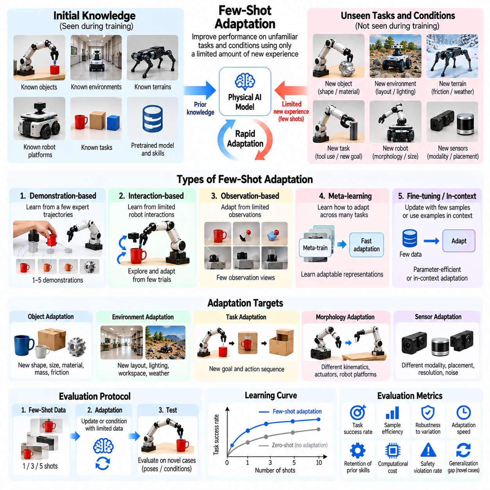{width="7.268055555555556in" height="7.268055555555556in"}

퓨샷 적응(Few-Shot Adaptation)이란 피지컬 AI(Physical AI) 시스템이 제한된 양의 새로운 경험만을 활용하여 익숙하지 않은 작업과 조건에 필요한 능력을 획득하거나 개선하는 능력을 의미한다. 제로샷 일반화(Zero-Shot Generalization)와 달리 퓨샷 적응은 엄격하게 제한된 시연(Demonstration), 관측(Observation), 상호작용(Interaction)을 허용한다. 평가에서는 시스템이 광범위한 재학습 없이 부족한 경험을 향상된 물리적 성능으로 얼마나 효율적으로 전환하는지 측정한다.

퓨샷 적응은 초기 학습(Initial Training) 과정에서 완전히 예측할 수 없는 다양한 변화가 물리적 환경에 존재하기 때문에 필수적이다. 로봇은 행동 조정(Behavioral Adjustment)이 필요한 익숙하지 않은 물체, 재질, 도구 또는 운영 조건(Operating Condition)을 마주할 수 있다. 능력 있는 시스템은 이전에 획득한 기술(Skill)을 유지하고 과도한 계산 요구사항(Computational Demand)을 방지하며 운영 안전성(Operational Safety)을 확보하면서 제한된 새로운 정보를 통합할 수 있어야 한다.

피지컬 AI 평가에서는 샷(Shot)의 의미를 명확하게 정의해야 한다. 하나의 샷은 전문가 시연(Expert Demonstration) 한 번, 완료된 궤적(Completed Trajectory) 하나, 레이블이 지정된 관측(Labeled Observation) 하나 또는 상호작용 에피소드(Interaction Episode) 하나를 의미할 수 있다. 이러한 단위는 서로 다른 양의 정보를 포함하므로 동등하지 않다. 벤치마크(Benchmark)는 의미 있는 비교를 지원하기 위해 각 샷에 해당하는 지속시간(Duration), 감독 정보(Supervision), 상호작용 내용(Interaction Content)을 명시해야 한다.

퓨샷 적응은 최종 시험 전에 추가적인 작업별 경험(Task-Specific Experience)을 허용한다는 점에서 제로샷 평가(Zero-Shot Evaluation)와 구별된다. 또한 대규모 데이터셋(Dataset)과 광범위한 최적화(Optimization)가 필요한 기존 재학습(Conventional Retraining)과도 다르다. 핵심 목표는 제한된 데이터 가용성(Data Availability)에서 빠르게 성능을 향상시키는 것이다. 평가에서는 매개변수 갱신(Parameter Update)을 통한 적응과 메모리(Memory), 프롬프팅(Prompting), 온라인 추론(Online Inference)을 통한 적응을 구분해야 한다.

시연 기반 적응(Demonstration-Based Adaptation)은 로봇이 소수의 전문가 실행(Expert Execution)으로부터 학습할 수 있도록 한다. 예를 들어 조작기(Manipulator)는 익숙하지 않은 부품을 독립적으로 조작하기 전에 몇 차례의 성공적인 파지(Grasp)를 관찰할 수 있다. 평가에서는 시스템이 초기 조건(Initial Condition)이 조금만 달라져도 실패할 수 있는 시연 궤적(Demonstrated Trajectory)을 암기하는 대신 전이 가능한 조작 원리(Transferable Manipulation Principle)를 추출하는지 판단해야 한다.

상호작용 기반 적응(Interaction-Based Adaptation)은 로봇이 통제된 물리적 경험(Controlled Physical Experience)을 통해 정보를 수집하도록 허용한다. 이동 로봇(Mobile Robot)은 익숙하지 않은 표면에서 바퀴 접지력(Wheel Traction)을 시험할 수 있으며, 조작기는 부드러운 접촉(Gentle Contact)을 통해 물체 강성(Object Stiffness)을 추정할 수 있다. 이러한 탐색(Exploration)은 후속 의사결정(Decision-Making)을 개선할 수 있다. 그러나 적응 프로토콜(Adaptation Protocol)은 상호작용 예산(Interaction Budget)을 제한하고 불확실한 환경에서 위험한 실험을 방지해야 한다.

관측 기반 적응(Observation-Based Adaptation)은 완전한 행동 시연(Action Demonstration) 없이 제한된 감각 정보(Sensory Information)를 활용한다. 로봇은 작업을 실행하기 전에 익숙하지 않은 작업 공간(Workspace)을 조사하거나 물체 움직임(Object Motion)을 관찰하거나 환경 매개변수(Environmental Parameter)를 추정할 수 있다. 이러한 설정은 인지 조정(Perceptual Adjustment)과 정책 학습(Policy Learning)을 분리한다. 평가에서는 추가 관측이 의사결정을 개선하는지, 그리고 그 개선 효과가 다양한 상황에서도 유지되는지 판단해야 한다.

메타학습(Meta-Learning)은 시스템이 새로운 작업에 빠르게 적응할 수 있도록 다양한 작업에 걸쳐 학습시키는 퓨샷 적응 접근법 중 하나이다. 메타학습 시스템은 고정된 정책(Fixed Policy)만 학습하는 대신 적응 메커니즘(Adaptation Mechanism)을 개발한다. 평가에서는 이러한 메커니즘이 학습에서 제외된 작업(Held-Out Task)으로 얼마나 효과적으로 전이되는지, 그리고 겉으로 드러난 효율성이 학습 분포(Training Distribution)와 시험 분포(Testing Distribution) 사이의 유사성에 의존하는지 측정해야 한다.

미세조정(Fine-Tuning)은 제한된 작업별 데이터(Task-Specific Data)를 사용하여 선택된 모델 매개변수(Model Parameter)를 갱신하는 또 다른 적응 전략이다. 매개변수 효율적 방법(Parameter-Efficient Method)은 사전학습된 백본(Pretrained Backbone)을 유지하면서 소규모 어댑터(Adapter)나 특수한 신경망 구성요소(Network Component)를 수정할 수 있다. 평가에서는 특히 자원이 제한된 로봇 하드웨어(Resource-Constrained Robotic Hardware)에서 갱신을 수행해야 하는 경우 적응 정확도(Adaptation Accuracy), 계산 비용(Computational Cost), 메모리 요구량(Memory Requirement), 학습 안정성(Training Stability)을 보고해야 한다.

문맥 내 적응(In-Context Adaptation)은 모델 가중치(Model Weight)를 반드시 수정하지 않고 시연이나 관측을 임시 조건 정보(Temporary Conditioning Information)로 활용한다. 비전-언어-행동 모델(Vision-Language-Action Model, VLA)은 실행 전에 예시 궤적(Example Trajectory)이나 작업 설명(Task Description)을 제공받을 수 있다. 이러한 접근법은 배치 복잡도(Deployment Complexity)를 줄일 수 있지만 효과는 문맥 표현(Context Representation)과 검색 품질(Retrieval Quality)에 따라 달라진다. 평가에서는 실제 적응과 제공된 사례의 직접적인 재현을 구분해야 한다.

퓨샷 물체 적응(Few-Shot Object Adaptation)은 로봇이 익숙하지 않은 형상(Shape), 질감(Texture), 질량(Mass), 마찰 특성(Friction Property)을 가진 물체를 얼마나 빠르게 조작하도록 학습하는지 조사한다. 시스템은 새로운 물체 범주(Object Category)에 대한 소수의 성공적인 시연을 제공받을 수 있다. 평가에서는 적응이 시연된 조건에 대한 제한적인 암기가 아니라 강건한 이해(Robust Understanding)를 형성하는지 판단하기 위해 서로 다른 물체 자세(Object Pose)와 배치(Placement)에서 성능을 시험해야 한다.

퓨샷 환경 적응(Few-Shot Environment Adaptation)은 익숙하지 않은 작업 공간, 지형(Terrain), 조명(Lighting), 센서 조건(Sensor Condition)에 빠르게 적응하는 능력을 의미한다. 로봇은 여러 관측이나 짧은 상호작용 에피소드를 사용하여 지역적 운영 특성(Local Operating Characteristic)을 추정할 수 있다. 성공적인 적응은 동일한 배치 환경(Deployment Environment) 내에서 환경 조건이 변화하더라도 주행(Navigation), 위치추정(Localization), 제어(Control)를 개선하면서 효과를 유지해야 한다.

퓨샷 형태 적응(Few-Shot Morphology Adaptation)은 학습된 정책이 제한된 보정 데이터(Calibration Data)나 시연 데이터를 사용하여 새로운 로봇 구성(Robot Configuration)에 대응할 수 있는지 평가한다. 관절 제한(Joint Limit), 구동기 응답(Actuator Response), 운동학적 구조(Kinematic Structure)의 차이는 조정을 요구할 수 있다. 평가에서는 기본적인 하드웨어 초기화(Hardware Initialization)에 필요한 정보와 익숙하지 않은 체화 형태(Embodiment)에서 작업 성능을 개선하는 데 사용되는 적응 경험(Adaptation Experience)을 구분해야 한다.

적응 효율성(Adaptation Efficiency)은 최소한의 경험으로 성능을 개선하는 것이 목표이므로 핵심적인 평가 지표이다. 학습 곡선(Learning Curve)은 시연 횟수, 상호작용 에피소드 수 또는 관측 횟수에 따른 작업 성능(Task Performance)을 보고해야 한다. 적응 곡선 아래 면적(Area Under the Adaptation Curve)은 학습 효율성(Learning Efficiency)을 요약할 수 있으며, 고정된 샷 예산(Fixed Shot Budget)에서의 성능은 동일한 정보 제약조건(Information Constraint) 아래 알고리즘 사이의 직접적인 비교를 가능하게 한다.

적응 이득(Adaptation Gain)은 제한된 경험을 활용하기 전과 후의 성능 차이를 측정한다. 이 지표는 적응 과정(Adaptation Process)이 제로샷 기준 성능(Zero-Shot Baseline)을 넘어 의미 있는 이점을 제공하는지 보여준다. 그러나 매우 낮은 초기 성능에서 큰 개선이 발생하더라도 여전히 신뢰할 수 없는 물리 시스템(Physical System)이 될 수 있으므로 적응 이후의 절대 성능(Absolute Post-Adaptation Performance)도 함께 보고해야 한다.

샘플 효율성(Sample Efficiency)만으로는 적응 품질(Adaptation Quality)을 완전히 설명할 수 없다. 두 방법은 동일한 수의 시연을 사용하여 유사한 성공률(Success Rate)을 달성하더라도 계산 시간(Computational Time), 에너지 소비(Energy Consumption), 물리적 상호작용 비용(Physical Interaction Cost)에서 상당한 차이를 보일 수 있다. 따라서 평가에서는 데이터 효율성(Data Efficiency), 실제 경과 적응 시간(Wall-Clock Adaptation Time), 프로세서 활용률(Processor Utilization), 운영 자원(Operational Resource)을 상호 보완적인 지표로 고려해야 한다.

적응 안정성(Adaptation Stability)은 서로 다른 지원 사례(Support Example)와 무작위 초기화 조건(Random Initialization Condition)에서도 성능이 일관되게 개선되는지 조사한다. 퓨샷 학습(Few-Shot Learning)은 사용 가능한 사례가 대표성을 갖지 못할 때 선택된 시연에 민감할 수 있다. 독립적으로 표본 추출한 지원 데이터 집합(Support Set)을 사용한 반복 평가는 변동성(Variability)을 정량화하고 유리한 적응 데이터에 과도하게 의존하는 알고리즘을 식별하는 데 도움이 된다.

과적합(Overfitting)은 적응이 극도로 작은 데이터셋에 의존할 때 발생하는 중요한 위험이다. 로봇은 시연된 행동을 정확하게 재현하면서도 물체 자세, 작업 순서(Task Sequence), 환경 교란(Environmental Disturbance)이 변화하면 실패할 수 있다. 평가에서는 적응 사례(Adaptation Example)와 최종 시험 에피소드(Final Test Episode)를 분리하고 통제된 변화(Controlled Variation)를 도입하여 갱신된 정책(Updated Policy)이 제한된 지원 데이터를 넘어 일반화되는지 판단해야 한다.

파국적 망각(Catastrophic Forgetting)은 새로운 적응 갱신(Adaptation Update)이 이전에 획득한 능력을 방해할 때 발생하는 또 다른 과제이다. 새로운 조작 작업에 적응한 로봇은 익숙한 작업에서 신뢰성을 잃을 수 있다. 평가에서는 새로운 작업의 성능 향상(New-Task Improvement)과 대표적인 기존 작업에서 유지되는 성능(Retained Performance)을 모두 측정하여 국소적 적응(Local Adaptation)이 더 폭넓은 운영 역량(Operational Competence)을 약화시키지 않는지 확인해야 한다.

안전 인식 적응(Safety-Aware Adaptation)은 물리적 학습이 실제 접촉, 움직임, 잠재적으로 위험한 탐색(Hazardous Exploration)을 포함하기 때문에 특히 중요하다. 로봇은 적응 과정에서 힘 제한(Force Limit), 충돌 제약조건(Collision Constraint), 불확실성 임계값(Uncertainty Threshold)을 준수해야 한다. 평가에서는 적응 시험(Adaptation Trial)을 비용이 없는 학습 기회로 취급하지 않고 위험한 시도(Unsafe Attempt), 비상 개입(Emergency Intervention), 제약조건 위반(Constraint Violation)을 집계해야 한다.

엄격한 벤치마크는 적응 예산(Adaptation Budget)과 정보 접근(Information Access)을 표준화해야 한다. 연구자는 샷 수(Number of Shots), 시연 품질(Demonstration Quality), 허용되는 상호작용(Permitted Interaction), 매개변수 갱신 규칙(Parameter-Update Rule), 사전학습 지식(Pretrained Knowledge)에 대한 접근 권한을 문서화해야 한다. 이러한 통제가 없다면 더 풍부한 피드백이나 추가 최적화 기회를 제공받는 시스템이 실제로는 제약조건이 덜 엄격한 환경에서 작동했음에도 더 높은 능력을 가진 것처럼 보일 수 있다.

시뮬레이션(Simulation)은 적응 예산, 작업 변화(Task Variation), 로봇 구성 전반에서 대규모 평가를 가능하게 한다. 또한 물리적 비용을 줄이면서 통제된 실험과 반복적인 지원 데이터 집합 표본 추출(Support-Set Sampling)을 지원한다. 그러나 시뮬레이션된 적응(Simulated Adaptation)은 실제 구동기 불확실성(Actuator Uncertainty), 접촉 동역학(Contact Dynamics), 센싱 불완전성(Sensing Imperfection)을 충분히 반영하지 못할 수 있다. 적응 효율성이 실제 배치 환경으로 전이되는지 판단하려면 실세계 검증(Real-World Validation)이 필요하다.

실세계 퓨샷 벤치마크(Real-World Few-Shot Benchmark)는 적응 단계(Adaptation Phase)와 평가 단계(Evaluation Phase)를 명확하게 분리한 상태에서 익숙하지 않은 물체, 환경 또는 로봇 구성을 사용해야 한다. 반복 시험(Repeated Trial)에서는 하드웨어 조건(Hardware Condition), 인간 지원(Human Assistance), 수집된 모든 상호작용 데이터(Interaction Data)를 문서화해야 한다. 결과에는 제로샷 기준 성능, 적응 곡선(Adaptation Curve), 최종 성공률(Final Success Rate), 안전성 결과(Safety Outcome)를 포함하여 학습 진행 상황과 운영 신뢰성(Operational Reliability)을 모두 특성화해야 한다.

통계적 보고(Statistical Reporting)는 샷 예산, 신규성 범주(Novelty Category), 작업 난이도(Task Difficulty), 로봇 플랫폼(Robot Platform)에 따라 적응 성능을 구분해야 한다. 신뢰구간(Confidence Interval)과 독립적으로 표본 추출한 여러 적응 데이터 집합은 제한된 경험에 대한 민감도를 보여준다. 종합 결과(Aggregate Result)는 어려운 조건에서의 낮은 성능을 숨길 수 있다. 투명한 평가 프로토콜(Transparent Evaluation Protocol)은 재현 가능한 비교(Reproducible Comparison)를 지원하고 빠른 학습 능력(Rapid Learning Capability)에 대한 오해를 유발하는 주장을 방지한다.

궁극적으로 퓨샷 적응은 피지컬 AI 시스템이 제한된 새로운 경험을 신뢰할 수 있는 물리적 역량(Physical Competence)으로 얼마나 효율적으로 전환하는지 측정한다. 높은 적응 능력을 위해서는 전이 가능한 표현(Transferable Representation), 효율적인 학습 메커니즘(Efficient Learning Mechanism), 안정적인 갱신(Stable Update), 안전 인식 상호작용(Safety-Aware Interaction)이 결합되어야 한다. 포괄적인 평가(Comprehensive Evaluation)는 성능 향상, 자원 소비(Resource Consumption), 지식 유지(Knowledge Retention), 적응 이후 일반화(Post-Adaptation Generalization)를 평가하여 로봇이 현실적인 배치 제약조건(Deployment Constraint) 아래에서 효과적으로 학습할 수 있는지 확인해야 한다.

## 04.11. Compositional Generalization

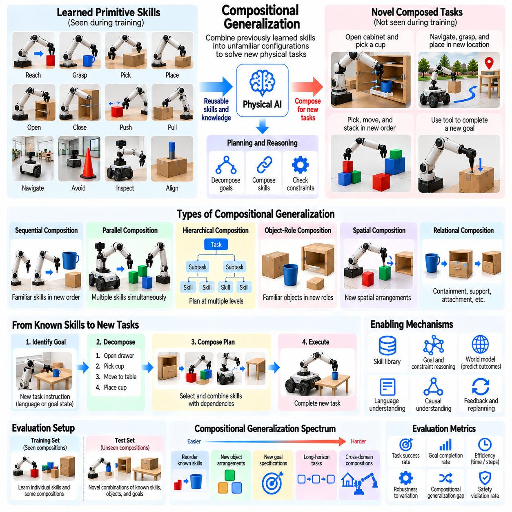{width="7.268055555555556in" height="7.268055555555556in"}

조합적 일반화(Compositional Generalization)란 피지컬 AI(Physical AI) 시스템이 이전에 학습한 기술(Skill), 개념(Concept), 행동 패턴(Action Pattern)을 익숙하지 않은 구성으로 결합할 수 있는 능력을 의미한다. 일반화 능력을 갖춘 시스템은 완전한 작업 순서(Task Sequence)를 암기하는 대신 재사용 가능한 구성요소(Reusable Component)가 어떻게 상호작용하는지 이해해야 한다. 평가에서는 가능한 모든 조합에 대해 별도로 학습하지 않고도 학습된 능력을 재구성하여 새로운 물리적 작업을 해결할 수 있는지 판단한다.

물리적 환경(Physical Environment)은 본질적으로 조합적 구조(Compositional Structure)를 포함한다. 제품 조립(Product Assembly), 창고 정리(Warehouse Organization), 가정용 물품 준비(Household Item Preparation)와 같은 복잡한 활동은 공간적 관계(Spatial Relationship), 시간적 관계(Temporal Relationship), 인과적 관계(Causal Relationship)로 연결된 단순한 작업들로 구성된다. 높은 조합적 일반화 능력을 갖춘 피지컬 AI 시스템은 익숙한 작업을 재사용하면서도 그 순서, 매개변수(Parameter), 의존관계(Dependency)를 새로운 목표에 맞게 조정할 수 있다.

조합적 일반화는 신규성(Novelty)이 주로 알려진 요소들 사이의 관계에서 발생한다는 점에서 일반적인 작업 일반화(Task Generalization)와 구별된다. 로봇은 이미 파지(Grasping), 이동(Moving), 열기(Opening), 배치(Placing)를 이해하고 있지만 이러한 행동을 이전에 경험하지 않은 순서로 수행해야 하는 작업을 마주할 수 있다. 성공적인 수행은 시스템이 완전한 시연(Demonstration)을 단순히 재현하는 것이 아니라 전이 가능한 관계(Transferable Relationship)를 학습했음을 나타낸다.

기술 조합(Skill Composition)은 복잡한 행동을 구성하는 기본적인 메커니즘을 제공한다. 개별 기술은 도달(Reaching), 파지(Grasping), 들어 올리기(Lifting), 주행(Navigating), 정렬(Aligning), 물체 놓기(Releasing)를 나타낼 수 있다. 이러한 기술은 사전조건(Precondition)과 결과(Outcome)가 서로 호환될 때 상위 수준 절차(Higher-Level Procedure)로 구성될 수 있다. 평가에서는 로봇이 적절한 기술을 선택하고 변화하는 물리적 조건에서 기술 간 전환(Skill Transition)을 조정하는지 조사해야 한다.

순차적 조합(Sequential Composition)은 알려진 기술을 익숙하지 않은 순서로 실행하는 것을 의미한다. 이동형 조작 로봇(Mobile Manipulator)은 캐비닛을 열고, 용기를 꺼내고, 운반한 다음, 지정된 목적지에 배치해야 할 수 있다. 각 작업은 익숙하더라도 전체 순서는 새로운 것일 수 있다. 평가에서는 로봇이 작업 의존관계(Task Dependency)를 유지하고 이후 행동으로 전파되는 오류(Error Propagation)를 방지하는지 측정해야 한다.

병렬 조합(Parallel Composition)은 서로 호환되는 여러 활동을 동시에 조정하는 것을 포함한다. 로봇은 조작기(Manipulator)의 위치를 조정하면서 이동 베이스(Mobile Base)를 움직이거나 다른 동작을 수행하면서 물체를 관찰할 수 있다. 이러한 조정은 효율성을 향상시킬 수 있지만 자원 충돌(Resource Conflict)과 안전 제약조건(Safety Constraint)을 발생시킨다. 평가에서는 병렬 실행(Parallel Execution)이 안정성(Stability), 충돌 회피(Collision Avoidance), 작업 완료 품질(Task Completion Quality)을 유지하는지 판단해야 한다.

계층적 조합(Hierarchical Composition)은 기본 행동(Primitive Action)을 재사용 가능한 기술, 하위 작업(Subtask), 임무 수준 계획(Mission-Level Plan)으로 구성한다. 상위 수준 추론(Higher-Level Reasoning)은 필요한 능력을 결정하고, 하위 수준 제어기(Lower-Level Controller)는 물리적 움직임을 실행한다. 일반화를 위해서는 이러한 추상화 수준(Abstraction Level) 사이의 조정이 필요하다. 평가에서는 실패가 잘못된 작업 분해(Task Decomposition), 부적절한 기술 선택(Skill Selection), 신뢰할 수 없는 물리적 실행(Physical Execution) 중 어디에서 발생하는지 식별해야 한다.

물체 역할 조합(Object-Role Composition)은 로봇이 특정 물체 정체성(Object Identity)과 독립적으로 기능적 관계(Functional Relationship)를 이해하는지 조사한다. 용기(Container)는 목적지 역할을 하고, 도구(Tool)는 조작을 가능하게 하며, 표면(Surface)은 지지 기능을 제공할 수 있다. 새로운 작업에서는 익숙한 물체에 이전과 다른 역할이 부여될 수 있다. 평가에서는 시스템이 암기된 물체-작업 연관성(Object-Task Association)에 의존하지 않고 이러한 관계를 추론하는지 판단해야 한다.

공간적 조합(Spatial Composition)은 익숙한 물체, 장애물(Obstacle), 목표 위치(Target Location)의 새로운 배치를 다룬다. 로봇은 한 물체를 다른 물체 뒤에 배치하거나, 부품을 새로운 순서로 쌓거나, 이전에 경험하지 않은 장애물 구성을 통과해야 할 수 있다. 성공적인 일반화를 위해서는 학습 과정에서 경험한 특정 기하학적 배치(Geometric Arrangement)를 기억하는 대신 공간적 제약조건(Spatial Constraint)을 해석하고 실행 가능한 행동(Feasible Action)을 생성해야 한다.

관계적 조합(Relational Composition)은 공간적 구조를 넘어 포함 관계(Containment), 지지 관계(Support), 부착 관계(Attachment), 소유 관계(Ownership), 상호작용 의존관계(Interaction Dependency)를 포함한다. 로봇은 용기의 뚜껑을 닫기 전에 부품을 용기 안에 넣어야 할 수 있다. 이러한 작업에서는 물체와 행동 사이의 관계를 이해해야 한다. 평가에서는 물체, 위치 또는 실행 순서가 변경되더라도 이러한 관계가 유효하게 유지되는지 시험해야 한다.

언어 조건부 조합(Language-Conditioned Composition)은 피지컬 AI 시스템이 익숙한 개념들의 새로운 조합을 포함하는 지시를 해석할 수 있도록 한다. 명령에는 여러 물체, 목적지, 제약조건, 행동 순서가 지정될 수 있다. 비전-언어-행동 모델(Vision-Language-Action Model, VLA)은 이러한 설명을 실행 가능한 행동으로 변환할 가능성이 있다. 그러나 평가에서는 언어적 해석 정확도(Linguistic Interpretation Accuracy)에만 의존하지 않고 실제 물리적 작업 완료(Physical Task Completion)를 검증해야 한다.

조합적 계획(Compositional Planning)은 행동 사이의 사전조건(Precondition), 효과(Effect), 의존관계(Dependency)에 대한 추론을 요구한다. 로봇은 닫힌 캐비닛을 먼저 열지 않고 물체를 그 안에 안정적으로 배치할 수 없다. 계획 시스템(Planning System)은 후속 단계를 가능하게 하는 작업을 결정하고 서로 양립할 수 없는 행동 순서(Incompatible Action Order)를 인식해야 한다. 평가에서는 논리적 일관성(Logical Consistency), 물리적 실행 가능성(Physical Feasibility), 생성된 계획의 성공적인 실행을 측정해야 한다.

인과적 이해(Causal Understanding)는 행동이 특정 결과를 발생시키는 이유를 표현함으로써 조합적 일반화를 강화할 수 있다. 지지하는 물체를 이동시키면 조립체(Assembly)가 불안정해질 수 있으며, 잘못된 방향으로 힘을 가하면 삽입(Insertion)이 실패할 수 있다. 이러한 의존관계를 이해하는 시스템은 행동을 더욱 신뢰성 있게 재구성할 수 있다. 평가에서는 인과적 추론(Causal Reasoning)과 일반적인 행동 순서에 대한 통계적 친숙성(Statistical Familiarity)을 구분해야 한다.

엄격한 벤치마크(Benchmark)는 개별 구성요소(Individual Component)에 대한 학습 노출을 통제하면서 학습 조합(Training Composition)과 평가 조합(Evaluation Composition)을 분리해야 한다. 시스템은 학습 과정에서 모든 기본 기술(Primitive Skill)을 경험했더라도 시험에 사용되는 특정 조합은 경험하지 않았을 수 있다. 이러한 구분은 완전히 새로운 기술의 획득과 조합적 전이(Compositional Transfer)를 분리한다. 평가 프로토콜(Evaluation Protocol)은 이전에 관측한 요소와 관계를 문서화해야 한다.

조합적 신규성(Compositional Novelty)은 행동 순서, 물체 역할, 공간적 관계, 작업 제약조건(Task Constraint), 계층적 구조(Hierarchical Structure)의 변화로 특성화할 수 있다. 서로 다른 조합은 서로 다른 난이도(Difficulty Level)를 발생시킨다. 벤치마크는 모든 미학습 순서(Unseen Sequence)를 동일하게 취급하지 않고 이러한 차원을 체계적으로 변화시켜야 한다. 이러한 구성은 피지컬 AI 시스템이 어떤 형태의 조합을 성공적으로 일반화할 수 있는지 식별하는 데 도움이 된다.

통제된 실험(Controlled Experiment)은 여러 조합 요소를 결합하기 전에 개별 요소를 분리해야 한다. 연구자는 물체와 행동을 유지하면서 순서만 변경하거나 행동 순서를 유지하면서 관계적 제약조건(Relational Constraint)을 수정할 수 있다. 더 어려운 시험에서는 여러 요소를 동시에 변화시킬 수 있다. 이러한 실험은 성능이 암기된 특정 패턴(Memorized Pattern)에 의존하는지 또는 작업 구성(Task Construction)의 일반적인 원리에 기반하는지 보여준다.

작업 성공률(Task Success Rate)은 조합적 일반화를 측정하는 주요 지표이지만 완전한 성공 여부만으로는 중요한 약점을 놓칠 수 있다. 로봇은 대부분의 하위 작업을 올바르게 수행한 후 마지막 의존관계에서 실패할 수 있다. 따라서 평가에서는 하위 작업 완료(Subtask Completion), 순서 정확도(Ordering Accuracy), 제약조건 충족(Constraint Satisfaction), 실행 전반에 걸친 중간 물리 상태(Intermediate Physical State)의 정확성을 측정해야 한다.

조합적 일반화 격차(Compositional Generalization Gap)는 익숙한 작업 조합에서의 성능과 시험용으로 별도 확보한 조합(Held-Out Composition)에서의 성능을 비교한다. 큰 차이는 이전에 관측한 작업 구조(Task Structure)에 대한 의존성을 나타낸다. 그러나 비교에서는 순서 길이(Sequence Length), 물리적 난이도(Physical Difficulty), 실행 시간(Execution Time)을 통제해야 한다. 그렇지 않으면 성능 저하가 학습된 능력을 재조합하지 못하는 문제보다 작업 복잡도(Task Complexity)의 증가를 반영할 수 있다.

장기 작업 조합(Long-Horizon Composition)은 작은 오류가 연결된 행동 전반에 걸쳐 누적되기 때문에 추가적인 어려움을 발생시킨다. 잘못 배치된 물체는 후속 파지를 방해할 수 있으며, 잘못된 주행 결정(Navigation Decision)은 이후 작업을 무효화할 수 있다. 평가에서는 오류 전파(Error Propagation), 복구 성공률(Recovery Success), 재계획 빈도(Replanning Frequency), 예상하지 못한 물리적 결과가 발생하더라도 작업 목표(Task Objective)를 유지하는 능력을 측정해야 한다.

제로샷 조합적 일반화(Zero-Shot Compositional Generalization)는 추가 학습이나 시연 없이 익숙하지 않은 조합을 실행할 수 있는지 조사한다. 퓨샷 적응(Few-Shot Adaptation)은 시험 전에 새로운 조합에 대한 제한된 경험을 허용한다. 이러한 조건을 비교하면 학습된 기술이 즉시 재사용 가능한지 또는 추가적인 조정 학습(Coordination Learning)이 필요한지 파악할 수 있다. 적응 비용(Adaptation Cost)은 최종 작업 성능과 별도로 보고해야 한다.

월드 모델(World Model)과 예측적 계획(Predictive Planning)은 제안된 행동 순서의 결과를 추정함으로써 조합을 지원할 수 있다. 로봇은 특정 배치가 이후 움직임을 방해하는지 또는 조립체가 안정적으로 유지되는지 평가할 수 있다. 이러한 예측은 기술 선택과 행동 순서를 결정하는 데 도움이 된다. 평가에서는 예측적 추론(Predictive Reasoning)이 실행 성능을 개선하고 예방 가능한 실패(Avoidable Failure)를 줄이는지 판단해야 한다.

시뮬레이션(Simulation)은 물체, 목표, 제약조건, 행동 순서의 절차적 생성(Procedural Generation)을 통해 조합적 작업(Compositional Task)의 확장성 높은 시험을 가능하게 한다. 연구자는 기본 기술의 일관성을 유지하면서 시험용 조합(Held-Out Combination)을 생성할 수 있다. 그러나 시뮬레이션에서의 성공은 실제 접촉 불확실성(Contact Uncertainty), 구동기 제한(Actuator Limitation), 환경 교란(Environmental Disturbance)을 충분히 반영하지 못할 수 있다. 신뢰할 수 있는 결론을 위해서는 물리적 검증(Physical Validation)이 필요하다.

실세계 벤치마크(Real-World Benchmark)에는 익숙하지 않은 작업 조합, 문서화된 초기 조건(Initial Condition), 반복 실행 시험(Repeated Execution Trial)이 포함되어야 한다. 평가에서는 중간 상태(Intermediate State), 실패한 의존관계(Failed Dependency), 개입(Intervention), 복구 행동(Recovery Behavior)을 기록해야 한다. 작업은 시험 대상 로봇에서 물리적으로 실행 가능해야 한다. 이러한 통제는 조합적 추론의 한계와 하드웨어 제약조건(Hardware Constraint) 또는 신뢰할 수 없는 기본 기술로 인한 실패를 구분하는 데 도움이 된다.

통계적 보고(Statistical Reporting)는 조합 유형(Composition Type), 순서 길이, 관계적 복잡도(Relational Complexity), 작업 난이도에 따라 결과를 구분해야 한다. 종합 성공률(Aggregate Success Rate)은 단순한 순서 변경에서는 높은 성능을 보이지만 계층적 조합(Hierarchical Composition)이나 인과적 조합(Causal Composition)에서는 낮은 성능을 보이는 문제를 숨길 수 있다. 신뢰구간(Confidence Interval)과 투명한 학습-시험 데이터 분할(Train-Test Partition)은 재현 가능한 비교(Reproducible Comparison)와 일반화 경계(Generalization Boundary)에 대한 의미 있는 해석을 지원한다.

궁극적으로 조합적 일반화는 피지컬 AI 시스템이 재사용 가능한 지식(Reusable Knowledge)을 활용하여 익숙하지 않은 물리적 행동(Physical Behavior)을 구성할 수 있는지 측정한다. 높은 성능을 위해서는 전이 가능한 기술(Transferable Skill), 관계적 이해(Relational Understanding), 계층적 계획(Hierarchical Planning), 인과적 추론(Causal Reasoning), 신뢰할 수 있는 실행(Reliable Execution)이 필요하다. 포괄적인 평가(Comprehensive Evaluation)는 재학습 없이 처리할 수 있는 조합을 식별하고 유연한 물리 지능(Flexible Physical Intelligence)의 한계를 규명한다.

## 04.12. Systematic and Causal Generalization

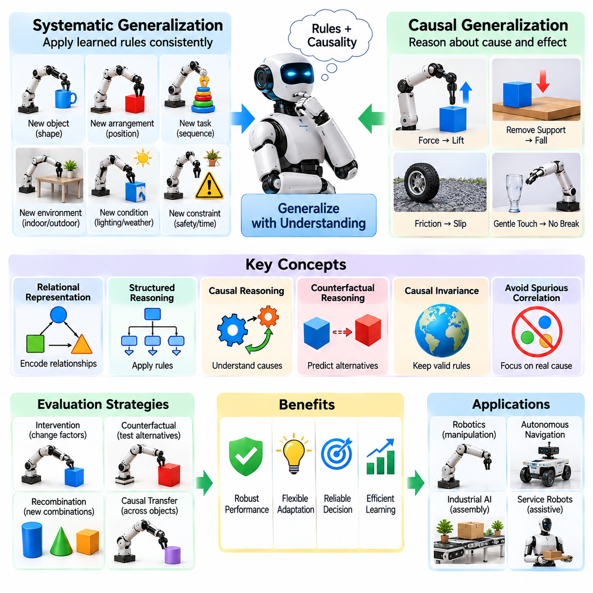{width="7.268055555555556in" height="7.268055555555556in"}

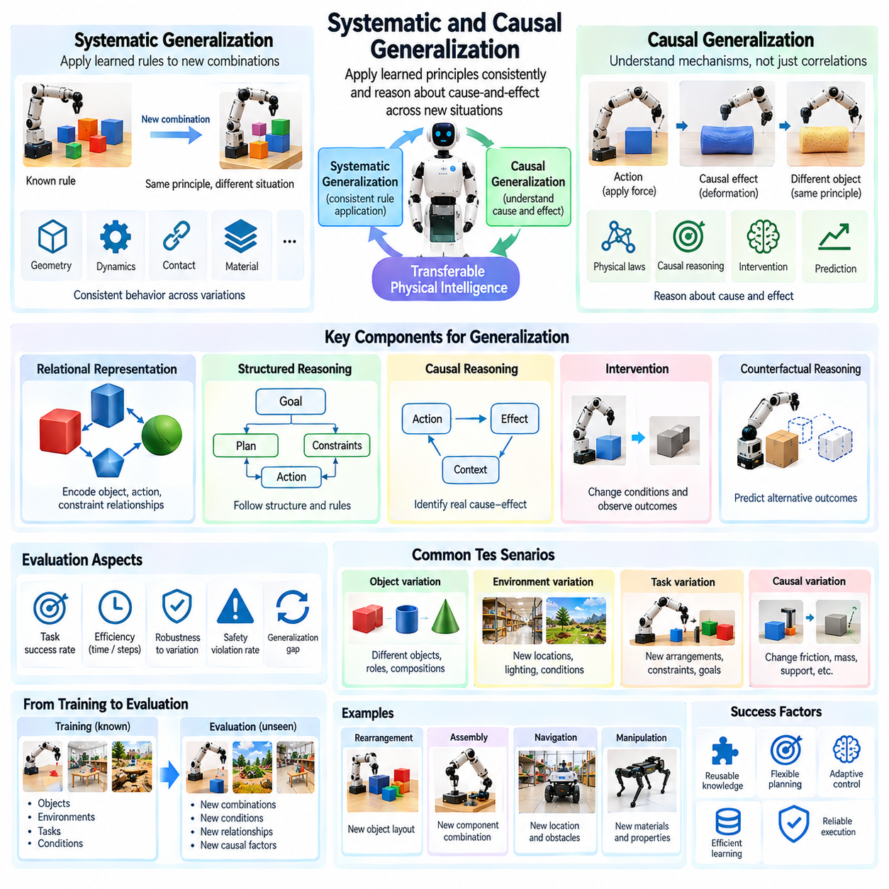{width="7.268055555555556in" height="7.268055555555556in"}

체계적 및 인과적 일반화(Systematic and Causal Generalization)란 피지컬 AI(Physical AI) 시스템이 학습된 원리(Learned Principle)를 익숙하지 않은 조건의 조합에도 일관되게 적용하고 원인과 결과의 관계(Cause-and-Effect Relationship)를 추론할 수 있는 능력을 의미한다. 일반화 능력을 갖춘 시스템은 암기된 패턴(Memorized Pattern)에 의존하는 대신 물리적 상호작용(Physical Interaction)을 지배하는 근본적인 규칙(Underlying Rule)을 인식해야 한다. 평가에서는 물체, 환경, 작업 구조(Task Structure)가 변화하더라도 이러한 원리가 유효하게 유지되는지 판단한다.

체계적 일반화(Systematic Generalization)는 새로운 상황에 학습된 규칙을 일관되게 적용하는 능력을 강조한다. 물체의 특성(Object Property)이 파지(Grasping)에 미치는 영향을 이해하는 로봇은 익숙하지 않은 형상(Shape)과 방향(Orientation)에서도 이러한 지식을 적용해야 한다. 성공적인 일반화를 위해서는 개별 사례(Isolated Example)를 학습하는 대신 개념과 행동 사이의 관계를 유지해야 한다. 평가에서는 동일한 물리적 원리(Physical Principle)가 다양한 시나리오에서 일관된 행동을 생성하는지 시험해야 한다.

인과적 일반화(Causal Generalization)는 행동과 환경적 요인(Environmental Factor)이 물리적 결과(Physical Outcome)를 어떻게 발생시키는지 이해하는 능력을 의미한다. 로봇은 가해지는 힘(Applied Force)을 증가시키면 물체의 변형(Deformation)이 달라지거나 지지 구조(Support)를 제거하면 불안정성(Instability)이 발생한다는 사실을 인식할 수 있다. 이러한 이해는 관측된 상관관계(Observed Correlation)를 넘어서는 예측을 가능하게 한다. 평가에서는 시스템이 변화하는 조건에서 실패할 수 있는 통계적 연관성(Statistical Association)에 의존하지 않고 의미 있는 인과 메커니즘(Causal Mechanism)을 식별하는지 판단해야 한다.

체계적 일반화와 인과적 일반화는 서로 관련되어 있지만 구별되는 능력이다. 체계적 일반화는 구조화된 지식(Structured Knowledge)을 일관되게 적용하는 능력에 관한 것이며, 인과적 일반화는 개입(Intervention)과 결과를 연결하는 메커니즘을 이해하는 능력에 관한 것이다. 시스템은 규칙의 인과적 근원(Causal Origin)을 식별하지 못하더라도 익숙한 규칙을 신뢰성 있게 적용할 수 있다. 반대로 인과적 지식(Causal Knowledge)은 이전에 신뢰할 수 있었던 패턴이 더 이상 성립하지 않을 때 적응(Adaptation)을 지원할 수 있다.

피지컬 AI 시스템은 기하학(Geometry), 동역학(Dynamics), 접촉 역학(Contact Mechanics), 재료 특성(Material Property)의 지배를 받는 환경에서 작동한다. 이러한 관계는 많은 물리적 원리가 서로 다른 물체와 환경에서도 적용될 수 있기 때문에 일반화의 기회를 제공한다. 그러나 실제 시스템은 폭넓게 전이 가능한 원리(Transferable Principle)와 특정 재료, 메커니즘 또는 운영 조건(Operating Condition)에 의존하는 가정(Assumption)을 구분해야 한다.

관계적 표현(Relational Representation)은 물체, 행동, 환경 제약조건(Environmental Constraint) 사이의 연결을 부호화(Encoding)함으로써 체계적 일반화를 지원할 수 있다. 로봇은 특정 물체가 특정 선반에 놓인다는 사실을 암기하는 대신 지지 관계(Support Relationship), 포함 관계(Containment Relationship), 접근 가능성(Accessibility Relationship)을 표현할 수 있다. 평가에서는 익숙한 물체가 새로운 역할을 수행하거나 새로운 구성(Configuration)으로 나타나더라도 이러한 표현이 유용하게 유지되는지 조사해야 한다.

구조화된 추론(Structured Reasoning)은 시스템이 다양한 작업 배치(Task Arrangement)에 일관된 절차(Consistent Procedure)를 적용할 수 있도록 한다. 익숙하지 않은 부품을 조립하는 로봇은 행동하기 전에 결합 지점(Attachment Point), 정렬 요구사항(Alignment Requirement), 삽입 제약조건(Insertion Constraint)을 식별할 수 있다. 이러한 관계는 정확히 동일한 조립 작업이 시연되지 않았더라도 행동 계획(Action Planning)을 안내할 수 있다. 평가에서는 시스템이 새로운 구성에서도 관련 구조적 규칙(Structural Rule)을 따르는지 측정해야 한다.

인과적 추론(Causal Reasoning)을 위해서는 관측(Observation)과 개입(Intervention)을 구분해야 한다. 한 물체가 움직일 때 다른 물체도 움직인다는 사실을 관측했다고 해서 반드시 직접적인 인과관계(Direct Causal Relationship)가 성립하는 것은 아니다. 로봇은 관측된 움직임이 접촉(Contact), 부착(Attachment), 외력(External Force) 중 무엇에 의해 발생하는지 판단하기 위해 통제된 상호작용(Controlled Interaction)을 수행해야 할 수 있다. 평가에서는 개입이 인과적 이해(Causal Understanding)와 후속 행동 선택(Action Selection)을 개선하는지 평가해야 한다.

개입 기반 평가(Intervention-Based Evaluation)는 인과적 일반화를 직접 시험하는 방법을 제공한다. 연구자는 다른 조건을 유지하면서 마찰(Friction)을 변경하거나 지지 구조를 제거하거나 물체 질량(Object Mass)을 변화시키거나 구동기 응답(Actuator Response)을 수정할 수 있다. 인과관계를 이해하는 시스템은 이러한 변화가 작업 결과(Task Outcome)에 어떤 영향을 미치는지 예측해야 한다. 이러한 실험은 실제 물리적 이해(Physical Understanding)와 익숙한 시각적 패턴(Visual Pattern)에 대한 의존성을 구분하는 데 도움이 된다.

반사실적 추론(Counterfactual Reasoning)은 대안적인 행동이나 조건에서 어떤 결과가 발생할지 시스템이 예측할 수 있는지 조사한다. 로봇은 물체를 다른 위치에 배치했을 때 안정적으로 유지되는지 또는 힘을 줄였을 때 파지가 성공하는지 판단할 수 있다. 평가에서는 불확실성(Uncertainty)과 불완전한 지식(Incomplete Knowledge)을 고려하면서 이러한 예측을 통제된 물리적 결과(Controlled Physical Outcome)와 비교해야 한다.

인과적 불변성(Causal Invariance)은 전이 가능한 물리적 이해를 나타내는 중요한 지표이다. 외형(Appearance), 조명(Lighting), 배경(Background)이 변화하여 표면적인 상관관계(Superficial Correlation)가 사라지더라도 특정 관계는 유효하게 유지될 수 있다. 예를 들어 중력 효과(Gravitational Effect)는 시각적으로 서로 다른 환경에서도 지속된다. 평가에서는 모델이 안정적인 인과관계(Stable Causal Relationship)에 의존하는지 또는 학습 분포(Training Distribution)와 관련된 불안정한 특징(Unstable Feature)에 의존하는지 식별해야 한다.

허위 상관관계(Spurious Correlation)는 인과적 일반화에 중대한 장애물이 된다. 로봇은 학습 과정에서 특정 색상이 특정 재료와 자주 함께 나타났기 때문에 물체 색상(Object Color)을 무게(Weight)와 연관시킬 수 있다. 이러한 연관성은 관계가 변화하면 실패할 수 있다. 벤치마크(Benchmark)는 관련 물리적 특성을 유지하면서 이러한 상관관계를 의도적으로 깨뜨려 의사결정(Decision-Making)이 인과적 증거(Causal Evidence)에 의존하는지 또는 우연한 패턴(Incidental Pattern)에 의존하는지 밝혀야 한다.

체계성(Systematicity)은 익숙한 개념을 통제된 방식으로 재조합(Controlled Recombination)하여 평가할 수 있다. 연구자는 알려진 구성요소(Known Component)를 유지하면서 물체 역할(Object Role), 공간적 관계(Spatial Relationship), 행동 순서(Action Order), 작업 제약조건(Task Constraint)을 변화시킬 수 있다. 성공적인 성능은 학습된 규칙이 암기된 조합을 넘어 적용될 수 있음을 나타낸다. 평가에서는 관계적 추론(Relational Reasoning)의 실패와 익숙하지 않은 기본 기술(Primitive Skill)로 인한 실패를 구분해야 한다.

인과적 전이(Causal Transfer)는 유사한 물리적 메커니즘(Physical Mechanism)을 공유하는 서로 다른 물체와 환경에서 조사할 수 있다. 마찰에 대한 지식은 익숙하지 않은 표면의 조작을 지원할 수 있으며, 지지 관계에 대한 이해는 서로 다른 조립체(Assembly)로 전이될 수 있다. 그러나 근본적인 메커니즘이 변화하면 전이에는 한계가 발생한다. 평가에서는 인과적 지식이 유용하게 유지되는 조건과 새로운 학습(New Learning)이 필요한 조건을 모두 식별해야 한다.

월드 모델(World Model)은 물리적 상태 전이(Physical State Transition)를 표현하고 행동의 결과(Action Consequence)를 예측하기 위한 계산적 프레임워크(Computational Framework)를 제공한다. 인과적으로 구조화된 월드 모델(Causally Structured World Model)은 물체, 힘(Force), 제약조건 사이의 상호작용을 명시적으로 표현할 수 있다. 평가에서는 이러한 모델이 학습 사례와 유사한 궤적(Trajectory)을 단순히 재현하는 대신 개입에 따른 결과를 예측하는지 판단해야 한다.

엄격한 벤치마크는 관계와 메커니즘 수준에서 학습 분포(Training Distribution)와 평가 분포(Evaluation Distribution)를 분리해야 한다. 시각적 외형만을 학습에서 제외하는 것으로는 인과적 일반화를 충분히 시험하지 못할 수 있다. 더욱 강력한 평가 프로토콜(Evaluation Protocol)은 물리적으로 의미 있는 평가 작업을 유지하면서 익숙하지 않은 인과 요인(Causal Factor)의 조합, 변경된 의존관계(Altered Dependency), 학습된 지름길(Learned Shortcut)을 무효화하는 개입을 도입한다.

통제된 실험(Controlled Experiment)은 복합적인 변화를 도입하기 전에 개별 인과 변수(Causal Variable)를 분리해야 한다. 연구자는 기하학적 구조를 일정하게 유지하면서 물체 질량을 변경하거나 작업 목표(Task Goal)를 유지하면서 마찰을 변화시킬 수 있다. 이러한 실험은 성능 차이(Performance Difference)를 특정 요인에 귀속시키는 데 도움이 된다. 실제 환경에서는 여러 물리적 변수가 자주 상호작용하므로 복합 개입(Combined Intervention)도 필요하다.

예측 정확도(Prediction Accuracy)는 인과적 이해를 측정하는 초기 지표를 제공하지만 물리적 역량(Physical Competence)을 완전히 입증할 수는 없다. 시스템은 물체의 움직임을 정확하게 예측하면서도 적절한 조작 전략(Manipulation Strategy)을 선택하지 못할 수 있다. 평가에서는 인과적 예측(Causal Prediction)을 계획 품질(Planning Quality), 개입 선택(Intervention Selection), 제어 안정성(Control Stability), 익숙하지 않은 물리적 조건에서의 작업 성공(Task Success)과 연결해야 한다.

인과적 일관성(Causal Consistency)은 서로 다른 시나리오에서 예측과 행동이 동일한 근본적 물리관계(Underlying Physical Relationship)와 일치하는지 측정한다. 시스템은 동등한 조건에서 동등한 개입을 수행했을 때 서로 모순되는 결과(Contradictory Outcome)를 예측해서는 안 된다. 평가에서는 확률적 동역학(Stochastic Dynamics)과 측정 불확실성(Measurement Uncertainty)을 고려하면서 반복 시험(Repeated Trial), 변환된 장면(Transformed Scene), 관련 작업(Related Task) 전반의 일관성을 조사할 수 있다.

체계적 일반화 격차(Systematic Generalization Gap)는 익숙한 규칙 적용에서의 성능과 학습에서 제외된 조합(Held-Out Combination)에서의 성능을 비교한다. 인과적 일반화 격차(Causal Generalization Gap)는 익숙한 인과 조건에서의 결과와 통제된 개입 또는 변경된 의존관계에서의 결과를 비교한다. 두 지표 모두 절대 성능(Absolute Performance)과 함께 보고해야 한다. 작은 격차가 모든 조건에서 낮은 작업 역량(Task Competence)을 감추고 있을 수 있기 때문이다.

강건성 곡선(Robustness Curve)은 인과 조건(Causal Condition)이 학습 경험(Training Experience)에서 멀어짐에 따라 성능이 어떻게 변화하는지 보여줄 수 있다. 연구자는 마찰, 질량, 유연성(Compliance), 교란 크기(Disturbance Magnitude)를 점진적으로 변화시키면서 예측 오차(Prediction Error)와 작업 성공률(Task Success Rate)을 관찰할 수 있다. 점진적인 성능 저하(Gradual Degradation)는 제한된 범위의 전이(Bounded Transfer)를 시사하며, 갑작스러운 실패(Abrupt Failure)는 협소한 가정이나 불안정한 인과적 표현(Causal Representation)에 대한 의존성을 나타낼 수 있다.

제로샷 인과적 일반화(Zero-Shot Causal Generalization)는 학습된 메커니즘이 익숙하지 않은 개입 조건에서 추가 학습 없이 즉각적인 수행을 지원하는지 평가한다. 퓨샷 인과적 적응(Few-Shot Causal Adaptation)은 변화된 동역학을 식별하기 위해 제한된 관측이나 상호작용을 허용한다. 이러한 조건을 비교하면 시스템이 기존 인과적 지식을 직접 전이하는지 또는 추가적인 시스템 식별(System Identification)이 필요한지 파악할 수 있다. 적응 비용(Adaptation Cost)과 안전 제약조건(Safety Constraint)은 반드시 문서화해야 한다.

시뮬레이션(Simulation)은 인과 변수의 체계적인 조작과 반사실적 시나리오(Counterfactual Scenario)의 생성을 가능하게 한다. 연구자는 물리적 매개변수(Physical Parameter)를 제어하고 개입을 분리하며 대규모로 실험을 재현할 수 있다. 그러나 시뮬레이션 모델(Simulation Model)은 접촉(Contact), 변형(Deformation), 구동기 동작(Actuator Behavior)에 대한 잘못된 가정을 포함할 수 있다. 실제 물리적 불확실성(Physical Uncertainty)에서도 인과적 결론(Causal Conclusion)이 신뢰할 수 있게 유지되는지 판단하려면 실세계 검증(Real-World Validation)이 필요하다.

실세계 평가(Real-World Evaluation)에는 통제된 물리적 개입(Controlled Physical Intervention), 반복 시험, 독립적으로 측정된 결과(Independently Measured Outcome)가 포함되어야 한다. 실험에서는 조작된 변수(Manipulated Variable), 환경 조건(Environmental Condition), 잠재적인 교란 요인(Confounding Factor)을 문서화해야 한다. 통계 분석(Statistical Analysis)은 불확실성, 인과적 예측 정확도(Causal Prediction Accuracy), 개입 성공률(Intervention Success), 서로 다른 메커니즘에서의 작업 성능을 보고해야 하며, 일반적인 인과적 이해(General Causal Understanding)에 대한 근거 없는 주장은 피해야 한다.

궁극적으로 체계적 및 인과적 일반화는 피지컬 AI 시스템이 구조화된 지식(Structured Knowledge)과 물리적 인과 원리(Physical Cause-and-Effect Principle)를 익숙한 경험을 넘어 적용할 수 있는지 측정한다. 높은 성능을 위해서는 관계적 표현(Relational Representation), 개입 인식 추론(Intervention-Aware Reasoning), 예측 모델(Predictive Model), 신뢰할 수 있는 제어(Reliable Control)가 필요하다. 포괄적인 평가(Comprehensive Evaluation)는 안정적으로 전이 가능한 메커니즘을 식별하고 허위 의존관계(Spurious Dependency)를 드러내며 인과적 물리 지능(Causal Physical Intelligence)의 한계를 규명한다.

## 04.13. Transfer and Domain Generalization

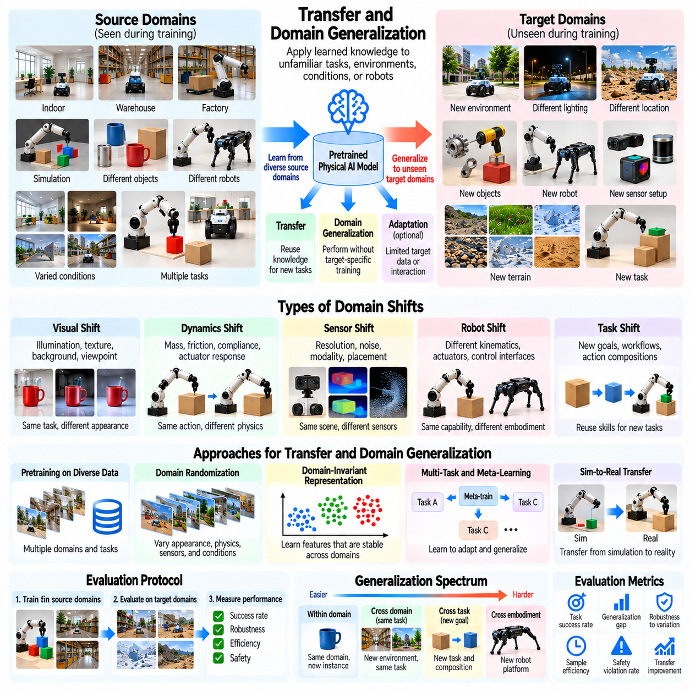{width="7.268055555555556in" height="7.268055555555556in"}

전이 및 도메인 일반화(Transfer and Domain Generalization)란 피지컬 AI(Physical AI) 시스템이 특정 작업, 환경 또는 운영 조건에서 학습한 지식을 익숙하지 않은 상황에 적용할 수 있는 능력을 의미한다. 전이(Transfer)는 서로 다른 환경에서 획득한 능력(Acquired Capability)의 재사용을 강조하며, 도메인 일반화(Domain Generalization)는 목표 도메인별 학습(Target-Specific Training) 없이 미지의 도메인(Unseen Domain)에서 성능을 유지하는 데 초점을 맞춘다. 평가에서는 학습된 표현(Learned Representation)과 정책(Policy)이 원래의 학습 분포(Training Distribution)를 벗어나서도 효과적으로 작동하는지 판단한다.

피지컬 AI에서 도메인(Domain)은 환경의 외형(Environmental Appearance), 물리적 동역학(Physical Dynamics), 센서 특성(Sensor Characteristic), 로봇 구성(Robot Configuration) 또는 작업 분포(Task Distribution)에 따라 정의할 수 있다. 서로 다른 공장, 창고, 실외 장소, 시뮬레이션 환경(Simulation Environment)은 각각 별개의 도메인을 나타낼 수 있다. 표면적인 시각적 변화와 물리적 동작의 근본적인 변화는 서로 다른 일반화 과제를 발생시키므로 의미 있는 평가를 위해서는 도메인을 명확하게 정의해야 한다.

전이학습(Transfer Learning)은 시스템이 새로운 작업이나 환경에 대응할 때 사전학습된 표현(Pretrained Representation), 제어 정책(Control Policy), 학습된 동역학(Learned Dynamics)을 재사용할 수 있도록 한다. 일반적인 물체를 조작하도록 학습된 로봇은 익숙하지 않은 산업용 부품(Industrial Component)에 파지 지식(Grasping Knowledge)을 전이할 수 있다. 평가에서는 어떤 능력을 재사용할 수 있는지, 얼마나 많은 추가 적응(Additional Adaptation)이 필요한지, 전이된 지식이 처음부터 학습(Learning from Scratch)하는 방법과 비교하여 성능을 개선하는지 판단해야 한다.

도메인 일반화는 배치(Deployment) 과정에서 사용할 수 있는 정보의 측면에서 도메인 적응(Domain Adaptation)과 구별된다. 도메인 적응은 일반적으로 모델 조정(Model Adjustment)을 위해 목표 도메인 데이터(Target-Domain Data)에 접근하는 것을 허용하지만, 도메인 일반화는 이러한 접근 없이 성능을 평가한다. 이러한 구분은 벤치마크 타당성(Benchmark Validity)을 확보하는 데 필수적이다. 평가 프로토콜(Evaluation Protocol)은 시험 전에 목표 도메인의 관측(Observation), 시연(Demonstration), 온라인 매개변수 갱신(Online Parameter Update)이 허용되는지 명시해야 한다.

소스 도메인(Source Domain)은 전이 가능한 지식(Transferable Knowledge)을 획득하는 학습 경험을 제공한다. 이러한 도메인은 물체 외형(Object Appearance), 작업 공간 기하학(Workspace Geometry), 조명(Lighting), 접촉 특성(Contact Property), 로봇 동역학(Robot Dynamics)에서 차이를 보일 수 있다. 다양한 소스 도메인에 노출되면 강건한 표현(Robust Representation)의 학습을 촉진할 수 있지만, 다양성만으로 일반화가 보장되지는 않는다. 평가에서는 학습된 원리가 실제로 익숙하지 않은 목표 조건(Target Condition)에서도 유용하게 유지되는지 조사해야 한다.

목표 도메인(Target Domain)은 일반화 평가에 사용되는 익숙하지 않은 운영 조건(Operating Condition)을 의미한다. 목표 도메인에는 새로운 재료(Material), 센서 잡음 패턴(Sensor Noise Pattern), 지형 특성(Terrain Characteristic), 기계적 구성(Mechanical Configuration)이 도입될 수 있다. 평가에서는 목표 도메인 데이터가 의도하지 않게 모델 개발(Model Development)에 영향을 미치지 않도록 해야 한다. 데이터 누출(Data Leakage)과 과대평가된 성능(Overestimated Performance)을 방지하려면 소스 도메인과 목표 도메인을 명확하게 분리해야 한다.

시각적 도메인 변화(Visual Domain Shift)는 기본적인 작업 요구사항(Task Requirement)이 유사하게 유지되는 동안 외형이 변화할 때 발생한다. 조도(Illumination), 질감(Texture), 배경(Background), 카메라 시점(Camera Viewpoint), 물체 색상(Object Color)의 차이는 인지(Perception)에 영향을 미칠 수 있다. 로봇은 이러한 변화에도 작업 관련 구조(Task-Relevant Structure)를 인식해야 한다. 평가에서는 시각적 표현의 불안정성(Visual Representation Instability)으로 인한 실패와 물리적 추론(Physical Reasoning) 또는 제어(Control)와 관련된 실패를 구분해야 한다.

동역학 도메인 변화(Dynamics Domain Shift)는 질량(Mass), 마찰(Friction), 유연성(Compliance), 구동기 응답(Actuator Response), 접촉 동작(Contact Behavior)의 변화를 포함한다. 특정 물리적 매개변수(Physical Parameter) 조건에서 학습된 조작 정책(Manipulation Policy)은 다른 조건으로 전이될 때 성능이 저하될 수 있다. 평가에서는 특히 익숙한 시각적 외형이 익숙하지 않은 물리적 특성(Physical Property)을 감추고 있는 경우, 변화된 동역학에서도 시스템이 안정성(Stability)과 작업 성공(Task Success)을 유지하는지 측정해야 한다.

센서 도메인 변화(Sensor Domain Shift)는 카메라 보정(Camera Calibration), 해상도(Resolution), 시야각(Field of View), 지연시간(Latency), 잡음(Noise), 센싱 모달리티(Sensing Modality)의 차이에서 발생한다. 고품질 관측(High-Quality Observation)을 사용하여 학습된 정책은 다른 하드웨어에 배치될 때 신뢰성이 저하될 수 있다. 평가에서는 센서 표현(Sensor Representation)의 전이 가능성과 시스템이 누락되거나 저하되거나 체계적인 편향(Systematic Bias)이 존재하는 측정값을 견딜 수 있는지 판단해야 한다.

로봇 간 전이(Cross-Robot Transfer)는 서로 다른 운동학(Kinematics), 구동기(Actuator), 제어 인터페이스(Control Interface)를 가진 체화 형태(Embodiment) 사이에서 학습된 지식을 재사용할 수 있는지 조사한다. 한 로봇 팔(Robotic Arm)에서 학습된 조작 전략(Manipulation Strategy)은 관절 제한(Joint Limit)이나 도달 가능성(Reachability)이 다른 로봇 팔에 적용할 때 조정이 필요할 수 있다. 평가에서는 전이 가능한 작업 지식(Task Knowledge)과 체화 형태별 실행 요구사항(Embodiment-Specific Execution Requirement)을 구분하고 모든 보정(Calibration) 또는 적응 절차(Adaptation Procedure)를 문서화해야 한다.

작업 도메인 전이(Task-Domain Transfer)는 서로 다른 목표(Objective)와 운영 작업 흐름(Operational Workflow) 사이에서 학습된 능력을 재사용하는 것을 의미한다. 분류(Sorting)를 위해 학습된 로봇은 물체 인식(Object Recognition)과 파지 기술(Grasping Skill)을 조립(Assembly)이나 포장(Packaging)에 전이할 수 있다. 그러나 공통 구성요소(Shared Component)가 존재한다고 해서 성공적인 작업 실행이 보장되지는 않는다. 평가에서는 전이된 표현이 새로운 계획 요구사항(Planning Requirement), 행동 의존관계(Action Dependency), 성공 조건(Success Condition)을 지원하는지 측정해야 한다.

표현 전이(Representation Transfer)는 학습된 특징(Learned Feature)이 도메인 전반에서 어떤 정보를 유용하게 유지하는지 결정하기 때문에 일반화의 핵심 요소이다. 강건한 표현은 우연한 외형적 특징(Incidental Appearance)보다 기하학(Geometry), 물체 관계(Object Relationship), 행동 가능성(Affordance), 관련 물리적 특성(Relevant Physical Property)을 강조해야 한다. 평가에서는 고정된 표현(Frozen Representation)과 적응된 모델(Adapted Model)을 비교하여 어떤 능력이 직접 전이되고 어떤 능력이 추가 학습을 요구하는지 식별할 수 있다.

도메인 무작위화(Domain Randomization)는 학습 과정에서 시뮬레이션 매개변수(Simulation Parameter)를 변화시켜 전이 성능을 개선하는 일반적인 전략이다. 조명, 질감, 물체 질량, 마찰 계수(Friction Coefficient), 구동기 특성(Actuator Characteristic)을 에피소드(Episode)마다 무작위로 변경할 수 있다. 목적은 배치 전에 정책을 다양한 조건에 노출하는 것이다. 평가에서는 무작위화가 익숙한 변화의 범위를 단순히 확대하는 것이 아니라 미지의 도메인에서 성능을 개선하는지 판단해야 한다.

도메인 불변 학습(Domain-Invariant Learning)은 여러 소스 환경(Source Environment)에서 안정적으로 유지되는 특징을 식별하려는 접근법이다. 이러한 특징은 목표 조건이 학습 데이터와 다를 때 일반화를 개선할 수 있다. 그러나 일부 도메인별 정보(Domain-Specific Information)는 안전한 물리적 제어(Safe Physical Control)에 필요하므로 완전한 불변성(Complete Invariance)이 항상 바람직한 것은 아니다. 평가에서는 학습된 불변성이 작업 관련 차이(Task-Relevant Distinction)와 물리적 변화에 대한 민감도(Physical Sensitivity)를 유지하는지 조사해야 한다.

시뮬레이션-현실 전이(Simulation-to-Reality Transfer, Sim2Real)는 특히 중요한 도메인 일반화의 한 형태이다. 시뮬레이션에서 학습된 정책은 실제 센싱 불확실성(Sensing Uncertainty), 접촉 동역학(Contact Dynamics), 구동기 제한(Actuator Limitation), 환경 교란(Environmental Disturbance) 아래에서 작동해야 한다. 평가에서는 동일한 작업 조건에서 시뮬레이션 성능(Simulated Performance)과 실제 물리적 성능(Physical Performance)을 비교해야 한다. 그 결과로 나타나는 전이 격차(Transfer Gap)는 단순화된 모델이나 학습 가정(Training Assumption)이 배치 조건을 충분히 반영하지 못하는 부분을 보여준다.

부정적 전이(Negative Transfer)는 소스 도메인에서 획득한 지식이 목표 도메인에서의 성능을 저하시키는 현상이다. 강체 물체(Rigid Object)에 최적화된 파지 정책(Grasping Policy)은 변형 가능한 재료(Deformable Material)에 적용할 때 실패할 수 있다. 평가에서는 전이된 정책을 적절한 목표 도메인 기준 모델(Target-Domain Baseline)과 비교하고 기존에 학습한 가정(Inherited Assumption)이 해롭게 작용하는 조건을 식별해야 한다. 성공적인 전이 사례만 보고하면 중요한 배치 위험(Deployment Risk)이 감춰질 수 있다.

엄격한 벤치마크(Benchmark)는 여러 소스 도메인과 신중하게 선정된 학습 제외 목표 도메인(Held-Out Target Domain)을 포함해야 한다. 평가 조건에서는 가능한 경우 시각적 외형, 동역학, 센싱(Sensing), 작업 구조(Task Structure)를 독립적으로 변화시켜야 한다. 실제 배치에서는 하나의 요인만 변화하는 경우가 드물기 때문에 복합 변화(Combined Shift)도 필요하다. 벤치마크 설계(Benchmark Design)는 목표 도메인 사례가 하이퍼파라미터 선택(Hyperparameter Selection)이나 모델 개발에 영향을 미치지 않도록 해야 한다.

전이 성능(Transfer Performance)은 작업 성공률(Task Success Rate), 실행 품질(Execution Quality), 안전성(Safety), 자원 효율성(Resource Efficiency)을 통해 측정해야 한다. 시스템은 높은 성공률을 유지하면서도 과도한 시간, 에너지 또는 수정 행동(Corrective Action)을 요구할 수 있다. 따라서 평가에서는 실제 전이 신뢰성(Practical Transfer Reliability)을 특성화하기 위해 기존의 성공 지표(Success Metric)와 함께 완료 시간(Completion Time), 궤적 품질(Trajectory Quality), 개입 빈도(Intervention Frequency), 제약조건 위반(Constraint Violation)을 포함해야 한다.

전이 격차(Transfer Gap)는 소스 조건(Source Condition)에서의 성능과 목표 조건(Target Condition)에서의 성능 차이를 측정한다. 작은 격차는 안정적인 도메인 간 동작(Cross-Domain Behavior)을 시사하지만 절대 성능(Absolute Performance)과 함께 해석해야 한다. 전이 효율성(Transfer Efficiency)은 적응이 허용될 때 필요한 경험이나 계산량도 측정한다. 이러한 지표는 즉각적인 일반화(Immediate Generalization)와 목표 도메인별 학습(Target-Specific Learning)을 통해 달성한 개선을 구분한다.

일반화 성능 저하 곡선(Generalization Degradation Curve)은 목표 조건이 소스 도메인에서 점차 멀어짐에 따라 성능이 어떻게 변화하는지 나타낸다. 연구자는 마찰, 조도, 센서 잡음, 기하학적 복잡도(Geometric Complexity)를 점진적으로 변화시킬 수 있다. 완만한 성능 저하(Smooth Degradation)는 측정 가능한 운영 경계(Operating Boundary)를 나타내지만 갑작스러운 실패(Abrupt Failure)는 취약한 표현(Brittle Representation)을 드러낼 수 있다. 이러한 곡선은 관련성이 낮은 여러 도메인의 단일 평균 점수보다 더 풍부한 정보를 제공한다.

퓨샷 전이 평가(Few-Shot Transfer Evaluation)는 초기 제로샷 시험(Zero-Shot Testing) 이후 제한된 목표 도메인 시연이나 상호작용을 허용한다. 적응 곡선(Adaptation Curve)은 전이된 지식이 얼마나 빠르게 성능 향상을 지원하는지 보여줄 수 있다. 비교에서는 동일한 데이터 예산(Data Budget)과 상호작용 예산(Interaction Budget)을 사용해야 한다. 이러한 프로토콜은 사전학습된 지식(Pretrained Knowledge)의 가치와 후속 적응 메커니즘(Adaptation Mechanism)의 효과를 분리한다.

안전성(Safety)은 익숙하지 않은 도메인이 인지와 물리적 동역학에 대한 가정을 무효화할 수 있기 때문에 전이 평가에서 필수적이다. 새로운 환경으로 전이된 로봇은 정지 거리(Stopping Distance)를 과소평가하거나 부적절한 접촉력(Contact Force)을 가할 수 있다. 평가에서는 위험한 행동(Unsafe Action), 복구 시도(Recovery Attempt), 비상 개입(Emergency Intervention), 불확실성 대응(Uncertainty Response)을 기록하여 성공적인 전이가 허용할 수 없는 운영 위험(Operational Risk)을 감추지 않도록 해야 한다.

통계적 평가(Statistical Evaluation)에는 여러 도메인 조합(Domain Combination), 독립적인 시험(Independent Trial), 불확실성 추정(Uncertainty Estimate)이 포함되어야 한다. 결과는 시각적 변화(Visual Shift), 동역학 변화(Dynamic Shift), 센서 변화(Sensor Shift), 체화 형태 변화(Embodiment Shift), 작업 변화(Task Shift)에 따라 별도로 보고해야 한다. 종합 점수(Aggregate Score)는 특정 목표 도메인에서 발생하는 심각한 실패를 감출 수 있다. 소스-목표 관계(Source-Target Relationship), 학습 노출(Training Exposure), 적응 허용 범위(Adaptation Permission)를 투명하게 보고하면 재현 가능한 비교(Reproducible Comparison)를 지원할 수 있다.

실세계 검증(Real-World Validation)은 실험실 벤치마크와 시뮬레이션이 배치 환경(Deployment Environment)의 모든 다양성을 충분히 반영하지 못할 수 있기 때문에 필요하다. 현장 평가(Field Evaluation)에서는 하드웨어 구성(Hardware Configuration), 환경 변동성(Environmental Variability), 작업 요구사항(Task Requirement), 인간 개입(Human Intervention)을 문서화해야 한다. 서로 다른 현장에서 반복적으로 시험하면 전이 성능이 일반화 가능한 역량(Generalizable Competence)을 반영하는지 또는 유리한 국소 조건(Favorable Local Condition)에 의존하는지 판단하는 데 도움이 된다.

궁극적으로 전이 및 도메인 일반화는 피지컬 AI 시스템이 학습된 능력을 원래의 학습 환경을 넘어 확장할 수 있는지 측정한다. 높은 성능을 위해서는 전이 가능한 표현(Transferable Representation), 강건한 정책(Robust Policy), 관련 물리적 변화에 대한 민감도(Sensitivity to Physical Changes), 신뢰할 수 있는 불확실성 처리(Reliable Uncertainty Handling)가 필요하다. 포괄적인 평가(Comprehensive Evaluation)는 지식이 성공적으로 전이되는 조건, 적응이 필요한 조건, 배치 경계(Deployment Boundary)를 강제해야 하는 조건을 규명한다.

## 04.14. Generalization Gap and Degradation Curves

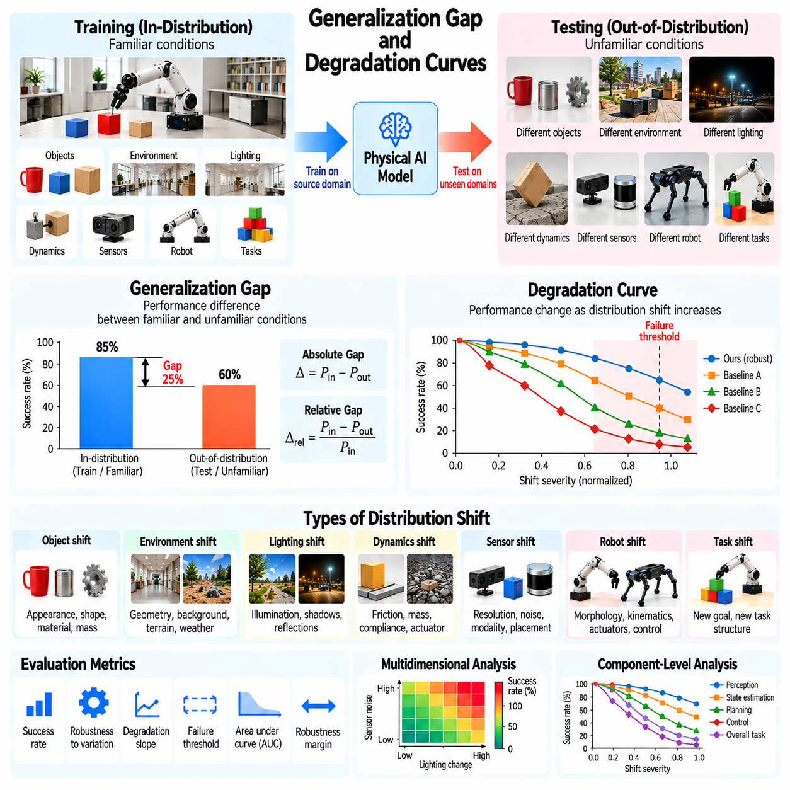{width="7.268055555555556in" height="7.268055555555556in"}

일반화 격차(Generalization Gap)와 성능 저하 곡선(Degradation Curve)은 피지컬 AI(Physical AI) 시스템이 학습 환경(Training Environment)과 다른 운영 조건(Operating Condition)에서 어떻게 작동하는지 평가하기 위한 정량적 방법(Quantitative Method)을 제공한다. 일반화 격차는 익숙한 조건과 익숙하지 않은 조건 사이의 성능 차이(Performance Difference)를 측정하며, 성능 저하 곡선은 분포 변화(Distribution Shift)가 증가함에 따라 성능이 어떻게 변화하는지 나타낸다. 이러한 지표는 강건성(Robustness), 전이 한계(Transfer Limitation), 운영 경계(Operational Boundary)를 밝혀준다.

일반화 격차는 일반적으로 분포 내 평가 데이터셋(In-Distribution Evaluation Set)의 성능과 분포 외 시험 데이터셋(Out-of-Distribution Test Set)의 성능을 비교하여 계산한다. 성공 여부를 기반으로 하는 지표(Success-Based Metric)의 경우 익숙한 조건에서의 성공률과 익숙하지 않은 조건에서의 성공률 사이의 차이로 표현할 수 있다. 양의 격차가 클수록 성능 저하(Performance Deterioration)가 크다는 것을 의미하지만, 해석은 지표의 방향(Metric Direction)과 기준 역량(Baseline Competence)에 따라 달라진다.

절대 일반화 격차(Absolute Generalization Gap)와 상대 일반화 격차(Relative Generalization Gap)는 상호 보완적인 정보를 제공한다. 절대 격차(Absolute Gap)는 작업 성공률(Task Success Rate)의 퍼센트포인트(Percentage Point)와 같은 성능 단위의 차이를 나타낸다. 상대 격차(Relative Gap)는 이러한 차이를 기준 성능(Reference Performance)에 대해 정규화(Normalization)하여 비례적인 성능 저하를 쉽게 해석하도록 한다. 그러나 기준 성능이 0에 가까워지면 상대 격차가 불안정해질 수 있으므로 두 지표를 정의와 함께 보고해야 한다.

일반화 평가(Generalization Evaluation)에서는 성능 저하와 작업 자체의 난이도(Task Difficulty) 차이를 구분해야 한다. 익숙하지 않은 조작 작업(Manipulation Task)은 익숙한 작업보다 더 정밀한 정렬(Alignment)이나 긴 실행 시간(Execution Time)을 요구할 수 있다. 따라서 낮은 성공률은 분포 변화 자체보다 증가한 물리적 복잡도(Physical Complexity)를 반영할 수 있다. 통제된 벤치마크(Controlled Benchmark)는 가능한 경우 작업 요구사항(Task Requirement)을 일치시키고 피할 수 없는 차이를 문서화해야 한다.

분포 변화는 물체 외형(Object Appearance), 환경 기하학(Environmental Geometry), 물리적 동역학(Physical Dynamics), 센서 특성(Sensor Characteristic), 로봇 형태(Robot Morphology), 작업 구조(Task Structure)에서 발생할 수 있다. 각 차원(Dimension)은 서로 다른 불확실성(Uncertainty)의 원인을 도입한다. 단일 종합 점수(Aggregate Score)가 물리 지능(Physical Intelligence)의 특정 측면에서 나타나는 심각한 약점을 감출 수 있으므로 포괄적인 평가(Comprehensive Evaluation)에서는 이러한 범주별 일반화 격차를 별도로 보고해야 한다.

성능 저하 곡선은 여러 수준의 분포 변화에서 성능을 평가함으로써 격차 분석(Gap Analysis)을 확장한다. 연구자는 익숙한 조건과 익숙하지 않은 조건만 비교하는 대신 통제 변수(Controlled Variable)를 점진적으로 변경한다. 예를 들어 센서 잡음(Sensor Noise)을 증가시키거나 표면 마찰(Surface Friction)을 감소시키면 작업 성공률이 어떻게 변화하는지 확인할 수 있다. 결과 곡선은 점진적인 성능 저하(Gradual Performance Deterioration)와 갑작스러운 실패 전이(Abrupt Failure Transition)를 모두 특성화한다.

성능 저하 곡선의 가로축(Horizontal Axis)은 정의된 변화 변수(Shift Variable) 또는 심각도 수준(Severity Level)을 나타내며, 세로축(Vertical Axis)은 성능 지표(Performance Metric)를 나타낸다. 적절한 변수에는 조도 변화(Illumination Change), 물체 질량 차이(Object Mass Difference), 위치추정 오차(Localization Error), 지형 거칠기(Terrain Roughness), 구동기 지연(Actuator Delay)이 포함된다. 선택한 심각도 척도(Severity Scale)는 실험 결과를 비교할 수 있도록 물리적으로 의미가 있고 재현 가능해야 한다.

서로 다른 변수는 호환되지 않는 물리 단위(Physical Unit)를 사용하므로 변화 심각도(Shift Severity)를 신중하게 정의해야 한다. 물체 질량의 5% 변화가 센서 잡음의 5% 변화와 자동으로 동등하다고 간주할 수는 없다. 연구자는 결과를 표현하기 위해 정규화된 심각도 지수(Normalized Severity Index)를 사용할 수 있지만, 기본이 되는 실제 물리적 값(Physical Value)은 확인할 수 있어야 한다. 그렇지 않으면 임의적인 정규화(Arbitrary Normalization)가 오해를 유발하는 비교를 만들어낼 수 있다.

성능 저하 곡선의 기울기(Slope)는 변화 심각도가 증가할 때 시스템 성능이 얼마나 민감하게 반응하는지 나타낸다. 완만한 기울기(Shallow Slope)는 조건이 변화하더라도 성능이 비교적 안정적으로 유지됨을 의미하며, 가파른 기울기(Steep Slope)는 취약성(Vulnerability)이 크다는 것을 나타낸다. 그러나 기울기 추정(Slope Estimation)은 측정 구간(Measurement Interval)과 지표 척도(Metric Scale)에 따라 달라진다. 평가에서는 특정 구간의 기울기 하나를 보편적인 강건성 특성(Universal Robustness Property)으로 해석하지 않아야 한다.

실패 임계값(Failure Threshold)은 성능이 운영상 허용 가능한 수준(Operationally Acceptable Level) 아래로 떨어지는 조건을 식별한다. 이동 로봇(Mobile Robot)은 지형 거칠기가 특정 범위를 초과하기 전까지 신뢰성 있게 작동할 수 있으며, 조작기(Manipulator)는 위치 불확실성(Positioning Uncertainty)이 지나치게 커지면 실패할 수 있다. 이러한 임계값은 응용 분야별 요구사항(Application-Specific Requirement)을 기준으로 정의해야 한다. 안전 필수 시스템(Safety-Critical System)은 실험용 시제품(Experimental Prototype)보다 훨씬 엄격한 한계를 요구할 수 있다.

성능 저하 곡선 아래 면적(Area Under the Degradation Curve)은 지정된 변화 심각도 범위(Shift Severity Range)에서 성능을 요약할 수 있다. 지표 값이 클수록 더 좋은 결과를 의미하는 경우, 정규화된 면적(Normalized Area)이 클수록 일반적으로 성능 유지 능력(Performance Retention)이 높다는 것을 나타낸다. 그러나 시스템이 동일한 심각도 범위, 표본 추출 절차(Sampling Procedure), 정규화 방법을 공유할 때만 의미 있는 비교가 가능하다. 곡선의 요약 지표(Curve Summary)가 상세한 실패 분석(Failure Analysis)을 대체해서는 안 된다.

강건성 여유(Robustness Margin)는 성능이 사전에 정의된 요구사항을 위반하기 전까지 운영 조건이 기준 환경(Reference Environment)에서 얼마나 벗어날 수 있는지 설명한다. 이러한 여유는 허용 가능한 센서 잡음, 질량 변화(Mass Variation), 위치추정 불확실성(Localization Uncertainty)과 같은 물리 단위로 표현할 수 있다. 강건성 여유를 보고하면 벤치마크 결과를 배치 사양(Deployment Specification)으로 전환하고 허용 가능한 운영 조건에 대한 공학적 의사결정(Engineering Decision)을 지원할 수 있다.

다차원 성능 저하 분석(Multidimensional Degradation Analysis)은 서로 다른 변화 변수 사이의 상호작용(Interaction)을 조사한다. 로봇은 중간 수준의 센서 잡음이나 조명 변화를 각각 독립적으로 견딜 수 있지만 두 조건이 동시에 발생하면 실패할 수 있다. 복합 교란(Combined Disturbance)을 평가하면 단일 변수 실험(Single-Variable Experiment)에서 놓칠 수 있는 비선형 상호작용(Nonlinear Interaction)을 밝혀낼 수 있다. 실제 환경은 하나의 차원에서만 변화하는 경우가 드물기 때문에 이러한 분석이 중요하다.

성능 저하는 작업 수준(Task Level)과 구성요소 수준(Component Level)에서 모두 조사해야 한다. 전체 작업 실패(Overall Task Failure)는 인지 오류(Perception Error), 부정확한 상태 추정(State Estimation), 계획 오류(Planning Error), 불안정한 제어(Unstable Control)에서 발생할 수 있다. 구성요소 수준 지표(Component-Level Metric)는 성능 저하가 발생하는 이유를 설명하는 데 도움이 된다. 벤치마크는 상관관계가 있는 오류(Correlated Error)가 반드시 인과적 책임(Causal Responsibility)을 입증한다고 가정하지 않으면서 관측 가능한 실패를 기반 하위 시스템(Underlying Subsystem)과 연결해야 한다.

장기 작업(Long-Horizon Task)은 작은 성능 손실이 여러 행동에 걸쳐 누적될 수 있으므로 추가적인 주의가 필요하다. 개별 파지 성공률(Individual Grasp Success Rate)이 조금만 감소하더라도 전체 조립 작업(Complete Assembly Task)의 성공률은 훨씬 크게 감소할 수 있다. 평가에서는 중간 작업 성공률(Intermediate Task Success), 오류 전파(Error Propagation), 복구 빈도(Recovery Frequency), 최종 완료율(Final Completion Rate)을 보고해야 한다. 이러한 측정은 국소적인 약점(Local Weakness)이 장시간의 물리적 행동(Extended Physical Behavior)에 어떤 영향을 미치는지 보여준다.

일반화 격차는 성공 여부뿐 아니라 실행 품질(Execution Quality)에 대해서도 평가해야 한다. 로봇은 익숙하지 않은 작업을 완료하더라도 더 긴 궤적(Trajectory), 더 많은 에너지 소비(Energy Consumption), 과도한 접촉력(Contact Force), 반복적인 수정 행동(Corrective Action)을 요구할 수 있다. 이러한 행동은 이진 성공 여부(Binary Success)가 변하지 않더라도 의미 있는 성능 저하를 나타낸다. 평가에는 효율성(Efficiency), 정밀도(Precision), 안전성(Safety), 상호작용 품질(Interaction Quality) 지표가 포함되어야 한다.

불확실성 보정(Uncertainty Calibration)은 성능 저하를 이해하는 또 다른 관점을 제공한다. 운영 조건이 익숙하지 않게 변화할수록 신뢰할 수 있는 피지컬 AI 시스템은 예측과 행동에서 증가하는 불확실성을 인식해야 한다. 평가에서는 변화 심각도에 따라 신뢰도 추정(Confidence Estimate)과 관측된 결과(Observed Outcome)를 비교해야 한다. 과도한 확신을 동반한 실패(Overconfident Failure)는 적절한 복구(Recovery)나 안전 개입(Safety Intervention)을 방해할 수 있으므로 특히 우려되는 문제이다.

일반화 격차는 작업, 무작위 시드(Random Seed), 물리적 시험(Physical Trial)에 따라 달라질 수 있으므로 통계적 신뢰도(Statistical Confidence)가 필수적이다. 연구자는 신뢰구간(Confidence Interval), 반복 측정(Repeated Measurement), 적절한 유의성 분석(Significance Analysis)을 보고해야 한다. 익숙한 조건과 익숙하지 않은 조건이 비교 가능한 작업 사례(Task Instance)를 공유하는 경우 대응 평가(Paired Evaluation)를 통해 변동성(Variability)을 줄일 수 있다. 충분한 증거 없이 작은 겉보기 격차(Apparent Gap)를 의미 있는 결과로 취급해서는 안 된다.

벤치마크 구성(Benchmark Construction)에서는 학습 조건과 평가 조건 사이의 오염(Contamination)을 방지해야 한다. 미지의 심각도 수준(Unseen Severity Level)으로 간주되는 조건을 사용하여 모델을 반복적으로 조정하면 해당 평가는 더 이상 독립적인 일반화(Independent Generalization)를 측정하지 못한다. 연구자는 학습에서 제외된 조건(Held-Out Condition)을 유지하고 시험 중 수행한 모든 적응(Adaptation)을 문서화해야 한다. 개발용 데이터셋(Development Set)과 최종 평가 데이터셋(Final Evaluation Set)을 분리하면 보고된 성능 저하 곡선의 타당성(Validity)을 유지하는 데 도움이 된다.

시뮬레이션(Simulation)은 광범위한 매개변수 범위(Parameter Range)에서 통제된 성능 저하 곡선을 생성할 수 있는 실용적인 환경을 제공한다. 연구자는 동일한 작업을 반복하면서 마찰, 물체 질량, 센서 잡음, 구동기 동역학(Actuator Dynamics)을 변화시킬 수 있다. 그러나 시뮬레이션된 심각도 수준(Simulated Severity Level)이 실제 물리적 효과(Physical Effect)를 정확하게 재현하지 못할 수 있다. 시뮬레이션에서 얻은 임계값을 배치 한계(Deployment Limit)로 해석하기 전에 하드웨어 실험(Hardware Experiment)을 통한 보정(Calibration)이 필요하다.

실세계 성능 저하 시험(Real-World Degradation Testing)은 장비 마모(Equipment Wear), 환경 변동성(Environmental Variability), 안전성에 관한 실질적인 제약조건을 수반한다. 실험에서는 가능한 경우 통제된 변화(Controlled Change)를 적용하고 각 시험의 실제 물리적 조건을 기록해야 한다. 위험한 심각도 수준은 하드웨어에서 직접 실행하는 대신 시뮬레이션이나 제한된 시험(Restricted Testing)을 통해 평가해야 할 수 있다. 평가 프로토콜(Evaluation Protocol)은 모든 스트레스 시험(Stress Testing)을 수행하는 것보다 안전한 실험(Safe Experimentation)을 우선해야 한다.

플랫폼 간 비교(Cross-Platform Comparison)를 위해서는 일관된 작업과 명확하게 정의된 심각도 척도가 필요하다. 서로 다른 형태(Morphology)나 센서(Sensor)를 가진 로봇은 동일한 교란(Disturbance)을 서로 다르게 경험할 수 있다. 따라서 동일한 환경 변화(Environmental Change)가 항상 동등한 기능적 난이도(Functional Difficulty)를 발생시키는 것은 아니다. 평가에서는 오해를 유발하는 리더보드 순위(Leaderboard Ranking)를 방지하기 위해 공통 외부 조건(Common External Condition)과 플랫폼별 운영 제약조건(Platform-Specific Operating Constraint)을 모두 보고해야 한다.

성능 저하 프로파일(Degradation Profile)은 가장 큰 성능 손실을 발생시키는 조건을 식별하여 시스템 개선(System Improvement)을 지원할 수 있다. 조명 변화에 대한 낮은 내성(Tolerance)은 인지 학습(Perception Training)의 필요성을 나타낼 수 있으며, 마찰에 대한 민감도(Sensitivity)는 더 나은 동역학 추정(Dynamics Estimation)이나 적응 제어(Adaptive Control)를 요구할 수 있다. 시스템을 수정한 후 반복 평가를 수행하면 기존에 신뢰할 수 있었던 조건에서 성능 퇴행(Regression)을 발생시키지 않으면서 강건성이 개선되었는지 검증할 수 있다.

평가 보고(Reporting)에는 기준 성능(Reference Performance), 목표 도메인 성능(Target-Domain Performance), 격차 정의(Gap Definition), 심각도 범위(Severity Range), 성능 저하 곡선, 실패 임계값, 통계적 불확실성(Statistical Uncertainty)이 포함되어야 한다. 연구자는 적응 허용 범위(Adaptation Permission), 하드웨어 구성(Hardware Configuration), 평가 프로토콜도 공개해야 한다. 투명한 보고(Transparent Reporting)를 통해 독자는 폭넓은 일반화(Broad Generalization)와 제한된 시험 조건에서만 나타나는 강건성을 구분할 수 있다.

궁극적으로 일반화 격차와 성능 저하 곡선은 익숙하지 않은 조건에서의 성능을 측정 가능한 공학적 근거(Engineering Evidence)로 전환한다. 우수한 피지컬 AI 시스템은 관련 분포 변화 전반에서 유용한 성능을 유지하고, 능력 경계(Capability Boundary)에 가까워질수록 예측 가능한 방식으로 성능이 저하되며, 불확실성이 증가할 때 안전하게 대응해야 한다. 포괄적인 평가(Comprehensive Evaluation)는 현실적인 운영 가능 범위(Operating Envelope)를 확립하고 추가 학습(Additional Learning), 적응 또는 보호 제약조건(Protective Constraint)이 필요한 영역을 식별한다.

## 04.15. Capability Coverage and Boundary Testing

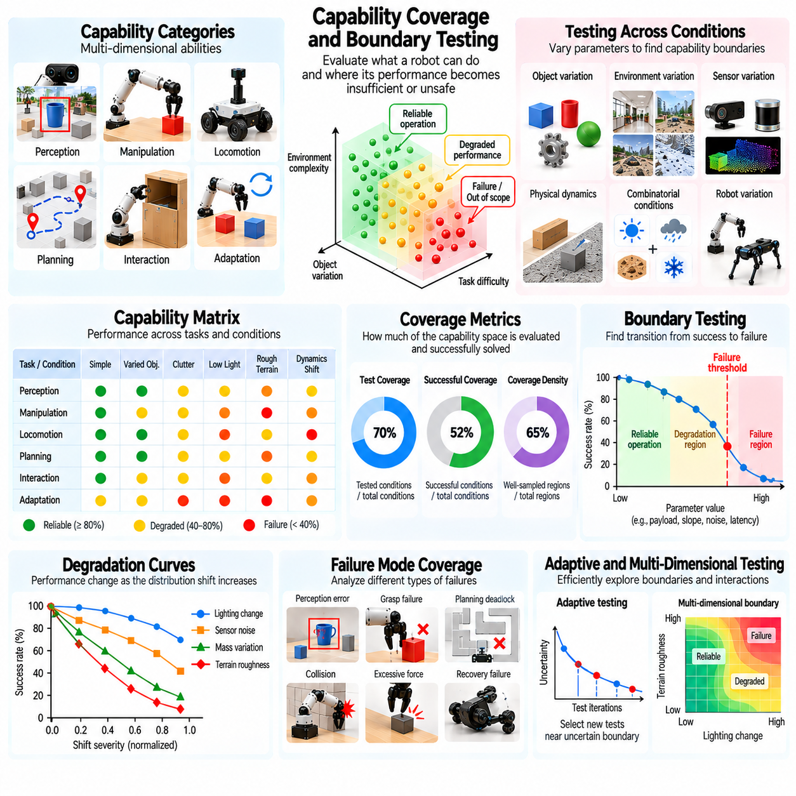{width="7.268055555555556in" height="7.268055555555556in"}

역량 범위 및 경계 시험(Capability Coverage and Boundary Testing)은 피지컬 AI(Physical AI) 시스템이 신뢰성 있게 작동할 수 있는 작업, 환경, 물리적 조건의 범위를 평가한다. 역량 범위(Capability Coverage)는 시스템이 무엇을 수행할 수 있는지 식별하며, 경계 시험(Boundary Testing)은 성능이 불충분하거나 안전하지 않게 되는 지점을 판단한다. 이러한 평가는 평균 벤치마크 점수(Average Benchmark Score)를 넘어 운영 역량(Operational Competence)을 구조적으로 이해할 수 있도록 한다.

역량 범위는 인지(Perception), 조작(Manipulation), 이동(Locomotion), 계획(Planning), 상호작용(Interaction), 적응(Adaptation)을 포함하는 여러 차원(Dimension)에 걸쳐 정의해야 한다. 각 차원은 단일 작업이 아니라 능력의 집합(Capability Family)을 나타낸다. 로봇은 높은 물체 인식(Object Recognition) 성능을 보이면서도 조작 정밀도(Manipulation Precision)가 제한적이거나, 안정적인 주행(Navigation) 능력을 갖추면서도 복구 행동(Recovery Behavior)이 부족할 수 있다. 평가에서는 이러한 차이를 하나의 구분되지 않은 점수로 통합하는 대신 명확하게 드러내야 한다.

역량 공간(Capability Space)은 로봇의 의도된 운영(Intended Operation)과 관련된 조건과 작업의 집합을 나타낸다. 역량 공간의 차원에는 물체 기하학(Object Geometry), 재료 특성(Material Property), 환경 복잡도(Environmental Complexity), 센서 품질(Sensor Quality), 작업 지속시간(Task Duration), 요구 정밀도(Required Precision)가 포함될 수 있다. 이러한 공간을 정의하면 평가 범위(Evaluation Scope)가 확립된다. 명시적인 경계가 없으면 광범위한 역량에 대한 주장이 실제로는 유리한 시나리오의 제한적인 선택만을 반영할 수 있다.

범위 지표(Coverage Metric)는 정의된 역량 공간에서 얼마나 많은 영역이 평가되었거나 성공적으로 입증되었는지 측정한다. 시험 범위(Test Coverage)와 성공적으로 입증된 역량 범위(Successful Capability Coverage)는 구분해야 한다. 작업을 시도했다는 사실만으로 역량이 입증되는 것은 아니기 때문이다. 벤치마크(Benchmark)는 최소 성공 요구사항(Minimum Success Requirement)을 충족한 시험 조건의 비율을 보고할 수 있다. 이러한 측정에서는 보편적인 물리 지능(Universal Physical Intelligence)을 암시하는 대신 실제 시험한 도메인(Tested Domain)을 명시해야 한다.

역량 행렬(Capability Matrix)은 작업 범주(Task Category)와 운영 조건(Operating Condition)에 따른 성능을 구조적으로 표현한다. 행(Row)은 파지(Grasping), 주행(Navigation), 조립(Assembly)과 같은 역량을 나타내고, 열(Column)은 환경 또는 난이도 변화(Difficulty Variation)를 나타낼 수 있다. 각 항목(Entry)은 정의된 조건에서의 성능을 기록한다. 이러한 구성은 불균형한 역량 개발(Uneven Capability Development)을 드러내고 피지컬 AI 시스템 사이의 체계적인 비교(Systematic Comparison)를 지원한다.

경계 시험은 신뢰할 수 있는 작동(Reliable Operation), 성능 저하(Degraded Performance), 허용할 수 없는 실패(Unacceptable Failure) 사이의 전환을 식별하는 데 초점을 맞춘다. 조작기(Manipulator)는 중간 수준의 위치 불확실성(Positioning Uncertainty)에서는 성공하지만 물체 정렬 오차(Object Alignment Error)가 임계값(Threshold)을 초과하면 실패할 수 있다. 이동 로봇(Mobile Robot)은 평탄한 지형(Smooth Terrain)을 안정적으로 통과하지만 경사가 가팔라지면 불안정해질 수 있다. 평가에서는 통제된 실험(Controlled Experiment)을 통해 이러한 전환 지점을 찾아야 한다.

운영 경계(Operational Boundary)는 측정 가능한 물리적 매개변수(Physical Parameter)로 표현할 수 있다. 예를 들어 최대 적재하중(Maximum Payload), 허용 접촉력(Allowable Contact Force), 최소 장애물 이격거리(Minimum Obstacle Clearance), 센서 지연 허용도(Sensor Latency Tolerance), 지형 경사 한계(Terrain Inclination Limit)가 있다. 이러한 매개변수는 추상적인 성능 주장을 공학적 제약조건(Engineering Constraint)으로 전환한다. 그러나 경계는 작업 요구사항(Task Requirement)에 따라 달라지므로 운영 맥락(Operating Context)과 독립적인 고정 특성으로 취급해서는 안 된다.

경계 탐색(Boundary Discovery)은 대표적인 운영 조건(Representative Operating Condition)에서 시작하여 작업 난이도(Task Difficulty)나 환경 스트레스(Environmental Stress)를 점진적으로 증가시키는 방식으로 수행해야 한다. 연구자는 초기 실패 영역(Initial Failure Region)을 식별하기 위해 한 번에 하나의 매개변수를 변경할 수 있다. 추가 실험에서는 변수 사이의 상호작용(Interaction)을 조사해야 한다. 이러한 단계적 접근법(Staged Approach)은 해석 가능성(Interpretability)을 높이면서 위험한 물리적 조건에 불필요하게 노출되는 상황을 방지한다.

범위 밀도(Coverage Density)는 역량 공간에 전혀 시험하지 않은 넓은 영역이 존재할 수 있기 때문에 중요하다. 쉬운 조건 주변에 많은 시험이 집중된 벤치마크는 잘못된 신뢰감(Misleading Confidence)을 형성할 수 있다. 평가에서는 표본 추출 밀도(Sampling Density)를 문서화하고 시험하지 않은 조합(Untested Combination)을 식별해야 한다. 표본이 희소한 영역(Sparse Region)은 성공적인 운영 조건으로 자동 분류하지 않고 불확실성이 존재하는 영역(Area of Uncertainty)으로 취급해야 한다.

경계 불확실성(Boundary Uncertainty)은 물리적 성능이 확률적 동역학(Stochastic Dynamics), 센서 잡음(Sensor Noise), 환경 변동성(Environmental Variability)의 영향을 받기 때문에 발생한다. 로봇은 명목상 동일한 조건(Nominally Identical Condition)에서도 성공하거나 실패할 수 있다. 따라서 역량 경계(Capability Boundary)는 단일 결정론적 임계값(Deterministic Threshold)보다 확률적 성능 추정(Probabilistic Performance Estimate)을 사용하여 표현해야 한다. 반복 시험(Repeated Trial)과 신뢰구간(Confidence Interval)은 중요한 한계 부근의 불확실성을 정량화하는 데 도움이 된다.

역량 경계는 최소 허용 성공 확률(Minimum Acceptable Success Probability), 정밀도 요구사항(Precision Requirement), 안전 제약조건(Safety Constraint)에 따라 정의할 수 있다. 예를 들어 산업용 조작 시스템(Industrial Manipulation System)은 지정된 위치 허용오차(Positioning Tolerance) 내에서 높은 작업 완료 신뢰성(Task Completion Reliability)을 요구할 수 있다. 평가에서는 시험을 수행하기 전에 수용 기준(Acceptance Criteria)을 확립해야 한다. 그렇지 않으면 결과를 관찰한 후 임계값을 조정하여 편향된 해석(Biased Interpretation)을 만들어낼 수 있다.

실패 모드 범위(Failure-Mode Coverage)는 시스템이 실패할 수 있는 다양한 방식을 조사함으로써 역량 범위를 보완한다. 실패에는 잘못된 인지(Incorrect Perception), 불안정한 파지(Unstable Grasping), 계획 교착상태(Planning Deadlock), 충돌(Collision), 과도한 힘(Excessive Force), 복구 실패(Unsuccessful Recovery)가 포함될 수 있다. 성공적인 결과만 평가하면 중요한 운영 위험(Operational Risk)이 조사되지 않은 상태로 남는다. 실패 모드 분석(Failure-Mode Analysis)은 관측된 행동(Observed Behavior)을 측정 가능한 시스템 한계(System Limitation)와 연결해야 한다.

조합적 경계 시험(Combinatorial Boundary Testing)은 개별적으로는 처리할 수 있는 여러 어려움이 동시에 발생하는 조건을 조사한다. 로봇은 낮은 조도(Low Lighting)와 중간 수준의 센서 잡음을 각각 견딜 수 있지만 두 조건이 동시에 발생하면 실패할 수 있다. 이러한 상호작용은 비선형 역량 경계(Nonlinear Capability Boundary)를 형성할 수 있다. 평가에서는 실제 배치(Deployment)에서 발생할 가능성이 있고 운영 안전성(Operational Safety)에 중요한 영향을 미칠 수 있는 조합을 우선해야 한다.

적응형 시험(Adaptive Testing)은 불확실한 역량 경계 부근에서 새로운 시험을 선택함으로써 평가 효율성(Evaluation Efficiency)을 높일 수 있다. 가능한 모든 조건을 균일하게 표본 추출(Uniform Sampling)하는 대신 성능이 급격히 변화하거나 증거가 부족한 영역에 집중할 수 있다. 적응형 절차(Adaptive Procedure)는 통계적 타당성(Statistical Validity)을 유지하고 시험 선택 규칙(Test-Selection Rule)을 문서화하여 전체 역량 범위에 대한 편향된 추정(Biased Estimate)을 방지해야 한다.

범위 평가는 작업 복잡도(Task Complexity)와 실행 지속시간(Execution Duration)을 고려해야 한다. 로봇은 개별 행동(Individual Action)을 신뢰성 있게 완료하더라도 여러 의존관계(Dependency)를 포함하는 긴 작업 순서(Extended Sequence)에서는 어려움을 겪을 수 있다. 장기 작업(Long-Horizon Task)은 누적 오류(Cumulative Error)와 복구 요구사항(Recovery Requirement)을 발생시킨다. 따라서 평가에는 순서 길이(Sequence Length), 하위 작업 다양성(Subtask Diversity), 계획 복잡도(Planning Complexity)에 따른 역량 범위가 포함되어야 한다.

일반화 범위(Generalization Coverage)는 입증된 능력이 익숙한 학습 조건(Training Condition)을 넘어 확장되는지 측정한다. 로봇은 알려진 물체(Known Object)에서는 높은 성능을 보이지만 익숙하지 않은 재료(Unfamiliar Material)나 구성(Configuration)에서는 실패할 수 있다. 평가에서는 분포 내 범위(In-Distribution Coverage)와 분포 외 범위(Out-of-Distribution Coverage)를 분리해야 한다. 이러한 구분은 폭넓은 작업 성능이 전이 가능한 역량(Transferable Competence)을 반영하는지 또는 유사한 학습 사례(Training Example)에 광범위하게 노출된 결과인지를 보여준다.

체화 형태 간 범위(Cross-Embodiment Coverage)는 서로 다른 로봇 형태(Morphology), 센서(Sensor), 구동 시스템(Actuation System)에서도 역량이 유지되는지 조사한다. 범용 피지컬 AI 모델(General-Purpose Physical AI Model)은 여러 플랫폼(Platform)을 지원하더라도 정밀도(Precision)와 신뢰성(Reliability)에서 서로 다른 수준을 보일 수 있다. 평가에서는 공유되는 인지적 역량(Shared Cognitive Capability)과 체화 형태별 실행 한계(Embodiment-Specific Execution Limit)를 구분하고 하드웨어 전반에서 동일한 성능을 가정하지 않아야 한다.

역량 범위에는 작업 완료(Task Completion)뿐 아니라 안전성(Safety)과 복구 행동(Recovery Behavior)도 포함되어야 한다. 로봇이 정상 조건(Nominal Condition)에서 작업을 성공적으로 수행하더라도 위험을 감지하거나 교란(Disturbance)에서 복구하지 못한다면 배치에 적합하지 않을 수 있다. 평가에서는 시험 대상 역량 공간 전반에 걸쳐 안전 정지(Safe Stopping), 불확실성 인식(Uncertainty Recognition), 대체 대응 행동(Fallback Behavior), 인간 개입 요구사항(Human Intervention Requirement)을 평가해야 한다.

범위 점수(Coverage Score)는 서로 다른 역량의 중요도가 동일하지 않을 수 있으므로 신중하게 통합해야 한다. 주행, 조작, 안전 성능을 단순 평균하면 치명적인 약점(Critical Weakness)이 감춰질 수 있다. 응용 분야별 가중치(Application-Specific Weighting)가 유용할 수 있지만 가중치 선택(Weighting Choice)은 투명하게 공개해야 한다. 개별 역량 차원(Individual Capability Dimension)을 종합 요약(Aggregate Summary)과 함께 보고하면 시스템 준비도(System Readiness)를 더욱 타당하게 해석할 수 있다.

시뮬레이션(Simulation)은 물체, 환경, 교란, 물리적 매개변수의 통제된 변화를 통해 역량 공간을 폭넓게 탐색할 수 있도록 한다. 자동화된 시나리오 생성(Automated Scenario Generation)은 잠재적인 경계 영역(Potential Boundary Region)을 효율적으로 식별할 수 있다. 그러나 시뮬레이션에서의 성공이 실세계 역량(Real-World Capability)을 보장하지는 않는다. 특히 모델링 오차(Modeling Error)가 중대한 영향을 미칠 수 있는 접촉(Contact), 안정성(Stability), 안전 경계(Safety Boundary) 부근에서는 물리적 검증(Physical Validation)이 필요하다.

실세계 경계 시험(Real-World Boundary Testing)은 장비, 작업자(Operator), 주변 환경을 보호하도록 신중하게 설계된 절차를 사용해야 한다. 실험에는 보호 장치(Protective Fixture), 제한된 작업 공간(Restricted Workspace), 비상 정지 장치(Emergency Stopping Mechanism)가 필요할 수 있다. 위험한 조건은 가능한 경우 시뮬레이션이나 통제된 대체 시험(Controlled Substitute Testing)을 통해 조사해야 한다. 안전 제약조건은 시험 과정 자체에도 적용되어야 한다.

벤치마크 보고(Benchmark Reporting)에는 역량 정의(Capability Definition), 표본 추출된 조건(Sampled Condition), 범위 밀도, 수용 임계값(Acceptance Threshold), 실패 모드(Failure Mode), 경계 불확실성이 포함되어야 한다. 역량 행렬이나 성능 지도(Performance Map)와 같은 시각적 요약(Visual Summary)은 해석을 지원할 수 있지만 기본 측정 데이터(Underlying Measurement)는 계속 접근 가능해야 한다. 투명한 보고(Transparent Reporting)는 시험 범위나 난이도의 차이를 감추지 않고 비교할 수 있도록 한다.

역량 범위 및 경계 시험은 충분히 개발되지 않은 기술(Underdeveloped Skill)과 위험도가 높은 운영 영역(High-Risk Operating Region)을 식별함으로써 시스템 개발(System Development)을 안내할 수 있다. 익숙하지 않은 물체 조작에서 낮은 범위가 나타나면 추가 학습(Additional Training)이 필요할 수 있으며, 좁은 안정성 여유(Stability Margin)는 하드웨어 또는 제어 개선(Control Improvement)을 요구할 수 있다. 반복 평가(Repeated Evaluation)는 변경 사항이 기존 역량을 약화시키지 않으면서 신뢰할 수 있는 운영 영역(Reliable Operating Region)을 확장하는지 검증할 수 있다.

배치 결정(Deployment Decision)은 일반 지능(General Intelligence)에 대한 광범위한 주장보다 입증된 역량 범위(Demonstrated Capability Envelope)에 기반해야 한다. 운영 정책(Operating Policy)은 로봇을 검증된 조건(Validated Condition)으로 제한하고 불확실성이 허용 한계(Acceptable Limit)를 초과하면 개입을 요구할 수 있다. 배치 중 경계 모니터링(Boundary Monitoring)은 시험에서 사용한 가정(Tested Assumption)으로부터 새롭게 벗어나는 상황을 식별할 수 있다. 이러한 관행은 벤치마크 평가를 실제 운영 보증(Operational Assurance)과 연결한다.

궁극적으로 역량 범위 및 경계 시험은 피지컬 AI 시스템이 무엇을 신뢰성 있게 수행할 수 있으며 어디에서 한계가 중요해지는지를 확립한다. 우수한 평가는 체계적인 표본 추출(Systematic Sampling), 확률적 성능 추정(Probabilistic Performance Estimation), 실패 분석(Failure Analysis), 안전 인식 실험(Safety-Aware Experimentation)을 결합한다. 이러한 방법은 측정 가능한 역량 주장(Measurable Capability Claim), 책임 있는 배치 경계(Responsible Deployment Boundary), 더욱 일반적인 물리 지능(General Physical Intelligence)을 향한 목표 지향적 개선(Targeted Improvement)을 지원한다.

## 04.16. Generalization Metric Suite [w/Code]

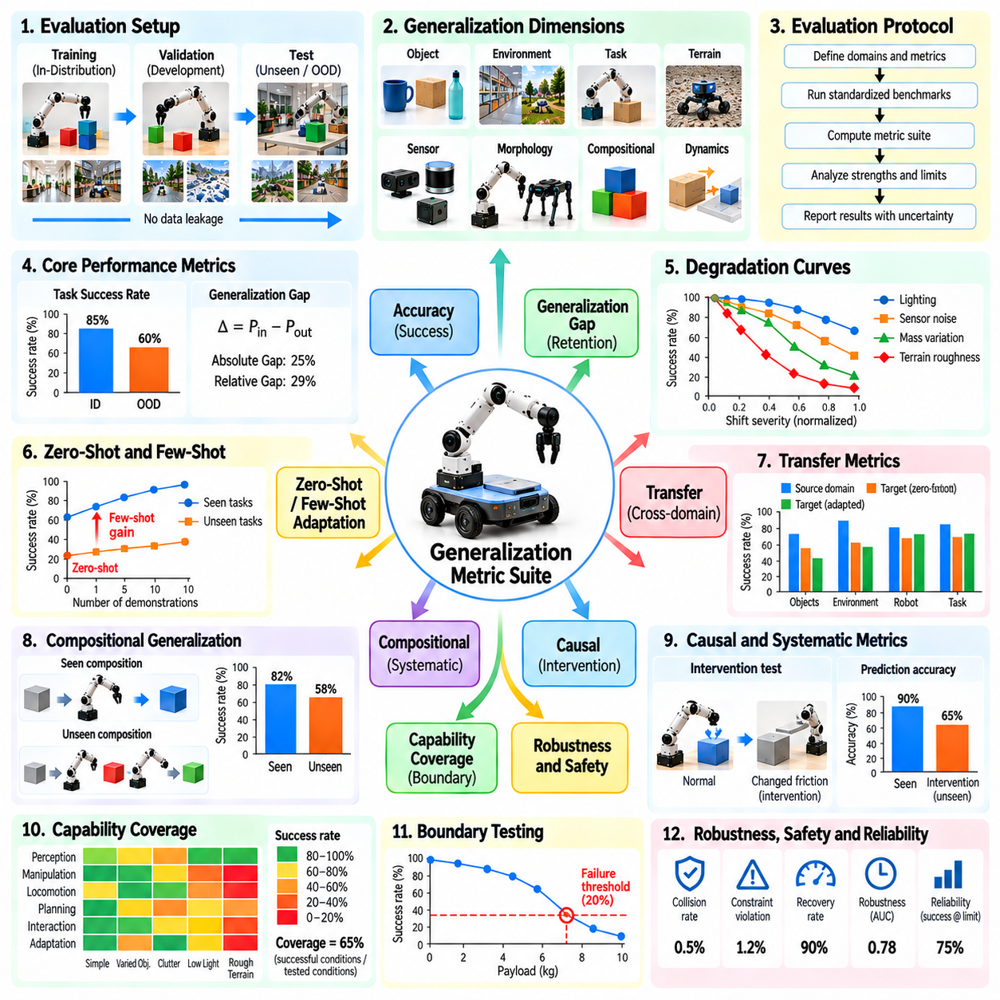{width="7.268055555555556in" height="7.268055555555556in"}

일반화 지표 모음(Generalization Metric Suite)은 피지컬 AI(Physical AI) 시스템이 익숙한 학습 조건(Training Condition)을 벗어나 어떻게 작동하는지 측정하기 위한 통합 평가 프레임워크(Integrated Evaluation Framework)를 제공한다. 단일 성공률(Success Rate)에 의존하는 대신 분포 변화(Distribution Shift), 작업 신규성(Task Novelty), 전이(Transfer), 적응(Adaptation), 강건성(Robustness), 운영 경계(Operational Boundary)에 관한 지표를 결합한다. 그 목적은 일반화 가능한 물리 지능(Generalizable Physical Intelligence)의 범위, 신뢰성, 한계를 특성화하는 것이다.

지표 모음은 명확하게 정의된 일반화 차원(Generalization Dimension)에 따라 평가를 구성해야 한다. 여기에는 미지의 물체(Unseen Object), 익숙하지 않은 환경(Unfamiliar Environment), 새로운 작업(Novel Task), 변화하는 지형(Changing Terrain), 센서 변화(Sensor Variation), 로봇 형태(Robot Morphology), 조합적 구조(Compositional Structure)가 포함될 수 있다. 각 차원은 서로 다른 신규성 원천(Source of Novelty)을 나타낸다. 이를 분리하면 시스템이 폭넓게 일반화하는지 또는 특정 유형의 분포 변화에서만 높은 성능을 보이는지 식별할 수 있다.

표준화된 평가 프로토콜(Standardized Evaluation Protocol)은 학습 분포(Training Distribution), 검증 분포(Validation Distribution), 학습에서 제외된 시험 분포(Held-Out Test Distribution)를 정의하는 것에서 시작한다. 학습 데이터(Training Data)는 모델이 활용할 수 있는 경험을 제공하며, 검증 데이터(Validation Data)는 개발 의사결정(Development Decision)을 지원한다. 학습에서 제외된 조건(Held-Out Condition)은 익숙하지 않은 상황에서의 성능을 평가한다. 평가 사례(Evaluation Example)에 노출되면 보고된 일반화 능력(Generalization Capability)이 과대평가될 수 있으므로 엄격한 분리가 필요하다.

작업 성공률(Task Success Rate)은 일반화 성능(Generalization Performance)을 측정하는 기본적인 지표이다. 이는 사전에 정의된 완료 기준(Completion Criteria)을 충족한 평가 에피소드(Evaluation Episode)의 비율을 나타낸다. 성공 정의(Success Definition)에는 물체 배치 정확도(Object Placement Accuracy), 충돌 회피(Collision Avoidance), 작업 완료 요구사항(Task Completion Requirement)과 같은 물리적 제약조건(Physical Constraint)이 포함되어야 한다. 익숙한 조건과 익숙하지 않은 조건의 성공률을 별도로 보고하면 후속 지표를 위한 기초가 마련된다.

일반화 격차(Generalization Gap)는 기준 조건(Reference Condition)과 익숙하지 않은 조건 사이의 성능 저하(Performance Deterioration)를 정량화한다. 성공률 기반 평가(Success-Based Evaluation)에서 절대 격차(Absolute Gap)는 기준 성공률(Reference Success Rate)에서 목표 성공률(Target Success Rate)을 뺀 값이다. 상대 격차(Relative Gap)는 성능 저하를 기준 성능에 대한 비율로 표현한다. 절대적인 차이와 비례적인 손실(Proportional Loss)은 일반화 품질(Generalization Quality)에 대한 상호 보완적인 해석을 제공하므로 두 지표를 모두 보고해야 한다.

성능 유지율(Performance Retention)은 익숙하지 않은 조건에서 기준 역량(Reference Capability)이 얼마나 유지되는지 측정한다. 값이 클수록 성능이 우수한 지표(Positive Performance Metric)의 경우 목표 성능(Target Performance)을 기준 성능(Reference Performance)으로 나눈 비율로 유지율을 표현할 수 있다. 1에 가까운 값은 성능 저하가 제한적임을 나타내며, 1보다 작은 값은 성능 감소를 의미한다. 기준 성능이 매우 낮거나 목표 성능이 개선되는 경우에는 이 지표를 신중하게 해석해야 한다.

신규성 조건별 성공률(Novelty-Conditioned Success Rate)은 익숙하지 않은 정도에 따른 성능을 특성화한다. 평가 시나리오(Evaluation Scenario)는 물체 신규성(Object Novelty), 환경 변화(Environmental Change), 작업 복잡도(Task Complexity), 물리적 매개변수 변화(Physical Parameter Variation)에 따라 분류할 수 있다. 각 범주 내의 결과를 보고하면 일반화가 약화되는 영역을 확인할 수 있다. 신규성 정의(Novelty Definition)는 일관되게 유지되어야 하며 작업 난이도에 대한 주관적 판단(Subjective Judgment)에만 의존해서는 안 된다.

성능 저하 곡선(Degradation Curve)은 분포 변화가 점진적으로 증가하는 조건에서 성능을 측정한다. 연구자는 작업 결과(Task Outcome)를 기록하면서 센서 잡음(Sensor Noise), 물체 질량(Object Mass), 마찰(Friction), 조명(Lighting), 지형 난이도(Terrain Difficulty)를 변화시킬 수 있다. 곡선 기울기(Curve Slope), 곡선 아래 면적(Area Under the Curve), 실패 임계값(Failure Threshold)은 강건성을 측정하는 상호 보완적인 지표를 제공한다. 이러한 요약 지표에는 항상 심각도 범위(Severity Range)와 시험한 변화의 물리적 의미(Physical Meaning)를 명시해야 한다.

제로샷 일반화 지표(Zero-Shot Generalization Metric)는 추가적인 작업별 학습(Task-Specific Training) 없이 익숙하지 않은 조건에서의 성능을 평가한다. 퓨샷 적응 지표(Few-Shot Adaptation Metric)는 제한된 수의 시연(Demonstration)이나 상호작용(Interaction) 이후의 성능 개선을 평가한다. 지표 모음은 제로샷 성공률(Zero-Shot Success), 적응 이득(Adaptation Gain), 샘플 효율성(Sample Efficiency), 최종 적응 성능(Final Adapted Performance)을 별도로 보고해야 한다. 이러한 구분은 추가 학습 자원(Additional Learning Resource)을 즉각적인 일반화(Immediate Generalization)로 잘못 해석하는 것을 방지한다.

전이 지표(Transfer Metric)는 소스 도메인(Source Domain)에서 학습된 지식이 목표 도메인(Target Domain)에서 어떻게 작동하는지 조사한다. 관련 측정값에는 목표 도메인 성공률(Target-Domain Success), 전이 격차(Transfer Gap), 적응 비용(Adaptation Cost), 부정적 전이 빈도(Negative Transfer Frequency)가 포함된다. 체화 형태 간 평가(Cross-Embodiment Evaluation)에서는 보정 요구사항(Calibration Requirement)과 플랫폼별 제약조건(Platform-Specific Constraint)도 고려할 수 있다. 이러한 요소를 보고하면 전이된 지식이 서로 다른 운영 시스템에서 실질적인 이점을 제공하는지 확인할 수 있다.

조합적 일반화 지표(Compositional Generalization Metric)는 익숙한 기술(Skill)과 개념(Concept)을 익숙하지 않은 조합에서 재사용하는 능력을 평가한다. 작업 성공률은 하위 작업 완료(Subtask Completion), 행동 순서 정확도(Action Ordering Accuracy), 제약조건 충족(Constraint Satisfaction)으로 보완해야 한다. 평가에서는 익숙한 조합(Familiar Composition)을 학습에서 제외된 행동 순서(Held-Out Sequence)나 관계(Relationship)와 비교할 수 있다. 이러한 지표는 유연한 기술 재조합(Flexible Skill Recombination)과 완전한 작업 시연(Task Demonstration)의 암기를 구분하는 데 도움이 된다.

체계적 일반화(Systematic Generalization)와 인과적 일반화(Causal Generalization)에는 구조화된 변화(Structured Change)와 통제된 개입(Controlled Intervention) 아래에서 일관성을 조사하는 지표가 필요하다. 예측 정확도(Prediction Accuracy), 인과적 일관성(Causal Consistency), 개입 성공률(Intervention Success), 반사실적 평가(Counterfactual Evaluation)가 포함될 수 있다. 이러한 측정은 표면적 상관관계(Superficial Correlation)가 교란되더라도 학습된 관계(Learned Relationship)가 유효하게 유지되는지 평가해야 한다. 성공적인 예측만으로 신뢰할 수 있는 물리적 제어(Reliable Physical Control)가 입증되는 것은 아니다.

역량 범위(Capability Coverage)는 정의된 작업-조건 공간(Task-Condition Space)에서 시스템이 지정된 성능 요구사항(Performance Requirement)을 충족하는 비율을 측정한다. 역량 범위는 단순히 시험한 조건의 비율과 구분해야 한다. 경계 지표(Boundary Metric)는 최대 적재하중(Maximum Payload), 허용 가능한 센서 불확실성(Acceptable Sensor Uncertainty), 지형 허용도(Terrain Tolerance)와 같은 운영 한계(Operating Limit)를 식별한다. 반복적인 물리적 시험(Physical Trial)에서 결과가 달라지는 경우 확률적 경계(Probabilistic Boundary)가 더 적절하다.

안전 관련 일반화 지표(Safety-Related Generalization Metric)는 익숙하지 않고 잠재적으로 위험한 조건에서의 행동을 측정한다. 관련 측정값에는 충돌 빈도(Collision Frequency), 제약조건 위반(Constraint Violation), 위험한 접촉력(Unsafe Contact Force), 비상 개입(Emergency Intervention), 복구 성공률(Recovery Success)이 포함된다. 안전성(Safety)이 평균 작업 성능(Average Task Performance)에 가려져서는 안 된다. 일상적인 작업(Routine Task)에서는 성공적으로 일반화하더라도 실패가 위험한 상황으로 이어진다면 해당 시스템은 배치에 적합하지 않을 수 있다.

실행 품질(Execution Quality)은 이진 작업 성공 여부(Binary Task Success)를 넘어서는 추가적인 근거를 제공한다. 로봇은 익숙하지 않은 작업을 완료하면서도 과도한 에너지를 소비하거나, 더 긴 궤적(Trajectory)을 생성하거나, 반복적인 수정 행동(Corrective Action)을 요구할 수 있다. 지표 모음에는 완료 시간(Completion Time), 경로 효율성(Path Efficiency), 조작 정밀도(Manipulation Precision), 제어 안정성(Control Stability), 상호작용 품질(Interaction Quality)이 포함되어야 한다. 이러한 측정은 기존 성공 지표가 놓칠 수 있는 성능 저하를 밝혀준다.

불확실성 보정(Uncertainty Calibration)은 분포 변화 아래에서 신뢰도 추정(Confidence Estimate)이 관측된 성능(Observed Performance)과 얼마나 일치하는지 평가한다. 신뢰할 수 있는 시스템은 예측과 행동의 신뢰성이 낮아지는 조건을 인식해야 한다. 보정 오차(Calibration Error), 실패 탐지 성능(Failure Detection Performance), 선택적 실행 행동(Selective Execution Behavior)은 이러한 평가를 지원할 수 있다. 평가에서는 특히 운영 경계(Operational Boundary) 부근에서 발생하는 과도한 확신을 동반한 실패(Confident Failure)에 주의를 기울여야 한다.

통계적 신뢰성(Statistical Reliability)은 지표를 의미 있게 해석하기 위해 필요하다. 보고되는 각 결과에는 적절한 시험 횟수(Trial Count), 변동성 추정(Variability Estimate), 신뢰구간(Confidence Interval)이 포함되어야 한다. 독립적인 작업 사례(Independent Task Instance)와 무작위 시드(Random Seed)에 걸친 반복 평가는 유리한 표본(Favorable Sample)에 대한 의존성을 줄인다. 시스템이 동일한 조건(Matched Condition)에서 시험되는 경우 대응 비교(Paired Comparison)가 유용하지만 물리적 변동성(Physical Variability)은 여전히 고려해야 한다.

지표 통합(Metric Aggregation)은 서로 다른 일반화 역량(Generalization Capability)에 관한 정보를 보존해야 한다. 단일 가중 점수(Weighted Score)는 비교를 지원할 수 있지만 안전성, 로봇 형태 간 전이(Morphology Transfer), 인과적 추론(Causal Reasoning)의 심각한 약점을 감출 수 있다. 지표 모음은 종합 지수(Composite Index)와 함께 차원별 결과(Dimension-Specific Result)를 보고해야 한다. 가중치 규칙(Weighting Rule), 정규화 절차(Normalization Procedure), 결측 데이터 처리(Missing-Data Treatment)는 평가 전에 정의해야 한다.

벤치마크 자동화(Benchmark Automation)는 시나리오 생성(Scenario Generation), 실행 기록(Execution Logging), 지표 계산(Metric Calculation), 보고서 생성(Report Production)을 표준화하여 일관성을 개선한다. 각 평가 에피소드에는 작업 식별자(Task Identifier), 도메인 조건(Domain Condition), 로봇 구성(Robot Configuration), 결과(Outcome), 안전 이벤트(Safety Event)를 기록해야 한다. 자동 검증(Automated Validation)은 불완전한 시험(Incomplete Trial)이나 일관되지 않은 레이블(Inconsistent Label)을 탐지할 수 있다. 재현 가능한 파이프라인(Reproducible Pipeline)은 수작업 오류(Manual Error)를 줄이고 모델 버전 간 반복 비교를 지원한다.

실용적인 구현(Practical Implementation)에서는 시나리오 메타데이터(Scenario Metadata), 기준 조건(Reference Condition), 측정 결과(Measured Outcome), 신규성 범주(Novelty Category)를 포함하는 구조화된 데이터(Structured Data)로 평가 기록을 표현할 수 있다. 지표 함수(Metric Function)는 이러한 기록에서 성공률, 일반화 격차, 성능 유지 비율(Retention Ratio), 범위 추정값(Coverage Estimate)을 계산할 수 있다. 모듈형 소프트웨어 설계(Modular Software Design)는 기본 프로토콜을 변경하지 않고도 추가 지표를 도입할 수 있도록 한다. 버전이 관리되는 정의(Versioned Definition)는 실험 간 비교 가능성(Comparability)을 유지한다.

시뮬레이션 평가(Simulation Evaluation)와 실세계 평가(Real-World Evaluation)는 가능한 경우 호환되는 지표 정의(Compatible Metric Definition)를 공유해야 한다. 시뮬레이션은 익숙하지 않은 조건을 폭넓게 표본 추출할 수 있도록 하며, 물리적 실험(Physical Experiment)은 하드웨어 한계(Hardware Limitation)와 모델링되지 않은 상호작용(Unmodeled Interaction)을 드러낸다. 결과는 별도의 설명 없이 결합하지 않고 평가 환경별로 구분해야 한다. 시뮬레이션 성능과 실제 성능의 차이는 전이 한계(Transfer Limitation)에 관한 추가적인 근거를 제공한다.

지표 타당성(Metric Validity)은 적절한 기준 모델(Baseline)과 통제된 비교(Controlled Comparison)에 따라 달라진다. 일반화 점수(Generalization Score)는 기준 성능(Reference Performance), 작업 난이도(Task Difficulty), 이용 가능한 정보(Available Information)를 고려하여 해석해야 한다. 목표 도메인 시연(Target-Domain Demonstration)이나 추가 적응 시간(Additional Adaptation Time)을 제공받은 모델은 이러한 사실을 공개하지 않은 채 엄격한 제로샷 시스템(Strictly Zero-Shot System)과 직접 비교해서는 안 된다. 공정한 평가(Fair Evaluation)를 위해서는 투명한 프로토콜(Transparent Protocol)이 필수적이다.

평가 보고(Reporting)에는 도메인 정의(Domain Definition), 시험 데이터 분할(Test Partition), 신규성 수준(Novelty Level), 성공 기준(Success Criteria), 적응 허용 범위(Adaptation Permission), 지표 계산식(Metric Formula), 통계적 불확실성(Statistical Uncertainty)이 포함되어야 한다. 또한 실패 사례(Failure Case)와 시험한 역량 공간(Tested Capability Space) 밖의 조건을 식별해야 한다. 표준화된 보고(Standardized Reporting)는 연구자가 결과를 재현하고 시스템을 책임 있게 비교하며 검증된 역량(Verified Capability)과 근거가 부족한 일반화 주장(Unsupported Generalization Claim)을 구분할 수 있도록 한다.

지표 모음은 피지컬 AI 개발 수명주기(Physical AI Development Lifecycle) 전반에서 지속적인 평가(Continuous Evaluation)를 지원해야 한다. 새로운 모델 버전(Model Version)은 고정된 기준 시나리오(Fixed Reference Scenario)와 새롭게 도입된 도전 과제 집합(Challenge Set)을 대상으로 시험할 수 있다. 회귀 분석(Regression Analysis)은 업데이트로 인해 약화된 역량을 식별하며, 경계 시험(Boundary Testing)은 확장된 운영 영역(Operating Region)을 밝혀준다. 장기 추적(Longitudinal Tracking)은 알고리즘 개선(Algorithm Improvement)을 배치 준비도(Deployment Readiness)의 측정 가능한 변화와 연결한다.

궁극적으로 일반화 지표 모음은 다양한 물리적 성능 관측(Physical Performance Observation)을 전이 가능한 지능(Transferable Intelligence)에 대한 일관된 평가(Coherent Assessment)로 전환한다. 우수한 평가는 성공률, 강건성, 적응, 인과적 일관성, 안전성, 역량 범위를 결합하면서도 각 지표의 차이를 감추지 않는다. 표준화되고 재현 가능한 지표 모음(Standardized and Reproducible Metric Suite)은 일반화 주장에 대한 신뢰할 수 있는 근거(Credible Evidence)를 확립하고 피지컬 AI 시스템의 더욱 안전한 배치(Safer Deployment)를 지원한다.
