**Volume 11. Physical AI Evaluation and Benchmarking**


# Chapter 05. Safety and Robustness Evaluation

##  

## 05.01. Safety vs Robustness Evaluation

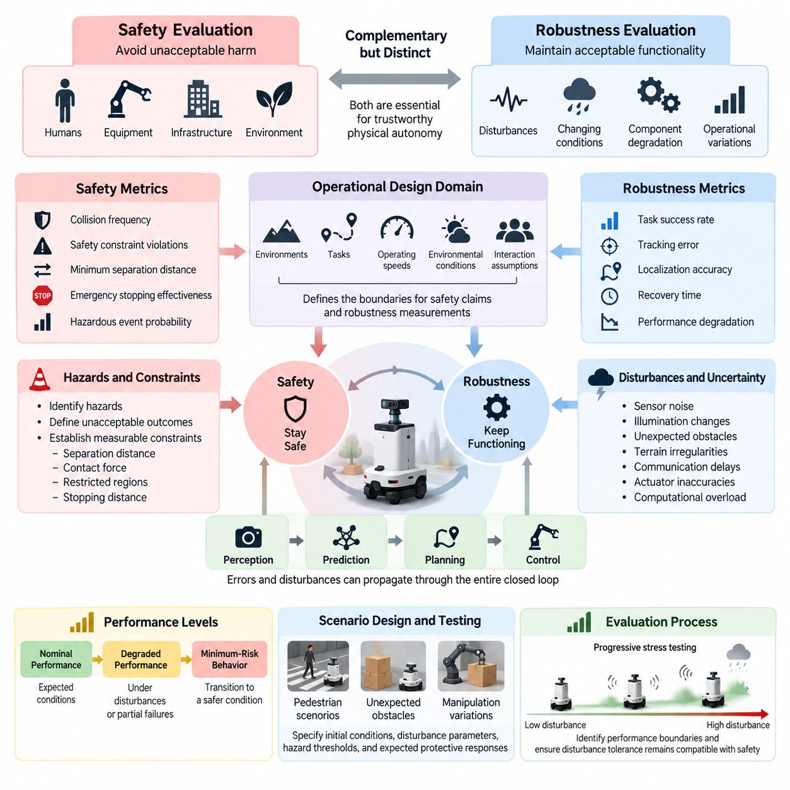{width="7.268055555555556in" height="7.268055555555556in"}

Safety and robustness evaluation are complementary but distinct dimensions of Physical AI assessment. Safety evaluation determines whether an autonomous system avoids unacceptable harm to humans, equipment, infrastructure, and the environment. Robustness evaluation measures whether the system maintains acceptable functionality when operating conditions change, disturbances occur, or components degrade. Both are essential for trustworthy physical autonomy.

The distinction becomes important because a robot can remain operational without being safe, or behave safely without completing its assigned task. A mobile robot that continues navigating despite inaccurate localization may demonstrate apparent robustness while creating collision hazards. Conversely, a robot that stops immediately after detecting uncertainty may preserve safety but exhibit limited operational robustness.

Safety evaluation begins with identifying hazards, defining unacceptable outcomes, and establishing measurable constraints. These constraints may include minimum human separation distances, maximum contact forces, restricted operating regions, and allowable stopping distances. Evaluation examines whether the system respects these boundaries during normal operation, foreseeable misuse, component failures, and abnormal environmental conditions.

Robustness evaluation focuses on performance degradation under uncertainty and disturbances. Relevant disturbances include sensor noise, illumination changes, unexpected obstacles, terrain irregularities, communication delays, actuator inaccuracies, and computational overload. A robust Physical AI system should tolerate specified variations while maintaining predictable behavior, acceptable task performance, and stable control responses.

The operational design domain provides a common foundation for both evaluations. It defines the environments, tasks, operating speeds, environmental conditions, and interaction assumptions under which a system is expected to function. Safety claims and robustness measurements must be interpreted within these boundaries. Performance demonstrated in a controlled warehouse cannot automatically establish equivalent reliability in crowded outdoor environments.

Safety metrics should represent exposure to hazards and the severity of possible consequences. Examples include collision frequency, safety constraint violations, minimum separation distance, emergency stopping effectiveness, and hazardous event probability. Near misses and unsafe trajectories are also important because successful task completion does not necessarily indicate safe execution throughout the entire operating sequence.

Robustness metrics characterize how system performance changes as disturbances become more severe. Task success rate, tracking error, localization accuracy, recovery time, and performance degradation provide complementary evidence. Evaluation should examine not only average performance but also variability, worst-case behavior within defined test conditions, and the disturbance levels at which functional capabilities begin to deteriorate.

A useful evaluation framework separates nominal performance, degraded performance, and minimum-risk behavior. Nominal performance describes operation under expected conditions, while degraded performance measures functionality under disturbances or partial failures. Minimum-risk behavior concerns the system\'s ability to transition toward a safer condition when continued task execution becomes unacceptable or cannot be supported by reliable information.

Safety and robustness interact through perception, prediction, planning, and control. Perception errors may cause incorrect obstacle detection, while prediction failures may lead to unsafe motion planning. Control disturbances can subsequently amplify these errors into physical hazards. Evaluation must therefore examine complete closed-loop behavior rather than relying exclusively on isolated component accuracy or offline model predictions.

Consider an autonomous mobile robot operating near pedestrians. Robustness testing may introduce noisy LiDAR measurements, partial camera occlusion, localization drift, or changing pedestrian trajectories. Safety testing examines whether the robot maintains appropriate separation, respects speed limits, and initiates protective stopping when necessary. The combined assessment determines whether disturbance tolerance remains compatible with human safety.

For robotic manipulators, robustness concerns variations in object geometry, payload mass, friction, and grasp uncertainty. Safety evaluation additionally considers unintended contact, excessive joint torque, dropped objects, and collisions with nearby workers. A manipulation policy may successfully recover from grasp errors yet still create unacceptable risk if recovery movements exceed permitted force or workspace constraints.

Safety-critical scenario design should prioritize situations in which disturbances can produce consequential failures. Examples include sudden pedestrian appearance, unexpected obstacle movement, emergency braking, unstable payloads, and loss of critical sensor information. Scenarios should specify initial conditions, disturbance parameters, hazard thresholds, and expected protective responses so that outcomes can be evaluated consistently.

Robustness stress testing progressively increases disturbance severity to reveal performance boundaries. Sensor noise, latency, external forces, and environmental uncertainty can be varied independently before introducing combined disturbances. Resulting degradation curves help identify whether failures occur gradually or abruptly. Abrupt transitions are particularly important because they may leave insufficient time for corrective action.

Failure injection provides a systematic method for examining system responses to component degradation. Controlled experiments may introduce camera dropout, delayed actuator commands, corrupted localization estimates, or temporary communication loss. Robustness assessment measures remaining functionality and recovery capability, while safety assessment determines whether the system detects hazardous conditions and executes appropriate protective actions.

Uncertainty estimation connects robustness assessment with safety decision-making. Physical AI models should recognize when observations differ substantially from training conditions or when predictions become unreliable. Evaluation can measure confidence calibration, out-of-distribution detection, and uncertainty-sensitive action selection. However, reliable uncertainty estimates contribute to safety only when appropriate control responses follow their detection.

Worst-case evaluation investigates combinations of conditions that challenge system assumptions. Adversarial observations, unusual obstacle configurations, and interacting component failures can reveal vulnerabilities overlooked by average-case benchmarks. Such tests should remain physically plausible and relevant to the intended operating domain. Their purpose is to expose credible failure mechanisms rather than generate arbitrary scenarios disconnected from deployment.

Runtime assurance mechanisms provide another evaluation dimension. Safety monitors, constraint checkers, independent protective controllers, and emergency stopping functions may intervene when learned policies approach unsafe states. Evaluation should measure detection coverage, intervention latency, false alarms, and successful hazard mitigation. A monitor that detects danger only after physical contact cannot provide adequate preventive protection.

Recovery behavior requires separate examination because returning to task execution is not always the safest response. Following a localization failure, a robot may need to stop, reacquire reliable positioning, request assistance, or enter a restricted operating mode. Robustness measures the ability to restore useful functionality, whereas safety evaluates whether the recovery sequence itself avoids introducing additional hazards.

Statistical rigor is essential because serious safety failures may be rare under ordinary testing. Repeated trials, controlled scenario sampling, confidence intervals, and exposure-normalized event rates improve interpretability. Rare-event simulation and targeted stress testing can provide additional evidence, but they cannot automatically establish real-world failure probabilities without justified assumptions about scenario frequency and representativeness.

Simulation supports broad exploration of disturbances and hazardous conditions without exposing people or equipment to unnecessary risks. Nevertheless, simulated safety and robustness results depend on the fidelity of physical dynamics, sensing, contact behavior, and environmental interactions. Laboratory experiments and controlled field trials are needed to investigate discrepancies and validate whether simulated failure responses transfer to actual hardware.

A comprehensive evaluation report should present safety and robustness results separately before analyzing their interactions. High task success under disturbances should not compensate for unacceptable safety violations through an unrestricted aggregate score. Safety constraints may instead function as mandatory acceptance criteria, while robustness metrics characterize operational capability within the region where those constraints are satisfied.

Ultimately, Physical AI evaluation must determine not only whether a system can continue operating under difficult conditions, but also whether continued operation remains justified. Robustness extends the range of conditions under which useful behavior is possible, while safety establishes boundaries that must not be crossed. Their integrated assessment supports defensible deployment decisions, transparent capability limitations, and continuous improvement of autonomous physical systems.

안전성 평가(Safety Evaluation)와 강건성 평가(Robustness Evaluation)는 피지컬 인공지능(Physical AI)을 평가하는 상호 보완적이지만 서로 구별되는 두 가지 차원이다. 안전성 평가는 자율 시스템(Autonomous System)이 인간, 장비, 기반 시설 및 환경에 허용할 수 없는 피해를 방지하는지를 판단한다. 강건성 평가는 운영 조건이 변화하거나 외란(Disturbance)이 발생하거나 구성 요소의 성능이 저하될 때 시스템이 허용 가능한 기능을 유지하는지를 측정한다. 두 평가 모두 신뢰할 수 있는 물리적 자율성(Physical Autonomy)을 확보하는 데 필수적이다.

이러한 구분이 중요한 이유는 로봇이 안전하지 않은 상태에서도 작동을 지속할 수 있으며, 반대로 안전하게 행동하면서도 할당된 작업을 완료하지 못할 수 있기 때문이다. 부정확한 위치 추정(Localization)에도 주행을 계속하는 이동 로봇(Mobile Robot)은 겉으로는 강건성을 보여주지만 충돌 위험(Collision Hazard)을 발생시킬 수 있다. 반대로 불확실성(Uncertainty)을 감지한 직후 정지하는 로봇은 안전성을 유지할 수 있지만 운영 강건성(Operational Robustness)은 제한적일 수 있다.

안전성 평가는 위험 요인(Hazard)을 식별하고, 허용할 수 없는 결과를 정의하며, 측정 가능한 제약 조건(Constraint)을 설정하는 것에서 시작한다. 이러한 제약 조건에는 인간과의 최소 이격 거리(Minimum Separation Distance), 최대 접촉력(Maximum Contact Force), 제한된 작업 영역(Restricted Operating Region), 허용 정지 거리(Allowable Stopping Distance) 등이 포함된다. 평가는 정상 작동, 예측 가능한 오용(Foreseeable Misuse), 구성 요소 고장(Component Failure), 비정상적인 환경 조건에서 시스템이 이러한 경계를 준수하는지를 검증한다.

강건성 평가는 불확실성과 외란이 존재하는 상황에서 성능이 얼마나 저하되는지에 초점을 맞춘다. 관련 외란에는 센서 잡음(Sensor Noise), 조명 변화(Illumination Change), 예상하지 못한 장애물(Unexpected Obstacle), 지형 불규칙성(Terrain Irregularity), 통신 지연(Communication Delay), 구동기 오차(Actuator Inaccuracy), 연산 과부하(Computational Overload) 등이 포함된다. 강건한 피지컬 인공지능 시스템은 지정된 변동을 견디면서 예측 가능한 동작, 허용 가능한 작업 성능, 안정적인 제어 응답을 유지해야 한다.

운영 설계 영역(Operational Design Domain, ODD)은 두 평가에 공통적인 기반을 제공한다. 이는 시스템이 정상적으로 기능할 것으로 예상되는 환경, 작업, 운행 속도, 환경 조건 및 상호작용 가정을 정의한다. 안전성에 관한 주장과 강건성 측정 결과는 반드시 이러한 경계 안에서 해석해야 한다. 통제된 창고 환경에서 입증된 성능이 혼잡한 실외 환경에서도 동일한 신뢰성(Reliability)을 보장하는 것은 아니다.

안전성 지표(Safety Metric)는 위험 요인에 대한 노출과 발생 가능한 결과의 심각도를 나타내야 한다. 대표적인 지표에는 충돌 빈도(Collision Frequency), 안전 제약 위반(Safety Constraint Violation), 최소 이격 거리, 비상 정지 효과(Emergency Stopping Effectiveness), 위험 사건 발생 확률(Hazardous Event Probability) 등이 있다. 아차 사고(Near Miss)와 불안전한 이동 궤적(Unsafe Trajectory)도 중요하다. 작업을 성공적으로 완료했다는 사실만으로 전체 수행 과정이 안전했다고 판단할 수 없기 때문이다.

강건성 지표(Robustness Metric)는 외란의 강도가 증가함에 따라 시스템 성능이 어떻게 변화하는지를 나타낸다. 작업 성공률(Task Success Rate), 추종 오차(Tracking Error), 위치 추정 정확도(Localization Accuracy), 복구 시간(Recovery Time), 성능 저하(Performance Degradation)는 상호 보완적인 평가 근거를 제공한다. 평가에서는 평균 성능뿐 아니라 변동성(Variability), 정의된 시험 조건 내 최악의 경우 동작(Worst-Case Behavior), 기능적 능력이 저하되기 시작하는 외란 수준도 분석해야 한다.

유용한 평가 프레임워크(Evaluation Framework)는 정상 성능(Nominal Performance), 성능 저하 상태(Degraded Performance), 최소 위험 행동(Minimum-Risk Behavior)을 구분한다. 정상 성능은 예상된 조건에서의 작동을 의미하며, 성능 저하 상태는 외란이나 부분적인 고장 상황에서 유지되는 기능을 측정한다. 최소 위험 행동은 작업을 계속 수행하는 것이 허용될 수 없거나 신뢰할 수 있는 정보로 뒷받침되지 않을 때 시스템이 더 안전한 상태로 전환하는 능력과 관련된다.

안전성과 강건성은 인지(Perception), 예측(Prediction), 계획(Planning), 제어(Control)를 통해 상호작용한다. 인지 오류는 잘못된 장애물 감지를 유발할 수 있으며, 예측 실패는 불안전한 동작 계획으로 이어질 수 있다. 이후 제어 외란이 이러한 오류를 증폭하여 물리적 위험으로 발전시킬 수 있다. 따라서 평가는 개별 구성 요소의 정확도나 오프라인 모델 예측(Offline Model Prediction)에만 의존하지 않고 전체 폐루프 동작(Closed-Loop Behavior)을 검증해야 한다.

보행자 근처에서 작동하는 자율 이동 로봇(Autonomous Mobile Robot)을 고려할 수 있다. 강건성 시험에서는 라이다(LiDAR) 측정 잡음, 카메라의 부분 가림(Partial Occlusion), 위치 추정 드리프트(Localization Drift), 보행자 이동 궤적 변화 등을 도입할 수 있다. 안전성 시험에서는 로봇이 적절한 이격 거리를 유지하고 속도 제한을 준수하며 필요한 경우 보호 정지(Protective Stop)를 수행하는지를 검증한다. 통합 평가는 외란에 대한 내성이 인간의 안전성과 양립하는지를 판단한다.

로봇 매니퓰레이터(Robotic Manipulator)의 강건성은 물체 형상(Object Geometry), 적재 질량(Payload Mass), 마찰(Friction), 파지 불확실성(Grasp Uncertainty)의 변화와 관련된다. 안전성 평가는 의도하지 않은 접촉(Unintended Contact), 과도한 관절 토크(Excessive Joint Torque), 물체 낙하(Dropped Object), 주변 작업자와의 충돌도 고려한다. 조작 정책(Manipulation Policy)이 파지 오류에서 성공적으로 복구하더라도 복구 동작이 허용된 힘이나 작업 공간 제약을 초과하면 허용할 수 없는 위험을 발생시킬 수 있다.

안전 필수 시나리오 설계(Safety-Critical Scenario Design)는 외란이 심각한 결과를 초래할 수 있는 고장 상황에 우선순위를 두어야 한다. 대표적인 사례에는 보행자의 갑작스러운 출현, 예상하지 못한 장애물 이동, 비상 제동(Emergency Braking), 불안정한 적재물(Unstable Payload), 핵심 센서 정보 손실 등이 있다. 각 시나리오는 초기 조건(Initial Condition), 외란 매개변수(Disturbance Parameter), 위험 임계값(Hazard Threshold), 예상 보호 응답(Expected Protective Response)을 명시하여 결과를 일관되게 평가할 수 있어야 한다.

강건성 스트레스 시험(Robustness Stress Testing)은 외란의 강도를 점진적으로 증가시켜 성능 한계(Performance Boundary)를 파악한다. 센서 잡음, 지연 시간(Latency), 외력(External Force), 환경 불확실성을 개별적으로 변화시킨 후 복합 외란(Combined Disturbance)을 도입할 수 있다. 그 결과로 얻어지는 성능 저하 곡선(Degradation Curve)은 고장이 점진적으로 발생하는지 또는 급격하게 발생하는지를 식별하는 데 도움이 된다. 급격한 상태 전이는 교정 동작(Corrective Action)에 필요한 시간을 충분히 확보하지 못할 수 있으므로 특히 중요하다.

고장 주입(Failure Injection)은 구성 요소의 성능 저하에 대한 시스템 응답을 체계적으로 검증하는 방법이다. 통제된 실험에서는 카메라 신호 손실(Camera Dropout), 지연된 구동기 명령(Delayed Actuator Command), 손상된 위치 추정값(Corrupted Localization Estimate), 일시적인 통신 두절(Communication Loss) 등을 도입할 수 있다. 강건성 평가는 잔여 기능(Remaining Functionality)과 복구 능력을 측정하며, 안전성 평가는 시스템이 위험 조건을 감지하고 적절한 보호 동작을 수행하는지를 판단한다.

불확실성 추정(Uncertainty Estimation)은 강건성 평가와 안전 의사결정(Safety Decision-Making)을 연결한다. 피지컬 인공지능 모델은 관측값이 학습 조건과 크게 다르거나 예측의 신뢰성이 낮아지는 상황을 인식해야 한다. 평가에서는 신뢰도 보정(Confidence Calibration), 분포 외 데이터 탐지(Out-of-Distribution Detection), 불확실성 인식 행동 선택(Uncertainty-Sensitive Action Selection)을 측정할 수 있다. 그러나 신뢰할 수 있는 불확실성 추정도 감지 이후 적절한 제어 응답이 수행될 때에만 안전성에 기여한다.

최악의 경우 평가(Worst-Case Evaluation)는 시스템의 기본 가정을 위협하는 조건들의 조합을 조사한다. 적대적 관측(Adversarial Observation), 비정상적인 장애물 배치(Unusual Obstacle Configuration), 상호작용하는 구성 요소 고장(Interacting Component Failure)은 평균적인 벤치마크(Benchmark)에서 발견하지 못한 취약점을 드러낼 수 있다. 이러한 시험은 물리적으로 타당하고 의도된 운영 영역과 관련되어야 하며, 실제 배치와 무관한 임의의 상황을 생성하기보다 신뢰할 수 있는 고장 메커니즘(Failure Mechanism)을 발견하는 데 목적이 있다.

실행시간 보증(Runtime Assurance) 메커니즘은 또 다른 평가 차원을 제공한다. 안전 감시기(Safety Monitor), 제약 조건 검사기(Constraint Checker), 독립 보호 제어기(Independent Protective Controller), 비상 정지 기능(Emergency Stopping Function)은 학습된 정책(Learned Policy)이 불안전한 상태에 접근할 때 개입할 수 있다. 평가에서는 탐지 범위(Detection Coverage), 개입 지연 시간(Intervention Latency), 오경보(False Alarm), 위험 완화 성공 여부를 측정해야 한다. 물리적 접촉이 발생한 이후에만 위험을 감지하는 감시기는 충분한 예방적 보호를 제공할 수 없다.

복구 행동(Recovery Behavior)은 작업 수행을 재개하는 것이 항상 가장 안전한 대응은 아니므로 별도로 검증해야 한다. 위치 추정 실패 이후 로봇은 정지하거나, 신뢰할 수 있는 위치 정보를 다시 확보하거나, 지원을 요청하거나, 제한된 운영 모드(Restricted Operating Mode)로 전환해야 할 수 있다. 강건성은 유용한 기능을 복원하는 능력을 측정하는 반면, 안전성은 복구 과정 자체가 추가적인 위험을 발생시키지 않는지를 평가한다.

통계적 엄밀성(Statistical Rigor)은 심각한 안전 사고가 일반적인 시험에서 드물게 발생할 수 있기 때문에 필수적이다. 반복 시험(Repeated Trial), 통제된 시나리오 표본 추출(Controlled Scenario Sampling), 신뢰 구간(Confidence Interval), 노출량 정규화 사건 발생률(Exposure-Normalized Event Rate)은 결과의 해석 가능성을 높인다. 희귀 사건 시뮬레이션(Rare-Event Simulation)과 표적 스트레스 시험(Targeted Stress Testing)은 추가적인 근거를 제공하지만, 시나리오의 발생 빈도와 대표성에 관한 정당한 가정 없이는 실제 환경의 고장 확률을 자동으로 입증할 수 없다.

시뮬레이션(Simulation)은 사람이나 장비를 불필요한 위험에 노출하지 않으면서 광범위한 외란과 위험 조건을 탐색할 수 있도록 지원한다. 그러나 시뮬레이션 기반 안전성 및 강건성 결과는 물리 동역학(Physical Dynamics), 센싱(Sensing), 접촉 동작(Contact Behavior), 환경 상호작용(Environmental Interaction)의 충실도(Fidelity)에 영향을 받는다. 시뮬레이션에서 나타난 고장 대응이 실제 하드웨어(Hardware)에서도 재현되는지 확인하려면 실험실 시험과 통제된 현장 시험이 필요하다.

포괄적인 평가 보고서(Evaluation Report)는 안전성과 강건성 결과를 개별적으로 제시한 후 두 요소의 상호작용을 분석해야 한다. 외란 상황에서 높은 작업 성공률을 달성했다고 해서 허용할 수 없는 안전 위반을 제한 없는 통합 점수(Aggregate Score)로 상쇄해서는 안 된다. 대신 안전 제약 조건을 필수 합격 기준(Mandatory Acceptance Criteria)으로 설정하고, 강건성 지표를 통해 이러한 제약이 충족되는 영역 안에서 운영 능력을 평가할 수 있다.

궁극적으로 피지컬 인공지능 평가는 시스템이 어려운 조건에서도 계속 작동할 수 있는지만 판단하는 것이 아니라, 그러한 작동을 지속하는 것이 정당한지도 판단해야 한다. 강건성은 유용한 행동이 가능한 조건의 범위를 확장하며, 안전성은 절대로 넘어서는 안 되는 경계를 설정한다. 두 요소를 통합적으로 평가하면 근거 있는 배치 의사결정(Deployment Decision), 투명한 능력 한계(Capability Limitation)의 제시, 자율 물리 시스템(Autonomous Physical System)의 지속적인 개선(Continuous Improvement)을 지원할 수 있다.

##  

## 05.02. Hazard Based Testing

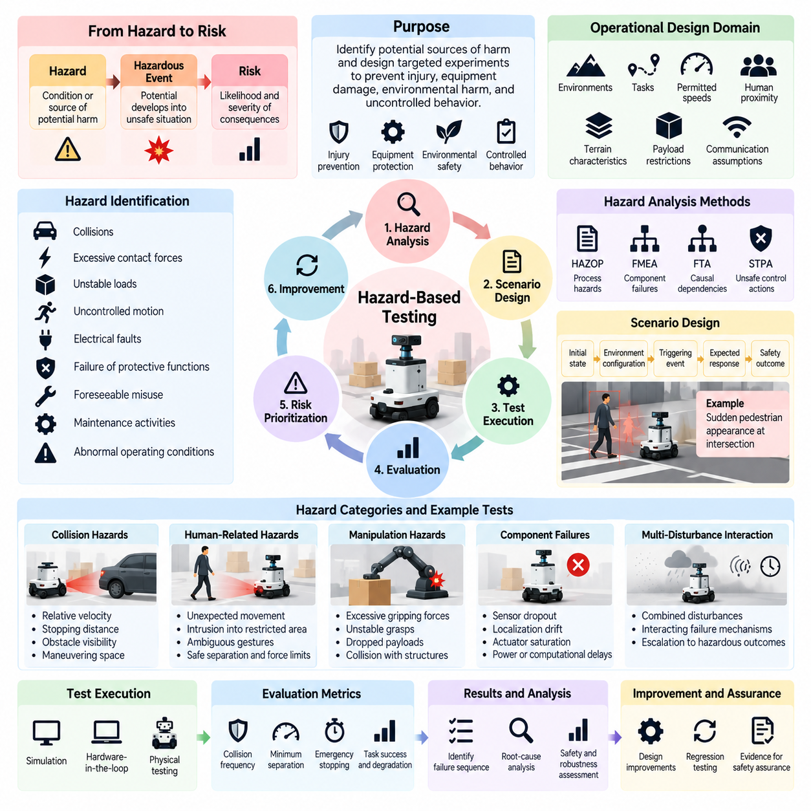{width="7.268055555555556in" height="7.268055555555556in"}

Hazard-based testing is a systematic approach to evaluating Physical AI systems by identifying potential sources of harm and designing experiments around the conditions that could produce hazardous outcomes. Unlike conventional performance testing, which emphasizes task completion and efficiency, hazard-based testing prioritizes the prevention of injury, equipment damage, environmental harm, and uncontrolled physical behavior during autonomous operation.

A hazard represents a condition or source of potential harm, while a hazardous event occurs when circumstances allow that potential to develop into an unsafe situation. Risk additionally considers the likelihood and severity of resulting consequences. These distinctions are essential because a robot may encounter hazardous conditions without causing an accident, yet repeated exposure to such conditions can reveal weaknesses in perception, planning, control, or protective mechanisms.

Hazard identification begins with understanding the robot\'s intended functions, operating environment, physical capabilities, and interactions with humans and other systems. Relevant hazards include collisions, excessive contact forces, unstable loads, uncontrolled motion, electrical faults, and failures of protective functions. The analysis should also consider foreseeable misuse, maintenance activities, and abnormal operating conditions rather than focusing exclusively on nominal tasks.

Structured hazard analysis methods provide a foundation for selecting meaningful tests. Hazard and Operability Study, Failure Mode and Effects Analysis, Fault Tree Analysis, and Systems-Theoretic Process Analysis can reveal different classes of failure mechanisms. These methods examine component faults, causal dependencies, unsafe control actions, and interactions among system elements, allowing test designers to identify scenarios that ordinary task benchmarks may overlook.

The operational design domain establishes the boundaries within which identified hazards must be evaluated. Environmental conditions, permitted speeds, human proximity, terrain characteristics, payload restrictions, and communication assumptions influence both hazard exposure and acceptable protective responses. Testing should distinguish hazards expected within the declared domain from conditions that require the system to restrict operation or transition into a minimum-risk state.

Hazard-based scenarios translate analytical findings into reproducible experiments. Each scenario should specify the initial system state, environmental configuration, triggering event, expected system response, and observable safety outcome. For example, a mobile robot approaching an intersection may encounter a suddenly appearing pedestrian, requiring timely detection, braking, and collision avoidance while maintaining defined separation constraints.

Scenario construction should examine the causal sequence connecting an initiating event to a hazardous outcome. A perception failure may produce an incorrect world representation, which influences trajectory planning and ultimately generates unsafe motion. By observing intermediate states and decisions, evaluators can distinguish the original fault from subsequent control failures and identify where protective mechanisms should interrupt the progression toward harm.

Risk prioritization helps allocate testing resources toward consequential hazards. Severity, exposure, controllability, and estimated occurrence likelihood may contribute to prioritization, depending on the applicable assessment framework. However, low observed frequency should not automatically justify excluding catastrophic hazards. Rare but severe events often require targeted scenarios because ordinary random testing may provide insufficient evidence about their associated failure mechanisms.

Collision hazards are particularly important for autonomous mobile robots, manipulators, humanoids, and aerial platforms. Evaluation should consider relative velocity, stopping distance, obstacle visibility, available maneuvering space, and contact geometry. A collision-free outcome alone is insufficient if the robot repeatedly approaches unsafe separation limits or relies on last-moment emergency responses that may fail under slightly different conditions.

Human-related hazards require special attention because human behavior is variable and difficult to predict. Tests may introduce unexpected pedestrian movement, worker intrusion into restricted zones, delayed human reactions, or ambiguous gestures. Evaluation examines whether the robot recognizes human presence, respects protective distances, limits physical interaction forces, and maintains safe behavior when human intentions cannot be inferred reliably.

Manipulation hazards arise from physical interaction with objects and surrounding structures. Excessive gripping forces, unstable grasps, dropped payloads, and unintended arm movements can damage equipment or injure nearby people. Hazard-based testing should evaluate force limitations, payload stability, collision monitoring, and controlled release behavior under changes in object mass, friction, geometry, and actuator performance.

Component failures provide another important source of hazardous conditions. Sensor dropout, localization drift, actuator saturation, power instability, and computational delays can undermine the assumptions used by autonomous controllers. Controlled failure injection allows evaluators to observe whether the system detects abnormal behavior, preserves essential safety functions, and prevents isolated faults from escalating into hazardous system-level outcomes.

Hazard-based testing must also investigate interactions between multiple disturbances. A partially obscured camera may be tolerable during slow movement, while the same condition combined with high speed and delayed braking can become dangerous. Such combinations reveal dependencies that isolated component tests may miss. Scenario selection should emphasize physically plausible interactions rather than arbitrary combinations of unrelated failures.

Safety constraints provide measurable acceptance criteria for hazardous scenarios. Examples include maximum allowable contact force, minimum separation distance, speed limits, stopping-time requirements, and prohibited workspace entry. Evaluation should record both violations and the margins separating observed behavior from established limits. Safety margins are important because a system operating consistently near a threshold may remain vulnerable to small uncertainties.

Protective response effectiveness is a central outcome of hazard-based evaluation. Safety monitors, emergency stops, collision avoidance controllers, and fallback policies should detect dangerous conditions and intervene before unacceptable consequences occur. Relevant measurements include hazard detection latency, intervention delay, stopping performance, false-negative detection, and successful transition into a defined minimum-risk condition.

Simulation enables systematic exploration of hazardous scenarios that would be expensive or unsafe to reproduce directly with physical hardware. Parameterized environments can vary obstacle motion, sensor degradation, surface friction, and actuator response while recording detailed internal states. Nevertheless, simulated results depend on model fidelity, so critical findings should be validated through appropriately controlled laboratory experiments and real-world testing.

Real-world hazard testing requires safeguards that prevent evaluation activities from creating unnecessary danger. Controlled test zones, physical barriers, emergency stopping provisions, surrogate obstacles, and trained personnel can support experiments involving potentially hazardous behavior. Test procedures should define termination conditions and escalation limits, ensuring that the search for system vulnerabilities does not compromise the safety of participants or surrounding equipment.

Statistical evaluation should distinguish observed safety performance from broader claims about operational risk. Repeated trials can estimate violation frequencies under specified scenarios, while confidence intervals communicate uncertainty. Rare-event methods and importance sampling may improve coverage of critical conditions, but results must account for sampling assumptions before being interpreted as estimates of real-world accident probability.

Traceability connects hazard identification, scenario design, experimental observations, and mitigation requirements. Each identified hazard should be associated with relevant initiating conditions, safety constraints, test cases, and recorded outcomes. This relationship allows engineers to determine which hazards have been evaluated, which protective mechanisms have demonstrated effectiveness, and where unresolved evidence gaps remain before deployment.

Hazard-based testing should continue throughout the Physical AI development lifecycle. Changes to perception models, learned policies, actuators, sensors, or operating environments may introduce new hazardous interactions even when nominal task performance improves. Regression testing and updated hazard analysis are therefore necessary after significant system modifications, particularly when foundation models or adaptive policies alter decision-making behavior.

Ultimately, hazard-based testing transforms abstract safety concerns into observable, measurable, and reproducible evaluation scenarios. Its purpose is not merely to demonstrate that accidents did not occur during testing, but to establish evidence that credible hazardous conditions are recognized, controlled, or mitigated. Integrated with robustness testing and runtime assurance, it provides a foundation for defensible safety claims and responsible Physical AI deployment.

위험 요인 기반 시험(Hazard-Based Testing)은 잠재적인 피해 원인(Potential Sources of Harm)을 식별하고 위험한 결과를 초래할 수 있는 조건을 중심으로 실험을 설계하여 피지컬 인공지능(Physical AI) 시스템을 평가하는 체계적인 접근 방식이다. 작업 완료와 효율성을 강조하는 기존 성능 시험(Performance Testing)과 달리, 위험 요인 기반 시험은 자율 운영(Autonomous Operation) 과정에서 인명 피해, 장비 손상, 환경 피해 및 통제되지 않은 물리적 동작을 방지하는 데 우선순위를 둔다.

위험 요인(Hazard)은 잠재적인 피해를 발생시킬 수 있는 조건이나 원인을 의미하며, 위험 사건(Hazardous Event)은 특정 상황에서 이러한 잠재적 위험이 불안전한 상태(Unsafe Situation)로 발전할 때 발생한다. 위험도(Risk)는 추가적으로 결과의 발생 가능성(Likelihood)과 심각도(Severity)를 고려한다. 이러한 구분은 로봇이 사고를 일으키지 않고도 위험한 조건에 노출될 수 있으며, 이러한 조건에 반복적으로 노출되는 과정에서 인지(Perception), 계획(Planning), 제어(Control) 또는 보호 메커니즘(Protective Mechanism)의 취약점이 드러날 수 있기 때문에 중요하다.

위험 요인 식별(Hazard Identification)은 로봇의 의도된 기능(Intended Function), 운영 환경(Operating Environment), 물리적 능력(Physical Capability), 인간 및 다른 시스템과의 상호작용을 이해하는 것에서 시작한다. 관련 위험 요인에는 충돌(Collision), 과도한 접촉력(Excessive Contact Force), 불안정한 적재물(Unstable Load), 통제되지 않은 동작(Uncontrolled Motion), 전기적 고장(Electrical Fault), 보호 기능 고장(Protective Function Failure) 등이 포함된다. 분석에서는 정상 작업뿐 아니라 예측 가능한 오용(Foreseeable Misuse), 유지보수 활동(Maintenance Activity), 비정상적인 운영 조건도 고려해야 한다.

체계적인 위험 분석(Structured Hazard Analysis) 방법은 의미 있는 시험을 선정하기 위한 기반을 제공한다. 위험 및 운전성 분석(Hazard and Operability Study, HAZOP), 고장 형태 및 영향 분석(Failure Mode and Effects Analysis, FMEA), 결함 수목 분석(Fault Tree Analysis, FTA), 시스템 이론 기반 프로세스 분석(Systems-Theoretic Process Analysis, STPA)은 서로 다른 유형의 고장 메커니즘(Failure Mechanism)을 식별할 수 있다. 이러한 방법은 구성 요소 고장, 인과적 의존성(Causal Dependency), 불안전한 제어 동작(Unsafe Control Action), 시스템 요소 간 상호작용을 분석하여 일반적인 작업 벤치마크(Task Benchmark)에서 놓칠 수 있는 시나리오를 발견하도록 지원한다.

운영 설계 영역(Operational Design Domain, ODD)은 식별된 위험 요인을 평가해야 하는 경계를 설정한다. 환경 조건(Environmental Condition), 허용 속도(Permitted Speed), 인간과의 근접성(Human Proximity), 지형 특성(Terrain Characteristic), 적재물 제한(Payload Restriction), 통신 가정(Communication Assumption)은 위험 노출(Hazard Exposure)과 허용 가능한 보호 응답(Acceptable Protective Response)에 영향을 미친다. 시험에서는 선언된 운영 영역 내에서 예상되는 위험 요인과 시스템이 운영을 제한하거나 최소 위험 상태(Minimum-Risk State)로 전환해야 하는 조건을 구분해야 한다.

위험 요인 기반 시나리오(Hazard-Based Scenario)는 분석 결과를 재현 가능한 실험(Reproducible Experiment)으로 변환한다. 각 시나리오는 초기 시스템 상태(Initial System State), 환경 구성(Environmental Configuration), 유발 사건(Triggering Event), 예상 시스템 응답(Expected System Response), 관측 가능한 안전 결과(Observable Safety Outcome)를 명시해야 한다. 예를 들어 교차로에 접근하는 이동 로봇(Mobile Robot)은 갑자기 나타나는 보행자를 마주할 수 있으며, 이때 정의된 이격 거리 제약(Separation Constraint)을 유지하면서 적시에 감지, 제동 및 충돌 회피를 수행해야 한다.

시나리오 구성(Scenario Construction)은 초기 유발 사건(Initiating Event)에서 위험한 결과(Hazardous Outcome)로 이어지는 인과적 연쇄(Causal Sequence)를 분석해야 한다. 인지 실패(Perception Failure)는 잘못된 세계 표현(World Representation)을 생성하고, 이는 이동 궤적 계획(Trajectory Planning)에 영향을 미쳐 궁극적으로 불안전한 동작을 발생시킬 수 있다. 평가자는 중간 상태(Intermediate State)와 의사결정(Decision)을 관찰하여 최초 고장과 후속 제어 실패를 구분하고, 보호 메커니즘이 피해로 이어지는 진행 과정을 어느 지점에서 차단해야 하는지 식별할 수 있다.

위험도 우선순위 결정(Risk Prioritization)은 중대한 위험 요인에 시험 자원을 집중하도록 지원한다. 적용되는 평가 프레임워크(Evaluation Framework)에 따라 심각도(Severity), 노출도(Exposure), 제어 가능성(Controllability), 추정 발생 가능성(Estimated Occurrence Likelihood)이 우선순위 결정에 반영될 수 있다. 그러나 관측 빈도가 낮다는 이유만으로 치명적인 위험 요인을 자동으로 제외해서는 안 된다. 발생 가능성은 낮지만 결과가 심각한 사건은 일반적인 무작위 시험(Random Testing)만으로 관련 고장 메커니즘에 대한 충분한 근거를 확보하기 어려우므로 표적 시나리오(Targeted Scenario)가 필요한 경우가 많다.

충돌 위험(Collision Hazard)은 자율 이동 로봇(Autonomous Mobile Robot), 매니퓰레이터(Manipulator), 휴머노이드(Humanoid), 항공 플랫폼(Aerial Platform)에서 특히 중요하다. 평가에서는 상대 속도(Relative Velocity), 정지 거리(Stopping Distance), 장애물 가시성(Obstacle Visibility), 사용 가능한 회피 공간(Available Maneuvering Space), 접촉 형상(Contact Geometry)을 고려해야 한다. 로봇이 불안전한 이격 거리 한계에 반복적으로 접근하거나 조금만 다른 조건에서도 실패할 수 있는 최후 순간의 비상 대응(Last-Moment Emergency Response)에 의존한다면, 충돌이 발생하지 않았다는 결과만으로는 충분하지 않다.

인간 관련 위험 요인(Human-Related Hazard)은 인간 행동이 다양하고 예측하기 어렵기 때문에 특별한 주의가 필요하다. 시험에서는 예상하지 못한 보행자 이동(Unexpected Pedestrian Movement), 제한 구역으로의 작업자 진입(Worker Intrusion), 지연된 인간 반응(Delayed Human Reaction), 모호한 몸짓(Ambiguous Gesture) 등을 도입할 수 있다. 평가는 로봇이 인간의 존재를 인식하고 보호 거리(Protective Distance)를 준수하며 물리적 상호작용 힘(Physical Interaction Force)을 제한하고, 인간의 의도를 신뢰성 있게 추론할 수 없는 상황에서도 안전한 행동을 유지하는지를 검증한다.

조작 위험 요인(Manipulation Hazard)은 물체 및 주변 구조물과의 물리적 상호작용(Physical Interaction)에서 발생한다. 과도한 파지력(Excessive Gripping Force), 불안정한 파지(Unstable Grasp), 적재물 낙하(Dropped Payload), 의도하지 않은 로봇 팔 동작(Unintended Arm Movement)은 장비를 손상시키거나 주변 사람에게 부상을 입힐 수 있다. 위험 요인 기반 시험은 물체 질량(Object Mass), 마찰(Friction), 형상(Geometry), 구동기 성능(Actuator Performance)이 변화하는 조건에서 힘 제한(Force Limitation), 적재물 안정성(Payload Stability), 충돌 감시(Collision Monitoring), 제어된 물체 해제 동작(Controlled Release Behavior)을 평가해야 한다.

구성 요소 고장(Component Failure)은 위험한 조건을 발생시키는 또 다른 중요한 원인이다. 센서 신호 손실(Sensor Dropout), 위치 추정 드리프트(Localization Drift), 구동기 포화(Actuator Saturation), 전력 불안정(Power Instability), 연산 지연(Computational Delay)은 자율 제어기(Autonomous Controller)가 사용하는 기본 가정을 무너뜨릴 수 있다. 통제된 고장 주입(Controlled Failure Injection)을 통해 평가자는 시스템이 비정상적인 동작을 감지하고 필수 안전 기능(Essential Safety Function)을 유지하며, 개별 고장이 위험한 시스템 수준의 결과로 확대되는 것을 방지하는지 관찰할 수 있다.

위험 요인 기반 시험은 여러 외란(Multiple Disturbances) 사이의 상호작용도 조사해야 한다. 부분적으로 가려진 카메라(Partially Obscured Camera)는 저속 이동 중에는 허용될 수 있지만, 동일한 조건이 고속 주행 및 지연된 제동(Delayed Braking)과 결합되면 위험해질 수 있다. 이러한 조합은 개별 구성 요소 시험(Component Test)에서 발견하지 못할 수 있는 의존 관계(Dependency)를 드러낸다. 시나리오 선정에서는 서로 무관한 고장을 임의로 결합하기보다 물리적으로 타당한 상호작용(Physically Plausible Interaction)을 강조해야 한다.

안전 제약 조건(Safety Constraint)은 위험 시나리오에 대한 측정 가능한 합격 기준(Measurable Acceptance Criteria)을 제공한다. 대표적인 예에는 최대 허용 접촉력(Maximum Allowable Contact Force), 최소 이격 거리(Minimum Separation Distance), 속도 제한(Speed Limit), 정지 시간 요구사항(Stopping-Time Requirement), 금지된 작업 공간 진입(Prohibited Workspace Entry) 등이 있다. 평가는 위반 여부뿐 아니라 관측된 동작과 설정된 한계 사이의 여유도(Margin)도 기록해야 한다. 안전 여유도(Safety Margin)가 중요한 이유는 시스템이 지속적으로 임계값(Threshold) 근처에서 작동하면 작은 불확실성에도 취약해질 수 있기 때문이다.

보호 응답 효과(Protective Response Effectiveness)는 위험 요인 기반 평가의 핵심 결과이다. 안전 감시기(Safety Monitor), 비상 정지(Emergency Stop), 충돌 회피 제어기(Collision Avoidance Controller), 대체 정책(Fallback Policy)은 위험한 조건을 감지하고 허용할 수 없는 결과가 발생하기 전에 개입해야 한다. 관련 측정 항목에는 위험 감지 지연 시간(Hazard Detection Latency), 개입 지연(Intervention Delay), 정지 성능(Stopping Performance), 미탐지(False-Negative Detection), 정의된 최소 위험 상태로의 성공적인 전환 등이 포함된다.

시뮬레이션(Simulation)은 실제 하드웨어(Physical Hardware)에서 재현하기에 비용이 많이 들거나 위험한 시나리오를 체계적으로 탐색할 수 있도록 지원한다. 매개변수화된 환경(Parameterized Environment)은 장애물 이동(Obstacle Motion), 센서 성능 저하(Sensor Degradation), 표면 마찰(Surface Friction), 구동기 응답(Actuator Response)을 변화시키면서 상세한 내부 상태(Internal State)를 기록할 수 있다. 그러나 시뮬레이션 결과는 모델 충실도(Model Fidelity)에 의존하므로 중요한 발견 사항은 적절히 통제된 실험실 실험(Laboratory Experiment)과 실제 환경 시험(Real-World Testing)을 통해 검증해야 한다.

실제 환경 위험 시험(Real-World Hazard Testing)에는 평가 활동 자체가 불필요한 위험을 발생시키지 않도록 하는 안전 조치(Safeguard)가 필요하다. 통제된 시험 구역(Controlled Test Zone), 물리적 방호벽(Physical Barrier), 비상 정지 장치(Emergency Stopping Provision), 대체 장애물(Surrogate Obstacle), 훈련된 인력(Trained Personnel)은 잠재적으로 위험한 행동을 포함하는 실험을 지원할 수 있다. 시험 절차(Test Procedure)는 종료 조건(Termination Condition)과 위험 확대 제한(Escalation Limit)을 정의하여 시스템 취약점을 탐색하는 과정에서 참가자나 주변 장비의 안전이 훼손되지 않도록 해야 한다.

통계적 평가(Statistical Evaluation)는 관측된 안전 성능(Observed Safety Performance)과 운영 위험도(Operational Risk)에 대한 광범위한 주장을 구분해야 한다. 반복 시험(Repeated Trial)은 지정된 시나리오에서 위반 빈도(Violation Frequency)를 추정할 수 있으며, 신뢰 구간(Confidence Interval)은 불확실성을 전달한다. 희귀 사건 분석 방법(Rare-Event Method)과 중요도 표본 추출(Importance Sampling)은 핵심 조건의 평가 범위를 확대할 수 있지만, 결과를 실제 사고 확률(Real-World Accident Probability)의 추정치로 해석하기 전에 표본 추출 가정(Sampling Assumption)을 고려해야 한다.

추적성(Traceability)은 위험 요인 식별, 시나리오 설계, 실험 관측 결과 및 위험 완화 요구사항(Mitigation Requirement)을 연결한다. 식별된 각 위험 요인은 관련 초기 유발 조건(Initiating Condition), 안전 제약 조건, 시험 사례(Test Case), 기록된 결과(Recorded Outcome)와 연계되어야 한다. 이러한 관계를 통해 엔지니어는 어떤 위험 요인이 평가되었는지, 어떤 보호 메커니즘의 효과가 입증되었는지, 실제 배치(Deployment) 이전에 해결되지 않은 증거 공백(Evidence Gap)이 어디에 남아 있는지 판단할 수 있다.

위험 요인 기반 시험은 피지컬 인공지능 개발 생명주기(Physical AI Development Lifecycle) 전반에 걸쳐 지속되어야 한다. 인지 모델(Perception Model), 학습된 정책(Learned Policy), 구동기(Actuator), 센서(Sensor), 운영 환경의 변경은 정상 작업 성능(Nominal Task Performance)이 향상되더라도 새로운 위험 상호작용(Hazardous Interaction)을 발생시킬 수 있다. 따라서 중요한 시스템 변경 이후에는 회귀 시험(Regression Testing)과 갱신된 위험 분석(Updated Hazard Analysis)이 필요하며, 특히 파운데이션 모델(Foundation Model)이나 적응형 정책(Adaptive Policy)이 의사결정 동작을 변화시키는 경우 더욱 중요하다.

궁극적으로 위험 요인 기반 시험은 추상적인 안전 문제(Abstract Safety Concern)를 관측 가능하고 측정 가능하며 재현 가능한 평가 시나리오(Observable, Measurable, and Reproducible Evaluation Scenario)로 변환한다. 그 목적은 단순히 시험 중 사고가 발생하지 않았음을 보여주는 것이 아니라, 실제로 발생 가능한 위험 조건(Credible Hazardous Condition)이 인식되고 통제되거나 완화된다는 근거를 확보하는 데 있다. 강건성 시험(Robustness Testing) 및 실행시간 보증(Runtime Assurance)과 통합하면 정당화 가능한 안전성 주장(Defensible Safety Claim)과 책임 있는 피지컬 인공지능 배치(Responsible Physical AI Deployment)를 위한 기반을 제공한다.

##  

## 05.03. Safety Critical Scenario Design

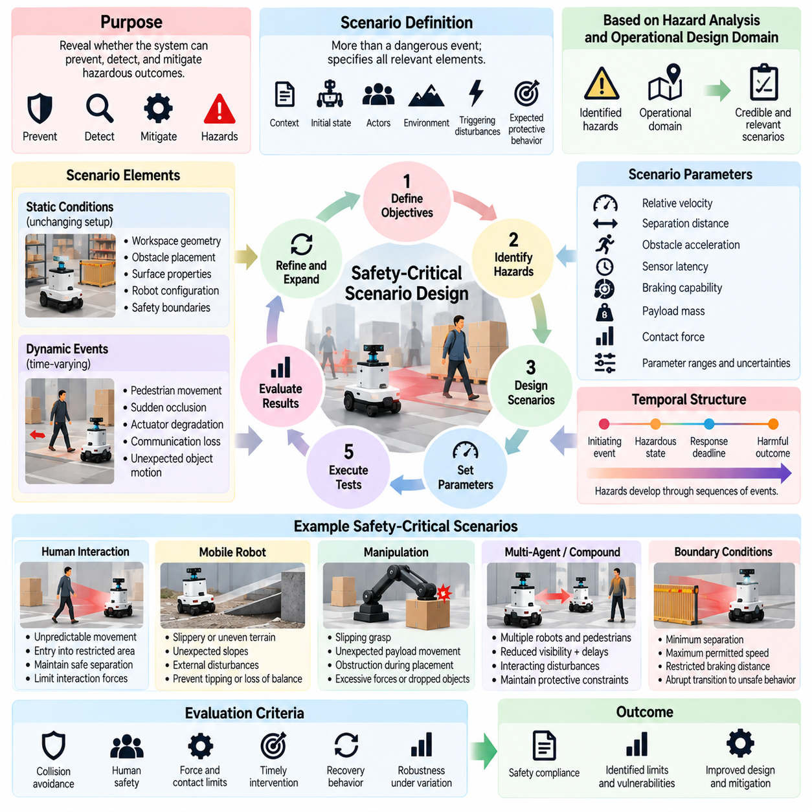{width="7.268055555555556in" height="7.268055555555556in"}

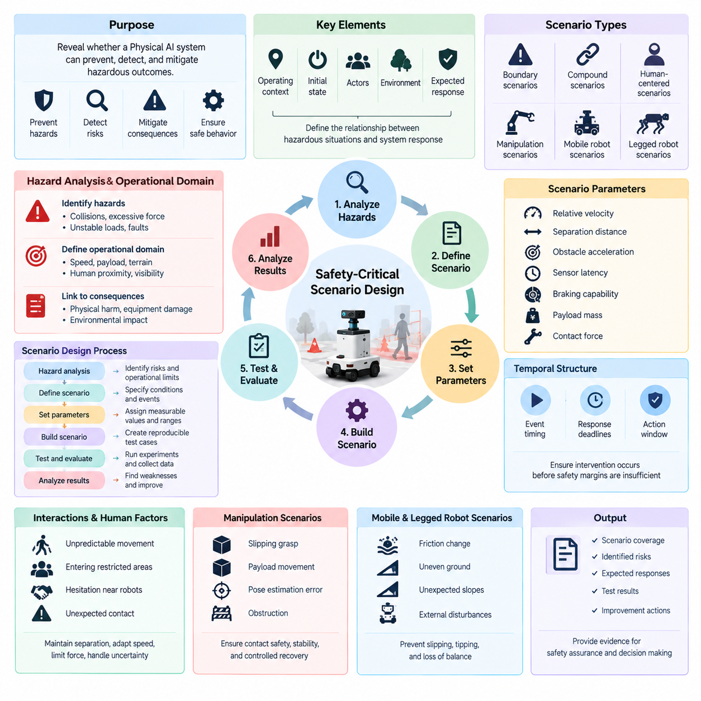{width="7.268055555555556in" height="7.268055555555556in"}

Safety-critical scenario design is the process of constructing test situations that reveal whether a Physical AI system can prevent, detect, and mitigate hazardous outcomes. Unlike ordinary task evaluation, which emphasizes successful execution under representative conditions, safety-critical testing concentrates on situations where perception errors, planning failures, environmental disturbances, or delayed control responses could produce unacceptable physical consequences.

A safety-critical scenario describes more than a dangerous event. It specifies the operating context, initial system state, relevant actors, environmental conditions, triggering disturbances, and expected protective behavior. These elements establish a reproducible relationship between a hazardous situation and the system\'s response. Well-defined scenarios enable evaluators to distinguish safe intervention from accidental avoidance or favorable environmental circumstances.

Scenario design begins with hazard analysis and the operational design domain. Identified hazards provide the potential consequences to investigate, while the operational domain defines where and how the robot is expected to operate. The resulting scenarios should reflect credible combinations of speed, payload, terrain, human proximity, visibility, and system limitations rather than arbitrary extreme conditions disconnected from intended deployment.

A useful scenario specification separates static conditions from dynamic events. Static conditions include workspace geometry, obstacle placement, surface properties, robot configuration, and safety boundaries. Dynamic events include pedestrian movement, sudden occlusion, actuator degradation, communication interruption, and unexpected object motion. This separation allows controlled variation while preserving the causal structure of the experiment.

Scenario parameters should represent measurable physical quantities whenever possible. Relative velocity, separation distance, obstacle acceleration, sensor latency, braking capability, payload mass, and contact force can define test conditions precisely. Parameter ranges should reflect operational assumptions and credible uncertainties. Explicit parameterization supports repeatability, systematic stress testing, and comparison across different Physical AI implementations.

Safety-critical scenarios frequently involve interactions between multiple agents. A mobile robot may encounter a pedestrian changing direction, another robot entering a shared corridor, or a worker unexpectedly crossing its planned route. Evaluation should examine whether the system recognizes conflicting intentions, predicts possible interactions, and maintains protective constraints without relying on unrealistic assumptions about human cooperation.

Temporal structure is essential because hazards develop through sequences of events rather than isolated observations. A delayed obstacle detection may be harmless at low speed but dangerous when combined with limited stopping distance. Scenario specifications should therefore describe event timing, response deadlines, and the interval available for protective action. Testing must capture whether interventions occur before safety margins become insufficient.

Scenario designers should distinguish initiating events, hazardous system states, and harmful outcomes. A camera failure is an initiating event, while continued high-speed movement without reliable obstacle detection may represent a hazardous state. Physical collision is a possible harmful outcome. Evaluating these stages separately helps identify whether detection, decision-making, or control mechanisms failed to interrupt the progression toward harm.

Boundary scenarios investigate conditions near the limits of safe operation. Examples include minimum allowable separation, maximum permitted velocity, restricted braking distance, and the threshold of reliable localization. Small parameter changes around these boundaries can reveal abrupt transitions from acceptable behavior to safety violations. Such tests are especially valuable for identifying fragile assumptions hidden by successful nominal operation.

Compound scenarios combine disturbances that may interact causally. Reduced visibility, slippery surfaces, delayed sensor updates, and unexpected pedestrian movement may individually remain manageable but collectively exceed the system\'s capabilities. Scenario construction should prioritize physically plausible combinations and document their dependencies. Arbitrary combinations may increase test difficulty without improving understanding of credible operational risks.

Human-centered scenarios require realistic representations of human behavior and vulnerability. Relevant situations include unpredictable walking trajectories, entry into restricted workspaces, hesitation near moving robots, and unexpected contact during collaborative manipulation. Evaluation should examine separation maintenance, speed adaptation, force limitation, and the ability to respond safely when human intentions remain uncertain.

Manipulation scenarios emphasize contact dynamics and object stability. A robot arm may experience a slipping grasp, unexpected payload movement, inaccurate object pose estimation, or obstruction during placement. These conditions can produce dropped objects, excessive forces, or unintended collisions. Test scenarios should specify contact constraints, payload characteristics, workspace boundaries, and acceptable recovery actions.

Mobile and legged robot scenarios introduce additional hazards associated with stability and terrain interaction. Sudden changes in friction, uneven ground, unexpected slopes, and external disturbances may cause slipping, tipping, or loss of balance. Safety-critical evaluation should consider whether the robot reduces speed, modifies its trajectory, stabilizes its posture, or transitions into a controlled protective state before instability becomes dangerous.

Failure injection expands scenario coverage by introducing controlled faults into sensors, actuators, communication systems, and computing resources. Examples include intermittent LiDAR dropout, corrupted localization estimates, delayed motor commands, and processor overload. The scenario should specify fault onset, duration, magnitude, and recovery conditions, allowing evaluators to determine whether safety functions remain effective despite degraded components.

Uncertainty-aware scenarios investigate situations where the system cannot confidently interpret its surroundings. Unfamiliar objects, ambiguous visual observations, incomplete maps, and unpredictable agent behavior can challenge learned perception and world models. Evaluation should examine whether uncertainty is detected and whether the robot appropriately slows down, requests assistance, replans, or enters a minimum-risk condition.

Expected system behavior must be defined independently of the policy being evaluated. Acceptance criteria may include collision avoidance, stopping before a protected boundary, maintaining force limits, or achieving a safe fallback state within a specified interval. This prevents evaluators from treating any successful task outcome as evidence of safety and supports consistent comparison between different algorithms and robotic platforms.

Scenario execution should record both final outcomes and intermediate system behavior. Relevant observations include sensor measurements, estimated states, predicted trajectories, planned actions, control commands, safety-monitor interventions, and physical responses. Time-synchronized records enable causal analysis of hazardous events and reveal whether apparent safety resulted from effective protection or favorable circumstances.

Simulation provides a scalable environment for exploring rare and dangerous situations. Parameter sweeps, randomized scenario generation, and targeted search can identify combinations that produce safety violations. However, scenario credibility depends on accurate representations of sensing, dynamics, contact, and agent behavior. Critical findings require validation through controlled physical experiments when safe and technically feasible.

Coverage analysis determines whether the scenario collection adequately represents identified hazards and operating conditions. Coverage should consider hazard categories, environmental parameters, failure modes, interaction patterns, and severity levels. Large numbers of similar tests do not necessarily provide broad safety evidence. Scenario diversity and traceability to hazard analysis are more informative than raw test volume.

Statistical evaluation must account for scenario selection and repeated execution. Violation rates, intervention latency, minimum safety margins, and recovery success can be reported with uncertainty estimates. Results from deliberately concentrated high-risk scenarios should not be interpreted directly as operational accident probabilities. The relationship between test distributions and real-world exposure must remain explicit.

Safety-critical scenario libraries should evolve as Physical AI systems change. Updated perception models, learned policies, robot morphology, hardware configurations, and deployment environments may introduce previously unrecognized hazardous interactions. Versioned scenarios and regression testing help preserve evaluation consistency while incorporating newly observed failures, near misses, and operational lessons.

Ultimately, safety-critical scenario design transforms hazard analysis into structured experimental evidence. Effective scenarios expose the conditions under which safety mechanisms succeed, degrade, or fail, while making the causal relationships between disturbances and outcomes observable. Combined with robustness evaluation, failure injection, and runtime assurance testing, this approach supports defensible safety boundaries and responsible deployment of Physical AI systems.

안전 필수 시나리오 설계(Safety-Critical Scenario Design)는 피지컬 인공지능(Physical AI) 시스템이 위험한 결과(Hazardous Outcome)를 예방, 감지 및 완화할 수 있는지를 검증하기 위한 시험 상황을 구성하는 과정이다. 대표적인 조건에서 성공적인 작업 수행을 강조하는 일반적인 작업 평가(Task Evaluation)와 달리, 안전 필수 시험(Safety-Critical Testing)은 인지 오류(Perception Error), 계획 실패(Planning Failure), 환경 외란(Environmental Disturbance), 지연된 제어 응답(Delayed Control Response)이 허용할 수 없는 물리적 결과를 초래할 수 있는 상황에 집중한다.

안전 필수 시나리오(Safety-Critical Scenario)는 단순히 위험한 사건을 기술하는 것 이상의 의미를 가진다. 운영 맥락(Operating Context), 초기 시스템 상태(Initial System State), 관련 행위자(Relevant Actor), 환경 조건(Environmental Condition), 유발 외란(Triggering Disturbance), 예상 보호 행동(Expected Protective Behavior)을 명시한다. 이러한 요소는 위험 상황과 시스템 응답 사이에 재현 가능한 관계를 설정한다. 잘 정의된 시나리오는 평가자가 안전한 개입(Safe Intervention)을 우연한 회피(Accidental Avoidance)나 유리한 환경 조건(Favorable Environmental Circumstance)과 구별할 수 있도록 한다.

시나리오 설계는 위험 요인 분석(Hazard Analysis)과 운영 설계 영역(Operational Design Domain, ODD)에서 시작한다. 식별된 위험 요인은 조사해야 할 잠재적 결과를 제공하며, 운영 영역은 로봇이 어디에서 어떤 방식으로 작동해야 하는지를 정의한다. 이에 따라 도출된 시나리오는 의도된 배치 환경(Intended Deployment)과 무관한 임의의 극단적 조건이 아니라 속도, 적재물, 지형, 인간과의 근접성, 가시성 및 시스템 한계가 결합된 현실적으로 발생 가능한 조건을 반영해야 한다.

유용한 시나리오 명세(Scenario Specification)는 정적 조건(Static Condition)과 동적 사건(Dynamic Event)을 구분한다. 정적 조건에는 작업 공간 형상(Workspace Geometry), 장애물 배치(Obstacle Placement), 표면 특성(Surface Property), 로봇 구성(Robot Configuration), 안전 경계(Safety Boundary)가 포함된다. 동적 사건에는 보행자 이동(Pedestrian Movement), 갑작스러운 가림(Sudden Occlusion), 구동기 성능 저하(Actuator Degradation), 통신 중단(Communication Interruption), 예상하지 못한 물체 이동(Unexpected Object Motion)이 포함된다. 이러한 구분은 실험의 인과적 구조(Causal Structure)를 유지하면서 통제된 변화를 가능하게 한다.

시나리오 매개변수(Scenario Parameter)는 가능한 경우 측정 가능한 물리량(Physical Quantity)으로 표현해야 한다. 상대 속도(Relative Velocity), 이격 거리(Separation Distance), 장애물 가속도(Obstacle Acceleration), 센서 지연 시간(Sensor Latency), 제동 능력(Braking Capability), 적재물 질량(Payload Mass), 접촉력(Contact Force)을 통해 시험 조건을 정확하게 정의할 수 있다. 매개변수 범위(Parameter Range)는 운영 가정(Operational Assumption)과 현실적으로 발생 가능한 불확실성을 반영해야 한다. 명시적인 매개변수화(Explicit Parameterization)는 반복 가능성(Repeatability), 체계적인 스트레스 시험(Systematic Stress Testing), 서로 다른 피지컬 인공지능 구현 간 비교를 지원한다.

안전 필수 시나리오는 여러 행위자(Multiple Agent) 사이의 상호작용을 포함하는 경우가 많다. 이동 로봇은 방향을 변경하는 보행자, 공용 통로에 진입하는 다른 로봇, 계획된 경로를 갑자기 가로지르는 작업자를 마주할 수 있다. 평가에서는 시스템이 상충하는 의도(Conflicting Intention)를 인식하고 가능한 상호작용을 예측하며, 인간의 협조에 대한 비현실적인 가정에 의존하지 않고 보호 제약 조건(Protective Constraint)을 유지하는지를 검증해야 한다.

시간적 구조(Temporal Structure)는 위험이 고립된 관측값이 아니라 일련의 사건을 통해 발전하기 때문에 필수적이다. 장애물 감지 지연(Delayed Obstacle Detection)은 저속에서는 무해할 수 있지만 정지 거리가 제한된 상황에서는 위험해질 수 있다. 따라서 시나리오 명세는 사건 발생 시점(Event Timing), 응답 기한(Response Deadline), 보호 동작에 사용할 수 있는 시간 간격을 기술해야 한다. 시험에서는 안전 여유도(Safety Margin)가 부족해지기 전에 개입이 이루어지는지를 확인해야 한다.

시나리오 설계자는 초기 유발 사건(Initiating Event), 위험한 시스템 상태(Hazardous System State), 유해한 결과(Harmful Outcome)를 구분해야 한다. 카메라 고장(Camera Failure)은 초기 유발 사건이며, 신뢰할 수 있는 장애물 감지 없이 고속 이동을 계속하는 것은 위험한 상태에 해당할 수 있다. 물리적 충돌(Physical Collision)은 발생 가능한 유해한 결과이다. 이러한 단계를 개별적으로 평가하면 감지(Detection), 의사결정(Decision-Making), 제어(Control) 메커니즘 중 어느 부분이 피해로 이어지는 진행 과정을 차단하지 못했는지 식별하는 데 도움이 된다.

경계 시나리오(Boundary Scenario)는 안전한 운영 한계(Safe Operating Limit)에 근접한 조건을 조사한다. 대표적인 예에는 최소 허용 이격 거리(Minimum Allowable Separation), 최대 허용 속도(Maximum Permitted Velocity), 제한된 제동 거리(Restricted Braking Distance), 신뢰할 수 있는 위치 추정의 임계값(Reliable Localization Threshold)이 있다. 이러한 경계 근처에서 매개변수를 조금씩 변화시키면 허용 가능한 행동에서 안전 위반(Safety Violation)으로 급격하게 전환되는 현상을 발견할 수 있다. 이러한 시험은 정상 운영의 성공적인 결과에 가려진 취약한 가정(Fragile Assumption)을 식별하는 데 특히 유용하다.

복합 시나리오(Compound Scenario)는 인과적으로 상호작용할 수 있는 여러 외란을 결합한다. 가시성 저하(Reduced Visibility), 미끄러운 표면(Slippery Surface), 지연된 센서 갱신(Delayed Sensor Update), 예상하지 못한 보행자 이동은 개별적으로는 대응할 수 있지만 함께 발생하면 시스템 능력을 초과할 수 있다. 시나리오 구성에서는 물리적으로 타당한 조합(Physically Plausible Combination)을 우선시하고 그 의존 관계(Dependency)를 문서화해야 한다. 임의의 조합은 현실적인 운영 위험(Credible Operational Risk)에 대한 이해를 높이지 못하면서 시험 난이도만 증가시킬 수 있다.

인간 중심 시나리오(Human-Centered Scenario)는 인간 행동(Human Behavior)과 취약성(Human Vulnerability)을 현실적으로 표현해야 한다. 관련 상황에는 예측하기 어려운 보행 궤적(Unpredictable Walking Trajectory), 제한된 작업 공간으로의 진입(Restricted Workspace Entry), 이동 로봇 근처에서의 주저하는 행동(Hesitation), 협업 조작(Collaborative Manipulation) 중 예상하지 못한 접촉 등이 포함된다. 평가는 이격 거리 유지(Separation Maintenance), 속도 적응(Speed Adaptation), 힘 제한(Force Limitation), 인간의 의도가 불확실한 상황에서 안전하게 대응하는 능력을 검증해야 한다.

조작 시나리오(Manipulation Scenario)는 접촉 동역학(Contact Dynamics)과 물체 안정성(Object Stability)을 강조한다. 로봇 팔(Robot Arm)은 파지 미끄러짐(Slipping Grasp), 예상하지 못한 적재물 이동(Unexpected Payload Movement), 부정확한 물체 자세 추정(Inaccurate Object Pose Estimation), 물체 배치 중 장애물 간섭(Obstruction During Placement)을 경험할 수 있다. 이러한 조건은 물체 낙하(Dropped Object), 과도한 힘(Excessive Force), 의도하지 않은 충돌(Unintended Collision)을 발생시킬 수 있다. 시험 시나리오는 접촉 제약 조건(Contact Constraint), 적재물 특성(Payload Characteristic), 작업 공간 경계(Workspace Boundary), 허용 가능한 복구 동작(Acceptable Recovery Action)을 명시해야 한다.

이동 로봇(Mobile Robot)과 다족 보행 로봇(Legged Robot)의 시나리오는 안정성(Stability) 및 지형 상호작용(Terrain Interaction)과 관련된 추가적인 위험을 포함한다. 마찰의 갑작스러운 변화(Sudden Friction Change), 불균일한 지면(Uneven Ground), 예상하지 못한 경사(Unexpected Slope), 외부 외란(External Disturbance)은 미끄러짐(Slipping), 전복(Tipping), 균형 상실(Loss of Balance)을 초래할 수 있다. 안전 필수 평가에서는 불안정성이 위험한 상태로 발전하기 전에 로봇이 속도를 줄이고, 이동 궤적을 수정하고, 자세를 안정화하거나, 통제된 보호 상태(Controlled Protective State)로 전환하는지를 고려해야 한다.

고장 주입(Failure Injection)은 센서(Sensor), 구동기(Actuator), 통신 시스템(Communication System), 컴퓨팅 자원(Computing Resource)에 통제된 결함을 도입하여 시나리오 평가 범위(Scenario Coverage)를 확장한다. 대표적인 예에는 간헐적인 라이다 신호 손실(Intermittent LiDAR Dropout), 손상된 위치 추정값(Corrupted Localization Estimate), 지연된 모터 명령(Delayed Motor Command), 프로세서 과부하(Processor Overload)가 있다. 시나리오는 고장 시작 시점(Fault Onset), 지속 시간(Duration), 크기(Magnitude), 복구 조건(Recovery Condition)을 명시하여 구성 요소의 성능이 저하된 상태에서도 안전 기능이 효과적으로 유지되는지를 판단할 수 있도록 해야 한다.

불확실성 인식 시나리오(Uncertainty-Aware Scenario)는 시스템이 주변 환경을 확신 있게 해석할 수 없는 상황을 조사한다. 익숙하지 않은 물체(Unfamiliar Object), 모호한 시각 관측(Ambiguous Visual Observation), 불완전한 지도(Incomplete Map), 예측하기 어려운 행위자 행동(Unpredictable Agent Behavior)은 학습된 인지 모델(Learned Perception Model)과 세계 모델(World Model)에 도전적인 조건을 제공한다. 평가에서는 불확실성이 감지되는지, 그리고 로봇이 적절하게 감속하거나 지원을 요청하고, 재계획(Replanning)을 수행하거나, 최소 위험 상태(Minimum-Risk Condition)로 진입하는지를 검증해야 한다.

예상 시스템 행동(Expected System Behavior)은 평가 대상 정책(Evaluated Policy)과 독립적으로 정의해야 한다. 합격 기준(Acceptance Criteria)에는 충돌 회피(Collision Avoidance), 보호 경계(Protected Boundary)에 도달하기 전 정지, 힘 제한(Force Limit) 준수, 지정된 시간 내 안전한 대체 상태(Safe Fallback State) 달성 등이 포함될 수 있다. 이러한 접근 방식은 평가자가 작업의 성공적인 결과를 무조건 안전성의 근거로 간주하는 것을 방지하고, 서로 다른 알고리즘(Algorithm)과 로봇 플랫폼(Robotic Platform) 사이의 일관된 비교를 지원한다.

시나리오 실행(Scenario Execution)에서는 최종 결과(Final Outcome)뿐 아니라 중간 시스템 동작(Intermediate System Behavior)도 기록해야 한다. 관련 관측 항목에는 센서 측정값(Sensor Measurement), 추정 상태(Estimated State), 예측 궤적(Predicted Trajectory), 계획된 행동(Planned Action), 제어 명령(Control Command), 안전 감시기 개입(Safety-Monitor Intervention), 물리적 응답(Physical Response)이 포함된다. 시간 동기화 기록(Time-Synchronized Record)은 위험 사건의 인과 분석(Causal Analysis)을 가능하게 하고, 겉으로 드러난 안전성이 효과적인 보호 기능에서 비롯되었는지 또는 유리한 상황 때문이었는지를 밝혀준다.

시뮬레이션(Simulation)은 드물고 위험한 상황을 탐색하기 위한 확장 가능한 환경(Scalable Environment)을 제공한다. 매개변수 탐색(Parameter Sweep), 무작위 시나리오 생성(Randomized Scenario Generation), 표적 탐색(Targeted Search)은 안전 위반을 발생시키는 조건의 조합을 식별할 수 있다. 그러나 시나리오의 신뢰성(Scenario Credibility)은 센싱(Sensing), 동역학(Dynamics), 접촉(Contact), 행위자 행동(Agent Behavior)을 정확하게 표현하는 데 달려 있다. 중요한 발견 사항은 안전하고 기술적으로 가능한 경우 통제된 물리적 실험(Controlled Physical Experiment)을 통해 검증해야 한다.

평가 범위 분석(Coverage Analysis)은 시나리오 집합(Scenario Collection)이 식별된 위험 요인과 운영 조건을 충분히 대표하는지를 판단한다. 평가 범위는 위험 범주(Hazard Category), 환경 매개변수(Environmental Parameter), 고장 형태(Failure Mode), 상호작용 패턴(Interaction Pattern), 심각도 수준(Severity Level)을 고려해야 한다. 유사한 시험을 대량으로 수행한다고 해서 반드시 폭넓은 안전성 근거(Safety Evidence)가 확보되는 것은 아니다. 단순한 시험 횟수보다 시나리오 다양성(Scenario Diversity)과 위험 분석에 대한 추적성(Traceability)이 더 유용한 정보를 제공한다.

통계적 평가(Statistical Evaluation)는 시나리오 선정(Scenario Selection)과 반복 실행(Repeated Execution)을 고려해야 한다. 위반율(Violation Rate), 개입 지연 시간(Intervention Latency), 최소 안전 여유도(Minimum Safety Margin), 복구 성공률(Recovery Success Rate)은 불확실성 추정값(Uncertainty Estimate)과 함께 보고할 수 있다. 의도적으로 고위험 시나리오(High-Risk Scenario)에 집중한 결과를 실제 운영 사고 확률(Operational Accident Probability)로 직접 해석해서는 안 된다. 시험 분포(Test Distribution)와 실제 환경 노출(Real-World Exposure) 사이의 관계를 명확하게 유지해야 한다.

안전 필수 시나리오 라이브러리(Safety-Critical Scenario Library)는 피지컬 인공지능 시스템의 변화에 따라 발전해야 한다. 갱신된 인지 모델(Perception Model), 학습된 정책(Learned Policy), 로봇 형태(Robot Morphology), 하드웨어 구성(Hardware Configuration), 배치 환경(Deployment Environment)은 이전에 인식하지 못했던 위험 상호작용(Hazardous Interaction)을 발생시킬 수 있다. 버전 관리된 시나리오(Versioned Scenario)와 회귀 시험(Regression Testing)은 새롭게 관측된 고장(Failure), 아차 사고(Near Miss), 운영 경험(Operational Lesson)을 반영하면서 평가의 일관성을 유지하는 데 도움이 된다.

궁극적으로 안전 필수 시나리오 설계는 위험 요인 분석(Hazard Analysis)을 구조화된 실험적 근거(Structured Experimental Evidence)로 변환한다. 효과적인 시나리오는 안전 메커니즘(Safety Mechanism)이 성공하거나 성능이 저하되거나 실패하는 조건을 드러내며, 외란과 결과 사이의 인과 관계(Causal Relationship)를 관측 가능하게 한다. 이러한 접근 방식은 강건성 평가(Robustness Evaluation), 고장 주입(Failure Injection), 실행시간 보증 시험(Runtime Assurance Testing)과 결합되어 정당화 가능한 안전 경계(Defensible Safety Boundary)를 설정하고 피지컬 인공지능 시스템의 책임 있는 배치(Responsible Deployment)를 지원한다.

##  

## 05.04. Collision and Separation Safety

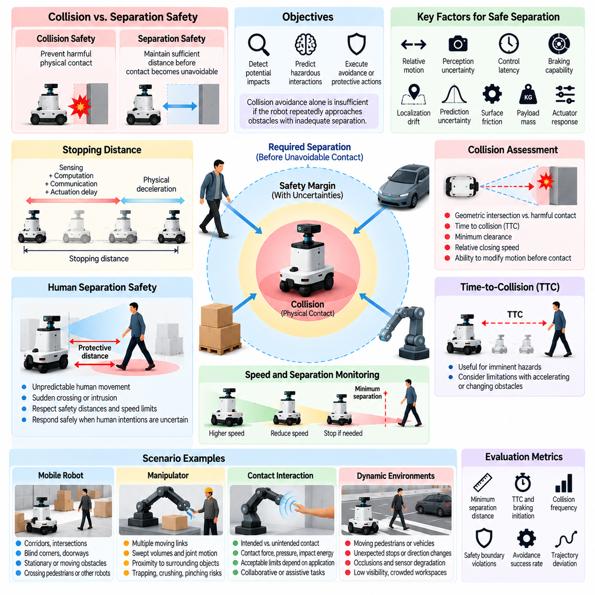{width="7.268055555555556in" height="7.268055555555556in"}

Collision and separation safety are fundamental dimensions of Physical AI evaluation because autonomous systems operate in environments containing humans, robots, equipment, and obstacles. Collision safety concerns preventing harmful physical contact, while separation safety focuses on maintaining sufficient distance before contact becomes unavoidable. Together, they establish measurable boundaries for safe motion and physical interaction.

Collision safety evaluation examines whether a robot can detect potential impacts, predict hazardous interactions, and execute appropriate avoidance or protective actions. Separation safety evaluates whether the system maintains required spatial margins under changing motion conditions. These objectives are closely related, but collision avoidance alone does not demonstrate adequate safety when a robot repeatedly approaches obstacles with insufficient stopping distance.

Safe separation depends on relative motion, perception uncertainty, control latency, and braking capability. A robot moving toward a stationary obstacle requires sufficient distance to recognize the hazard, process sensor information, generate a response, and decelerate. When both the robot and obstacle move, their relative velocities and possible future trajectories must be considered to determine whether the available separation remains adequate.

Stopping distance provides a practical foundation for separation safety assessment. It includes the distance traveled during sensing, computation, communication, and actuation delays, together with the distance required for physical deceleration. Evaluation should account for uncertainty in braking performance, surface friction, payload mass, and actuator response rather than assuming ideal stopping behavior under all operating conditions.

Safety margins extend beyond nominal stopping calculations by accounting for measurement errors and unpredictable environmental changes. Localization drift, obstacle position uncertainty, delayed sensor updates, and imperfect motion prediction can reduce the reliability of estimated separation. A robust safety evaluation examines whether protective boundaries remain effective when several uncertainty sources occur simultaneously.

Collision assessment should distinguish between geometric intersection and harmful physical contact. A predicted trajectory intersection indicates potential conflict, but actual collision risk depends on timing, relative velocity, object dimensions, and available avoidance actions. Evaluation should therefore examine predicted time to collision, minimum clearance, relative closing speed, and the ability to modify motion before contact becomes unavoidable.

Time-to-collision is a useful indicator for evaluating imminent hazards, particularly in mobile robotics and autonomous navigation. However, it depends on assumptions about future motion and may become unreliable when obstacles accelerate or change direction. Safety testing should investigate whether the robot recognizes these limitations and avoids relying exclusively on constant-velocity predictions in dynamic environments.

Human separation safety requires additional consideration because people can move unpredictably and may enter the robot\'s workspace without warning. Evaluation should examine pedestrian approach, sudden crossing, worker intrusion, and close-proximity collaboration. The robot must respond appropriately to human motion while respecting protective distances, speed restrictions, and applicable contact-force limitations.

Speed and separation monitoring provides a structured approach to human-robot interaction safety. Permitted robot speed can be adjusted according to the distance from a person, estimated human approach speed, stopping capability, and system response time. Evaluation should verify that the robot slows or stops before protective separation is violated, including situations involving sensor uncertainty and delayed control responses.

For autonomous mobile robots, collision and separation testing should include corridors, intersections, blind corners, doorways, and shared workspaces. Scenarios may involve stationary obstacles, crossing pedestrians, moving vehicles, or other robots following conflicting routes. Measurements should capture minimum separation, braking initiation, avoidance success, trajectory deviation, and violations of designated safety boundaries.

Manipulator safety introduces additional challenges because multiple moving links can create collision hazards even when the end effector follows a safe trajectory. Evaluation should consider the complete robot geometry, joint motion, swept volumes, and proximity to surrounding objects. Potential trapping, crushing, and pinching regions require particular attention because relatively small movements can produce hazardous contact.

Contact safety becomes important when physical interaction cannot be eliminated, as in collaborative manipulation or assistive robotics. In these situations, evaluation should distinguish intended contact from unintended collision and assess contact force, pressure, impact energy, and duration. Acceptable limits depend on the application, body region, contact geometry, and relevant safety requirements rather than a universal force threshold.

Collision safety also depends on the accuracy of perception and environmental representation. Cameras, LiDAR, depth sensors, and proximity detectors may experience occlusion, noise, reflective surfaces, or limited fields of view. Evaluation should examine whether sensor degradation causes missed obstacles, inaccurate distance estimates, or delayed protective responses, especially near the boundaries of the robot\'s sensing coverage.

Dynamic obstacle prediction introduces another source of uncertainty. Pedestrians may stop unexpectedly, vehicles may accelerate, and other robots may deviate from planned trajectories. Safety evaluation should test whether the system maintains conservative separation under multiple plausible future motions and whether uncertainty-aware planning prevents aggressive maneuvers based on unreliable predictions.

Multi-robot environments require collision avoidance mechanisms that account for distributed decision-making and communication delays. Two robots may independently select trajectories that appear safe but become conflicting when executed simultaneously. Evaluation should examine coordination failures, delayed state exchange, shared-space access, and emergency responses when communication is interrupted or predictions become inconsistent.

Safety-critical scenario design should progressively increase interaction complexity. Initial tests may involve static obstacles and predictable motion, followed by crossing trajectories, partial occlusion, sudden direction changes, and compound disturbances. Parameterized scenarios allow systematic variation of speed, separation, reaction time, and braking effectiveness, revealing the conditions under which safety margins begin to deteriorate.

Quantitative metrics should distinguish collision occurrence from proximity-related risk. Collision frequency, minimum separation distance, time-to-collision violations, protective stop success, and near-miss rates provide complementary evidence. Measurements should also include intervention latency and stopping margin because a collision-free result may conceal repeated situations in which the robot narrowly avoided harmful contact.

Simulation supports large-scale evaluation of collision and separation behavior under diverse environmental conditions. Parameter sweeps can vary obstacle trajectories, friction coefficients, sensing delays, and robot velocities while preserving reproducibility. Nevertheless, simulated contact dynamics and braking behavior may differ from physical hardware, requiring controlled laboratory validation before relying on results for deployment decisions.

Real-world testing should use controlled environments, protective barriers, surrogate obstacles, and independent emergency stopping provisions when hazardous interactions are possible. Test procedures must define safe operating limits and termination criteria. Human participants should not be exposed to uncontrolled collision experiments, particularly when the system\'s protective capabilities have not yet been demonstrated.

Runtime safety mechanisms can provide independent protection when autonomous planning becomes unreliable. Safety monitors, protective speed limits, collision prediction checks, and emergency stopping controllers may override nominal motion commands. Evaluation should measure their detection coverage, response latency, intervention reliability, and ability to maintain a minimum-risk condition after a hazardous situation is detected.

Statistical analysis should report collision and separation performance across repeated trials and clearly defined exposure conditions. Rare collisions may require targeted stress testing and confidence intervals to characterize uncertainty. A low observed collision count does not independently establish a low operational risk, particularly when test scenarios fail to represent challenging interactions or realistic environmental variability.

Ultimately, collision and separation safety evaluation determines whether Physical AI systems maintain adequate physical boundaries throughout autonomous operation. Effective assessment combines geometric clearance, motion prediction, braking performance, perception uncertainty, contact limitations, and protective intervention. These measurements support defensible safety claims and help establish operating conditions under which robots can interact responsibly with humans and their surroundings.

충돌 안전성(Collision Safety)과 이격 안전성(Separation Safety)은 자율 시스템(Autonomous System)이 인간, 로봇, 장비 및 장애물이 존재하는 환경에서 작동하기 때문에 피지컬 인공지능(Physical AI) 평가의 핵심적인 차원이다. 충돌 안전성은 유해한 물리적 접촉(Harmful Physical Contact)을 방지하는 데 초점을 맞추며, 이격 안전성은 접촉을 피할 수 없는 상황이 발생하기 전에 충분한 거리를 유지하는 데 중점을 둔다. 두 요소는 함께 안전한 이동과 물리적 상호작용을 위한 측정 가능한 경계(Measurable Boundary)를 설정한다.

충돌 안전성 평가(Collision Safety Evaluation)는 로봇이 잠재적인 충돌을 감지하고, 위험한 상호작용을 예측하며, 적절한 회피 또는 보호 동작(Protective Action)을 수행할 수 있는지를 검증한다. 이격 안전성 평가는 변화하는 운동 조건에서 시스템이 요구되는 공간적 여유(Spatial Margin)를 유지하는지를 평가한다. 두 목표는 밀접하게 연관되어 있지만, 로봇이 불충분한 정지 거리(Stopping Distance)를 가진 상태에서 장애물에 반복적으로 접근한다면 충돌 회피(Collision Avoidance)만으로 충분한 안전성을 입증할 수 없다.

안전 이격 거리(Safe Separation Distance)는 상대 운동(Relative Motion), 인지 불확실성(Perception Uncertainty), 제어 지연 시간(Control Latency), 제동 능력(Braking Capability)에 따라 달라진다. 정지된 장애물을 향해 이동하는 로봇은 위험을 인식하고, 센서 정보를 처리하고, 대응 동작을 생성하고, 감속하는 데 필요한 충분한 거리를 확보해야 한다. 로봇과 장애물이 모두 움직이는 경우에는 상대 속도(Relative Velocity)와 가능한 미래 이동 궤적(Future Trajectory)을 고려하여 현재의 이격 거리가 적절한지를 판단해야 한다.

정지 거리(Stopping Distance)는 이격 안전성 평가(Separation Safety Assessment)의 실질적인 기반을 제공한다. 여기에는 센싱(Sensing), 연산(Computation), 통신(Communication), 구동(Actuation) 과정에서 발생하는 지연 시간 동안 이동한 거리와 실제 물리적 감속(Physical Deceleration)에 필요한 거리가 포함된다. 평가에서는 모든 운영 조건에서 이상적인 정지 동작(Ideal Stopping Behavior)을 가정하기보다 제동 성능(Braking Performance), 표면 마찰(Surface Friction), 적재물 질량(Payload Mass), 구동기 응답(Actuator Response)의 불확실성을 고려해야 한다.

안전 여유도(Safety Margin)는 측정 오차(Measurement Error)와 예측하기 어려운 환경 변화를 고려함으로써 정상적인 정지 거리 계산을 보완한다. 위치 추정 드리프트(Localization Drift), 장애물 위치 불확실성(Obstacle Position Uncertainty), 지연된 센서 갱신(Delayed Sensor Update), 불완전한 동작 예측(Imperfect Motion Prediction)은 추정된 이격 거리의 신뢰성을 낮출 수 있다. 강건한 안전성 평가(Robust Safety Evaluation)는 여러 불확실성 원인(Uncertainty Source)이 동시에 발생하는 상황에서도 보호 경계(Protective Boundary)가 효과적으로 유지되는지를 검증한다.

충돌 평가(Collision Assessment)는 기하학적 교차(Geometric Intersection)와 유해한 물리적 접촉(Harmful Physical Contact)을 구분해야 한다. 예측된 이동 궤적의 교차(Predicted Trajectory Intersection)는 잠재적인 충돌 가능성을 나타내지만, 실제 충돌 위험(Collision Risk)은 발생 시점(Timing), 상대 속도(Relative Velocity), 물체 크기(Object Dimension), 사용 가능한 회피 동작(Avoidance Action)에 따라 달라진다. 따라서 평가는 예측 충돌 시간(Time-to-Collision), 최소 여유 거리(Minimum Clearance), 상대 접근 속도(Relative Closing Speed), 접촉이 불가피해지기 전에 동작을 수정하는 능력을 검증해야 한다.

충돌 예상 시간(Time-to-Collision, TTC)은 특히 이동 로봇(Mobile Robotics)과 자율 주행(Autonomous Navigation)에서 임박한 위험(Imminent Hazard)을 평가하는 데 유용한 지표이다. 그러나 이 지표는 미래 운동(Future Motion)에 대한 가정에 의존하므로 장애물이 가속하거나 방향을 변경하면 신뢰성이 저하될 수 있다. 안전성 시험(Safety Testing)은 로봇이 이러한 한계를 인식하고 동적 환경(Dynamic Environment)에서 일정 속도 예측(Constant-Velocity Prediction)에만 의존하지 않는지를 검증해야 한다.

인간 이격 안전성(Human Separation Safety)은 사람이 예측하기 어렵게 움직이거나 사전 경고 없이 로봇의 작업 공간(Workspace)에 진입할 수 있기 때문에 추가적인 고려가 필요하다. 평가에서는 보행자 접근(Pedestrian Approach), 갑작스러운 횡단(Sudden Crossing), 작업자 침입(Worker Intrusion), 근접 협업(Close-Proximity Collaboration)을 검증해야 한다. 로봇은 보호 거리(Protective Distance), 속도 제한(Speed Restriction), 적용 가능한 접촉력 제한(Contact-Force Limitation)을 준수하면서 인간의 움직임에 적절하게 대응해야 한다.

속도 및 이격 거리 감시(Speed and Separation Monitoring, SSM)는 인간-로봇 상호작용 안전성(Human-Robot Interaction Safety)을 위한 체계적인 접근 방식을 제공한다. 허용 로봇 속도(Permitted Robot Speed)는 사람과의 거리, 추정된 인간 접근 속도(Estimated Human Approach Speed), 정지 능력(Stopping Capability), 시스템 응답 시간(System Response Time)에 따라 조정할 수 있다. 평가는 센서 불확실성(Sensor Uncertainty)과 지연된 제어 응답(Delayed Control Response)이 존재하는 상황을 포함하여 보호 이격 거리(Protective Separation)가 위반되기 전에 로봇이 감속하거나 정지하는지를 검증해야 한다.

자율 이동 로봇(Autonomous Mobile Robot)의 충돌 및 이격 안전성 시험에는 복도(Corridor), 교차로(Intersection), 사각지대 모서리(Blind Corner), 출입구(Doorway), 공동 작업 공간(Shared Workspace)이 포함되어야 한다. 시나리오에는 정적 장애물(Stationary Obstacle), 횡단하는 보행자(Crossing Pedestrian), 이동 차량(Moving Vehicle), 상충하는 경로를 따르는 다른 로봇 등이 포함될 수 있다. 측정 항목에는 최소 이격 거리(Minimum Separation), 제동 시작 시점(Braking Initiation), 회피 성공률(Avoidance Success), 이동 궤적 편차(Trajectory Deviation), 지정된 안전 경계 위반(Safety Boundary Violation)이 포함되어야 한다.

매니퓰레이터 안전성(Manipulator Safety)은 말단 효과기(End Effector)가 안전한 이동 궤적을 따르더라도 여러 개의 움직이는 링크(Moving Link)가 충돌 위험을 발생시킬 수 있기 때문에 추가적인 과제를 가진다. 평가에서는 로봇 전체 형상(Complete Robot Geometry), 관절 운동(Joint Motion), 이동 중 점유 공간(Swept Volume), 주변 물체와의 근접성(Proximity)을 고려해야 한다. 끼임(Trapping), 압착(Crushing), 협착(Pinching)이 발생할 수 있는 영역은 비교적 작은 움직임으로도 위험한 접촉을 유발할 수 있으므로 특별한 주의가 필요하다.

접촉 안전성(Contact Safety)은 협업 조작(Collaborative Manipulation)이나 보조 로봇(Assistive Robotics)과 같이 물리적 상호작용을 제거할 수 없는 경우 중요해진다. 이러한 상황에서 평가는 의도된 접촉(Intended Contact)과 의도하지 않은 충돌(Unintended Collision)을 구분하고 접촉력(Contact Force), 압력(Pressure), 충격 에너지(Impact Energy), 접촉 지속 시간(Contact Duration)을 평가해야 한다. 허용 가능한 한계(Acceptable Limit)는 보편적인 단일 힘 임계값(Universal Force Threshold)이 아니라 적용 분야(Application), 신체 부위(Body Region), 접촉 형상(Contact Geometry), 관련 안전 요구사항(Safety Requirement)에 따라 결정된다.

충돌 안전성은 인지(Perception)와 환경 표현(Environmental Representation)의 정확도에도 영향을 받는다. 카메라(Camera), 라이다(LiDAR), 깊이 센서(Depth Sensor), 근접 감지기(Proximity Detector)는 가림(Occlusion), 잡음(Noise), 반사 표면(Reflective Surface), 제한된 시야각(Limited Field of View)의 영향을 받을 수 있다. 평가는 특히 로봇의 센싱 범위(Sensing Coverage) 경계 근처에서 센서 성능 저하(Sensor Degradation)가 장애물 미탐지(Missed Obstacle), 부정확한 거리 추정(Inaccurate Distance Estimation), 지연된 보호 응답(Delayed Protective Response)을 유발하는지를 검증해야 한다.

동적 장애물 예측(Dynamic Obstacle Prediction)은 또 다른 불확실성 원인(Uncertainty Source)을 발생시킨다. 보행자는 예상하지 못하게 멈출 수 있고, 차량은 가속할 수 있으며, 다른 로봇은 계획된 이동 궤적(Planned Trajectory)에서 벗어날 수 있다. 안전성 평가는 여러 가능한 미래 운동(Plausible Future Motion)에 대해 시스템이 보수적인 이격 거리(Conservative Separation)를 유지하는지, 그리고 불확실성 인식 계획(Uncertainty-Aware Planning)이 신뢰할 수 없는 예측에 기반한 공격적인 기동(Aggressive Maneuver)을 방지하는지를 검증해야 한다.

다중 로봇 환경(Multi-Robot Environment)에서는 분산 의사결정(Distributed Decision-Making)과 통신 지연(Communication Delay)을 고려하는 충돌 회피 메커니즘(Collision Avoidance Mechanism)이 필요하다. 두 로봇이 독립적으로 안전해 보이는 이동 궤적을 선택하더라도 동시에 실행하면 서로 충돌하는 경로가 될 수 있다. 평가는 협조 실패(Coordination Failure), 지연된 상태 정보 교환(Delayed State Exchange), 공유 공간 접근(Shared-Space Access), 통신이 중단되거나 예측이 불일치할 때의 비상 대응(Emergency Response)을 검증해야 한다.

안전 필수 시나리오 설계(Safety-Critical Scenario Design)는 상호작용 복잡도(Interaction Complexity)를 점진적으로 증가시켜야 한다. 초기 시험은 정적 장애물(Static Obstacle)과 예측 가능한 운동(Predictable Motion)을 포함하고, 이후 교차 궤적(Crossing Trajectory), 부분 가림(Partial Occlusion), 갑작스러운 방향 변경(Sudden Direction Change), 복합 외란(Compound Disturbance)으로 확장할 수 있다. 매개변수화된 시나리오(Parameterized Scenario)는 속도(Speed), 이격 거리(Separation), 반응 시간(Reaction Time), 제동 효과(Braking Effectiveness)를 체계적으로 변화시켜 안전 여유도가 저하되기 시작하는 조건을 식별할 수 있도록 한다.

정량적 지표(Quantitative Metric)는 충돌 발생(Collision Occurrence)과 근접 관련 위험(Proximity-Related Risk)을 구분해야 한다. 충돌 빈도(Collision Frequency), 최소 이격 거리(Minimum Separation Distance), 충돌 예상 시간 위반(Time-to-Collision Violation), 보호 정지 성공률(Protective Stop Success), 아차 사고 발생률(Near-Miss Rate)은 상호 보완적인 근거를 제공한다. 측정에는 개입 지연 시간(Intervention Latency)과 정지 여유도(Stopping Margin)도 포함되어야 한다. 충돌이 발생하지 않았다는 결과만으로는 로봇이 유해한 접촉을 간신히 피한 상황이 반복되었다는 사실을 확인하기 어려울 수 있기 때문이다.

시뮬레이션(Simulation)은 다양한 환경 조건에서 충돌 및 이격 동작(Collision and Separation Behavior)을 대규모로 평가할 수 있도록 지원한다. 매개변수 탐색(Parameter Sweep)은 재현성(Reproducibility)을 유지하면서 장애물 이동 궤적(Obstacle Trajectory), 마찰 계수(Friction Coefficient), 센싱 지연(Sensing Delay), 로봇 속도(Robot Velocity)를 변화시킬 수 있다. 그러나 시뮬레이션의 접촉 동역학(Contact Dynamics)과 제동 동작(Braking Behavior)은 실제 하드웨어(Physical Hardware)와 다를 수 있으므로, 배치 의사결정(Deployment Decision)에 결과를 활용하기 전에 통제된 실험실 검증(Controlled Laboratory Validation)이 필요하다.

실제 환경 시험(Real-World Testing)은 위험한 상호작용이 발생할 가능성이 있을 때 통제된 환경(Controlled Environment), 보호 장벽(Protective Barrier), 대체 장애물(Surrogate Obstacle), 독립적인 비상 정지 장치(Independent Emergency Stopping Provision)를 활용해야 한다. 시험 절차(Test Procedure)는 안전 운영 한계(Safe Operating Limit)와 종료 기준(Termination Criteria)을 정의해야 한다. 특히 시스템의 보호 능력(Protective Capability)이 아직 입증되지 않은 경우 인간 참가자(Human Participant)를 통제되지 않은 충돌 실험(Uncontrolled Collision Experiment)에 노출해서는 안 된다.

실행시간 안전 메커니즘(Runtime Safety Mechanism)은 자율 계획(Autonomous Planning)의 신뢰성이 저하될 때 독립적인 보호 기능(Independent Protection)을 제공할 수 있다. 안전 감시기(Safety Monitor), 보호 속도 제한(Protective Speed Limit), 충돌 예측 검사(Collision Prediction Check), 비상 정지 제어기(Emergency Stopping Controller)는 정상적인 이동 명령(Nominal Motion Command)을 무효화하거나 대체할 수 있다. 평가는 이러한 메커니즘의 탐지 범위(Detection Coverage), 응답 지연 시간(Response Latency), 개입 신뢰성(Intervention Reliability), 위험 상황 감지 이후 최소 위험 상태(Minimum-Risk Condition)를 유지하는 능력을 측정해야 한다.

통계 분석(Statistical Analysis)은 반복 시험(Repeated Trial)과 명확하게 정의된 노출 조건(Exposure Condition)에 걸쳐 충돌 및 이격 성능을 보고해야 한다. 드물게 발생하는 충돌(Rare Collision)은 불확실성을 특성화하기 위해 표적 스트레스 시험(Targeted Stress Testing)과 신뢰 구간(Confidence Interval)이 필요할 수 있다. 관측된 충돌 횟수가 적다는 사실만으로 운영 위험도(Operational Risk)가 낮다고 단정할 수는 없으며, 특히 시험 시나리오가 어려운 상호작용이나 현실적인 환경 변동성(Environmental Variability)을 충분히 대표하지 못하는 경우에는 더욱 그렇다.

궁극적으로 충돌 및 이격 안전성 평가(Collision and Separation Safety Evaluation)는 피지컬 인공지능 시스템이 자율 운영(Autonomous Operation) 전반에 걸쳐 적절한 물리적 경계(Physical Boundary)를 유지하는지를 판단한다. 효과적인 평가는 기하학적 여유 거리(Geometric Clearance), 동작 예측(Motion Prediction), 제동 성능(Braking Performance), 인지 불확실성(Perception Uncertainty), 접촉 제한(Contact Limitation), 보호 개입(Protective Intervention)을 통합한다. 이러한 측정은 정당화 가능한 안전성 주장(Defensible Safety Claim)을 뒷받침하고 로봇이 인간 및 주변 환경과 책임 있게 상호작용할 수 있는 운영 조건(Operating Condition)을 설정하는 데 기여한다.

##  

## 05.05. Human Robot Safety Evaluation

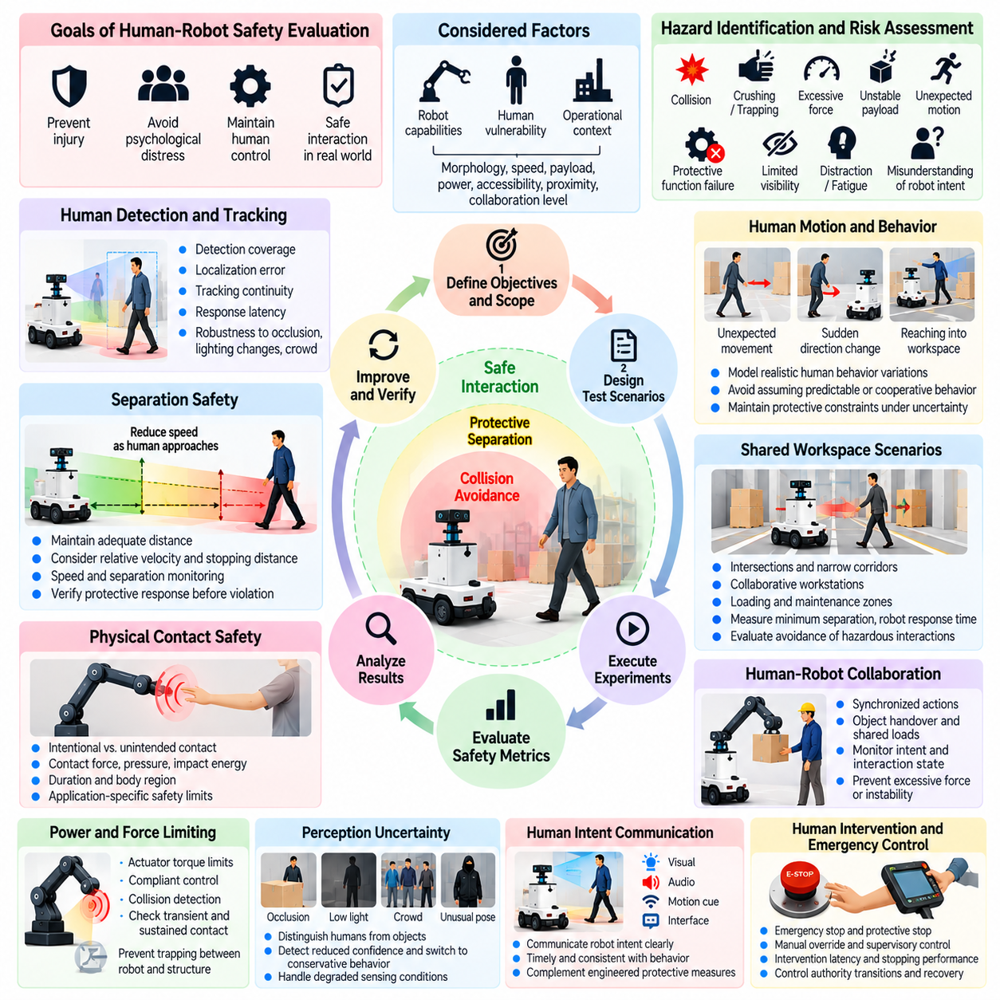{width="7.268055555555556in" height="7.268055555555556in"}

Human-robot safety evaluation examines whether Physical AI systems can interact with people without creating unacceptable risks of injury, psychological distress, or loss of human control. Unlike conventional robotic performance assessment, it considers both physical behavior and the conditions under which humans encounter autonomous machines. Evaluation must address predictable interactions, unexpected human actions, system failures, and changing environmental conditions.

Human-robot safety depends on the relationship between robot capabilities, human vulnerability, and the surrounding operational context. A robot operating behind protective barriers presents different hazards from a mobile manipulator sharing workspace with employees. Evaluation should therefore consider robot morphology, speed, payload, actuator power, accessibility, human proximity, and the degree of physical collaboration expected during normal operation.

A structured evaluation begins with hazard identification and risk assessment. Potential hazards include collisions, crushing, trapping, excessive contact forces, unstable payloads, unexpected movements, and failures of protective functions. Human factors such as limited visibility, distraction, fatigue, and misunderstanding of robot intentions may increase exposure. Test scenarios should connect these hazards to measurable safety requirements.

Human detection and tracking are essential components of interaction safety. Cameras, LiDAR, depth sensors, and proximity detectors may estimate human position, motion, and distance from hazardous robot components. Evaluation should measure detection coverage, localization error, tracking continuity, and response latency under occlusion, changing illumination, reflective surfaces, and crowded environments where reliable human recognition becomes difficult.

Separation safety evaluates whether a robot maintains adequate distance from people throughout its movements. Required separation depends on relative velocity, stopping capability, sensing uncertainty, and response delays. Speed and separation monitoring can reduce permissible robot velocity as humans approach hazardous regions. Evaluation should verify protective responses before separation boundaries are violated rather than relying solely on collision-free outcomes.

Physical contact safety becomes particularly important in collaborative robotics, assistive systems, and human-centered manipulation. Some applications require intentional contact, while others must prevent it. Evaluation should distinguish these situations and measure contact force, pressure, impact energy, duration, and affected body regions. Acceptable thresholds must be established through application-specific risk assessment and relevant safety requirements.

Power and force limiting provides a method for reducing injury risk when physical contact may occur. Evaluation should examine whether actuator torque limits, compliant control, mechanical design, and collision detection maintain contact conditions within established boundaries. Tests should consider both transient impacts and sustained contact, including situations where a person could become trapped between a moving robot and a fixed structure.

Human motion introduces uncertainty that cannot be fully represented by deterministic trajectories. People may stop unexpectedly, reverse direction, reach into workspaces, or move unpredictably around autonomous platforms. Safety evaluation should introduce realistic behavioral variations and determine whether the robot maintains protective constraints without assuming that humans consistently follow planned routes or respond immediately to warnings.

Shared workspace evaluation should include intersections, narrow corridors, collaborative workstations, loading areas, and maintenance zones. These environments create opportunities for unexpected encounters and conflicting movement intentions. Relevant measurements include minimum separation, protective stop frequency, human intrusion detection, robot response time, and successful avoidance of hazardous interactions during repeated operational trials.

Robot intent communication contributes to human safety by helping people anticipate autonomous behavior. Visual indicators, audible alerts, motion cues, and interface messages can communicate planned movement, operating state, or requests for assistance. Evaluation should determine whether these signals are understandable, timely, and consistent with actual robot behavior. Communication must complement rather than replace engineered protective measures.

Human intervention and emergency control require explicit evaluation. Emergency stop devices, protective stops, manual overrides, and supervisory controls should remain accessible and effective under relevant operating conditions. Testing should examine intervention latency, stopping performance, control authority transitions, and recovery procedures. The system must avoid unexpected motion when switching between autonomous and human-controlled operation.

Human-robot collaboration introduces hazards associated with coordinated physical tasks. A robot handing over an object, supporting a payload, or assisting assembly must synchronize actions with human movement and intention. Evaluation should consider premature release, unexpected force application, delayed response, and unstable shared loads. Safe collaboration requires reliable monitoring of both robot behavior and the evolving interaction state.

Perception uncertainty can become a direct safety concern when a robot cannot reliably distinguish humans from surrounding objects or predict their movements. Partial occlusion, unusual clothing, crowded scenes, and unfamiliar postures may degrade detection performance. Evaluation should examine whether the system recognizes reduced confidence and adopts conservative actions such as slowing, stopping, or requesting human assistance.

Learned policies and vision-language-action models introduce additional evaluation challenges because their responses may vary across semantically similar situations. Ambiguous instructions, conflicting goals, and unfamiliar human behavior can produce inappropriate physical actions. Safety testing should determine whether learned decision-making respects independent safety constraints and whether uncertainty or conflicting commands trigger appropriate protective responses.

Human trust and perceived safety provide complementary information but should not replace objective safety measurements. Sudden acceleration, unpredictable trajectories, and unclear robot intentions may cause discomfort even without physical contact. Controlled user studies can examine perceived predictability, workload, and confidence. Such findings should be interpreted alongside measured separation, force, intervention effectiveness, and actual hazardous events.

Vulnerable populations may require additional evaluation because physical capabilities, reaction times, and understanding of robot behavior differ among users. Children, older adults, and people with mobility limitations may face distinct interaction risks. Evaluation protocols should reflect the intended user population and avoid assuming a single representative human model. Protective requirements must remain appropriate for foreseeable users and operating contexts.

Failure injection helps determine whether human protection remains effective during component degradation. Sensor dropout, communication interruption, actuator faults, and delayed computation may compromise human detection or stopping performance. Controlled testing should establish whether independent protective mechanisms detect unsafe conditions and transition the robot into a minimum-risk state before hazardous contact occurs.

Simulation can support systematic exploration of human-robot encounters, including rare crossing patterns, occlusion events, and complex multi-agent interactions. Human behavior models allow controlled variation of walking speed, reaction time, and movement intention. However, simulated behavior cannot fully reproduce human unpredictability, so critical findings require validation through carefully controlled physical experiments.

Real-world human-robot safety testing must avoid exposing participants to uncontrolled hazards. Early experiments should use surrogate obstacles, instrumented test devices, protective barriers, and independent emergency stopping provisions. Human participation should occur only after appropriate protective capabilities have been demonstrated. Test protocols must define operational limits, supervision requirements, and immediate termination conditions.

Quantitative evaluation should combine collision frequency, near-miss rate, minimum separation, contact-force violations, intervention latency, and protective stop effectiveness. Repeated trials and confidence intervals help characterize uncertainty, while scenario coverage indicates which interaction conditions have been examined. A low accident count does not establish safety when exposure is limited or critical human behaviors remain untested.

Safety assurance should connect evaluation results to documented hazards, protective requirements, and operational restrictions. Changes to robot hardware, perception models, learned policies, or workspace configurations may invalidate previous assumptions. Regression testing and updated risk assessments are necessary to determine whether safety performance remains acceptable as systems evolve or deployment conditions expand.

Ultimately, human-robot safety evaluation must establish that autonomous physical systems recognize human presence, respect physical boundaries, respond appropriately to uncertainty, and preserve effective human intervention mechanisms. Reliable safety evidence requires integrating perception, motion control, contact mechanics, human factors, and protective system testing. This integrated approach supports responsible deployment in environments where humans and intelligent machines operate together.

인간-로봇 안전성 평가(Human-Robot Safety Evaluation)는 피지컬 인공지능(Physical AI) 시스템이 허용할 수 없는 신체적 상해(Injury), 심리적 고통(Psychological Distress), 인간의 제어권 상실(Loss of Human Control) 위험을 발생시키지 않으면서 사람과 상호작용할 수 있는지를 검증한다. 기존의 로봇 성능 평가(Robotic Performance Assessment)와 달리 물리적 행동(Physical Behavior)뿐 아니라 인간이 자율 기계(Autonomous Machine)를 접하는 조건도 고려한다. 평가에서는 예측 가능한 상호작용(Predictable Interaction), 예상하지 못한 인간 행동(Unexpected Human Action), 시스템 고장(System Failure), 변화하는 환경 조건(Changing Environmental Condition)을 다루어야 한다.

인간-로봇 안전성(Human-Robot Safety)은 로봇의 능력(Robot Capability), 인간의 취약성(Human Vulnerability), 주변 운영 환경(Operational Context) 사이의 관계에 따라 달라진다. 보호 장벽(Protective Barrier) 뒤에서 작동하는 로봇은 직원과 작업 공간을 공유하는 이동형 매니퓰레이터(Mobile Manipulator)와 서로 다른 위험 요인(Hazard)을 가진다. 따라서 평가에서는 로봇 형태(Robot Morphology), 속도(Speed), 적재물(Payload), 구동기 출력(Actuator Power), 접근 가능성(Accessibility), 인간과의 근접성(Human Proximity), 정상 운영 중 예상되는 물리적 협업(Physical Collaboration)의 정도를 고려해야 한다.

체계적인 평가(Structured Evaluation)는 위험 요인 식별(Hazard Identification)과 위험도 평가(Risk Assessment)에서 시작한다. 잠재적 위험 요인에는 충돌(Collision), 압착(Crushing), 끼임(Trapping), 과도한 접촉력(Excessive Contact Force), 불안정한 적재물(Unstable Payload), 예상하지 못한 움직임(Unexpected Movement), 보호 기능 고장(Protective Function Failure)이 포함된다. 제한된 가시성(Limited Visibility), 주의 분산(Distraction), 피로(Fatigue), 로봇 의도에 대한 오해(Misunderstanding of Robot Intentions)와 같은 인간 요인(Human Factor)은 위험 노출(Risk Exposure)을 증가시킬 수 있다. 시험 시나리오(Test Scenario)는 이러한 위험 요인을 측정 가능한 안전 요구사항(Safety Requirement)과 연결해야 한다.

인간 감지 및 추적(Human Detection and Tracking)은 상호작용 안전성(Interaction Safety)의 필수 구성 요소이다. 카메라(Camera), 라이다(LiDAR), 깊이 센서(Depth Sensor), 근접 감지기(Proximity Detector)는 인간의 위치(Position), 움직임(Motion), 위험한 로봇 구성 요소와의 거리(Distance)를 추정할 수 있다. 평가에서는 가림(Occlusion), 조명 변화(Changing Illumination), 반사 표면(Reflective Surface), 혼잡한 환경(Crowded Environment)에서 감지 범위(Detection Coverage), 위치 추정 오차(Localization Error), 추적 연속성(Tracking Continuity), 응답 지연 시간(Response Latency)을 측정해야 한다.

이격 안전성(Separation Safety)은 로봇이 이동하는 동안 사람과 적절한 거리를 유지하는지를 평가한다. 필요한 이격 거리(Required Separation)는 상대 속도(Relative Velocity), 정지 능력(Stopping Capability), 센싱 불확실성(Sensing Uncertainty), 응답 지연(Response Delay)에 따라 달라진다. 속도 및 이격 거리 감시(Speed and Separation Monitoring)는 인간이 위험 영역(Hazardous Region)에 접근함에 따라 허용 로봇 속도(Permissible Robot Velocity)를 감소시킬 수 있다. 평가는 충돌이 발생하지 않았다는 결과에만 의존하지 않고 이격 경계(Separation Boundary)가 위반되기 전에 보호 응답(Protective Response)이 이루어지는지를 검증해야 한다.

물리적 접촉 안전성(Physical Contact Safety)은 협업 로봇(Collaborative Robotics), 보조 시스템(Assistive System), 인간 중심 조작(Human-Centered Manipulation)에서 특히 중요하다. 일부 응용 분야(Application)에서는 의도적인 접촉(Intentional Contact)이 필요하지만 다른 분야에서는 접촉 자체를 방지해야 한다. 평가는 이러한 상황을 구분하고 접촉력(Contact Force), 압력(Pressure), 충격 에너지(Impact Energy), 접촉 지속 시간(Contact Duration), 영향을 받는 신체 부위(Affected Body Region)를 측정해야 한다. 허용 임계값(Acceptable Threshold)은 응용 분야별 위험도 평가(Application-Specific Risk Assessment)와 관련 안전 요구사항(Relevant Safety Requirement)을 통해 설정해야 한다.

출력 및 힘 제한(Power and Force Limiting)은 물리적 접촉이 발생할 수 있는 상황에서 상해 위험(Injury Risk)을 줄이는 방법을 제공한다. 평가에서는 구동기 토크 제한(Actuator Torque Limit), 순응 제어(Compliant Control), 기계적 설계(Mechanical Design), 충돌 감지(Collision Detection)가 접촉 조건(Contact Condition)을 설정된 경계(Established Boundary) 이내로 유지하는지를 검증해야 한다. 시험에서는 일시적 충격(Transient Impact)과 지속적 접촉(Sustained Contact)을 모두 고려해야 하며, 특히 사람이 움직이는 로봇과 고정 구조물(Fixed Structure) 사이에 끼일 수 있는 상황을 포함해야 한다.

인간의 움직임(Human Motion)은 결정론적 이동 궤적(Deterministic Trajectory)만으로 완전히 표현할 수 없는 불확실성을 발생시킨다. 사람은 예상하지 못하게 멈추거나 방향을 반대로 바꾸고, 작업 공간(Workspace) 안으로 손을 뻗거나, 자율 플랫폼(Autonomous Platform) 주변에서 예측하기 어렵게 움직일 수 있다. 안전성 평가에서는 현실적인 행동 변화(Realistic Behavioral Variation)를 도입하고, 인간이 항상 계획된 경로(Planned Route)를 따르거나 경고(Warning)에 즉시 반응한다고 가정하지 않으면서 로봇이 보호 제약 조건(Protective Constraint)을 유지하는지를 판단해야 한다.

공유 작업 공간 평가(Shared Workspace Evaluation)에는 교차로(Intersection), 좁은 복도(Narrow Corridor), 협업 작업대(Collaborative Workstation), 적재 구역(Loading Area), 유지보수 구역(Maintenance Zone)이 포함되어야 한다. 이러한 환경은 예상하지 못한 접촉 상황(Unexpected Encounter)과 상충하는 이동 의도(Conflicting Movement Intention)를 발생시킬 수 있다. 관련 측정 항목에는 최소 이격 거리(Minimum Separation), 보호 정지 빈도(Protective Stop Frequency), 인간 침입 감지(Human Intrusion Detection), 로봇 응답 시간(Robot Response Time), 반복 운영 시험(Repeated Operational Trial)에서 위험한 상호작용을 성공적으로 회피하는 능력이 포함된다.

로봇 의도 전달(Robot Intent Communication)은 사람이 자율 행동(Autonomous Behavior)을 예상할 수 있도록 지원하여 인간 안전성(Human Safety)에 기여한다. 시각적 표시기(Visual Indicator), 청각 경고(Audible Alert), 동작 신호(Motion Cue), 인터페이스 메시지(Interface Message)는 계획된 이동(Planned Movement), 운영 상태(Operating State), 지원 요청(Request for Assistance)을 전달할 수 있다. 평가에서는 이러한 신호가 이해하기 쉽고, 적시에 제공되며, 실제 로봇 행동(Actual Robot Behavior)과 일치하는지를 판단해야 한다. 의사소통(Communication)은 공학적으로 설계된 보호 조치(Engineered Protective Measure)를 대체하는 것이 아니라 보완해야 한다.

인간 개입(Human Intervention)과 비상 제어(Emergency Control)는 명시적인 평가가 필요하다. 비상 정지 장치(Emergency Stop Device), 보호 정지(Protective Stop), 수동 재정의(Manual Override), 감독 제어(Supervisory Control)는 관련 운영 조건에서 접근 가능하고 효과적으로 작동해야 한다. 시험에서는 개입 지연 시간(Intervention Latency), 정지 성능(Stopping Performance), 제어 권한 전환(Control Authority Transition), 복구 절차(Recovery Procedure)를 검증해야 한다. 시스템은 자율 운영(Autonomous Operation)과 인간 제어 운영(Human-Controlled Operation) 사이를 전환할 때 예상하지 못한 움직임을 방지해야 한다.

인간-로봇 협업(Human-Robot Collaboration)은 조정된 물리적 작업(Coordinated Physical Task)과 관련된 위험 요인을 발생시킨다. 로봇이 물체를 전달하거나 적재물을 지지하거나 조립 작업을 보조하는 경우, 인간의 움직임과 의도에 맞추어 동작을 동기화해야 한다. 평가에서는 조기 해제(Premature Release), 예상하지 못한 힘의 적용(Unexpected Force Application), 지연된 응답(Delayed Response), 불안정한 공동 하중(Unstable Shared Load)을 고려해야 한다. 안전한 협업(Safe Collaboration)을 위해서는 로봇 행동과 변화하는 상호작용 상태(Evolving Interaction State)를 모두 신뢰성 있게 감시해야 한다.

인지 불확실성(Perception Uncertainty)은 로봇이 인간과 주변 물체를 신뢰성 있게 구별하거나 인간의 움직임을 예측하지 못할 때 직접적인 안전 문제(Safety Concern)가 될 수 있다. 부분 가림(Partial Occlusion), 특이한 의복(Unusual Clothing), 혼잡한 장면(Crowded Scene), 익숙하지 않은 자세(Unfamiliar Posture)는 감지 성능(Detection Performance)을 저하시킬 수 있다. 평가에서는 시스템이 신뢰도 감소(Reduced Confidence)를 인식하고 감속(Slowing), 정지(Stopping), 인간 지원 요청(Requesting Human Assistance)과 같은 보수적인 동작(Conservative Action)을 수행하는지를 검증해야 한다.

학습된 정책(Learned Policy)과 시각-언어-행동 모델(Vision-Language-Action Model, VLA)은 의미적으로 유사한 상황(Semantically Similar Situation)에서도 응답이 달라질 수 있기 때문에 추가적인 평가 과제를 발생시킨다. 모호한 명령(Ambiguous Instruction), 상충하는 목표(Conflicting Goal), 익숙하지 않은 인간 행동(Unfamiliar Human Behavior)은 부적절한 물리적 행동(Inappropriate Physical Action)을 유발할 수 있다. 안전성 시험에서는 학습 기반 의사결정(Learned Decision-Making)이 독립적인 안전 제약 조건(Independent Safety Constraint)을 준수하는지, 불확실성이나 상충하는 명령이 적절한 보호 응답(Protective Response)을 유발하는지를 판단해야 한다.

인간의 신뢰(Human Trust)와 지각된 안전성(Perceived Safety)은 상호 보완적인 정보를 제공하지만 객관적인 안전성 측정(Objective Safety Measurement)을 대체해서는 안 된다. 갑작스러운 가속(Sudden Acceleration), 예측하기 어려운 이동 궤적(Unpredictable Trajectory), 불명확한 로봇 의도(Unclear Robot Intention)는 물리적 접촉이 없더라도 불편함을 유발할 수 있다. 통제된 사용자 연구(Controlled User Study)는 지각된 예측 가능성(Perceived Predictability), 작업 부담(Workload), 신뢰도(Confidence)를 조사할 수 있다. 이러한 결과는 측정된 이격 거리(Measured Separation), 접촉력(Contact Force), 개입 효과(Intervention Effectiveness), 실제 위험 사건(Actual Hazardous Event)과 함께 해석해야 한다.

취약 계층(Vulnerable Population)은 사용자마다 신체 능력(Physical Capability), 반응 시간(Reaction Time), 로봇 행동에 대한 이해(Understanding of Robot Behavior)가 다르기 때문에 추가적인 평가가 필요할 수 있다. 어린이(Children), 고령자(Older Adults), 이동 능력에 제약이 있는 사람(People with Mobility Limitations)은 서로 다른 상호작용 위험(Interaction Risk)에 직면할 수 있다. 평가 프로토콜(Evaluation Protocol)은 의도된 사용자 집단(Intended User Population)을 반영해야 하며, 단일한 대표 인간 모델(Representative Human Model)을 가정해서는 안 된다. 보호 요구사항(Protective Requirement)은 예측 가능한 사용자(Foreseeable User)와 운영 환경(Operating Context)에 적합하게 유지되어야 한다.

고장 주입(Failure Injection)은 구성 요소의 성능 저하(Component Degradation)가 발생하는 동안 인간 보호 기능(Human Protection)이 효과적으로 유지되는지를 판단하는 데 도움이 된다. 센서 신호 손실(Sensor Dropout), 통신 중단(Communication Interruption), 구동기 고장(Actuator Fault), 연산 지연(Delayed Computation)은 인간 감지(Human Detection)나 정지 성능(Stopping Performance)을 저하시킬 수 있다. 통제된 시험(Controlled Testing)은 독립적인 보호 메커니즘(Independent Protective Mechanism)이 불안전한 조건(Unsafe Condition)을 감지하고 위험한 접촉이 발생하기 전에 로봇을 최소 위험 상태(Minimum-Risk State)로 전환하는지를 확인해야 한다.

시뮬레이션(Simulation)은 드문 횡단 패턴(Rare Crossing Pattern), 가림 사건(Occlusion Event), 복잡한 다중 행위자 상호작용(Complex Multi-Agent Interaction)을 포함한 인간-로봇 접촉 상황(Human-Robot Encounter)을 체계적으로 탐색하도록 지원한다. 인간 행동 모델(Human Behavior Model)은 보행 속도(Walking Speed), 반응 시간(Reaction Time), 이동 의도(Movement Intention)를 통제된 방식으로 변화시킬 수 있다. 그러나 시뮬레이션된 행동(Simulated Behavior)은 인간의 예측 불가능성(Human Unpredictability)을 완전히 재현할 수 없으므로 중요한 결과는 신중하게 통제된 물리적 실험(Carefully Controlled Physical Experiment)을 통해 검증해야 한다.

실제 환경의 인간-로봇 안전성 시험(Real-World Human-Robot Safety Testing)에서는 참가자를 통제되지 않은 위험(Uncontrolled Hazard)에 노출하지 않아야 한다. 초기 실험에서는 대체 장애물(Surrogate Obstacle), 계측 시험 장치(Instrumented Test Device), 보호 장벽(Protective Barrier), 독립적인 비상 정지 장치(Independent Emergency Stopping Provision)를 사용해야 한다. 인간 참가(Human Participation)는 적절한 보호 능력(Protective Capability)이 입증된 이후에만 이루어져야 한다. 시험 프로토콜(Test Protocol)은 운영 한계(Operational Limit), 감독 요구사항(Supervision Requirement), 즉각적인 종료 조건(Immediate Termination Condition)을 정의해야 한다.

정량적 평가(Quantitative Evaluation)는 충돌 빈도(Collision Frequency), 아차 사고 발생률(Near-Miss Rate), 최소 이격 거리(Minimum Separation), 접촉력 제한 위반(Contact-Force Violation), 개입 지연 시간(Intervention Latency), 보호 정지 효과(Protective Stop Effectiveness)를 결합해야 한다. 반복 시험(Repeated Trial)과 신뢰 구간(Confidence Interval)은 불확실성을 특성화하는 데 도움이 되며, 시나리오 평가 범위(Scenario Coverage)는 어떤 상호작용 조건이 검증되었는지를 나타낸다. 위험 노출이 제한적이거나 중요한 인간 행동이 시험되지 않았다면 사고 발생 횟수가 적다는 사실만으로 안전성이 입증되지는 않는다.

안전성 보증(Safety Assurance)은 평가 결과(Evaluation Result)를 문서화된 위험 요인(Documented Hazard), 보호 요구사항(Protective Requirement), 운영 제한(Operational Restriction)과 연결해야 한다. 로봇 하드웨어(Robot Hardware), 인지 모델(Perception Model), 학습된 정책(Learned Policy), 작업 공간 구성(Workspace Configuration)의 변경은 이전의 가정(Previous Assumption)을 무효화할 수 있다. 시스템이 발전하거나 배치 조건(Deployment Condition)이 확장될 때 안전 성능(Safety Performance)이 계속 허용 가능한 수준을 유지하는지 판단하려면 회귀 시험(Regression Testing)과 갱신된 위험도 평가(Updated Risk Assessment)가 필요하다.

궁극적으로 인간-로봇 안전성 평가(Human-Robot Safety Evaluation)는 자율 물리 시스템(Autonomous Physical System)이 인간의 존재(Human Presence)를 인식하고, 물리적 경계(Physical Boundary)를 준수하며, 불확실성(Uncertainty)에 적절하게 대응하고, 효과적인 인간 개입 메커니즘(Human Intervention Mechanism)을 유지한다는 사실을 입증해야 한다. 신뢰할 수 있는 안전성 근거(Reliable Safety Evidence)를 확보하려면 인지(Perception), 동작 제어(Motion Control), 접촉 역학(Contact Mechanics), 인간 요인(Human Factors), 보호 시스템 시험(Protective System Testing)을 통합해야 한다. 이러한 통합적 접근 방식(Integrated Approach)은 인간과 지능형 기계(Intelligent Machine)가 함께 작동하는 환경에서 책임 있는 배치(Responsible Deployment)를 지원한다.

##  

## 05.06. Sensor Degradation and Failure Testing

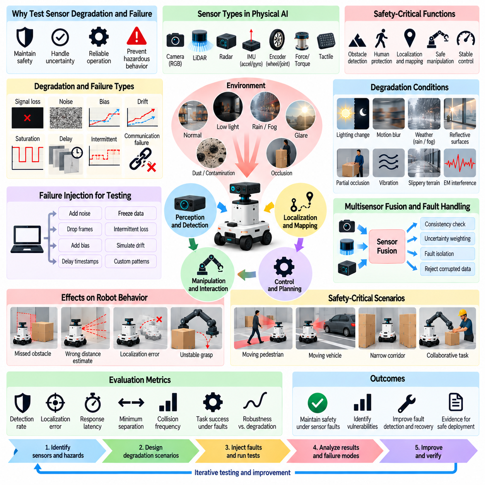{width="7.268055555555556in" height="7.268055555555556in"}

Sensor degradation and failure testing evaluates whether Physical AI systems remain safe when sensing capabilities become inaccurate, delayed, incomplete, or unavailable. Autonomous robots depend on sensors to estimate environmental conditions and internal states, making sensing reliability essential for physical safety. Evaluation must examine not only complete sensor failures but also gradual degradation that produces plausible yet misleading measurements.

Sensor failures can be classified according to their effects on measurement quality and availability. Common conditions include signal loss, excessive noise, bias, drift, saturation, delayed updates, and intermittent communication. Some failures are immediately observable, while others generate measurements that appear valid. Testing should distinguish detectable faults from subtle errors that can silently influence perception and control decisions.

A structured testing process begins by identifying safety-critical sensing functions and their dependencies. Cameras may support object recognition, LiDAR may estimate obstacle distance, inertial sensors may measure motion, and encoders may provide joint or wheel feedback. Evaluators should determine which safety functions depend on each sensor and identify the hazardous consequences of incorrect, missing, or outdated measurements.

Sensor degradation scenarios should reflect the physical mechanisms responsible for measurement errors. Cameras may experience glare, darkness, motion blur, or lens contamination. LiDAR performance may deteriorate under rain, fog, reflective surfaces, or partial obstruction. Inertial sensors may suffer bias drift and vibration effects, while wheel encoders may produce misleading motion estimates during slipping or mechanical faults.

Failure injection provides a controlled method for evaluating sensor-related vulnerabilities. Test systems can introduce synthetic noise, missing samples, timestamp errors, frozen measurements, or artificial biases into sensor streams. Fault parameters should specify onset, duration, magnitude, and temporal pattern. This enables reproducible experiments and supports systematic analysis of how different degradation levels affect robot behavior.

Gradual degradation deserves particular attention because its effects may remain hidden until safety margins become insufficient. Slowly increasing localization bias, declining image contrast, or progressive sensor contamination can undermine state estimation without triggering immediate fault alarms. Evaluation should determine whether monitoring mechanisms recognize these trends and initiate protective actions before hazardous conditions emerge.

Intermittent failures create challenges that differ from permanent sensor loss. A sensor may alternate between normal operation and corrupted measurements, causing unstable state estimates or repeated controller adjustments. Testing should vary fault frequency, burst duration, and recovery intervals. Evaluators should examine whether the system avoids oscillating between unsafe operating states and unnecessary protective interventions.

Timing failures can be as dangerous as incorrect measurements. Delayed sensor frames, inconsistent timestamps, synchronization errors, and irregular update rates may cause the robot to act on outdated environmental information. Evaluation should measure data age, processing latency, and temporal alignment across sensors. Safety mechanisms must account for uncertainty introduced by stale or temporally inconsistent observations.

Multisensor fusion can improve resilience, but it may also propagate errors when unreliable measurements receive excessive confidence. A faulty camera, LiDAR, or inertial sensor can distort the fused estimate of position, velocity, or obstacle location. Testing should examine consistency checks, uncertainty weighting, fault isolation, and the ability to reject corrupted observations without destabilizing the overall estimation process.

Redundant sensors do not automatically guarantee fault tolerance. Multiple devices may share power supplies, communication buses, mounting structures, or environmental vulnerabilities. Heavy rain may degrade several optical sensors simultaneously, while electrical interference may disrupt multiple sensing channels. Evaluation should include common-cause failures and determine whether the remaining sensing capability supports safe operation.

Perception model robustness must be evaluated separately from sensor hardware reliability. A sensor may operate correctly while producing observations that challenge a learned perception model. Unusual lighting, unfamiliar objects, occlusion, and distribution shifts can cause incorrect classifications or distance estimates. Testing should distinguish hardware faults, data-quality degradation, and model-level interpretation failures.

Sensor degradation can directly affect collision avoidance and human protection. Missed obstacles, underestimated closing speeds, or incorrect human localization may reduce protective separation margins. Safety-critical scenarios should combine sensing faults with moving obstacles, limited stopping distance, and unexpected human movement. Evaluation should determine whether the robot slows, stops, or changes behavior before unsafe proximity occurs.

Manipulation systems introduce additional sensing dependencies involving force, torque, tactile feedback, and joint position. A degraded force sensor may conceal excessive contact loads, while inaccurate joint feedback can distort end-effector positioning. Testing should examine grasp instability, unintended contact, payload release, and protective force limitation under sensor faults, including situations where several feedback channels disagree.

Fault detection and diagnosis mechanisms should be evaluated through measurable performance criteria. Detection latency, false-alarm rate, missed-fault rate, isolation accuracy, and minimum detectable fault magnitude provide complementary evidence. Evaluators should also measure how long unsafe estimates remain active after fault onset. A fault detector is insufficient if its response arrives too late to prevent hazardous physical behavior.

Recovery behavior is a critical component of sensor failure evaluation. Depending on the available sensing capability, a robot may continue at reduced speed, switch to redundant sensors, request human assistance, or enter a minimum-risk state. Tests should verify that these transitions preserve safety constraints and avoid unexpected motion. Recovery should occur only when restored measurements satisfy defined reliability conditions.

Simulation enables extensive exploration of sensor degradation through parameterized fault models. Noise distributions, dropout probabilities, latency profiles, and environmental disturbances can be varied across repeated scenarios. However, synthetic faults may not reproduce real sensor behavior, particularly correlated errors and hardware-specific artifacts. Physical measurements should therefore inform fault models whenever possible.

Hardware-in-the-loop testing bridges simulated faults and physical system responses. Real controllers can process modified sensor streams while robot dynamics or environmental interactions remain controlled. This approach helps reveal scheduling delays, interface failures, and unexpected software behavior. Test boundaries must prevent injected faults from creating uncontrolled physical hazards during experimental execution.

Real-world sensor testing should use controlled conditions and independent protective measures. Environmental chambers, lighting variation, artificial occlusion, vibration equipment, and calibrated reference instruments can expose sensing weaknesses. Ground-truth measurements are necessary to distinguish sensor error from actual environmental changes. Dangerous fault conditions should first be investigated without exposing humans or equipment to unnecessary risk.

Quantitative evaluation should connect sensor performance to downstream safety outcomes. Measurement error, detection coverage, estimation uncertainty, fault detection latency, collision risk, and protective intervention success should be analyzed together. A small average sensing error may conceal rare but severe failures. Tail distributions and worst-case operating conditions are therefore important complements to nominal accuracy metrics.

Scenario coverage should include individual faults, combined degradation, environmental stress, and failures occurring during critical actions. Testing should vary robot speed, payload, obstacle proximity, and operational phase to reveal interactions between sensing limitations and physical risk. Traceability from identified hazards to injected faults and observed responses helps determine whether the evaluation provides meaningful safety evidence.

Sensor failure evaluation must continue throughout the system lifecycle. Hardware replacement, calibration changes, software updates, and retrained perception models can alter fault sensitivity and recovery behavior. Versioned fault scenarios and regression tests help detect newly introduced vulnerabilities. Operational logs and near-miss reports should inform additional tests when previously unrecognized sensing weaknesses emerge.

Ultimately, sensor degradation and failure testing establishes whether Physical AI systems can recognize unreliable observations and maintain safe behavior despite incomplete environmental knowledge. Effective evaluation integrates physical fault modeling, controlled injection, multisensor consistency analysis, protective response measurement, and real-world validation. The objective is not uninterrupted task execution but dependable safety under degraded sensing conditions.

센서 성능 저하 및 고장 시험(Sensor Degradation and Failure Testing)은 센싱 능력(Sensing Capability)이 부정확해지거나 지연되거나 불완전해지거나 사용할 수 없게 되었을 때 피지컬 인공지능(Physical AI) 시스템이 안전성을 유지하는지를 평가한다. 자율 로봇(Autonomous Robot)은 환경 조건(Environmental Condition)과 내부 상태(Internal State)를 추정하기 위해 센서에 의존하므로 센싱 신뢰성(Sensing Reliability)은 물리적 안전성(Physical Safety)에 필수적이다. 평가에서는 센서의 완전한 고장(Complete Sensor Failure)뿐 아니라 그럴듯하지만 잘못된 측정값을 생성하는 점진적인 성능 저하(Gradual Degradation)도 검증해야 한다.

센서 고장(Sensor Failure)은 측정 품질(Measurement Quality)과 가용성(Availability)에 미치는 영향에 따라 분류할 수 있다. 일반적인 조건에는 신호 손실(Signal Loss), 과도한 잡음(Excessive Noise), 편향(Bias), 드리프트(Drift), 포화(Saturation), 갱신 지연(Delayed Update), 간헐적인 통신(Intermittent Communication)이 포함된다. 일부 고장은 즉시 관측할 수 있지만 다른 고장은 정상으로 보이는 측정값을 생성한다. 시험에서는 감지 가능한 결함(Detectable Fault)과 인지 및 제어 의사결정(Perception and Control Decision)에 은밀하게 영향을 미칠 수 있는 미세한 오류(Subtle Error)를 구분해야 한다.

체계적인 시험 과정(Structured Testing Process)은 안전 필수 센싱 기능(Safety-Critical Sensing Function)과 그 의존 관계(Dependency)를 식별하는 것에서 시작한다. 카메라(Camera)는 물체 인식(Object Recognition)을 지원하고, 라이다(LiDAR)는 장애물 거리(Obstacle Distance)를 추정하며, 관성 센서(Inertial Sensor)는 운동(Motion)을 측정하고, 엔코더(Encoder)는 관절 또는 바퀴의 피드백(Joint or Wheel Feedback)을 제공할 수 있다. 평가자는 각 센서에 의존하는 안전 기능(Safety Function)을 파악하고 부정확하거나 누락되거나 오래된 측정값(Outdated Measurement)이 초래할 수 있는 위험한 결과(Hazardous Consequence)를 식별해야 한다.

센서 성능 저하 시나리오(Sensor Degradation Scenario)는 측정 오류(Measurement Error)를 발생시키는 물리적 메커니즘(Physical Mechanism)을 반영해야 한다. 카메라는 눈부심(Glare), 어둠(Darkness), 움직임 흐림(Motion Blur), 렌즈 오염(Lens Contamination)의 영향을 받을 수 있다. 라이다 성능은 비(Rain), 안개(Fog), 반사 표면(Reflective Surface), 부분적인 차폐(Partial Obstruction)로 저하될 수 있다. 관성 센서는 편향 드리프트(Bias Drift)와 진동 영향(Vibration Effect)을 겪을 수 있으며, 바퀴 엔코더(Wheel Encoder)는 미끄러짐(Slipping)이나 기계적 고장(Mechanical Fault)이 발생할 때 잘못된 운동 추정값(Motion Estimate)을 생성할 수 있다.

고장 주입(Failure Injection)은 센서 관련 취약성(Sensor-Related Vulnerability)을 평가하기 위한 통제된 방법을 제공한다. 시험 시스템(Test System)은 센서 데이터 스트림(Sensor Stream)에 합성 잡음(Synthetic Noise), 누락된 샘플(Missing Sample), 타임스탬프 오류(Timestamp Error), 고정된 측정값(Frozen Measurement), 인위적인 편향(Artificial Bias)을 도입할 수 있다. 고장 매개변수(Fault Parameter)는 발생 시점(Onset), 지속 시간(Duration), 크기(Magnitude), 시간적 패턴(Temporal Pattern)을 명시해야 한다. 이를 통해 재현 가능한 실험(Reproducible Experiment)을 수행하고 성능 저하 수준에 따른 로봇 행동의 변화를 체계적으로 분석할 수 있다.

점진적인 성능 저하(Gradual Degradation)는 안전 여유도(Safety Margin)가 부족해질 때까지 그 영향이 드러나지 않을 수 있으므로 특별한 주의가 필요하다. 서서히 증가하는 위치 추정 편향(Localization Bias), 감소하는 영상 대비(Image Contrast), 진행성 센서 오염(Progressive Sensor Contamination)은 즉각적인 고장 경보(Fault Alarm)를 발생시키지 않으면서 상태 추정(State Estimation)의 신뢰성을 저하시킬 수 있다. 평가에서는 감시 메커니즘(Monitoring Mechanism)이 이러한 추세를 인식하고 위험한 조건(Hazardous Condition)이 발생하기 전에 보호 동작(Protective Action)을 시작하는지를 판단해야 한다.

간헐적 고장(Intermittent Failure)은 영구적인 센서 손실(Permanent Sensor Loss)과 다른 문제를 발생시킨다. 센서는 정상 작동과 손상된 측정값(Corrupted Measurement) 생성을 반복할 수 있으며, 이로 인해 불안정한 상태 추정값(Unstable State Estimate)이나 반복적인 제어기 조정(Controller Adjustment)이 발생할 수 있다. 시험에서는 고장 빈도(Fault Frequency), 연속 고장 지속 시간(Burst Duration), 복구 간격(Recovery Interval)을 변화시켜야 한다. 평가자는 시스템이 불안전한 운영 상태(Unsafe Operating State)와 불필요한 보호 개입(Unnecessary Protective Intervention) 사이에서 반복적으로 전환되는 현상을 방지하는지 검증해야 한다.

시간 관련 고장(Timing Failure)은 부정확한 측정값만큼 위험할 수 있다. 지연된 센서 프레임(Delayed Sensor Frame), 일관되지 않은 타임스탬프(Inconsistent Timestamp), 동기화 오류(Synchronization Error), 불규칙한 갱신 주기(Irregular Update Rate)는 로봇이 오래된 환경 정보(Outdated Environmental Information)에 기반하여 행동하도록 만들 수 있다. 평가에서는 데이터 경과 시간(Data Age), 처리 지연 시간(Processing Latency), 센서 간 시간 정렬(Temporal Alignment)을 측정해야 한다. 안전 메커니즘(Safety Mechanism)은 오래되거나 시간적으로 일관되지 않은 관측값(Temporally Inconsistent Observation)이 유발하는 불확실성을 고려해야 한다.

다중 센서 융합(Multisensor Fusion)은 복원력(Resilience)을 향상시킬 수 있지만 신뢰할 수 없는 측정값에 과도한 신뢰도(Excessive Confidence)를 부여하면 오류를 전파할 수도 있다. 결함이 있는 카메라, 라이다 또는 관성 센서는 위치(Position), 속도(Velocity), 장애물 위치(Obstacle Location)에 대한 융합 추정값(Fused Estimate)을 왜곡할 수 있다. 시험에서는 일관성 검사(Consistency Check), 불확실성 가중치(Uncertainty Weighting), 고장 격리(Fault Isolation), 전체 추정 과정(Estimation Process)을 불안정하게 만들지 않으면서 손상된 관측값(Corrupted Observation)을 배제하는 능력을 검증해야 한다.

중복 센서(Redundant Sensor)가 존재한다고 해서 자동으로 내고장성(Fault Tolerance)이 보장되는 것은 아니다. 여러 장치가 전원 공급 장치(Power Supply), 통신 버스(Communication Bus), 장착 구조물(Mounting Structure), 환경적 취약성(Environmental Vulnerability)을 공유할 수 있다. 폭우(Heavy Rain)는 여러 광학 센서(Optical Sensor)의 성능을 동시에 저하시킬 수 있으며, 전기적 간섭(Electrical Interference)은 다수의 센싱 채널(Sensing Channel)을 방해할 수 있다. 평가에서는 공통 원인 고장(Common-Cause Failure)을 포함하고 남아 있는 센싱 능력(Remaining Sensing Capability)이 안전한 운영을 지원하는지를 판단해야 한다.

인지 모델 강건성(Perception Model Robustness)은 센서 하드웨어 신뢰성(Sensor Hardware Reliability)과 별도로 평가해야 한다. 센서가 정상적으로 작동하더라도 학습된 인지 모델(Learned Perception Model)에 어려움을 주는 관측값을 생성할 수 있다. 비정상적인 조명(Unusual Lighting), 익숙하지 않은 물체(Unfamiliar Object), 가림(Occlusion), 분포 변화(Distribution Shift)는 잘못된 분류(Incorrect Classification)나 거리 추정(Distance Estimation)을 유발할 수 있다. 시험에서는 하드웨어 결함(Hardware Fault), 데이터 품질 저하(Data-Quality Degradation), 모델 수준의 해석 실패(Model-Level Interpretation Failure)를 구분해야 한다.

센서 성능 저하(Sensor Degradation)는 충돌 회피(Collision Avoidance)와 인간 보호(Human Protection)에 직접적인 영향을 미칠 수 있다. 장애물 미탐지(Missed Obstacle), 접근 속도 과소 추정(Underestimated Closing Speed), 부정확한 인간 위치 추정(Incorrect Human Localization)은 보호 이격 여유도(Protective Separation Margin)를 감소시킬 수 있다. 안전 필수 시나리오(Safety-Critical Scenario)는 센싱 결함(Sensing Fault)을 이동 장애물(Moving Obstacle), 제한된 정지 거리(Limited Stopping Distance), 예상하지 못한 인간 움직임(Unexpected Human Movement)과 결합해야 한다. 평가에서는 위험한 근접 상황(Unsafe Proximity)이 발생하기 전에 로봇이 감속하거나 정지하거나 행동을 변경하는지를 판단해야 한다.

조작 시스템(Manipulation System)은 힘(Force), 토크(Torque), 촉각 피드백(Tactile Feedback), 관절 위치(Joint Position)와 관련된 추가적인 센싱 의존성(Sensing Dependency)을 가진다. 성능이 저하된 힘 센서(Degraded Force Sensor)는 과도한 접촉 하중(Excessive Contact Load)을 감지하지 못할 수 있으며, 부정확한 관절 피드백(Inaccurate Joint Feedback)은 말단 효과기 위치(End-Effector Positioning)를 왜곡할 수 있다. 시험에서는 여러 피드백 채널(Feedback Channel)이 서로 불일치하는 상황을 포함하여 센서 결함이 발생했을 때 파지 불안정성(Grasp Instability), 의도하지 않은 접촉(Unintended Contact), 적재물 해제(Payload Release), 보호 힘 제한(Protective Force Limitation)을 검증해야 한다.

고장 감지 및 진단 메커니즘(Fault Detection and Diagnosis Mechanism)은 측정 가능한 성능 기준(Measurable Performance Criteria)을 통해 평가해야 한다. 감지 지연 시간(Detection Latency), 오경보율(False-Alarm Rate), 고장 미탐지율(Missed-Fault Rate), 고장 격리 정확도(Isolation Accuracy), 최소 감지 가능 고장 크기(Minimum Detectable Fault Magnitude)는 상호 보완적인 근거를 제공한다. 평가자는 고장 발생 이후 불안전한 추정값(Unsafe Estimate)이 활성 상태로 유지되는 시간도 측정해야 한다. 고장 감지기(Fault Detector)의 응답이 위험한 물리적 행동(Hazardous Physical Behavior)을 방지하기에 너무 늦다면 충분한 보호 기능을 제공한다고 볼 수 없다.

복구 동작(Recovery Behavior)은 센서 고장 평가(Sensor Failure Evaluation)의 핵심 구성 요소이다. 사용 가능한 센싱 능력(Available Sensing Capability)에 따라 로봇은 감속 상태(Reduced Speed)로 계속 작동하거나, 중복 센서(Redundant Sensor)로 전환하거나, 인간의 지원(Human Assistance)을 요청하거나, 최소 위험 상태(Minimum-Risk State)로 진입할 수 있다. 시험에서는 이러한 전환(Transition)이 안전 제약 조건(Safety Constraint)을 유지하고 예상하지 못한 움직임(Unexpected Motion)을 방지하는지를 검증해야 한다. 복구는 복원된 측정값(Restored Measurement)이 정의된 신뢰성 조건(Reliability Condition)을 충족하는 경우에만 이루어져야 한다.

시뮬레이션(Simulation)은 매개변수화된 고장 모델(Parameterized Fault Model)을 통해 센서 성능 저하를 광범위하게 탐색할 수 있도록 한다. 잡음 분포(Noise Distribution), 데이터 손실 확률(Dropout Probability), 지연 시간 프로파일(Latency Profile), 환경 외란(Environmental Disturbance)을 반복 시나리오(Repeated Scenario)에서 변화시킬 수 있다. 그러나 합성 고장(Synthetic Fault)은 실제 센서 동작(Real Sensor Behavior), 특히 상관된 오류(Correlated Error)와 하드웨어별 특이 현상(Hardware-Specific Artifact)을 재현하지 못할 수 있다. 따라서 가능한 경우 실제 물리적 측정값(Physical Measurement)을 고장 모델에 반영해야 한다.

하드웨어 인 더 루프 시험(Hardware-in-the-Loop Testing, HIL)은 시뮬레이션된 결함(Simulated Fault)과 실제 시스템 응답(Physical System Response) 사이의 간극을 연결한다. 실제 제어기(Real Controller)는 로봇 동역학(Robot Dynamics)이나 환경 상호작용(Environmental Interaction)이 통제된 상태에서 수정된 센서 데이터 스트림(Modified Sensor Stream)을 처리할 수 있다. 이러한 접근 방식은 스케줄링 지연(Scheduling Delay), 인터페이스 고장(Interface Failure), 예상하지 못한 소프트웨어 동작(Unexpected Software Behavior)을 발견하는 데 도움이 된다. 시험 경계(Test Boundary)는 주입된 결함이 실험 수행 중 통제되지 않은 물리적 위험(Uncontrolled Physical Hazard)을 발생시키지 않도록 설정해야 한다.

실제 환경 센서 시험(Real-World Sensor Testing)은 통제된 조건(Controlled Condition)과 독립적인 보호 조치(Independent Protective Measure)를 사용해야 한다. 환경 시험 챔버(Environmental Chamber), 조명 변화(Lighting Variation), 인위적인 가림(Artificial Occlusion), 진동 장비(Vibration Equipment), 교정된 기준 계측기(Calibrated Reference Instrument)를 활용하여 센싱 취약성(Sensing Weakness)을 드러낼 수 있다. 센서 오류(Sensor Error)와 실제 환경 변화(Actual Environmental Change)를 구분하려면 정답 기준 측정값(Ground-Truth Measurement)이 필요하다. 위험한 고장 조건(Dangerous Fault Condition)은 인간이나 장비를 불필요한 위험에 노출하지 않는 방식으로 먼저 조사해야 한다.

정량적 평가(Quantitative Evaluation)는 센서 성능(Sensor Performance)을 후속 안전 결과(Downstream Safety Outcome)와 연결해야 한다. 측정 오차(Measurement Error), 감지 범위(Detection Coverage), 추정 불확실성(Estimation Uncertainty), 고장 감지 지연 시간(Fault Detection Latency), 충돌 위험(Collision Risk), 보호 개입 성공률(Protective Intervention Success)을 함께 분석해야 한다. 평균 센싱 오차(Average Sensing Error)가 작더라도 드물지만 심각한 고장(Rare but Severe Failure)이 숨겨져 있을 수 있다. 따라서 분포의 꼬리 영역(Tail Distribution)과 최악 조건(Worst-Case Operating Condition)은 정상 정확도 지표(Nominal Accuracy Metric)를 보완하는 중요한 평가 요소이다.

시나리오 평가 범위(Scenario Coverage)에는 개별 결함(Individual Fault), 복합 성능 저하(Combined Degradation), 환경 스트레스(Environmental Stress), 중요 동작(Critical Action) 중 발생하는 고장이 포함되어야 한다. 시험에서는 로봇 속도(Robot Speed), 적재물(Payload), 장애물 근접성(Obstacle Proximity), 운영 단계(Operational Phase)를 변화시켜 센싱 한계(Sensing Limitation)와 물리적 위험(Physical Risk) 사이의 상호작용을 밝혀야 한다. 식별된 위험 요인(Identified Hazard), 주입된 결함(Injected Fault), 관측된 응답(Observed Response) 사이의 추적성(Traceability)은 평가가 의미 있는 안전성 근거(Safety Evidence)를 제공하는지 판단하는 데 도움이 된다.

센서 고장 평가(Sensor Failure Evaluation)는 시스템 수명주기(System Lifecycle) 전반에 걸쳐 지속되어야 한다. 하드웨어 교체(Hardware Replacement), 교정 변경(Calibration Change), 소프트웨어 업데이트(Software Update), 재학습된 인지 모델(Retrained Perception Model)은 고장 민감도(Fault Sensitivity)와 복구 동작(Recovery Behavior)을 변화시킬 수 있다. 버전 관리된 고장 시나리오(Versioned Fault Scenario)와 회귀 시험(Regression Test)은 새롭게 도입된 취약성(Newly Introduced Vulnerability)을 탐지하는 데 도움이 된다. 이전에 인식하지 못했던 센싱 취약성이 나타나면 운영 로그(Operational Log)와 아차 사고 보고서(Near-Miss Report)를 추가 시험 설계에 반영해야 한다.

궁극적으로 센서 성능 저하 및 고장 시험(Sensor Degradation and Failure Testing)은 피지컬 인공지능 시스템이 신뢰할 수 없는 관측값(Unreliable Observation)을 인식하고 불완전한 환경 정보(Incomplete Environmental Knowledge)에서도 안전한 행동(Safe Behavior)을 유지할 수 있는지를 입증한다. 효과적인 평가는 물리적 고장 모델링(Physical Fault Modeling), 통제된 고장 주입(Controlled Fault Injection), 다중 센서 일관성 분석(Multisensor Consistency Analysis), 보호 응답 측정(Protective Response Measurement), 실제 환경 검증(Real-World Validation)을 통합한다. 목표는 중단 없는 작업 수행(Uninterrupted Task Execution)이 아니라 센싱 성능이 저하된 조건(Degraded Sensing Condition)에서도 신뢰할 수 있는 안전성(Dependable Safety)을 확보하는 것이다.

##  

## 05.07. Localization and State Estimation Failures

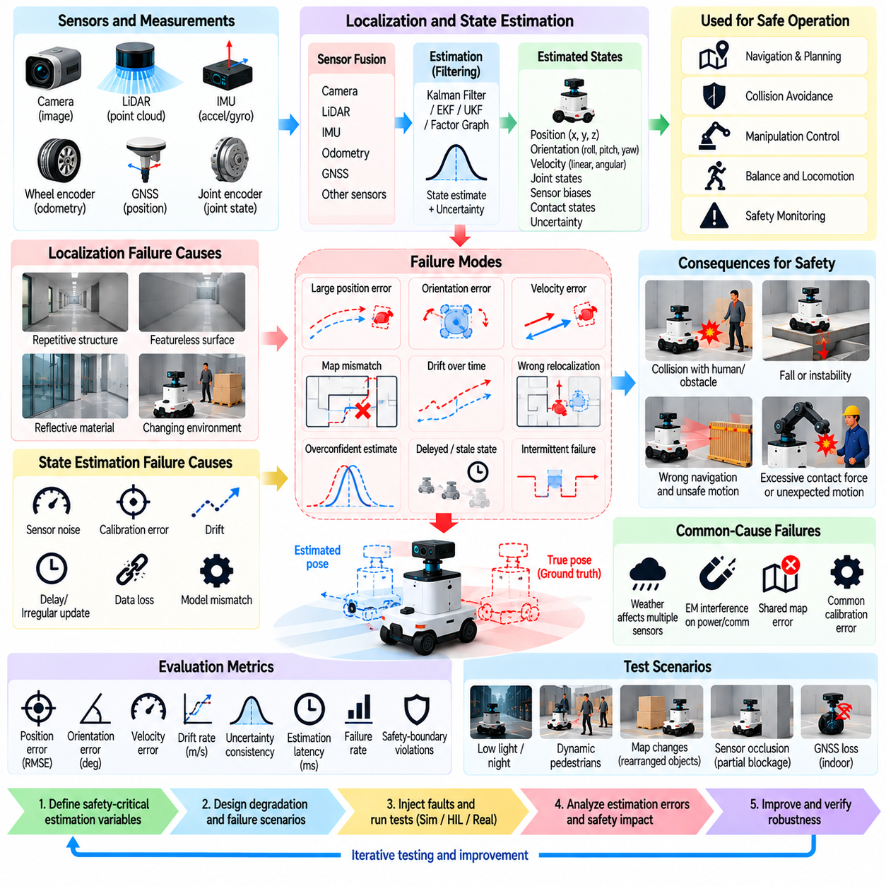{width="7.268055555555556in" height="7.268055555555556in"}

Localization and state estimation failures represent critical safety risks in Physical AI because autonomous robots depend on accurate knowledge of their position, orientation, velocity, and internal conditions. When these estimates become unreliable, navigation, manipulation, and protective control may operate on incorrect assumptions. Evaluation must determine whether estimation errors are detected before they produce hazardous physical behavior.

Localization estimates a robot\'s pose relative to a reference frame, while state estimation reconstructs additional variables such as velocity, acceleration, joint configuration, and sensor biases. These functions combine measurements with mathematical models and prior information. Failure testing should examine both incorrect numerical estimates and situations where the system expresses unjustified confidence in its estimated state.

Localization failures may arise from sensor noise, calibration errors, environmental ambiguity, map inconsistencies, and accumulated drift. Repetitive corridors, featureless surfaces, reflective materials, and changing surroundings can weaken position estimation. Evaluation should identify the conditions under which localization accuracy deteriorates and determine whether the resulting uncertainty affects safe motion decisions.

State estimation failures can propagate through multiple components of a robotic control system. An incorrect velocity estimate may distort stopping-distance calculations, while an erroneous orientation estimate can compromise balance or trajectory tracking. Testing should trace how estimation errors influence planning, collision avoidance, actuator commands, and runtime safety mechanisms rather than measuring estimator accuracy in isolation.

A systematic evaluation begins by defining the state variables required for safety-critical functions. Relevant quantities may include global position, local pose, heading, linear velocity, angular velocity, joint angles, and contact states. Each variable should have defined accuracy, latency, and confidence requirements. These requirements must reflect the consequences of estimation errors under realistic operating conditions.

Ground-truth measurements provide the reference needed to quantify localization and state estimation performance. Motion-capture systems, surveyed landmarks, precision tracking instruments, and calibrated encoders can support independent verification. Evaluation should account for reference-system uncertainty and coordinate-frame alignment. Without reliable ground truth, apparent estimator failures may be confused with measurement or synchronization errors.

Position and orientation errors should be evaluated using metrics appropriate to the robot\'s operating environment. Absolute trajectory error measures deviation from reference poses, while relative pose error captures local motion consistency. Drift rate, heading error, and maximum deviation provide additional information. Safety evaluation should emphasize error distributions and hazardous excursions rather than relying only on average accuracy.

Estimation uncertainty is as important as estimation accuracy. A robot may produce a biased pose estimate while reporting a narrow confidence interval, encouraging unsafe decisions. Consistency testing should compare predicted uncertainty with observed estimation errors. Calibration metrics and statistical consistency checks can reveal whether covariance estimates appropriately represent the actual reliability of the estimator.

Temporal failures occur when state estimates are delayed, irregularly updated, or associated with incorrect timestamps. Even geometrically accurate estimates can become unsafe when they describe outdated robot motion. Testing should vary sensing latency, computation delays, synchronization errors, and update frequency. Evaluation must determine whether control and safety functions account for state age and uncertainty accumulated during delays.

Sensor fusion failures deserve particular attention because localization often combines cameras, LiDAR, inertial measurements, wheel odometry, and satellite positioning. Incorrect sensor weighting or undetected measurement corruption can bias the fused estimate. Evaluation should test residual monitoring, innovation consistency, fault isolation, and estimator recovery when one or more measurement sources become unreliable.

Common-cause failures can defeat apparently redundant localization systems. Multiple estimators may share sensors, calibration parameters, maps, or assumptions about environmental geometry. A map error or severe wheel slip may therefore affect several estimation pipelines simultaneously. Testing should identify shared dependencies and examine whether independent evidence remains available to support safe decisions.

Localization loss and incorrect relocalization create distinct hazards. A robot may recognize that its position is unknown, or it may confidently associate observations with the wrong location. The latter can cause unexpected route selection and incorrect obstacle interpretation. Evaluation should examine localization-loss detection, false relocalization, recovery latency, and the safety of motion while location confidence remains insufficient.

Map-related failures should be evaluated under changing environmental conditions. Rearranged equipment, temporary barriers, construction activity, and altered landmarks can make previously valid maps inaccurate. Testing should determine whether the robot detects map inconsistency and avoids treating outdated spatial information as authoritative. Safe operation may require local obstacle sensing, map updates, or restricted movement.

Dynamic environments introduce additional estimation challenges because moving objects can be mistaken for stationary landmarks. Crowds, passing vehicles, and moving machinery may distort visual or LiDAR-based localization. Evaluation should examine whether dynamic-object filtering and robust data association prevent these observations from corrupting the robot\'s estimated pose, particularly near humans and hazardous equipment.

Mobile robots require localization accuracy appropriate to their speed, stopping capability, and available clearance. A small position error may be acceptable in an open area but hazardous in a narrow passage or near a protected boundary. Testing should combine localization disturbances with changing velocity, obstacle proximity, and limited braking distance to establish operationally meaningful safety thresholds.

Legged robots introduce state estimation challenges involving body orientation, contact detection, and terrain interaction. Foot slip, uncertain ground contact, and rapid body motion can distort estimated velocity and posture. Evaluation should determine whether these errors compromise balance, foothold selection, or recovery actions. Safety testing must consider transitions between stable locomotion, degraded control, and controlled protective behavior.

Manipulator systems depend on accurate joint states, end-effector pose, and contact estimates. Encoder errors, calibration drift, structural compliance, and uncertain payload motion can produce unintended contact or inaccurate placement. Evaluation should measure how state estimation errors affect workspace boundaries, collision avoidance, grasp stability, and force-limited interaction during safety-critical manipulation tasks.

Fault injection enables controlled examination of estimation-system vulnerabilities. Test conditions may include artificial pose offsets, increasing bias, delayed measurements, incorrect coordinate transforms, missing observations, and abrupt estimator resets. Fault magnitude, onset, duration, and recovery conditions should be parameterized. Repeated experiments can reveal thresholds where estimation degradation begins to violate safety requirements.

Protective behavior should be evaluated when estimation confidence deteriorates. Depending on the robot\'s capabilities, appropriate responses may include reducing speed, increasing clearance, switching estimation modes, stopping, or requesting assistance. Testing should verify that fallback decisions are triggered early enough and that transitions do not introduce additional hazards through abrupt or inconsistent control commands.

Simulation provides a scalable environment for evaluating rare localization failures and combinations of disturbances. Parameterized tests can vary sensor noise, map mismatch, drift, and timing errors while preserving reproducibility. However, synthetic faults may omit hardware-specific correlations and environmental effects. Hardware-in-the-loop experiments and controlled physical trials are needed to validate critical findings.

Quantitative assessment should connect estimation quality with downstream safety outcomes. Relevant metrics include pose error, drift rate, uncertainty consistency, localization-loss frequency, fault detection latency, recovery success, and safety-boundary violations. Reporting conditional performance across operating scenarios is essential because average accuracy may conceal rare errors that create disproportionate physical risk.

Ultimately, localization and state estimation failure evaluation determines whether Physical AI systems can recognize unreliable internal representations and preserve safe operation despite imperfect knowledge of their own motion and surroundings. Effective testing integrates reference measurements, uncertainty validation, fault injection, environmental stress, and protective response assessment to establish defensible limits for autonomous operation.

위치 추정 및 상태 추정 실패(Localization and State Estimation Failures)는 자율 로봇(Autonomous Robot)이 자신의 위치(Position), 방향(Orientation), 속도(Velocity), 내부 상태(Internal Condition)에 대한 정확한 정보에 의존하기 때문에 피지컬 인공지능(Physical AI)에서 중요한 안전 위험(Safety Risk)을 나타낸다. 이러한 추정값의 신뢰성이 저하되면 내비게이션(Navigation), 조작(Manipulation), 보호 제어(Protective Control)가 잘못된 가정에 기반하여 작동할 수 있다. 평가는 추정 오류(Estimation Error)가 위험한 물리적 행동(Hazardous Physical Behavior)을 발생시키기 전에 감지되는지를 판단해야 한다.

위치 추정(Localization)은 기준 좌표계(Reference Frame)에 대한 로봇의 자세(Pose)를 추정하는 과정이며, 상태 추정(State Estimation)은 속도(Velocity), 가속도(Acceleration), 관절 구성(Joint Configuration), 센서 편향(Sensor Bias)과 같은 추가적인 변수를 복원하는 과정이다. 이러한 기능은 측정값(Measurement)을 수학적 모델(Mathematical Model) 및 사전 정보(Prior Information)와 결합한다. 고장 시험(Failure Testing)에서는 잘못된 수치 추정값(Incorrect Numerical Estimate)뿐 아니라 시스템이 자신의 추정 상태(Estimated State)에 대해 정당화되지 않은 높은 신뢰도(Unjustified Confidence)를 나타내는 상황도 검증해야 한다.

위치 추정 실패(Localization Failure)는 센서 잡음(Sensor Noise), 교정 오류(Calibration Error), 환경적 모호성(Environmental Ambiguity), 지도 불일치(Map Inconsistency), 누적 드리프트(Accumulated Drift)로 인해 발생할 수 있다. 반복적인 복도 구조(Repetitive Corridor), 특징이 부족한 표면(Featureless Surface), 반사 재질(Reflective Material), 변화하는 주변 환경(Changing Surroundings)은 위치 추정 성능을 약화시킬 수 있다. 평가에서는 위치 추정 정확도(Localization Accuracy)가 저하되는 조건을 식별하고 그에 따른 불확실성(Uncertainty)이 안전한 이동 의사결정(Safe Motion Decision)에 영향을 미치는지를 판단해야 한다.

상태 추정 실패(State Estimation Failure)는 로봇 제어 시스템(Robotic Control System)의 여러 구성 요소로 전파될 수 있다. 잘못된 속도 추정값(Incorrect Velocity Estimate)은 정지 거리 계산(Stopping-Distance Calculation)을 왜곡할 수 있으며, 부정확한 방향 추정값(Erroneous Orientation Estimate)은 균형 유지(Balance)나 궤적 추종(Trajectory Tracking)을 저해할 수 있다. 시험에서는 추정 오류가 계획(Planning), 충돌 회피(Collision Avoidance), 구동기 명령(Actuator Command), 실행시간 안전 메커니즘(Runtime Safety Mechanism)에 어떤 영향을 미치는지 추적해야 하며, 추정기의 정확도(Estimator Accuracy)만을 독립적으로 측정하는 데 그쳐서는 안 된다.

체계적인 평가(Systematic Evaluation)는 안전 필수 기능(Safety-Critical Function)에 필요한 상태 변수(State Variable)를 정의하는 것에서 시작한다. 관련 변수에는 전역 위치(Global Position), 국소 자세(Local Pose), 진행 방향(Heading), 선속도(Linear Velocity), 각속도(Angular Velocity), 관절 각도(Joint Angle), 접촉 상태(Contact State)가 포함될 수 있다. 각 변수에는 정확도(Accuracy), 지연 시간(Latency), 신뢰도(Confidence)에 대한 요구사항이 정의되어야 한다. 이러한 요구사항은 현실적인 운영 조건(Realistic Operating Condition)에서 추정 오류가 초래할 수 있는 결과를 반영해야 한다.

정답 기준 측정값(Ground-Truth Measurement)은 위치 추정 및 상태 추정 성능(Localization and State Estimation Performance)을 정량화하는 데 필요한 기준을 제공한다. 모션 캡처 시스템(Motion-Capture System), 측량된 기준점(Surveyed Landmark), 정밀 추적 장비(Precision Tracking Instrument), 교정된 엔코더(Calibrated Encoder)는 독립적인 검증(Independent Verification)을 지원할 수 있다. 평가에서는 기준 시스템의 불확실성(Reference-System Uncertainty)과 좌표계 정렬(Coordinate-Frame Alignment)을 고려해야 한다. 신뢰할 수 있는 정답 기준(Ground Truth)이 없다면 추정기 고장(Estimator Failure)으로 보이는 현상을 측정 오류(Measurement Error)나 동기화 오류(Synchronization Error)와 혼동할 수 있다.

위치 및 방향 오류(Position and Orientation Error)는 로봇의 운영 환경(Operating Environment)에 적합한 지표를 사용하여 평가해야 한다. 절대 궤적 오차(Absolute Trajectory Error, ATE)는 기준 자세(Reference Pose)로부터의 편차를 측정하며, 상대 자세 오차(Relative Pose Error, RPE)는 국소 운동의 일관성(Local Motion Consistency)을 나타낸다. 드리프트율(Drift Rate), 진행 방향 오차(Heading Error), 최대 편차(Maximum Deviation)는 추가적인 정보를 제공한다. 안전성 평가(Safety Evaluation)는 평균 정확도(Average Accuracy)에만 의존하지 않고 오류 분포(Error Distribution)와 위험한 이탈(Hazardous Excursion)을 중점적으로 분석해야 한다.

추정 불확실성(Estimation Uncertainty)은 추정 정확도(Estimation Accuracy)만큼 중요하다. 로봇이 편향된 자세 추정값(Biased Pose Estimate)을 생성하면서도 좁은 신뢰 구간(Narrow Confidence Interval)을 보고한다면 불안전한 의사결정(Unsafe Decision)을 유발할 수 있다. 일관성 시험(Consistency Testing)은 예측된 불확실성(Predicted Uncertainty)과 실제 관측된 추정 오류(Observed Estimation Error)를 비교해야 한다. 보정 지표(Calibration Metric)와 통계적 일관성 검사(Statistical Consistency Check)는 공분산 추정값(Covariance Estimate)이 추정기의 실제 신뢰성(Actual Reliability)을 적절하게 표현하는지를 밝혀낼 수 있다.

시간적 고장(Temporal Failure)은 상태 추정값(State Estimate)이 지연되거나 불규칙하게 갱신되거나 잘못된 타임스탬프(Incorrect Timestamp)와 연결될 때 발생한다. 기하학적으로 정확한 추정값(Geometrically Accurate Estimate)이라도 오래된 로봇 운동 상태를 나타낸다면 불안전해질 수 있다. 시험에서는 센싱 지연 시간(Sensing Latency), 연산 지연(Computation Delay), 동기화 오류(Synchronization Error), 갱신 빈도(Update Frequency)를 변화시켜야 한다. 평가에서는 제어 기능(Control Function)과 안전 기능(Safety Function)이 상태 정보의 경과 시간(State Age)과 지연 중 누적된 불확실성을 고려하는지를 판단해야 한다.

센서 융합 실패(Sensor Fusion Failure)는 위치 추정이 카메라(Camera), 라이다(LiDAR), 관성 측정값(Inertial Measurement), 바퀴 주행 거리 추정(Wheel Odometry), 위성 위치 측정(Satellite Positioning)을 결합하는 경우가 많기 때문에 특별한 주의가 필요하다. 잘못된 센서 가중치(Incorrect Sensor Weighting)나 감지되지 않은 측정값 손상(Undetected Measurement Corruption)은 융합 추정값(Fused Estimate)에 편향을 발생시킬 수 있다. 평가에서는 잔차 감시(Residual Monitoring), 이노베이션 일관성(Innovation Consistency), 고장 격리(Fault Isolation), 하나 이상의 측정 정보원이 신뢰할 수 없게 되었을 때의 추정기 복구(Estimator Recovery)를 시험해야 한다.

공통 원인 고장(Common-Cause Failure)은 겉보기에 중복성을 갖춘 위치 추정 시스템(Redundant Localization System)도 무력화할 수 있다. 여러 추정기(Estimator)가 센서(Sensor), 교정 매개변수(Calibration Parameter), 지도(Map), 환경 형상에 대한 가정(Assumption About Environmental Geometry)을 공유할 수 있다. 따라서 지도 오류(Map Error)나 심각한 바퀴 미끄러짐(Severe Wheel Slip)은 여러 추정 파이프라인(Estimation Pipeline)에 동시에 영향을 미칠 수 있다. 시험에서는 공유 의존성(Shared Dependency)을 식별하고 안전한 의사결정을 지원할 독립적인 근거(Independent Evidence)가 남아 있는지를 검증해야 한다.

위치 추정 상실(Localization Loss)과 잘못된 재위치 추정(Incorrect Relocalization)은 서로 다른 위험을 발생시킨다. 로봇은 자신의 위치를 알 수 없다는 사실을 인식할 수도 있지만, 관측값을 잘못된 위치와 높은 확신으로 연결할 수도 있다. 후자의 경우 예상하지 못한 경로 선택(Unexpected Route Selection)과 잘못된 장애물 해석(Incorrect Obstacle Interpretation)이 발생할 수 있다. 평가에서는 위치 추정 상실 감지(Localization-Loss Detection), 잘못된 재위치 추정(False Relocalization), 복구 지연 시간(Recovery Latency), 위치 신뢰도(Location Confidence)가 충분하지 않은 동안의 이동 안전성을 검증해야 한다.

지도 관련 고장(Map-Related Failure)은 변화하는 환경 조건(Changing Environmental Condition)에서 평가해야 한다. 재배치된 장비(Rearranged Equipment), 임시 장벽(Temporary Barrier), 건설 작업(Construction Activity), 변경된 기준점(Altered Landmark)은 이전에 유효했던 지도를 부정확하게 만들 수 있다. 시험에서는 로봇이 지도 불일치(Map Inconsistency)를 감지하고 오래된 공간 정보(Outdated Spatial Information)를 신뢰할 수 있는 정보로 취급하지 않는지를 판단해야 한다. 안전한 운영을 위해서는 국소 장애물 센싱(Local Obstacle Sensing), 지도 갱신(Map Update), 이동 제한(Restricted Movement)이 필요할 수 있다.

동적 환경(Dynamic Environment)은 움직이는 물체(Moving Object)가 정적 기준점(Stationary Landmark)으로 잘못 인식될 수 있기 때문에 추가적인 추정 문제를 발생시킨다. 군중(Crowd), 지나가는 차량(Passing Vehicle), 이동 기계(Moving Machinery)는 시각 기반 또는 라이다 기반 위치 추정(Visual or LiDAR-Based Localization)을 왜곡할 수 있다. 평가에서는 동적 물체 필터링(Dynamic-Object Filtering)과 강건한 데이터 연관(Robust Data Association)이 이러한 관측값으로 인해 로봇의 추정 자세(Estimated Pose)가 손상되는 것을 방지하는지 검증해야 하며, 특히 인간과 위험 장비(Hazardous Equipment) 근처에서의 성능을 중점적으로 확인해야 한다.

이동 로봇(Mobile Robot)은 속도(Speed), 정지 능력(Stopping Capability), 사용 가능한 여유 공간(Available Clearance)에 적합한 위치 추정 정확도(Localization Accuracy)가 필요하다. 작은 위치 오차(Position Error)는 개방된 공간(Open Area)에서는 허용될 수 있지만 좁은 통로(Narrow Passage)나 보호 경계(Protected Boundary) 근처에서는 위험할 수 있다. 시험에서는 위치 추정 외란(Localization Disturbance)을 변화하는 속도(Changing Velocity), 장애물 근접성(Obstacle Proximity), 제한된 제동 거리(Limited Braking Distance)와 결합하여 운영상 의미 있는 안전 임계값(Operationally Meaningful Safety Threshold)을 설정해야 한다.

다족 보행 로봇(Legged Robot)은 몸체 방향(Body Orientation), 접촉 감지(Contact Detection), 지형 상호작용(Terrain Interaction)과 관련된 상태 추정 문제를 추가로 가진다. 발 미끄러짐(Foot Slip), 불확실한 지면 접촉(Uncertain Ground Contact), 빠른 몸체 움직임(Rapid Body Motion)은 추정된 속도(Estimated Velocity)와 자세(Posture)를 왜곡할 수 있다. 평가에서는 이러한 오류가 균형 유지(Balance), 발 디딤 위치 선택(Foothold Selection), 복구 동작(Recovery Action)을 저해하는지를 판단해야 한다. 안전성 시험에서는 안정적인 보행(Stable Locomotion), 성능이 저하된 제어(Degraded Control), 통제된 보호 동작(Controlled Protective Behavior) 사이의 전환을 고려해야 한다.

매니퓰레이터 시스템(Manipulator System)은 정확한 관절 상태(Joint State), 말단 효과기 자세(End-Effector Pose), 접촉 추정값(Contact Estimate)에 의존한다. 엔코더 오류(Encoder Error), 교정 드리프트(Calibration Drift), 구조적 순응성(Structural Compliance), 불확실한 적재물 움직임(Uncertain Payload Motion)은 의도하지 않은 접촉(Unintended Contact)이나 부정확한 배치(Inaccurate Placement)를 유발할 수 있다. 평가에서는 안전 필수 조작 작업(Safety-Critical Manipulation Task) 중 상태 추정 오류가 작업 공간 경계(Workspace Boundary), 충돌 회피(Collision Avoidance), 파지 안정성(Grasp Stability), 힘 제한 상호작용(Force-Limited Interaction)에 미치는 영향을 측정해야 한다.

고장 주입(Fault Injection)은 추정 시스템의 취약성(Estimation-System Vulnerability)을 통제된 방식으로 조사할 수 있도록 한다. 시험 조건에는 인위적인 자세 오프셋(Artificial Pose Offset), 증가하는 편향(Increasing Bias), 지연된 측정값(Delayed Measurement), 잘못된 좌표 변환(Incorrect Coordinate Transform), 누락된 관측값(Missing Observation), 갑작스러운 추정기 재설정(Abrupt Estimator Reset)이 포함될 수 있다. 고장 크기(Fault Magnitude), 발생 시점(Onset), 지속 시간(Duration), 복구 조건(Recovery Condition)은 매개변수화되어야 한다. 반복 실험(Repeated Experiment)은 추정 성능 저하(Estimation Degradation)가 안전 요구사항(Safety Requirement)을 위반하기 시작하는 임계값을 밝혀낼 수 있다.

추정 신뢰도(Estimation Confidence)가 저하될 때의 보호 동작(Protective Behavior)을 평가해야 한다. 로봇의 능력(Robot Capability)에 따라 적절한 대응에는 감속(Reducing Speed), 여유 거리 확대(Increasing Clearance), 추정 모드 전환(Switching Estimation Modes), 정지(Stopping), 지원 요청(Requesting Assistance)이 포함될 수 있다. 시험에서는 대체 동작 결정(Fallback Decision)이 충분히 이른 시점에 시작되는지, 그리고 전환 과정(Transition)이 갑작스럽거나 일관되지 않은 제어 명령(Control Command)을 통해 추가적인 위험을 발생시키지 않는지를 검증해야 한다.

시뮬레이션(Simulation)은 드문 위치 추정 실패(Rare Localization Failure)와 복합 외란(Combined Disturbance)을 평가하기 위한 확장 가능한 환경(Scalable Environment)을 제공한다. 매개변수화된 시험(Parameterized Test)은 재현성(Reproducibility)을 유지하면서 센서 잡음(Sensor Noise), 지도 불일치(Map Mismatch), 드리프트(Drift), 시간 관련 오류(Timing Error)를 변화시킬 수 있다. 그러나 합성 고장(Synthetic Fault)은 하드웨어별 상관관계(Hardware-Specific Correlation)와 환경적 영향(Environmental Effect)을 충분히 반영하지 못할 수 있다. 중요한 결과를 검증하려면 하드웨어 인 더 루프 실험(Hardware-in-the-Loop Experiment)과 통제된 물리적 시험(Controlled Physical Trial)이 필요하다.

정량적 평가(Quantitative Assessment)는 추정 품질(Estimation Quality)을 후속 안전 결과(Downstream Safety Outcome)와 연결해야 한다. 관련 지표에는 자세 오차(Pose Error), 드리프트율(Drift Rate), 불확실성 일관성(Uncertainty Consistency), 위치 추정 상실 빈도(Localization-Loss Frequency), 고장 감지 지연 시간(Fault Detection Latency), 복구 성공률(Recovery Success), 안전 경계 위반(Safety-Boundary Violation)이 포함된다. 평균 정확도(Average Accuracy)는 불균형적으로 큰 물리적 위험(Disproportionate Physical Risk)을 발생시키는 드문 오류(Rare Error)를 숨길 수 있으므로 운영 시나리오(Operating Scenario)별 조건부 성능(Conditional Performance)을 보고하는 것이 필수적이다.

궁극적으로 위치 추정 및 상태 추정 실패 평가(Localization and State Estimation Failure Evaluation)는 피지컬 인공지능 시스템이 신뢰할 수 없는 내부 표현(Unreliable Internal Representation)을 인식하고 자신의 움직임과 주변 환경에 대한 불완전한 정보(Imperfect Knowledge)에도 불구하고 안전한 운영(Safe Operation)을 유지할 수 있는지를 판단한다. 효과적인 시험은 기준 측정값(Reference Measurement), 불확실성 검증(Uncertainty Validation), 고장 주입(Fault Injection), 환경 스트레스(Environmental Stress), 보호 응답 평가(Protective Response Assessment)를 통합하여 자율 운영(Autonomous Operation)에 대한 정당화 가능한 한계(Defensible Limit)를 설정한다.

##  

## 05.08. Actuator Control and Compute Failures

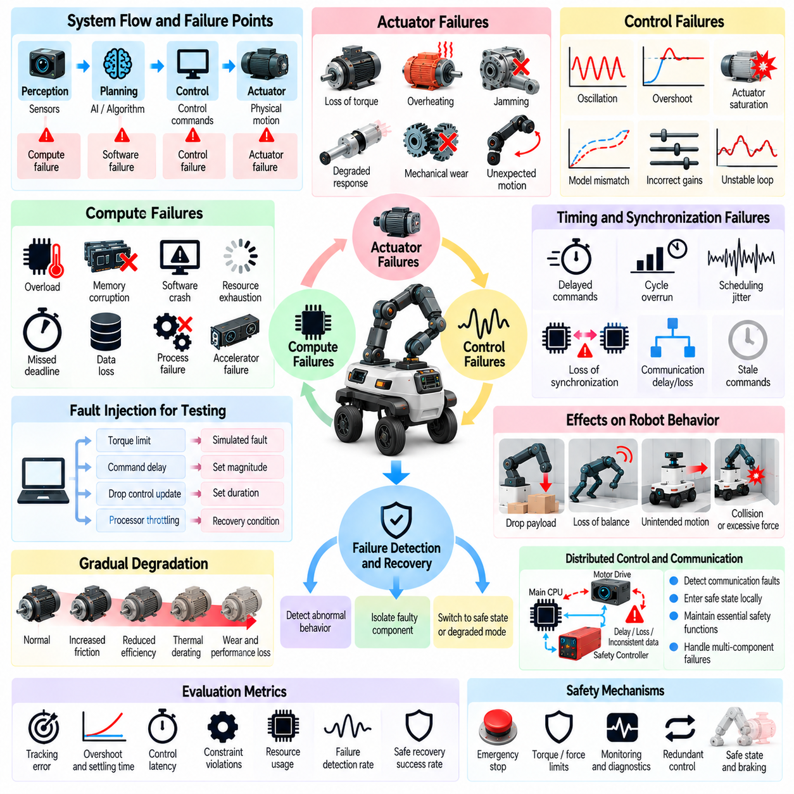{width="7.268055555555556in" height="7.268055555555556in"}

Actuator, control, and compute failures represent critical safety concerns in Physical AI because autonomous robots transform digital decisions into physical motion. Even when perception and planning operate correctly, failures in motors, controllers, processors, or execution pipelines can produce hazardous behavior. Evaluation must determine whether these failures are detected, contained, and managed before they compromise physical safety.

Actuator failures include loss of torque, unexpected motion, mechanical jamming, overheating, and degraded response characteristics. Electric motors, hydraulic systems, pneumatic devices, and transmission mechanisms exhibit different failure behaviors. Testing should identify how each failure affects movement, load support, stopping capability, and the robot\'s ability to maintain a safe configuration under operational stress.

Control failures arise when commanded actions no longer produce the intended physical response. Incorrect feedback gains, unstable control loops, actuator saturation, and model mismatch may generate oscillation, overshoot, or excessive force. Evaluation should examine whether the controller maintains stability and respects safety constraints when disturbances, parameter uncertainty, or unexpected physical interactions occur.

Compute failures affect the processing infrastructure responsible for perception, planning, estimation, and control. Processor overload, memory corruption, software crashes, and resource exhaustion can interrupt safety-critical execution. Testing should distinguish temporary performance degradation from complete computational failure and determine whether essential protective functions remain operational when noncritical workloads consume excessive resources.

Timing failures are especially important because physical control depends on predictable execution intervals. Missed deadlines, scheduling jitter, delayed commands, and asynchronous processing can destabilize feedback loops. Evaluation should measure worst-case execution time, control-cycle overruns, and command age. Safety mechanisms must prevent stale or delayed commands from producing unintended movement.

Fault injection provides a systematic method for evaluating actuator, control, and compute vulnerabilities. Experiments may introduce artificial torque limits, command delays, dropped control updates, processor throttling, or simulated component faults. Each fault should be parameterized by onset, duration, magnitude, and recovery conditions. Reproducible injection enables comparison of protective responses across different operating scenarios.

Actuator degradation often develops gradually rather than appearing as an immediate failure. Increasing friction, reduced motor efficiency, thermal derating, and mechanical wear can progressively alter response characteristics. Evaluation should determine whether monitoring systems detect these trends and adjust operating limits before control authority becomes insufficient to maintain stability or prevent hazardous contact.

Unexpected actuator motion requires particular attention because it can create immediate collision or crushing hazards. Faults in drive electronics, command interpretation, or feedback signals may cause unintended acceleration or movement in the wrong direction. Testing should verify that independent protective mechanisms can inhibit hazardous motion and that stopping functions remain effective when the nominal motion controller becomes unreliable.

Loss of actuation can be equally dangerous when a robot depends on continuous torque to support loads or maintain posture. A manipulator may drop a payload, while a legged robot may lose balance after joint torque disappears. Evaluation should consider gravity, stored mechanical energy, brake engagement, and passive stability. Safe behavior may require controlled load release, mechanical restraint, or a predefined protective posture.

Control-loop stability should be examined across realistic operating conditions rather than only under nominal parameters. Payload changes, varying friction, structural compliance, and external disturbances can alter system dynamics. Evaluation should measure tracking error, overshoot, settling time, oscillation amplitude, and constraint violations while identifying whether unstable behavior approaches hazardous physical limits.

Distributed control architectures introduce additional failure modes involving communication between processors, motor drives, and safety controllers. Delayed messages, inconsistent state updates, and lost synchronization can cause components to execute incompatible commands. Testing should determine whether communication faults are detected and whether local controllers enter safe states when coordinated control can no longer be guaranteed.

Real-time scheduling failures can arise when computational workloads compete for limited processing resources. High-resolution perception, neural network inference, mapping, and planning may interfere with time-sensitive control tasks. Evaluation should examine processor utilization, task priorities, memory pressure, and scheduling latency. Safety-critical functions should remain within validated timing bounds under representative peak workloads.

AI inference failures introduce challenges because learned policies may generate commands with variable latency or unexpected numerical outputs. Model execution can be disrupted by accelerator contention, memory exhaustion, or software exceptions. Evaluation should verify output validity, command freshness, and execution deadlines. Invalid, missing, or excessively delayed policy outputs must not be translated directly into unsafe actuator commands.

Numerical and software faults can propagate through control calculations without causing an obvious system crash. Overflow, invalid floating-point values, incorrect coordinate transformations, and corrupted parameters may produce extreme control outputs. Testing should examine input validation, numerical bounds, command plausibility, and independent safety checks that prevent invalid computations from reaching physical actuators.

Watchdog mechanisms and runtime monitors can detect stalled execution, missed control deadlines, and abnormal command patterns. However, their effectiveness depends on detection coverage, independence, and response speed. Evaluation should measure fault detection latency, missed-fault rates, false alarms, and protective intervention success. A watchdog that resets software without securing physical motion may not provide adequate safety.

Fallback control strategies should be evaluated according to the remaining actuator and computational capabilities. Depending on the platform, appropriate responses may include reduced-speed operation, controlled braking, torque limitation, load stabilization, or transition to a minimum-risk state. Testing must verify that fallback behavior is dynamically feasible and does not introduce additional hazards during mode transitions.

Emergency stopping requires careful evaluation because removing actuator power does not always produce the safest physical outcome. Uncontrolled coasting, gravity-driven motion, or sudden loss of support may increase risk. Tests should distinguish controlled stopping, power removal, mechanical braking, and safe torque inhibition. The selected response must reflect robot morphology, stored energy, and application-specific hazards.

Compound failures may expose weaknesses that remain hidden during isolated fault testing. Processor overload combined with actuator degradation can delay protective braking, while communication loss and stale state estimates may destabilize distributed control. Scenario design should prioritize credible causal combinations and examine whether safety mechanisms remain effective when multiple protective assumptions fail simultaneously.

Simulation and hardware-in-the-loop testing support controlled exploration of dangerous failures without immediately exposing physical equipment to unacceptable risks. Dynamic models can represent actuator faults, controller instability, and computational delays. However, simulated responses may omit thermal behavior, mechanical backlash, or hardware-specific timing effects. Critical results require carefully controlled physical validation.

Quantitative evaluation should connect component-level faults to system-level safety outcomes. Relevant metrics include control deadline violations, actuator response error, stopping distance, fault detection latency, recovery success, and safety-boundary violations. Repeated trials should examine worst-case conditions and uncertainty. A system may maintain average task performance while exhibiting rare failures with severe physical consequences.

Regression testing is essential because software updates, controller tuning, hardware replacement, and new AI models can alter failure behavior. Versioned fault scenarios should verify that previously established protective responses remain effective. Operational logs, diagnostic records, and near-miss reports can reveal additional vulnerabilities. Evaluation evidence must remain traceable to specific hardware, software, and operating configurations.

Ultimately, actuator, control, and compute failure evaluation determines whether Physical AI systems preserve physical safety when the mechanisms responsible for executing intelligent decisions become unreliable. Effective assessment integrates fault injection, dynamic stability analysis, real-time performance testing, independent protection, and recovery validation. The objective is dependable containment of hazardous motion rather than uninterrupted autonomous operation.

구동기, 제어 및 컴퓨팅 고장(Actuator, Control, and Compute Failures)은 자율 로봇(Autonomous Robot)이 디지털 의사결정(Digital Decision)을 물리적 움직임(Physical Motion)으로 변환하기 때문에 피지컬 인공지능(Physical AI)에서 중요한 안전 문제(Safety Concern)를 나타낸다. 인지(Perception)와 계획(Planning)이 정상적으로 작동하더라도 모터(Motor), 제어기(Controller), 프로세서(Processor), 실행 파이프라인(Execution Pipeline)의 고장은 위험한 행동(Hazardous Behavior)을 발생시킬 수 있다. 평가는 이러한 고장이 물리적 안전성(Physical Safety)을 저해하기 전에 감지, 격리 및 관리되는지를 판단해야 한다.

구동기 고장(Actuator Failure)에는 토크 손실(Loss of Torque), 예상하지 못한 움직임(Unexpected Motion), 기계적 걸림(Mechanical Jamming), 과열(Overheating), 응답 특성 저하(Degraded Response Characteristics)가 포함된다. 전기 모터(Electric Motor), 유압 시스템(Hydraulic System), 공압 장치(Pneumatic Device), 동력 전달 메커니즘(Transmission Mechanism)은 서로 다른 고장 동작(Failure Behavior)을 나타낸다. 시험에서는 각 고장이 이동(Movement), 하중 지지(Load Support), 정지 능력(Stopping Capability), 운영 스트레스(Operational Stress) 상황에서 안전한 구성(Safe Configuration)을 유지하는 로봇의 능력에 어떤 영향을 미치는지 식별해야 한다.

제어 고장(Control Failure)은 명령된 동작(Commanded Action)이 더 이상 의도한 물리적 응답(Intended Physical Response)을 생성하지 못할 때 발생한다. 잘못된 피드백 이득(Incorrect Feedback Gain), 불안정한 제어 루프(Unstable Control Loop), 구동기 포화(Actuator Saturation), 모델 불일치(Model Mismatch)는 진동(Oscillation), 오버슈트(Overshoot), 과도한 힘(Excessive Force)을 발생시킬 수 있다. 평가에서는 외란(Disturbance), 매개변수 불확실성(Parameter Uncertainty), 예상하지 못한 물리적 상호작용(Unexpected Physical Interaction)이 발생할 때 제어기가 안정성(Stability)을 유지하고 안전 제약 조건(Safety Constraint)을 준수하는지를 검증해야 한다.

컴퓨팅 고장(Compute Failure)은 인지(Perception), 계획(Planning), 추정(Estimation), 제어(Control)를 담당하는 처리 인프라(Processing Infrastructure)에 영향을 미친다. 프로세서 과부하(Processor Overload), 메모리 손상(Memory Corruption), 소프트웨어 충돌(Software Crash), 자원 고갈(Resource Exhaustion)은 안전 필수 실행(Safety-Critical Execution)을 중단시킬 수 있다. 시험에서는 일시적인 성능 저하(Temporary Performance Degradation)와 완전한 연산 실패(Complete Computational Failure)를 구분하고, 비필수 작업 부하(Noncritical Workload)가 과도한 자원을 소비할 때 필수 보호 기능(Essential Protective Function)이 계속 작동하는지를 판단해야 한다.

시간 관련 고장(Timing Failure)은 물리적 제어(Physical Control)가 예측 가능한 실행 주기(Predictable Execution Interval)에 의존하기 때문에 특히 중요하다. 기한 초과(Missed Deadline), 스케줄링 지터(Scheduling Jitter), 지연된 명령(Delayed Command), 비동기 처리(Asynchronous Processing)는 피드백 루프(Feedback Loop)를 불안정하게 만들 수 있다. 평가에서는 최악 실행 시간(Worst-Case Execution Time), 제어 주기 초과(Control-Cycle Overrun), 명령 경과 시간(Command Age)을 측정해야 한다. 안전 메커니즘(Safety Mechanism)은 오래되거나 지연된 명령이 의도하지 않은 움직임(Unintended Movement)을 발생시키지 않도록 해야 한다.

고장 주입(Fault Injection)은 구동기, 제어 및 컴퓨팅 취약성(Actuator, Control, and Compute Vulnerabilities)을 체계적으로 평가하는 방법을 제공한다. 실험에서는 인위적인 토크 제한(Artificial Torque Limit), 명령 지연(Command Delay), 제어 갱신 누락(Dropped Control Update), 프로세서 성능 제한(Processor Throttling), 모의 구성 요소 고장(Simulated Component Fault)을 도입할 수 있다. 각 고장은 발생 시점(Onset), 지속 시간(Duration), 크기(Magnitude), 복구 조건(Recovery Condition)에 따라 매개변수화되어야 한다. 재현 가능한 고장 주입(Reproducible Fault Injection)은 서로 다른 운영 시나리오(Operating Scenario)에서 보호 응답(Protective Response)을 비교할 수 있도록 한다.

구동기 성능 저하(Actuator Degradation)는 즉각적인 고장으로 나타나기보다 점진적으로 진행되는 경우가 많다. 마찰 증가(Increasing Friction), 모터 효율 감소(Reduced Motor Efficiency), 열적 출력 제한(Thermal Derating), 기계적 마모(Mechanical Wear)는 응답 특성(Response Characteristics)을 점진적으로 변화시킬 수 있다. 평가에서는 감시 시스템(Monitoring System)이 이러한 추세를 감지하고, 제어 권한(Control Authority)이 안정성을 유지하거나 위험한 접촉(Hazardous Contact)을 방지하기에 부족해지기 전에 운영 한계(Operating Limit)를 조정하는지를 판단해야 한다.

예상하지 못한 구동기 움직임(Unexpected Actuator Motion)은 즉각적인 충돌(Collision)이나 압착 위험(Crushing Hazard)을 발생시킬 수 있으므로 특별한 주의가 필요하다. 구동 전자장치(Drive Electronics), 명령 해석(Command Interpretation), 피드백 신호(Feedback Signal)의 결함은 의도하지 않은 가속(Unintended Acceleration)이나 잘못된 방향으로의 움직임(Wrong-Direction Movement)을 유발할 수 있다. 시험에서는 독립적인 보호 메커니즘(Independent Protective Mechanism)이 위험한 움직임을 억제할 수 있는지, 정상 동작 제어기(Nominal Motion Controller)의 신뢰성이 저하되었을 때에도 정지 기능(Stopping Function)이 효과적으로 유지되는지를 검증해야 한다.

구동력 상실(Loss of Actuation)은 로봇이 하중을 지지하거나 자세를 유지하기 위해 지속적인 토크(Continuous Torque)에 의존하는 경우 마찬가지로 위험할 수 있다. 매니퓰레이터(Manipulator)는 적재물(Payload)을 떨어뜨릴 수 있으며, 다족 보행 로봇(Legged Robot)은 관절 토크(Joint Torque)가 사라지면 균형(Balance)을 잃을 수 있다. 평가에서는 중력(Gravity), 저장된 기계적 에너지(Stored Mechanical Energy), 브레이크 작동(Brake Engagement), 수동적 안정성(Passive Stability)을 고려해야 한다. 안전한 행동(Safe Behavior)을 위해서는 통제된 하중 해제(Controlled Load Release), 기계적 구속(Mechanical Restraint), 사전에 정의된 보호 자세(Predefined Protective Posture)가 필요할 수 있다.

제어 루프 안정성(Control-Loop Stability)은 정상 매개변수(Nominal Parameter)에서만이 아니라 현실적인 운영 조건(Realistic Operating Condition) 전반에서 검증해야 한다. 적재물 변화(Payload Change), 마찰 변화(Varying Friction), 구조적 순응성(Structural Compliance), 외부 외란(External Disturbance)은 시스템 동역학(System Dynamics)을 변화시킬 수 있다. 평가에서는 추종 오차(Tracking Error), 오버슈트(Overshoot), 정착 시간(Settling Time), 진동 진폭(Oscillation Amplitude), 제약 조건 위반(Constraint Violation)을 측정하면서 불안정한 행동이 위험한 물리적 한계(Hazardous Physical Limit)에 접근하는지를 식별해야 한다.

분산 제어 아키텍처(Distributed Control Architecture)는 프로세서(Processor), 모터 드라이브(Motor Drive), 안전 제어기(Safety Controller) 사이의 통신과 관련된 추가적인 고장 형태(Failure Mode)를 발생시킨다. 지연된 메시지(Delayed Message), 일관되지 않은 상태 갱신(Inconsistent State Update), 동기화 상실(Lost Synchronization)은 구성 요소들이 서로 양립할 수 없는 명령(Incompatible Command)을 실행하도록 만들 수 있다. 시험에서는 통신 결함(Communication Fault)이 감지되는지, 그리고 조정된 제어(Coordinated Control)를 더 이상 보장할 수 없을 때 국소 제어기(Local Controller)가 안전 상태(Safe State)로 전환하는지를 판단해야 한다.

실시간 스케줄링 고장(Real-Time Scheduling Failure)은 연산 작업 부하(Computational Workload)가 제한된 처리 자원(Processing Resource)을 두고 경쟁할 때 발생할 수 있다. 고해상도 인지(High-Resolution Perception), 신경망 추론(Neural Network Inference), 지도 작성(Mapping), 계획(Planning)은 시간에 민감한 제어 작업(Time-Sensitive Control Task)을 방해할 수 있다. 평가에서는 프로세서 사용률(Processor Utilization), 작업 우선순위(Task Priority), 메모리 압박(Memory Pressure), 스케줄링 지연 시간(Scheduling Latency)을 검증해야 한다. 안전 필수 기능(Safety-Critical Function)은 대표적인 최대 작업 부하(Representative Peak Workload)에서도 검증된 시간 한계(Validated Timing Bound)를 준수해야 한다.

인공지능 추론 고장(AI Inference Failure)은 학습된 정책(Learned Policy)이 가변적인 지연 시간(Variable Latency)이나 예상하지 못한 수치 출력(Unexpected Numerical Output)을 가진 명령을 생성할 수 있기 때문에 추가적인 문제를 발생시킨다. 모델 실행(Model Execution)은 가속기 자원 경합(Accelerator Contention), 메모리 고갈(Memory Exhaustion), 소프트웨어 예외(Software Exception)로 중단될 수 있다. 평가에서는 출력 유효성(Output Validity), 명령 최신성(Command Freshness), 실행 기한(Execution Deadline)을 검증해야 한다. 유효하지 않거나 누락되거나 과도하게 지연된 정책 출력(Policy Output)이 불안전한 구동기 명령(Unsafe Actuator Command)으로 직접 변환되어서는 안 된다.

수치 및 소프트웨어 결함(Numerical and Software Fault)은 명백한 시스템 충돌(System Crash)을 일으키지 않으면서 제어 계산(Control Calculation)을 통해 전파될 수 있다. 오버플로(Overflow), 유효하지 않은 부동소수점 값(Invalid Floating-Point Value), 잘못된 좌표 변환(Incorrect Coordinate Transformation), 손상된 매개변수(Corrupted Parameter)는 극단적인 제어 출력(Extreme Control Output)을 발생시킬 수 있다. 시험에서는 입력 검증(Input Validation), 수치적 경계(Numerical Bound), 명령 타당성(Command Plausibility), 유효하지 않은 계산 결과가 물리적 구동기(Physical Actuator)에 전달되는 것을 방지하는 독립적인 안전 검사(Independent Safety Check)를 검증해야 한다.

워치독 메커니즘(Watchdog Mechanism)과 실행시간 감시기(Runtime Monitor)는 실행 정지(Stalled Execution), 제어 기한 초과(Missed Control Deadline), 비정상적인 명령 패턴(Abnormal Command Pattern)을 감지할 수 있다. 그러나 그 효과는 감지 범위(Detection Coverage), 독립성(Independence), 응답 속도(Response Speed)에 따라 달라진다. 평가에서는 고장 감지 지연 시간(Fault Detection Latency), 고장 미탐지율(Missed-Fault Rate), 오경보(False Alarm), 보호 개입 성공률(Protective Intervention Success)을 측정해야 한다. 물리적 움직임을 안전하게 확보하지 않은 상태에서 소프트웨어만 재설정하는 워치독(Watchdog)은 충분한 안전성을 제공하지 못할 수 있다.

대체 제어 전략(Fallback Control Strategy)은 남아 있는 구동기 및 연산 능력(Remaining Actuator and Computational Capability)에 따라 평가해야 한다. 플랫폼(Platform)에 따라 적절한 대응에는 저속 운영(Reduced-Speed Operation), 통제된 제동(Controlled Braking), 토크 제한(Torque Limitation), 하중 안정화(Load Stabilization), 최소 위험 상태(Minimum-Risk State)로의 전환이 포함될 수 있다. 시험에서는 대체 동작(Fallback Behavior)이 동역학적으로 실현 가능(Dynamically Feasible)하고 모드 전환(Mode Transition) 과정에서 추가적인 위험을 발생시키지 않는지를 검증해야 한다.

비상 정지(Emergency Stopping)는 구동기 전원(Actuator Power)을 차단하는 것이 항상 가장 안전한 물리적 결과를 가져오는 것은 아니기 때문에 신중한 평가가 필요하다. 통제되지 않은 관성 주행(Uncontrolled Coasting), 중력에 의한 움직임(Gravity-Driven Motion), 갑작스러운 지지력 상실(Sudden Loss of Support)은 위험을 증가시킬 수 있다. 시험에서는 통제된 정지(Controlled Stopping), 전원 차단(Power Removal), 기계적 제동(Mechanical Braking), 안전 토크 차단(Safe Torque Inhibition)을 구분해야 한다. 선택된 대응은 로봇 형태(Robot Morphology), 저장 에너지(Stored Energy), 응용 분야별 위험 요인(Application-Specific Hazard)을 반영해야 한다.

복합 고장(Compound Failure)은 개별 고장 시험(Isolated Fault Testing)에서는 드러나지 않는 취약성을 노출할 수 있다. 프로세서 과부하(Processor Overload)와 구동기 성능 저하(Actuator Degradation)가 결합되면 보호 제동(Protective Braking)이 지연될 수 있으며, 통신 손실(Communication Loss)과 오래된 상태 추정값(Stale State Estimate)은 분산 제어(Distributed Control)를 불안정하게 만들 수 있다. 시나리오 설계(Scenario Design)는 현실적으로 발생 가능한 인과적 조합(Credible Causal Combination)을 우선시하고 여러 보호 가정(Protective Assumption)이 동시에 실패할 때에도 안전 메커니즘(Safety Mechanism)이 효과적으로 유지되는지를 검증해야 한다.

시뮬레이션(Simulation)과 하드웨어 인 더 루프 시험(Hardware-in-the-Loop Testing, HIL)은 물리적 장비(Physical Equipment)를 즉시 허용할 수 없는 위험에 노출하지 않으면서 위험한 고장을 통제된 방식으로 탐색할 수 있도록 지원한다. 동역학 모델(Dynamic Model)은 구동기 결함(Actuator Fault), 제어기 불안정성(Controller Instability), 연산 지연(Computational Delay)을 표현할 수 있다. 그러나 시뮬레이션된 응답(Simulated Response)은 열적 거동(Thermal Behavior), 기계적 백래시(Mechanical Backlash), 하드웨어별 시간 특성(Hardware-Specific Timing Effect)을 반영하지 못할 수 있다. 중요한 결과는 신중하게 통제된 물리적 검증(Controlled Physical Validation)을 통해 확인해야 한다.

정량적 평가(Quantitative Evaluation)는 구성 요소 수준의 결함(Component-Level Fault)을 시스템 수준의 안전 결과(System-Level Safety Outcome)와 연결해야 한다. 관련 지표에는 제어 기한 위반(Control Deadline Violation), 구동기 응답 오차(Actuator Response Error), 정지 거리(Stopping Distance), 고장 감지 지연 시간(Fault Detection Latency), 복구 성공률(Recovery Success), 안전 경계 위반(Safety-Boundary Violation)이 포함된다. 반복 시험(Repeated Trial)에서는 최악 조건(Worst-Case Condition)과 불확실성(Uncertainty)을 검증해야 한다. 시스템이 평균적인 작업 성능(Average Task Performance)을 유지하더라도 심각한 물리적 결과를 초래하는 드문 고장(Rare Failure)이 발생할 수 있다.

회귀 시험(Regression Testing)은 소프트웨어 업데이트(Software Update), 제어기 튜닝(Controller Tuning), 하드웨어 교체(Hardware Replacement), 새로운 인공지능 모델(New AI Model)이 고장 동작(Failure Behavior)을 변화시킬 수 있기 때문에 필수적이다. 버전 관리된 고장 시나리오(Versioned Fault Scenario)는 이전에 확립된 보호 응답(Protective Response)이 계속 효과적으로 작동하는지를 검증해야 한다. 운영 로그(Operational Log), 진단 기록(Diagnostic Record), 아차 사고 보고서(Near-Miss Report)는 추가적인 취약성(Vulnerability)을 밝혀낼 수 있다. 평가 근거(Evaluation Evidence)는 특정 하드웨어(Hardware), 소프트웨어(Software), 운영 구성(Operating Configuration)과의 추적성(Traceability)을 유지해야 한다.

궁극적으로 구동기, 제어 및 컴퓨팅 고장 평가(Actuator, Control, and Compute Failure Evaluation)는 지능적 의사결정(Intelligent Decision)을 실행하는 메커니즘의 신뢰성이 저하되었을 때에도 피지컬 인공지능 시스템이 물리적 안전성(Physical Safety)을 유지하는지를 판단한다. 효과적인 평가는 고장 주입(Fault Injection), 동적 안정성 분석(Dynamic Stability Analysis), 실시간 성능 시험(Real-Time Performance Testing), 독립적인 보호 기능(Independent Protection), 복구 검증(Recovery Validation)을 통합한다. 목표는 중단 없는 자율 운영(Uninterrupted Autonomous Operation)이 아니라 위험한 움직임(Hazardous Motion)을 신뢰성 있게 억제하는 것(Dependable Containment)이다.

##  

## 05.09. Communication and Connectivity Failures

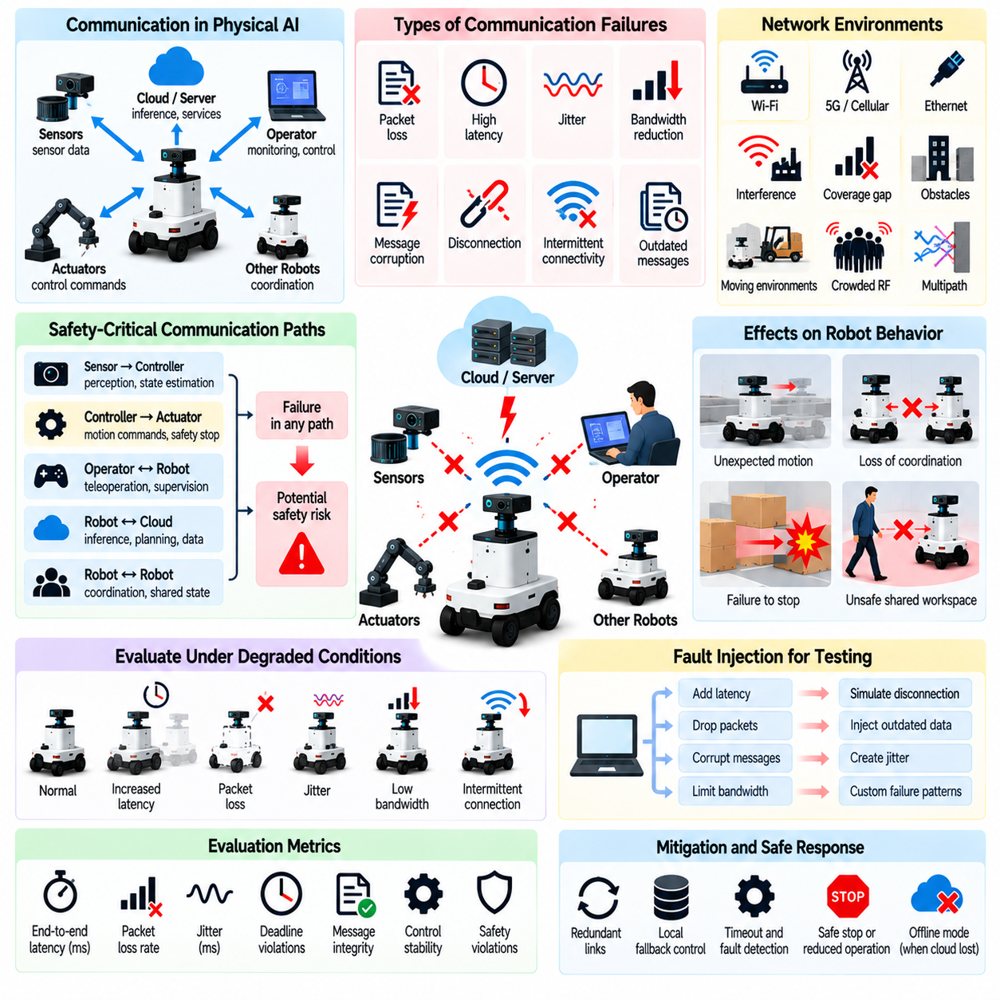{width="7.268055555555556in" height="7.268055555555556in"}

Communication and connectivity failures represent significant safety risks in Physical AI because autonomous robots depend on reliable information exchange between sensors, controllers, computing platforms, operators, and external services. Network disruptions can interrupt coordination or delay safety-critical decisions. Evaluation must determine whether communication degradation leads to hazardous motion, loss of control, or unsafe dependence on unavailable information.

Communication failures include packet loss, excessive latency, jitter, bandwidth reduction, message corruption, disconnection, and intermittent connectivity. Each condition affects robotic systems differently depending on network architecture and task requirements. Testing should distinguish complete communication loss from partial degradation that allows messages to arrive but makes their timing, integrity, or relevance unsuitable for safe operation.

A systematic evaluation begins by identifying communication paths that support safety-critical functions. These may include sensor-to-controller links, distributed motor control networks, operator interfaces, robot-to-robot communication, and edge-to-cloud connections. Evaluators should document message dependencies, update requirements, and failure consequences to determine which communication interruptions can directly affect physical safety.

Network latency can compromise closed-loop control when measurements or commands arrive after their intended execution intervals. Delayed feedback may cause unstable corrections, inaccurate trajectory tracking, or excessive stopping distances. Evaluation should measure end-to-end latency, worst-case delays, and deadline violations. Safety mechanisms must prevent outdated messages from being treated as valid control information.

Jitter introduces unpredictable variation in communication timing, even when average latency remains acceptable. Irregular sensor updates and control commands can disturb synchronization between distributed components. Testing should vary delay distributions, burst patterns, and scheduling interference. Evaluation must establish whether control stability and protective functions remain effective under realistic temporal variability.

Packet loss may interrupt feedback, command delivery, or shared state updates. Isolated losses can sometimes be tolerated, while consecutive missing messages may invalidate state estimates or coordination assumptions. Testing should examine random loss, burst loss, and prolonged dropout conditions. Evaluators should determine when missing information requires reduced operation, local fallback control, or protective stopping.

Intermittent connectivity creates repeated transitions between connected and disconnected states. Robots may receive delayed commands after reconnecting or resume tasks using outdated shared information. Evaluation should examine reconnection timing, session recovery, message ordering, and state synchronization. Systems must avoid executing obsolete commands or abruptly returning to unsafe operating conditions after communication is restored.

Message integrity failures occur when transmitted information is corrupted, truncated, duplicated, or incorrectly interpreted. Faulty commands and inconsistent status messages can produce unintended physical actions without complete network failure. Testing should verify error detection, sequence validation, message authentication where appropriate, and plausibility checks. Invalid communication data must not directly control hazardous actuator behavior.

Communication architecture strongly influences fault propagation. Centralized systems may lose critical capabilities when a single network connection fails, while distributed architectures may continue operating with inconsistent local states. Evaluation should identify single points of failure, shared communication dependencies, and common-cause disruptions. Redundant links should be tested for independence rather than assumed to guarantee availability.

Wireless communication introduces environmental vulnerabilities involving interference, attenuation, multipath propagation, and coverage gaps. Metal structures, moving machinery, crowded radio environments, and changing robot orientation can reduce link quality. Testing should reproduce representative operating conditions and measure how signal degradation affects control, coordination, and protective responses before connectivity becomes completely unavailable.

Remote operation and teleoperation depend on communication quality for timely human intervention. Video delays, command latency, and feedback loss may prevent operators from recognizing hazards or controlling motion accurately. Evaluation should examine round-trip delay, visual feedback freshness, command acknowledgment, and emergency intervention capability. Remote supervision must not be treated as an adequate safeguard when connectivity cannot support timely action.

Cloud-dependent Physical AI systems introduce additional risks because remote inference, planning, or fleet services may become unavailable. Network outages can interrupt task execution or delay high-level decisions. Testing should distinguish functions that require continuous connectivity from those supported locally. Essential safety mechanisms should remain effective without relying on uninterrupted cloud access.

Multi-robot systems face coordination failures when communication becomes unreliable. Delayed position updates, inconsistent task assignments, and missing intent messages can cause conflicting movements or resource contention. Evaluation should examine collision avoidance, shared-space access, and decentralized decision-making during partial network partitions. Robots must maintain safe separation even when collective coordination information becomes incomplete.

Network partitioning can create groups of robots or controllers that continue operating without consistent shared knowledge. Each partition may independently assume authority over tasks, routes, or resources. Testing should investigate conflicting leadership, duplicated commands, and inconsistent mission states. Recovery procedures must reconcile distributed information before coordinated operations resume, particularly when physical actions cannot be reversed.

Time synchronization failures can undermine communication-dependent sensing and control. Clock drift, timestamp inconsistency, and synchronization service interruptions may cause incorrect ordering of observations and commands. Evaluation should measure clock offsets, data age, and temporal alignment across distributed devices. Safety-critical functions must account for uncertainty when a common time reference cannot be maintained.

Communication fault injection enables controlled exploration of network vulnerabilities. Test environments can introduce packet loss, variable latency, bandwidth constraints, reordered messages, corrupted payloads, and simulated disconnections. Fault parameters should specify onset, duration, severity, and recovery patterns. Reproducible scenarios help identify thresholds at which communication degradation begins to compromise safety requirements.

Protective responses should depend on the role of the failed communication channel. A robot may continue autonomous operation after losing a nonessential monitoring connection but require immediate restriction when critical control feedback disappears. Testing should verify safe degradation, local autonomy boundaries, controlled stopping, and minimum-risk transitions. Recovery must not depend exclusively on the same failed network.

Communication recovery presents hazards beyond the original disconnection. Buffered commands, duplicated transactions, and inconsistent state updates may trigger unexpected actions when links return. Evaluation should verify stale-message rejection, sequence reconciliation, authority restoration, and safe task resumption. Reconnection should restore operational capability only after relevant system states and safety conditions have been validated.

Simulation and network emulation provide scalable methods for evaluating communication disturbances. Emulated delay, loss, and bandwidth limitations can be combined with robotic dynamics to examine downstream consequences. However, simplified network models may overlook hardware-specific interference and protocol behavior. Controlled laboratory experiments and field trials are needed to validate critical failure scenarios.

Quantitative evaluation should connect communication performance with physical safety outcomes. Relevant metrics include packet delivery ratio, latency distributions, jitter, outage duration, reconnection time, missed control deadlines, and protective intervention success. Measurements should also capture collision risk and safety-boundary violations. Average network performance alone cannot establish safety under rare but severe disruptions.

Regression testing is necessary because network configuration changes, software updates, firmware revisions, and infrastructure modifications can alter failure behavior. Versioned scenarios should verify that communication safeguards remain effective across system changes. Operational logs and near-miss reports can reveal previously unrecognized connectivity weaknesses. Evaluation results should remain traceable to specific architectures and deployment conditions.

Ultimately, communication and connectivity failure evaluation determines whether Physical AI systems can maintain safe physical behavior when information exchange becomes delayed, incomplete, inconsistent, or unavailable. Effective testing integrates network fault injection, timing analysis, distributed-state validation, protective fallback assessment, and real-world verification. The objective is dependable safety despite communication uncertainty rather than uninterrupted connectivity.

통신 및 연결 장애(Communication and Connectivity Failures)는 자율 로봇(Autonomous Robot)이 센서(Sensor), 제어기(Controller), 컴퓨팅 플랫폼(Computing Platform), 운영자(Operator), 외부 서비스(External Service) 사이의 신뢰할 수 있는 정보 교환(Information Exchange)에 의존하기 때문에 피지컬 인공지능(Physical AI)에서 중요한 안전 위험(Safety Risk)을 나타낸다. 네트워크 장애(Network Disruption)는 협업 제어(Coordination)를 중단시키거나 안전 필수 의사결정(Safety-Critical Decision)을 지연시킬 수 있다. 평가에서는 통신 성능 저하(Communication Degradation)가 위험한 움직임(Hazardous Motion), 제어 상실(Loss of Control), 사용할 수 없는 정보에 대한 불안전한 의존(Unsafe Dependence)을 초래하는지를 판단해야 한다.

통신 장애(Communication Failure)에는 패킷 손실(Packet Loss), 과도한 지연 시간(Excessive Latency), 지터(Jitter), 대역폭 감소(Bandwidth Reduction), 메시지 손상(Message Corruption), 연결 끊김(Disconnection), 간헐적 연결(Intermittent Connectivity)이 포함된다. 각 조건은 네트워크 아키텍처(Network Architecture)와 작업 요구사항(Task Requirement)에 따라 로봇 시스템에 서로 다른 영향을 미친다. 시험에서는 완전한 통신 손실(Complete Communication Loss)과 메시지는 도착하지만 시간적 특성(Timing), 무결성(Integrity), 관련성(Relevance)이 안전한 운영에 적합하지 않은 부분적인 성능 저하(Partial Degradation)를 구분해야 한다.

체계적인 평가(Systematic Evaluation)는 안전 필수 기능(Safety-Critical Function)을 지원하는 통신 경로(Communication Path)를 식별하는 것에서 시작한다. 여기에는 센서와 제어기 간 연결(Sensor-to-Controller Link), 분산 모터 제어 네트워크(Distributed Motor Control Network), 운영자 인터페이스(Operator Interface), 로봇 간 통신(Robot-to-Robot Communication), 엣지와 클라우드 간 연결(Edge-to-Cloud Connection)이 포함될 수 있다. 평가자는 메시지 의존성(Message Dependency), 갱신 요구사항(Update Requirement), 고장 결과(Failure Consequence)를 문서화하여 어떤 통신 중단이 물리적 안전성(Physical Safety)에 직접적인 영향을 미칠 수 있는지 판단해야 한다.

네트워크 지연 시간(Network Latency)은 측정값이나 명령이 의도된 실행 주기(Execution Interval) 이후에 도착할 경우 폐루프 제어(Closed-Loop Control)를 저해할 수 있다. 지연된 피드백(Delayed Feedback)은 불안정한 제어 보정(Unstable Correction), 부정확한 궤적 추종(Inaccurate Trajectory Tracking), 과도한 정지 거리(Excessive Stopping Distance)를 발생시킬 수 있다. 평가에서는 종단 간 지연 시간(End-to-End Latency), 최악 지연 시간(Worst-Case Delay), 실행 기한 위반(Deadline Violation)을 측정해야 한다. 안전 메커니즘(Safety Mechanism)은 오래된 메시지(Outdated Message)가 유효한 제어 정보(Valid Control Information)로 취급되지 않도록 해야 한다.

지터(Jitter)는 평균 지연 시간(Average Latency)이 허용 가능한 수준을 유지하더라도 통신 시점(Communication Timing)에 예측할 수 없는 변동을 발생시킨다. 불규칙한 센서 갱신(Irregular Sensor Update)과 제어 명령(Control Command)은 분산 구성 요소(Distributed Component) 사이의 동기화(Synchronization)를 방해할 수 있다. 시험에서는 지연 분포(Delay Distribution), 연속 장애 패턴(Burst Pattern), 스케줄링 간섭(Scheduling Interference)을 변화시켜야 한다. 평가에서는 현실적인 시간적 변동성(Temporal Variability)에서도 제어 안정성(Control Stability)과 보호 기능(Protective Function)이 효과적으로 유지되는지를 확인해야 한다.

패킷 손실(Packet Loss)은 피드백(Feedback), 명령 전달(Command Delivery), 공유 상태 갱신(Shared State Update)을 중단시킬 수 있다. 개별적인 손실(Isolated Loss)은 허용할 수 있는 경우도 있지만 연속적으로 누락되는 메시지(Consecutive Missing Message)는 상태 추정값(State Estimate)이나 협업 제어에 대한 가정(Coordination Assumption)을 무효화할 수 있다. 시험에서는 무작위 손실(Random Loss), 연속 패킷 손실(Burst Loss), 장시간 데이터 누락(Prolonged Dropout)을 검증해야 한다. 평가자는 정보 누락(Missing Information)이 어느 시점부터 제한된 운영(Reduced Operation), 국소 대체 제어(Local Fallback Control), 보호 정지(Protective Stopping)를 요구하는지 판단해야 한다.

간헐적 연결(Intermittent Connectivity)은 연결 상태(Connected State)와 연결 해제 상태(Disconnected State) 사이의 반복적인 전환을 발생시킨다. 로봇은 재연결(Reconnection) 이후 지연된 명령(Delayed Command)을 수신하거나 오래된 공유 정보(Outdated Shared Information)를 사용하여 작업을 재개할 수 있다. 평가에서는 재연결 시점(Reconnection Timing), 세션 복구(Session Recovery), 메시지 순서(Message Ordering), 상태 동기화(State Synchronization)를 검증해야 한다. 시스템은 연결이 복원된 이후 오래된 명령(Obsolete Command)을 실행하거나 불안전한 운영 조건(Unsafe Operating Condition)으로 갑작스럽게 복귀하지 않도록 해야 한다.

메시지 무결성 장애(Message Integrity Failure)는 전송된 정보가 손상(Corruption), 잘림(Truncation), 중복(Duplication), 잘못된 해석(Incorrect Interpretation)을 겪을 때 발생한다. 잘못된 명령(Faulty Command)과 일관되지 않은 상태 메시지(Inconsistent Status Message)는 완전한 네트워크 장애가 발생하지 않더라도 의도하지 않은 물리적 동작(Unintended Physical Action)을 유발할 수 있다. 시험에서는 오류 감지(Error Detection), 순서 검증(Sequence Validation), 필요한 경우 메시지 인증(Message Authentication), 타당성 검사(Plausibility Check)를 검증해야 한다. 유효하지 않은 통신 데이터(Invalid Communication Data)가 위험한 구동기 동작(Hazardous Actuator Behavior)을 직접 제어해서는 안 된다.

통신 아키텍처(Communication Architecture)는 고장 전파(Fault Propagation)에 큰 영향을 미친다. 중앙집중형 시스템(Centralized System)은 단일 네트워크 연결(Single Network Connection)이 실패할 때 중요한 기능을 상실할 수 있으며, 분산 아키텍처(Distributed Architecture)는 일관되지 않은 국소 상태(Inconsistent Local State)를 가진 채 계속 작동할 수 있다. 평가에서는 단일 고장점(Single Point of Failure), 공유 통신 의존성(Shared Communication Dependency), 공통 원인 장애(Common-Cause Disruption)를 식별해야 한다. 중복 통신 링크(Redundant Link)는 가용성(Availability)을 보장한다고 가정하기보다 독립성(Independence)을 시험해야 한다.

무선 통신(Wireless Communication)은 간섭(Interference), 감쇠(Attenuation), 다중 경로 전파(Multipath Propagation), 통신 음영 지역(Coverage Gap)과 관련된 환경적 취약성(Environmental Vulnerability)을 가진다. 금속 구조물(Metal Structure), 이동 기계(Moving Machinery), 혼잡한 무선 환경(Crowded Radio Environment), 변화하는 로봇 방향(Changing Robot Orientation)은 연결 품질(Link Quality)을 저하시킬 수 있다. 시험에서는 대표적인 운영 조건(Representative Operating Condition)을 재현하고 연결이 완전히 끊어지기 전에 신호 성능 저하(Signal Degradation)가 제어(Control), 협업(Coordination), 보호 응답(Protective Response)에 미치는 영향을 측정해야 한다.

원격 운영(Remote Operation)과 원격 조작(Teleoperation)은 적시에 이루어지는 인간 개입(Timely Human Intervention)을 위해 통신 품질(Communication Quality)에 의존한다. 영상 지연(Video Delay), 명령 지연 시간(Command Latency), 피드백 손실(Feedback Loss)은 운영자가 위험을 인식하거나 움직임을 정확하게 제어하지 못하도록 만들 수 있다. 평가에서는 왕복 지연 시간(Round-Trip Delay), 시각 피드백 최신성(Visual Feedback Freshness), 명령 확인(Command Acknowledgment), 비상 개입 능력(Emergency Intervention Capability)을 검증해야 한다. 연결 상태가 적시 대응을 지원할 수 없다면 원격 감독(Remote Supervision)을 충분한 안전 보호 수단(Adequate Safeguard)으로 간주해서는 안 된다.

클라우드 의존형 피지컬 인공지능 시스템(Cloud-Dependent Physical AI System)은 원격 추론(Remote Inference), 계획(Planning), 플릿 서비스(Fleet Service)를 사용할 수 없게 될 수 있으므로 추가적인 위험을 가진다. 네트워크 장애(Network Outage)는 작업 실행(Task Execution)을 중단시키거나 상위 수준의 의사결정(High-Level Decision)을 지연시킬 수 있다. 시험에서는 지속적인 연결(Continuous Connectivity)이 필요한 기능과 로컬에서 지원되는 기능(Locally Supported Function)을 구분해야 한다. 필수 안전 메커니즘(Essential Safety Mechanism)은 중단 없는 클라우드 접속(Uninterrupted Cloud Access)에 의존하지 않고 효과적으로 작동해야 한다.

다중 로봇 시스템(Multi-Robot System)은 통신의 신뢰성이 저하되면 협업 장애(Coordination Failure)에 직면한다. 지연된 위치 갱신(Delayed Position Update), 일관되지 않은 작업 할당(Inconsistent Task Assignment), 누락된 의도 메시지(Missing Intent Message)는 충돌하는 움직임(Conflicting Movement)이나 자원 경합(Resource Contention)을 발생시킬 수 있다. 평가에서는 부분적인 네트워크 분할(Partial Network Partition) 상황에서 충돌 회피(Collision Avoidance), 공유 공간 접근(Shared-Space Access), 분산형 의사결정(Decentralized Decision-Making)을 검증해야 한다. 로봇은 집단 협업 정보(Collective Coordination Information)가 불완전해지더라도 안전 이격 거리(Safe Separation)를 유지해야 한다.

네트워크 분할(Network Partitioning)은 일관된 공유 정보(Consistent Shared Knowledge) 없이 계속 작동하는 로봇 또는 제어기 그룹을 생성할 수 있다. 각 분할 그룹(Partition)은 작업(Task), 경로(Route), 자원(Resource)에 대한 권한(Authority)을 독립적으로 가지고 있다고 가정할 수 있다. 시험에서는 충돌하는 리더십(Conflicting Leadership), 중복 명령(Duplicated Command), 일관되지 않은 임무 상태(Inconsistent Mission State)를 조사해야 한다. 복구 절차(Recovery Procedure)는 특히 물리적 동작(Physical Action)을 되돌릴 수 없는 경우 협업 운영(Coordinated Operation)을 재개하기 전에 분산 정보(Distributed Information)의 일관성을 회복해야 한다.

시간 동기화 장애(Time Synchronization Failure)는 통신에 의존하는 센싱 및 제어(Communication-Dependent Sensing and Control)의 신뢰성을 저하시킬 수 있다. 클록 드리프트(Clock Drift), 타임스탬프 불일치(Timestamp Inconsistency), 동기화 서비스 중단(Synchronization Service Interruption)은 관측값(Observation)과 명령(Command)의 순서를 잘못 판단하게 만들 수 있다. 평가에서는 분산 장치(Distributed Device) 사이의 클록 오프셋(Clock Offset), 데이터 경과 시간(Data Age), 시간 정렬(Temporal Alignment)을 측정해야 한다. 안전 필수 기능(Safety-Critical Function)은 공통 시간 기준(Common Time Reference)을 유지할 수 없을 때 발생하는 불확실성(Uncertainty)을 고려해야 한다.

통신 고장 주입(Communication Fault Injection)은 네트워크 취약성(Network Vulnerability)을 통제된 방식으로 탐색할 수 있도록 한다. 시험 환경(Test Environment)은 패킷 손실(Packet Loss), 가변 지연 시간(Variable Latency), 대역폭 제약(Bandwidth Constraint), 메시지 순서 변경(Reordered Message), 손상된 페이로드(Corrupted Payload), 모의 연결 해제(Simulated Disconnection)를 도입할 수 있다. 고장 매개변수(Fault Parameter)는 발생 시점(Onset), 지속 시간(Duration), 심각도(Severity), 복구 패턴(Recovery Pattern)을 명시해야 한다. 재현 가능한 시나리오(Reproducible Scenario)는 통신 성능 저하가 안전 요구사항(Safety Requirement)을 위반하기 시작하는 임계값을 식별하는 데 도움이 된다.

보호 응답(Protective Response)은 장애가 발생한 통신 채널(Failed Communication Channel)의 역할에 따라 달라져야 한다. 로봇은 비필수 감시 연결(Nonessential Monitoring Connection)이 끊어진 이후에도 자율 운영(Autonomous Operation)을 계속할 수 있지만 중요한 제어 피드백(Critical Control Feedback)이 사라지면 즉각적인 운영 제한(Operational Restriction)이 필요할 수 있다. 시험에서는 안전한 성능 저하(Safe Degradation), 로컬 자율성 경계(Local Autonomy Boundary), 통제된 정지(Controlled Stopping), 최소 위험 상태 전환(Minimum-Risk Transition)을 검증해야 한다. 복구는 장애가 발생한 동일한 네트워크에만 의존해서는 안 된다.

통신 복구(Communication Recovery)는 최초의 연결 해제(Disconnection) 자체를 넘어서는 위험을 발생시킨다. 버퍼에 저장된 명령(Buffered Command), 중복 트랜잭션(Duplicated Transaction), 일관되지 않은 상태 갱신(Inconsistent State Update)은 연결이 복원될 때 예상하지 못한 동작(Unexpected Action)을 유발할 수 있다. 평가에서는 오래된 메시지 거부(Stale-Message Rejection), 순서 조정(Sequence Reconciliation), 권한 복원(Authority Restoration), 안전한 작업 재개(Safe Task Resumption)를 검증해야 한다. 재연결(Reconnection)은 관련 시스템 상태(System State)와 안전 조건(Safety Condition)이 검증된 이후에만 운영 능력(Operational Capability)을 복원해야 한다.

시뮬레이션(Simulation)과 네트워크 에뮬레이션(Network Emulation)은 통신 외란(Communication Disturbance)을 평가하기 위한 확장 가능한 방법을 제공한다. 에뮬레이션된 지연(Emulated Delay), 손실(Loss), 대역폭 제한(Bandwidth Limitation)을 로봇 동역학(Robotic Dynamics)과 결합하여 후속 결과(Downstream Consequence)를 검증할 수 있다. 그러나 단순화된 네트워크 모델(Simplified Network Model)은 하드웨어별 간섭(Hardware-Specific Interference)과 프로토콜 동작(Protocol Behavior)을 충분히 반영하지 못할 수 있다. 중요한 고장 시나리오(Critical Failure Scenario)를 검증하려면 통제된 실험실 시험(Controlled Laboratory Experiment)과 현장 시험(Field Trial)이 필요하다.

정량적 평가(Quantitative Evaluation)는 통신 성능(Communication Performance)을 물리적 안전 결과(Physical Safety Outcome)와 연결해야 한다. 관련 지표에는 패킷 전달률(Packet Delivery Ratio), 지연 시간 분포(Latency Distribution), 지터(Jitter), 통신 중단 지속 시간(Outage Duration), 재연결 시간(Reconnection Time), 제어 기한 미준수(Missed Control Deadline), 보호 개입 성공률(Protective Intervention Success)이 포함된다. 측정에서는 충돌 위험(Collision Risk)과 안전 경계 위반(Safety-Boundary Violation)도 포착해야 한다. 평균 네트워크 성능(Average Network Performance)만으로는 드물지만 심각한 통신 장애(Rare but Severe Disruption) 상황에서의 안전성을 입증할 수 없다.

회귀 시험(Regression Testing)은 네트워크 구성 변경(Network Configuration Change), 소프트웨어 업데이트(Software Update), 펌웨어 개정(Firmware Revision), 인프라 수정(Infrastructure Modification)이 고장 동작(Failure Behavior)을 변화시킬 수 있기 때문에 필요하다. 버전 관리된 시나리오(Versioned Scenario)는 시스템 변경 이후에도 통신 안전 보호 기능(Communication Safeguard)이 효과적으로 유지되는지를 검증해야 한다. 운영 로그(Operational Log)와 아차 사고 보고서(Near-Miss Report)는 이전에 인식하지 못했던 연결 취약성(Connectivity Weakness)을 밝혀낼 수 있다. 평가 결과(Evaluation Result)는 특정 아키텍처(Architecture)와 배포 조건(Deployment Condition)에 대한 추적성(Traceability)을 유지해야 한다.

궁극적으로 통신 및 연결 장애 평가(Communication and Connectivity Failure Evaluation)는 정보 교환(Information Exchange)이 지연되거나 불완전하거나 일관성을 잃거나 사용할 수 없게 되었을 때에도 피지컬 인공지능 시스템이 안전한 물리적 행동(Safe Physical Behavior)을 유지할 수 있는지를 판단한다. 효과적인 시험은 네트워크 고장 주입(Network Fault Injection), 시간 분석(Timing Analysis), 분산 상태 검증(Distributed-State Validation), 보호 대체 동작 평가(Protective Fallback Assessment), 실제 환경 검증(Real-World Verification)을 통합한다. 목표는 중단 없는 연결(Uninterrupted Connectivity)이 아니라 통신 불확실성(Communication Uncertainty)에도 불구하고 신뢰할 수 있는 안전성(Dependable Safety)을 확보하는 것이다.

##  

## 05.10. Environmental Perturbation and Stress Testing

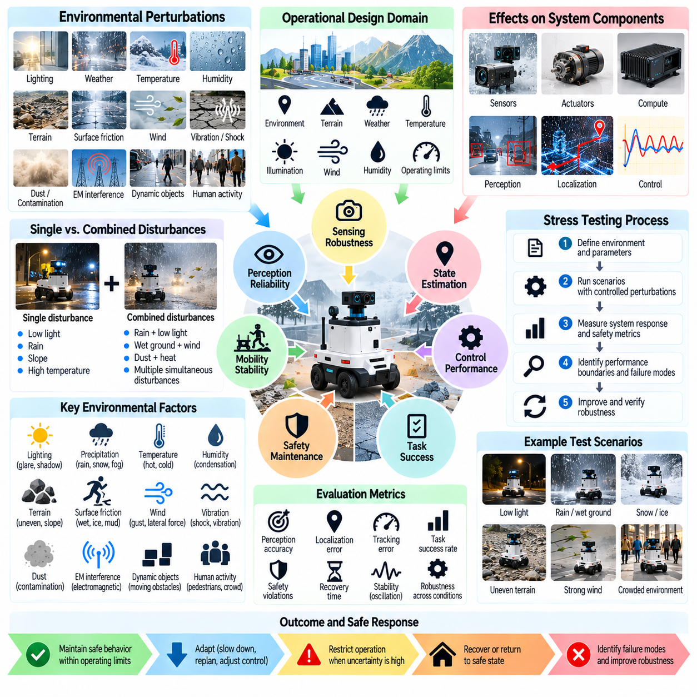{width="7.268055555555556in" height="7.268055555555556in"}

Environmental perturbation and stress testing evaluates whether Physical AI systems maintain safe behavior when external conditions differ from nominal operating assumptions. Autonomous robots interact with environments containing unpredictable forces, changing surfaces, weather effects, and human activity. Evaluation must establish how environmental disturbances influence perception, motion, control stability, and the ability to preserve safety constraints.

Environmental perturbations include variations in lighting, temperature, humidity, precipitation, wind, vibration, terrain, and surface friction. These factors can affect sensors, actuators, computing hardware, and physical interactions simultaneously. Testing should distinguish ordinary environmental variability from extreme conditions and identify which disturbances can trigger hazardous behavior or compromise protective mechanisms.

A systematic evaluation begins by defining the operational design domain and its environmental boundaries. Relevant parameters may include allowable temperature ranges, illumination levels, terrain slopes, wind speeds, and surface conditions. Test conditions should reflect expected deployment environments and credible deviations. Safety requirements must specify when the robot can continue operating and when protective restrictions become necessary.

Environmental stress testing should examine both isolated disturbances and interacting conditions. Low illumination may reduce visual perception accuracy, while wet surfaces decrease traction and increase stopping distance. Combined disturbances can produce greater risk than either condition alone. Evaluation should identify interactions that invalidate assumptions used by navigation, manipulation, locomotion, and safety monitoring systems.

Lighting variation is a major source of perception degradation in camera-dependent robots. Glare, shadows, reflections, flickering illumination, and abrupt brightness changes can disrupt object recognition and depth estimation. Testing should measure perception performance and downstream physical responses across controlled lighting conditions. The robot must avoid unsafe actions when visual information becomes unreliable.

Weather disturbances introduce complex sensing and mobility challenges for outdoor Physical AI systems. Rain, fog, snow, dust, and strong sunlight can degrade cameras, LiDAR, and other sensors. Precipitation and surface contamination may also alter friction and braking performance. Evaluation should combine environmental exposure with navigation tasks to determine whether sensing uncertainty and reduced traction are managed safely.

Terrain perturbations influence robot stability, mobility, and physical contact. Uneven ground, loose gravel, mud, slopes, steps, and unexpected obstacles can challenge locomotion and path planning. Testing should vary terrain geometry, compliance, and friction while measuring slip, balance recovery, trajectory deviation, and collision risk. Safety limits should reflect the robot\'s morphology and dynamic capabilities.

External forces such as wind, impacts, and unexpected contact can disturb robot motion. Aerial robots may experience gust-induced displacement, while mobile manipulators may encounter lateral forces during interaction. Evaluation should examine disturbance rejection, recovery time, control saturation, and stability margins. Protective behavior must remain effective when disturbances exceed the controller\'s nominal compensation capability.

Temperature extremes can affect battery performance, motor efficiency, electronics, and sensor calibration. High temperatures may trigger thermal derating or shutdown, while low temperatures can reduce available power and alter mechanical characteristics. Testing should evaluate thermal transitions, sustained exposure, and recovery behavior. Safety-critical functions must remain dependable within validated environmental limits.

Humidity, condensation, and contamination can introduce failures that develop gradually. Moisture may affect electrical connections, while dust accumulation or liquid deposits can degrade optical sensing and mechanical motion. Evaluation should investigate progressive exposure and delayed effects rather than focusing only on immediate failures. Monitoring systems should recognize environmental deterioration before protective capabilities become insufficient.

Vibration and mechanical shock can disrupt sensing, computation, and structural integrity. Repeated vibration may distort inertial measurements, loosen connectors, or accelerate component wear. Sudden impacts can produce transient control errors or damage mounting structures. Testing should measure disturbance severity, component response, and the persistence of resulting faults under representative operational conditions.

Electromagnetic interference introduces environmental risks that may not be visible through physical observation. Industrial machinery, power equipment, and wireless transmitters can disturb communication, sensing, or embedded electronics. Evaluation should examine susceptibility, error detection, and protective responses under controlled interference conditions. Safety assessment must consider correlated failures affecting multiple electronic subsystems.

Environmental perturbations can also alter human behavior and interaction patterns. Poor visibility, slippery surfaces, crowded spaces, and unexpected obstacles may change pedestrian trajectories or operator responses. Testing should incorporate realistic human movement while preserving independent protective measures. Evaluation must determine whether robots maintain safe separation and adapt their behavior when environmental uncertainty increases.

Stress testing should explore the boundaries of acceptable operation rather than simply demonstrate success under typical conditions. Disturbance magnitude, duration, frequency, and rate of change should be systematically varied. Evaluators should identify performance degradation curves and thresholds where safety requirements cease to be satisfied. These boundaries help define restrictions and minimum-risk transitions.

Fault injection can reproduce environmental effects that are difficult or dangerous to create physically. Simulated wind forces, reduced friction, lighting changes, sensor contamination, and thermal limitations can be introduced into controlled experiments. Fault models should reflect measurable physical mechanisms. Unrealistic perturbations may reveal software weaknesses but cannot independently establish real-world safety performance.

Simulation enables large-scale exploration of environmental combinations and rare stress scenarios. Domain randomization can vary terrain, weather, lighting, and physical parameters across repeated trials. However, simulated disturbances may not accurately reproduce complex contact mechanics or sensor artifacts. Evaluation should compare simulated responses with measured physical behavior to identify significant simulation-to-reality gaps.

Hardware-in-the-loop and controlled laboratory testing provide intermediate validation before field deployment. Environmental chambers, vibration tables, adjustable lighting, and calibrated force equipment can expose system weaknesses under repeatable conditions. Testing must maintain independent emergency protections and clearly defined termination criteria. Hazardous conditions should be introduced progressively rather than without operational safeguards.

Long-duration exposure testing is important because environmental stress may accumulate over time. Repeated thermal cycles, vibration, contamination, and mechanical loading can gradually reduce reliability. Evaluation should monitor sensor drift, actuator response, structural wear, and protective function availability. Short experiments may overlook degradation mechanisms that emerge only after sustained operation.

Quantitative metrics should connect environmental conditions to both task performance and safety outcomes. Relevant measures include perception error, localization drift, traction loss, stopping distance, control instability, intervention latency, and safety-boundary violations. Results should be reported by disturbance severity and operating context. Average success rates alone may conceal rare but hazardous responses.

Scenario coverage should include environmental extremes, abrupt transitions, combined disturbances, and recovery after exposure. Tests should vary robot speed, payload, task phase, and human proximity to reveal interactions with physical risk. Repeated trials and uncertainty estimates improve confidence in the results. Hazard traceability ensures that tested disturbances correspond to meaningful safety concerns.

Environmental robustness must be reassessed when hardware, software, calibration, or deployment conditions change. New sensors, updated controllers, and modified mechanical structures may respond differently to previously tested disturbances. Versioned scenarios and regression testing help identify newly introduced weaknesses. Field observations and near-miss reports should guide additional testing when unexpected environmental effects appear.

Ultimately, environmental perturbation and stress testing determines whether Physical AI systems can maintain safe operation despite changing and adverse physical conditions. Effective evaluation integrates environmental characterization, controlled disturbances, simulation, physical validation, and protective response analysis. The objective is to establish credible operating limits and dependable safety behavior when environmental conditions exceed nominal expectations.

환경 교란 및 스트레스 시험(Environmental Perturbation and Stress Testing)은 외부 조건(External Condition)이 정상 운영 가정(Nominal Operating Assumption)과 달라질 때 피지컬 인공지능 시스템(Physical AI System)이 안전한 행동(Safe Behavior)을 유지하는지를 평가한다. 자율 로봇(Autonomous Robot)은 예측하기 어려운 힘(Unpredictable Force), 변화하는 표면 조건(Changing Surface Condition), 기상 영향(Weather Effect), 인간 활동(Human Activity)이 존재하는 환경과 상호작용한다. 평가에서는 환경 외란(Environmental Disturbance)이 인지(Perception), 움직임(Motion), 제어 안정성(Control Stability), 안전 제약 조건(Safety Constraint)을 유지하는 능력에 어떤 영향을 미치는지 규명해야 한다.

환경 교란(Environmental Perturbation)에는 조명(Lighting), 온도(Temperature), 습도(Humidity), 강수(Precipitation), 바람(Wind), 진동(Vibration), 지형(Terrain), 표면 마찰(Surface Friction)의 변화가 포함된다. 이러한 요인은 센서(Sensor), 구동기(Actuator), 컴퓨팅 하드웨어(Computing Hardware), 물리적 상호작용(Physical Interaction)에 동시에 영향을 미칠 수 있다. 시험에서는 일반적인 환경 변동성(Ordinary Environmental Variability)과 극한 조건(Extreme Condition)을 구분하고, 어떤 외란이 위험한 행동(Hazardous Behavior)을 유발하거나 보호 메커니즘(Protective Mechanism)을 저해할 수 있는지 식별해야 한다.

체계적인 평가(Systematic Evaluation)는 운영 설계 영역(Operational Design Domain, ODD)과 환경적 경계(Environmental Boundary)를 정의하는 것에서 시작한다. 관련 매개변수(Parameter)에는 허용 온도 범위(Allowable Temperature Range), 조도 수준(Illumination Level), 지형 경사(Terrain Slope), 풍속(Wind Speed), 표면 상태(Surface Condition)가 포함될 수 있다. 시험 조건(Test Condition)은 예상되는 배포 환경(Deployment Environment)과 현실적으로 발생 가능한 편차(Credible Deviation)를 반영해야 한다. 안전 요구사항(Safety Requirement)은 로봇이 언제 운영을 계속할 수 있으며, 언제 보호를 위한 운영 제한(Protective Restriction)이 필요한지를 명시해야 한다.

환경 스트레스 시험(Environmental Stress Testing)은 개별 외란(Isolated Disturbance)과 상호작용하는 조건(Interacting Condition)을 모두 검증해야 한다. 낮은 조도(Low Illumination)는 시각 인지 정확도(Visual Perception Accuracy)를 감소시킬 수 있으며, 젖은 표면(Wet Surface)은 접지력(Traction)을 감소시키고 정지 거리(Stopping Distance)를 증가시킨다. 복합 외란(Combined Disturbance)은 개별 조건보다 더 큰 위험을 발생시킬 수 있다. 평가에서는 내비게이션(Navigation), 조작(Manipulation), 보행(Locomotion), 안전 감시 시스템(Safety Monitoring System)이 사용하는 가정을 무효화하는 상호작용을 식별해야 한다.

조명 변화(Lighting Variation)는 카메라 의존형 로봇(Camera-Dependent Robot)에서 인지 성능 저하(Perception Degradation)를 발생시키는 주요 원인이다. 눈부심(Glare), 그림자(Shadow), 반사(Reflection), 깜박이는 조명(Flickering Illumination), 급격한 밝기 변화(Abrupt Brightness Change)는 객체 인식(Object Recognition)과 깊이 추정(Depth Estimation)을 방해할 수 있다. 시험에서는 통제된 조명 조건(Controlled Lighting Condition) 전반에서 인지 성능(Perception Performance)과 후속 물리적 응답(Downstream Physical Response)을 측정해야 한다. 로봇은 시각 정보(Visual Information)의 신뢰성이 저하될 때 불안전한 행동(Unsafe Action)을 피해야 한다.

기상 외란(Weather Disturbance)은 실외 피지컬 인공지능 시스템(Outdoor Physical AI System)에 복잡한 센싱 및 이동성 문제(Sensing and Mobility Challenge)를 발생시킨다. 비(Rain), 안개(Fog), 눈(Snow), 먼지(Dust), 강한 햇빛(Strong Sunlight)은 카메라(Camera), 라이다(LiDAR), 기타 센서(Other Sensor)의 성능을 저하시킬 수 있다. 강수(Precipitation)와 표면 오염(Surface Contamination)은 마찰(Friction)과 제동 성능(Braking Performance)도 변화시킬 수 있다. 평가에서는 환경 노출(Environmental Exposure)과 내비게이션 작업(Navigation Task)을 결합하여 센싱 불확실성(Sensing Uncertainty)과 감소된 접지력(Reduced Traction)이 안전하게 관리되는지를 판단해야 한다.

지형 교란(Terrain Perturbation)은 로봇 안정성(Robot Stability), 이동성(Mobility), 물리적 접촉(Physical Contact)에 영향을 미친다. 불균일한 지면(Uneven Ground), 느슨한 자갈(Loose Gravel), 진흙(Mud), 경사면(Slope), 계단(Step), 예상하지 못한 장애물(Unexpected Obstacle)은 보행(Locomotion)과 경로 계획(Path Planning)에 어려움을 발생시킬 수 있다. 시험에서는 지형 형상(Terrain Geometry), 순응성(Compliance), 마찰(Friction)을 변화시키면서 미끄러짐(Slip), 균형 회복(Balance Recovery), 궤적 편차(Trajectory Deviation), 충돌 위험(Collision Risk)을 측정해야 한다. 안전 한계(Safety Limit)는 로봇 형태(Robot Morphology)와 동적 능력(Dynamic Capability)을 반영해야 한다.

바람(Wind), 충격(Impact), 예상하지 못한 접촉(Unexpected Contact)과 같은 외력(External Force)은 로봇의 움직임(Robot Motion)을 교란할 수 있다. 비행 로봇(Aerial Robot)은 돌풍에 의한 위치 변위(Gust-Induced Displacement)를 경험할 수 있으며, 모바일 매니퓰레이터(Mobile Manipulator)는 상호작용 중 횡방향 힘(Lateral Force)을 받을 수 있다. 평가에서는 외란 억제(Disturbance Rejection), 복구 시간(Recovery Time), 제어 포화(Control Saturation), 안정성 여유(Stability Margin)를 검증해야 한다. 외란이 제어기의 정상 보상 능력(Nominal Compensation Capability)을 초과하더라도 보호 행동(Protective Behavior)은 효과적으로 유지되어야 한다.

극한 온도(Temperature Extreme)는 배터리 성능(Battery Performance), 모터 효율(Motor Efficiency), 전자장치(Electronics), 센서 보정(Sensor Calibration)에 영향을 미칠 수 있다. 고온(High Temperature)은 열적 출력 제한(Thermal Derating)이나 시스템 종료(Shutdown)를 유발할 수 있으며, 저온(Low Temperature)은 사용 가능한 전력(Available Power)을 감소시키고 기계적 특성(Mechanical Characteristic)을 변화시킬 수 있다. 시험에서는 온도 전환(Thermal Transition), 지속적인 노출(Sustained Exposure), 복구 동작(Recovery Behavior)을 평가해야 한다. 안전 필수 기능(Safety-Critical Function)은 검증된 환경 한계(Validated Environmental Limit) 내에서 신뢰성 있게 유지되어야 한다.

습도(Humidity), 결로(Condensation), 오염(Contamination)은 점진적으로 진행되는 고장을 유발할 수 있다. 수분(Moisture)은 전기적 연결(Electrical Connection)에 영향을 미칠 수 있으며, 먼지 축적(Dust Accumulation)이나 액체 침착물(Liquid Deposit)은 광학 센싱(Optical Sensing)과 기계적 움직임(Mechanical Motion)의 성능을 저하시킬 수 있다. 평가에서는 즉각적인 고장(Immediate Failure)에만 집중하기보다 점진적인 노출(Progressive Exposure)과 지연 효과(Delayed Effect)를 조사해야 한다. 감시 시스템(Monitoring System)은 보호 능력(Protective Capability)이 불충분해지기 전에 환경적 악화(Environmental Deterioration)를 인식해야 한다.

진동(Vibration)과 기계적 충격(Mechanical Shock)은 센싱(Sensing), 연산(Computation), 구조적 무결성(Structural Integrity)을 저해할 수 있다. 반복 진동(Repeated Vibration)은 관성 측정(Inertial Measurement)을 왜곡하거나 커넥터(Connector)를 느슨하게 만들거나 구성 요소 마모(Component Wear)를 가속할 수 있다. 갑작스러운 충격(Sudden Impact)은 일시적인 제어 오차(Transient Control Error)를 발생시키거나 장착 구조물(Mounting Structure)을 손상시킬 수 있다. 시험에서는 대표적인 운영 조건(Representative Operational Condition)에서 외란의 심각도(Disturbance Severity), 구성 요소 응답(Component Response), 결과적으로 발생한 고장의 지속성(Fault Persistence)을 측정해야 한다.

전자기 간섭(Electromagnetic Interference, EMI)은 물리적 관찰(Physical Observation)만으로 확인하기 어려운 환경 위험(Environmental Risk)을 발생시킨다. 산업용 기계(Industrial Machinery), 전력 장비(Power Equipment), 무선 송신기(Wireless Transmitter)는 통신(Communication), 센싱(Sensing), 임베디드 전자장치(Embedded Electronics)를 방해할 수 있다. 평가에서는 통제된 간섭 조건(Controlled Interference Condition)에서 민감도(Susceptibility), 오류 감지(Error Detection), 보호 응답(Protective Response)을 검증해야 한다. 안전성 평가(Safety Assessment)는 여러 전자 하위 시스템(Electronic Subsystem)에 영향을 미치는 상관된 고장(Correlated Failure)을 고려해야 한다.

환경 교란(Environmental Perturbation)은 인간 행동(Human Behavior)과 상호작용 패턴(Interaction Pattern)도 변화시킬 수 있다. 낮은 가시성(Poor Visibility), 미끄러운 표면(Slippery Surface), 혼잡한 공간(Crowded Space), 예상하지 못한 장애물(Unexpected Obstacle)은 보행자 궤적(Pedestrian Trajectory)이나 운영자 대응(Operator Response)을 변화시킬 수 있다. 시험에서는 독립적인 보호 조치(Independent Protective Measure)를 유지하면서 현실적인 인간 움직임(Realistic Human Movement)을 포함해야 한다. 평가에서는 환경 불확실성(Environmental Uncertainty)이 증가할 때 로봇이 안전 이격 거리(Safe Separation)를 유지하고 행동을 적응적으로 조정하는지를 판단해야 한다.

스트레스 시험(Stress Testing)은 일반적인 조건(Typical Condition)에서의 성공만 입증하는 것이 아니라 허용 가능한 운영 범위(Acceptable Operating Range)의 경계를 탐색해야 한다. 외란 크기(Disturbance Magnitude), 지속 시간(Duration), 빈도(Frequency), 변화율(Rate of Change)을 체계적으로 변화시켜야 한다. 평가자는 성능 저하 곡선(Performance Degradation Curve)과 안전 요구사항(Safety Requirement)이 더 이상 충족되지 않는 임계값(Threshold)을 식별해야 한다. 이러한 경계(Boundary)는 운영 제한(Operational Restriction)과 최소 위험 상태 전환(Minimum-Risk Transition)을 정의하는 데 도움이 된다.

고장 주입(Fault Injection)은 물리적으로 생성하기 어렵거나 위험한 환경 영향(Environmental Effect)을 재현할 수 있다. 모의 바람 힘(Simulated Wind Force), 감소된 마찰(Reduced Friction), 조명 변화(Lighting Change), 센서 오염(Sensor Contamination), 열적 제한(Thermal Limitation)을 통제된 실험(Controlled Experiment)에 도입할 수 있다. 고장 모델(Fault Model)은 측정 가능한 물리적 메커니즘(Measurable Physical Mechanism)을 반영해야 한다. 비현실적인 교란(Unrealistic Perturbation)은 소프트웨어 취약성(Software Weakness)을 드러낼 수 있지만, 실제 환경의 안전 성능(Real-World Safety Performance)을 독립적으로 입증할 수는 없다.

시뮬레이션(Simulation)은 환경 조건의 조합(Environmental Combination)과 드문 스트레스 시나리오(Rare Stress Scenario)를 대규모로 탐색할 수 있도록 한다. 도메인 무작위화(Domain Randomization)는 반복 시험(Repeated Trial) 전반에서 지형(Terrain), 기상(Weather), 조명(Lighting), 물리적 매개변수(Physical Parameter)를 변화시킬 수 있다. 그러나 시뮬레이션된 외란(Simulated Disturbance)은 복잡한 접촉 역학(Contact Mechanics)이나 센서 아티팩트(Sensor Artifact)를 정확하게 재현하지 못할 수 있다. 평가에서는 시뮬레이션 응답(Simulated Response)과 측정된 물리적 행동(Measured Physical Behavior)을 비교하여 중요한 시뮬레이션과 현실 간 격차(Simulation-to-Reality Gap)를 식별해야 한다.

하드웨어 인 더 루프 시험(Hardware-in-the-Loop Testing, HIL)과 통제된 실험실 시험(Controlled Laboratory Testing)은 현장 배포(Field Deployment) 이전에 중간 단계의 검증(Intermediate Validation)을 제공한다. 환경 시험 챔버(Environmental Chamber), 진동 시험대(Vibration Table), 조절 가능한 조명(Adjustable Lighting), 보정된 힘 인가 장비(Calibrated Force Equipment)는 반복 가능한 조건(Repeatable Condition)에서 시스템의 취약성을 드러낼 수 있다. 시험에서는 독립적인 비상 보호 기능(Independent Emergency Protection)과 명확하게 정의된 종료 기준(Termination Criteria)을 유지해야 한다. 위험한 조건(Hazardous Condition)은 운영상 안전 조치(Operational Safeguard) 없이 도입하기보다 점진적으로 적용해야 한다.

장시간 노출 시험(Long-Duration Exposure Testing)은 환경 스트레스(Environmental Stress)가 시간에 따라 누적될 수 있기 때문에 중요하다. 반복적인 열 주기(Thermal Cycle), 진동(Vibration), 오염(Contamination), 기계적 하중(Mechanical Loading)은 신뢰성(Reliability)을 점진적으로 감소시킬 수 있다. 평가에서는 센서 드리프트(Sensor Drift), 구동기 응답(Actuator Response), 구조적 마모(Structural Wear), 보호 기능 가용성(Protective Function Availability)을 감시해야 한다. 단시간 실험(Short Experiment)은 지속적인 운영(Sustained Operation) 이후에만 나타나는 성능 저하 메커니즘(Degradation Mechanism)을 놓칠 수 있다.

정량적 지표(Quantitative Metric)는 환경 조건(Environmental Condition)을 작업 성능(Task Performance)과 안전 결과(Safety Outcome)에 모두 연결해야 한다. 관련 측정값에는 인지 오차(Perception Error), 위치 추정 드리프트(Localization Drift), 접지력 손실(Traction Loss), 정지 거리(Stopping Distance), 제어 불안정성(Control Instability), 개입 지연 시간(Intervention Latency), 안전 경계 위반(Safety-Boundary Violation)이 포함된다. 결과는 외란 심각도(Disturbance Severity)와 운영 맥락(Operating Context)에 따라 보고해야 한다. 평균 성공률(Average Success Rate)만으로는 드물지만 위험한 응답(Rare but Hazardous Response)을 드러내지 못할 수 있다.

시나리오 적용 범위(Scenario Coverage)에는 환경적 극한 조건(Environmental Extreme), 급격한 전환(Abrupt Transition), 복합 외란(Combined Disturbance), 노출 이후 복구(Recovery After Exposure)가 포함되어야 한다. 시험에서는 로봇 속도(Robot Speed), 적재물(Payload), 작업 단계(Task Phase), 인간과의 근접도(Human Proximity)를 변화시켜 물리적 위험(Physical Risk)과의 상호작용을 밝혀야 한다. 반복 시험(Repeated Trial)과 불확실성 추정(Uncertainty Estimate)은 결과에 대한 신뢰도(Confidence)를 향상시킨다. 위험 추적성(Hazard Traceability)은 시험된 외란이 의미 있는 안전 문제(Safety Concern)에 대응하도록 보장한다.

환경 강건성(Environmental Robustness)은 하드웨어(Hardware), 소프트웨어(Software), 보정(Calibration), 배포 조건(Deployment Condition)이 변경될 때 다시 평가해야 한다. 새로운 센서(New Sensor), 업데이트된 제어기(Updated Controller), 수정된 기계적 구조(Modified Mechanical Structure)는 이전에 시험한 외란에 다르게 반응할 수 있다. 버전 관리된 시나리오(Versioned Scenario)와 회귀 시험(Regression Testing)은 새롭게 도입된 취약성(Newly Introduced Weakness)을 식별하는 데 도움이 된다. 예상하지 못한 환경 영향(Unexpected Environmental Effect)이 나타나면 현장 관찰(Field Observation)과 아차 사고 보고서(Near-Miss Report)를 바탕으로 추가 시험을 수행해야 한다.

궁극적으로 환경 교란 및 스트레스 시험(Environmental Perturbation and Stress Testing)은 변화하고 불리한 물리적 조건(Changing and Adverse Physical Condition)에서도 피지컬 인공지능 시스템(Physical AI System)이 안전한 운영(Safe Operation)을 유지할 수 있는지를 판단한다. 효과적인 평가(Effective Evaluation)는 환경 특성 분석(Environmental Characterization), 통제된 외란(Controlled Disturbance), 시뮬레이션(Simulation), 물리적 검증(Physical Validation), 보호 응답 분석(Protective Response Analysis)을 통합한다. 목표는 신뢰할 수 있는 운영 한계(Credible Operating Limit)를 확립하고 환경 조건이 정상적인 예상 범위(Nominal Expectation)를 초과할 때에도 신뢰성 있는 안전 행동(Dependable Safety Behavior)을 확보하는 것이다.

##  

## 05.11. AI Model OOD and Uncertainty Evaluation

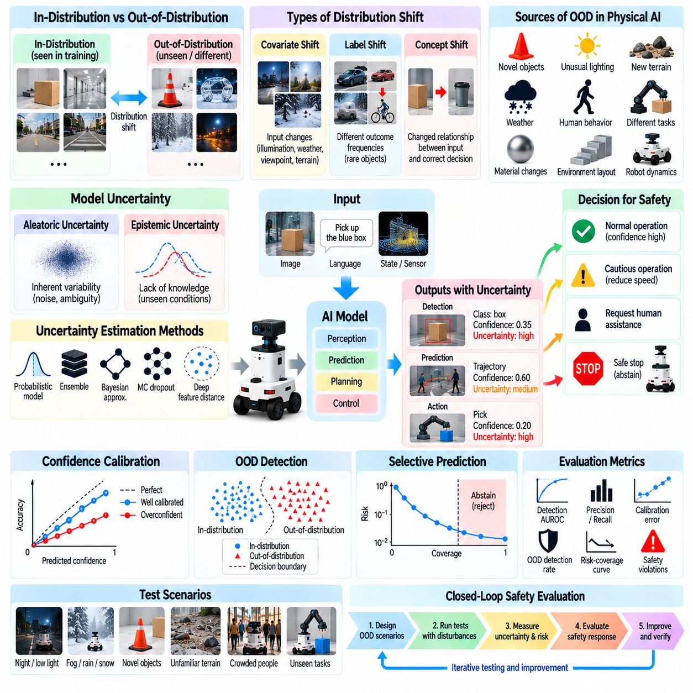{width="7.268055555555556in" height="7.268055555555556in"}

Out-of-distribution (OOD) and uncertainty evaluation examines whether Physical AI models recognize conditions that differ from their training experience and respond without creating physical hazards. Learned perception, prediction, and control systems may behave confidently in unfamiliar situations. Evaluation must determine whether model uncertainty reflects actual limitations and whether safety mechanisms prevent unreliable predictions from producing dangerous actions.

OOD conditions arise when operational inputs, environments, tasks, or interactions differ meaningfully from the training distribution. Novel objects, unusual lighting, unfamiliar terrain, unexpected human behavior, and altered robot dynamics can introduce distribution shifts. Testing should distinguish harmless variations from changes that invalidate learned assumptions and compromise the reliability of safety-critical decisions.

A systematic evaluation begins by defining the model\'s intended operating distribution and its relationship to the operational design domain. Training data coverage, deployment conditions, and known exclusions should be documented. Evaluators must identify relevant distribution shifts and determine whether the model can distinguish familiar conditions from situations requiring reduced autonomy, additional verification, or protective intervention.

OOD evaluation should distinguish covariate shift, label shift, and concept shift because they affect learned systems differently. Covariate shift changes input characteristics, while label shift changes outcome frequencies. Concept shift alters relationships between observations and correct decisions. Physical AI testing should examine whether each shift produces unreliable predictions and whether uncertainty estimates reveal the resulting limitations.

Uncertainty in Physical AI commonly includes aleatoric and epistemic components. Aleatoric uncertainty reflects inherent variability or ambiguity in observations, while epistemic uncertainty arises from incomplete knowledge or insufficient training coverage. Evaluation should investigate whether models distinguish these sources sufficiently to support safe decisions, particularly when unfamiliar conditions require caution rather than confident action.

Confidence calibration measures whether predicted confidence corresponds to observed correctness. A model reporting high confidence should achieve appropriately high accuracy under the evaluated conditions. Reliability diagrams, expected calibration error, and proper scoring rules can quantify calibration quality. However, calibration should be examined across safety-critical scenarios because aggregate metrics may conceal severe overconfidence in rare conditions.

OOD detection methods attempt to identify inputs that differ from expected operating conditions. Approaches may use predictive confidence, feature-space distances, density estimates, ensembles, or learned anomaly detectors. Evaluation should measure detection effectiveness across multiple shift types rather than relying on one benchmark. Detection methods must also be tested against unfamiliar conditions that resemble ordinary inputs.

Detection performance should be evaluated using metrics that reflect both statistical discrimination and operational consequences. Area under the receiver operating characteristic curve, precision-recall measures, false-positive rates, and missed-detection rates provide complementary information. Safety evaluation must emphasize hazardous OOD cases that remain undetected and unnecessary interventions that disrupt otherwise safe operation.

Uncertainty estimates can be generated through probabilistic models, ensembles, Bayesian approximations, or repeated stochastic inference. These methods differ in computational cost, calibration behavior, and sensitivity to distribution shift. Evaluation should compare uncertainty quality with execution latency and resource requirements. An uncertainty estimator that delays safety-critical control may introduce risks despite improved statistical performance.

Selective prediction allows a model to abstain when confidence is insufficient. In Physical AI, abstention must correspond to a defined physical response rather than merely withholding a prediction. Evaluation should measure risk-coverage tradeoffs and determine whether reduced autonomy, slower motion, or human assistance prevents hazardous behavior. Rejection thresholds must reflect task severity and the consequences of incorrect decisions.

Perception models may encounter OOD objects, materials, viewpoints, and environmental conditions. An unfamiliar obstacle can be misclassified or ignored, while reflective surfaces may create misleading depth estimates. Testing should examine whether uncertainty increases when object recognition or scene interpretation becomes unreliable. Downstream navigation and manipulation must respond safely when perceptual confidence deteriorates.

Vision-language-action models and generalist robot policies introduce additional OOD challenges because they combine language instructions, visual observations, and physical actions. Novel instruction combinations or unfamiliar object relationships may produce plausible but unsafe behavior. Evaluation should test semantic understanding, action feasibility, and uncertainty under unfamiliar tasks while measuring the physical consequences of incorrect policy outputs.

World models and predictive controllers may become unreliable when environmental dynamics differ from learned assumptions. Unexpected friction, payload changes, or unusual contact interactions can invalidate future-state predictions. Testing should compare predicted outcomes with observed trajectories and examine whether prediction uncertainty increases before hazardous deviations occur. Model confidence must not substitute for physical constraint enforcement.

Temporal distribution shifts deserve attention because unfamiliarity may emerge gradually during continuous operation. Sensor aging, environmental changes, accumulated wear, and evolving human activity can alter input statistics over time. Evaluation should measure detection delay, uncertainty trends, and the effectiveness of online monitoring. Systems must recognize persistent degradation rather than treating each observation independently.

Compound OOD conditions can expose weaknesses that remain hidden during isolated testing. Unfamiliar terrain combined with poor lighting, novel objects, or delayed sensing may produce interacting uncertainties. Evaluation should examine combinations selected through hazard analysis and operational relevance. Rare scenarios require particular attention when multiple unfamiliar factors jointly increase the probability of unsafe actions.

Adversarial and naturally occurring distribution shifts should be distinguished during evaluation. Adversarial inputs intentionally exploit model vulnerabilities, while natural shifts arise from environmental or operational variability. Both can generate confident errors, but their likelihood and mechanisms differ. Testing should identify common failure patterns without assuming that performance against one shift category guarantees robustness against another.

OOD fault injection and scenario generation enable systematic exploration of unfamiliar conditions. Synthetic objects, altered textures, modified dynamics, unusual instructions, and randomized environments can challenge learned representations. Generated scenarios should preserve physical plausibility and meaningful task constraints. Evaluation must avoid treating arbitrary synthetic novelty as equivalent to realistic deployment uncertainty.

Simulation supports large-scale OOD testing but can introduce its own distribution mismatch. Synthetic observations may differ from real sensor data, and simulated dynamics may omit important physical effects. Evaluation should compare model responses across simulation, controlled laboratory experiments, and field conditions. Critical findings require real-world validation to establish whether uncertainty estimates remain trustworthy.

Runtime assurance mechanisms can use OOD indicators and uncertainty estimates to restrict unsafe actions. Safety monitors may enforce speed limits, collision constraints, or fallback transitions when model reliability deteriorates. Evaluation should measure detection-to-intervention latency, protective effectiveness, and false intervention rates. Independent safety constraints remain necessary because uncertainty estimators can themselves fail.

Quantitative assessment should connect uncertainty quality with physical safety outcomes. Relevant metrics include calibration error, OOD detection performance, selective risk, intervention latency, collision frequency, and safety-boundary violations. Results should be stratified by shift severity, task type, and operating context. Average accuracy or detection scores alone cannot establish dependable safety under unfamiliar conditions.

Benchmark validity requires careful separation of training, validation, and evaluation distributions. Repeated exposure to fixed OOD benchmarks may encourage overfitting and conceal weaknesses against genuinely unfamiliar scenarios. Testing should include held-out environments, hidden perturbations, and documented scenario coverage. Statistical confidence intervals and repeated trials are needed to distinguish meaningful improvements from experimental variability.

Ultimately, AI model OOD and uncertainty evaluation determines whether Physical AI systems recognize the boundaries of learned competence and preserve safety when those boundaries are approached or exceeded. Effective assessment integrates distribution-shift testing, calibration analysis, uncertainty validation, physical outcome measurement, and protective response verification. The objective is not perfect prediction but reliable recognition and containment of model uncertainty.

분포 외(Out-of-Distribution, OOD) 및 불확실성 평가(Uncertainty Evaluation)는 피지컬 인공지능 모델(Physical AI Model)이 학습 경험(Training Experience)과 다른 조건을 인식하고 물리적 위험(Physical Hazard)을 발생시키지 않으면서 대응하는지를 검증한다. 학습 기반 인지(Learned Perception), 예측(Prediction), 제어(Control) 시스템은 익숙하지 않은 상황에서도 높은 확신을 가지고 동작할 수 있다. 평가에서는 모델 불확실성(Model Uncertainty)이 실제 한계(Actual Limitation)를 반영하는지, 그리고 안전 메커니즘(Safety Mechanism)이 신뢰할 수 없는 예측(Unreliable Prediction)이 위험한 행동(Dangerous Action)으로 이어지는 것을 방지하는지 판단해야 한다.

분포 외 조건(OOD Condition)은 운영 입력(Operational Input), 환경(Environment), 작업(Task), 상호작용(Interaction)이 학습 분포(Training Distribution)와 의미 있게 달라질 때 발생한다. 새로운 객체(Novel Object), 비정상적인 조명(Unusual Lighting), 익숙하지 않은 지형(Unfamiliar Terrain), 예상하지 못한 인간 행동(Unexpected Human Behavior), 변화된 로봇 동역학(Altered Robot Dynamics)은 분포 변화(Distribution Shift)를 유발할 수 있다. 시험에서는 무해한 변동(Harmless Variation)과 학습된 가정(Learned Assumption)을 무효화하여 안전 필수 의사결정(Safety-Critical Decision)의 신뢰성을 저해하는 변화를 구분해야 한다.

체계적인 평가(Systematic Evaluation)는 모델의 의도된 운영 분포(Intended Operating Distribution)와 운영 설계 영역(Operational Design Domain, ODD) 사이의 관계를 정의하는 것에서 시작한다. 학습 데이터 적용 범위(Training Data Coverage), 배포 조건(Deployment Condition), 알려진 제외 조건(Known Exclusion)을 문서화해야 한다. 평가자는 관련 분포 변화(Relevant Distribution Shift)를 식별하고 모델이 익숙한 조건과 자율성 축소(Reduced Autonomy), 추가 검증(Additional Verification), 보호 개입(Protective Intervention)이 필요한 상황을 구분할 수 있는지 판단해야 한다.

분포 외 평가(OOD Evaluation)에서는 공변량 변화(Covariate Shift), 레이블 변화(Label Shift), 개념 변화(Concept Shift)를 구분해야 한다. 이러한 변화는 학습 시스템(Learned System)에 서로 다른 영향을 미치기 때문이다. 공변량 변화는 입력 특성(Input Characteristic)을 변화시키며, 레이블 변화는 결과 발생 빈도(Outcome Frequency)를 변화시킨다. 개념 변화는 관측값(Observation)과 올바른 의사결정(Correct Decision) 사이의 관계를 변화시킨다. 피지컬 인공지능 시험(Physical AI Testing)은 각 변화가 신뢰할 수 없는 예측(Unreliable Prediction)을 발생시키는지, 그리고 불확실성 추정값(Uncertainty Estimate)이 그에 따른 한계를 드러내는지 검증해야 한다.

피지컬 인공지능의 불확실성(Uncertainty)은 일반적으로 우연적 불확실성(Aleatoric Uncertainty)과 인식론적 불확실성(Epistemic Uncertainty)을 포함한다. 우연적 불확실성은 관측값(Observation)에 내재된 변동성(Inherent Variability)이나 모호성(Ambiguity)을 반영하며, 인식론적 불확실성은 불완전한 지식(Incomplete Knowledge)이나 부족한 학습 범위(Insufficient Training Coverage)에서 발생한다. 평가에서는 특히 익숙하지 않은 조건에서 확신에 찬 행동(Confident Action)보다 신중한 대응(Cautious Response)이 필요할 때 모델이 안전한 의사결정(Safe Decision)을 지원할 만큼 이러한 불확실성의 원인을 구분하는지 검증해야 한다.

신뢰도 보정(Confidence Calibration)은 예측 신뢰도(Predicted Confidence)가 관측된 정답률(Observed Correctness)에 대응하는지를 측정한다. 높은 신뢰도(High Confidence)를 보고하는 모델은 평가 조건(Evaluation Condition)에서 그에 상응하는 높은 정확도(High Accuracy)를 달성해야 한다. 신뢰도 다이어그램(Reliability Diagram), 기대 보정 오차(Expected Calibration Error, ECE), 적절한 점수화 규칙(Proper Scoring Rule)은 보정 품질(Calibration Quality)을 정량화할 수 있다. 그러나 종합 지표(Aggregate Metric)는 드문 조건(Rare Condition)에서 발생하는 심각한 과신(Severe Overconfidence)을 숨길 수 있으므로 안전 필수 시나리오(Safety-Critical Scenario) 전반에서 보정 성능을 검증해야 한다.

분포 외 탐지 방법(OOD Detection Method)은 예상되는 운영 조건(Expected Operating Condition)과 다른 입력을 식별하려고 한다. 접근 방법에는 예측 신뢰도(Predictive Confidence), 특징 공간 거리(Feature-Space Distance), 밀도 추정(Density Estimate), 앙상블(Ensemble), 학습 기반 이상 탐지기(Learned Anomaly Detector)가 사용될 수 있다. 평가에서는 단일 벤치마크(Single Benchmark)에 의존하기보다 여러 분포 변화 유형(Distribution Shift Type)에 걸쳐 탐지 효과(Detection Effectiveness)를 측정해야 한다. 탐지 방법은 일반적인 입력(Ordinary Input)과 유사하게 보이는 익숙하지 않은 조건(Unfamiliar Condition)에 대해서도 시험해야 한다.

탐지 성능(Detection Performance)은 통계적 판별 능력(Statistical Discrimination)과 운영상 결과(Operational Consequence)를 모두 반영하는 지표로 평가해야 한다. 수신자 조작 특성 곡선 아래 면적(Area Under the Receiver Operating Characteristic Curve, AUROC), 정밀도-재현율 지표(Precision-Recall Measure), 거짓 양성률(False-Positive Rate), 미탐지율(Missed-Detection Rate)은 상호 보완적인 정보를 제공한다. 안전성 평가(Safety Evaluation)에서는 탐지되지 않은 위험한 분포 외 사례(Hazardous OOD Case)와 정상적으로 안전한 운영을 방해하는 불필요한 개입(Unnecessary Intervention)을 중요하게 고려해야 한다.

불확실성 추정값(Uncertainty Estimate)은 확률적 모델(Probabilistic Model), 앙상블(Ensemble), 베이지안 근사(Bayesian Approximation), 반복적인 확률적 추론(Repeated Stochastic Inference)을 통해 생성할 수 있다. 이러한 방법은 연산 비용(Computational Cost), 보정 특성(Calibration Behavior), 분포 변화 민감도(Sensitivity to Distribution Shift)에서 차이가 있다. 평가에서는 불확실성 품질(Uncertainty Quality)을 실행 지연 시간(Execution Latency) 및 자원 요구사항(Resource Requirement)과 함께 비교해야 한다. 통계적 성능(Statistical Performance)이 향상되더라도 안전 필수 제어(Safety-Critical Control)를 지연시키는 불확실성 추정기(Uncertainty Estimator)는 새로운 위험을 발생시킬 수 있다.

선택적 예측(Selective Prediction)은 신뢰도가 충분하지 않을 때 모델이 예측을 보류(Abstention)하도록 한다. 피지컬 인공지능에서는 예측 보류가 단순히 예측값을 출력하지 않는 것이 아니라 정의된 물리적 대응(Defined Physical Response)과 연결되어야 한다. 평가에서는 위험도-적용 범위 상충관계(Risk-Coverage Tradeoff)를 측정하고 자율성 축소(Reduced Autonomy), 저속 이동(Slower Motion), 인간 지원(Human Assistance)이 위험한 행동(Hazardous Behavior)을 방지하는지 판단해야 한다. 예측 거부 임계값(Rejection Threshold)은 작업의 심각도(Task Severity)와 잘못된 의사결정(Incorrect Decision)의 결과를 반영해야 한다.

인지 모델(Perception Model)은 분포 외 객체(OOD Object), 재질(Material), 관측 시점(Viewpoint), 환경 조건(Environmental Condition)을 마주할 수 있다. 익숙하지 않은 장애물(Unfamiliar Obstacle)은 잘못 분류되거나 무시될 수 있으며, 반사 표면(Reflective Surface)은 잘못된 깊이 추정값(Misleading Depth Estimate)을 생성할 수 있다. 시험에서는 객체 인식(Object Recognition)이나 장면 해석(Scene Interpretation)의 신뢰성이 저하될 때 불확실성이 증가하는지 검증해야 한다. 후속 내비게이션(Downstream Navigation)과 조작(Manipulation)은 인지 신뢰도(Perceptual Confidence)가 저하될 때 안전하게 대응해야 한다.

비전-언어-행동 모델(Vision-Language-Action Model, VLA)과 범용 로봇 정책(Generalist Robot Policy)은 언어 명령(Language Instruction), 시각 관측(Visual Observation), 물리적 행동(Physical Action)을 결합하기 때문에 추가적인 분포 외 문제(OOD Challenge)를 발생시킨다. 새로운 명령 조합(Novel Instruction Combination)이나 익숙하지 않은 객체 관계(Unfamiliar Object Relationship)는 그럴듯하지만 불안전한 행동(Plausible but Unsafe Behavior)을 생성할 수 있다. 평가에서는 익숙하지 않은 작업(Unfamiliar Task)에서 의미 이해(Semantic Understanding), 행동 실행 가능성(Action Feasibility), 불확실성(Uncertainty)을 시험하면서 잘못된 정책 출력(Incorrect Policy Output)이 초래하는 물리적 결과(Physical Consequence)를 측정해야 한다.

월드 모델(World Model)과 예측 제어기(Predictive Controller)는 환경 동역학(Environmental Dynamics)이 학습된 가정(Learned Assumption)과 달라질 때 신뢰성이 저하될 수 있다. 예상하지 못한 마찰(Unexpected Friction), 적재물 변화(Payload Change), 비정상적인 접촉 상호작용(Unusual Contact Interaction)은 미래 상태 예측(Future-State Prediction)을 무효화할 수 있다. 시험에서는 예측 결과(Predicted Outcome)와 관측된 궤적(Observed Trajectory)을 비교하고 위험한 편차(Hazardous Deviation)가 발생하기 전에 예측 불확실성(Prediction Uncertainty)이 증가하는지 검증해야 한다. 모델 신뢰도(Model Confidence)가 물리적 제약 조건 강제(Physical Constraint Enforcement)를 대신해서는 안 된다.

시간적 분포 변화(Temporal Distribution Shift)는 지속적인 운영(Continuous Operation) 중에 익숙하지 않은 조건이 점진적으로 나타날 수 있기 때문에 주의가 필요하다. 센서 노후화(Sensor Aging), 환경 변화(Environmental Change), 누적 마모(Accumulated Wear), 변화하는 인간 활동(Evolving Human Activity)은 시간에 따라 입력 통계(Input Statistics)를 변화시킬 수 있다. 평가에서는 탐지 지연 시간(Detection Delay), 불확실성 추세(Uncertainty Trend), 온라인 감시(Online Monitoring)의 효과를 측정해야 한다. 시스템은 각 관측값(Observation)을 독립적으로 처리하는 데 그치지 않고 지속적인 성능 저하(Persistent Degradation)를 인식해야 한다.

복합 분포 외 조건(Compound OOD Condition)은 개별 시험(Isolated Testing)에서는 드러나지 않는 취약성을 노출할 수 있다. 익숙하지 않은 지형(Unfamiliar Terrain)에 낮은 조도(Poor Lighting), 새로운 객체(Novel Object), 지연된 센싱(Delayed Sensing)이 결합되면 서로 상호작용하는 불확실성(Interacting Uncertainty)이 발생할 수 있다. 평가에서는 위험 분석(Hazard Analysis)과 운영 관련성(Operational Relevance)을 기반으로 선택한 조합을 검증해야 한다. 여러 익숙하지 않은 요인(Unfamiliar Factor)이 함께 불안전한 행동(Unsafe Action)의 발생 확률을 높이는 드문 시나리오(Rare Scenario)에 특별한 주의를 기울여야 한다.

적대적 분포 변화(Adversarial Distribution Shift)와 자연적으로 발생하는 분포 변화(Naturally Occurring Distribution Shift)는 평가 과정에서 구분해야 한다. 적대적 입력(Adversarial Input)은 의도적으로 모델 취약성(Model Vulnerability)을 악용하는 반면, 자연적 변화(Natural Shift)는 환경적 또는 운영상 변동성(Environmental or Operational Variability)에서 발생한다. 두 유형 모두 높은 확신을 가진 오류(Confident Error)를 발생시킬 수 있지만 발생 가능성(Likelihood)과 메커니즘(Mechanism)은 서로 다르다. 시험에서는 한 가지 변화 유형(Shift Category)에 대한 성능이 다른 유형에 대한 강건성(Robustness)을 보장한다고 가정하지 않고 공통 고장 패턴(Common Failure Pattern)을 식별해야 한다.

분포 외 고장 주입(OOD Fault Injection)과 시나리오 생성(Scenario Generation)은 익숙하지 않은 조건(Unfamiliar Condition)을 체계적으로 탐색할 수 있도록 한다. 합성 객체(Synthetic Object), 변경된 텍스처(Altered Texture), 수정된 동역학(Modified Dynamics), 비정상적인 명령(Unusual Instruction), 무작위화된 환경(Randomized Environment)은 학습된 표현(Learned Representation)을 시험할 수 있다. 생성된 시나리오(Generated Scenario)는 물리적 타당성(Physical Plausibility)과 의미 있는 작업 제약 조건(Meaningful Task Constraint)을 유지해야 한다. 평가에서는 임의적인 합성 신규성(Arbitrary Synthetic Novelty)을 현실적인 배포 불확실성(Realistic Deployment Uncertainty)과 동등하게 취급해서는 안 된다.

시뮬레이션(Simulation)은 대규모 분포 외 시험(Large-Scale OOD Testing)을 지원하지만 자체적인 분포 불일치(Distribution Mismatch)를 발생시킬 수 있다. 합성 관측값(Synthetic Observation)은 실제 센서 데이터(Real Sensor Data)와 다를 수 있으며, 시뮬레이션 동역학(Simulated Dynamics)은 중요한 물리적 효과(Physical Effect)를 누락할 수 있다. 평가에서는 시뮬레이션(Simulation), 통제된 실험실 실험(Controlled Laboratory Experiment), 현장 조건(Field Condition)에서 모델 응답(Model Response)을 비교해야 한다. 중요한 결과(Critical Finding)는 불확실성 추정값(Uncertainty Estimate)이 계속 신뢰할 수 있는지를 확인하기 위해 실제 환경 검증(Real-World Validation)을 거쳐야 한다.

실행시간 보증 메커니즘(Runtime Assurance Mechanism)은 분포 외 지표(OOD Indicator)와 불확실성 추정값(Uncertainty Estimate)을 활용하여 불안전한 행동(Unsafe Action)을 제한할 수 있다. 안전 감시기(Safety Monitor)는 모델 신뢰성(Model Reliability)이 저하될 때 속도 제한(Speed Limit), 충돌 제약 조건(Collision Constraint), 대체 동작 전환(Fallback Transition)을 강제할 수 있다. 평가에서는 탐지부터 개입까지의 지연 시간(Detection-to-Intervention Latency), 보호 효과(Protective Effectiveness), 잘못된 개입 비율(False Intervention Rate)을 측정해야 한다. 불확실성 추정기(Uncertainty Estimator) 자체도 실패할 수 있으므로 독립적인 안전 제약 조건(Independent Safety Constraint)이 계속 필요하다.

정량적 평가(Quantitative Assessment)는 불확실성 품질(Uncertainty Quality)을 물리적 안전 결과(Physical Safety Outcome)와 연결해야 한다. 관련 지표에는 보정 오차(Calibration Error), 분포 외 탐지 성능(OOD Detection Performance), 선택적 위험도(Selective Risk), 개입 지연 시간(Intervention Latency), 충돌 빈도(Collision Frequency), 안전 경계 위반(Safety-Boundary Violation)이 포함된다. 결과는 분포 변화의 심각도(Shift Severity), 작업 유형(Task Type), 운영 맥락(Operating Context)에 따라 구분하여 보고해야 한다. 평균 정확도(Average Accuracy)나 탐지 점수(Detection Score)만으로는 익숙하지 않은 조건에서 신뢰할 수 있는 안전성(Dependable Safety)을 입증할 수 없다.

벤치마크 타당성(Benchmark Validity)을 확보하려면 학습 분포(Training Distribution), 검증 분포(Validation Distribution), 평가 분포(Evaluation Distribution)를 신중하게 분리해야 한다. 고정된 분포 외 벤치마크(Fixed OOD Benchmark)에 반복적으로 노출되면 과적합(Overfitting)이 발생하고 실제로 익숙하지 않은 시나리오(Genuinely Unfamiliar Scenario)에 대한 취약성이 숨겨질 수 있다. 시험에는 학습에서 제외된 환경(Held-Out Environment), 비공개 교란(Hidden Perturbation), 문서화된 시나리오 적용 범위(Documented Scenario Coverage)가 포함되어야 한다. 통계적 신뢰구간(Statistical Confidence Interval)과 반복 시험(Repeated Trial)은 의미 있는 개선(Meaningful Improvement)과 실험적 변동성(Experimental Variability)을 구분하는 데 필요하다.

궁극적으로 인공지능 모델의 분포 외 및 불확실성 평가(AI Model OOD and Uncertainty Evaluation)는 피지컬 인공지능 시스템이 학습된 능력의 경계(Boundary of Learned Competence)를 인식하고 그 경계에 접근하거나 이를 초과할 때에도 안전성을 유지하는지를 판단한다. 효과적인 평가(Effective Assessment)는 분포 변화 시험(Distribution-Shift Testing), 보정 분석(Calibration Analysis), 불확실성 검증(Uncertainty Validation), 물리적 결과 측정(Physical Outcome Measurement), 보호 응답 검증(Protective Response Verification)을 통합한다. 목표는 완벽한 예측(Perfect Prediction)이 아니라 모델 불확실성(Model Uncertainty)을 신뢰성 있게 인식하고 그로 인한 위험을 억제(Reliable Recognition and Containment)하는 것이다.

##  

## 05.12. World Model and Prediction Failure Evaluation

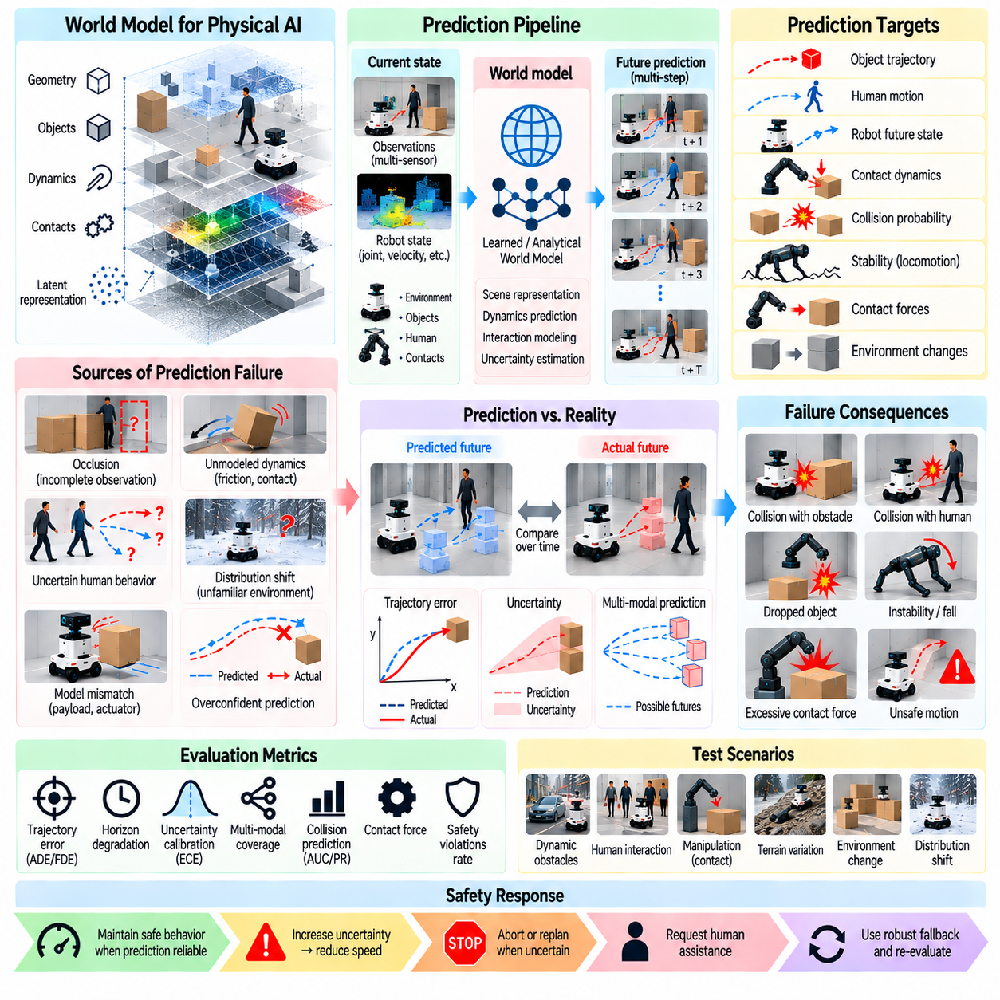{width="7.268055555555556in" height="7.268055555555556in"}

World model and prediction failure evaluation examines whether Physical AI systems can anticipate physical outcomes reliably enough to support safe decisions. Autonomous robots use learned or analytical models to predict object motion, environmental changes, contact interactions, and future robot states. When these predictions are incorrect, planning and control may produce hazardous actions. Evaluation must connect prediction errors with their physical safety consequences.

A world model represents relevant properties of the environment and predicts how those properties evolve under actions and external influences. Its representations may include geometry, object states, motion dynamics, contact relationships, and latent variables. Failure evaluation should examine both incorrect representations and inaccurate transitions between predicted states, particularly when these errors affect collision avoidance or manipulation safety.

Prediction failures arise from incomplete observations, inaccurate dynamics, insufficient training coverage, and incorrect assumptions about the environment. Occluded objects, unexpected human movements, changing friction, and unmodeled contacts can invalidate predictions. Testing should distinguish ordinary forecasting uncertainty from systematic errors that persist across planning cycles and create unsafe confidence in future outcomes.

A systematic evaluation begins by identifying the predictions required for safety-critical functions. Relevant outputs may include obstacle trajectories, collision probabilities, stopping distances, contact forces, robot stability, and future occupancy. Each prediction should have defined accuracy, uncertainty, and timing requirements. These requirements must reflect the consequences of errors rather than relying solely on statistical prediction quality.

Ground-truth trajectories and physical measurements provide references for evaluating prediction reliability. Motion capture, calibrated sensors, force measurements, and independently recorded system states can support verification. Evaluation should account for measurement uncertainty, coordinate alignment, and temporal synchronization. Incorrect reference data can otherwise produce misleading conclusions about world model performance.

Prediction accuracy should be evaluated across multiple forecast horizons. Short-term predictions may remain accurate while long-term estimates accumulate substantial error. Metrics such as displacement error, trajectory deviation, and state prediction error quantify different aspects of performance. Safety assessment should emphasize maximum hazardous deviations and horizon-dependent degradation rather than average prediction accuracy alone.

Multi-step prediction introduces compounding errors because each predicted state becomes the basis for subsequent forecasts. Small inaccuracies in velocity, contact dynamics, or object position can grow into substantial trajectory divergence. Evaluation should compare open-loop rollouts with observed physical evolution. Testing must identify when accumulated uncertainty makes predicted trajectories unsuitable for safety-critical planning.

Uncertainty calibration is essential because an inaccurate prediction may become especially dangerous when accompanied by unjustified confidence. Probabilistic world models should express uncertainty consistent with observed prediction errors. Evaluation may use likelihood-based measures, interval coverage, and calibration analysis. Safety testing should determine whether uncertainty expands appropriately when predictions extend beyond reliable operating conditions.

Multimodal prediction is necessary when several future outcomes are physically plausible. A pedestrian may turn, stop, or continue walking, while an object may slide or remain stationary after contact. Models that collapse multiple possibilities into one average prediction can conceal dangerous outcomes. Evaluation should assess whether plausible alternatives are represented and whether planning accounts for safety-critical possibilities.

Dynamic-object prediction failures can directly affect collision avoidance. Unexpected acceleration, sudden direction changes, and partially occluded motion may invalidate predicted trajectories. Testing should vary object speed, interaction patterns, and observation quality. Evaluation must determine whether robots preserve sufficient separation when predicted movement differs from actual behavior, especially near humans and moving machinery.

Contact prediction presents particular challenges because friction, compliance, and impact dynamics are difficult to model accurately. Manipulation tasks may involve uncertain grasp stability, object deformation, or unexpected slipping. Evaluation should compare predicted contact states and forces with measured outcomes. Safety requirements must address excessive force, dropped objects, unstable grasps, and unintended environmental contact.

Robot dynamics prediction failures can compromise locomotion and motion planning. Payload changes, actuator degradation, wheel slip, and terrain variation may alter actual system responses. Testing should examine discrepancies between predicted and observed motion under controlled disturbances. Evaluation should establish whether controllers detect model mismatch and reduce reliance on predictions before stability or collision constraints are violated.

Latent world models introduce additional verification challenges because internal representations may not correspond directly to interpretable physical variables. A model can achieve low training loss while omitting safety-relevant information. Evaluation should therefore test downstream physical outcomes, representation sensitivity, and counterfactual consistency. Predictive accuracy in latent space alone cannot establish reliable environmental understanding.

Causal prediction should be evaluated by examining how models respond to changes in actions and environmental conditions. A robot must distinguish correlations in observed data from physical consequences of its own interventions. Counterfactual tests can compare predicted outcomes under alternative actions. Evaluation should identify whether incorrect causal assumptions produce unsafe planning choices when familiar correlations no longer hold.

Distribution shifts can invalidate world models when deployment conditions differ from training experience. Novel objects, unusual materials, unfamiliar terrain, and changing interaction dynamics may produce systematic prediction errors. Testing should measure error growth and uncertainty response under these shifts. Models must recognize when their predictive competence becomes insufficient for unrestricted autonomous behavior.

Temporal failures occur when predictions rely on delayed observations or outdated world states. Even an accurate dynamics model may generate unsafe forecasts if its initial conditions no longer represent the physical environment. Evaluation should vary observation latency, prediction update frequency, and synchronization errors. Safety mechanisms must account for the age of information and uncertainty accumulated between updates.

Planning systems may amplify world model errors by repeatedly selecting actions that exploit inaccurate predictions. Model-based reinforcement learning and predictive control can favor trajectories that appear safe in simulation but violate real physical constraints. Evaluation should examine closed-loop behavior, model exploitation, and repeated replanning. A favorable predicted reward must not override independent safety requirements.

Fault injection enables controlled investigation of prediction vulnerabilities. Experiments may introduce incorrect object velocities, biased friction estimates, missing obstacles, delayed observations, or corrupted latent states. Fault magnitude, duration, and onset should be systematically varied. Testing should determine whether prediction monitors detect discrepancies and whether protective actions occur before hazardous physical consequences develop.

Simulation supports scalable evaluation of rare prediction failures and complex future scenarios. Parameterized environments can vary dynamics, object interactions, and uncertainty while maintaining reproducibility. However, simulation models may share assumptions with the world models being tested. Independent physical measurements and controlled real-world trials are necessary to avoid misleading validation based on correlated modeling errors.

Quantitative evaluation should connect prediction quality with downstream safety performance. Relevant metrics include trajectory error, uncertainty coverage, collision probability calibration, model mismatch detection latency, and safety-boundary violations. Results should be stratified by forecast horizon, disturbance severity, and task context. Statistical accuracy alone cannot demonstrate safe behavior when rare prediction failures have severe consequences.

Protective responses should be evaluated when prediction reliability deteriorates. Appropriate behavior may include shorter planning horizons, reduced speed, increased clearance, conservative action selection, or transition to a minimum-risk state. Testing should verify that uncertainty thresholds trigger interventions early enough. Recovery should require evidence that model predictions have returned to an acceptable reliability level.

Ultimately, world model and prediction failure evaluation determines whether Physical AI systems can recognize unreliable forecasts and preserve safety despite imperfect representations of future physical events. Effective assessment integrates ground-truth validation, uncertainty calibration, causal testing, closed-loop evaluation, fault injection, and protective response verification. The objective is dependable decision-making under predictive uncertainty rather than flawless forecasting.

월드 모델 및 예측 실패 평가(World Model and Prediction Failure Evaluation)는 피지컬 인공지능 시스템(Physical AI System)이 안전한 의사결정(Safe Decision)을 지원할 만큼 물리적 결과(Physical Outcome)를 신뢰성 있게 예측할 수 있는지를 검증한다. 자율 로봇(Autonomous Robot)은 학습 기반 또는 해석적 모델(Learned or Analytical Model)을 사용하여 객체 움직임(Object Motion), 환경 변화(Environmental Change), 접촉 상호작용(Contact Interaction), 미래 로봇 상태(Future Robot State)를 예측한다. 이러한 예측이 부정확하면 계획(Planning)과 제어(Control)가 위험한 행동(Hazardous Action)을 생성할 수 있다. 평가에서는 예측 오차(Prediction Error)를 물리적 안전 결과(Physical Safety Consequence)와 연결해야 한다.

월드 모델(World Model)은 환경의 관련 속성(Relevant Property)을 표현하고 이러한 속성이 행동(Action)과 외부 영향(External Influence)에 따라 어떻게 변화하는지 예측한다. 모델의 표현(Representation)에는 기하학적 구조(Geometry), 객체 상태(Object State), 운동 동역학(Motion Dynamics), 접촉 관계(Contact Relationship), 잠재 변수(Latent Variable)가 포함될 수 있다. 실패 평가(Failure Evaluation)에서는 특히 이러한 오류가 충돌 회피(Collision Avoidance)나 조작 안전성(Manipulation Safety)에 영향을 미치는 경우 잘못된 표현(Incorrect Representation)과 예측 상태 사이의 부정확한 전이(Inaccurate State Transition)를 모두 검증해야 한다.

예측 실패(Prediction Failure)는 불완전한 관측(Incomplete Observation), 부정확한 동역학(Inaccurate Dynamics), 불충분한 학습 범위(Insufficient Training Coverage), 환경에 대한 잘못된 가정(Incorrect Environmental Assumption)에서 발생한다. 가려진 객체(Occluded Object), 예상하지 못한 인간 움직임(Unexpected Human Movement), 변화하는 마찰(Changing Friction), 모델링되지 않은 접촉(Unmodeled Contact)은 예측을 무효화할 수 있다. 시험에서는 일반적인 예측 불확실성(Ordinary Forecasting Uncertainty)과 여러 계획 주기(Planning Cycle)에 걸쳐 지속되면서 미래 결과(Future Outcome)에 대한 불안전한 확신(Unsafe Confidence)을 발생시키는 체계적 오류(Systematic Error)를 구분해야 한다.

체계적인 평가(Systematic Evaluation)는 안전 필수 기능(Safety-Critical Function)에 필요한 예측을 식별하는 것에서 시작한다. 관련 출력(Relevant Output)에는 장애물 궤적(Obstacle Trajectory), 충돌 확률(Collision Probability), 정지 거리(Stopping Distance), 접촉력(Contact Force), 로봇 안정성(Robot Stability), 미래 점유 상태(Future Occupancy)가 포함될 수 있다. 각 예측에는 정확도(Accuracy), 불확실성(Uncertainty), 시간적 요구사항(Timing Requirement)이 정의되어야 한다. 이러한 요구사항은 통계적 예측 품질(Statistical Prediction Quality)에만 의존하지 않고 오류의 결과(Error Consequence)를 반영해야 한다.

실측 기준 궤적(Ground-Truth Trajectory)과 물리적 측정값(Physical Measurement)은 예측 신뢰성(Prediction Reliability)을 평가하기 위한 기준을 제공한다. 모션 캡처(Motion Capture), 보정된 센서(Calibrated Sensor), 힘 측정(Force Measurement), 독립적으로 기록된 시스템 상태(Independently Recorded System State)는 검증을 지원할 수 있다. 평가에서는 측정 불확실성(Measurement Uncertainty), 좌표 정렬(Coordinate Alignment), 시간 동기화(Temporal Synchronization)를 고려해야 한다. 그렇지 않으면 잘못된 기준 데이터(Incorrect Reference Data)가 월드 모델 성능(World Model Performance)에 대한 오해를 일으킬 수 있다.

예측 정확도(Prediction Accuracy)는 여러 예측 시간 범위(Forecast Horizon)에 걸쳐 평가해야 한다. 단기 예측(Short-Term Prediction)은 정확하게 유지되더라도 장기 추정(Long-Term Estimate)에서는 상당한 오차가 누적될 수 있다. 변위 오차(Displacement Error), 궤적 편차(Trajectory Deviation), 상태 예측 오차(State Prediction Error)와 같은 지표는 성능의 서로 다른 측면을 정량화한다. 안전성 평가(Safety Assessment)는 평균 예측 정확도(Average Prediction Accuracy)뿐 아니라 최대 위험 편차(Maximum Hazardous Deviation)와 예측 시간 범위에 따른 성능 저하(Horizon-Dependent Degradation)를 중요하게 고려해야 한다.

다단계 예측(Multi-Step Prediction)은 각 예측 상태(Predicted State)가 후속 예측(Subsequent Forecast)의 기반이 되기 때문에 오차 누적(Compounding Error)을 발생시킨다. 속도(Velocity), 접촉 동역학(Contact Dynamics), 객체 위치(Object Position)의 작은 부정확성(Small Inaccuracy)은 상당한 궤적 발산(Trajectory Divergence)으로 확대될 수 있다. 평가에서는 개루프 롤아웃(Open-Loop Rollout)과 관측된 물리적 변화(Observed Physical Evolution)를 비교해야 한다. 시험에서는 누적된 불확실성(Accumulated Uncertainty)으로 인해 예측 궤적(Predicted Trajectory)을 안전 필수 계획(Safety-Critical Planning)에 사용할 수 없게 되는 시점을 식별해야 한다.

불확실성 보정(Uncertainty Calibration)은 부정확한 예측(Inaccurate Prediction)에 정당화되지 않은 높은 확신(Unjustified Confidence)이 동반될 때 특히 위험해질 수 있으므로 필수적이다. 확률적 월드 모델(Probabilistic World Model)은 관측된 예측 오차(Observed Prediction Error)와 일치하는 불확실성을 표현해야 한다. 평가에서는 우도 기반 측정값(Likelihood-Based Measure), 구간 포함률(Interval Coverage), 보정 분석(Calibration Analysis)을 사용할 수 있다. 안전 시험(Safety Testing)에서는 예측이 신뢰할 수 있는 운영 조건(Reliable Operating Condition)을 벗어날 때 불확실성이 적절하게 증가하는지를 판단해야 한다.

다중 모드 예측(Multimodal Prediction)은 여러 미래 결과(Future Outcome)가 물리적으로 가능할 때 필요하다. 보행자(Pedestrian)는 방향을 바꾸거나 멈추거나 계속 걸을 수 있으며, 객체(Object)는 접촉 이후 미끄러지거나 정지 상태를 유지할 수 있다. 여러 가능성을 하나의 평균 예측(Average Prediction)으로 축약하는 모델은 위험한 결과(Dangerous Outcome)를 숨길 수 있다. 평가에서는 발생 가능한 대안(Plausible Alternative)이 표현되는지, 그리고 계획(Planning)이 안전에 중요한 가능성(Safety-Critical Possibility)을 고려하는지 검증해야 한다.

동적 객체 예측 실패(Dynamic-Object Prediction Failure)는 충돌 회피(Collision Avoidance)에 직접적인 영향을 미칠 수 있다. 예상하지 못한 가속(Unexpected Acceleration), 갑작스러운 방향 변화(Sudden Direction Change), 부분적으로 가려진 움직임(Partially Occluded Motion)은 예측 궤적(Predicted Trajectory)을 무효화할 수 있다. 시험에서는 객체 속도(Object Speed), 상호작용 패턴(Interaction Pattern), 관측 품질(Observation Quality)을 변화시켜야 한다. 평가에서는 특히 인간(Human)과 이동 기계(Moving Machinery) 주변에서 예측된 움직임(Predicted Movement)이 실제 행동(Actual Behavior)과 다를 때 로봇이 충분한 이격 거리(Sufficient Separation)를 유지하는지 판단해야 한다.

접촉 예측(Contact Prediction)은 마찰(Friction), 순응성(Compliance), 충격 동역학(Impact Dynamics)을 정확하게 모델링하기 어렵기 때문에 특별한 문제를 가진다. 조작 작업(Manipulation Task)에는 불확실한 파지 안정성(Uncertain Grasp Stability), 객체 변형(Object Deformation), 예상하지 못한 미끄러짐(Unexpected Slipping)이 포함될 수 있다. 평가에서는 예측된 접촉 상태(Predicted Contact State)와 접촉력(Contact Force)을 측정된 결과(Measured Outcome)와 비교해야 한다. 안전 요구사항(Safety Requirement)은 과도한 힘(Excessive Force), 객체 낙하(Dropped Object), 불안정한 파지(Unstable Grasp), 의도하지 않은 환경 접촉(Unintended Environmental Contact)을 다루어야 한다.

로봇 동역학 예측 실패(Robot Dynamics Prediction Failure)는 보행(Locomotion)과 동작 계획(Motion Planning)의 안전성을 저해할 수 있다. 적재물 변화(Payload Change), 구동기 성능 저하(Actuator Degradation), 바퀴 미끄러짐(Wheel Slip), 지형 변화(Terrain Variation)는 실제 시스템 응답(Actual System Response)을 변화시킬 수 있다. 시험에서는 통제된 외란(Controlled Disturbance) 상황에서 예측된 움직임(Predicted Motion)과 관측된 움직임(Observed Motion) 사이의 불일치를 검증해야 한다. 평가에서는 안정성 제약 조건(Stability Constraint)이나 충돌 제약 조건(Collision Constraint)이 위반되기 전에 제어기(Controller)가 모델 불일치(Model Mismatch)를 감지하고 예측에 대한 의존도를 줄이는지 확인해야 한다.

잠재 월드 모델(Latent World Model)은 내부 표현(Internal Representation)이 해석 가능한 물리적 변수(Interpretable Physical Variable)와 직접 대응하지 않을 수 있기 때문에 추가적인 검증 문제(Verification Challenge)를 발생시킨다. 모델은 낮은 학습 손실(Low Training Loss)을 달성하면서도 안전 관련 정보(Safety-Relevant Information)를 누락할 수 있다. 따라서 평가에서는 후속 물리적 결과(Downstream Physical Outcome), 표현 민감도(Representation Sensitivity), 반사실적 일관성(Counterfactual Consistency)을 시험해야 한다. 잠재 공간(Latent Space)에서의 예측 정확도(Predictive Accuracy)만으로는 신뢰할 수 있는 환경 이해(Reliable Environmental Understanding)를 입증할 수 없다.

인과적 예측(Causal Prediction)은 행동(Action)과 환경 조건(Environmental Condition)의 변화에 모델이 어떻게 반응하는지 검증하여 평가해야 한다. 로봇은 관측 데이터(Observed Data)의 상관관계(Correlation)와 자신의 개입(Intervention)이 초래하는 물리적 결과(Physical Consequence)를 구분해야 한다. 반사실적 시험(Counterfactual Test)은 대안적 행동(Alternative Action)에 따른 예측 결과(Predicted Outcome)를 비교할 수 있다. 평가에서는 익숙한 상관관계(Familiar Correlation)가 더 이상 성립하지 않을 때 잘못된 인과적 가정(Incorrect Causal Assumption)이 불안전한 계획 선택(Unsafe Planning Choice)을 발생시키는지 식별해야 한다.

분포 변화(Distribution Shift)는 배포 조건(Deployment Condition)이 학습 경험(Training Experience)과 다를 때 월드 모델(World Model)을 무효화할 수 있다. 새로운 객체(Novel Object), 비정상적인 재질(Unusual Material), 익숙하지 않은 지형(Unfamiliar Terrain), 변화하는 상호작용 동역학(Changing Interaction Dynamics)은 체계적인 예측 오차(Systematic Prediction Error)를 발생시킬 수 있다. 시험에서는 이러한 변화 상황에서 오차 증가(Error Growth)와 불확실성 응답(Uncertainty Response)을 측정해야 한다. 모델은 자신의 예측 능력(Predictive Competence)이 제한 없는 자율 행동(Unrestricted Autonomous Behavior)을 지원하기에 불충분해지는 시점을 인식해야 한다.

시간 관련 실패(Temporal Failure)는 예측이 지연된 관측값(Delayed Observation)이나 오래된 월드 상태(Outdated World State)에 의존할 때 발생한다. 정확한 동역학 모델(Accurate Dynamics Model)이라도 초기 조건(Initial Condition)이 더 이상 실제 물리적 환경(Physical Environment)을 나타내지 못하면 불안전한 예측(Unsafe Forecast)을 생성할 수 있다. 평가에서는 관측 지연 시간(Observation Latency), 예측 갱신 빈도(Prediction Update Frequency), 동기화 오류(Synchronization Error)를 변화시켜야 한다. 안전 메커니즘(Safety Mechanism)은 정보 경과 시간(Age of Information)과 갱신 사이에 누적된 불확실성(Accumulated Uncertainty)을 고려해야 한다.

계획 시스템(Planning System)은 부정확한 예측(Inaccurate Prediction)을 활용하는 행동을 반복적으로 선택함으로써 월드 모델 오차(World Model Error)를 증폭시킬 수 있다. 모델 기반 강화학습(Model-Based Reinforcement Learning)과 예측 제어(Predictive Control)는 시뮬레이션(Simulation)에서는 안전해 보이지만 실제 물리적 제약 조건(Physical Constraint)을 위반하는 궤적(Trajectory)을 선호할 수 있다. 평가에서는 폐루프 행동(Closed-Loop Behavior), 모델 오류 악용(Model Exploitation), 반복적인 재계획(Repeated Replanning)을 검증해야 한다. 유리한 예측 보상(Predicted Reward)이 독립적인 안전 요구사항(Independent Safety Requirement)보다 우선해서는 안 된다.

고장 주입(Fault Injection)은 예측 취약성(Prediction Vulnerability)을 통제된 방식으로 조사할 수 있도록 한다. 실험에서는 잘못된 객체 속도(Incorrect Object Velocity), 편향된 마찰 추정값(Biased Friction Estimate), 누락된 장애물(Missing Obstacle), 지연된 관측값(Delayed Observation), 손상된 잠재 상태(Corrupted Latent State)를 도입할 수 있다. 고장 크기(Fault Magnitude), 지속 시간(Duration), 발생 시점(Onset)을 체계적으로 변화시켜야 한다. 시험에서는 예측 감시기(Prediction Monitor)가 불일치(Discrepancy)를 감지하는지, 그리고 위험한 물리적 결과(Hazardous Physical Consequence)가 발생하기 전에 보호 행동(Protective Action)이 실행되는지 판단해야 한다.

시뮬레이션(Simulation)은 드문 예측 실패(Rare Prediction Failure)와 복잡한 미래 시나리오(Complex Future Scenario)를 확장 가능하게 평가할 수 있도록 지원한다. 매개변수화된 환경(Parameterized Environment)은 재현성(Reproducibility)을 유지하면서 동역학(Dynamics), 객체 상호작용(Object Interaction), 불확실성(Uncertainty)을 변화시킬 수 있다. 그러나 시뮬레이션 모델(Simulation Model)은 시험 대상 월드 모델(World Model)과 동일한 가정을 공유할 수 있다. 상관된 모델링 오류(Correlated Modeling Error)에 기반한 잘못된 검증(Misleading Validation)을 방지하려면 독립적인 물리적 측정(Independent Physical Measurement)과 통제된 실제 환경 시험(Controlled Real-World Trial)이 필요하다.

정량적 평가(Quantitative Evaluation)는 예측 품질(Prediction Quality)을 후속 안전 성능(Downstream Safety Performance)과 연결해야 한다. 관련 지표에는 궤적 오차(Trajectory Error), 불확실성 포함률(Uncertainty Coverage), 충돌 확률 보정(Collision Probability Calibration), 모델 불일치 감지 지연 시간(Model Mismatch Detection Latency), 안전 경계 위반(Safety-Boundary Violation)이 포함된다. 결과는 예측 시간 범위(Forecast Horizon), 외란 심각도(Disturbance Severity), 작업 맥락(Task Context)에 따라 구분하여 보고해야 한다. 드문 예측 실패(Rare Prediction Failure)가 심각한 결과를 초래할 수 있는 경우 통계적 정확도(Statistical Accuracy)만으로는 안전한 행동(Safe Behavior)을 입증할 수 없다.

예측 신뢰성(Prediction Reliability)이 저하될 때 보호 응답(Protective Response)을 평가해야 한다. 적절한 행동에는 예측 계획 범위 단축(Shorter Planning Horizon), 속도 감소(Reduced Speed), 이격 거리 증가(Increased Clearance), 보수적인 행동 선택(Conservative Action Selection), 최소 위험 상태(Minimum-Risk State)로의 전환이 포함될 수 있다. 시험에서는 불확실성 임계값(Uncertainty Threshold)이 충분히 이른 시점에 개입(Intervention)을 유발하는지 검증해야 한다. 복구(Recovery)를 위해서는 모델 예측(Model Prediction)이 허용 가능한 신뢰성 수준(Acceptable Reliability Level)으로 돌아왔다는 근거가 필요하다.

궁극적으로 월드 모델 및 예측 실패 평가(World Model and Prediction Failure Evaluation)는 피지컬 인공지능 시스템(Physical AI System)이 신뢰할 수 없는 예측(Unreliable Forecast)을 인식하고 미래 물리적 사건(Future Physical Event)에 대한 불완전한 표현(Imperfect Representation)에도 불구하고 안전성을 유지할 수 있는지를 판단한다. 효과적인 평가(Effective Assessment)는 실측 기준 검증(Ground-Truth Validation), 불확실성 보정(Uncertainty Calibration), 인과적 시험(Causal Testing), 폐루프 평가(Closed-Loop Evaluation), 고장 주입(Fault Injection), 보호 응답 검증(Protective Response Verification)을 통합한다. 목표는 완벽한 미래 예측(Flawless Forecasting)이 아니라 예측 불확실성(Predictive Uncertainty) 속에서도 신뢰할 수 있는 의사결정(Dependable Decision-Making)을 확보하는 것이다.

##  

## 05.13. Adversarial and Worst Case Evaluation

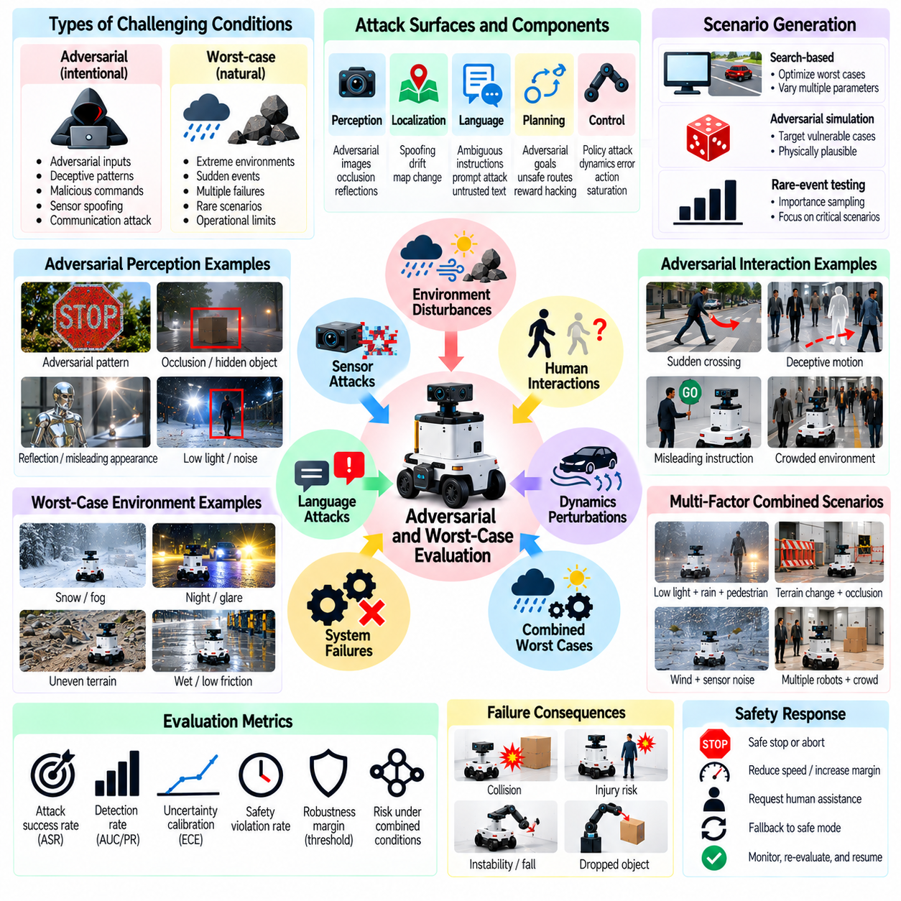{width="7.268055555555556in" height="7.268055555555556in"}

Adversarial and worst-case evaluation examines whether Physical AI systems remain safe when exposed to deliberately challenging inputs, extreme operating conditions, and combinations of failures. Conventional testing often emphasizes representative scenarios, but rare conditions can reveal critical weaknesses. Evaluation must identify how intelligent agents behave when perception, prediction, planning, and control are pushed toward their operational limits.

Adversarial conditions include intentionally constructed inputs or interactions that exploit weaknesses in learned models and control policies. Worst-case conditions may arise naturally without malicious intent, such as sudden obstacle appearance or unexpected loss of traction. Evaluation should distinguish these origins while examining their shared potential to produce hazardous actions, unreliable decisions, and violations of physical safety constraints.

A systematic evaluation begins with hazard analysis and the definition of credible threat scenarios. Relevant hazards include collisions, unstable motion, excessive contact forces, unintended manipulation, and failure to reach a safe state. Test designers should identify vulnerable components, plausible disturbances, and measurable safety consequences. Adversarial severity must be bounded by physically meaningful operating assumptions.

Adversarial perception testing investigates whether small or structured changes in sensor observations can produce dangerous interpretation errors. Visual patterns, unusual reflections, partial occlusions, and misleading object appearances may disrupt recognition or depth estimation. Evaluation should measure both model prediction changes and resulting robot behavior. A classification error becomes safety-critical when it causes an unsafe physical response.

Physical adversarial examples differ from purely digital perturbations because they must remain effective under real-world geometry, illumination, viewpoint, and motion. A pattern that disrupts a model in one image may fail under changing camera angles or distances. Testing should examine physical realizability, environmental variability, and persistence of effects. Digital attack success alone cannot establish real-world vulnerability.

Adversarial interactions may exploit the relationship between human behavior and autonomous robot policies. Unexpected pedestrian movements, deceptive motion patterns, and rapidly changing interaction cues can challenge intent prediction. Evaluation should examine whether the robot maintains safe separation and conservative behavior when human actions contradict learned expectations. Human safety must not depend on accurate intent prediction alone.

Language-conditioned robots introduce additional adversarial risks through ambiguous instructions, conflicting commands, and untrusted environmental text. Vision-language-action models may incorrectly treat observed text or contextual cues as authoritative instructions. Evaluation should test instruction prioritization, task boundaries, and resistance to unsafe behavioral redirection. Physical safety constraints must remain effective regardless of language-model outputs.

Worst-case scenario generation seeks combinations of environmental and operational factors that maximize safety risk within defined constraints. Variables may include robot speed, obstacle position, friction, sensor delay, and actuator response. Search-based optimization, adversarial simulation, and structured scenario exploration can identify critical cases. Generated scenarios must remain physically plausible and relevant to the intended operating domain.

Rare-event evaluation is important because catastrophic outcomes may occur too infrequently for ordinary random testing to discover. Importance sampling, adaptive stress testing, and targeted scenario search can concentrate trials on hazardous regions. Evaluation should document sampling assumptions and avoid treating biased stress-test frequencies as real-world incident probabilities. Statistical conclusions require careful interpretation.

Worst-case analysis should examine interactions among multiple disturbances rather than assuming independent effects. Reduced visibility combined with localization drift and delayed braking may create hazards absent from individual tests. Evaluation should identify correlated failures and cascading consequences across perception, planning, and actuation. Protective mechanisms must be assessed under combinations that challenge their common dependencies.

Adversarial attacks against learned control policies may exploit inaccuracies in dynamics models or reward functions. A policy can select actions that appear successful according to its internal model while violating physical constraints. Testing should examine repeated decision cycles, action saturation, unstable trajectories, and unintended contact. Independent safety monitoring is necessary when policy behavior becomes unpredictable.

Robustness margins describe how much disturbance a system can tolerate before performance or safety requirements are violated. Evaluation should vary perturbation magnitude, duration, timing, and frequency to identify critical thresholds. Safety margins may differ across robot speed, payload, terrain, and task phase. Reporting only whether an adversarial test succeeds or fails obscures important information about proximity to unsafe operation.

Adversarial evaluation must consider attacker capabilities and access assumptions when intentional threats are relevant. Threat models may distinguish sensor manipulation, communication interference, malicious instructions, and compromised data sources. Testing should remain consistent with plausible access and physical constraints. Unrealistic threat assumptions can distort priorities, while overly narrow assumptions may overlook consequential vulnerabilities.

Safety-critical scenario search should target transitions between acceptable operation and hazardous states. Near-collision events, balance instability, excessive force, and delayed emergency responses provide useful boundary cases. Evaluation should examine whether small additional disturbances cause abrupt safety degradation. These transition regions can reveal fragile assumptions that remain hidden in ordinary success-rate measurements.

Simulation enables extensive adversarial exploration without exposing people or equipment to uncontrolled hazards. Automated scenario generators can vary agent behavior, physical parameters, and sensor conditions across thousands of trials. However, simulated adversarial effects may exploit simulator artifacts rather than real system weaknesses. Candidate failures should be validated using independent models and controlled physical experiments.

Hardware-in-the-loop testing can reproduce adversarial timing, sensor anomalies, and control disturbances while preserving physical safeguards. Controlled laboratory experiments may then evaluate selected scenarios with real sensors and actuators. Test progression should use defined severity limits, emergency shutdown mechanisms, and independent supervision. Deliberately hazardous conditions must not be introduced without appropriate containment.

Evaluation metrics should reflect both adversarial effectiveness and physical safety outcomes. Relevant measures include collision frequency, minimum separation distance, safety-boundary violations, intervention latency, recovery success, and robustness margins. Detection accuracy alone is insufficient if protective action occurs too late. Results should distinguish adversarial success, model failure, and actual safety requirement violations.

Coverage assessment should document which attack classes, environmental extremes, system states, and failure combinations have been tested. Scenario diversity matters because repeated variants of one attack may provide limited evidence of general robustness. Evaluation should include unseen perturbations and independent test generation methods. Hidden evaluation scenarios can reduce overfitting to familiar adversarial benchmarks.

Protective responses must be evaluated when adversarial or worst-case conditions exceed validated operating limits. Appropriate actions may include speed reduction, increased clearance, restricted manipulation, emergency stopping, or transition to a minimum-risk state. Testing should verify that these responses remain effective despite degraded perception or control. Recovery must not resume unsafe operation before relevant conditions are reassessed.

Adversarial robustness should be reassessed after changes to models, sensors, controllers, or operating environments. Improvements against known attacks can introduce new weaknesses or reduce performance in ordinary conditions. Regression testing should compare safety outcomes across representative and worst-case scenarios. Field incidents, near misses, and newly discovered failure modes should inform subsequent evaluation campaigns.

Worst-case evaluation cannot establish absolute safety across every possible environment or attack. Physical systems operate in open-ended conditions, and exhaustive scenario coverage is generally infeasible. Assurance therefore depends on explicit assumptions, bounded operating domains, credible evidence, and independent protective mechanisms. Evaluation should communicate residual risks and uncertainty rather than claiming universal robustness.

Ultimately, adversarial and worst-case evaluation determines whether Physical AI systems preserve essential safety properties when confronted with severe, unfamiliar, or deliberately challenging conditions. Effective assessment combines threat modeling, hazard analysis, adversarial scenario generation, simulation, physical validation, and protective response testing. The objective is to expose critical weaknesses before deployment and establish defensible limits for safe autonomous operation.

적대적 및 최악 조건 평가(Adversarial and Worst-Case Evaluation)는 피지컬 인공지능 시스템(Physical AI System)이 의도적으로 구성된 도전적인 입력(Challenging Input), 극한 운영 조건(Extreme Operating Condition), 복합 고장(Combined Failure)에 노출되었을 때에도 안전성을 유지하는지를 검증한다. 기존 시험(Conventional Testing)은 대표적인 시나리오(Representative Scenario)에 집중하는 경우가 많지만, 드문 조건(Rare Condition)은 치명적인 취약성(Critical Weakness)을 드러낼 수 있다. 평가에서는 인지(Perception), 예측(Prediction), 계획(Planning), 제어(Control)가 운영 한계(Operational Limit)에 가까워질 때 지능형 에이전트(Intelligent Agent)가 어떻게 행동하는지 식별해야 한다.

적대적 조건(Adversarial Condition)에는 학습 모델(Learned Model)과 제어 정책(Control Policy)의 취약성을 악용하도록 의도적으로 구성된 입력(Input)이나 상호작용(Interaction)이 포함된다. 최악 조건(Worst-Case Condition)은 갑작스러운 장애물 출현(Sudden Obstacle Appearance)이나 예상하지 못한 접지력 손실(Unexpected Loss of Traction)처럼 악의적인 의도 없이 자연적으로 발생할 수도 있다. 평가에서는 이러한 발생 원인(Origin)을 구분하면서 위험한 행동(Hazardous Action), 신뢰할 수 없는 의사결정(Unreliable Decision), 물리적 안전 제약 조건 위반(Physical Safety Constraint Violation)을 유발할 수 있는 공통적인 가능성을 검증해야 한다.

체계적인 평가(Systematic Evaluation)는 위험 분석(Hazard Analysis)과 현실적으로 발생 가능한 위협 시나리오(Credible Threat Scenario)의 정의에서 시작한다. 관련 위험(Hazard)에는 충돌(Collision), 불안정한 움직임(Unstable Motion), 과도한 접촉력(Excessive Contact Force), 의도하지 않은 조작(Unintended Manipulation), 안전 상태 도달 실패(Failure to Reach a Safe State)가 포함된다. 시험 설계자(Test Designer)는 취약한 구성 요소(Vulnerable Component), 발생 가능한 외란(Plausible Disturbance), 측정 가능한 안전 결과(Measurable Safety Consequence)를 식별해야 한다. 적대적 조건의 심각도(Adversarial Severity)는 물리적으로 의미 있는 운영 가정(Physically Meaningful Operating Assumption)에 따라 제한되어야 한다.

적대적 인지 시험(Adversarial Perception Testing)은 센서 관측값(Sensor Observation)에 대한 작거나 구조화된 변화(Small or Structured Change)가 위험한 해석 오류(Dangerous Interpretation Error)를 발생시키는지 조사한다. 시각적 패턴(Visual Pattern), 비정상적인 반사(Unusual Reflection), 부분 가림(Partial Occlusion), 오해를 유발하는 객체 외형(Misleading Object Appearance)은 객체 인식(Recognition)이나 깊이 추정(Depth Estimation)을 방해할 수 있다. 평가에서는 모델 예측 변화(Model Prediction Change)와 그에 따른 로봇 행동(Robot Behavior)을 모두 측정해야 한다. 분류 오류(Classification Error)가 불안전한 물리적 응답(Unsafe Physical Response)을 유발하면 안전 필수 문제(Safety-Critical Problem)가 된다.

물리적 적대적 사례(Physical Adversarial Example)는 실제 환경의 기하학적 구조(Real-World Geometry), 조명(Illumination), 관측 시점(Viewpoint), 움직임(Motion) 속에서도 효과가 유지되어야 한다는 점에서 순수한 디지털 교란(Digital Perturbation)과 다르다. 특정 이미지에서 모델을 교란하는 패턴(Pattern)은 카메라 각도(Camera Angle)나 거리(Distance)가 변하면 효과를 잃을 수 있다. 시험에서는 물리적 실현 가능성(Physical Realizability), 환경 변동성(Environmental Variability), 효과의 지속성(Persistence of Effects)을 검증해야 한다. 디지털 공격 성공(Digital Attack Success)만으로는 실제 환경의 취약성(Real-World Vulnerability)을 입증할 수 없다.

적대적 상호작용(Adversarial Interaction)은 인간 행동(Human Behavior)과 자율 로봇 정책(Autonomous Robot Policy) 사이의 관계를 악용할 수 있다. 예상하지 못한 보행자 움직임(Unexpected Pedestrian Movement), 기만적인 움직임 패턴(Deceptive Motion Pattern), 급격하게 변화하는 상호작용 단서(Rapidly Changing Interaction Cue)는 의도 예측(Intent Prediction)을 어렵게 만들 수 있다. 평가에서는 인간 행동(Human Action)이 학습된 예상(Learned Expectation)과 다를 때에도 로봇이 안전 이격 거리(Safe Separation)와 보수적인 행동(Conservative Behavior)을 유지하는지 검증해야 한다. 인간 안전(Human Safety)이 정확한 의도 예측(Accurate Intent Prediction)에만 의존해서는 안 된다.

언어 조건부 로봇(Language-Conditioned Robot)은 모호한 명령(Ambiguous Instruction), 충돌하는 명령(Conflicting Command), 신뢰할 수 없는 환경 텍스트(Untrusted Environmental Text)를 통해 추가적인 적대적 위험(Adversarial Risk)에 노출된다. 비전-언어-행동 모델(Vision-Language-Action Model, VLA)은 관측된 텍스트(Observed Text)나 맥락적 단서(Contextual Cue)를 권한 있는 명령(Authoritative Instruction)으로 잘못 해석할 수 있다. 평가에서는 명령 우선순위(Instruction Prioritization), 작업 경계(Task Boundary), 불안전한 행동 유도(Unsafe Behavioral Redirection)에 대한 저항성을 시험해야 한다. 물리적 안전 제약 조건(Physical Safety Constraint)은 언어 모델 출력(Language-Model Output)과 관계없이 효과적으로 유지되어야 한다.

최악 조건 시나리오 생성(Worst-Case Scenario Generation)은 정의된 제약 조건(Defined Constraint) 내에서 안전 위험(Safety Risk)을 극대화하는 환경적 및 운영적 요인(Environmental and Operational Factor)의 조합을 탐색한다. 변수(Variable)에는 로봇 속도(Robot Speed), 장애물 위치(Obstacle Position), 마찰(Friction), 센서 지연(Sensor Delay), 구동기 응답(Actuator Response)이 포함될 수 있다. 탐색 기반 최적화(Search-Based Optimization), 적대적 시뮬레이션(Adversarial Simulation), 구조화된 시나리오 탐색(Structured Scenario Exploration)은 중요한 사례(Critical Case)를 식별할 수 있다. 생성된 시나리오(Generated Scenario)는 물리적으로 타당하며 의도된 운영 영역(Intended Operating Domain)과 관련성이 있어야 한다.

희귀 사건 평가(Rare-Event Evaluation)는 치명적인 결과(Catastrophic Outcome)가 일반적인 무작위 시험(Random Testing)으로 발견하기 어려울 만큼 낮은 빈도로 발생할 수 있기 때문에 중요하다. 중요도 샘플링(Importance Sampling), 적응형 스트레스 시험(Adaptive Stress Testing), 표적 시나리오 탐색(Targeted Scenario Search)은 위험한 영역(Hazardous Region)에 시험을 집중할 수 있다. 평가에서는 샘플링 가정(Sampling Assumption)을 문서화하고 편향된 스트레스 시험 빈도(Biased Stress-Test Frequency)를 실제 환경의 사고 확률(Real-World Incident Probability)로 취급하지 않아야 한다. 통계적 결론(Statistical Conclusion)은 신중하게 해석해야 한다.

최악 조건 분석(Worst-Case Analysis)은 여러 외란(Multiple Disturbance)의 영향을 독립적이라고 가정하지 않고 상호작용을 검증해야 한다. 가시성 감소(Reduced Visibility)에 위치 추정 드리프트(Localization Drift)와 제동 지연(Delayed Braking)이 결합되면 개별 시험(Isolated Test)에서는 나타나지 않는 위험이 발생할 수 있다. 평가에서는 인지(Perception), 계획(Planning), 구동(Actuation) 전반에 걸친 상관된 고장(Correlated Failure)과 연쇄적 결과(Cascading Consequence)를 식별해야 한다. 보호 메커니즘(Protective Mechanism)은 공통 의존성(Common Dependency)에 부담을 주는 복합 조건에서 평가되어야 한다.

학습된 제어 정책(Learned Control Policy)에 대한 적대적 공격(Adversarial Attack)은 동역학 모델(Dynamics Model)이나 보상 함수(Reward Function)의 부정확성을 악용할 수 있다. 정책(Policy)은 내부 모델(Internal Model)에 따르면 성공적으로 보이지만 실제 물리적 제약 조건(Physical Constraint)을 위반하는 행동을 선택할 수 있다. 시험에서는 반복적인 의사결정 주기(Repeated Decision Cycle), 행동 포화(Action Saturation), 불안정한 궤적(Unstable Trajectory), 의도하지 않은 접촉(Unintended Contact)을 검증해야 한다. 정책 행동(Policy Behavior)이 예측하기 어려워질 때에는 독립적인 안전 감시(Independent Safety Monitoring)가 필요하다.

강건성 여유(Robustness Margin)는 성능 요구사항(Performance Requirement)이나 안전 요구사항(Safety Requirement)이 위반되기 전에 시스템이 견딜 수 있는 외란(Disturbance)의 크기를 나타낸다. 평가에서는 교란 크기(Perturbation Magnitude), 지속 시간(Duration), 발생 시점(Timing), 빈도(Frequency)를 변화시켜 중요한 임계값(Critical Threshold)을 식별해야 한다. 안전 여유(Safety Margin)는 로봇 속도(Robot Speed), 적재물(Payload), 지형(Terrain), 작업 단계(Task Phase)에 따라 달라질 수 있다. 적대적 시험(Adversarial Test)의 성공 또는 실패 여부만 보고하면 불안전한 운영(Unsafe Operation)에 얼마나 가까운지에 대한 중요한 정보가 드러나지 않는다.

적대적 평가(Adversarial Evaluation)는 의도적인 위협(Intentional Threat)이 관련되는 경우 공격자의 능력(Attacker Capability)과 접근 권한 가정(Access Assumption)을 고려해야 한다. 위협 모델(Threat Model)은 센서 조작(Sensor Manipulation), 통신 간섭(Communication Interference), 악의적인 명령(Malicious Instruction), 손상된 데이터 소스(Compromised Data Source)를 구분할 수 있다. 시험은 현실적으로 가능한 접근 권한(Plausible Access)과 물리적 제약 조건(Physical Constraint)에 부합해야 한다. 비현실적인 위협 가정(Unrealistic Threat Assumption)은 우선순위(Priority)를 왜곡할 수 있으며, 지나치게 좁은 가정(Overly Narrow Assumption)은 중대한 취약성(Consequential Vulnerability)을 놓칠 수 있다.

안전 필수 시나리오 탐색(Safety-Critical Scenario Search)은 허용 가능한 운영(Acceptable Operation)과 위험 상태(Hazardous State) 사이의 전환(Transition)을 대상으로 해야 한다. 충돌 직전 사건(Near-Collision Event), 균형 불안정성(Balance Instability), 과도한 힘(Excessive Force), 지연된 비상 대응(Delayed Emergency Response)은 유용한 경계 사례(Boundary Case)를 제공한다. 평가에서는 작은 추가 외란(Additional Disturbance)이 급격한 안전 성능 저하(Abrupt Safety Degradation)를 발생시키는지 검증해야 한다. 이러한 전환 영역(Transition Region)은 일반적인 성공률 측정(Success-Rate Measurement)에서는 드러나지 않는 취약한 가정(Fragile Assumption)을 밝혀낼 수 있다.

시뮬레이션(Simulation)은 사람이나 장비를 통제되지 않은 위험(Uncontrolled Hazard)에 노출하지 않으면서 광범위한 적대적 탐색(Adversarial Exploration)을 가능하게 한다. 자동화된 시나리오 생성기(Automated Scenario Generator)는 수천 번의 시험에서 에이전트 행동(Agent Behavior), 물리적 매개변수(Physical Parameter), 센서 조건(Sensor Condition)을 변화시킬 수 있다. 그러나 시뮬레이션된 적대적 효과(Simulated Adversarial Effect)는 실제 시스템 취약성(Real System Weakness)이 아니라 시뮬레이터 아티팩트(Simulator Artifact)를 악용할 수 있다. 발견된 고장 후보(Candidate Failure)는 독립적인 모델(Independent Model)과 통제된 물리적 실험(Controlled Physical Experiment)을 통해 검증해야 한다.

하드웨어 인 더 루프 시험(Hardware-in-the-Loop Testing, HIL)은 물리적 안전장치(Physical Safeguard)를 유지하면서 적대적 시간 조건(Adversarial Timing), 센서 이상(Sensor Anomaly), 제어 외란(Control Disturbance)을 재현할 수 있다. 이후 통제된 실험실 실험(Controlled Laboratory Experiment)을 통해 실제 센서(Real Sensor)와 구동기(Actuator)를 사용하여 선택된 시나리오를 평가할 수 있다. 시험 진행(Test Progression)에는 정의된 심각도 한계(Severity Limit), 비상 정지 메커니즘(Emergency Shutdown Mechanism), 독립적인 감독(Independent Supervision)이 적용되어야 한다. 의도적으로 위험한 조건(Deliberately Hazardous Condition)은 적절한 위험 격리 조치(Appropriate Containment) 없이 도입해서는 안 된다.

평가 지표(Evaluation Metric)는 적대적 공격 효과(Adversarial Effectiveness)와 물리적 안전 결과(Physical Safety Outcome)를 모두 반영해야 한다. 관련 측정값에는 충돌 빈도(Collision Frequency), 최소 이격 거리(Minimum Separation Distance), 안전 경계 위반(Safety-Boundary Violation), 개입 지연 시간(Intervention Latency), 복구 성공률(Recovery Success), 강건성 여유(Robustness Margin)가 포함된다. 보호 행동(Protective Action)이 너무 늦게 실행된다면 탐지 정확도(Detection Accuracy)만으로는 충분하지 않다. 결과에서는 적대적 공격 성공(Adversarial Success), 모델 실패(Model Failure), 실제 안전 요구사항 위반(Actual Safety Requirement Violation)을 구분해야 한다.

적용 범위 평가(Coverage Assessment)에서는 시험된 공격 유형(Attack Class), 환경적 극한 조건(Environmental Extreme), 시스템 상태(System State), 고장 조합(Failure Combination)을 문서화해야 한다. 하나의 공격(Attack)에 대한 반복적인 변형은 일반적인 강건성(General Robustness)에 관한 제한적인 근거만 제공할 수 있으므로 시나리오 다양성(Scenario Diversity)이 중요하다. 평가에는 이전에 관측되지 않은 교란(Unseen Perturbation)과 독립적인 시험 생성 방법(Independent Test Generation Method)이 포함되어야 한다. 비공개 평가 시나리오(Hidden Evaluation Scenario)는 익숙한 적대적 벤치마크(Adversarial Benchmark)에 대한 과적합(Overfitting)을 줄일 수 있다.

적대적 조건(Adversarial Condition)이나 최악 조건(Worst-Case Condition)이 검증된 운영 한계(Validated Operating Limit)를 초과할 때에는 보호 응답(Protective Response)을 평가해야 한다. 적절한 행동에는 속도 감소(Speed Reduction), 이격 거리 증가(Increased Clearance), 조작 제한(Restricted Manipulation), 비상 정지(Emergency Stopping), 최소 위험 상태(Minimum-Risk State)로의 전환이 포함될 수 있다. 시험에서는 인지(Perception)나 제어(Control)의 성능이 저하된 상황에서도 이러한 응답이 효과적으로 유지되는지 검증해야 한다. 복구(Recovery) 과정에서는 관련 조건을 재평가하기 전에 불안전한 운영(Unsafe Operation)을 재개해서는 안 된다.

적대적 강건성(Adversarial Robustness)은 모델(Model), 센서(Sensor), 제어기(Controller), 운영 환경(Operating Environment)이 변경된 이후 다시 평가해야 한다. 알려진 공격(Known Attack)에 대한 개선은 새로운 취약성(New Weakness)을 도입하거나 일반적인 조건(Ordinary Condition)에서 성능을 저하시킬 수 있다. 회귀 시험(Regression Testing)은 대표적인 시나리오(Representative Scenario)와 최악 조건 시나리오(Worst-Case Scenario) 전반에서 안전 결과(Safety Outcome)를 비교해야 한다. 현장 사고(Field Incident), 아차 사고(Near Miss), 새롭게 발견된 고장 유형(Newly Discovered Failure Mode)은 후속 평가 활동(Subsequent Evaluation Campaign)에 반영되어야 한다.

최악 조건 평가(Worst-Case Evaluation)는 가능한 모든 환경(Environment)이나 공격(Attack)에 대한 절대적인 안전성(Absolute Safety)을 입증할 수 없다. 물리적 시스템(Physical System)은 개방형 조건(Open-Ended Condition)에서 운영되며, 모든 시나리오를 빠짐없이 시험하는 포괄적 시나리오 적용 범위(Exhaustive Scenario Coverage)는 일반적으로 실현하기 어렵다. 따라서 안전 보증(Safety Assurance)은 명시적인 가정(Explicit Assumption), 제한된 운영 영역(Bounded Operating Domain), 신뢰할 수 있는 근거(Credible Evidence), 독립적인 보호 메커니즘(Independent Protective Mechanism)에 의존한다. 평가에서는 보편적인 강건성(Universal Robustness)을 주장하기보다 잔여 위험(Residual Risk)과 불확실성(Uncertainty)을 명확하게 전달해야 한다.

궁극적으로 적대적 및 최악 조건 평가(Adversarial and Worst-Case Evaluation)는 피지컬 인공지능 시스템(Physical AI System)이 심각하거나 익숙하지 않거나 의도적으로 도전적인 조건(Severe, Unfamiliar, or Deliberately Challenging Condition)에 직면했을 때 필수 안전 속성(Essential Safety Property)을 유지하는지를 판단한다. 효과적인 평가(Effective Assessment)는 위협 모델링(Threat Modeling), 위험 분석(Hazard Analysis), 적대적 시나리오 생성(Adversarial Scenario Generation), 시뮬레이션(Simulation), 물리적 검증(Physical Validation), 보호 응답 시험(Protective Response Testing)을 통합한다. 목표는 배포(Deployment) 이전에 치명적인 취약성(Critical Weakness)을 발견하고 안전한 자율 운영(Safe Autonomous Operation)을 위한 합리적으로 입증 가능한 한계(Defensible Limit)를 확립하는 것이다.

##  

## 05.14. Fallback Recovery and Minimum Risk Behavior

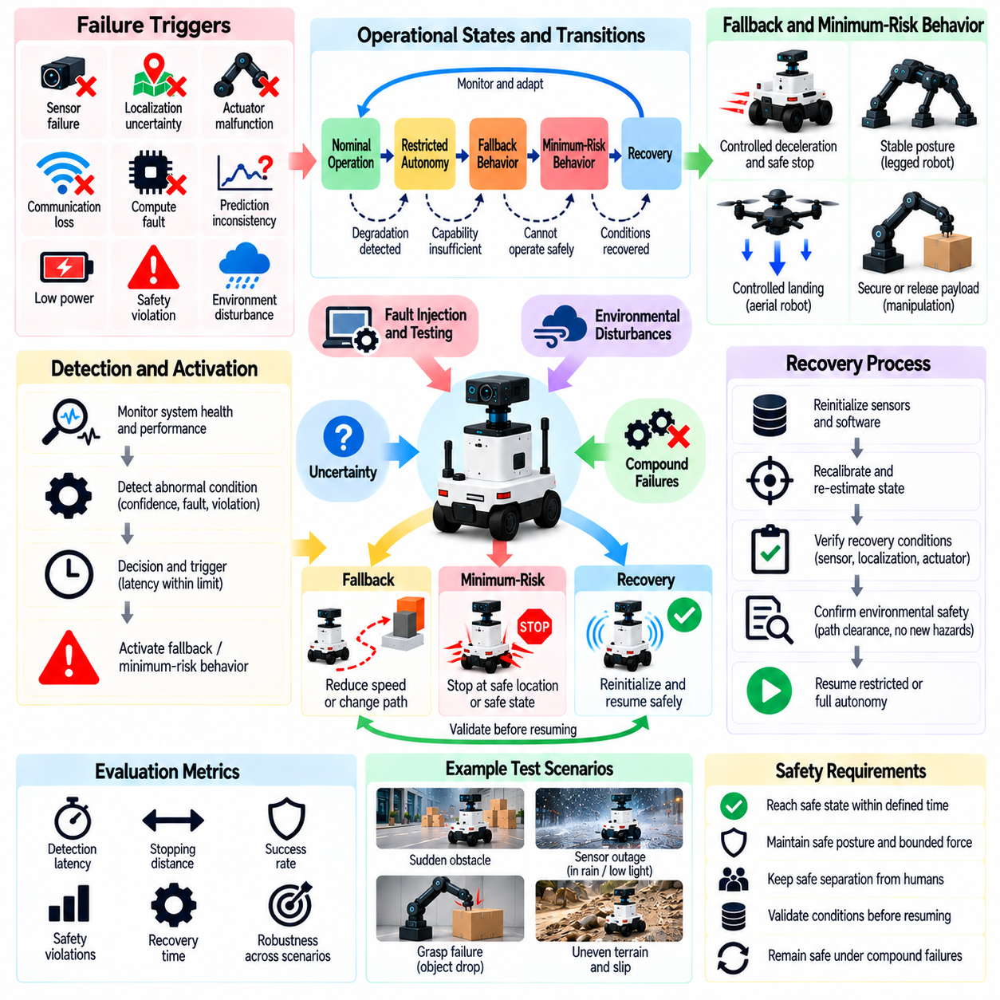{width="7.268055555555556in" height="7.268055555555556in"}

Fallback, recovery, and minimum-risk behavior evaluation examines whether Physical AI systems can preserve safety when normal autonomous operation becomes unreliable or impossible. Robots may encounter sensor failures, control instability, unexpected obstacles, or computational faults that invalidate their planned actions. Evaluation must determine whether the system recognizes these conditions and transitions to protective behavior before hazardous consequences occur.

Fallback behavior refers to predefined actions that replace normal operation when system capability becomes insufficient. Recovery behavior attempts to restore acceptable functionality after a disturbance or failure. Minimum-risk behavior seeks to reduce physical danger when continued operation cannot be justified. These mechanisms serve different purposes, and evaluation must verify that each is activated under appropriate conditions.

A systematic evaluation begins by defining the operational states and transitions associated with degraded performance. States may include nominal operation, restricted autonomy, controlled fallback, minimum-risk operation, and recovery. Each transition should have explicit triggering conditions, safety requirements, and completion criteria. Testing should determine whether the system follows valid transitions without entering uncontrolled or ambiguous states.

Fallback triggers may include sensor confidence loss, localization uncertainty, actuator malfunction, communication interruption, or prediction inconsistency. Trigger thresholds should reflect the severity of possible consequences and the time available for intervention. Evaluation must measure detection accuracy, activation latency, and the relationship between fault progression and protective response. Delayed triggering can eliminate the opportunity for safe intervention.

Minimum-risk behavior depends on robot morphology, environment, and task context. A wheeled robot may stop in a safe location, while a legged robot may adopt a stable posture. Aerial systems may require controlled landing, and manipulators may need to secure or release payloads according to hazard conditions. Evaluation should avoid assuming that immediate stopping is always the safest possible response.

Minimum-risk states should be defined through measurable physical safety properties rather than abstract labels. Relevant properties include stable posture, bounded velocity, controlled contact force, safe separation, and secure energy isolation. A state that is safe for one environment may be hazardous in another. Testing must examine whether the selected state minimizes foreseeable risk under actual operating conditions.

Controlled deceleration is a common fallback response, but its effectiveness depends on available traction, braking capability, and surrounding obstacles. Abrupt stopping may destabilize mobile robots or create dangerous payload motion. Evaluation should measure stopping distance, deceleration profiles, stability margins, and collision exposure. Protective motion must remain feasible under degraded sensing and actuation conditions.

Manipulation fallback requires special consideration because objects may remain suspended, grasped, or in contact with people and equipment. Sudden actuator shutdown can release loads or generate uncontrolled motion. Testing should examine holding capability, compliant withdrawal, controlled placement, and emergency release strategies. The safest response depends on object properties, contact geometry, and the consequences of continued force application.

Recovery mechanisms attempt to restore safe operation after disturbances such as localization loss, temporary sensor degradation, or recoverable control faults. Recovery may involve reinitialization, recalibration, state reestimation, or replanning. Evaluation should verify that recovery procedures do not introduce additional hazards. A system must not resume unrestricted autonomy merely because an error indicator disappears.

Recovery readiness should be established through explicit validation conditions. Sensor availability, state estimation confidence, actuator health, and environmental clearance may need confirmation before normal operation resumes. Testing should evaluate whether these conditions are independently checked and whether residual faults remain detectable. Premature recovery can reproduce the original hazard or introduce new failure sequences.

Fallback and recovery policies must account for uncertainty about the underlying failure. A robot may detect inconsistent observations without knowing whether the cause is sensor damage, environmental interference, or model mismatch. Evaluation should determine whether protective behavior remains appropriate under diagnostic ambiguity. Safety must not depend on perfectly identifying the failure mechanism before responding.

Timing is critical because protective actions must occur within the interval available before a hazard becomes unavoidable. Evaluation should measure fault detection time, decision latency, actuator response, and total transition duration. These measurements should be compared with task-specific safety deadlines. A correct fallback decision that arrives after the available intervention window cannot provide effective protection.

Fault injection provides a systematic method for testing fallback and recovery behavior. Experiments may introduce sensor outages, corrupted state estimates, actuator saturation, delayed control commands, or intermittent communication. Fault severity, duration, and occurrence timing should be varied. Testing must determine whether protective transitions remain reliable across different operating phases and disturbance combinations.

Compound failures can compromise both normal operation and the mechanisms intended to protect it. For example, localization loss combined with braking degradation may prevent a robot from reaching its preferred stopping location. Evaluation should examine shared dependencies, redundant capabilities, and alternative minimum-risk responses. Protective architectures must not rely entirely on components likely to fail together.

Human intervention may form part of fallback or recovery, but its availability cannot always be assumed. Remote operators may experience communication delays, incomplete situational awareness, or limited control authority. Evaluation should measure handover timing, operator workload, and the robot\'s ability to remain safe while assistance is unavailable. Human supervision should supplement rather than replace essential autonomous safeguards.

Runtime monitoring and safety supervision can coordinate transitions between nominal, degraded, and minimum-risk operation. Independent monitors may enforce motion limits, validate control commands, or override unsafe policies. Evaluation should test whether supervisory authority remains effective when primary AI components malfunction. Conflicting commands and unstable switching between control modes must be identified and prevented.

Repeated transitions can create additional hazards when a robot alternates rapidly between normal and fallback operation. Such oscillation may arise from noisy sensor confidence, unstable thresholds, or intermittent faults. Testing should examine transition hysteresis, minimum dwell times, and state consistency. Recovery logic should prevent repeated activation cycles from producing unpredictable movement or excessive mechanical stress.

Environmental and task conditions strongly influence fallback effectiveness. Narrow corridors, slopes, crowded workspaces, moving platforms, and unstable payloads may restrict available protective actions. Evaluation should include scenarios where the preferred minimum-risk state cannot be reached directly. The system must select feasible alternatives while respecting physical constraints and prioritizing human safety.

Quantitative metrics should connect protective decisions with actual safety outcomes. Relevant measures include fallback activation latency, transition success rate, minimum-risk state attainment, residual collision risk, recovery time, and unsafe restart frequency. Results should be reported across fault severity and operating context. Successful activation alone is insufficient if the resulting physical state remains hazardous.

Simulation enables broad exploration of fallback strategies and rare failure combinations before physical testing. Hardware-in-the-loop experiments can then validate timing and supervisory interactions, while controlled robot trials assess actual motion and contact behavior. Evaluation should progress from low-risk conditions toward more demanding scenarios. Independent emergency safeguards must remain available throughout testing.

Regression testing is necessary because changes to models, controllers, sensors, or recovery logic can alter protective behavior. Previously successful fallback transitions may become unreliable after software updates or hardware modifications. Versioned fault scenarios and repeatable acceptance criteria support ongoing verification. Field incidents and near misses should inform revisions to minimum-risk behavior requirements.

Ultimately, fallback, recovery, and minimum-risk behavior evaluation determines whether Physical AI systems can respond safely when their normal capabilities are degraded or lost. Effective assessment integrates state-transition verification, fault injection, timing analysis, physical outcome measurement, and recovery validation. The objective is to maintain defensible safety boundaries even when autonomous task completion must be interrupted or abandoned.

대체 동작, 복구 및 최소 위험 행동 평가(Fallback, Recovery, and Minimum-Risk Behavior Evaluation)는 정상적인 자율 운영(Normal Autonomous Operation)이 신뢰할 수 없거나 불가능해졌을 때 피지컬 인공지능 시스템(Physical AI System)이 안전성을 유지할 수 있는지를 검증한다. 로봇은 센서 고장(Sensor Failure), 제어 불안정성(Control Instability), 예상하지 못한 장애물(Unexpected Obstacle), 컴퓨팅 오류(Computational Fault)로 인해 계획된 행동(Planned Action)을 수행할 수 없는 상황에 직면할 수 있다. 평가에서는 시스템이 이러한 조건을 인식하고 위험한 결과(Hazardous Consequence)가 발생하기 전에 보호 행동(Protective Behavior)으로 전환하는지 판단해야 한다.

대체 동작(Fallback Behavior)은 시스템 능력(System Capability)이 불충분해졌을 때 정상 운영(Normal Operation)을 대신하는 사전 정의된 행동(Predefined Action)을 의미한다. 복구 행동(Recovery Behavior)은 외란(Disturbance)이나 고장(Failure) 이후 허용 가능한 기능(Acceptable Functionality)을 회복하려는 동작이다. 최소 위험 행동(Minimum-Risk Behavior)은 지속적인 운영(Continued Operation)을 정당화할 수 없을 때 물리적 위험(Physical Danger)을 줄이는 것을 목표로 한다. 이러한 메커니즘은 서로 다른 목적을 가지며, 평가에서는 각각이 적절한 조건에서 활성화되는지 검증해야 한다.

체계적인 평가(Systematic Evaluation)는 성능 저하(Degraded Performance)와 관련된 운영 상태(Operational State) 및 상태 전이(State Transition)를 정의하는 것에서 시작한다. 상태에는 정상 운영(Nominal Operation), 제한된 자율성(Restricted Autonomy), 통제된 대체 동작(Controlled Fallback), 최소 위험 운영(Minimum-Risk Operation), 복구(Recovery)가 포함될 수 있다. 각 전이에는 명시적인 발동 조건(Triggering Condition), 안전 요구사항(Safety Requirement), 완료 기준(Completion Criteria)이 있어야 한다. 시험에서는 시스템이 통제되지 않거나 모호한 상태(Uncontrolled or Ambiguous State)에 진입하지 않고 유효한 상태 전이(Valid Transition)를 수행하는지 판단해야 한다.

대체 동작 발동 조건(Fallback Trigger)에는 센서 신뢰도 손실(Sensor Confidence Loss), 위치 추정 불확실성(Localization Uncertainty), 구동기 오작동(Actuator Malfunction), 통신 중단(Communication Interruption), 예측 불일치(Prediction Inconsistency)가 포함될 수 있다. 발동 임계값(Trigger Threshold)은 발생 가능한 결과의 심각도(Consequence Severity)와 개입에 사용할 수 있는 시간(Available Intervention Time)을 반영해야 한다. 평가에서는 탐지 정확도(Detection Accuracy), 활성화 지연 시간(Activation Latency), 고장 진행(Fault Progression)과 보호 응답(Protective Response) 사이의 관계를 측정해야 한다. 발동이 지연되면 안전한 개입(Safe Intervention)의 기회를 잃을 수 있다.

최소 위험 행동(Minimum-Risk Behavior)은 로봇 형태(Robot Morphology), 환경(Environment), 작업 맥락(Task Context)에 따라 달라진다. 바퀴형 로봇(Wheeled Robot)은 안전한 위치에서 정지할 수 있으며, 다족 보행 로봇(Legged Robot)은 안정적인 자세(Stable Posture)를 취할 수 있다. 비행 시스템(Aerial System)은 제어된 착륙(Controlled Landing)이 필요할 수 있으며, 매니퓰레이터(Manipulator)는 위험 조건(Hazard Condition)에 따라 적재물(Payload)을 안전하게 고정하거나 해제해야 할 수 있다. 평가에서는 즉각적인 정지(Immediate Stopping)가 항상 가장 안전한 대응이라고 가정해서는 안 된다.

최소 위험 상태(Minimum-Risk State)는 추상적인 명칭(Abstract Label)이 아니라 측정 가능한 물리적 안전 속성(Measurable Physical Safety Property)을 통해 정의해야 한다. 관련 속성에는 안정적인 자세(Stable Posture), 제한된 속도(Bounded Velocity), 제어된 접촉력(Controlled Contact Force), 안전 이격 거리(Safe Separation), 안전한 에너지 격리(Secure Energy Isolation)가 포함된다. 특정 환경에서 안전한 상태(Safe State)가 다른 환경에서는 위험할 수 있다. 시험에서는 선택된 상태가 실제 운영 조건(Actual Operating Condition)에서 예측 가능한 위험(Foreseeable Risk)을 최소화하는지 검증해야 한다.

제어된 감속(Controlled Deceleration)은 일반적인 대체 동작 응답(Fallback Response)이지만, 그 효과는 사용 가능한 접지력(Available Traction), 제동 능력(Braking Capability), 주변 장애물(Surrounding Obstacle)에 따라 달라진다. 급격한 정지(Abrupt Stopping)는 이동 로봇(Mobile Robot)을 불안정하게 만들거나 위험한 적재물 움직임(Dangerous Payload Motion)을 발생시킬 수 있다. 평가에서는 정지 거리(Stopping Distance), 감속 프로파일(Deceleration Profile), 안정성 여유(Stability Margin), 충돌 노출 위험(Collision Exposure)을 측정해야 한다. 보호 동작(Protective Motion)은 센싱(Sensing)과 구동(Actuation) 성능이 저하된 조건에서도 실행 가능해야 한다.

조작 대체 동작(Manipulation Fallback)은 객체(Object)가 공중에 매달려 있거나 파지된 상태이거나 사람 및 장비와 접촉하고 있을 수 있기 때문에 특별한 고려가 필요하다. 갑작스러운 구동기 종료(Sudden Actuator Shutdown)는 하중을 떨어뜨리거나 통제되지 않은 움직임(Uncontrolled Motion)을 발생시킬 수 있다. 시험에서는 유지 능력(Holding Capability), 순응적 후퇴(Compliant Withdrawal), 제어된 배치(Controlled Placement), 비상 해제 전략(Emergency Release Strategy)을 검증해야 한다. 가장 안전한 대응(Safest Response)은 객체 특성(Object Property), 접촉 기하학(Contact Geometry), 지속적인 힘 적용(Continued Force Application)의 결과에 따라 달라진다.

복구 메커니즘(Recovery Mechanism)은 위치 추정 손실(Localization Loss), 일시적인 센서 성능 저하(Temporary Sensor Degradation), 복구 가능한 제어 고장(Recoverable Control Fault)과 같은 외란 이후 안전한 운영(Safe Operation)을 회복하려고 한다. 복구에는 재초기화(Reinitialization), 재보정(Recalibration), 상태 재추정(State Reestimation), 재계획(Replanning)이 포함될 수 있다. 평가에서는 복구 절차(Recovery Procedure)가 추가적인 위험(Additional Hazard)을 발생시키지 않는지 검증해야 한다. 시스템은 오류 표시(Error Indicator)가 사라졌다는 이유만으로 제한 없는 자율성(Unrestricted Autonomy)을 재개해서는 안 된다.

복구 준비 상태(Recovery Readiness)는 명시적인 검증 조건(Explicit Validation Condition)을 통해 확인되어야 한다. 정상 운영(Normal Operation)을 재개하기 전에 센서 가용성(Sensor Availability), 상태 추정 신뢰도(State Estimation Confidence), 구동기 건전성(Actuator Health), 주변 환경의 안전 공간(Environmental Clearance)을 확인해야 할 수 있다. 시험에서는 이러한 조건이 독립적으로 확인되는지, 그리고 잔여 고장(Residual Fault)을 계속 탐지할 수 있는지 평가해야 한다. 성급한 복구(Premature Recovery)는 기존 위험(Original Hazard)을 재발시키거나 새로운 고장 연쇄(New Failure Sequence)를 발생시킬 수 있다.

대체 동작 및 복구 정책(Fallback and Recovery Policy)은 근본적인 고장 원인(Underlying Failure)에 대한 불확실성(Uncertainty)을 고려해야 한다. 로봇은 관측값 불일치(Inconsistent Observation)를 감지하더라도 그 원인이 센서 손상(Sensor Damage), 환경 간섭(Environmental Interference), 모델 불일치(Model Mismatch) 중 무엇인지 알지 못할 수 있다. 평가에서는 진단적 모호성(Diagnostic Ambiguity)이 존재하는 상황에서도 보호 행동(Protective Behavior)이 적절하게 유지되는지 판단해야 한다. 안전성은 대응하기 전에 고장 메커니즘(Failure Mechanism)을 완벽하게 식별하는 능력에 의존해서는 안 된다.

시간적 대응(Timing)은 위험을 피할 수 없게 되기 전에 보호 행동(Protective Action)이 실행되어야 하므로 매우 중요하다. 평가에서는 고장 탐지 시간(Fault Detection Time), 의사결정 지연 시간(Decision Latency), 구동기 응답(Actuator Response), 전체 전환 소요 시간(Total Transition Duration)을 측정해야 한다. 이러한 측정값은 작업별 안전 시간 한계(Task-Specific Safety Deadline)와 비교해야 한다. 올바른 대체 동작 결정(Correct Fallback Decision)이라도 개입 가능한 시간 범위(Available Intervention Window)가 지난 후에 내려진다면 효과적인 보호를 제공할 수 없다.

고장 주입(Fault Injection)은 대체 동작 및 복구 행동(Fallback and Recovery Behavior)을 체계적으로 시험하는 방법을 제공한다. 실험에서는 센서 중단(Sensor Outage), 손상된 상태 추정값(Corrupted State Estimate), 구동기 포화(Actuator Saturation), 지연된 제어 명령(Delayed Control Command), 간헐적인 통신(Intermittent Communication)을 도입할 수 있다. 고장 심각도(Fault Severity), 지속 시간(Duration), 발생 시점(Occurrence Timing)을 변화시켜야 한다. 시험에서는 다양한 운영 단계(Operating Phase)와 외란 조합(Disturbance Combination)에서 보호 상태 전이(Protective Transition)가 신뢰성 있게 유지되는지 판단해야 한다.

복합 고장(Compound Failure)은 정상 운영(Normal Operation)과 이를 보호하기 위한 메커니즘(Protective Mechanism)을 동시에 손상시킬 수 있다. 예를 들어 위치 추정 손실(Localization Loss)과 제동 성능 저하(Braking Degradation)가 결합되면 로봇이 의도한 정지 위치(Preferred Stopping Location)에 도달하지 못할 수 있다. 평가에서는 공통 의존성(Shared Dependency), 중복 능력(Redundant Capability), 대안적인 최소 위험 대응(Alternative Minimum-Risk Response)을 검증해야 한다. 보호 아키텍처(Protective Architecture)는 함께 고장 날 가능성이 높은 구성 요소(Component)에 전적으로 의존해서는 안 된다.

인간 개입(Human Intervention)은 대체 동작(Fallback)이나 복구(Recovery)의 일부가 될 수 있지만, 항상 이용 가능하다고 가정할 수는 없다. 원격 운영자(Remote Operator)는 통신 지연(Communication Delay), 불완전한 상황 인식(Incomplete Situational Awareness), 제한된 제어 권한(Limited Control Authority)을 경험할 수 있다. 평가에서는 제어권 이양 시간(Handover Timing), 운영자 작업 부하(Operator Workload), 지원을 받을 수 없는 동안 로봇이 안전을 유지하는 능력을 측정해야 한다. 인간 감독(Human Supervision)은 필수적인 자율 안전장치(Essential Autonomous Safeguard)를 대체하는 것이 아니라 보완해야 한다.

실행시간 감시(Runtime Monitoring)와 안전 감독(Safety Supervision)은 정상 운영(Nominal Operation), 성능 저하 운영(Degraded Operation), 최소 위험 운영(Minimum-Risk Operation) 사이의 전환을 조정할 수 있다. 독립적인 감시기(Independent Monitor)는 동작 제한(Motion Limit)을 강제하거나 제어 명령(Control Command)을 검증하거나 불안전한 정책(Unsafe Policy)을 무효화할 수 있다. 평가에서는 주요 인공지능 구성 요소(Primary AI Component)가 오작동할 때에도 감독 권한(Supervisory Authority)이 효과적으로 유지되는지 시험해야 한다. 충돌하는 명령(Conflicting Command)과 제어 모드(Control Mode) 사이의 불안정한 전환(Unstable Switching)을 식별하고 방지해야 한다.

반복적인 상태 전이(Repeated Transition)는 로봇이 정상 운영(Normal Operation)과 대체 동작(Fallback Operation) 사이를 빠르게 오갈 때 추가적인 위험을 발생시킬 수 있다. 이러한 진동 현상(Oscillation)은 잡음이 포함된 센서 신뢰도(Noisy Sensor Confidence), 불안정한 임계값(Unstable Threshold), 간헐적인 고장(Intermittent Fault)에서 발생할 수 있다. 시험에서는 전이 히스테리시스(Transition Hysteresis), 최소 상태 유지 시간(Minimum Dwell Time), 상태 일관성(State Consistency)을 검증해야 한다. 복구 로직(Recovery Logic)은 반복적인 활성화 주기(Repeated Activation Cycle)가 예측하기 어려운 움직임(Unpredictable Movement)이나 과도한 기계적 응력(Excessive Mechanical Stress)을 발생시키지 않도록 해야 한다.

환경 및 작업 조건(Environmental and Task Condition)은 대체 동작의 효과(Fallback Effectiveness)에 큰 영향을 미친다. 좁은 복도(Narrow Corridor), 경사면(Slope), 혼잡한 작업 공간(Crowded Workspace), 이동 플랫폼(Moving Platform), 불안정한 적재물(Unstable Payload)은 사용 가능한 보호 행동(Available Protective Action)을 제한할 수 있다. 평가에는 선호하는 최소 위험 상태(Preferred Minimum-Risk State)에 직접 도달할 수 없는 시나리오가 포함되어야 한다. 시스템은 물리적 제약 조건(Physical Constraint)을 준수하고 인간 안전(Human Safety)을 우선하면서 실행 가능한 대안(Feasible Alternative)을 선택해야 한다.

정량적 지표(Quantitative Metric)는 보호 의사결정(Protective Decision)을 실제 안전 결과(Actual Safety Outcome)와 연결해야 한다. 관련 측정값에는 대체 동작 활성화 지연 시간(Fallback Activation Latency), 전환 성공률(Transition Success Rate), 최소 위험 상태 도달(Minimum-Risk State Attainment), 잔여 충돌 위험(Residual Collision Risk), 복구 시간(Recovery Time), 불안전한 재시작 빈도(Unsafe Restart Frequency)가 포함된다. 결과는 고장 심각도(Fault Severity)와 운영 맥락(Operating Context)에 따라 보고해야 한다. 활성화에 성공했더라도 결과적인 물리적 상태(Physical State)가 여전히 위험하다면 충분하지 않다.

시뮬레이션(Simulation)은 물리적 시험(Physical Testing) 이전에 대체 동작 전략(Fallback Strategy)과 드문 고장 조합(Rare Failure Combination)을 광범위하게 탐색할 수 있도록 한다. 이후 하드웨어 인 더 루프 실험(Hardware-in-the-Loop Experiment, HIL)은 시간적 응답(Timing)과 감독 시스템의 상호작용(Supervisory Interaction)을 검증할 수 있으며, 통제된 로봇 시험(Controlled Robot Trial)은 실제 움직임(Actual Motion)과 접촉 행동(Contact Behavior)을 평가할 수 있다. 평가는 낮은 위험 조건(Low-Risk Condition)에서 시작하여 더 어려운 시나리오(More Demanding Scenario)로 진행해야 한다. 시험 전반에 걸쳐 독립적인 비상 안전장치(Independent Emergency Safeguard)가 항상 사용 가능해야 한다.

회귀 시험(Regression Testing)은 모델(Model), 제어기(Controller), 센서(Sensor), 복구 로직(Recovery Logic)의 변경이 보호 행동(Protective Behavior)을 변화시킬 수 있기 때문에 필요하다. 이전에 성공했던 대체 동작 전이(Fallback Transition)는 소프트웨어 업데이트(Software Update)나 하드웨어 수정(Hardware Modification) 이후 신뢰성이 저하될 수 있다. 버전 관리된 고장 시나리오(Versioned Fault Scenario)와 반복 가능한 합격 기준(Repeatable Acceptance Criteria)은 지속적인 검증(Ongoing Verification)을 지원한다. 현장 사고(Field Incident)와 아차 사고(Near Miss)는 최소 위험 행동 요구사항(Minimum-Risk Behavior Requirement)의 개정에 반영되어야 한다.

궁극적으로 대체 동작, 복구 및 최소 위험 행동 평가(Fallback, Recovery, and Minimum-Risk Behavior Evaluation)는 피지컬 인공지능 시스템(Physical AI System)의 정상적인 능력(Normal Capability)이 저하되거나 상실되었을 때 안전하게 대응할 수 있는지를 판단한다. 효과적인 평가(Effective Assessment)는 상태 전이 검증(State-Transition Verification), 고장 주입(Fault Injection), 시간 분석(Timing Analysis), 물리적 결과 측정(Physical Outcome Measurement), 복구 검증(Recovery Validation)을 통합한다. 목표는 자율 작업 완료(Autonomous Task Completion)를 중단하거나 포기해야 하는 상황에서도 합리적으로 입증 가능한 안전 경계(Defensible Safety Boundary)를 유지하는 것이다.

##  

## 05.15. Runtime Assurance Effectiveness

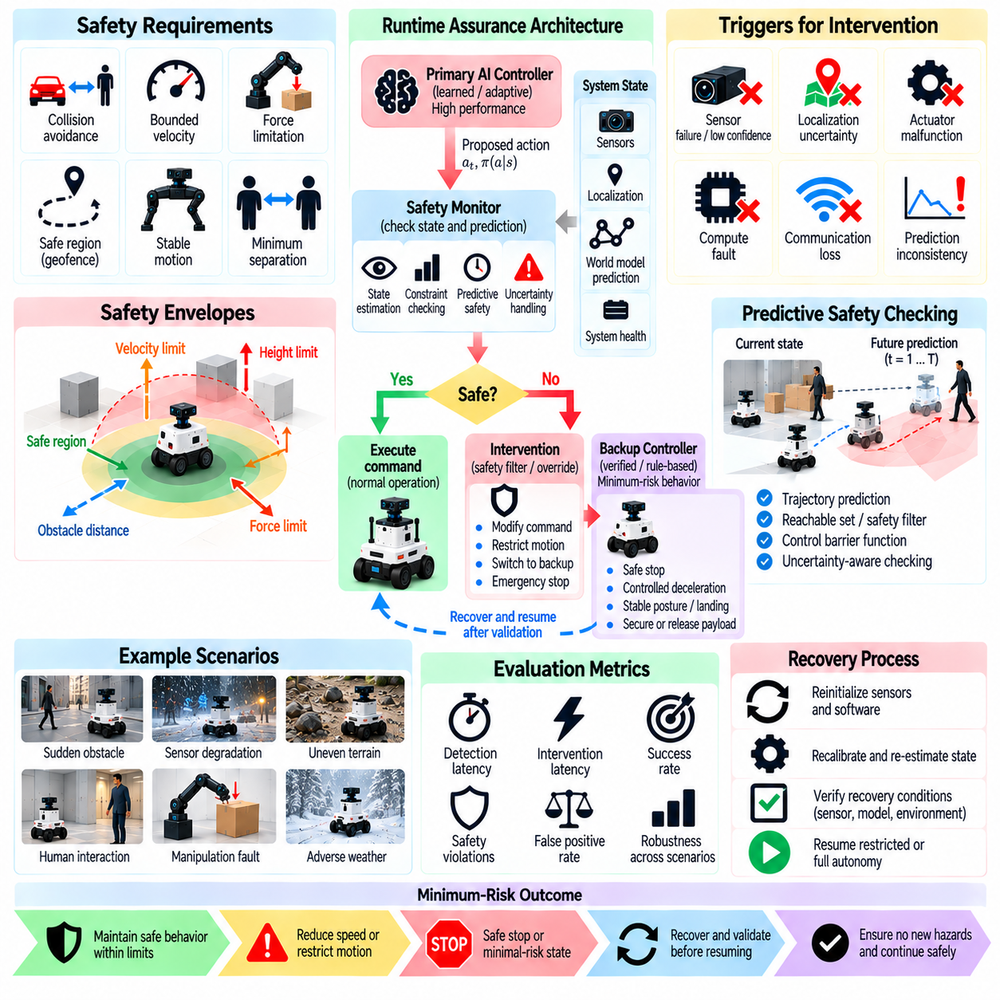{width="7.268055555555556in" height="7.268055555555556in"}

Runtime assurance effectiveness evaluates whether Physical AI systems can maintain safety while executing learned or adaptive behaviors in uncertain physical environments. Runtime assurance combines continuous monitoring, safety constraints, supervisory control, and protective intervention. Evaluation must determine whether these mechanisms recognize unsafe conditions and prevent hazardous actions without depending entirely on the correctness of the primary AI model.

Runtime assurance architectures typically separate high-performance autonomous control from independently justified safety functions. An advanced controller may optimize task performance, while a safety supervisor monitors operating boundaries and overrides unsafe commands. Evaluation should verify that this separation remains effective during model errors, software faults, and unexpected physical disturbances.

A systematic evaluation begins by defining the safety properties that runtime assurance must enforce. These properties may include collision avoidance, minimum separation, bounded velocity, force limitations, and stable motion. Each requirement should be expressed through measurable state variables and operating constraints. Testing must establish whether the monitoring and intervention mechanisms preserve these properties across relevant scenarios.

Safety monitors evaluate whether current or predicted system states approach unacceptable operating regions. Monitoring may rely on sensor observations, state estimates, dynamic models, and uncertainty bounds. Evaluation should measure the accuracy and timeliness of safety-state assessment. A monitor that correctly identifies a violation only after the robot enters a hazardous state provides insufficient protection.

Runtime assurance effectiveness depends on the reliability of the information used by safety monitors. Sensor noise, localization errors, delayed measurements, and inconsistent state estimates can distort safety assessments. Testing should introduce controlled information degradation and examine whether uncertainty is handled conservatively. Monitoring logic must not interpret unreliable measurements as evidence of safe operation.

Safety envelopes define regions of operation in which specified constraints are expected to remain satisfied. These envelopes may depend on robot speed, braking capability, obstacle proximity, actuator limits, and environmental conditions. Evaluation should verify that the envelopes reflect actual physical capabilities. Incorrectly optimistic safety boundaries can permit hazardous actions even when the monitoring logic operates as designed.

Predictive safety monitoring estimates whether proposed actions could violate constraints within a future time horizon. Methods may use reachable sets, trajectory prediction, control barrier functions, or model predictive safety filters. Evaluation should compare predicted safety margins with observed physical outcomes. Model uncertainty and computation delays must be considered when determining whether predicted safe regions remain trustworthy.

Intervention mechanisms may modify commands, restrict motion, replace unsafe actions, or transfer control to a verified backup controller. Their effectiveness depends on both the correctness of intervention decisions and the feasibility of resulting physical actions. Evaluation should measure intervention latency, control continuity, and safety constraint satisfaction. An override that creates instability may introduce a new hazard.

The Simplex architecture provides a representative runtime assurance pattern in which an advanced controller operates under supervision from a safety decision module. A verified or otherwise justified backup controller takes control when safety conditions require intervention. Evaluation should examine switching logic, backup controller capability, and recovery criteria. Safe switching must be demonstrated under realistic disturbances and timing constraints.

Control barrier functions can enforce safety conditions by constraining admissible control actions. Their effectiveness depends on valid system dynamics, feasible constraints, and accurate state information. Evaluation should examine whether safety filters remain effective under model mismatch, actuator saturation, and limited control authority. Mathematical feasibility must be supported by evidence that the physical system follows the filtered commands.

Runtime verification evaluates system execution against formally specified properties. Temporal logic, state invariants, and event-based conditions can describe acceptable behavior and prohibited transitions. Testing should examine monitor correctness, specification coverage, and response to ambiguous observations. Formal properties are valuable only when they capture relevant physical hazards and are connected to effective intervention mechanisms.

Detection-to-intervention latency is a central measure of runtime assurance effectiveness. Total response time includes sensing, state estimation, monitoring, decision-making, communication, and actuator execution. Evaluation should compare this delay with the time remaining before a hazard becomes unavoidable. Average response time is insufficient when rare latency spikes can cause safety violations.

False-positive interventions and missed detections create different operational risks. Excessive intervention can disrupt tasks, destabilize manipulation, or encourage unsafe recovery behavior. Missed detections can allow hazardous actions to proceed without restriction. Evaluation should examine both error types under representative operating conditions. Threshold selection must reflect the physical consequences of unnecessary and delayed intervention.

Runtime assurance must remain effective when primary AI models encounter out-of-distribution inputs or unreliable predictions. A learned controller may produce confident but unsafe commands under unfamiliar conditions. Evaluation should determine whether safety supervision identifies violations independently of model confidence. Protective mechanisms should enforce physical constraints even when the primary model cannot recognize its own limitations.

Compound failures can challenge the independence of runtime assurance components. A shared sensor failure, power disturbance, or communication fault may affect both the advanced controller and the safety monitor. Evaluation should identify common-cause dependencies and examine degraded supervision capability. Redundancy is valuable only when alternative components do not share the same critical failure mechanisms.

Safety intervention should be tested across different task phases and physical configurations. A robot carrying a heavy payload may require different protective actions from an unloaded robot. Manipulators interacting with humans may need controlled force reduction rather than abrupt shutdown. Evaluation must verify that intervention policies account for task context, robot dynamics, and the feasibility of minimum-risk transitions.

Repeated supervisory switching can produce oscillation between advanced and backup control modes. Such behavior may arise from noisy measurements, unstable thresholds, or rapidly changing environmental conditions. Testing should evaluate hysteresis, dwell-time constraints, and state consistency during transitions. Switching mechanisms must avoid introducing control discontinuities or excessive mechanical stress.

Fault injection enables systematic assessment of runtime assurance under abnormal conditions. Tests may introduce unsafe control commands, corrupted state estimates, delayed monitoring, actuator limitations, and unexpected obstacles. Fault magnitude, duration, and timing should be varied to reveal intervention boundaries. Evaluation must verify that protective mechanisms act before safety constraints are violated.

Simulation supports extensive runtime assurance testing across rare hazards and complex operating conditions. Hardware-in-the-loop experiments can validate timing, supervisory logic, and controller interactions. Controlled physical trials are necessary to confirm braking, contact forces, and recovery behavior. Evidence should progress from simulated correctness to demonstrated effectiveness on actual hardware.

Quantitative metrics should measure both protective performance and operational consequences. Relevant indicators include hazard detection rate, intervention latency, safety-boundary violation frequency, backup controller success, false intervention rate, and recovery reliability. Results should be stratified by fault severity and operating context. Aggregate success rates cannot establish assurance effectiveness when critical failures are concealed.

Runtime assurance evaluation must also examine specification validity and monitoring coverage. A supervisor may correctly enforce an incomplete safety specification while overlooking important hazards. Hazard analysis, scenario coverage, and independent review should identify missing constraints. Evaluation must distinguish implementation correctness from the adequacy of the safety requirements being enforced.

Ultimately, runtime assurance effectiveness determines whether independent monitoring and supervisory control can preserve essential safety properties despite failures in primary Physical AI components. Effective evaluation integrates formal requirements, fault injection, timing analysis, simulation, physical validation, and protective response assessment. The objective is demonstrable safety enforcement during operation, not merely the presence of a safety monitor.

실행시간 보증 효과 평가(Runtime Assurance Effectiveness)는 피지컬 인공지능 시스템(Physical AI System)이 불확실한 물리적 환경(Uncertain Physical Environment)에서 학습 기반 또는 적응형 행동(Learned or Adaptive Behavior)을 실행하는 동안 안전성을 유지할 수 있는지를 검증한다. 실행시간 보증(Runtime Assurance)은 지속적인 감시(Continuous Monitoring), 안전 제약 조건(Safety Constraint), 감독 제어(Supervisory Control), 보호 개입(Protective Intervention)을 결합한다. 평가에서는 이러한 메커니즘이 주요 인공지능 모델(Primary AI Model)의 정확성에 전적으로 의존하지 않으면서 불안전한 조건(Unsafe Condition)을 인식하고 위험한 행동(Hazardous Action)을 방지하는지 판단해야 한다.

실행시간 보증 아키텍처(Runtime Assurance Architecture)는 일반적으로 고성능 자율 제어(High-Performance Autonomous Control)와 독립적으로 안전성이 정당화된 안전 기능(Independently Justified Safety Function)을 분리한다. 고급 제어기(Advanced Controller)는 작업 성능(Task Performance)을 최적화하는 반면, 안전 감독기(Safety Supervisor)는 운영 경계(Operating Boundary)를 감시하고 불안전한 명령(Unsafe Command)을 무효화할 수 있다. 평가에서는 모델 오류(Model Error), 소프트웨어 고장(Software Fault), 예상하지 못한 물리적 외란(Unexpected Physical Disturbance)이 발생하는 동안에도 이러한 분리가 효과적으로 유지되는지 검증해야 한다.

체계적인 평가(Systematic Evaluation)는 실행시간 보증(Runtime Assurance)이 강제해야 하는 안전 속성(Safety Property)을 정의하는 것에서 시작한다. 이러한 속성에는 충돌 회피(Collision Avoidance), 최소 이격 거리(Minimum Separation), 제한된 속도(Bounded Velocity), 힘 제한(Force Limitation), 안정적인 움직임(Stable Motion)이 포함될 수 있다. 각 요구사항(Requirement)은 측정 가능한 상태 변수(Measurable State Variable)와 운영 제약 조건(Operating Constraint)을 통해 표현되어야 한다. 시험에서는 감시 및 개입 메커니즘(Monitoring and Intervention Mechanism)이 관련 시나리오 전반에서 이러한 속성을 유지하는지 확인해야 한다.

안전 감시기(Safety Monitor)는 현재 또는 예측된 시스템 상태(Current or Predicted System State)가 허용할 수 없는 운영 영역(Unacceptable Operating Region)에 접근하는지를 평가한다. 감시에는 센서 관측값(Sensor Observation), 상태 추정값(State Estimate), 동역학 모델(Dynamic Model), 불확실성 경계(Uncertainty Bound)가 사용될 수 있다. 평가에서는 안전 상태 평가(Safety-State Assessment)의 정확도(Accuracy)와 적시성(Timeliness)을 측정해야 한다. 로봇이 위험 상태(Hazardous State)에 진입한 이후에야 위반을 정확하게 식별하는 감시기는 충분한 보호를 제공하지 못한다.

실행시간 보증 효과(Runtime Assurance Effectiveness)는 안전 감시기(Safety Monitor)가 사용하는 정보의 신뢰성(Information Reliability)에 따라 달라진다. 센서 잡음(Sensor Noise), 위치 추정 오류(Localization Error), 지연된 측정값(Delayed Measurement), 일관되지 않은 상태 추정값(Inconsistent State Estimate)은 안전성 평가(Safety Assessment)를 왜곡할 수 있다. 시험에서는 통제된 정보 품질 저하(Controlled Information Degradation)를 도입하고 불확실성(Uncertainty)이 보수적으로 처리되는지 검증해야 한다. 감시 로직(Monitoring Logic)은 신뢰할 수 없는 측정값(Unreliable Measurement)을 안전한 운영(Safe Operation)의 증거로 해석해서는 안 된다.

안전 영역(Safety Envelope)은 지정된 제약 조건(Specified Constraint)이 계속 충족될 것으로 예상되는 운영 영역(Operating Region)을 정의한다. 이러한 영역은 로봇 속도(Robot Speed), 제동 능력(Braking Capability), 장애물 근접도(Obstacle Proximity), 구동기 한계(Actuator Limit), 환경 조건(Environmental Condition)에 따라 달라질 수 있다. 평가에서는 안전 영역이 실제 물리적 능력(Actual Physical Capability)을 반영하는지 검증해야 한다. 지나치게 낙관적인 안전 경계(Optimistic Safety Boundary)는 감시 로직이 설계대로 작동하더라도 위험한 행동을 허용할 수 있다.

예측 기반 안전 감시(Predictive Safety Monitoring)는 제안된 행동(Proposed Action)이 미래 시간 범위(Future Time Horizon) 내에서 제약 조건을 위반할 가능성이 있는지 추정한다. 이러한 방법에는 도달 가능 집합(Reachable Set), 궤적 예측(Trajectory Prediction), 제어 장벽 함수(Control Barrier Function), 모델 예측 안전 필터(Model Predictive Safety Filter)가 사용될 수 있다. 평가에서는 예측된 안전 여유(Predicted Safety Margin)와 관측된 물리적 결과(Observed Physical Outcome)를 비교해야 한다. 예측된 안전 영역(Predicted Safe Region)의 신뢰성을 판단할 때 모델 불확실성(Model Uncertainty)과 연산 지연(Computation Delay)을 고려해야 한다.

개입 메커니즘(Intervention Mechanism)은 명령(Command)을 수정하거나 움직임(Motion)을 제한하거나 불안전한 행동(Unsafe Action)을 대체하거나 검증된 백업 제어기(Verified Backup Controller)로 제어권을 이전할 수 있다. 그 효과는 개입 결정(Intervention Decision)의 정확성과 결과적인 물리적 행동(Physical Action)의 실행 가능성(Feasibility)에 모두 달려 있다. 평가에서는 개입 지연 시간(Intervention Latency), 제어 연속성(Control Continuity), 안전 제약 조건 충족(Safety Constraint Satisfaction)을 측정해야 한다. 불안정성(Instability)을 발생시키는 제어 명령 무효화(Override)는 새로운 위험(New Hazard)을 초래할 수 있다.

심플렉스 아키텍처(Simplex Architecture)는 고급 제어기(Advanced Controller)가 안전 결정 모듈(Safety Decision Module)의 감독 아래에서 작동하는 대표적인 실행시간 보증 구조(Runtime Assurance Pattern)를 제공한다. 안전 조건(Safety Condition)에 따라 개입이 필요해지면 검증되었거나 다른 방식으로 안전성이 정당화된 백업 제어기(Backup Controller)가 제어권을 인수한다. 평가에서는 전환 로직(Switching Logic), 백업 제어기 능력(Backup Controller Capability), 복구 기준(Recovery Criteria)을 검증해야 한다. 안전한 전환(Safe Switching)은 현실적인 외란(Realistic Disturbance)과 시간 제약 조건(Timing Constraint)에서 입증되어야 한다.

제어 장벽 함수(Control Barrier Function, CBF)는 허용 가능한 제어 행동(Admissible Control Action)을 제한하여 안전 조건(Safety Condition)을 강제할 수 있다. 그 효과는 유효한 시스템 동역학(Valid System Dynamics), 실행 가능한 제약 조건(Feasible Constraint), 정확한 상태 정보(Accurate State Information)에 달려 있다. 평가에서는 모델 불일치(Model Mismatch), 구동기 포화(Actuator Saturation), 제한된 제어 권한(Limited Control Authority)에서도 안전 필터(Safety Filter)가 효과적으로 유지되는지 검증해야 한다. 수학적 실행 가능성(Mathematical Feasibility)은 실제 물리적 시스템(Physical System)이 필터링된 명령(Filtered Command)을 따른다는 증거로 뒷받침되어야 한다.

실행시간 검증(Runtime Verification)은 형식적으로 명세된 속성(Formally Specified Property)을 기준으로 시스템 실행(System Execution)을 평가한다. 시간 논리(Temporal Logic), 상태 불변 조건(State Invariant), 이벤트 기반 조건(Event-Based Condition)은 허용 가능한 행동(Acceptable Behavior)과 금지된 상태 전이(Prohibited Transition)를 기술할 수 있다. 시험에서는 감시기 정확성(Monitor Correctness), 명세 적용 범위(Specification Coverage), 모호한 관측값(Ambiguous Observation)에 대한 응답을 검증해야 한다. 형식적 속성(Formal Property)은 관련 물리적 위험(Physical Hazard)을 포착하고 효과적인 개입 메커니즘(Effective Intervention Mechanism)과 연결될 때에만 가치가 있다.

탐지부터 개입까지의 지연 시간(Detection-to-Intervention Latency)은 실행시간 보증 효과(Runtime Assurance Effectiveness)의 핵심 측정 지표이다. 전체 응답 시간(Total Response Time)에는 센싱(Sensing), 상태 추정(State Estimation), 감시(Monitoring), 의사결정(Decision-Making), 통신(Communication), 구동기 실행(Actuator Execution)이 포함된다. 평가에서는 이러한 지연 시간을 위험을 피할 수 없게 되기 전까지 남아 있는 시간(Time Remaining Before an Unavoidable Hazard)과 비교해야 한다. 드물게 발생하는 지연 시간 급증(Rare Latency Spike)이 안전 위반(Safety Violation)을 유발할 수 있다면 평균 응답 시간(Average Response Time)만으로는 충분하지 않다.

거짓 양성 개입(False-Positive Intervention)과 탐지 누락(Missed Detection)은 서로 다른 운영 위험(Operational Risk)을 발생시킨다. 과도한 개입(Excessive Intervention)은 작업(Task)을 방해하거나 조작(Manipulation)을 불안정하게 만들거나 불안전한 복구 행동(Unsafe Recovery Behavior)을 유발할 수 있다. 탐지 누락은 위험한 행동(Hazardous Action)이 제한 없이 진행되도록 허용할 수 있다. 평가에서는 대표적인 운영 조건(Representative Operating Condition)에서 두 가지 오류 유형(Error Type)을 모두 검증해야 한다. 임계값 선택(Threshold Selection)은 불필요한 개입(Unnecessary Intervention)과 지연된 개입(Delayed Intervention)의 물리적 결과(Physical Consequence)를 반영해야 한다.

실행시간 보증(Runtime Assurance)은 주요 인공지능 모델(Primary AI Model)이 분포 외 입력(Out-of-Distribution Input)이나 신뢰할 수 없는 예측(Unreliable Prediction)을 경험할 때에도 효과적으로 유지되어야 한다. 학습 기반 제어기(Learned Controller)는 익숙하지 않은 조건(Unfamiliar Condition)에서 높은 확신을 가진 불안전한 명령(Confident but Unsafe Command)을 생성할 수 있다. 평가에서는 안전 감독(Safety Supervision)이 모델 신뢰도(Model Confidence)와 독립적으로 위반 사항(Violation)을 식별하는지 판단해야 한다. 보호 메커니즘(Protective Mechanism)은 주요 모델이 자신의 한계를 인식하지 못하더라도 물리적 제약 조건(Physical Constraint)을 강제해야 한다.

복합 고장(Compound Failure)은 실행시간 보증 구성 요소(Runtime Assurance Component)의 독립성을 위협할 수 있다. 공통 센서 고장(Shared Sensor Failure), 전원 외란(Power Disturbance), 통신 고장(Communication Fault)은 고급 제어기(Advanced Controller)와 안전 감시기(Safety Monitor)에 동시에 영향을 미칠 수 있다. 평가에서는 공통 원인 의존성(Common-Cause Dependency)을 식별하고 성능이 저하된 감독 능력(Degraded Supervision Capability)을 검증해야 한다. 중복성(Redundancy)은 대체 구성 요소(Alternative Component)가 동일한 핵심 고장 메커니즘(Critical Failure Mechanism)을 공유하지 않을 때에만 유효하다.

안전 개입(Safety Intervention)은 다양한 작업 단계(Task Phase)와 물리적 구성(Physical Configuration)에서 시험해야 한다. 무거운 적재물(Heavy Payload)을 운반하는 로봇은 적재물이 없는 로봇(Unloaded Robot)과 다른 보호 행동(Protective Action)이 필요할 수 있다. 인간과 상호작용하는 매니퓰레이터(Manipulator)는 갑작스러운 종료(Abrupt Shutdown)보다 제어된 힘 감소(Controlled Force Reduction)가 필요할 수 있다. 평가에서는 개입 정책(Intervention Policy)이 작업 맥락(Task Context), 로봇 동역학(Robot Dynamics), 최소 위험 상태 전환(Minimum-Risk Transition)의 실행 가능성을 고려하는지 검증해야 한다.

반복적인 감독 제어 전환(Repeated Supervisory Switching)은 고급 제어 모드(Advanced Control Mode)와 백업 제어 모드(Backup Control Mode) 사이의 진동(Oscillation)을 발생시킬 수 있다. 이러한 현상은 잡음이 포함된 측정값(Noisy Measurement), 불안정한 임계값(Unstable Threshold), 급격하게 변화하는 환경 조건(Rapidly Changing Environmental Condition)에서 발생할 수 있다. 시험에서는 히스테리시스(Hysteresis), 최소 상태 유지 시간 제약 조건(Dwell-Time Constraint), 전환 중 상태 일관성(State Consistency)을 평가해야 한다. 전환 메커니즘(Switching Mechanism)은 제어 불연속성(Control Discontinuity)이나 과도한 기계적 응력(Excessive Mechanical Stress)을 발생시키지 않아야 한다.

고장 주입(Fault Injection)은 비정상적인 조건(Abnormal Condition)에서 실행시간 보증(Runtime Assurance)을 체계적으로 평가할 수 있도록 한다. 시험에서는 불안전한 제어 명령(Unsafe Control Command), 손상된 상태 추정값(Corrupted State Estimate), 지연된 감시(Delayed Monitoring), 구동기 제한(Actuator Limitation), 예상하지 못한 장애물(Unexpected Obstacle)을 도입할 수 있다. 고장 크기(Fault Magnitude), 지속 시간(Duration), 발생 시점(Timing)을 변화시켜 개입 경계(Intervention Boundary)를 식별해야 한다. 평가에서는 안전 제약 조건(Safety Constraint)이 위반되기 전에 보호 메커니즘(Protective Mechanism)이 작동하는지 검증해야 한다.

시뮬레이션(Simulation)은 드문 위험(Rare Hazard)과 복잡한 운영 조건(Complex Operating Condition) 전반에서 광범위한 실행시간 보증 시험(Runtime Assurance Testing)을 지원한다. 하드웨어 인 더 루프 실험(Hardware-in-the-Loop Experiment, HIL)은 시간적 응답(Timing), 감독 로직(Supervisory Logic), 제어기 상호작용(Controller Interaction)을 검증할 수 있다. 제동(Braking), 접촉력(Contact Force), 복구 행동(Recovery Behavior)을 확인하려면 통제된 물리적 시험(Controlled Physical Trial)이 필요하다. 검증 근거(Evidence)는 시뮬레이션상의 정확성(Simulated Correctness)에서 실제 하드웨어(Actual Hardware)에서 입증된 효과(Demonstrated Effectiveness)로 발전해야 한다.

정량적 지표(Quantitative Metric)는 보호 성능(Protective Performance)과 운영상 결과(Operational Consequence)를 모두 측정해야 한다. 관련 지표에는 위험 탐지율(Hazard Detection Rate), 개입 지연 시간(Intervention Latency), 안전 경계 위반 빈도(Safety-Boundary Violation Frequency), 백업 제어기 성공률(Backup Controller Success), 잘못된 개입 비율(False Intervention Rate), 복구 신뢰성(Recovery Reliability)이 포함된다. 결과는 고장 심각도(Fault Severity)와 운영 맥락(Operating Context)에 따라 구분하여 보고해야 한다. 종합 성공률(Aggregate Success Rate)은 치명적인 고장(Critical Failure)이 숨겨져 있을 경우 보증 효과(Assurance Effectiveness)를 입증할 수 없다.

실행시간 보증 평가(Runtime Assurance Evaluation)에서는 명세 타당성(Specification Validity)과 감시 적용 범위(Monitoring Coverage)도 검증해야 한다. 감독기(Supervisor)는 불완전한 안전 명세(Incomplete Safety Specification)를 정확하게 강제하면서도 중요한 위험(Important Hazard)을 놓칠 수 있다. 위험 분석(Hazard Analysis), 시나리오 적용 범위(Scenario Coverage), 독립적인 검토(Independent Review)를 통해 누락된 제약 조건(Missing Constraint)을 식별해야 한다. 평가에서는 구현 정확성(Implementation Correctness)과 강제되는 안전 요구사항(Safety Requirement)의 적절성(Adequacy)을 구분해야 한다.

궁극적으로 실행시간 보증 효과(Runtime Assurance Effectiveness)는 주요 피지컬 인공지능 구성 요소(Primary Physical AI Component)에 고장이 발생하더라도 독립적인 감시(Independent Monitoring)와 감독 제어(Supervisory Control)가 필수 안전 속성(Essential Safety Property)을 유지할 수 있는지를 판단한다. 효과적인 평가(Effective Evaluation)는 형식적 요구사항(Formal Requirement), 고장 주입(Fault Injection), 시간 분석(Timing Analysis), 시뮬레이션(Simulation), 물리적 검증(Physical Validation), 보호 응답 평가(Protective Response Assessment)를 통합한다. 목표는 단순히 안전 감시기(Safety Monitor)가 존재하는 것이 아니라 실제 운영 중 안전 제약 조건이 강제된다는 것을 입증하는 것(Demonstrable Safety Enforcement)이다.

##  

## 05.16. Robustness Stress Testing Pipeline [w/Code]

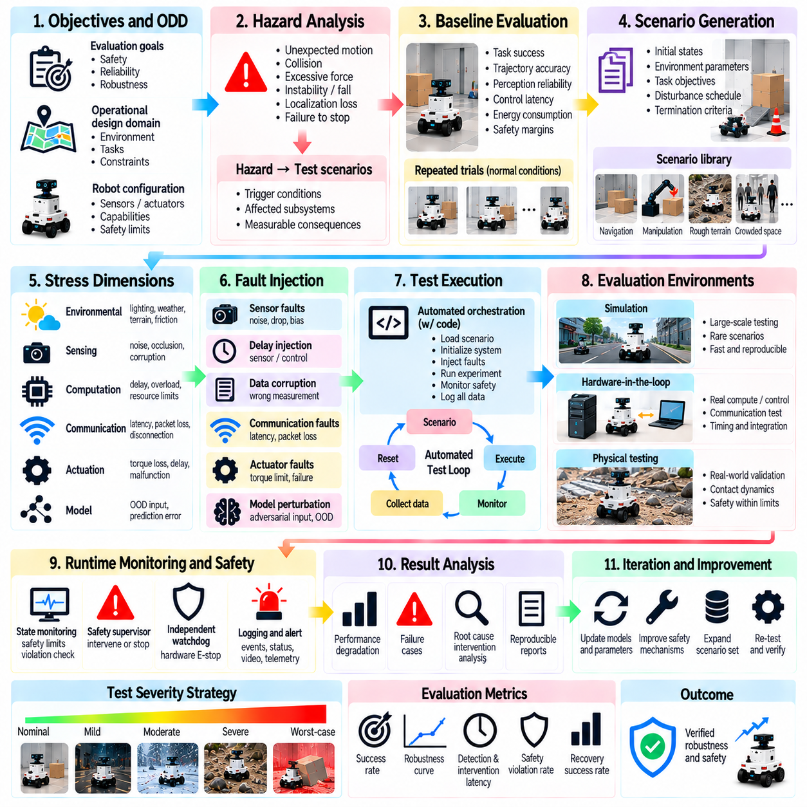{width="7.268055555555556in" height="7.268055555555556in"}

A robustness stress testing pipeline provides a systematic framework for evaluating whether Physical AI systems maintain safe and reliable behavior under disturbances, failures, and unfamiliar operating conditions. Unlike isolated tests, a pipeline integrates scenario design, fault injection, execution, measurement, and analysis. Its purpose is to identify operational limits, expose hidden vulnerabilities, and generate reproducible evidence of system robustness.

The pipeline begins with defining evaluation objectives and the operational design domain. Relevant objectives may include collision prevention, stable locomotion, safe manipulation, reliable perception, and fault-tolerant control. Environmental boundaries, task assumptions, robot capabilities, and safety constraints must be documented. These definitions establish which disturbances are meaningful and which outcomes constitute unacceptable system behavior.

Hazard analysis connects stress testing to physical safety requirements. Potential hazards include unexpected motion, excessive contact forces, unstable balance, loss of localization, and failure to stop safely. Each hazard should be associated with triggering conditions, affected subsystems, and measurable consequences. This traceability ensures that the pipeline evaluates realistic risks rather than arbitrary performance degradation.

A baseline evaluation establishes system performance under nominal operating conditions before disturbances are introduced. Baseline measurements may include task success, trajectory accuracy, perception reliability, control latency, energy consumption, and safety margins. Repeated trials characterize normal variability. Without a stable baseline, it becomes difficult to distinguish stress-induced degradation from ordinary experimental fluctuations.

Scenario generation translates identified hazards into executable test conditions. Scenarios should specify robot configuration, initial states, environmental parameters, task objectives, and disturbance schedules. Controlled variation enables comparison across experiments. Scenario descriptions must include expected safety boundaries and termination criteria so that automated testing does not introduce uncontrolled physical hazards.

Stress dimensions should cover environmental, sensing, computation, communication, actuation, and model-related disturbances. Examples include lighting changes, sensor noise, processing delays, packet loss, actuator degradation, and distribution shifts. Each dimension should have measurable severity parameters. Testing must distinguish independent perturbations from combined disturbances that produce interacting failure mechanisms.

Fault injection provides repeatable control over abnormal operating conditions. Software interfaces can introduce corrupted observations, delayed commands, missing measurements, or incorrect state estimates. Hardware experiments may reproduce physical disturbances through controlled loading or environmental exposure. Injection mechanisms should be validated to ensure that the intended fault actually reaches the relevant subsystem.

Stress severity should increase progressively from nominal conditions toward defined operating limits. Parameter sweeps can vary disturbance magnitude, duration, frequency, and onset timing. Adaptive search may concentrate trials near failure boundaries. The pipeline should identify degradation thresholds and critical transitions without unnecessarily exposing personnel or equipment to hazardous conditions.

Combined-stress scenarios are necessary because individual disturbances may appear manageable while their interactions produce serious failures. Reduced visibility combined with localization drift and communication delay may overwhelm navigation safeguards. Testing should prioritize combinations identified through hazard analysis. Exhaustive testing is rarely feasible, so scenario selection must balance coverage, severity, and operational relevance.

Simulation provides a scalable environment for exploring large scenario spaces and rare failure conditions. Automated execution can evaluate thousands of combinations while recording trajectories, sensor outputs, and controller decisions. However, simulated disturbances may not reproduce real contact dynamics or sensor artifacts. The pipeline must document simulator assumptions and validate critical findings against physical measurements.

Hardware-in-the-loop testing connects simulated disturbances with real computing hardware, control software, and communication interfaces. This stage reveals timing errors, resource contention, and supervisory failures that may remain hidden in software-only experiments. Evaluation should preserve deterministic test inputs where possible. Independent emergency protection is required when hardware outputs can influence physical actuators.

Controlled physical testing validates whether predicted robustness extends to real-world behavior. Laboratory trials may examine braking, stability recovery, contact forces, sensor degradation, and minimum-risk transitions. Test severity should progress within approved safety limits. Physical experiments must record environmental conditions and hardware configurations to support reproducibility and meaningful comparison with simulation results.

Automated orchestration coordinates scenario selection, system initialization, fault injection, execution, monitoring, and result collection. Each trial should use a defined configuration and record software versions, model checkpoints, calibration parameters, and random seeds. Automation reduces procedural inconsistency. Reliable reset mechanisms are essential because residual system states can contaminate subsequent experiments.

Runtime monitoring must remain active throughout stress testing. Independent safety monitors should detect boundary violations, unexpected motion, excessive force, and loss of control authority. Testing infrastructure must distinguish experimental fault injection from actual protective-system failures. Emergency termination conditions should take precedence over scenario completion or performance measurement objectives.

Data collection should capture synchronized observations, predictions, control commands, actuator responses, environmental states, and safety events. Accurate timestamps and consistent coordinate frames support causal reconstruction of failures. Logging should include fault injection timing and protective intervention records. Missing or misaligned data can prevent reliable diagnosis even when a hazardous event is observed.

Quantitative metrics should connect stress severity with task performance and physical safety outcomes. Relevant measures include task success rate, collision frequency, trajectory deviation, stopping distance, intervention latency, recovery success, and safety-boundary violations. Results should be stratified by disturbance type and severity. Average performance alone may conceal rare but unacceptable failures.

Robustness curves describe how system performance changes as disturbance intensity increases. A gradual decline may indicate predictable degradation, while sudden failure suggests fragile operating boundaries. Evaluation should identify critical thresholds and uncertainty around those estimates. Safety margins must be interpreted relative to the validated operating domain rather than generalized to all possible environments.

Failure analysis should reconstruct the sequence from disturbance introduction to system response and final outcome. Investigators should distinguish initiating faults, propagation mechanisms, detection failures, and ineffective protective actions. Root-cause analysis may reveal interactions across perception, prediction, planning, and control. Findings should be linked to corrective actions and repeatable regression scenarios.

Statistical confidence requires repeated trials, controlled comparisons, and explicit uncertainty estimates. Rare safety failures may not appear in small test samples, even when average success rates are high. Confidence intervals and targeted stress sampling can improve interpretation. Results from deliberately biased scenario searches must not be presented as direct estimates of real-world incident frequency.

Regression testing ensures that improvements do not introduce new robustness weaknesses. Updated models, controllers, sensors, and calibration procedures should be evaluated against versioned scenario suites. Previously discovered failures should remain part of the test library. Comparisons must account for changes in hardware, environmental conditions, and evaluation methodology before performance differences are attributed to system updates.

Pipeline outputs should support engineering decisions and safety assurance. Reports should document scenario coverage, tested operating limits, observed failure modes, protective response effectiveness, and unresolved risks. Acceptance criteria must be tied to explicit safety requirements. A successful evaluation demonstrates compliance within defined conditions rather than claiming immunity to every possible disturbance.

Ultimately, a robustness stress testing pipeline transforms fragmented safety experiments into a continuous and reproducible evaluation process. Effective implementation integrates hazard-driven scenario generation, progressive fault injection, simulation, hardware validation, automated measurement, and regression analysis. The objective is to establish credible robustness boundaries and provide actionable evidence for improving the safety of deployed Physical AI systems.

강건성 스트레스 시험 파이프라인(Robustness Stress Testing Pipeline)은 피지컬 인공지능 시스템(Physical AI System)이 외란(Disturbance), 고장(Failure), 익숙하지 않은 운영 조건(Unfamiliar Operating Condition)에서도 안전하고 신뢰할 수 있는 행동을 유지하는지 평가하기 위한 체계적인 프레임워크(Systematic Framework)를 제공한다. 개별 시험(Isolated Test)과 달리 파이프라인(Pipeline)은 시나리오 설계(Scenario Design), 고장 주입(Fault Injection), 실행(Execution), 측정(Measurement), 분석(Analysis)을 통합한다. 목적은 운영 한계(Operational Limit)를 식별하고 숨겨진 취약성(Hidden Vulnerability)을 발견하며 시스템 강건성(System Robustness)에 대한 재현 가능한 근거(Reproducible Evidence)를 생성하는 것이다.

파이프라인(Pipeline)은 평가 목표(Evaluation Objective)와 운영 설계 영역(Operational Design Domain, ODD)을 정의하는 것에서 시작한다. 관련 목표에는 충돌 방지(Collision Prevention), 안정적인 이동(Stable Locomotion), 안전한 조작(Safe Manipulation), 신뢰할 수 있는 인지(Reliable Perception), 내결함성 제어(Fault-Tolerant Control)가 포함될 수 있다. 환경적 경계(Environmental Boundary), 작업 가정(Task Assumption), 로봇 능력(Robot Capability), 안전 제약 조건(Safety Constraint)을 문서화해야 한다. 이러한 정의는 어떤 외란이 의미 있는지, 어떤 결과가 허용할 수 없는 시스템 행동(Unacceptable System Behavior)에 해당하는지를 결정하는 기준을 확립한다.

위험 분석(Hazard Analysis)은 스트레스 시험(Stress Testing)을 물리적 안전 요구사항(Physical Safety Requirement)과 연결한다. 잠재적인 위험(Potential Hazard)에는 예상하지 못한 움직임(Unexpected Motion), 과도한 접촉력(Excessive Contact Force), 불안정한 균형(Unstable Balance), 위치 추정 손실(Loss of Localization), 안전 정지 실패(Failure to Stop Safely)가 포함된다. 각 위험은 발동 조건(Triggering Condition), 영향을 받는 하위 시스템(Affected Subsystem), 측정 가능한 결과(Measurable Consequence)와 연결되어야 한다. 이러한 추적성(Traceability)은 파이프라인이 임의적인 성능 저하(Arbitrary Performance Degradation)가 아니라 현실적인 위험(Realistic Risk)을 평가하도록 보장한다.

기준선 평가(Baseline Evaluation)는 외란을 도입하기 전에 정상 운영 조건(Nominal Operating Condition)에서 시스템 성능(System Performance)을 확립한다. 기준선 측정값(Baseline Measurement)에는 작업 성공률(Task Success), 궤적 정확도(Trajectory Accuracy), 인지 신뢰성(Perception Reliability), 제어 지연 시간(Control Latency), 에너지 소비(Energy Consumption), 안전 여유(Safety Margin)가 포함될 수 있다. 반복 시험(Repeated Trial)은 정상적인 변동성(Normal Variability)을 특성화한다. 안정적인 기준선(Stable Baseline)이 없으면 스트레스로 인한 성능 저하(Stress-Induced Degradation)와 일반적인 실험 변동(Ordinary Experimental Fluctuation)을 구분하기 어렵다.

시나리오 생성(Scenario Generation)은 식별된 위험(Identified Hazard)을 실행 가능한 시험 조건(Executable Test Condition)으로 변환한다. 시나리오에는 로봇 구성(Robot Configuration), 초기 상태(Initial State), 환경 매개변수(Environmental Parameter), 작업 목표(Task Objective), 외란 일정(Disturbance Schedule)이 명시되어야 한다. 통제된 변화(Controlled Variation)는 실험 간 비교를 가능하게 한다. 자동화된 시험(Automated Testing)이 통제되지 않은 물리적 위험(Uncontrolled Physical Hazard)을 발생시키지 않도록 시나리오 설명(Scenario Description)에는 예상 안전 경계(Expected Safety Boundary)와 종료 기준(Termination Criteria)이 포함되어야 한다.

스트레스 차원(Stress Dimension)은 환경(Environment), 센싱(Sensing), 연산(Computation), 통신(Communication), 구동(Actuation), 모델 관련 외란(Model-Related Disturbance)을 포괄해야 한다. 예시에는 조명 변화(Lighting Change), 센서 잡음(Sensor Noise), 처리 지연(Processing Delay), 패킷 손실(Packet Loss), 구동기 성능 저하(Actuator Degradation), 분포 변화(Distribution Shift)가 포함된다. 각 차원에는 측정 가능한 심각도 매개변수(Measurable Severity Parameter)가 있어야 한다. 시험에서는 독립적인 교란(Independent Perturbation)과 상호작용하는 고장 메커니즘(Interacting Failure Mechanism)을 발생시키는 복합 외란(Combined Disturbance)을 구분해야 한다.

고장 주입(Fault Injection)은 비정상적인 운영 조건(Abnormal Operating Condition)을 반복 가능하게 제어하는 방법을 제공한다. 소프트웨어 인터페이스(Software Interface)는 손상된 관측값(Corrupted Observation), 지연된 명령(Delayed Command), 누락된 측정값(Missing Measurement), 잘못된 상태 추정값(Incorrect State Estimate)을 도입할 수 있다. 하드웨어 실험(Hardware Experiment)은 통제된 하중(Controlled Loading)이나 환경 노출(Environmental Exposure)을 통해 물리적 외란(Physical Disturbance)을 재현할 수 있다. 주입 메커니즘(Injection Mechanism)은 의도한 고장(Intended Fault)이 실제로 관련 하위 시스템(Relevant Subsystem)에 전달되는지 검증되어야 한다.

스트레스 심각도(Stress Severity)는 정상 조건(Nominal Condition)에서 정의된 운영 한계(Defined Operating Limit)를 향해 점진적으로 증가해야 한다. 매개변수 스윕(Parameter Sweep)은 외란 크기(Disturbance Magnitude), 지속 시간(Duration), 빈도(Frequency), 시작 시점(Onset Timing)을 변화시킬 수 있다. 적응형 탐색(Adaptive Search)은 고장 경계(Failure Boundary) 부근에 시험을 집중할 수 있다. 파이프라인은 인력(Personnel)이나 장비(Equipment)를 불필요하게 위험한 조건(Hazardous Condition)에 노출하지 않으면서 성능 저하 임계값(Degradation Threshold)과 중요한 상태 전환(Critical Transition)을 식별해야 한다.

복합 스트레스 시나리오(Combined-Stress Scenario)는 개별 외란(Individual Disturbance)은 관리 가능한 수준으로 보이더라도 상호작용으로 인해 심각한 고장(Serious Failure)이 발생할 수 있기 때문에 필요하다. 가시성 감소(Reduced Visibility)에 위치 추정 드리프트(Localization Drift)와 통신 지연(Communication Delay)이 결합되면 내비게이션 안전장치(Navigation Safeguard)의 대응 능력을 초과할 수 있다. 시험에서는 위험 분석(Hazard Analysis)을 통해 식별된 조합에 우선순위를 부여해야 한다. 모든 경우를 빠짐없이 시험하는 포괄적 시험(Exhaustive Testing)은 현실적으로 어렵기 때문에 시나리오 선택(Scenario Selection)은 적용 범위(Coverage), 심각도(Severity), 운영 관련성(Operational Relevance)의 균형을 고려해야 한다.

시뮬레이션(Simulation)은 광범위한 시나리오 공간(Scenario Space)과 드문 고장 조건(Rare Failure Condition)을 탐색하기 위한 확장 가능한 환경(Scalable Environment)을 제공한다. 자동화된 실행(Automated Execution)은 궤적(Trajectory), 센서 출력(Sensor Output), 제어기 결정(Controller Decision)을 기록하면서 수천 가지 조합을 평가할 수 있다. 그러나 시뮬레이션된 외란(Simulated Disturbance)은 실제 접촉 동역학(Real Contact Dynamics)이나 센서 아티팩트(Sensor Artifact)를 정확하게 재현하지 못할 수 있다. 파이프라인은 시뮬레이터 가정(Simulator Assumption)을 문서화하고 중요한 발견(Critical Finding)을 물리적 측정값(Physical Measurement)과 비교하여 검증해야 한다.

하드웨어 인 더 루프 시험(Hardware-in-the-Loop Testing, HIL)은 시뮬레이션된 외란(Simulated Disturbance)을 실제 연산 하드웨어(Real Computing Hardware), 제어 소프트웨어(Control Software), 통신 인터페이스(Communication Interface)와 연결한다. 이 단계에서는 소프트웨어 전용 실험(Software-Only Experiment)에서 드러나지 않을 수 있는 시간 오류(Timing Error), 자원 경합(Resource Contention), 감독 시스템 고장(Supervisory Failure)을 발견할 수 있다. 평가에서는 가능한 경우 결정론적 시험 입력(Deterministic Test Input)을 유지해야 한다. 하드웨어 출력(Hardware Output)이 물리적 구동기(Physical Actuator)에 영향을 줄 수 있는 경우 독립적인 비상 보호(Independent Emergency Protection)가 필요하다.

통제된 물리적 시험(Controlled Physical Testing)은 예측된 강건성(Predicted Robustness)이 실제 환경의 행동(Real-World Behavior)으로 이어지는지 검증한다. 실험실 시험(Laboratory Trial)에서는 제동(Braking), 안정성 복구(Stability Recovery), 접촉력(Contact Force), 센서 성능 저하(Sensor Degradation), 최소 위험 상태 전환(Minimum-Risk Transition)을 검증할 수 있다. 시험 심각도(Test Severity)는 승인된 안전 한계(Approved Safety Limit) 내에서 점진적으로 증가해야 한다. 물리적 실험(Physical Experiment)은 재현성(Reproducibility)과 시뮬레이션 결과(Simulation Result)와의 의미 있는 비교를 지원하도록 환경 조건(Environmental Condition)과 하드웨어 구성(Hardware Configuration)을 기록해야 한다.

자동화된 오케스트레이션(Automated Orchestration)은 시나리오 선택(Scenario Selection), 시스템 초기화(System Initialization), 고장 주입(Fault Injection), 실행(Execution), 감시(Monitoring), 결과 수집(Result Collection)을 조정한다. 각 시험(Trial)은 정의된 구성(Defined Configuration)을 사용하고 소프트웨어 버전(Software Version), 모델 체크포인트(Model Checkpoint), 보정 매개변수(Calibration Parameter), 난수 시드(Random Seed)를 기록해야 한다. 자동화(Automation)는 절차적 불일치(Procedural Inconsistency)를 줄인다. 잔여 시스템 상태(Residual System State)가 후속 실험(Subsequent Experiment)을 오염시킬 수 있으므로 신뢰할 수 있는 초기화 메커니즘(Reliable Reset Mechanism)이 필수적이다.

실행시간 감시(Runtime Monitoring)는 스트레스 시험(Stress Testing) 전반에 걸쳐 활성화된 상태를 유지해야 한다. 독립적인 안전 감시기(Independent Safety Monitor)는 경계 위반(Boundary Violation), 예상하지 못한 움직임(Unexpected Motion), 과도한 힘(Excessive Force), 제어 권한 상실(Loss of Control Authority)을 탐지해야 한다. 시험 인프라(Testing Infrastructure)는 실험적인 고장 주입(Experimental Fault Injection)과 실제 보호 시스템 고장(Actual Protective-System Failure)을 구분해야 한다. 비상 종료 조건(Emergency Termination Condition)은 시나리오 완료(Scenario Completion)나 성능 측정 목표(Performance Measurement Objective)보다 우선해야 한다.

데이터 수집(Data Collection)은 시간 동기화된 관측값(Synchronized Observation), 예측(Prediction), 제어 명령(Control Command), 구동기 응답(Actuator Response), 환경 상태(Environmental State), 안전 이벤트(Safety Event)를 포함해야 한다. 정확한 타임스탬프(Accurate Timestamp)와 일관된 좌표계(Consistent Coordinate Frame)는 고장의 인과적 재구성(Causal Reconstruction)을 지원한다. 로깅(Logging)에는 고장 주입 시점(Fault Injection Timing)과 보호 개입 기록(Protective Intervention Record)이 포함되어야 한다. 데이터가 누락되거나 시간적으로 정렬되지 않으면 위험한 사건(Hazardous Event)이 관측되더라도 신뢰할 수 있는 진단(Reliable Diagnosis)이 어려워질 수 있다.

정량적 지표(Quantitative Metric)는 스트레스 심각도(Stress Severity)를 작업 성능(Task Performance) 및 물리적 안전 결과(Physical Safety Outcome)와 연결해야 한다. 관련 측정값에는 작업 성공률(Task Success Rate), 충돌 빈도(Collision Frequency), 궤적 편차(Trajectory Deviation), 정지 거리(Stopping Distance), 개입 지연 시간(Intervention Latency), 복구 성공률(Recovery Success), 안전 경계 위반(Safety-Boundary Violation)이 포함된다. 결과는 외란 유형(Disturbance Type)과 심각도(Severity)에 따라 구분하여 보고해야 한다. 평균 성능(Average Performance)만으로는 드물지만 허용할 수 없는 고장(Rare but Unacceptable Failure)이 숨겨질 수 있다.

강건성 곡선(Robustness Curve)은 외란 강도(Disturbance Intensity)가 증가함에 따라 시스템 성능(System Performance)이 어떻게 변화하는지를 나타낸다. 점진적인 성능 저하(Gradual Decline)는 예측 가능한 성능 저하(Predictable Degradation)를 의미할 수 있으며, 갑작스러운 고장(Sudden Failure)은 취약한 운영 경계(Fragile Operating Boundary)를 나타낼 수 있다. 평가에서는 중요한 임계값(Critical Threshold)과 그 추정값의 불확실성(Uncertainty)을 식별해야 한다. 안전 여유(Safety Margin)는 검증된 운영 영역(Validated Operating Domain)을 기준으로 해석해야 하며, 가능한 모든 환경으로 일반화해서는 안 된다.

고장 분석(Failure Analysis)은 외란 도입(Disturbance Introduction)부터 시스템 응답(System Response)과 최종 결과(Final Outcome)에 이르는 순서를 재구성해야 한다. 분석자는 최초 고장(Initiating Fault), 전파 메커니즘(Propagation Mechanism), 탐지 실패(Detection Failure), 효과적이지 못한 보호 행동(Ineffective Protective Action)을 구분해야 한다. 근본 원인 분석(Root-Cause Analysis)은 인지(Perception), 예측(Prediction), 계획(Planning), 제어(Control) 전반에 걸친 상호작용을 밝혀낼 수 있다. 발견된 문제(Finding)는 시정 조치(Corrective Action)와 반복 가능한 회귀 시험 시나리오(Repeatable Regression Scenario)에 연결되어야 한다.

통계적 신뢰도(Statistical Confidence)를 확보하려면 반복 시험(Repeated Trial), 통제된 비교(Controlled Comparison), 명시적인 불확실성 추정(Explicit Uncertainty Estimate)이 필요하다. 드문 안전 고장(Rare Safety Failure)은 평균 성공률(Average Success Rate)이 높더라도 작은 시험 표본(Small Test Sample)에서는 나타나지 않을 수 있다. 신뢰 구간(Confidence Interval)과 표적 스트레스 샘플링(Targeted Stress Sampling)은 결과 해석을 개선할 수 있다. 의도적으로 편향된 시나리오 탐색(Deliberately Biased Scenario Search)에서 얻은 결과를 실제 환경의 사고 빈도(Real-World Incident Frequency)에 대한 직접적인 추정값으로 제시해서는 안 된다.

회귀 시험(Regression Testing)은 시스템 개선(System Improvement)이 새로운 강건성 취약성(Robustness Weakness)을 도입하지 않도록 보장한다. 업데이트된 모델(Updated Model), 제어기(Controller), 센서(Sensor), 보정 절차(Calibration Procedure)는 버전 관리된 시나리오 모음(Versioned Scenario Suite)을 기준으로 평가해야 한다. 이전에 발견된 고장(Previously Discovered Failure)은 시험 라이브러리(Test Library)에 계속 포함되어야 한다. 성능 차이(Performance Difference)를 시스템 업데이트(System Update)의 결과로 판단하기 전에 하드웨어(Hardware), 환경 조건(Environmental Condition), 평가 방법론(Evaluation Methodology)의 변화를 고려해야 한다.

파이프라인 출력(Pipeline Output)은 엔지니어링 의사결정(Engineering Decision)과 안전 보증(Safety Assurance)을 지원해야 한다. 보고서(Report)에는 시나리오 적용 범위(Scenario Coverage), 시험된 운영 한계(Tested Operating Limit), 관측된 고장 유형(Observed Failure Mode), 보호 응답 효과(Protective Response Effectiveness), 해결되지 않은 위험(Unresolved Risk)이 문서화되어야 한다. 합격 기준(Acceptance Criteria)은 명시적인 안전 요구사항(Explicit Safety Requirement)과 연결되어야 한다. 성공적인 평가(Successful Evaluation)는 가능한 모든 외란(Disturbance)에 대한 완전한 면역성(Immunity)을 주장하는 것이 아니라 정의된 조건(Defined Condition) 내에서 요구사항을 준수한다는 것을 입증한다.

궁극적으로 강건성 스트레스 시험 파이프라인(Robustness Stress Testing Pipeline)은 분산된 안전 실험(Fragmented Safety Experiment)을 지속적이고 재현 가능한 평가 프로세스(Continuous and Reproducible Evaluation Process)로 전환한다. 효과적인 구현(Effective Implementation)은 위험 기반 시나리오 생성(Hazard-Driven Scenario Generation), 점진적 고장 주입(Progressive Fault Injection), 시뮬레이션(Simulation), 하드웨어 검증(Hardware Validation), 자동화된 측정(Automated Measurement), 회귀 분석(Regression Analysis)을 통합한다. 목표는 신뢰할 수 있는 강건성 경계(Credible Robustness Boundary)를 확립하고 실제 배포된 피지컬 인공지능 시스템(Deployed Physical AI System)의 안전성을 개선하기 위한 실행 가능한 근거(Actionable Evidence)를 제공하는 것이다.
