**Volume 11. Physical AI Evaluation and Benchmarking**

# Chapter 06. Long Horizon Task Evaluation

## 06.01. Why Long Horizon Evaluation Matters

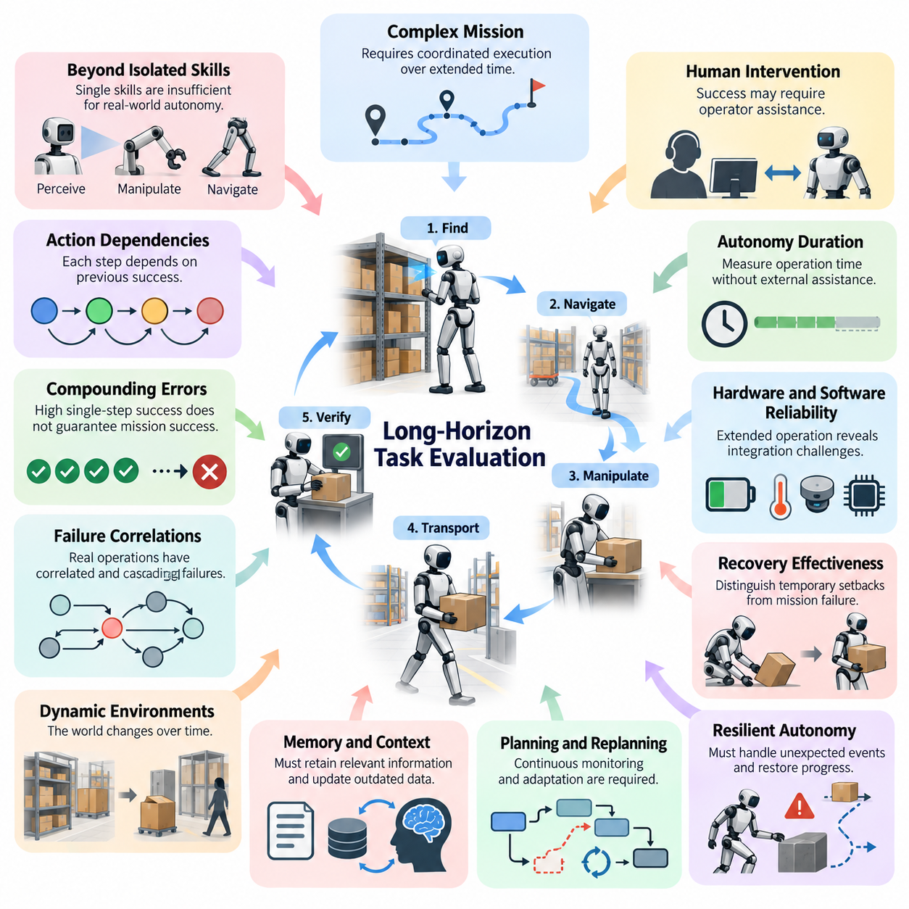{width="7.268055555555556in" height="7.268055555555556in"}

Long-horizon task evaluation is essential because Physical AI systems must operate successfully across extended sequences of decisions, actions, and environmental interactions. Completing an isolated movement or manipulation skill does not demonstrate the ability to accomplish a complex mission. Real-world autonomy requires coordinated execution over time, where earlier decisions influence later opportunities, constraints, and outcomes.

Traditional benchmarks frequently emphasize short-duration tasks with clearly defined initial states and immediate success conditions. Such evaluations are useful for measuring individual capabilities but provide limited evidence of sustained autonomy. A robot may demonstrate excellent object recognition, navigation, and grasping performance independently while failing to combine these capabilities into a reliable operational workflow.

Long-horizon tasks introduce dependencies between actions that cannot be evaluated adequately through isolated success rates. A warehouse robot may need to locate inventory, navigate multiple aisles, manipulate objects, transport materials, and verify delivery. Each stage depends on the successful completion of previous stages, and an error during an early operation may prevent the entire mission from reaching its intended objective.

The importance of long-horizon evaluation becomes apparent when considering compounding errors. Even when individual actions have high probabilities of success, the probability of completing an extended sequence without failure can decrease substantially. If twenty independent actions each succeed with a probability of 0.98, the probability that all twenty succeed is approximately 0.668, illustrating why strong short-horizon performance does not guarantee mission reliability.

However, real robotic operations rarely consist of independent actions with identical success probabilities. Environmental conditions, accumulated uncertainty, previous decisions, and system degradation create correlations between failures. Long-horizon evaluation must therefore examine how errors propagate through perception, planning, control, and interaction rather than relying exclusively on simplified probability calculations.

Another fundamental challenge involves maintaining accurate representations of the world throughout extended operations. Physical environments change as objects move, people intervene, and robots modify their surroundings. A system that initially constructs an accurate scene representation may gradually develop inconsistencies. Evaluating long-horizon competence requires examining whether internal world states remain aligned with observable physical conditions.

Memory and context retention also become critical as task duration increases. A robot may need to remember previously inspected locations, completed subtasks, object identities, operational restrictions, and user instructions. Losing relevant information can produce redundant actions, incorrect decisions, or unsafe behavior. Long-horizon evaluation determines whether the system preserves useful context while updating outdated information appropriately.

Planning quality cannot be assessed solely by determining whether a robot generates a valid initial action sequence. Extended missions require continuous monitoring, adaptation, and replanning when assumptions become invalid. Obstacles may appear, resources may become unavailable, and task priorities may change. A capable Physical AI system must revise its strategy without unnecessarily abandoning progress toward the original objective.

Long-horizon evaluation also distinguishes between nominal task execution and resilient autonomous behavior. A robot that completes a mission only when every operation proceeds as expected has limited practical usefulness. Real deployments involve unexpected contact, localization uncertainty, temporary communication failures, and manipulation errors. Evaluation must determine whether the robot detects deviations, diagnoses their consequences, and restores meaningful progress.

Failure recovery introduces an important distinction between temporary setbacks and terminal mission failures. Dropping an object does not necessarily imply that a delivery task has failed if the robot can locate and retrieve it safely. Similarly, an unsuccessful navigation attempt may be recoverable through route modification. Evaluation should measure the effectiveness, cost, and safety of recovery rather than treating every intermediate failure as final.

Human intervention represents another important dimension of sustained autonomy. A robot may eventually complete a mission while requiring frequent operator assistance, manual resets, or corrective instructions. Although the final outcome appears successful, the operational burden may remain substantial. Long-horizon benchmarks should record intervention frequency, intervention duration, assistance type, and the degree to which external support determines mission completion.

Autonomy duration provides complementary information about system capability. Measuring how long a robot operates without external assistance reveals limitations that short trials may overlook. Mean time between interventions can indicate operational maturity, although its interpretation depends on task difficulty and environmental exposure. These measurements become especially meaningful when combined with mission success, safety, and execution quality.

Extended operation also exposes reliability challenges associated with hardware and software integration. Sensors may drift, actuators may heat, batteries may discharge, and computational resources may become constrained. A control policy that performs effectively during a brief demonstration may behave differently after prolonged operation. Long-horizon evaluation therefore examines the integrated Physical AI system rather than the intelligence model alone.

Temporal credit assignment presents another challenge because final mission outcomes may depend on decisions made much earlier. An inefficient object placement during preparation may create a manipulation failure several minutes later. Evaluators must identify which decisions contributed to success or failure across the complete trajectory. This requires preserving intermediate observations, actions, state transitions, and meaningful task milestones.

Evaluating intermediate progress is particularly important when missions contain multiple subtasks. Binary completion metrics provide a clear overall result but may conceal substantial differences between systems. One robot may fail immediately, while another may complete nearly every stage before encountering a recoverable obstacle. Progress-aware evaluation helps distinguish these behaviors without confusing partial achievement with full mission success.

Long-horizon benchmarks must also address the relationship between efficiency and reliability. A robot may choose a conservative strategy that increases execution time but reduces collision risk and recovery requirements. Another system may complete tasks rapidly under favorable conditions while failing frequently during disturbances. Meaningful evaluation considers completion time, energy consumption, intervention costs, safety, and mission success together.

Environmental diversity further increases the significance of long-horizon testing. Extended missions expose robots to combinations of conditions that may not appear during isolated experiments. Lighting changes, human activity, moving obstacles, object rearrangements, and surface variations can interact over time. Evaluation should examine whether the system maintains competence across these evolving conditions rather than only within fixed initial configurations.

The distinction between simulation and real-world testing becomes especially important for extended tasks. Simulation enables repeated experiments, controlled disturbances, and detailed trajectory analysis, making it valuable for identifying systematic weaknesses. Nevertheless, simulated environments may omit cumulative mechanical effects, sensor degradation, and unpredictable human interactions. Real-world trials remain necessary to establish operational validity.

Reproducibility requires careful definition of mission objectives, initial conditions, environmental variability, termination rules, and permitted interventions. Without consistent protocols, differences in task duration or difficulty can distort comparisons between systems. Long-horizon evaluations should report multiple trials, outcome distributions, failure categories, and uncertainty estimates to support statistically meaningful conclusions.

A further concern is benchmark overfitting, where systems learn to exploit predictable task sequences rather than develop transferable autonomy. Repeated exposure to identical object arrangements, navigation routes, or scripted disturbances may produce impressive results without demonstrating genuine adaptability. Evaluation should incorporate unseen task compositions, changing environments, and alternative execution pathways while maintaining comparable difficulty.

Ultimately, long-horizon evaluation measures whether Physical AI can transform individual competencies into dependable mission-level autonomy. Its purpose extends beyond demonstrating that robots can perform complex sequences under ideal conditions. It establishes whether they can maintain situational awareness, manage uncertainty, recover from failures, minimize human assistance, and achieve objectives consistently throughout sustained physical operation.

## 06.02. From Atomic Skills to Complete Missions

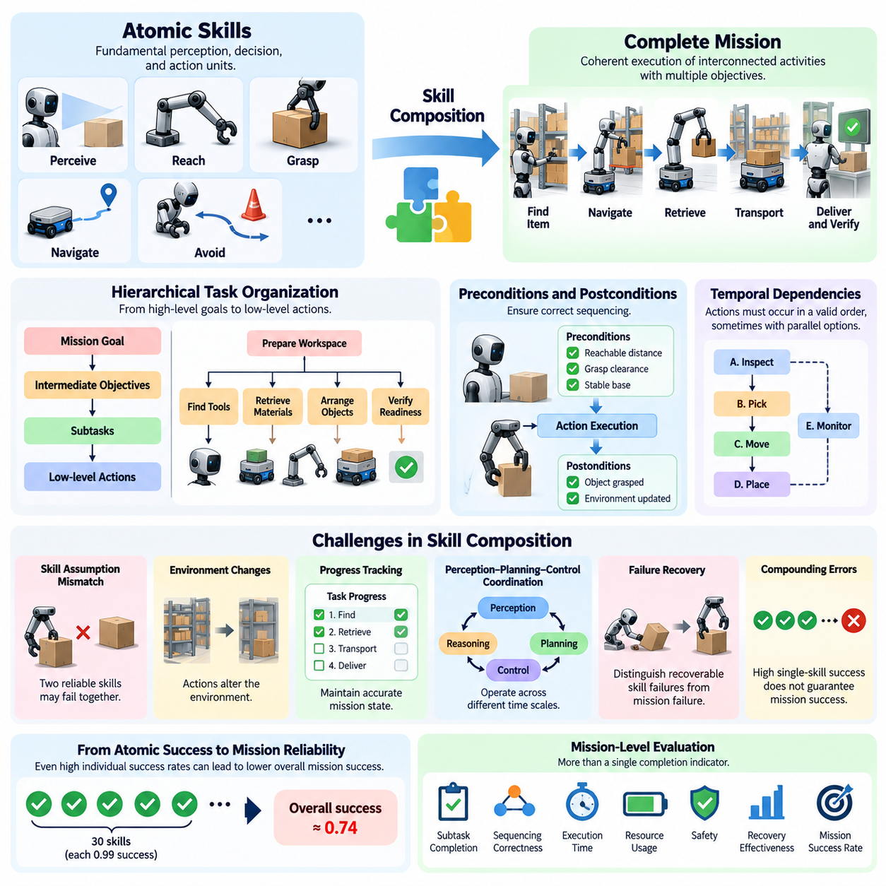{width="7.268055555555556in" height="7.268055555555556in"}

Atomic skills represent the fundamental units of physical intelligence through which robots perceive, decide, and act within their environments. Examples include detecting an object, reaching toward a target, grasping a component, navigating to a waypoint, or avoiding an obstacle. Although these capabilities can be evaluated independently, their practical value emerges when they are coordinated into complete missions involving multiple objectives and dependencies.

A complete mission differs from an isolated skill because it requires the robot to maintain a coherent objective across a sequence of interconnected activities. A warehouse delivery mission may involve identifying an item, navigating to its storage location, retrieving it, transporting it through shared spaces, and confirming successful delivery. The final outcome depends not only on individual skill performance but also on correct coordination between successive operations.

The transition from atomic skills to complete missions introduces hierarchical task organization. High-level goals are decomposed into intermediate objectives, executable subtasks, and low-level control actions. A robot preparing a workspace may first identify required tools, then retrieve materials, arrange objects, and verify readiness. Evaluation must determine whether the system selects appropriate subtasks and executes them in a logically consistent order.

Skill composition creates challenges that are not visible during isolated testing. Two individually reliable skills may fail when executed consecutively because their assumptions about the environment differ. A grasping policy may expect an object to occupy a particular orientation, while the preceding navigation or positioning operation produces a different configuration. Mission-level evaluation examines whether transitions between skills preserve the conditions required for successful execution.

Preconditions and postconditions provide a useful framework for analyzing these dependencies. A manipulation action may require the robot to be within a reachable distance, possess sufficient grasp clearance, and maintain a stable base configuration. Successful execution should produce a verifiable change in the environment. Evaluating whether these conditions are satisfied helps identify failures arising from incorrect sequencing rather than deficiencies in individual skills.

Mission execution also requires persistent representations of progress. A robot must distinguish completed subtasks from pending operations while maintaining awareness of relevant environmental changes. Without reliable progress tracking, the system may repeat actions, skip necessary steps, or terminate prematurely. Evaluation should examine whether the robot maintains an accurate task state throughout execution and updates that state when observations contradict previous assumptions.

Temporal dependencies further complicate skill composition. Certain actions must occur before others, while some operations may be performed concurrently or in alternative sequences. A mobile manipulator may need to secure an object before moving, whereas inspection tasks may permit flexible ordering. Mission evaluation should assess whether the system respects necessary constraints while exploiting permissible flexibility to improve efficiency and reliability.

Long-horizon missions often require coordination between perception, reasoning, planning, and control at different temporal scales. Low-level controllers respond to immediate physical disturbances, while high-level planners manage objectives extending across minutes or hours. Intermediate decision mechanisms connect these processes. Evaluation must determine whether information flows effectively between levels and whether local actions remain consistent with global mission requirements.

A major limitation of atomic skill benchmarks is their dependence on carefully prepared initial conditions. A grasping test may place an object within reach, while a navigation test may provide a known starting pose. Complete missions rarely offer such convenient conditions. Robots must establish the necessary conditions themselves, making autonomous preparation and state estimation essential components of mission-level competence.

Skill execution can also alter the environment in ways that affect subsequent operations. Moving a container may expose another object, obstruct a pathway, or change the available manipulation space. These consequences require continuous updating of the robot\'s world model. Mission-level evaluation examines whether the system anticipates relevant changes and adapts future actions to the physical state produced by earlier decisions.

Failures during individual subtasks should not automatically imply mission failure. A robot may recover from an unsuccessful grasp by adjusting its approach or selecting an alternative manipulation strategy. However, repeated recovery attempts may consume time, energy, and operational resources. Evaluation should therefore distinguish recoverable skill failures from terminal mission failures while measuring the effectiveness and cost of corrective behavior.

The relationship between atomic success rates and mission completion probability is particularly important. Under a simplified independence assumption, a mission containing thirty mandatory skills with individual success probabilities of 0.99 has an overall uninterrupted success probability of approximately 0.74. Real systems exhibit correlated errors and recovery mechanisms, but this example demonstrates why high component-level accuracy does not necessarily produce dependable mission-level autonomy.

Mission-level performance must consequently include more than a binary completion indicator. Useful measurements include subtask completion, sequencing correctness, execution time, resource consumption, recovery frequency, intervention requirements, and final objective satisfaction. These measurements reveal whether the robot achieves its goal efficiently and independently or depends on repeated corrections and favorable environmental conditions.

Evaluation frameworks should also examine whether a robot can reuse learned skills across different mission configurations. The same navigation, grasping, and placement capabilities may support warehouse logistics, laboratory automation, and service robotics. However, successful transfer requires adapting skill parameters, ordering constraints, and environmental assumptions. Testing varied combinations helps determine whether the system possesses compositional competence rather than memorized procedures.

Increasing mission complexity provides a systematic method for measuring capability boundaries. Evaluators can begin with short sequences of familiar skills and progressively introduce additional subtasks, branching decisions, environmental changes, and delayed dependencies. Performance degradation across these conditions reveals limitations in planning, memory, coordination, and recovery. Such evaluations provide more diagnostic information than testing only the most difficult mission.

Complete missions also introduce requirements for goal verification. Executing every planned action does not necessarily mean the intended objective has been achieved. A robot may place an object at an incorrect destination or complete an assembly sequence with an undetected defect. Mission evaluation must therefore distinguish procedural execution from verified physical outcomes using appropriate observations, measurements, and acceptance criteria.

Human assistance must be explicitly represented when assessing the transition toward autonomous missions. Operators may provide instructions, correct localization, resolve manipulation failures, or authorize exceptional actions. Although such interventions can support safe operation, they change the interpretation of mission success. Evaluation protocols should document assistance boundaries and report autonomous completion separately from assisted completion.

Safety constraints remain essential throughout skill composition. A sequence of individually safe actions can produce unsafe consequences when executed without considering cumulative effects or changing surroundings. For example, transporting an unstable load after an imperfect grasp may create hazards not present during either isolated test. Mission-level evaluation must verify that safety requirements remain satisfied across transitions and extended execution.

Simulation provides a practical environment for constructing progressively complex missions and identifying integration failures. Controlled scenarios can isolate specific dependencies, while randomized environments reveal weaknesses in skill transitions and task planning. Real-world testing is nevertheless necessary because contact dynamics, sensing limitations, human activity, and hardware variability may alter the behavior of otherwise successful skill combinations.

Reproducible mission evaluation requires standardized definitions of objectives, initial conditions, available resources, permitted actions, and completion criteria. Evaluators should preserve execution traces that connect high-level decisions with individual skill outcomes. This enables researchers to identify whether a failed mission resulted from perception errors, incorrect decomposition, inappropriate sequencing, control limitations, or insufficient recovery capabilities.

Ultimately, the progression from atomic skills to complete missions represents the transition from demonstrating isolated robotic abilities to validating integrated physical autonomy. A capable Physical AI system must select, coordinate, monitor, and adapt its skills while maintaining a consistent understanding of mission progress. Evaluating this integration establishes whether individual competencies can support reliable, safe, and generalizable operation in complex real-world environments.

## 06.03. Task Decomposition and Subgoal Evaluation

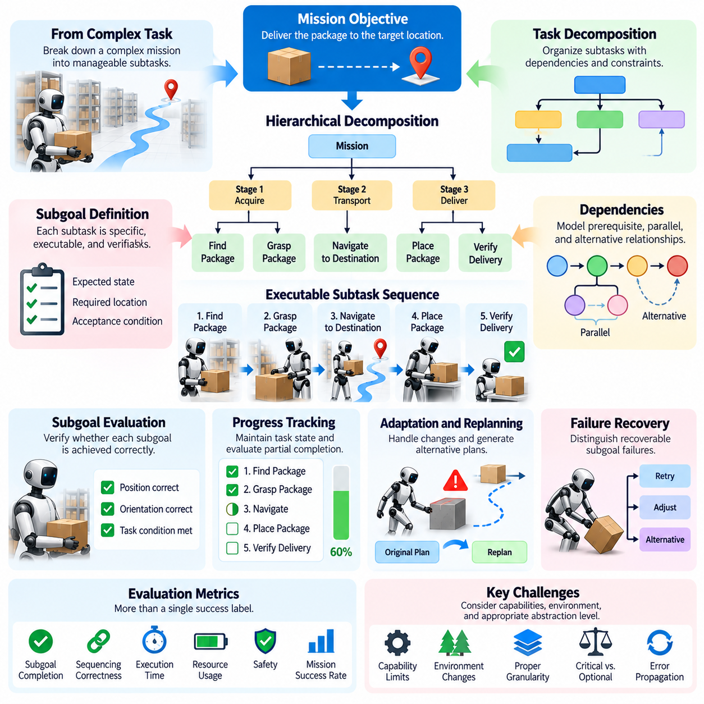{width="7.268055555555556in" height="7.268055555555556in"}

Task decomposition is the process of transforming a complex mission into smaller, manageable subtasks that can be planned, executed, and evaluated systematically. In Physical AI, this process connects high-level objectives with the physical actions required to achieve them. A robot must identify the necessary intermediate goals, determine their dependencies, and organize them into an executable sequence while accounting for environmental constraints and available capabilities.

Subgoal evaluation examines whether these intermediate objectives contribute meaningfully to successful mission completion. A robot may perform individual subtasks correctly but still fail to achieve the overall objective if the subtasks are incomplete, incorrectly ordered, or poorly coordinated. Evaluation must therefore assess both the quality of individual subgoals and their collective contribution to the intended mission outcome.

A useful decomposition begins with a clearly specified mission objective and identifies the conditions required for completion. For example, a mobile manipulator tasked with delivering a package may need to locate the package, navigate to its position, grasp it securely, travel to the destination, release the package, and verify delivery. Each subgoal establishes a measurable intermediate condition that supports the next stage of execution.

The quality of task decomposition depends on whether subtasks are sufficiently specific, executable, and verifiable. A vague subgoal such as preparing an object may not provide enough information for reliable execution or evaluation. A more precise formulation specifies the expected object state, required location, and acceptance conditions. Clearly defined subgoals make it easier to distinguish successful progress from incomplete execution or unintended environmental changes.

Dependencies between subtasks are central to decomposition quality. Some operations require the successful completion of earlier stages, while others can be performed independently or in parallel. A robot cannot safely transport an object before securing it, but it may inspect a destination while another independent preparation activity is underway. Evaluation should determine whether the decomposition captures these dependencies and produces a feasible execution order.

Subgoal boundaries must also reflect the capabilities and limitations of the physical system. A decomposition that assumes precise manipulation beyond the robot\'s mechanical reach or reliable perception under unsupported conditions may be logically consistent but operationally infeasible. Effective evaluation considers whether each subtask can be executed using the available sensors, actuators, computational resources, and control policies.

The appropriate level of decomposition varies with mission complexity. Excessively broad subtasks conceal important decisions and make failures difficult to diagnose. Excessively narrow subtasks create unnecessary planning overhead and may prevent the system from exploiting useful combinations of actions. Evaluation should examine whether the decomposition provides enough detail for reliable execution without introducing avoidable complexity.

Hierarchical decomposition allows a robot to represent missions at multiple levels of abstraction. A high-level objective can be divided into operational stages, which are further divided into executable actions and low-level control commands. Each level should preserve the intent of the level above it while providing sufficient detail for the level below. Evaluation examines whether information and constraints remain consistent throughout this hierarchy.

Subgoal completion requires explicit verification rather than an assumption that issuing an action guarantees its intended result. A robot instructed to place a component may complete the movement while leaving the component incorrectly positioned. Evaluation should compare the observed physical state against the specified completion conditions. This distinction prevents the system from treating attempted actions as successful outcomes and allows it to detect incomplete or incorrect execution.

Progress evaluation should also account for partial completion. A subtask may achieve some required conditions while leaving others unsatisfied. For example, a robot may reach a delivery location but fail to orient a package correctly for placement. Recording intermediate progress provides more diagnostic information than assigning only a binary success or failure label. However, partial credit must not obscure unmet requirements that are essential to mission completion or safety.

The relationship between subgoal success and overall mission success is not always straightforward. Some subtasks are mandatory, whereas others improve efficiency or provide alternative routes to the same objective. A failed optional action may have little effect on the final outcome, while a small error in a critical prerequisite may invalidate the entire mission. Evaluation should distinguish critical dependencies from flexible alternatives and weight outcomes according to their operational significance.

Task decomposition must remain adaptable when environmental conditions change. An unexpected obstacle, unavailable object, or failed grasp may invalidate the original plan. A capable system should identify which subgoals remain achievable, determine which dependencies have changed, and generate an appropriate alternative. Evaluation should measure whether replanning preserves the overall objective while avoiding unnecessary repetition of completed work.

Recovery behavior also depends on the quality of the decomposition. When a subgoal fails, the system should identify the affected stage and determine whether the failure can be corrected locally or requires reconsideration of earlier decisions. A failed grasp may require another approach, whereas discovering that an object is unavailable may require selecting a different source. Evaluation should examine whether recovery decisions address the actual cause rather than merely repeating the previous action.

Long-horizon missions introduce additional challenges because the validity of earlier subgoals may change over time. A location that was previously accessible may become blocked, and an object that was successfully identified may be moved before retrieval. The system must distinguish completed actions from conditions that remain valid. Subgoal evaluation should therefore consider both historical completion and the continued validity of relevant world states.

Temporal constraints provide another dimension for assessing decomposition. Some subtasks must finish before a deadline, while others must occur within a particular time window or remain synchronized with external events. A decomposition can be logically correct yet fail operationally if it ignores these timing requirements. Evaluation should examine whether the plan accounts for execution duration, resource availability, synchronization, and the consequences of delays.

Resource constraints also influence subgoal selection and ordering. Battery capacity, payload limits, available tools, computational load, and access to shared workspaces can determine whether a proposed sequence is feasible. A robot may need to recharge, retrieve equipment, or reserve a restricted area before continuing. Evaluation should assess whether resource requirements are represented accurately and whether the selected decomposition supports sustained mission execution.

Safety requirements must be incorporated into both task decomposition and subgoal evaluation. A sequence of locally acceptable actions can produce an unsafe overall outcome if interactions between stages are ignored. For example, moving an object may obstruct an emergency route needed later in the mission. Evaluation should verify that safety constraints remain satisfied across subgoal transitions and that the decomposition includes appropriate checks before hazardous or irreversible actions.

Subgoal evaluation can also reveal weaknesses in planning and reasoning. If a system repeatedly generates redundant steps, overlooks necessary prerequisites, or selects actions that do not advance the mission, the problem may lie in its decomposition strategy rather than its low-level controller. Recording subgoal definitions, dependency relationships, execution outcomes, and recovery decisions helps researchers identify these distinctions and improve the appropriate system component.

Reliable assessment requires consistent task specifications and repeatable evaluation conditions. Benchmarks should define mission objectives, subgoal acceptance criteria, dependency rules, resource limits, and termination conditions. Repeated trials across varied environments can reveal whether a decomposition strategy is robust or dependent on familiar scenarios. Reporting mission completion alongside subgoal accuracy, execution time, recovery frequency, and intervention requirements provides a more complete account of system performance.

Ultimately, task decomposition and subgoal evaluation connect high-level mission reasoning with measurable physical outcomes. Effective systems must divide complex objectives into feasible intermediate goals, preserve dependencies, verify progress, and adapt when assumptions fail. Evaluating these capabilities reveals whether a Physical AI system can organize its actions into coherent, reliable, and safe mission execution rather than merely performing a collection of individually successful skills.

## 06.04. Temporal Credit and Progress Metrics

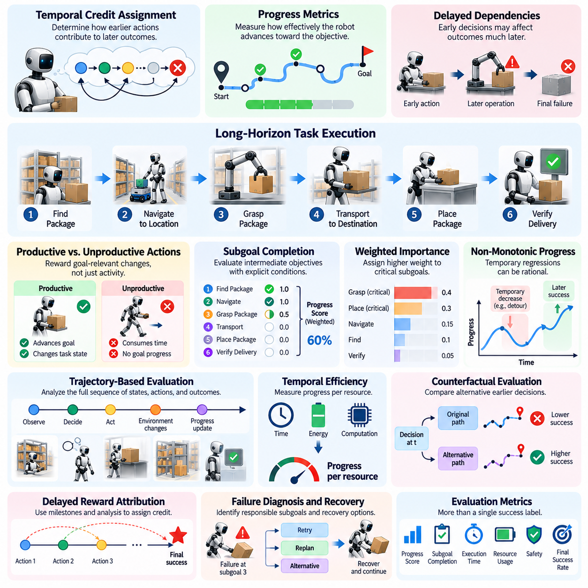{width="7.268055555555556in" height="7.268055555555556in"}

Temporal credit assignment is the process of determining how actions and decisions made at different moments contribute to the eventual outcome of a task. In Physical AI, this problem becomes particularly important during long-horizon missions because the consequences of an action may emerge much later. Evaluation must identify which earlier decisions supported progress, introduced risks, or caused failures that only became visible during subsequent operations.

Progress metrics complement temporal credit assignment by measuring how effectively a robot advances toward its intended objective. Traditional success metrics often classify an entire mission as completed or failed, providing limited information about intermediate performance. Progress-oriented evaluation instead examines meaningful changes in task state, completed subgoals, remaining requirements, and the quality of advancement throughout execution.

Long-horizon tasks frequently contain delayed dependencies between actions and outcomes. A robot may position an object incorrectly during an early manipulation step, yet the resulting failure may occur only when another component must be assembled. Assigning responsibility exclusively to the final unsuccessful action would misrepresent the underlying cause. Temporal evaluation must connect later outcomes with relevant earlier decisions and environmental changes.

A fundamental challenge is distinguishing productive actions from activities that merely consume time or resources. A robot may move repeatedly, manipulate objects, or execute valid commands without approaching the mission objective. Progress metrics should therefore reflect verified changes in goal-relevant conditions rather than the number of actions performed. This distinction prevents excessive activity from being incorrectly interpreted as meaningful task advancement.

Subgoal completion provides a practical foundation for measuring progress. Complex missions can be decomposed into intermediate objectives with explicit acceptance conditions. Evaluators can record which subgoals have been achieved, which remain incomplete, and which have become invalid because of environmental changes. However, counting completed subgoals alone may be misleading when their difficulty, importance, and dependency relationships differ substantially.

Weighted progress metrics address these differences by assigning greater importance to critical or resource-intensive objectives. For example, safely securing a hazardous object may contribute more to mission readiness than completing several routine navigation movements. Weighting schemes should be defined before evaluation and justified by mission requirements. Otherwise, arbitrary weights may distort comparisons or reward behavior that does not improve actual mission outcomes.

Temporal credit assignment also requires distinguishing direct effects from indirect consequences. A navigation decision may not immediately affect manipulation quality, but it can determine the robot\'s approach orientation and available workspace. Similarly, an early perception error may influence several later planning decisions. Evaluation should preserve sufficient execution history to identify plausible causal relationships without assuming that temporal proximity establishes causation.

Trajectory-based evaluation provides a systematic way to examine these relationships. A trajectory records observations, estimated states, selected actions, intermediate outcomes, and relevant environmental transitions. By analyzing the sequence, evaluators can determine where progress accelerated, stalled, reversed, or became unsafe. Such analysis supports diagnosis of planning failures, control limitations, incorrect assumptions, and delayed error propagation.

Progress is not necessarily monotonic during physical task execution. A robot may temporarily move away from a destination to avoid an obstacle, reposition an object to improve accessibility, or undo an earlier action before completing assembly. These behaviors can represent rational progress despite increasing immediate distance from the goal. Evaluation must distinguish temporary regressions that support future success from unnecessary or ineffective detours.

Potential-based progress measures can represent advancement through changes in estimated distance to a goal state. This distance may be geometric, symbolic, or defined over task-specific state variables. However, a simple distance measure may fail when successful execution requires intermediate preparation or nonlocal actions. Progress functions should therefore incorporate relevant task structure and avoid rewarding shortcuts that violate operational constraints.

Temporal efficiency introduces another important evaluation dimension. Two robots may reach identical intermediate states but require different amounts of time, energy, or computation. Measuring progress per unit of resource consumption can reveal operational efficiency, although faster progress is not always preferable. Safety margins, uncertainty reduction, and preparation for later stages may justify additional effort that produces limited immediate advancement.

Delayed rewards create difficulties for both learning and evaluation. A successful final outcome may depend on many earlier decisions whose individual contributions are difficult to isolate. Techniques such as reward decomposition, counterfactual analysis, and intermediate milestone attribution can provide useful diagnostic information. Nevertheless, these methods depend on assumptions about task dynamics and should not be treated as definitive causal explanations without supporting evidence.

Counterfactual evaluation asks whether a different earlier decision might have produced a better outcome. In simulation, evaluators may restore a previous state and compare alternative actions under controlled conditions. This approach can help identify influential decisions and avoid attributing failure to unrelated events. In physical environments, exact state restoration is often impossible, requiring repeated trials, approximate matching, or model-based analysis.

Uncertainty must be considered when assigning temporal credit. Sensor noise, partial observability, stochastic contact dynamics, and changing environments can obscure the relationship between decisions and outcomes. A robot may select a reasonable action that fails because of an unpredictable disturbance. Evaluation should distinguish decision quality from realized outcomes whenever sufficient evidence exists, while reporting uncertainty when causal responsibility cannot be established.

Progress metrics must also recognize recovery behavior. After a failed grasp or navigation attempt, a robot may spend time restoring a usable state before resuming its mission. A metric based only on immediate goal proximity may penalize this necessary recovery. More informative evaluation records lost progress, recovery duration, restored capabilities, and subsequent task completion to determine whether corrective actions were effective.

Mission progress can be represented at multiple temporal scales. Short-term metrics capture immediate execution quality, medium-term metrics measure subgoal achievement, and long-term metrics assess mission completion and sustained autonomy. These measurements should remain connected so that local improvements do not conceal global failures. A system that optimizes individual movements while repeatedly abandoning mission objectives should not receive a favorable overall evaluation.

Safety and progress must be evaluated together because advancement toward a goal is not beneficial when achieved through unacceptable risk. A robot may shorten its route by entering a restricted area or increase manipulation speed beyond safe operating limits. Progress metrics should incorporate feasibility and safety constraints, while safety-critical violations should be reported separately rather than hidden within an aggregated performance score.

Human intervention can complicate temporal attribution because externally supplied corrections may determine whether later subgoals succeed. If an operator resolves a localization failure, subsequent autonomous navigation should not be interpreted as evidence that the robot independently recovered. Evaluation records should identify intervention timing, assistance type, and affected task stages. This allows autonomous progress to be distinguished from progress enabled by external support.

Benchmark design should specify progress definitions, temporal sampling procedures, subgoal weights, and credit assignment assumptions before testing. Evaluation logs should preserve timestamps, action histories, state estimates, verification results, and intervention records. Repeated trials across varied conditions can reveal whether observed progress patterns are consistent or dependent on favorable circumstances. Statistical reporting should include variability and uncertainty.

A robust evaluation framework should combine final mission success with intermediate progress, temporal efficiency, recovery quality, and causal diagnostics. No single metric can fully represent the complexity of extended physical interaction. Multi-dimensional assessment helps distinguish systems that make reliable progress from those that exhibit temporary success, inefficient repetition, or fragile execution strategies under changing conditions.

Ultimately, temporal credit assignment and progress metrics explain not only whether a Physical AI system completes a mission but also how its decisions contribute to success or failure over time. They connect local actions with delayed consequences, reveal hidden dependencies, and support systematic improvement of planning and control. Their integration is essential for evaluating dependable long-horizon autonomy in complex physical environments.

## 06.05. Long Horizon Task Success

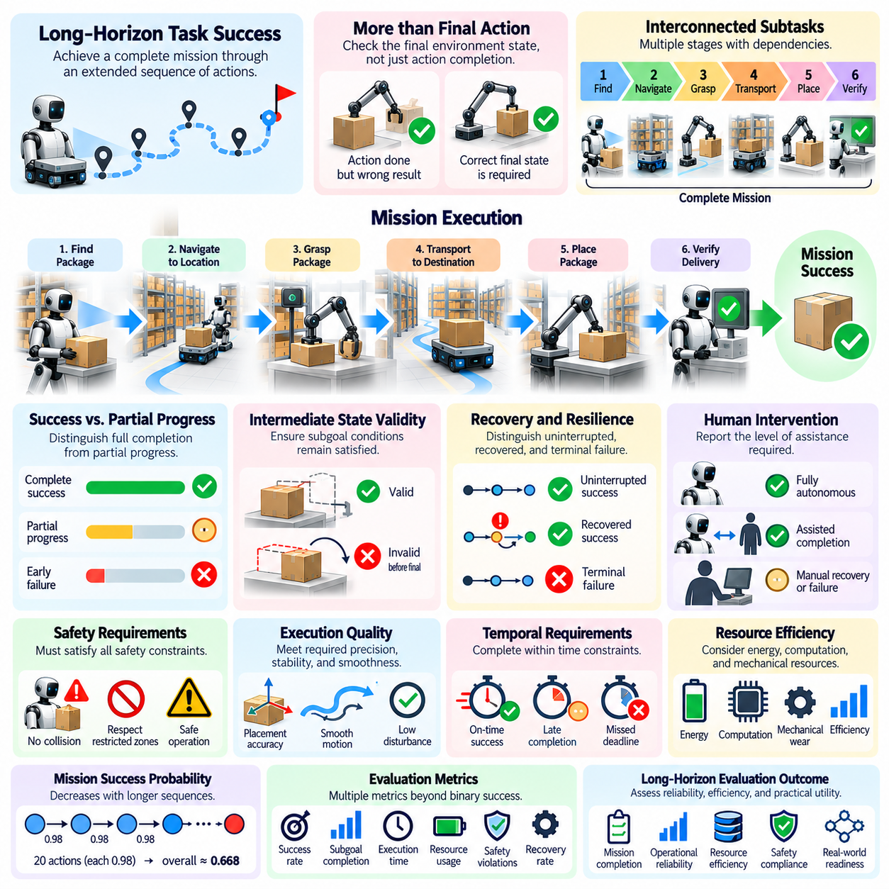{width="7.268055555555556in" height="7.268055555555556in"}

Long-horizon task success refers to the ability of a Physical AI system to achieve a complete mission objective through an extended sequence of coordinated actions and decisions. Unlike short-horizon evaluation, which focuses on isolated skills or immediate outcomes, long-horizon success requires sustained competence across multiple stages. The system must maintain goal consistency, manage dependencies, and respond appropriately to changes throughout execution.

Defining success in long-horizon tasks requires more than observing whether the final action was completed. A robot may execute every planned movement while failing to produce the intended physical outcome. For example, a delivery robot may reach the destination without transferring the correct package. Evaluation must therefore establish explicit mission acceptance criteria based on verified environmental states rather than action completion alone.

A complete mission typically consists of interconnected subtasks with different operational requirements. A mobile manipulator may need to identify an object, navigate toward it, grasp it, transport it, place it accurately, and confirm the final arrangement. Success depends on satisfying the required conditions across the entire sequence. Failure in a critical prerequisite may invalidate subsequent actions even when those actions are executed correctly.

Long-horizon success metrics must distinguish mission completion from partial progress. A robot that completes most subtasks but fails during the final stage demonstrates different capabilities from one that fails immediately. Binary success indicators provide a clear measure of final achievement, but they conceal important differences in execution quality. Complementary progress metrics help characterize incomplete missions without treating partial completion as full success.

Mission success should also account for the validity of intermediate states. A robot may temporarily satisfy a subgoal that becomes invalid before the mission ends. For example, an object may be correctly positioned during preparation but displaced during later manipulation. Evaluation must determine whether required conditions remain satisfied when relevant dependencies are exercised and whether the final world state meets all mandatory requirements.

The probability of completing a long sequence can decrease as the number of required operations increases. Under a simplified assumption of independent actions with identical success probabilities, overall uninterrupted success is the product of individual probabilities. Twenty actions with a success probability of 0.98 each yield approximately 0.668 overall success. Real systems require more detailed analysis because errors are correlated and recovery may restore progress.

Recovery capability is a defining element of practical mission success. A robot may experience a failed grasp, temporary localization error, or blocked route without permanently losing the ability to complete its objective. Evaluation should distinguish uninterrupted success from recovered success and terminal failure. This distinction reveals whether a system can maintain mission continuity despite disturbances rather than succeeding only under ideal conditions.

However, successful recovery does not eliminate the operational cost of failure. Repeated attempts may increase mission duration, energy consumption, mechanical wear, and exposure to hazards. A system that eventually completes a mission after numerous corrective actions may be less useful than one that completes it consistently with minimal disruption. Long-horizon evaluation should therefore report recovery frequency, recovery duration, and associated resource costs.

Autonomous mission success must be distinguished from assisted completion. Human operators may resolve unexpected obstacles, correct perception errors, reset controllers, or provide additional instructions. Although the mission may ultimately reach its objective, external assistance changes the meaning of the result. Evaluation protocols should specify permitted intervention levels and separately report fully autonomous, assisted, and unsuccessful outcomes.

Safety is an essential condition for meaningful long-horizon success. Completing a task while causing collisions, damaging equipment, violating restricted zones, or exposing people to unacceptable risks cannot be considered equivalent to safe completion. Evaluation should define mandatory safety constraints and record violations independently of productivity metrics. Critical safety failures may invalidate mission success even when the final objective is physically achieved.

Execution quality provides another dimension beyond binary completion. Two robots may accomplish identical objectives while exhibiting different levels of precision, stability, smoothness, and environmental disturbance. A manipulation task may require placement within specified tolerances, while a navigation mission may impose clearance and positioning requirements. Success criteria should reflect the quality necessary for the intended application.

Temporal requirements also influence the interpretation of mission success. A robot may eventually complete every subtask but miss a critical deadline or fail to synchronize with another system. In logistics, manufacturing, and inspection applications, delayed completion can reduce or eliminate operational value. Evaluation should distinguish completion within required time constraints from late completion and report the consequences of timing violations.

Resource efficiency must be considered alongside successful execution. Extended missions consume energy, computation, communication bandwidth, and mechanical resources. A robot that completes a mission while exhausting essential resources may be unable to continue operating safely. Evaluation should measure resource consumption and remaining operational capacity, particularly when missions form part of continuous deployment rather than isolated demonstrations.

Long-horizon success depends on maintaining accurate task and world representations over time. Robots must remember completed operations, preserve relevant instructions, track object states, and update assumptions when environments change. Errors in memory or state estimation may cause redundant actions, missed requirements, or incorrect termination. Evaluation should examine whether the system retains the information necessary to support consistent decisions throughout the mission.

Planning and replanning competence also affect mission outcomes. A successful system must coordinate actions across multiple temporal scales while adapting to unexpected conditions. When a route becomes blocked or an object becomes unavailable, the robot should identify feasible alternatives without abandoning the original objective unnecessarily. Evaluation should determine whether revised plans preserve mission constraints and support continued progress.

Mission success must be assessed under environmental variability rather than only fixed laboratory conditions. Changes in lighting, terrain, object arrangement, human activity, and sensor quality can affect performance over extended periods. A system that succeeds repeatedly in a familiar environment may fail under modest variations. Benchmarking should therefore include controlled disturbances and unseen configurations to examine the robustness of mission completion.

Statistical reliability is especially important because a small number of successful demonstrations cannot establish dependable autonomy. Evaluation should include repeated trials across representative conditions and report completion rates with appropriate uncertainty estimates. Failure distributions, mission durations, and intervention frequencies provide additional context. Comparisons between systems should account for differences in task difficulty and exposure to disturbances.

Long-horizon success can also be evaluated through survival-oriented measurements that examine how mission reliability changes with duration or task complexity. The probability of remaining operational without terminal failure may decline as execution continues. Survival curves, time-to-failure distributions, and completion probabilities at different mission lengths can reveal limitations that aggregate success rates conceal.

Continuous operation introduces further distinctions between completing a single mission and maintaining reliable performance across repeated missions. A robot may succeed during one task but gradually accumulate localization drift, thermal stress, or resource depletion. Evaluation should examine whether the system can reset relevant task states, recover operational readiness, and complete successive missions without excessive maintenance or intervention.

A comprehensive long-horizon success framework should combine final objective satisfaction, subgoal completion, safety compliance, execution quality, autonomy level, temporal efficiency, and resource consumption. These dimensions should remain individually interpretable rather than being hidden within a single aggregate score. Clear reporting enables researchers to distinguish genuinely dependable systems from those achieving occasional success through favorable conditions or extensive assistance.

Ultimately, long-horizon task success represents the transition from demonstrating isolated robotic capabilities to validating sustained mission-level autonomy. A successful Physical AI system must achieve verified objectives while preserving safety, managing uncertainty, recovering from disturbances, and operating within practical constraints. Evaluating these properties together establishes whether the system can deliver reliable and repeatable performance in complex real-world environments.

## 06.06. Compounding Error and Error Propagation

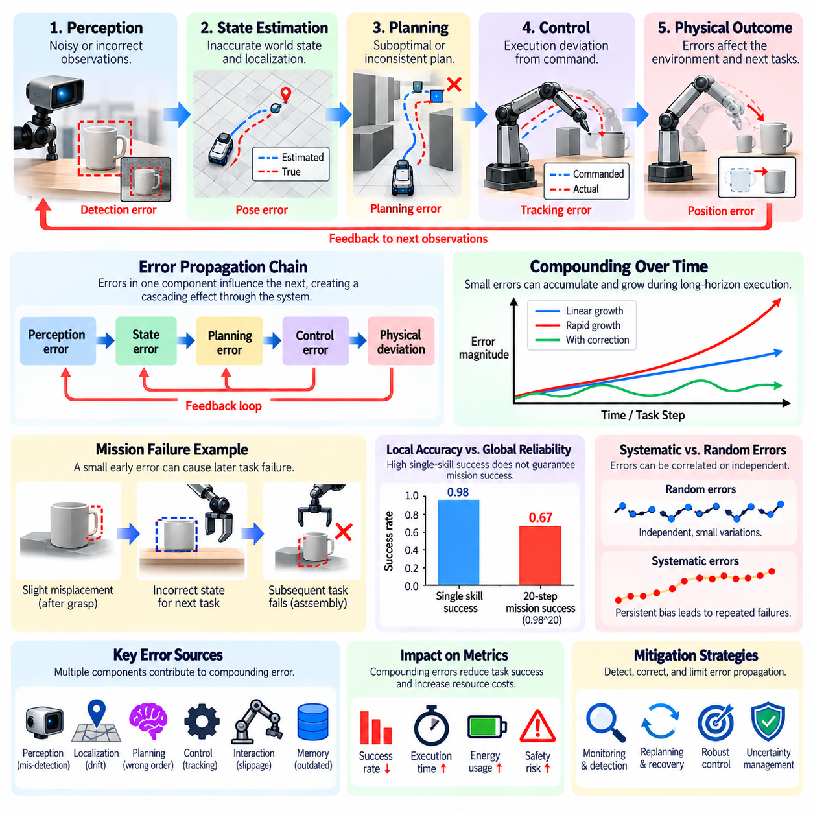{width="7.268055555555556in" height="7.268055555555556in"}

Compounding error refers to the accumulation of small inaccuracies across successive actions, observations, and decisions during extended task execution. In Physical AI, even minor deviations can become significant when their effects persist across multiple stages. Long-horizon evaluation must examine how errors originate, interact, and influence later operations rather than assessing each action as an isolated event.

Error propagation occurs when inaccuracies in one component influence the outputs of subsequent components. A small perception error may affect state estimation, which then changes planning decisions and control commands. The resulting physical deviation can generate additional observation errors, creating a feedback cycle. Evaluating this process requires tracing relationships between sensing, reasoning, planning, and execution.

Long-horizon missions are especially vulnerable because intermediate states often become the starting conditions for later actions. A robot that places an object slightly outside its intended position may cause a subsequent grasp or assembly operation to fail. Although the original placement error appears small, its downstream consequences can be substantial. Evaluation should therefore consider both immediate error magnitude and eventual mission impact.

Compounding error does not always increase at a constant rate. Some inaccuracies accumulate approximately linearly, while others grow rapidly because of unstable dynamics, repeated estimation bias, or interacting control errors. Certain deviations may also diminish through corrective feedback. Evaluation should identify whether errors are amplified, preserved, or attenuated over time and determine the conditions responsible for these behaviors.

State estimation errors are a major source of long-horizon performance degradation. Mobile robots continuously estimate position, orientation, velocity, and environmental relationships using imperfect measurements. Small localization errors can accumulate during extended navigation, particularly when external reference observations are unavailable. Evaluation should measure estimation drift and its influence on navigation, manipulation, and task completion.

Perception errors can propagate through symbolic and geometric representations of the environment. Misidentifying an object, estimating its pose incorrectly, or overlooking an obstacle may produce an inaccurate world model. Planning systems operating on this representation can generate internally consistent but physically inappropriate actions. Evaluation must distinguish failures caused by incorrect observations from failures caused by subsequent reasoning.

Control inaccuracies introduce another pathway for error accumulation. Actuator delays, calibration errors, friction variations, and imperfect dynamics models can produce differences between commanded and actual motion. Repeated execution may increase positional deviations or cause unstable interactions with objects. Evaluation should compare intended and observed trajectories while accounting for physical uncertainty and disturbances.

Planning errors may compound even when individual actions are executed accurately. An incorrect task decomposition, overlooked prerequisite, or unsuitable action ordering can create dependencies that become increasingly difficult to resolve. A robot may complete several locally valid operations while moving farther from the overall mission objective. Evaluation should assess whether planning decisions preserve future feasibility and support sustained progress.

Memory and context errors also contribute to long-horizon failures. A robot may forget that a subtask was completed, retain outdated information about an object, or confuse the current mission stage with an earlier one. These errors can trigger redundant actions, incorrect transitions, or unsafe decisions. Evaluation should examine how reliably the system preserves and updates task-relevant information throughout extended execution.

The relationship between local accuracy and global reliability is fundamental to compounding-error analysis. A system may achieve high success rates on individual skills while exhibiting much lower mission completion rates across long sequences. Under simplified independence assumptions, repeated operation success probabilities multiply across stages. Real systems require additional analysis because errors may be correlated, recoverable, or dependent on shared environmental conditions.

Error correlation can significantly change long-horizon outcomes. Repeated failures may arise from a persistent calibration bias, an incorrect world model, or a shared sensor limitation rather than independent random disturbances. Such errors can affect multiple subtasks in similar ways. Evaluation should identify common failure sources and distinguish systematic errors from stochastic variations to avoid misleading reliability estimates.

Error propagation can be represented through temporal dependencies between observations, internal states, decisions, and physical outcomes. Detailed execution logs allow evaluators to reconstruct when deviations first appeared and how they influenced later stages. Timestamped sensor data, state estimates, planned actions, control outputs, and verification results provide evidence for diagnosing failure pathways and identifying potential intervention points.

Quantitative error metrics should reflect the physical and operational significance of deviations. Position error, orientation error, trajectory deviation, state estimation uncertainty, and task constraint violations may all be relevant. However, identical numerical errors can have different consequences depending on the task. A small positioning deviation may be harmless during navigation but unacceptable during precision assembly.

Error budgets provide a structured method for allocating acceptable uncertainty across system components and task stages. A mission may specify tolerances for sensing, localization, manipulation, and final placement. Evaluation can determine whether individual components remain within their assigned limits and whether combined errors threaten mission requirements. Such budgets must account for dependencies rather than assuming every source contributes independently.

Recovery and correction mechanisms determine whether accumulated errors become terminal failures. Recalibration, active perception, localization updates, replanning, and corrective manipulation can reduce deviations before they propagate further. Evaluation should measure how quickly the system detects errors, whether corrective actions restore valid states, and how much residual uncertainty remains after recovery.

Early error detection is particularly valuable because correction costs often increase as execution progresses. A misplaced component may be easy to reposition immediately but difficult to access after additional assembly steps. Similarly, localization drift may be corrected before entering a constrained workspace but become hazardous during precision movement. Evaluation should examine detection latency and the operational consequences of delayed intervention.

Long-horizon error analysis must also consider uncertainty accumulation. A robot may maintain an estimated state that appears consistent while confidence in that estimate gradually decreases. Without appropriate uncertainty tracking, planning systems may continue operating under unjustified assumptions. Evaluation should assess whether uncertainty estimates are calibrated and whether the system requests additional observations when confidence becomes insufficient.

Simulation provides controlled opportunities to study error propagation by introducing known disturbances and varying their magnitude, timing, and frequency. Researchers can inject sensor noise, actuator bias, delayed observations, or incorrect object poses to identify system sensitivities. However, simulated error behavior must be validated against physical measurements because real-world contact dynamics and environmental variability may differ substantially.

Benchmark protocols should include missions of varying lengths and complexity to reveal how reliability changes with execution horizon. Repeated trials can measure failure probability, accumulated deviation, recovery frequency, and time to terminal failure. Comparisons should control task difficulty and disturbance exposure. Reporting error trajectories alongside final success rates provides more diagnostic information than aggregate completion statistics alone.

Safety-critical error propagation requires particular attention because small deviations may eventually violate hard operational constraints. An accumulating localization error can reduce obstacle clearance, while repeated force-control inaccuracies may damage fragile objects. Evaluation should identify safety margins, monitor approaching constraint boundaries, and distinguish recoverable deviations from hazardous states requiring immediate intervention.

A comprehensive framework should connect error sources, propagation pathways, detection mechanisms, and final mission consequences. It should examine perception, estimation, memory, planning, and control as interacting components rather than independent subsystems. Ultimately, understanding compounding error enables Physical AI developers to design systems that detect deviations early, limit their amplification, and sustain reliable long-horizon operation under realistic uncertainty.

## 06.07. Memory and Context Retention

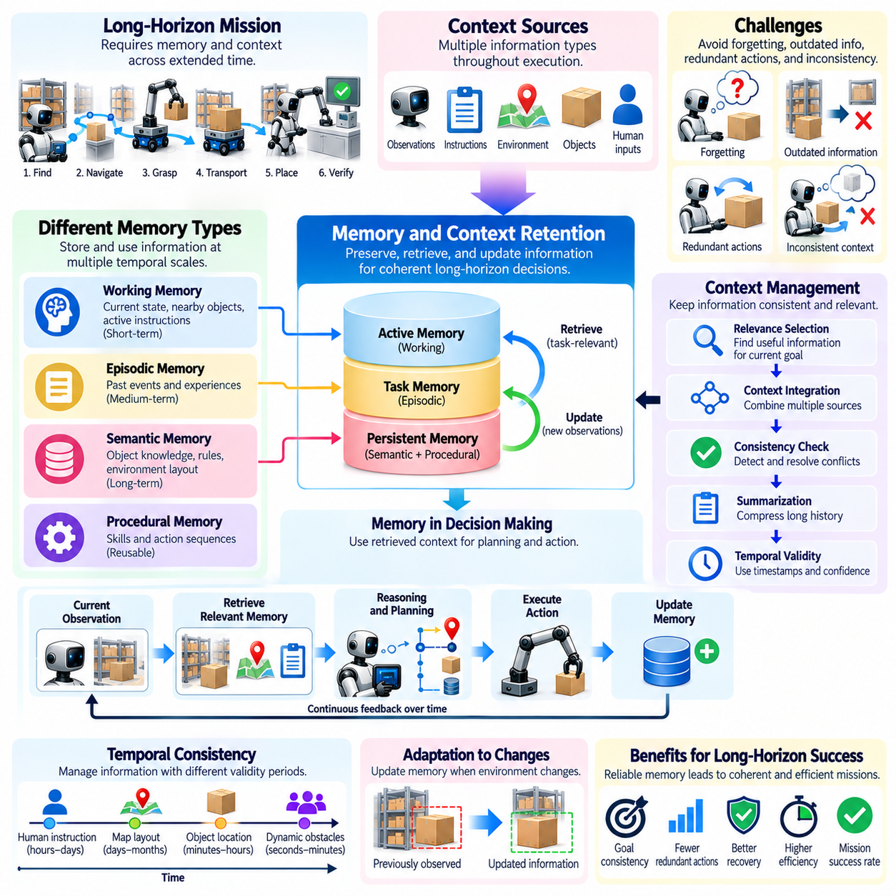{width="7.268055555555556in" height="7.268055555555556in"}

Memory and context retention refer to a Physical AI system\'s ability to preserve, retrieve, and update information required for coherent decisions throughout extended task execution. Unlike short-horizon tasks, long-horizon missions depend on observations and decisions made across widely separated moments. Evaluation must determine whether the system retains relevant information while avoiding outdated, redundant, or misleading representations.

Memory enables robots to connect previous experiences with current observations and future objectives. A robot may need to remember where an object was last observed, which subtasks have been completed, and which environmental constraints remain active. Without reliable retention, the system may repeat completed actions or overlook essential dependencies. Long-horizon evaluation should assess whether stored information supports consistent mission execution.

Context retention extends beyond storing individual observations. It involves preserving the relationships between mission objectives, task instructions, environmental states, and earlier decisions. A robot may remember an object\'s location but forget why the object was selected or how it relates to the current task. Evaluation should examine whether retained context supports meaningful reasoning rather than merely reproducing isolated historical details.

Different temporal scales require different forms of memory. Short-term memory supports immediate perception and control, medium-term memory maintains subgoal progress and local task context, and long-term memory preserves persistent environmental knowledge and prior experience. These layers must exchange information without introducing contradictions. Evaluation should determine whether relevant knowledge remains accessible across changing execution horizons.

Working memory provides the active information needed for immediate decision-making. It may contain the current robot state, nearby obstacles, active instructions, and recently observed object properties. Because computational capacity is limited, the system must prioritize information that directly affects current actions. Evaluation should measure whether working memory preserves essential details while discarding information that no longer contributes to execution.

Episodic memory records events and experiences associated with particular times and situations. A robot may recall that a grasp failed because an object was obstructed or that a corridor became inaccessible during an earlier attempt. Such records can support recovery and future planning. Evaluation should examine whether the system retrieves relevant episodes accurately and applies their lessons without confusing past conditions with current reality.

Semantic memory represents more persistent knowledge about objects, environments, procedures, and operational rules. A robot may retain information about tool functions, room relationships, or handling requirements across multiple missions. However, persistent knowledge can become inaccurate when environments change. Evaluation should assess whether semantic information remains useful and whether the system distinguishes stable knowledge from assumptions requiring verification.

Procedural memory supports the reuse of learned skills and action sequences. A robot may retain successful manipulation routines, navigation strategies, or recovery procedures that reduce planning effort during repeated tasks. Evaluation should determine whether these procedures remain effective under changing conditions. Successful retention requires appropriate adaptation rather than blindly repeating actions learned in different environments.

Memory retrieval is as important as memory storage. A system may preserve accurate information but fail to retrieve it when a relevant decision must be made. Retrieval mechanisms should identify task-related records based on current goals, environmental context, and temporal relevance. Evaluation should measure retrieval accuracy, latency, and the ability to select useful information from large histories without introducing unrelated content.

Memory updating presents another challenge because stored information may conflict with new observations. An object previously recorded at one location may have been moved, or a completed subgoal may become invalid after an environmental disturbance. A capable system should revise its representations while preserving useful historical evidence. Evaluation must distinguish appropriate updates from accidental forgetting or unjustified replacement of reliable information.

Context windows and computational limits constrain how much historical information can be processed simultaneously. Systems using transformer-based reasoning may need summarization, retrieval, or hierarchical representations to manage extended histories. Compression reduces resource consumption but can remove important dependencies or safety conditions. Evaluation should examine whether compressed context preserves information essential for later decisions.

Hierarchical memory organization can improve scalability by separating immediate observations, task-level summaries, and persistent knowledge. High-level representations capture mission objectives and dependencies, while lower-level records preserve detailed execution evidence. Information should move between levels according to operational relevance. Evaluation should test whether abstraction preserves critical details and whether detailed records can be recovered when necessary.

Temporal consistency is essential because remembered information has different validity periods. A robot\'s knowledge of a fixed doorway may remain useful for months, while an observation of a moving person may become outdated within seconds. Memory systems should associate information with timestamps, confidence estimates, and validity conditions. Evaluation should determine whether the robot recognizes when stored information requires renewed observation.

Long-horizon missions also require maintaining goal and instruction continuity. A robot may receive an initial objective, encounter interruptions, perform recovery operations, and later resume its original task. The system must preserve mandatory constraints and distinguish temporary recovery goals from the primary mission. Evaluation should identify whether extended execution causes goal drift, forgotten requirements, or inappropriate changes in task priorities.

Memory failures can propagate into planning and control errors. Forgetting that an object was already transported may cause duplicate handling, while retaining an outdated obstacle map may produce unsafe navigation decisions. Such failures may appear to originate in downstream components even when the underlying problem is incorrect memory. Evaluation should trace these dependencies to distinguish retention failures from reasoning or execution failures.

Robust memory evaluation requires tests that deliberately separate information acquisition from later use. A benchmark may introduce an object property early in a mission and require the robot to apply it after several unrelated subtasks. Varying the delay, intervening activity, and environmental changes reveals retention limitations. Success should depend on appropriate use of remembered information rather than repeated access to the original observation.

Quantitative metrics can include retention accuracy, retrieval precision, update correctness, context consistency, and memory-related task success. Retrieval latency and computational overhead are also important for real-time operation. However, isolated memory scores may not reflect operational usefulness. Evaluation should connect memory performance with downstream planning quality, recovery effectiveness, and final mission outcomes.

Uncertainty management is necessary because remembered information is not always reliable. Sensor noise, incomplete observations, and ambiguous events may produce uncertain records. A robot should distinguish verified facts from estimates and avoid treating low-confidence memories as authoritative. Evaluation should examine whether uncertainty is preserved during storage, retrieval, summarization, and updating, particularly when safety-critical decisions depend on historical information.

Human intervention and multi-agent coordination introduce additional context requirements. A robot may receive corrected instructions from an operator or exchange task information with another robot. These updates must be integrated without losing the history of previous decisions or confusing information sources. Evaluation should verify source attribution, instruction precedence, and consistency across shared and locally maintained memories.

Benchmark protocols should include extended missions with interruptions, repeated objects, changing environments, and delayed dependencies. Evaluation logs should preserve memory writes, retrieval events, updates, timestamps, and resulting decisions. Controlled experiments can compare systems with different memory architectures under equivalent conditions. Reporting both memory-specific metrics and mission-level outcomes helps identify whether architectural improvements translate into practical autonomy.

Ultimately, memory and context retention provide the informational continuity required for dependable long-horizon Physical AI. Effective systems must preserve relevant experiences, retrieve them when needed, update outdated representations, and maintain consistent objectives across extended execution. Evaluating these capabilities reveals whether a robot can reason coherently over time rather than treating each observation and action as an isolated event.

## 06.08. World State Consistency over Time

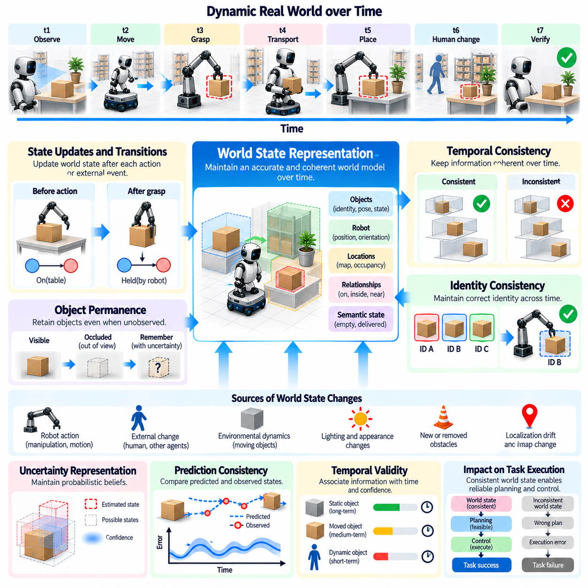{width="7.268055555555556in" height="7.268055555555556in"}

World state consistency over time refers to a Physical AI system\'s ability to maintain an accurate and coherent representation of its environment throughout extended task execution. As robots observe, move, manipulate objects, and interact with people, the physical world changes continuously. Evaluation must determine whether the internal world state reflects these changes without introducing contradictions, losing essential information, or preserving invalid assumptions.

A world state representation describes relevant properties of the robot, objects, locations, and their relationships. It may include object identities, positions, orientations, accessibility, occupancy, and task-related conditions. During long-horizon missions, these properties evolve through robot actions and external events. Consistency requires the system to distinguish persistent facts from temporary observations and update each property according to its expected dynamics.

Temporal consistency differs from instantaneous perception accuracy. A robot may correctly identify objects in individual images while maintaining contradictory beliefs about their locations across successive observations. Similarly, an object temporarily hidden behind an obstacle should not automatically disappear from the internal representation. Evaluation must examine whether information remains logically and physically coherent across time rather than assessing isolated observations alone.

State transitions provide a foundation for evaluating temporal consistency. Each action or external event may transform the world from one configuration into another. A robot that grasps an object should update its representation to reflect the object\'s attachment and changing position. Evaluation should compare predicted transitions with observed outcomes and determine whether unexpected differences trigger appropriate state revision.

Object permanence is essential for reasoning under partial observability. Physical objects generally continue to exist when they leave the sensor\'s field of view, although their locations may become uncertain. A robot should retain object identity while adjusting confidence about its current state. Evaluation should test whether the system preserves plausible object histories without inventing unsupported movements or treating unobserved conditions as verified facts.

Identity consistency becomes difficult when multiple similar objects appear in the same environment. A robot may confuse identical containers, tools, or components after temporary occlusion or relocation. Such errors can propagate into incorrect manipulation and task completion decisions. Evaluation should measure whether object identities remain associated with the correct histories, attributes, and intended destinations throughout the mission.

Spatial consistency requires coherent relationships between coordinate frames, object poses, robot localization, and environmental maps. Small calibration or localization errors can cause the same object to appear at incompatible positions over time. Evaluation should examine coordinate transformations, accumulated drift, and map alignment. Reliable systems must distinguish actual object movement from apparent movement caused by estimation inaccuracies.

Semantic consistency concerns the meaning assigned to objects, locations, and task conditions. A container classified as empty should not simultaneously be represented as holding an item unless the system explicitly models uncertainty or conflicting evidence. Similarly, a completed delivery should correspond to verified transfer conditions. Evaluation should identify contradictory semantic assertions and determine whether the system resolves them through observation or reasoning.

Long-horizon world models must account for both robot-induced and externally induced changes. A robot may move an object intentionally, while a human may relocate another object without the robot observing the event. When later observations conflict with stored information, the system should consider possible external changes. Evaluation should assess whether revisions remain physically plausible and whether uncertainty is handled without unjustified assumptions.

Temporal validity is another critical property of world state information. A static wall location may remain reliable for extended periods, while the position of a moving person may become outdated almost immediately. State representations should associate observations with timestamps, confidence levels, and expected rates of change. Evaluation should determine whether the system recognizes stale information and requests updated observations before consequential actions.

Prediction consistency connects current world states with expected future developments. A Physical AI system may predict object motion, contact outcomes, or environmental changes using learned or physics-based dynamics models. Evaluation should compare predicted states with subsequent observations across different time horizons. Prediction errors should be analyzed for systematic bias, uncertainty calibration, and their effects on planning decisions.

Uncertainty-aware representations are necessary because the true world state is rarely fully observable. A robot may maintain probability distributions, confidence intervals, or multiple hypotheses about ambiguous conditions. Temporal consistency does not require pretending that uncertainty has disappeared. Instead, evaluation should examine whether the system updates beliefs coherently as evidence accumulates and avoids excessive confidence in unsupported conclusions.

State estimation and memory must remain synchronized throughout extended execution. A perception module may update an object\'s position while a planning module continues using an older representation. Such inconsistencies can cause actions based on obsolete information even when individual components operate correctly. Evaluation should investigate synchronization delays, conflicting state versions, and whether decisions reference the appropriate information.

Task-level consistency connects the world model with mission objectives and completed subgoals. A robot may record that an item has been delivered, but the physical state may indicate that the item remains attached to its gripper. Evaluation should compare symbolic task status with verified environmental conditions. This prevents systems from confusing issued commands, predicted outcomes, and physically confirmed accomplishments.

Contradiction detection is an important capability for maintaining reliable world representations. Conflicts may arise when observations disagree with previous estimates, predicted transitions fail, or multiple sensors provide incompatible measurements. A robust system should identify these conflicts and seek additional evidence when necessary. Evaluation should measure detection accuracy, resolution time, and the consequences of unresolved contradictions.

World state consistency can deteriorate gradually through accumulated estimation errors. Localization drift, object tracking mistakes, inaccurate contact models, and delayed updates may each introduce small deviations. Over extended missions, these inaccuracies can interact and produce substantial discrepancies between the internal model and physical reality. Evaluation should examine error growth and identify when state correction becomes necessary.

Recovery mechanisms help restore consistency after unexpected events. A robot may reobserve an object, relocalize against known landmarks, reconstruct a local map, or revise a task-state estimate. Effective recovery should correct the relevant representation without discarding reliable historical information. Evaluation should measure recovery accuracy, time, computational cost, and whether subsequent actions remain consistent with the corrected state.

Benchmark design should introduce controlled changes that challenge temporal world modeling. Objects may be moved during occlusion, obstacles may appear unexpectedly, or task-relevant conditions may change between observations. These scenarios test whether the system maintains plausible beliefs and updates them when new evidence becomes available. Evaluation should separate genuine state-tracking capability from success based on static environmental assumptions.

Quantitative metrics may include object identity persistence, state transition accuracy, spatial drift, contradiction frequency, temporal validity, and state update latency. Additional measures can assess prediction error, uncertainty calibration, and recovery effectiveness. However, numerical consistency alone is insufficient if errors have little operational significance. Evaluation should connect state quality with planning feasibility, safety, and mission completion.

Safety-critical consistency requires particular attention because outdated or contradictory world states can lead to hazardous actions. A robot that incorrectly believes a workspace is unoccupied may initiate movement near a person, while an outdated obstacle map may compromise navigation clearance. Evaluation should verify that uncertain or stale safety-relevant information triggers appropriate precautions rather than unsupported assumptions of safety.

A comprehensive evaluation framework should examine world state consistency across perception, memory, estimation, prediction, planning, and control. It should assess not only whether individual observations are accurate but also whether the system preserves a coherent history of physical changes. Ultimately, temporal world state consistency enables Physical AI systems to reason reliably about evolving environments and sustain safe, goal-directed behavior during long-horizon missions.

## 06.09. Long Horizon Planning and Replanning

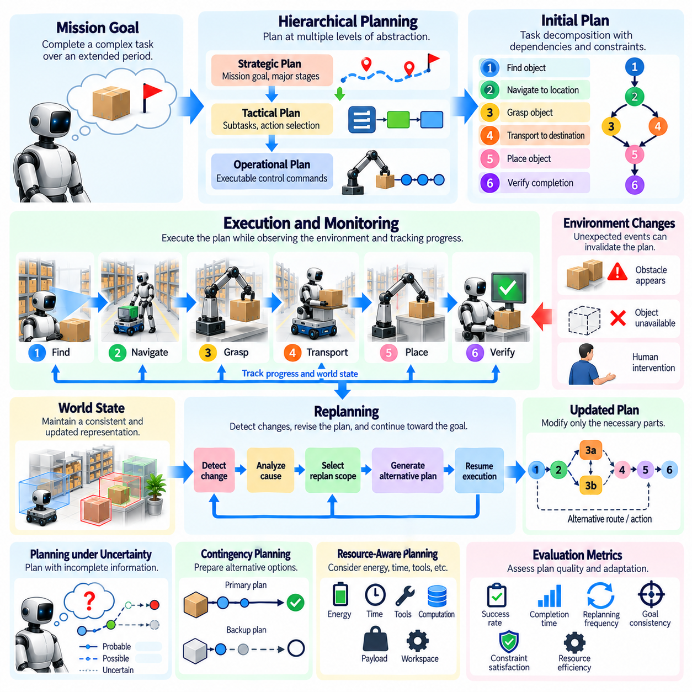{width="7.268055555555556in" height="7.268055555555556in"}

Long-horizon planning is the process of organizing actions and decisions across extended periods to achieve complex mission objectives. In Physical AI, planning must connect high-level goals with executable physical behaviors while accounting for environmental constraints, resource limitations, and uncertainty. Evaluation should determine whether a robot can construct feasible plans that remain coherent and effective throughout prolonged execution.

Unlike short-horizon planning, long-horizon planning requires reasoning about consequences that may emerge many steps after an initial decision. A robot may need to acquire tools, prepare a workspace, transport materials, and complete assembly before reaching its final objective. Evaluation must examine whether the system identifies necessary prerequisites, maintains appropriate action ordering, and anticipates dependencies between distant stages.

Planning quality depends on the accuracy of task decomposition and the representation of intermediate goals. Complex missions are typically divided into subtasks with measurable completion conditions and explicit dependencies. A reliable planner should generate sequences that satisfy these relationships without unnecessary repetition or omitted operations. Evaluation should distinguish logically valid plans from plans that are physically executable under actual operating conditions.

Hierarchical planning provides a practical structure for coordinating decisions at different levels of abstraction. Strategic planning defines mission objectives and major stages, tactical planning selects intermediate actions, and operational planning generates executable movements. These levels must remain mutually consistent while allowing local adjustments. Evaluation should determine whether lower-level execution preserves the intentions and constraints established by higher-level plans.

Replanning becomes necessary when observations reveal that the original plan is no longer feasible or desirable. Unexpected obstacles, unavailable objects, failed grasps, or changing human activity may invalidate earlier assumptions. A capable Physical AI system should recognize these changes and generate an alternative course of action. Evaluation should examine whether replanning responds to meaningful environmental changes rather than repeatedly modifying plans without justification.

Effective replanning begins with identifying which assumptions or constraints have changed. A robot encountering a blocked corridor should determine whether an alternative route exists before reconsidering the entire mission. Similarly, a failed manipulation attempt may require a different grasp configuration rather than complete task decomposition. Evaluation should assess whether the system selects an appropriate scope of revision and avoids unnecessary disruption to completed work.

Plan stability is an important consideration because excessive replanning can reduce efficiency and create inconsistent behavior. A robot that changes its intended route after every minor sensor fluctuation may oscillate between alternatives without making progress. Evaluation should measure replanning frequency, decision stability, and the magnitude of plan revisions. A reliable system should balance responsiveness to genuine changes with resistance to irrelevant disturbances.

Planning under uncertainty requires representing incomplete knowledge about objects, environments, and future events. A robot may not know whether a passage remains accessible or whether a required component is available at its expected location. Robust planning should incorporate uncertainty estimates and select actions that remain useful across plausible conditions. Evaluation should determine whether uncertainty is handled explicitly rather than concealed behind unsupported assumptions.

Contingency planning prepares alternative responses before failures occur. A robot may identify backup routes, alternative grasp strategies, or replacement resources during initial planning. Such preparation can reduce recovery delays when unexpected events arise. However, maintaining too many alternatives may increase computational overhead. Evaluation should examine whether contingency plans improve mission reliability without imposing disproportionate planning costs.

Long-horizon planning must preserve goal consistency across interruptions and changing conditions. A robot may temporarily pursue obstacle avoidance, localization recovery, or battery charging while maintaining its original mission objective. These temporary goals should support rather than replace the primary task. Evaluation should identify goal drift, forgotten requirements, and inappropriate changes in priorities that emerge during extended execution.

World state consistency is essential because planning depends on accurate representations of the current environment. An outdated object location or incorrect task status may cause a planner to select actions that are no longer appropriate. Replanning based on inconsistent state estimates can introduce additional errors. Evaluation should examine whether planning decisions use updated observations and whether detected contradictions trigger state verification before execution.

Temporal constraints introduce additional complexity into extended planning. Some actions must occur before deadlines, while others depend on synchronization with external systems or human operators. A plan may be logically correct but operationally unsuccessful if it violates timing requirements. Evaluation should measure schedule feasibility, deadline compliance, waiting time, and the system\'s ability to revise action timing when delays occur.

Resource-aware planning must account for energy, computational capacity, payload limits, tools, and workspace availability. A robot may need to recharge before transporting a heavy object or retrieve equipment before entering a restricted area. Poor resource allocation can make later subtasks impossible despite successful early execution. Evaluation should determine whether plans preserve sufficient resources for mission completion and respond appropriately to changing availability.

Safety constraints must remain valid during both initial planning and replanning. An alternative route that shortens travel time may be unacceptable if it crosses a restricted zone or reduces clearance around people. Similarly, a revised manipulation sequence may introduce unstable object configurations. Evaluation should verify that generated plans satisfy mandatory safety requirements and that replanning never treats unsafe shortcuts as acceptable progress.

Planning efficiency involves balancing computational effort with the quality of selected actions. More extensive search may produce better plans but introduce delays that are unacceptable in dynamic environments. Conversely, overly simplified planning may overlook critical dependencies. Evaluation should measure planning latency, computational consumption, solution quality, and execution performance while considering the operational deadlines under which decisions must be made.

Model predictive planning offers one approach to maintaining adaptability by repeatedly optimizing actions over a limited future horizon. The system executes part of a plan, incorporates new observations, and updates subsequent decisions. This process can improve responsiveness but may overlook distant consequences if the planning horizon is insufficient. Evaluation should examine whether local optimization remains aligned with long-term mission objectives.

Planning and replanning performance should be evaluated through both outcome-based and process-based metrics. Final mission success reveals whether the objective was achieved, while intermediate measures expose planning weaknesses. Useful indicators include plan feasibility, subgoal completion, replanning latency, revision frequency, execution deviation, and recovery effectiveness. These measurements should distinguish planning failures from perception and control limitations.

Benchmark scenarios should introduce controlled disturbances at different stages of mission execution. Obstacles may appear after navigation begins, objects may become unavailable, or resource constraints may change unexpectedly. Repeated trials across varying mission lengths and disturbance patterns can reveal whether replanning capabilities generalize. Evaluation should compare initial plan quality with the system\'s ability to adapt under equivalent conditions.

Counterfactual analysis can help assess whether alternative planning decisions would have improved mission outcomes. In simulation, evaluators may restore earlier states and compare different plans under controlled disturbances. This approach can reveal inefficient choices and critical dependencies. However, conclusions depend on simulation fidelity and the validity of assumed environmental dynamics, requiring careful interpretation when applied to physical systems.

Long-horizon planning also requires maintaining coherent execution histories. The system should record completed actions, failed attempts, revised assumptions, and reasons for changing plans. These records support debugging and prevent repeated mistakes. Evaluation should determine whether the robot uses historical information to improve subsequent decisions rather than repeatedly reconstructing plans without considering earlier experience.

Ultimately, long-horizon planning and replanning measure whether a Physical AI system can transform complex objectives into sustained, adaptable, and safe physical behavior. Reliable autonomy requires more than generating an initial action sequence; it requires preserving mission intent while responding intelligently to uncertainty and change. Comprehensive evaluation reveals whether planning competence supports consistent mission completion in realistic environments.

## 06.10. Failure Detection and Recovery

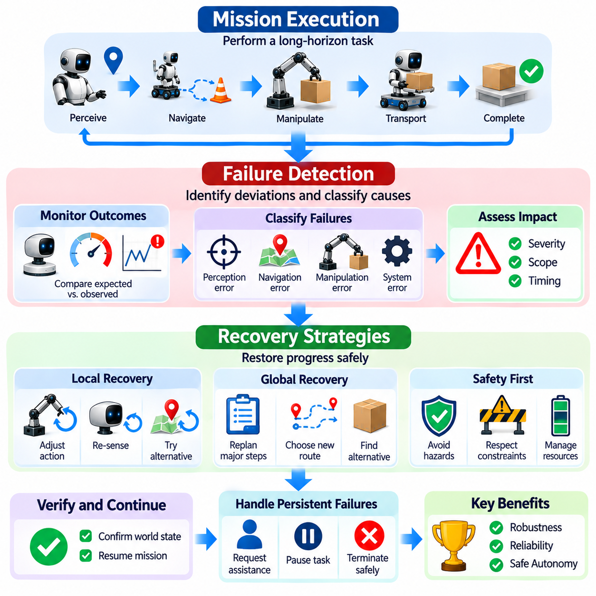{width="7.268055555555556in" height="7.268055555555556in"}

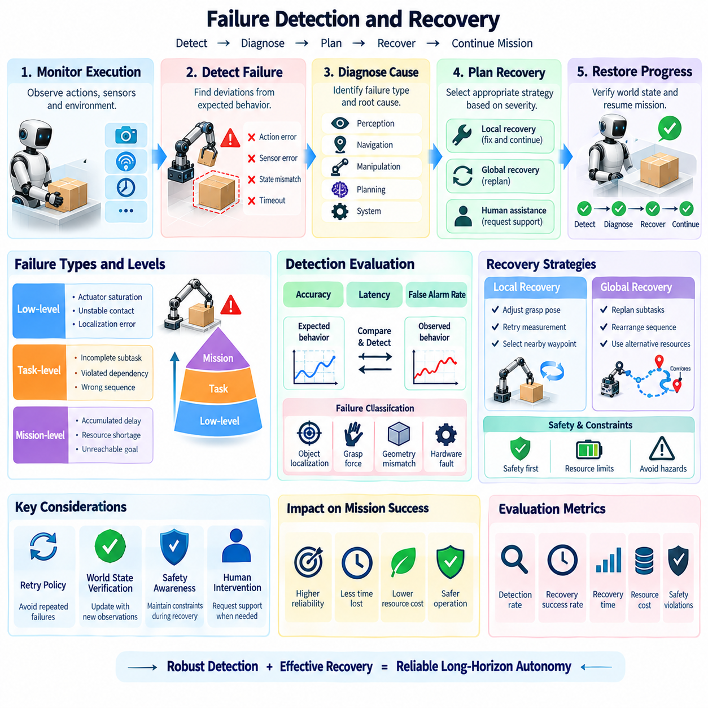{width="7.268055555555556in" height="7.268055555555556in"}

Failure detection and recovery are essential capabilities for evaluating long-horizon Physical AI systems because extended missions inevitably expose robots to unexpected conditions and execution errors. A robot may encounter perception failures, navigation obstacles, manipulation errors, or changing environmental states. Evaluation must determine whether the system can recognize these failures, diagnose their consequences, and restore progress without compromising safety.

Failure detection refers to identifying deviations between expected and observed system behavior. A robot may predict that a grasp will secure an object, but force measurements or visual observations may indicate that the object has slipped. Detecting this discrepancy requires monitoring action outcomes rather than assuming that issued commands were completed successfully. Evaluation should assess detection accuracy, response latency, and the ability to distinguish genuine failures from sensor noise.

Long-horizon missions involve failures at multiple levels of abstraction. Low-level failures include actuator saturation, unstable contact, and localization errors, while task-level failures involve incomplete subtasks or violated dependencies. Mission-level failures may arise when accumulated delays or resource shortages make the final objective unreachable. Evaluation should determine whether the system identifies failures at the appropriate level and understands their implications for subsequent actions.

Failure detection depends on reliable expectations about normal operation. These expectations may originate from physics models, learned predictions, task specifications, or historical performance. A monitoring system compares observed outcomes with predicted states and predefined constraints. Evaluation should examine whether the system detects meaningful deviations under changing operating conditions without generating excessive false alarms that unnecessarily interrupt execution.

Failure classification supports appropriate recovery decisions by distinguishing different causes and consequences. A failed grasp may result from inaccurate object localization, insufficient gripping force, unexpected geometry, or mechanical malfunction. Although these failures may produce similar visible outcomes, they require different responses. Evaluation should assess whether the robot identifies actionable failure categories rather than repeatedly applying ineffective corrections.

Temporal failure detection is particularly important because some errors become visible only after several actions. An incorrectly placed object may remain unnoticed until a later assembly operation fails. Similarly, small localization errors can accumulate before navigation becomes unreliable. Evaluation should measure the delay between failure occurrence and detection, including whether the system identifies early warning signals before errors propagate into larger mission disruptions.

Recovery begins by determining whether the current task can continue safely. A robot should evaluate the severity of the failure, the validity of its world state, and the availability of alternative actions. Minor deviations may require local correction, while significant failures may demand replanning or human assistance. Evaluation should examine whether the selected response matches the failure severity and avoids unnecessary escalation or unsafe continuation.

Local recovery strategies address failures without substantially changing the overall mission plan. A robot may adjust its grasp pose, repeat a perception measurement, or select a nearby navigation waypoint after encountering an obstacle. These actions can restore progress with limited computational and operational cost. Evaluation should measure local recovery success, additional execution time, and whether repeated attempts improve the outcome.

Global recovery becomes necessary when a failure invalidates major assumptions or dependencies within the mission plan. An unavailable tool, inaccessible destination, or depleted energy reserve may require restructuring multiple subtasks. The system should preserve completed work while revising only the affected portions of the plan. Evaluation should assess whether global recovery restores feasibility without introducing contradictory goals or unnecessary repetition.

Recovery policies must consider the risk of repeated failure. Retrying an unsuccessful action without modifying its underlying conditions may waste resources or increase physical damage. A capable robot should determine when additional attempts are justified and when alternative strategies are preferable. Evaluation should examine retry limits, strategy diversity, and the ability to recognize situations where further autonomous attempts are unlikely to succeed.

World state verification is critical after a failure because the robot\'s internal representation may no longer match physical reality. A dropped object may have moved unpredictably, while a failed manipulation may have changed the configuration of nearby components. Recovery should begin with sufficient observation to establish a trustworthy state estimate. Evaluation should determine whether subsequent actions rely on verified conditions rather than outdated assumptions.

Safety-aware recovery requires maintaining operational constraints throughout the recovery process. A robot attempting to retrieve a dropped object should not enter a hazardous area or exceed actuator limits simply to complete the original task. When safe recovery is impossible, the system should transition to an appropriate minimum-risk condition. Evaluation must verify that recovery actions remain safe even when mission completion becomes temporarily or permanently infeasible.

Human assistance represents an important recovery option when autonomous capabilities are insufficient. A robot may request clarification, remote intervention, or physical assistance to resolve an ambiguous or hazardous situation. Effective escalation requires communicating the failure, relevant observations, and attempted corrective actions. Evaluation should measure assistance frequency, escalation appropriateness, and the extent to which human intervention enables successful mission continuation.

Recovery effectiveness should be evaluated separately from initial task success. Two robots may experience similar failure rates but differ substantially in their ability to restore progress. A system with moderate initial reliability may achieve strong mission completion through effective recovery, while another may terminate after minor disturbances. Evaluation should therefore distinguish failure occurrence, detection performance, recovery success, and final mission outcome.

Quantitative metrics can include failure detection precision, recall, detection latency, diagnosis accuracy, recovery success rate, and mean recovery time. Additional measures may capture repeated failure frequency, intervention rate, lost progress, and resource consumption during recovery. These indicators should be interpreted together because rapid recovery is not necessarily desirable if it sacrifices safety or produces unreliable task completion.

Benchmark scenarios should include controlled failure injection to ensure comparable evaluation conditions. Examples include temporary sensor degradation, blocked routes, misplaced objects, actuator limitations, and interrupted communication. Each scenario should define observable failure conditions and acceptable recovery outcomes. Repeated trials across different failure types and mission stages can reveal whether recovery capabilities generalize beyond familiar disturbances.

Failure propagation analysis helps determine how local errors influence later mission stages. A missed grasp may delay transportation, invalidate a subsequent assembly step, and eventually prevent mission completion. Evaluation should trace these causal relationships rather than attributing all unsuccessful outcomes to the final visible error. This approach reveals whether early detection and targeted recovery reduce the accumulation of downstream failures.

Recovery evaluation must also consider temporal dependencies and mission deadlines. A robot may successfully repair a local error but consume so much time that the overall mission becomes infeasible. Similarly, repeated recovery attempts may exhaust battery capacity or computational resources. Evaluation should measure whether recovery preserves sufficient time and resources for remaining tasks and whether the system recognizes when continued execution is no longer practical.

Learning from failures can improve long-horizon autonomy when previous experiences inform future decisions. A robot may record unsuccessful grasp configurations, unreliable routes, or environmental conditions associated with repeated errors. These records can support better planning and recovery selection during later missions. Evaluation should examine whether accumulated experience reduces recurring failures without introducing inappropriate assumptions in unfamiliar situations.

A comprehensive failure evaluation framework should integrate continuous monitoring, failure diagnosis, recovery selection, execution verification, and mission-level assessment. Detailed logs should preserve expected states, observed deviations, diagnostic decisions, corrective actions, and final outcomes. Ultimately, failure detection and recovery determine whether Physical AI systems can sustain dependable autonomy despite disturbances, uncertainty, and imperfect execution.

## 06.11. Intervention and Human Assistance Rate

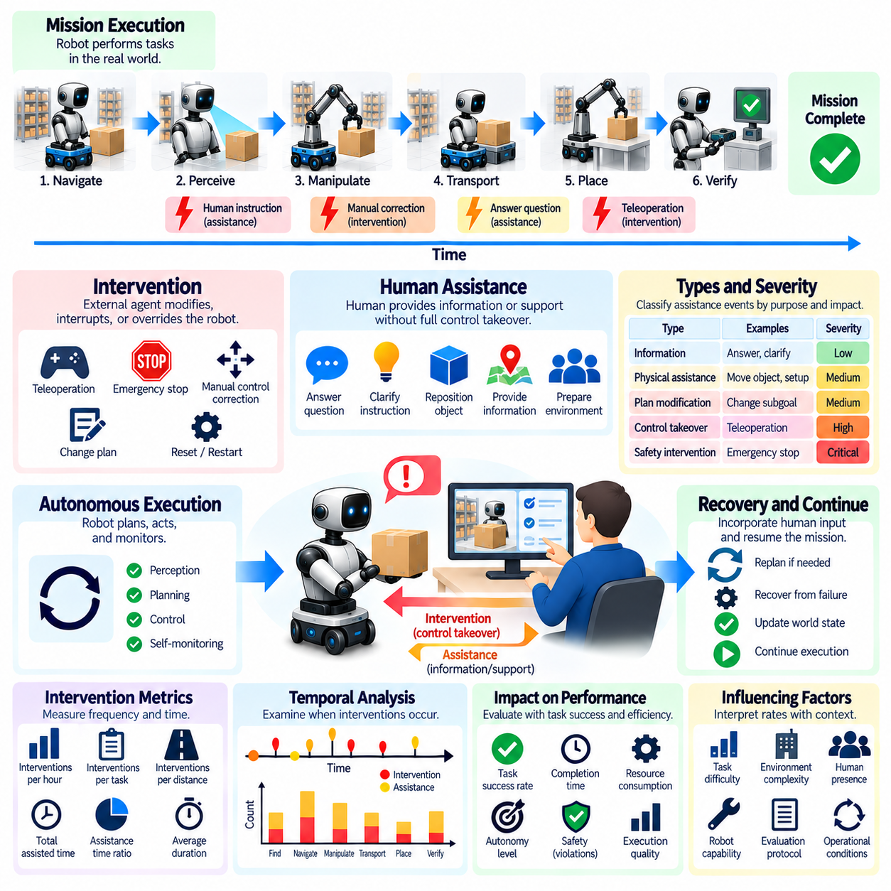{width="7.268055555555556in" height="7.268055555555556in"}

Intervention and human assistance rates are essential measures of long-horizon Physical AI autonomy because mission completion alone does not reveal how independently a robot operates. A system may finish complex tasks successfully while relying on frequent operator corrections or remote control. Evaluation must quantify the frequency, duration, and purpose of human involvement to distinguish genuine autonomous capability from human-supported execution.

An intervention occurs when an external agent modifies, interrupts, or overrides the robot\'s autonomous behavior during task execution. Examples include emergency stops, manual navigation corrections, teleoperation, and direct changes to task plans. Human assistance is broader and may include providing information, clarifying instructions, or physically preparing the environment. Evaluation protocols should define these categories explicitly to prevent inconsistent reporting.

Intervention rate measures how frequently external corrective actions occur relative to a defined exposure or workload. It may be expressed as interventions per operating hour, completed task, mission, or distance traveled. These denominators capture different aspects of autonomy and should not be treated as interchangeable. Evaluation should report the selected normalization basis and explain how mission complexity and operating conditions influence interpretation.

Human assistance rate measures the frequency with which a robot requires human support to continue or complete its assigned tasks. Assistance may involve answering questions, confirming uncertain observations, repositioning objects, or resolving unexpected environmental conditions. Unlike direct intervention, assistance does not always transfer control away from the robot. Evaluation should distinguish informational support from physical assistance and control takeover.

Intervention severity is important because not all events have equivalent operational consequences. A brief instruction clarification differs substantially from a prolonged teleoperation session or emergency shutdown. Evaluation should classify events according to their urgency, duration, required expertise, and effect on mission continuity. Severity-weighted reporting can complement raw event counts, although weighting rules must be defined and justified.

Long-horizon evaluation must account for the temporal distribution of interventions. A robot may operate independently for several hours before requiring assistance, while another may request small corrections at regular intervals. Identical average intervention rates can therefore conceal different autonomy patterns. Evaluation should examine intervention timing, clustering, and the relationship between assistance events and specific mission stages.

The distinction between requested assistance and externally imposed intervention is particularly important. A robot may proactively request clarification when uncertainty exceeds an acceptable threshold, demonstrating appropriate self-monitoring. Conversely, an operator may intervene because the robot fails to recognize a dangerous condition. Evaluation should distinguish these cases rather than assuming that every assistance request indicates poor autonomy.

Appropriate assistance seeking can improve safety and reliability. A robot that recognizes the limits of its perception or manipulation capability may request help before an error causes damage. Excessive assistance requests, however, can undermine scalability and increase operational costs. Evaluation should determine whether requests are justified by uncertainty, task difficulty, or safety constraints rather than rewarding the lowest possible request frequency.

False autonomy can arise when evaluation procedures exclude substantial human contributions. Operators may reset failed trials, arrange objects, select favorable starting conditions, or correct plans without these actions being counted. Such hidden assistance can inflate reported success rates and distort comparisons between systems. Evaluation should document all human contributions that materially influence execution, including preparation and recovery activities.

Intervention logging should capture the circumstances surrounding each event. Relevant information includes timestamps, mission phase, triggering condition, assistance type, duration, operator identity or role, and resulting task status. Logs should also record whether control was transferred, whether autonomous execution resumed, and whether the original objective remained achievable. Consistent event records support reproducible analysis and auditing.

Human assistance duration provides information that intervention frequency alone cannot capture. A single prolonged takeover may impose greater operational cost than several brief confirmations. Evaluation should measure total assisted time, average assistance duration, and the proportion of mission time spent under autonomous control. These measures help characterize how much continuous supervision or active operator involvement is required.

Intervention metrics should be interpreted alongside task success and execution quality. A robot that completes every mission through frequent assistance may be operationally useful but should not receive the same autonomy assessment as a robot completing equivalent missions independently. Conversely, a system that avoids requesting help but repeatedly fails should not be considered superior. Evaluation must preserve the distinction between autonomy, reliability, and overall utility.

Task difficulty strongly influences intervention frequency. Repetitive operations in structured environments may require little assistance, while unfamiliar objects, crowded spaces, and changing conditions create additional uncertainty. Fair comparisons should control for mission duration, task complexity, environmental variability, and operational design domain. Reporting intervention rates without these conditions can produce misleading conclusions about system capability.

Operator behavior can introduce additional variability into benchmark results. Experienced operators may intervene earlier or resolve problems faster than inexperienced personnel. Different organizations may also apply different thresholds for manual takeover. Evaluation protocols should standardize intervention criteria, operator training, and permissible assistance. Where complete standardization is impossible, operator-related variability should be documented and analyzed.

Autonomy degradation over time can be detected through changes in intervention frequency. A robot may initially perform reliably but require increasing assistance as localization drift, memory errors, or resource constraints accumulate. Evaluation should measure intervention rates across successive mission intervals rather than relying exclusively on aggregate totals. Such analysis can reveal progressive deterioration that short-duration tests would overlook.

Intervention efficiency examines whether human involvement produces meaningful improvements in mission progress. Assistance that resolves a critical obstacle and enables several hours of autonomous operation may be more valuable than repeated corrections addressing the same unresolved problem. Evaluation should assess the progress restored, failures prevented, and autonomous operation enabled by each intervention. This connects assistance requirements with practical mission outcomes.

Human assistance also creates workload and scalability considerations. A deployment requiring continuous operator attention may be difficult to expand across large robot fleets, even when individual robots achieve high task success. Evaluation should estimate operator time per robot, simultaneous supervision capacity, and the frequency of urgent assistance requests. These measures help determine whether autonomy performance supports sustainable operational deployment.

Benchmark design should include scenarios that create realistic opportunities for intervention. Examples include ambiguous instructions, blocked passages, misplaced objects, uncertain manipulation outcomes, and temporary sensor failures. Each scenario should define when autonomous recovery is expected and when human assistance is permissible. Evaluation should distinguish justified escalation from premature requests and unsafe persistence.

Statistical reporting should include intervention counts, exposure-normalized rates, uncertainty estimates, and distributions across repeated trials. Rare but severe interventions may require longer observation periods than routine assistance events. Comparisons should consider both event frequency and variability between missions. Confidence intervals and clearly defined counting rules improve the interpretability and reproducibility of reported autonomy performance.

Ultimately, intervention and human assistance rates reveal the operational independence of long-horizon Physical AI systems. Meaningful evaluation requires measuring not only how often humans become involved but also why assistance is needed, how much effort it requires, and whether the robot resumes autonomous execution successfully. These metrics connect technical autonomy with safety, reliability, supervision burden, and real-world deployment scalability.

## 06.12. Autonomy Duration and Mean Time Between Interventions

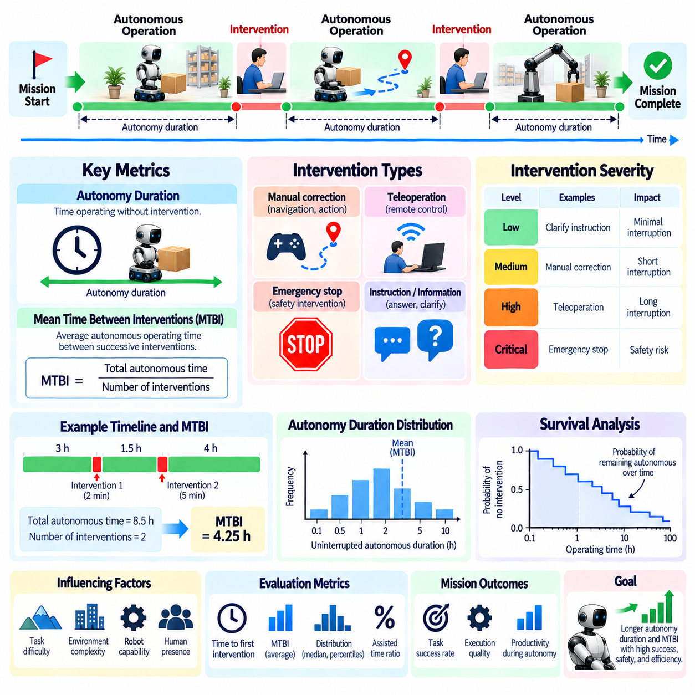{width="7.268055555555556in" height="7.268055555555556in"}

Autonomy duration measures how long a Physical AI system can operate without requiring external intervention during extended missions. Unlike task success rate, which focuses on final outcomes, autonomy duration captures the continuity of independent operation. Evaluation should determine whether a robot can sustain perception, planning, control, and decision-making over time while responding to changing conditions without human assistance.

Mean Time Between Interventions (MTBI) measures the average autonomous operating time separating successive interventions. It provides an operational indicator of how frequently a robot requires external assistance or corrective control. A longer MTBI generally indicates greater independence under comparable conditions. However, evaluation must consider intervention definitions, mission complexity, and exposure time before interpreting differences between systems.

Autonomy duration and MTBI describe related but distinct characteristics. Autonomy duration may represent the longest uninterrupted operating interval, the average autonomous episode, or the time until first intervention. MTBI summarizes the spacing between intervention events over a defined observation period. Evaluation protocols should specify these definitions explicitly because different calculation methods can produce substantially different results.

A basic MTBI estimate divides accumulated autonomous operating time by the number of qualifying interventions, subject to a clearly defined counting convention. For example, a robot accumulating twenty autonomous operating hours with four interventions yields an estimate of five hours per intervention. This exposure-based estimate should not be confused with the arithmetic mean of observed intervals when incomplete intervals are excluded.

Measurement boundaries are essential for reproducible evaluation. An autonomous interval may begin when the robot assumes control and end when a human intervenes, a safety system overrides control, or the mission terminates. Scheduled maintenance, charging, communication interruptions, and voluntary pauses require explicit treatment. Evaluation should document which events terminate autonomy and which periods contribute to measured operating time.

Interventions should be classified according to their causes and operational significance. Manual navigation corrections, teleoperation sessions, emergency stops, and task-level assistance may represent different degrees of autonomy loss. A brief informational clarification may not interrupt physical control but still indicate dependence on external knowledge. Evaluation should report event categories separately before combining them into aggregate MTBI measurements.

Long-duration autonomy depends on maintaining reliable performance across interconnected subsystems. Perception errors, localization drift, memory degradation, planning inconsistencies, and actuator limitations may accumulate gradually. A robot that performs well during short tests may become increasingly dependent on intervention during prolonged operation. Evaluation should examine how autonomy duration changes as operational exposure increases.

The distribution of uninterrupted autonomous intervals often provides more information than their average alone. Two robots may exhibit identical MTBI values while one experiences frequent short interruptions and occasional long runs. Median interval duration, lower-percentile performance, and interval variability help reveal these differences. Evaluation should avoid relying exclusively on a single average that conceals unstable autonomy behavior.

Time-to-first-intervention is a useful complementary measure because it characterizes the initial uninterrupted autonomous period. This metric can reveal how quickly a robot encounters conditions requiring external support. However, it does not describe subsequent recovery or continued operation. Evaluation should therefore combine first-intervention timing with repeated-event analysis and total mission performance.

Survival analysis offers a statistical framework for evaluating autonomy duration when observation periods differ. An intervention can be treated as an event, while a mission ending without intervention contributes a right-censored observation. Survival curves estimate the probability of remaining intervention-free over increasing operating durations. This approach helps compare systems without incorrectly treating successful observation endings as failures.

Intervention events may not occur at a constant rate throughout a mission. Early operation may involve calibration difficulties, while later stages may expose accumulated state-estimation errors or resource shortages. Evaluation should examine time-dependent intervention intensity and compare successive operating intervals. A declining autonomy duration may indicate progressive degradation even when aggregate MTBI remains acceptable.

Mission difficulty must be considered when comparing autonomy duration across systems. Structured warehouse navigation, dynamic construction environments, and human-populated facilities present different levels of uncertainty and operational risk. Longer uninterrupted operation in an easy environment does not necessarily demonstrate greater capability. Fair benchmarking requires comparable tasks, environmental conditions, and intervention policies.

Autonomy duration must also be interpreted alongside task productivity and completion quality. A robot may operate independently for many hours while making little useful progress, repeating ineffective actions, or avoiding difficult tasks. Such behavior should not receive a high autonomy assessment solely because interventions are infrequent. Evaluation should relate autonomous operating time to verified task progress, mission success, and execution efficiency.

Safety considerations place important limits on maximizing MTBI. A robot that refuses necessary assistance or continues operating under hazardous conditions may achieve a deceptively long intervention-free interval. Appropriate escalation can demonstrate responsible autonomy rather than weakness. Evaluation should reward sustained independent operation only when safety constraints remain satisfied and assistance decisions are justified.

Human intervention duration provides another dimension of operational independence. Two systems may have similar MTBI values but require substantially different amounts of operator time during each intervention. One may recover after a brief confirmation, while another requires prolonged teleoperation. Evaluation should combine MTBI with mean intervention duration, assisted-time fraction, and the proportion of operation performed autonomously.

Recovery behavior strongly influences the relationship between intervention frequency and mission continuity. A robot that detects failures and executes effective autonomous recovery can extend uninterrupted operating periods. Conversely, repeated unsuccessful recovery attempts may delay necessary intervention and increase risk. Evaluation should distinguish successful self-recovery from intervention avoidance that merely postpones unresolved failures.

Benchmark protocols should include missions of sufficient duration to expose delayed failures and changing operating conditions. Repeated trials should vary mission length, task dependencies, environmental disturbances, and resource constraints. Intervention timestamps and autonomous control transitions should be recorded automatically whenever possible. Standardized logging supports consistent calculations and comparisons across platforms.

Statistical uncertainty becomes particularly important when interventions are rare. A system completing several short trials without assistance cannot automatically be assumed to have an extremely high MTBI. Longer observation periods and repeated missions provide stronger evidence about sustained autonomy. Evaluation should report total exposure, intervention counts, confidence intervals, and censored observations alongside estimated performance.

Fleet-level evaluation extends autonomy duration analysis to multiple simultaneously operating robots. A deployment may achieve long individual MTBI values while still generating frequent assistance requests across the fleet. Operator workload depends on intervention arrival patterns, event duration, and simultaneous assistance demands. Evaluation should examine whether individual autonomy improvements translate into scalable supervision capacity.

Ultimately, autonomy duration and Mean Time Between Interventions connect technical performance with sustained operational independence. Comprehensive evaluation must consider uninterrupted execution, intervention frequency, safety, productivity, statistical uncertainty, and mission difficulty together. These measures reveal whether Physical AI systems can maintain dependable autonomous behavior over extended periods rather than merely succeed in isolated tasks.

## 06.13. Continuous Operation and Mission Reliability

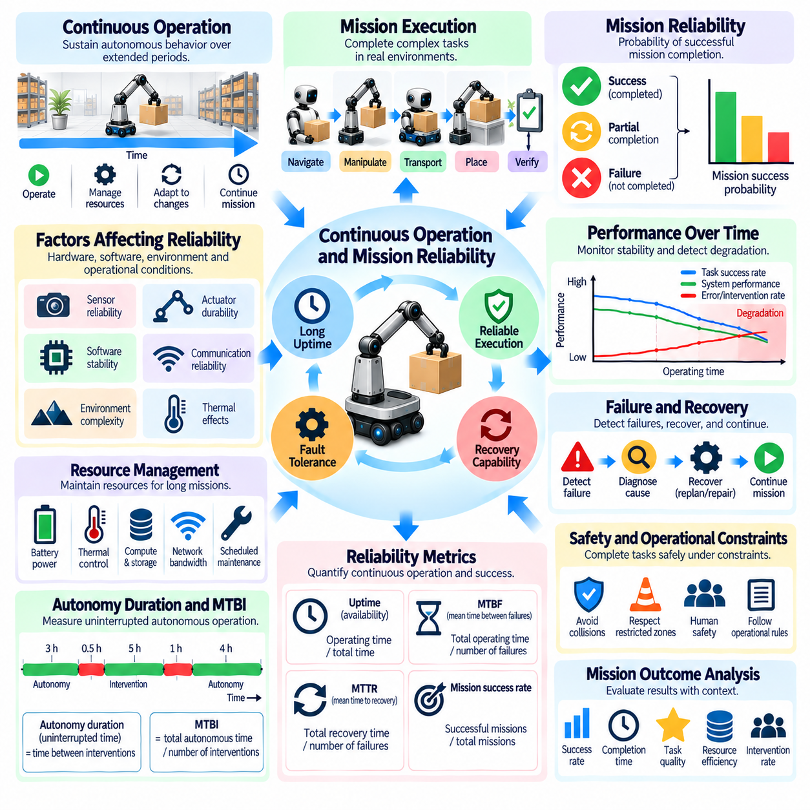{width="7.268055555555556in" height="7.268055555555556in"}

Continuous operation is a fundamental requirement for long-horizon Physical AI because real-world missions often extend beyond isolated task executions. Robots must maintain perception, planning, control, and communication while managing changing environments and operational demands. Evaluation should determine whether a system can sustain useful autonomous behavior over extended periods without unacceptable degradation, repeated interruptions, or loss of mission objectives.

Mission reliability describes the probability that a Physical AI system completes its assigned objectives under specified operating conditions and time constraints. Unlike individual action success, mission reliability reflects the combined effects of many dependent operations. A robot may execute most subtasks correctly yet fail the overall mission because of one critical error. Evaluation must therefore consider complete mission outcomes rather than isolated component performance.

Continuous operation and mission reliability are closely related but represent different dimensions of performance. A robot may remain operational for many hours without completing meaningful tasks, while another may complete missions successfully but require frequent restarts. Evaluation should distinguish system uptime, autonomous operating continuity, productive execution time, and verified mission completion to avoid confusing availability with actual mission effectiveness.

Long-duration operation exposes systems to accumulating errors that may remain invisible during short evaluations. Localization drift, calibration changes, memory inconsistencies, thermal effects, and resource depletion can gradually reduce performance. These problems may interact across perception, planning, and control subsystems. Evaluation should examine whether performance remains stable as operating time increases and whether emerging degradation is detected before mission failure.

Reliability depends on the interaction between hardware, software, and environmental conditions. Sensors may experience intermittent failures, actuators may overheat, and communication channels may become unreliable. Software components may encounter memory leaks, scheduling delays, or inconsistent internal states. Evaluation should identify how subsystem disturbances affect overall mission execution and whether the architecture prevents localized faults from escalating.

Operational availability measures the proportion of time a system remains capable of performing its intended functions. It is commonly related to failure frequency and restoration time, but availability alone does not establish autonomous competence. A robot may be technically available while waiting for instructions or performing ineffective actions. Evaluation should report availability alongside task productivity, intervention requirements, and mission success.

Mission success probability should be estimated across repeated trials under clearly defined conditions. Each trial should specify the mission objective, starting state, allowable assistance, completion criteria, and termination rules. Successful execution must satisfy all mandatory requirements, including safety and timing constraints. Evaluation should distinguish complete success, partial completion, recoverable failure, and irreversible mission failure.

Failure dependencies become increasingly important as mission length grows. When a mission requires many sequential subtasks, even small failure probabilities can accumulate into substantial mission-level risk. However, simple multiplication of individual success rates may be misleading when failures are correlated or recovery is possible. Evaluation should model task dependencies, shared failure causes, and recovery mechanisms when estimating overall reliability.

Fault tolerance enables continuous operation despite disturbances or partial component failures. Redundant sensors, alternative control strategies, health monitoring, and graceful degradation can preserve essential functions. A robot may continue a mission at reduced speed after detecting limited sensor performance. Evaluation should determine whether degraded operation remains safe, productive, and consistent with mission requirements rather than merely avoiding shutdown.

Recovery effectiveness strongly influences mission reliability. A system capable of detecting failures, restoring valid world states, and replanning around obstacles may complete missions despite repeated disturbances. Recovery attempts nevertheless consume time, energy, and computational resources. Evaluation should measure the proportion of failures successfully recovered, recovery latency, lost progress, and the effect of recovery on final mission outcomes.

Continuous operation requires effective resource management throughout the mission. Battery capacity, thermal limits, computational load, storage availability, and network bandwidth may constrain sustained execution. A robot must anticipate resource shortages and schedule charging, cooling, or maintenance without disrupting critical objectives. Evaluation should determine whether resource planning preserves mission feasibility and prevents avoidable interruptions.

Mission reliability must account for maintenance and planned operational pauses. Charging, calibration, inspection, and component replacement may be necessary for sustained deployment. These activities should be distinguished from unexpected failures and emergency interventions. Evaluation protocols should define whether planned downtime is excluded from autonomous operating time while still including its effect on total mission duration and operational availability.

Safety is an essential condition of reliable continuous operation. A robot that completes tasks while repeatedly violating collision constraints or operating beyond actuator limits cannot be considered dependable. Long-duration testing should monitor cumulative safety exposure, near misses, emergency stops, and constraint violations. Evaluation should treat mandatory safety requirements as mission success conditions rather than optional performance indicators.

Reliability assessment should include both time-based and mission-based metrics. Useful indicators include uptime ratio, productive autonomy ratio, mission completion rate, mean time between failures, mean time to recovery, and intervention frequency. Each metric captures a different operational characteristic. Evaluation should avoid combining these measures into a single score without explaining the weighting assumptions and resulting tradeoffs.

Long-horizon reliability can be analyzed using survival methods and repeated-event statistics. Time-to-failure distributions reveal how long systems operate before significant disruptions, while repeated-event models describe recurring faults. Missions that end without failure may contribute censored observations rather than being classified as failures. Evaluation should report observation duration, event definitions, uncertainty estimates, and sufficient trial exposure.

Benchmark environments should introduce realistic operational variability over extended periods. Lighting changes, moving obstacles, network disturbances, payload variation, and gradual sensor degradation can reveal weaknesses absent from short tests. Controlled disturbances enable comparison, while representative field trials demonstrate practical relevance. Evaluation should separate failures caused by the robot from those arising outside the specified operating domain.

Continuous operation also requires consistent mission state management. After pauses, restarts, or recovery procedures, a robot must preserve completed work, task dependencies, and remaining objectives. Incorrect restoration of execution context can cause duplicated actions or omitted subtasks. Evaluation should verify whether the system resumes from a valid checkpoint and maintains world state consistency across interruptions.

Fleet-level reliability introduces additional considerations beyond individual robot performance. Shared infrastructure failures, communication congestion, and coordinated task dependencies may affect multiple robots simultaneously. A fleet can maintain high aggregate productivity despite individual failures if tasks are redistributed effectively. Evaluation should measure collective mission completion, service continuity, and the consequences of correlated failures.

Long-duration evaluation should examine reliability trends rather than relying solely on final averages. Failure rates may increase with component wear, environmental exposure, or accumulated software state. Performance may also improve when adaptive systems learn from recurring disturbances. Evaluation should analyze reliability across successive operating periods and distinguish genuine improvement from changes in task difficulty or intervention policy.

Ultimately, continuous operation and mission reliability determine whether Physical AI systems can deliver dependable performance beyond controlled demonstrations. Comprehensive evaluation must integrate mission completion, operational availability, fault tolerance, recovery, safety, and resource sustainability. The central objective is to establish whether autonomous systems can execute complex missions consistently under realistic conditions while maintaining acceptable risk and operational efficiency.

## 06.14. Efficiency vs Task Completion Tradeoffs

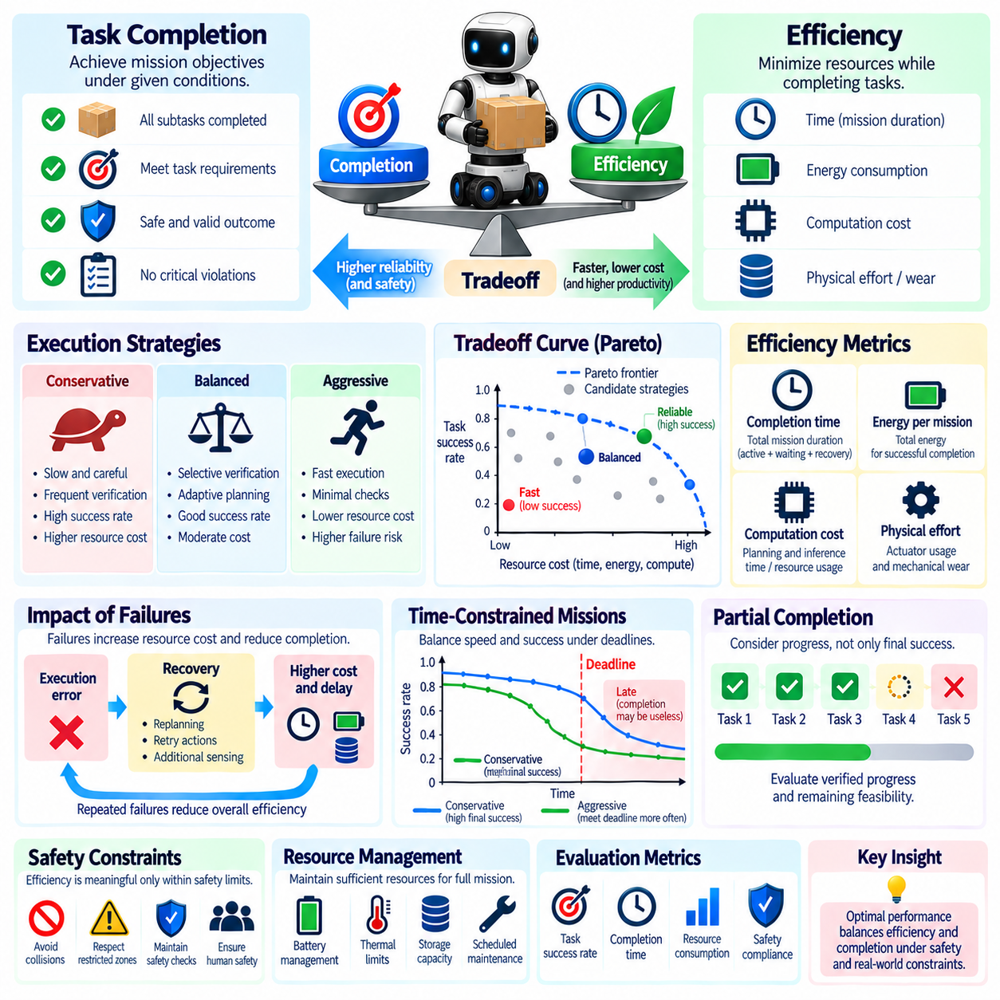{width="7.268055555555556in" height="7.268055555555556in"}

Efficiency and task completion represent competing objectives in long-horizon Physical AI evaluation. A robot may complete a mission reliably by moving slowly, repeating observations, and performing extensive verification, but these precautions increase execution time and resource consumption. Conversely, aggressive optimization may improve speed while increasing failure risk. Evaluation must determine whether efficiency gains preserve the required level of mission success.

Task completion measures whether a robot achieves its assigned objectives under specified conditions. Efficiency describes the resources consumed while reaching those objectives, including time, energy, computation, and physical effort. These dimensions should be evaluated separately before examining their relationship. A system that finishes quickly but violates mandatory requirements cannot be considered more effective than one that completes the mission safely.

Long-horizon missions amplify efficiency tradeoffs because early decisions influence later opportunities and constraints. A robot choosing a short but unreliable route may encounter delays that exceed the savings from reduced travel distance. Similarly, skipping an intermediate verification step may accelerate initial progress but cause expensive recovery later. Evaluation should account for downstream consequences rather than judging each action in isolation.

Execution time is a primary efficiency measure, but its interpretation requires careful normalization. Total mission duration may include planning, movement, manipulation, waiting, recovery, and human assistance. Reporting only active motion time can conceal substantial operational delays. Evaluation should distinguish productive execution, necessary preparation, avoidable waiting, and recovery overhead while preserving an end-to-end mission duration measure.

Energy efficiency becomes increasingly important as missions extend beyond individual battery cycles. Faster movements may require higher power, while conservative trajectories may consume less instantaneous energy but increase operating duration. Additional sensing and computation also contribute to total consumption. Evaluation should measure energy per completed mission and useful task outcome rather than relying exclusively on power or travel distance.

Computational efficiency introduces another tradeoff between decision quality and operational responsiveness. Extensive planning may produce safer or shorter action sequences but consume processing time and energy. Lightweight policies can respond rapidly yet overlook distant dependencies. Evaluation should compare planning latency, computational demand, execution quality, and final completion probability under equivalent hardware and environmental conditions.

Reliability and efficiency interact through the cost of failures. A strategy with rapid nominal execution may perform poorly when unsuccessful attempts require repeated manipulation, navigation recovery, or mission restart. Expected completion cost should therefore incorporate failure probability and recovery expenditure. Evaluation should distinguish efficiency under successful trials from efficiency across all attempts, including unsuccessful executions.

Repeated verification illustrates the balance between caution and productivity. A robot may inspect object placement after every manipulation, improving error detection but increasing cycle time. Less frequent inspection reduces overhead but may allow mistakes to propagate. Evaluation should determine whether verification frequency matches the consequences of undetected errors and whether selective monitoring provides a better balance than uniform checking.

Safety requirements impose nonnegotiable constraints on efficiency optimization. A robot should not reduce human clearance, exceed actuator limits, or omit essential safety checks merely to improve completion time. Evaluation should treat mandatory safety conditions as feasibility requirements rather than assigning them arbitrary penalties. Efficiency comparisons are meaningful only among strategies satisfying the required safety envelope.

Partial completion complicates efficiency measurement because missions may terminate before all objectives are achieved. A robot completing several easy subtasks quickly should not automatically outperform one progressing more slowly through critical dependencies. Evaluation should measure verified progress, subgoal importance, and remaining mission feasibility. Partial progress metrics must avoid rewarding actions that generate activity without advancing the final objective.

Time-constrained missions require balancing speed against the probability of meeting deadlines. A conservative strategy may offer high eventual success but fail when completion occurs too late. A faster strategy may satisfy the deadline more often despite a higher probability of individual action failure. Evaluation should distinguish eventual completion probability from deadline-constrained mission success and assess both under identical timing requirements.

Resource allocation decisions also affect future mission feasibility. Spending additional energy to improve early task accuracy may reduce the resources available for later navigation or manipulation. Conversely, excessive resource conservation can delay progress unnecessarily. Evaluation should examine whether resource-aware policies maintain sufficient reserves while avoiding inefficient overprovisioning and unnecessary operational pauses.

Pareto analysis provides a useful framework for examining efficiency and completion tradeoffs without imposing a single preference. A strategy is Pareto-dominated when another strategy achieves at least equivalent task success with no greater resource cost and improves one dimension. Nondominated strategies form a Pareto frontier. Evaluation should report these alternatives so deployment requirements can determine the appropriate operating point.

Composite efficiency scores can simplify comparisons but may conceal important distinctions. Weighted combinations of completion rate, execution time, energy, and intervention burden depend on subjective priorities. A small improvement in speed should not automatically compensate for a substantial reduction in reliability. Evaluation should disclose normalization methods, weighting assumptions, and sensitivity to alternative preferences before interpreting aggregate rankings.

Risk-sensitive evaluation considers not only average performance but also the consequences of rare costly failures. Two policies may have similar mean completion times while one occasionally experiences severe delays or mission termination. Tail latency, completion-time variability, and worst-case resource expenditure reveal operational risks hidden by averages. These measures are especially important in safety-critical or deadline-sensitive deployments.

Adaptive efficiency policies may adjust their behavior according to task difficulty and environmental uncertainty. A robot can move rapidly through familiar open spaces while slowing near people or uncertain obstacles. It may also increase verification when manipulation confidence declines. Evaluation should determine whether such adaptation improves overall mission outcomes compared with fixed-speed, fixed-verification, or uniformly conservative policies.

Benchmark design should vary mission length, task dependencies, resource limits, and disturbance frequency to expose changing tradeoffs. Short tests may favor aggressive strategies because delayed failures remain unobserved. Extended trials reveal accumulated recovery costs and resource depletion. Evaluation should use matched scenarios and repeated trials to compare strategies under equivalent operational exposure and completion requirements.

Human assistance must be included in efficiency accounting because external intervention consumes operational resources. A robot that completes tasks rapidly through frequent operator corrections may appear efficient if human labor is ignored. Evaluation should report autonomous execution time, assisted time, intervention frequency, and operator workload. This prevents human-supported performance from being mistaken for independent robotic efficiency.

Statistical analysis should account for incomplete missions and variability across repeated trials. Reporting average completion time only for successful runs introduces selection bias when failure rates differ. Evaluation should provide success probabilities, completion-time distributions, resource consumption, and clearly defined treatment of failed or censored trials. Confidence intervals help determine whether apparent efficiency improvements are meaningful.

Ultimately, efficiency versus task completion evaluation determines whether Physical AI systems can accomplish complex missions with acceptable resource expenditure while preserving reliability and safety. The objective is not simply to minimize execution time or maximize success independently. Comprehensive assessment identifies operating strategies that balance mission completion, resource sustainability, recovery cost, and deployment constraints across realistic long-horizon conditions.

## 06.15. Long Horizon Evaluation Framework [w/Code]

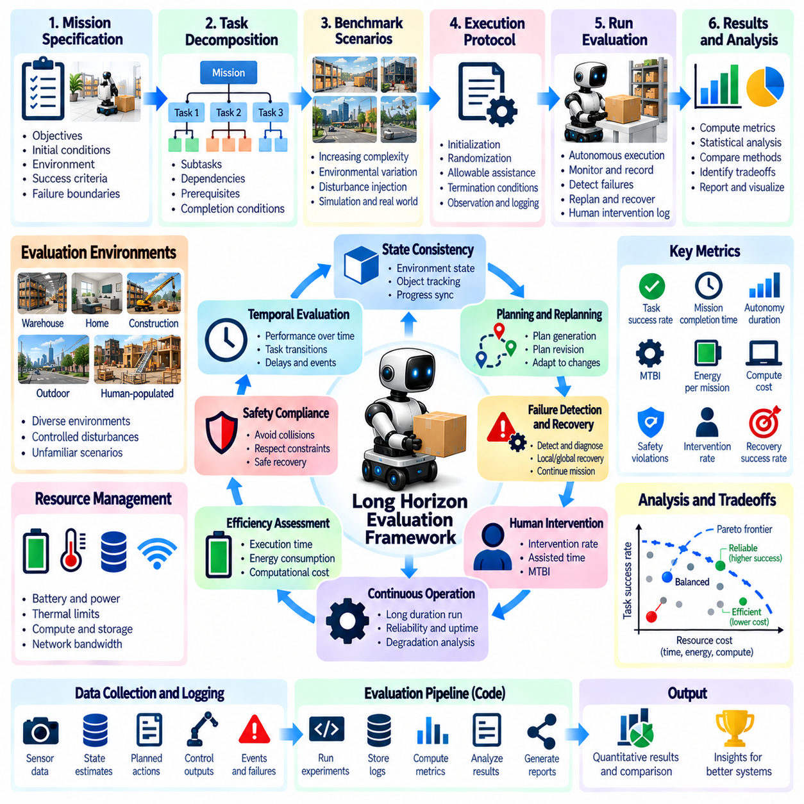{width="7.268055555555556in" height="7.268055555555556in"}

A long-horizon evaluation framework provides a systematic method for assessing whether Physical AI systems can complete complex missions through sustained autonomous operation. Unlike isolated skill benchmarks, it examines sequences of interdependent actions, environmental changes, and accumulated execution errors. The framework must integrate task success, planning consistency, recovery capability, operational reliability, and resource efficiency within a reproducible evaluation process.

The foundation of the framework is a formal mission specification defining objectives, initial conditions, environmental constraints, and completion criteria. Each mission should include observable success conditions and explicit failure boundaries. Evaluators must distinguish mandatory outcomes from optional performance improvements. Clear specifications prevent ambiguous scoring and ensure that different systems are evaluated against equivalent operational requirements.

Mission decomposition establishes the intermediate structure needed to evaluate progress across extended execution periods. Complex objectives are represented as subtasks with dependencies, prerequisites, and measurable completion conditions. This structure enables evaluators to identify where progress occurs and where failures propagate. The framework should preserve the distinction between successful intermediate actions and achievement of the overall mission objective.

Temporal evaluation captures how performance changes as missions progress. Early decisions may influence later feasibility, while small errors can accumulate into significant disruptions. The framework should record task transitions, elapsed time, execution delays, and the timing of critical events. Temporal measurements help determine whether the system maintains consistent performance or gradually loses effectiveness during prolonged autonomous operation.

State consistency evaluation examines whether the robot maintains an accurate representation of its environment and task progress. Object locations, completed actions, resource availability, and remaining objectives must remain synchronized with physical reality. Incorrect state estimates may lead to repeated actions or invalid plans. The framework should compare internal state representations with independent observations at defined checkpoints.

Planning and replanning assessment measures the system\'s ability to generate feasible action sequences and revise them when conditions change. Unexpected obstacles, unavailable resources, and failed subtasks should trigger appropriate adaptations. Evaluation must distinguish justified plan revisions from unstable decision-making. Useful measurements include planning latency, revision frequency, dependency preservation, and successful continuation after disturbances.

Failure detection and recovery form another essential evaluation dimension. The system should identify deviations between expected and observed outcomes, determine their causes, and select suitable corrective actions. Recovery may involve local adjustments, global replanning, or human assistance. The framework should measure detection latency, diagnosis accuracy, recovery success, and the extent of mission progress preserved after failure.

Human intervention must be explicitly incorporated into autonomy assessment. A mission completed through repeated operator corrections does not demonstrate the same independence as one completed without assistance. Evaluation should record intervention frequency, duration, purpose, and control transfer. These observations support measures such as intervention rate, assisted-time fraction, autonomy duration, and Mean Time Between Interventions.

Continuous operation evaluation determines whether autonomous performance remains dependable across extended periods. Sensor degradation, localization drift, computational limitations, and resource depletion may emerge only during long missions. The framework should measure productive operating time, unexpected interruptions, restoration time, and mission completion reliability. Long-duration trials must expose weaknesses that short demonstrations cannot reveal.

Efficiency assessment connects mission outcomes with the resources required to achieve them. Execution time, energy consumption, computational demand, travel distance, and recovery overhead should be measured alongside task completion. Faster execution is not necessarily preferable when it increases failure probability or violates safety requirements. The framework should examine efficiency and reliability tradeoffs rather than optimizing either dimension independently.

Safety requirements must be treated as mandatory constraints throughout evaluation. Collision avoidance, actuator limitations, restricted operating regions, and safe recovery procedures should remain valid during normal execution and unexpected disturbances. A mission that reaches its objective through unsafe behavior should not receive an unrestricted success classification. Safety violations should be recorded independently from task progress and efficiency.

Benchmark scenarios should cover increasing mission complexity and environmental uncertainty. Initial tests may involve structured sequences with predictable dependencies, while advanced scenarios introduce dynamic obstacles, missing objects, delayed actions, and resource constraints. Controlled disturbance injection supports repeatable comparisons. The framework should also include unfamiliar conditions to assess whether capabilities generalize beyond previously encountered situations.

A standardized execution protocol is necessary for meaningful benchmarking. Each trial should define initialization procedures, randomization settings, allowable assistance, termination conditions, and observation methods. Simulation and physical testing should use compatible mission definitions wherever practical. Repeated trials under matched conditions help separate genuine capability differences from environmental variability and experimental noise.

Evaluation data should be collected through synchronized logs covering observations, internal states, selected actions, task transitions, interventions, and outcomes. Each event should include timestamps and relevant contextual information. Automated scoring reduces subjective interpretation, while independent verification strengthens result credibility. Reproducible records also support failure analysis, debugging, and comparison across model versions.

Metric aggregation requires careful treatment because long-horizon autonomy is inherently multidimensional. Mission success, subgoal completion, intervention burden, recovery effectiveness, safety, and efficiency should first be reported separately. Composite scores may support comparisons but can conceal important weaknesses. Any aggregation method should disclose normalization rules, weighting assumptions, and the consequences of compensating between metrics.

Statistical evaluation must account for variability, incomplete missions, and rare failures. Success probabilities should be estimated across repeated trials, while completion-time distributions and confidence intervals reveal uncertainty. Missions ending without intervention may contribute censored observations to autonomy-duration analysis. Reporting exposure time, trial counts, and failure definitions is essential for interpreting reliability claims.

Cross-environment evaluation determines whether long-horizon performance transfers beyond a single benchmark configuration. Changes in lighting, object placement, terrain, robot embodiment, and task ordering may expose hidden dependencies. The framework should distinguish performance under familiar conditions from generalization to unfamiliar settings. Comparable evaluation procedures help identify whether improvements reflect robust autonomy or narrow benchmark adaptation.

A practical implementation can organize evaluation into mission definition, scenario generation, execution monitoring, event classification, metric computation, and report generation. Each stage should maintain traceable connections between mission requirements and measured outcomes. Automated pipelines can repeat trials, validate logs, and generate standardized scorecards. Modular design allows new tasks and metrics to be introduced without changing established evaluation principles.

Benchmark governance supports consistency as tasks, environments, and models evolve. Dataset versions, scenario configurations, scoring rules, and software dependencies should be recorded for every evaluation. Changes that affect comparability require explicit documentation and potentially separate benchmark versions. This lifecycle discipline prevents misleading comparisons between results obtained under different assumptions or experimental conditions.

Ultimately, a long-horizon evaluation framework must establish whether Physical AI systems can sustain coherent, safe, and productive autonomy across complex missions. Reliable assessment integrates temporal progress, planning, state consistency, failure recovery, intervention requirements, operational continuity, and efficiency. The resulting evidence supports transparent comparisons, systematic improvement, and informed decisions about readiness for real-world deployment.
