**Volume 11. Physical AI Evaluation and Benchmarking**

# Chapter 07. Cross Embodiment Evaluation

## 07.01. Why Cross Embodiment Evaluation

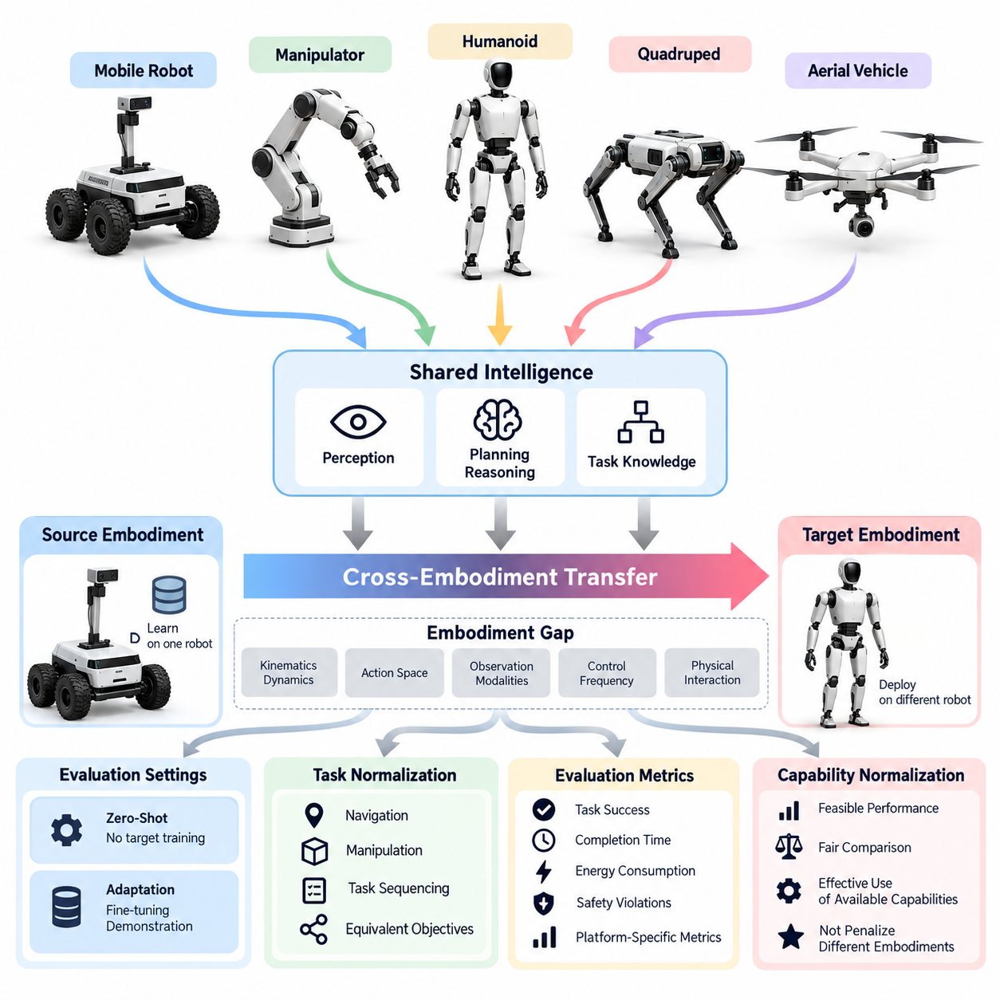{width="7.268055555555556in" height="7.268055555555556in"}

Physical AI systems are increasingly expected to operate across diverse robotic platforms rather than remain confined to a single mechanical configuration. Autonomous mobile robots, manipulators, quadrupeds, humanoids, and aerial vehicles possess different physical capabilities, yet they may share perception, planning, and reasoning mechanisms. Cross-embodiment evaluation determines whether learned intelligence remains effective when transferred between these distinct physical systems.

Traditional robot evaluation usually measures performance on a fixed platform with predefined sensors, actuators, and mechanical constraints. Such evaluation can establish competence within a particular configuration but cannot determine whether the underlying intelligence is reusable. Cross-embodiment evaluation extends the assessment beyond one robot by examining how policies, representations, and task knowledge generalize across different bodies and operating conditions.

The motivation for cross-embodiment evaluation arises from the growing development of generalist robot policies and foundation models. These models aim to learn reusable behavioral principles from heterogeneous robotic datasets. However, successful performance on multiple robots does not automatically demonstrate transferable intelligence. Evaluation must distinguish genuinely shared capabilities from platform-specific memorization, specialized control interfaces, and extensive adaptation.

Embodiment influences how intelligence interacts with the physical world. Robot morphology determines reachable workspaces, movement constraints, manipulation capabilities, stability characteristics, and available sensory perspectives. A wheeled robot navigates through continuous ground contact, while a quadruped coordinates intermittent foot contacts. A manipulator operates through articulated joints, whereas an aerial vehicle must continuously regulate flight dynamics.

These differences create an embodiment gap between the source platform used for learning and the target platform used for deployment. The gap may involve variations in kinematics, dynamics, action spaces, observation modalities, control frequencies, and physical interaction mechanisms. Cross-embodiment evaluation investigates whether a learned system can overcome these differences while preserving useful task knowledge and maintaining acceptable execution quality.

A central evaluation question concerns what should remain invariant across embodiments. High-level goals, object relationships, spatial reasoning, task sequencing, and environmental understanding may be transferable even when motor commands differ substantially. For example, the instruction to transport an object to a destination can apply to a mobile manipulator or humanoid, although their movement strategies and physical constraints require different implementations.

Cross-embodiment evaluation must therefore separate task-level intelligence from embodiment-specific execution. A system may correctly understand a task while failing because its target robot lacks sufficient reach, payload capacity, or mobility. Conversely, a robot may complete a task through specialized engineering without demonstrating reusable reasoning. Evaluation protocols should identify these distinctions rather than interpreting every success or failure as evidence of general intelligence.

Fair comparison requires careful task normalization across robotic platforms. Identical physical actions are not always meaningful because different robots possess different capabilities. Instead, evaluation can define equivalent functional objectives and compare outcomes under explicitly documented constraints. A navigation task, for example, may require reaching the same destination while permitting different locomotion strategies appropriate to each robot.

Performance metrics must capture both shared objectives and embodiment-specific characteristics. Task success, completion time, intervention frequency, energy consumption, and safety violations provide broadly applicable measurements. Joint tracking error, foot placement accuracy, grasp stability, and flight control precision remain platform-dependent. Combining these measurements enables meaningful comparison without concealing important differences in physical execution.

Capability-normalized evaluation provides another perspective by considering the feasible performance envelope of each embodiment. A small mobile robot should not necessarily be penalized for lacking the manipulation capabilities of a humanoid. Similarly, a stationary manipulator cannot reasonably be expected to perform long-distance navigation. Normalization helps determine whether an intelligent policy uses the available capabilities effectively rather than merely rewarding mechanically superior platforms.

Cross-embodiment transfer can be assessed under zero-shot and adaptation-based conditions. Zero-shot evaluation measures performance on an unseen robot without target-specific training, providing evidence about immediate transferability. Adaptation-based evaluation examines improvements obtained through fine-tuning, demonstrations, or additional interaction. Reporting both conditions reveals whether a model transfers knowledge directly or requires substantial platform-specific learning.

Adaptation efficiency is especially important because unrestricted retraining can obscure the value of transferable representations. A model that achieves high performance after extensive target-specific training may offer limited advantages over a specialized policy. Evaluation should therefore record adaptation data volume, training steps, computational cost, and target-environment interactions. These measurements expose the practical resources required to achieve successful transfer.

Shared representations offer a potential foundation for transferable physical intelligence. Visual features, spatial maps, object-centric states, language instructions, and latent action representations may encode information useful across robot types. Evaluation should investigate whether such representations preserve task-relevant structure when observation viewpoints, sensor configurations, and action interfaces change. Representation similarity alone is insufficient without behavioral validation.

Vision-language-action models introduce additional cross-embodiment evaluation requirements. Their architectures may connect natural-language instructions and visual observations to robot-specific actions through shared latent spaces or specialized action heads. A model trained on manipulation demonstrations might understand a mobile navigation instruction but lack the appropriate control interface. Evaluation must distinguish semantic understanding, action generation, and successful closed-loop execution.

Closed-loop testing is essential because physical embodiment changes how prediction errors influence subsequent actions. Small control inaccuracies may produce different consequences for wheeled, legged, and aerial platforms. A transferable policy must respond to changing observations, physical disturbances, and unexpected contact events. Open-loop action prediction can provide diagnostic information, but it cannot establish reliable cross-embodiment behavior under real interaction.

Safety and robustness must also be considered across embodiments. A control strategy that is acceptable for a low-speed mobile platform may become hazardous when applied to a powerful manipulator or flying robot. Differences in momentum, contact forces, balance requirements, and failure consequences affect the interpretation of performance. Evaluation should measure constraint violations, recovery behavior, uncertainty awareness, and the ability to recognize unsupported operating conditions.

Statistical reliability becomes challenging when experiments involve heterogeneous platforms. Differences in hardware calibration, operator intervention, environmental conditions, and trial difficulty can distort comparisons. Repeated trials, clearly defined test distributions, confidence intervals, and transparent experimental protocols are necessary. Results should distinguish variability caused by the learned policy from variability introduced by hardware and experimental procedures.

Ultimately, cross-embodiment evaluation supports the transition from isolated robot intelligence toward reusable Physical AI capabilities. It identifies which knowledge transfers across bodies, which behaviors require adaptation, and where physical constraints limit generalization. By combining normalized tasks, shared metrics, platform-specific diagnostics, and rigorous transfer experiments, evaluation can provide credible evidence of progress toward general-purpose embodied intelligence.

## 07.02. Embodiment Gap and Evaluation Challenges

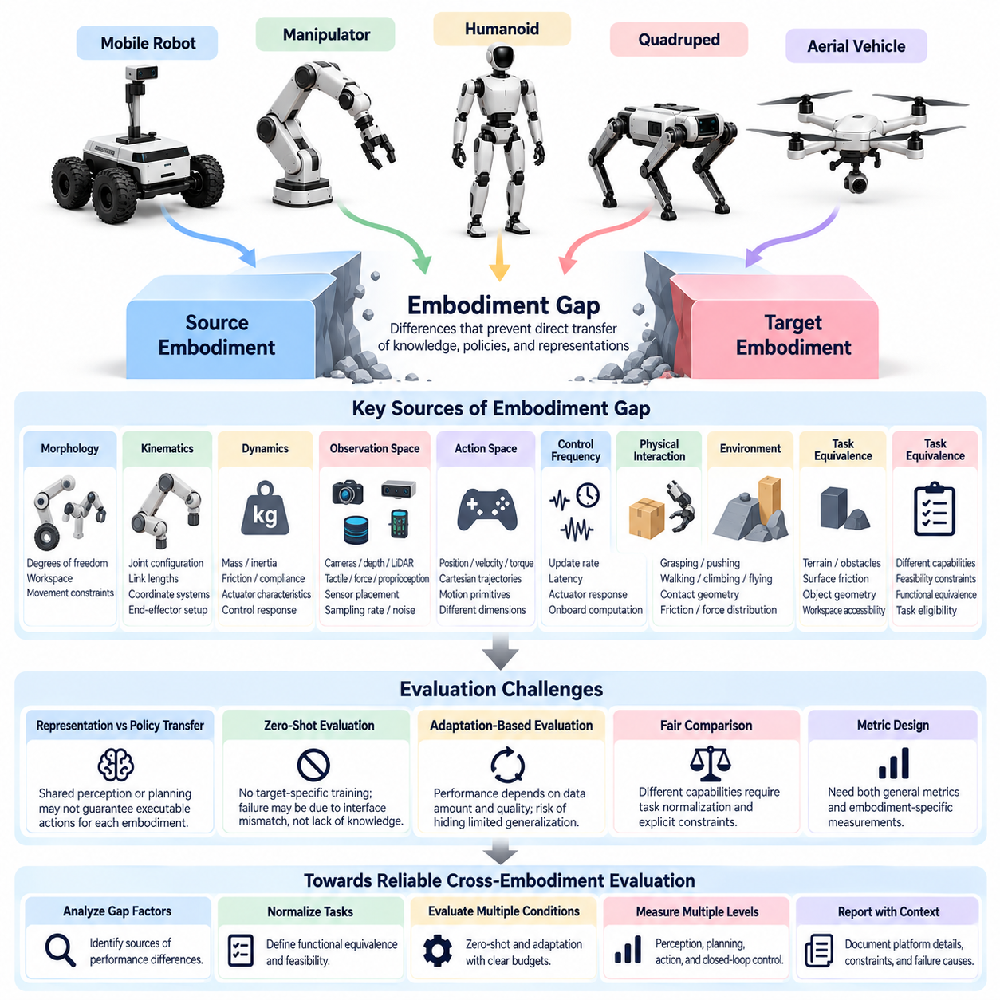{width="7.268055555555556in" height="7.268055555555556in"}

The embodiment gap refers to the differences between robotic platforms that prevent knowledge, policies, and learned representations from transferring directly across physical systems. These differences extend beyond external appearance and include mechanical structure, sensing capabilities, actuation mechanisms, control interfaces, and environmental interaction. Evaluating this gap is essential for determining whether Physical AI systems possess genuinely transferable intelligence.

Robot morphology creates one of the most fundamental sources of embodiment mismatch. Wheeled robots, manipulators, quadrupeds, humanoids, and aerial vehicles operate with different degrees of freedom, reachable workspaces, and movement constraints. A policy developed for one morphology may generate actions that are physically impossible for another. Evaluation must distinguish limitations imposed by robot structure from deficiencies in learned decision-making.

Kinematic differences complicate the transfer of motion representations and control commands. Joint configurations, link lengths, coordinate systems, and end-effector arrangements vary significantly across platforms. Even robots performing equivalent tasks may require different joint trajectories to achieve similar outcomes. Cross-embodiment evaluation must therefore consider task-space objectives rather than relying exclusively on direct comparisons of joint-level actions.

Dynamic differences introduce additional challenges because identical motion objectives can require substantially different forces, torques, and control responses. Robot mass, inertia, friction, compliance, and actuator characteristics influence physical behavior. A policy that stabilizes one quadruped may fail on another with different joint torque limits. Evaluation must identify whether performance degradation originates from dynamics mismatch or inadequate policy adaptation.

Observation spaces also differ across embodiments. Robots may use cameras, depth sensors, LiDAR, tactile sensors, force sensors, or proprioceptive measurements in different combinations. Sensor placement changes the perspective from which environments are observed, while sampling rates and noise characteristics affect information quality. Evaluation must determine whether transferred intelligence remains effective when the available observations differ from those encountered during training.

Action-space incompatibility represents another major obstacle. Some robots receive joint position commands, while others use velocity targets, torque commands, Cartesian trajectories, or high-level motion primitives. These interfaces differ in dimensionality, timing, and physical interpretation. Comparing raw action predictions across robots is therefore often meaningless. Evaluation requires suitable action mappings or task-level behavioral measurements.

Control frequency and latency further complicate cross-embodiment transfer. A slow mobile robot may operate effectively with relatively low-frequency planning updates, whereas a dynamically balancing robot requires rapid feedback control. Differences in actuator response, communication delay, and onboard computation influence execution stability. Evaluation protocols should document these timing constraints and assess whether transferred policies satisfy the requirements of each platform.

Physical interaction introduces embodiment-specific constraints that are difficult to represent through abstract task descriptions alone. Grasping, pushing, walking, climbing, and flying depend on contact geometry, friction, force distribution, and environmental conditions. A manipulation strategy successful with a rigid gripper may fail with a compliant hand. Evaluation must examine whether shared task knowledge can be translated into physically appropriate interaction strategies.

Task equivalence becomes difficult when robots possess fundamentally different capabilities. A humanoid may open a door using articulated hands, while a mobile robot without manipulators cannot perform the same operation. Assigning identical tasks without considering feasibility produces misleading comparisons. Evaluation should define functional equivalence, capability requirements, and task eligibility before measuring cross-embodiment performance.

Environmental differences can amplify the embodiment gap. Terrain roughness, obstacle dimensions, surface friction, object geometry, and workspace accessibility affect platforms differently. A narrow passage may be traversable by a compact mobile robot but inaccessible to a larger humanoid. Evaluation must separate environmental accessibility from intelligence-related generalization and avoid interpreting physically infeasible situations as policy failures.

A critical challenge involves separating representation transfer from complete policy transfer. A shared visual encoder may recognize objects across robots without providing effective control commands for each embodiment. Similarly, a common language-conditioned planner may generate valid task sequences while requiring specialized low-level controllers. Evaluation should independently measure perception transfer, planning transfer, action generation, and closed-loop execution.

Zero-shot evaluation provides a demanding test of embodiment generalization because the target robot receives no additional task-specific training. However, zero-shot failure does not necessarily indicate that shared knowledge is absent. Differences in action interfaces or observation formats may prevent otherwise useful representations from being applied. Evaluation should report interface compatibility and distinguish architectural limitations from failures of learned generalization.

Adaptation-based evaluation introduces another difficulty because performance depends on the amount and quality of target-specific data. Fine-tuning, calibration, action remapping, and controller adjustment can substantially improve transfer results. Without controlling these procedures, comparisons between models become unreliable. Evaluation must record adaptation budgets, training interactions, computational resources, and modifications to robot-specific components.

Benchmark normalization is necessary but can introduce unintended biases. Normalizing completion time, energy consumption, or motion accuracy may improve comparability, yet excessive normalization can conceal meaningful differences in operational performance. A slower robot may achieve excellent capability-relative efficiency while remaining unsuitable for time-critical deployment. Evaluation should report both absolute performance and capability-normalized measurements.

Statistical evaluation becomes more complex when performance varies across robot types, tasks, and environments. Aggregating results into a single average can conceal severe failures on particular embodiments. Small sample sizes and unequal task distributions may further distort conclusions. Robust evaluation should examine per-platform results, cross-platform variance, confidence intervals, and the relationship between embodiment differences and performance degradation.

Safety requirements also vary substantially across embodiments. A failed grasp may damage an object, while unstable locomotion may cause a fall and aerial control failure may create a collision hazard. Consequently, identical failure rates do not imply equivalent operational risk. Cross-embodiment evaluation must account for platform-specific hazards, safety constraints, recovery mechanisms, and the consequences of unsuccessful actions.

Reproducibility presents practical challenges because heterogeneous robots require different hardware configurations, calibration procedures, software interfaces, and experimental facilities. Even nominally identical platforms may exhibit variation caused by manufacturing tolerances and component wear. Evaluation protocols should document hardware specifications, controller versions, sensor calibration, environmental conditions, and experimental procedures to support reliable replication.

The embodiment gap should ultimately be treated as a multidimensional evaluation problem rather than a single measure of physical difference. Morphology, dynamics, sensing, control, task feasibility, and environmental interaction contribute distinct sources of transfer difficulty. By measuring these dimensions separately and examining their combined effects, researchers can identify transferable capabilities, diagnose adaptation requirements, and establish credible evidence of cross-embodiment generalization.

## 07.03. Common vs Embodiment Specific Metrics

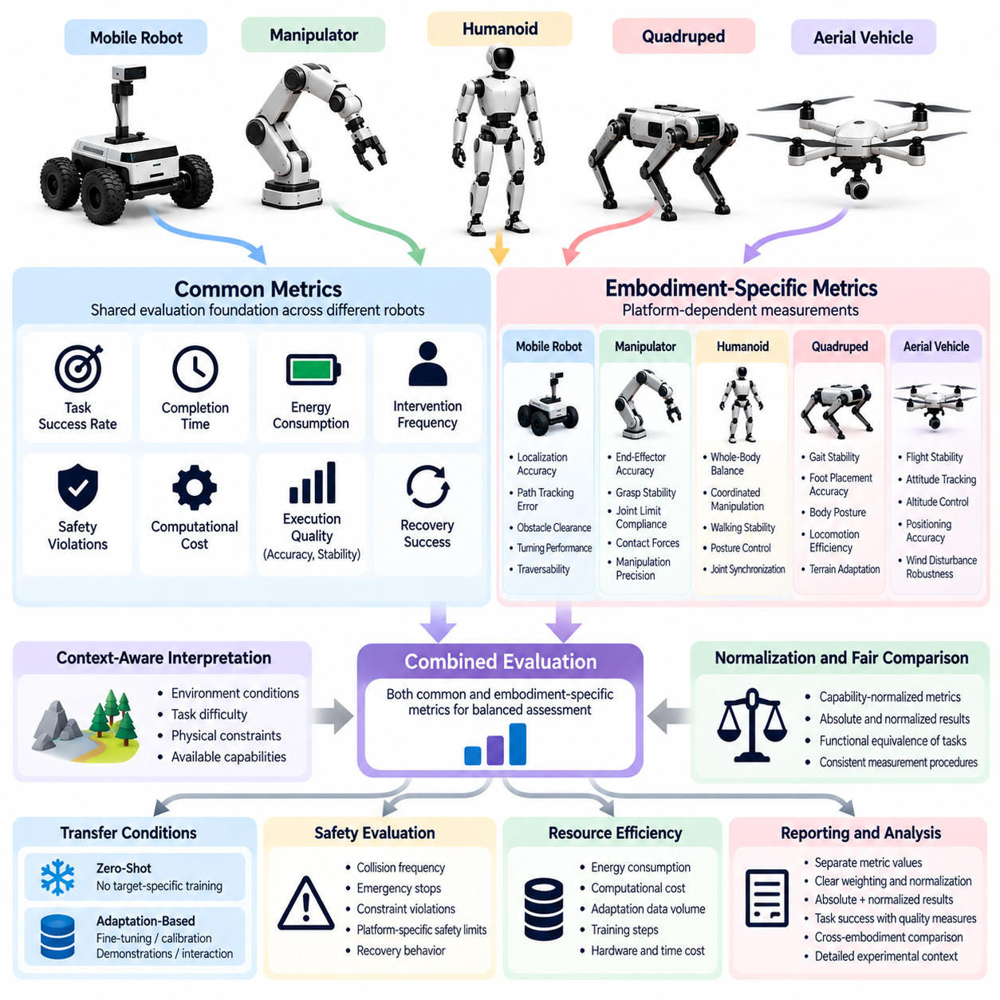{width="7.268055555555556in" height="7.268055555555556in"}

Cross-embodiment evaluation requires a careful distinction between common metrics and embodiment-specific metrics to ensure that performance comparisons across robotic platforms remain meaningful. Common metrics measure capabilities shared by different robots, such as task success, completion time, energy consumption, intervention frequency, and safety violations. Embodiment-specific metrics capture physical characteristics and operational requirements unique to particular robot types. Combining both categories provides a balanced assessment of transferable intelligence and platform-dependent performance.

Common metrics establish a shared evaluation foundation for heterogeneous robotic systems. Task success rate measures whether a robot achieves a predefined objective, while completion time indicates how efficiently it performs the task. Energy consumption and computational cost reveal resource requirements, and intervention frequency measures the extent to which human assistance is necessary. These metrics support comparisons across embodiments when tasks, environmental conditions, and measurement procedures are consistently defined.

However, common metrics must not be interpreted without considering task context. Two robots may achieve the same success rate while operating under substantially different physical constraints. A wheeled robot may complete navigation efficiently on smooth floors, whereas a quadruped may require more energy to traverse uneven terrain. Reporting success alone would conceal these operational differences. Common metrics should therefore be interpreted alongside environmental conditions, task difficulty, and the capabilities available to each platform.

Task completion quality provides another important dimension of common evaluation. A robot may technically complete an objective while producing an inaccurate, unstable, or unsafe result. For example, successful object placement may still involve excessive contact forces or poor positioning accuracy. Evaluation should therefore distinguish binary success from execution quality, including accuracy, repeatability, constraint compliance, and recovery behavior. Such measurements help determine whether transferred policies preserve the quality of task execution across embodiments.

Embodiment-specific metrics are necessary because different robot morphologies introduce distinct physical requirements. Manipulators may be evaluated using end-effector positioning accuracy, grasp stability, joint-limit compliance, and applied contact forces. Quadrupeds require measurements related to gait stability, foot placement, body posture, and locomotion efficiency. Humanoids may require additional assessment of whole-body balance and coordinated manipulation, while aerial robots need flight stability, attitude tracking, and altitude control measurements.

Mobile platforms introduce their own specialized performance considerations. Autonomous mobile robots can be evaluated using localization accuracy, path-tracking error, obstacle clearance, turning performance, and traversability. Mobile manipulators combine navigation and manipulation requirements, making it necessary to measure both base positioning and end-effector performance. These metrics reveal limitations that a common task-success score cannot adequately explain, especially when physical mobility and manipulation accuracy interact.

A central challenge is determining how common and embodiment-specific metrics should be combined. A single aggregate score may simplify ranking, but it can hide severe weaknesses in particular capabilities. A robot could achieve high task success while consuming excessive energy or violating important safety constraints. Evaluation should preserve separate metric values and use composite scores only when their weighting, normalization, and intended interpretation are explicitly documented.

Metric normalization supports comparison across robots with different physical capabilities. Absolute completion time, energy consumption, or positioning error may favor platforms with inherently advantageous hardware. Capability-normalized metrics can indicate how effectively each robot uses its available resources and physical potential. Nevertheless, normalization should not eliminate operationally meaningful differences. Both absolute and normalized results are valuable because they answer different questions about practical performance and relative capability.

Fair evaluation also requires task definitions that account for functional equivalence rather than identical physical actions. A humanoid and a mobile manipulator may transport an object using different movement strategies while achieving the same functional objective. Common metrics should measure the shared outcome, while embodiment-specific metrics describe the quality and cost of each execution method. This separation allows researchers to evaluate transferable task knowledge without assuming that all robots should behave identically.

Safety metrics must combine shared principles with platform-dependent risk measurements. Collision frequency, emergency stops, constraint violations, and recovery success can provide common indicators. However, acceptable contact forces, stability margins, stopping distances, and failure consequences differ across embodiments. A safety evaluation should therefore report common risk indicators alongside relevant physical limits and hazard-specific measurements. High task performance must never compensate for unacceptable safety violations.

Cross-embodiment experiments should also measure the resources required to transfer a policy. Zero-shot performance indicates whether a model can operate on a new platform without additional task-specific training. Adaptation-based performance measures the improvement obtained through fine-tuning, calibration, or additional demonstrations. Reporting adaptation data, training time, computational requirements, and the resulting performance changes helps distinguish reusable intelligence from expensive platform-specific optimization.

Statistical reliability is essential when comparing common and embodiment-specific metrics. Results should be collected over repeated trials and, where appropriate, multiple robots of the same type. Means alone may conceal unstable behavior or rare failures, so evaluation should include variability, confidence intervals, and failure distributions. Metrics must also be defined consistently, with explicit units, measurement boundaries, and data-collection procedures, to support reproducibility across laboratories and benchmark implementations.

Ultimately, common and embodiment-specific metrics serve complementary purposes in Physical AI evaluation. Common metrics establish whether different robots can achieve comparable functional objectives, while embodiment-specific metrics explain how physical structure influences execution quality, efficiency, and safety. A rigorous evaluation framework preserves both perspectives instead of reducing cross-embodiment performance to a single number. This approach enables researchers to identify transferable capabilities, diagnose platform-dependent limitations, and assess whether generalist policies can operate reliably across diverse physical systems.

## 07.04. Task Normalization Across Robots

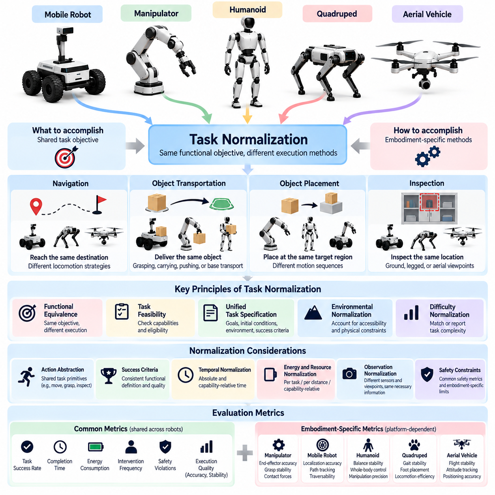{width="7.268055555555556in" height="7.268055555555556in"}

Task normalization across robots is a fundamental requirement for meaningful cross-embodiment evaluation. Different robotic platforms possess distinct mechanical structures, sensing capabilities, and control interfaces, making direct comparisons of physical actions unreliable. Task normalization establishes equivalent functional objectives while accounting for differences in embodiment. Its purpose is to evaluate transferable intelligence without assuming that heterogeneous robots must execute identical movements.

The central principle of task normalization is to distinguish what a robot must accomplish from how it accomplishes the objective. A navigation task may require reaching a designated destination, while allowing wheeled, legged, and aerial robots to use different movement strategies. Similarly, object transportation can involve grasping, carrying, pushing, or platform-based delivery. Normalization focuses on shared outcomes rather than enforcing identical execution procedures.

Functional equivalence provides the conceptual foundation for normalized tasks. Two robot executions are functionally equivalent when they satisfy the same task objective under comparable requirements, even if their physical actions differ. For example, a humanoid may retrieve an object using articulated arms, while a mobile manipulator combines base movement with robotic grasping. Evaluation should determine whether both systems achieve the intended outcome within explicitly defined operational constraints.

Task feasibility must be established before performance comparisons are conducted. Robots differ in payload capacity, reachable workspace, locomotion capability, and environmental accessibility. A task requiring dexterous manipulation cannot fairly evaluate a mobile robot without an appropriate end-effector. Normalization should therefore define eligibility conditions and capability prerequisites. Physically infeasible tasks should be identified separately from failures caused by perception, planning, or control.

Task specifications should describe goals, initial conditions, environmental constraints, and success criteria independently of robot-specific control commands. A normalized object-placement task might define the source location, target region, allowable placement error, and permitted interaction forces. Each robot can then determine its own motion sequence. This approach maintains consistent evaluation objectives while preserving the flexibility required by different embodiments.

Environmental normalization is necessary because identical environments do not always produce equivalent difficulty across platforms. Door widths, obstacle heights, terrain slopes, surface friction, and workspace dimensions affect robots differently. A narrow corridor may be easy for a compact mobile robot but impossible for a larger humanoid. Evaluation should document these accessibility differences and distinguish common environmental conditions from capability-adjusted test scenarios.

Difficulty normalization requires more than assigning the same task label to every robot. Task complexity may depend on travel distance, manipulation precision, obstacle density, payload requirements, and required coordination. These factors should be represented through measurable difficulty parameters. Researchers can then compare performance across matched difficulty levels or explicitly report differences when equivalent difficulty cannot be established.

Action abstraction helps separate high-level task meaning from embodiment-specific control. A command such as move to target, grasp object, or inspect location can be represented as a shared task primitive. Individual robots translate these primitives into joint commands, wheel velocities, footstep sequences, or flight trajectories. Evaluation should measure whether the shared intent is achieved while recording the quality of the platform-specific execution.

Success criteria must remain consistent at the functional level. For example, successful delivery may require an object to reach a designated destination without damage and within a specified time limit. The criterion should not depend on whether the robot uses wheels, legs, or articulated arms. However, additional embodiment-specific constraints may be necessary to ensure safe execution. These constraints should be documented separately from the shared definition of success.

Temporal normalization introduces challenges because robots operate at different speeds and control frequencies. Absolute completion time reflects operational performance but may favor inherently faster platforms. Capability-relative time can provide an additional measure by comparing execution duration against a suitable platform-specific reference. Reporting both values prevents normalization from hiding practical differences while supporting comparisons of how efficiently each robot uses its capabilities.

Energy and resource normalization follow similar principles. A quadruped may consume more energy than a wheeled robot during ground transportation because its locomotion mechanism requires continuous joint actuation. Comparing total energy alone may obscure differences in task difficulty and mechanical efficiency. Energy per unit distance, energy per completed task, and capability-relative consumption can provide complementary perspectives when their measurement boundaries are consistently defined.

Normalization must also address differences in observation and sensing capabilities. Robots may perceive the same environment through different camera viewpoints, depth sensors, tactile measurements, or localization systems. Requiring identical sensor inputs may be impractical or artificially restrictive. Instead, evaluation can standardize the information necessary for task completion while documenting sensor configurations and distinguishing perception advantages from differences in reasoning performance.

Statistical fairness requires normalized tasks to be evaluated across repeated trials and controlled variations. Initial positions, object arrangements, environmental disturbances, and task parameters should follow documented sampling procedures. Where possible, paired scenarios can reduce variation between platform comparisons. Confidence intervals and per-platform performance distributions should accompany aggregate results to reveal uncertainty and prevent misleading conclusions.

Excessive normalization can undermine evaluation validity by removing differences that matter in real deployment. Adjusting every task to match each robot\'s strengths may produce comparable scores while concealing important limitations. A platform that cannot operate in narrow spaces or handle required payloads remains unsuitable for certain applications. Evaluation should therefore preserve absolute operational results alongside normalized comparisons and clearly identify any task modifications.

A rigorous task normalization framework should separate shared task definitions, capability eligibility, environmental conditions, difficulty parameters, and platform-specific execution constraints. This separation enables researchers to identify whether performance differences arise from transferable intelligence, mechanical limitations, or evaluation design. Transparent documentation of normalization rules is essential for reproducibility and for comparing results across laboratories and benchmark versions.

Ultimately, task normalization enables heterogeneous robots to be evaluated against common functional objectives without erasing their physical differences. It establishes a fair basis for measuring task success, execution quality, efficiency, safety, and transfer performance. By combining functional equivalence with capability-aware constraints and transparent reporting, cross-embodiment evaluation can distinguish genuine generalization from advantages or limitations imposed by robot morphology.

## 07.05. Action Space and Kinematic Normalization

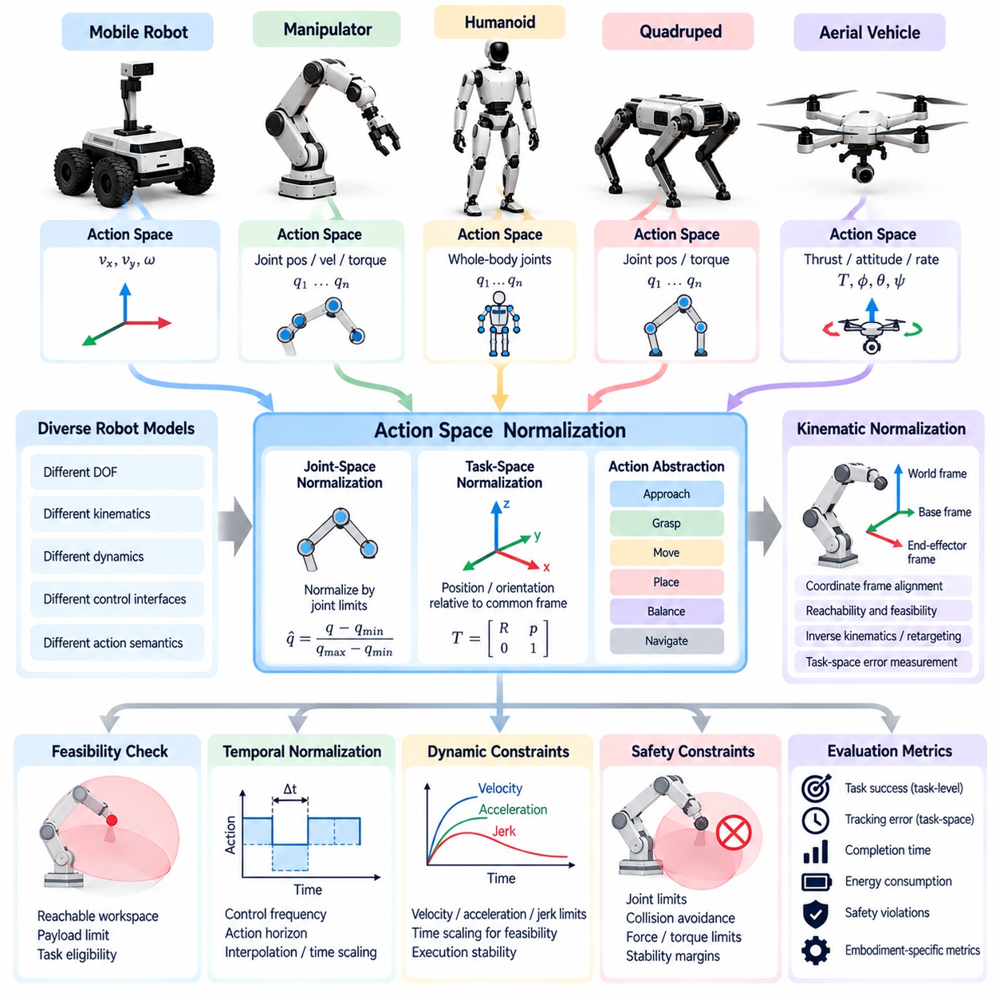{width="7.268055555555556in" height="7.268055555555556in"}

Action-space and kinematic normalization are essential for evaluating transferable intelligence across robots with different mechanical structures and control interfaces. Robotic platforms may use joint positions, joint velocities, torques, Cartesian motions, or high-level commands to express actions. Directly comparing these outputs can produce misleading results. Normalization establishes compatible representations while preserving the physical constraints and operational characteristics of each embodiment.

Action spaces differ in dimensionality, semantics, and control resolution. A six-axis manipulator may command six joint variables, while a humanoid coordinates many joints and a mobile robot controls translational and rotational velocities. Even when two robots perform the same task, their action vectors may have incompatible meanings. Evaluation must distinguish differences caused by action representation from differences in planning, reasoning, or execution competence.

Kinematic normalization addresses variations in joint configurations, link dimensions, coordinate frames, and reachable workspaces. Robots with different morphologies can achieve similar end-effector poses through different joint configurations. Comparing raw joint trajectories would therefore penalize legitimate solutions. Task-space representations provide a more consistent basis by expressing objectives through positions, orientations, relative transformations, and motion constraints.

Coordinate-frame alignment is a prerequisite for meaningful kinematic comparison. Robot-base frames, world frames, sensor frames, and end-effector frames must be defined consistently. Transformations between these frames allow trajectories generated by different robots to be interpreted within a common reference system. Calibration uncertainty and frame-estimation errors should be recorded because they can influence measured accuracy independently of policy quality.

Joint-space normalization may be useful when comparing robots with similar articulated structures. Joint positions can be expressed relative to allowable motion ranges, while velocities and torques can be scaled against documented hardware limits. However, normalized joint values do not necessarily represent equivalent physical behavior. Different link lengths, transmissions, and dynamic properties can produce substantially different motions despite similar normalized commands.

Task-space normalization provides a more general alternative for heterogeneous robots. Manipulation actions can be described through target object poses, end-effector displacements, grasp objectives, or desired contact conditions. Navigation actions can be represented through destination coordinates, heading changes, or reference paths. These descriptions preserve functional meaning while allowing each embodiment to generate physically appropriate low-level commands.

Action abstraction introduces shared behavioral primitives that can operate above robot-specific controllers. Commands such as approach target, grasp object, move payload, or maintain balance can describe intended outcomes without specifying individual actuator signals. Each platform translates these abstractions into executable actions through its own control architecture. Evaluation should distinguish the correctness of the shared command from the effectiveness of its embodiment-specific realization.

Inverse kinematics and motion retargeting provide mechanisms for translating task-space objectives into robot-specific joint configurations. However, these methods may encounter unreachable targets, singular configurations, joint-limit violations, or collisions. Evaluation should document retargeting success, residual task-space error, and constraint violations. Failures caused by mapping limitations should be distinguished from failures originating in the learned policy.

Reachability and feasibility constraints are central to kinematic normalization. Two robots may share a nominal task objective but possess different reachable workspaces, payload limits, and orientation capabilities. A target pose accessible to one manipulator may be impossible for another. Evaluation should identify feasible target regions and report performance within those regions while preserving information about absolute capability differences.

Temporal normalization is also necessary because action representations operate at different frequencies and durations. A policy may output commands every few milliseconds, while another generates longer motion segments or high-level actions. Comparing action counts or prediction errors without considering execution duration can distort results. Evaluation should specify control periods, action horizons, interpolation methods, and latency constraints.

Velocity, acceleration, and jerk limits influence whether normalized trajectories are physically executable. A geometrically valid path may exceed the dynamic capabilities of a slower or less powerful robot. Time scaling can make trajectories feasible, but it also changes completion time and energy consumption. Evaluation should report both geometric tracking quality and the temporal adjustments required to satisfy platform-specific motion constraints.

Normalization must preserve safety-critical differences between embodiments. Joint torque limits, collision boundaries, stability margins, and contact-force restrictions cannot be eliminated through simple scaling. A command that is safe for a lightweight manipulator may be hazardous for a high-payload industrial arm. Evaluation should apply embodiment-specific safety constraints while maintaining common definitions for task completion and constraint compliance.

Representation normalization introduces another challenge when policies use learned latent action spaces. Shared action tokens or continuous latent vectors may encode reusable behavioral patterns, but their physical interpretation depends on robot-specific decoders. Similar latent outputs do not guarantee equivalent executed behavior. Evaluation should therefore examine both representation-level consistency and the actual trajectories produced after decoding and control.

Normalization quality can be assessed through reconstruction accuracy, trajectory consistency, execution feasibility, and task success. A mapping that preserves geometric similarity but produces unstable control is insufficient. Conversely, a robot may complete a task successfully despite substantial differences in its joint trajectories. Evaluation should prioritize functional outcomes while using representation and kinematic diagnostics to explain observed performance differences.

Fair comparison requires separating normalization components from the intelligence being evaluated. A sophisticated robot-specific controller may compensate for weaknesses in a shared policy, while poor calibration or retargeting may obscure otherwise transferable knowledge. Evaluation protocols should document action mappings, controller capabilities, calibration procedures, and adaptation requirements. Where possible, controlled comparisons can isolate the contribution of each component.

Ultimately, action-space and kinematic normalization establish a bridge between shared task intelligence and heterogeneous physical execution. They enable policies to be compared through common functional objectives without assuming identical joints, actuators, or motion strategies. By combining coordinate alignment, task-space representations, feasibility analysis, temporal constraints, and transparent reporting, cross-embodiment evaluation can identify genuine transfer capabilities while preserving the physical distinctions that determine real-world performance.

## 07.06. Capability Normalized Performance

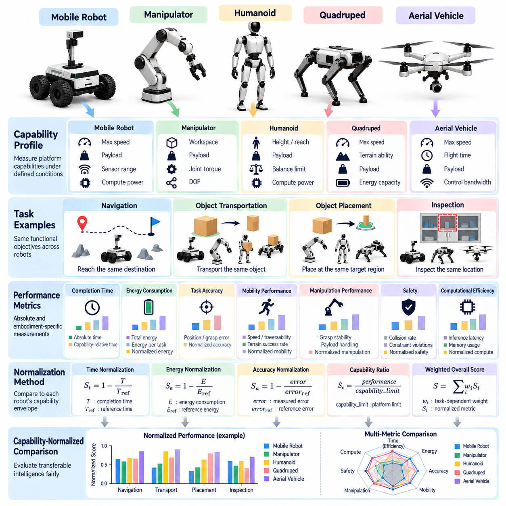{width="7.268055555555556in" height="7.268055555555556in"}

Capability-normalized performance provides a framework for comparing Physical AI systems that operate through different robotic embodiments. Traditional performance measurements often favor robots with greater speed, strength, reach, or computational resources. Capability normalization evaluates how effectively each system uses its available physical and computational capabilities. This approach helps distinguish the quality of learned intelligence from advantages provided by hardware design.

The central objective of capability normalization is to separate absolute performance from performance relative to a robot\'s feasible operating envelope. Absolute performance describes measurable outcomes such as completion time, positioning accuracy, payload capacity, and energy consumption. Capability-relative performance evaluates these outcomes against appropriate platform-specific references. Both perspectives are necessary because practical effectiveness and intelligent resource utilization represent different evaluation objectives.

Robotic capabilities depend on morphology, actuator characteristics, sensing configurations, and computational resources. A wheeled mobile robot may achieve high transportation efficiency on smooth surfaces, while a quadruped provides greater mobility across irregular terrain. A stationary manipulator may offer excellent positioning precision but cannot independently navigate between workstations. Normalized evaluation must account for these differences without treating every physical limitation as an intelligence failure.

A capability profile establishes the foundation for meaningful normalization. This profile describes measurable properties such as maximum velocity, acceleration, payload, reachable workspace, joint torque limits, sensor coverage, and available computational capacity. Relevant capabilities should be measured under documented operating conditions rather than inferred exclusively from manufacturer specifications. The profile defines reference limits against which task execution can be interpreted.

Task feasibility must be established before normalized performance is calculated. A robot should not receive a conventional failure score for an objective that is physically impossible under its documented capabilities. However, excluding infeasible tasks entirely may conceal important limitations in deployment suitability. Evaluation should therefore report task eligibility, feasibility boundaries, and performance on feasible tasks separately, preserving both comparative fairness and operational relevance.

Capability-relative completion time can be evaluated by comparing observed execution duration with a suitable reference duration for the same platform and task. The reference may come from a validated controller, measured baseline, or independently established feasible trajectory. Such comparisons reveal whether a learned policy approaches the platform\'s demonstrated execution capability. Reference selection must be transparent because an artificially weak baseline can inflate normalized performance.

Energy normalization requires careful consideration of mechanical structure and operating conditions. Total energy consumption may differ substantially between wheeled, legged, and aerial robots even when they achieve similar functional objectives. Energy per completed task, energy per transported payload-distance, and energy relative to a documented baseline can provide complementary measurements. Evaluation should specify whether sensing, computation, actuation, and auxiliary power are included.

Accuracy normalization is especially relevant when comparing manipulation and positioning capabilities. A robot with high-resolution encoders and rigid mechanical construction may achieve smaller absolute errors than a lightweight compliant system. Normalized accuracy can express measured error relative to a validated platform-specific reference or tolerance. However, absolute error remains essential when applications impose fixed precision requirements that cannot be relaxed for individual embodiments.

Mobility performance can be normalized using terrain difficulty, feasible speed, obstacle negotiation capability, and locomotion constraints. A quadruped traversing uneven terrain should not be compared solely through travel time against a wheeled robot operating on a smooth floor. Capability-aware evaluation can compare progress relative to each platform\'s demonstrated operating envelope. Nevertheless, differences in environmental accessibility must remain visible rather than being hidden by normalized scores.

Manipulation performance introduces additional normalization dimensions involving reach, dexterity, grasp stability, and payload handling. Two robotic arms may successfully place an object while operating with different degrees of freedom and force limits. Evaluation can measure task quality relative to each system\'s feasible workspace and manipulation constraints. This approach identifies effective policy execution without assuming that mechanically different manipulators possess equivalent physical potential.

Computational capability also influences observed performance. Robots equipped with powerful accelerators may support larger models, faster inference, and more frequent replanning than resource-constrained edge platforms. Normalization can examine task performance relative to computational power, memory capacity, inference latency, and energy budgets. However, computational efficiency should be reported alongside absolute execution performance because deployment requirements depend on actual hardware limitations.

Normalized performance should not be reduced to a single ratio without examining the underlying reference conditions. Different baselines, measurement boundaries, and task distributions can produce incomparable results. A policy may appear highly efficient because its reference controller performs poorly rather than because the policy approaches physical limits. Evaluation protocols should validate reference quality, document uncertainty, and prevent normalization procedures from rewarding weak baselines.

Multi-objective capability normalization considers task success, execution quality, efficiency, robustness, and safety simultaneously. Improvements in one dimension may introduce unacceptable degradation in another. A robot might complete tasks rapidly by operating near actuator limits while increasing collision risk or mechanical wear. Evaluation should preserve separate performance dimensions and enforce safety constraints rather than allowing favorable efficiency scores to compensate for hazardous behavior.

Statistical reliability requires normalized measurements to be evaluated across repeated trials, environmental variations, and representative task distributions. Reference capabilities may vary with battery state, payload, temperature, component wear, and calibration quality. Confidence intervals and sensitivity analysis can reveal whether apparent performance advantages remain stable under these variations. Both absolute and normalized metrics should be reported with consistent measurement procedures.

Capability normalization is particularly valuable when evaluating cross-embodiment policy transfer. A shared policy may achieve different absolute outcomes on a humanoid, quadruped, or mobile manipulator because their physical capabilities differ. Comparing performance relative to validated platform-specific references can reveal whether the policy uses each embodiment effectively. Adaptation requirements and controller contributions must also be documented to distinguish transferable intelligence from specialized engineering.

Ultimately, capability-normalized performance provides a complementary perspective rather than a replacement for absolute evaluation. It helps identify whether Physical AI systems exploit their available capabilities efficiently while preserving visibility into real-world operating limitations. By combining capability profiles, feasibility analysis, validated references, multidimensional metrics, and transparent reporting, cross-embodiment evaluation can produce fairer and more informative comparisons of generalist robotic intelligence.

## 07.07. AMR and Mobile Platform Transfer

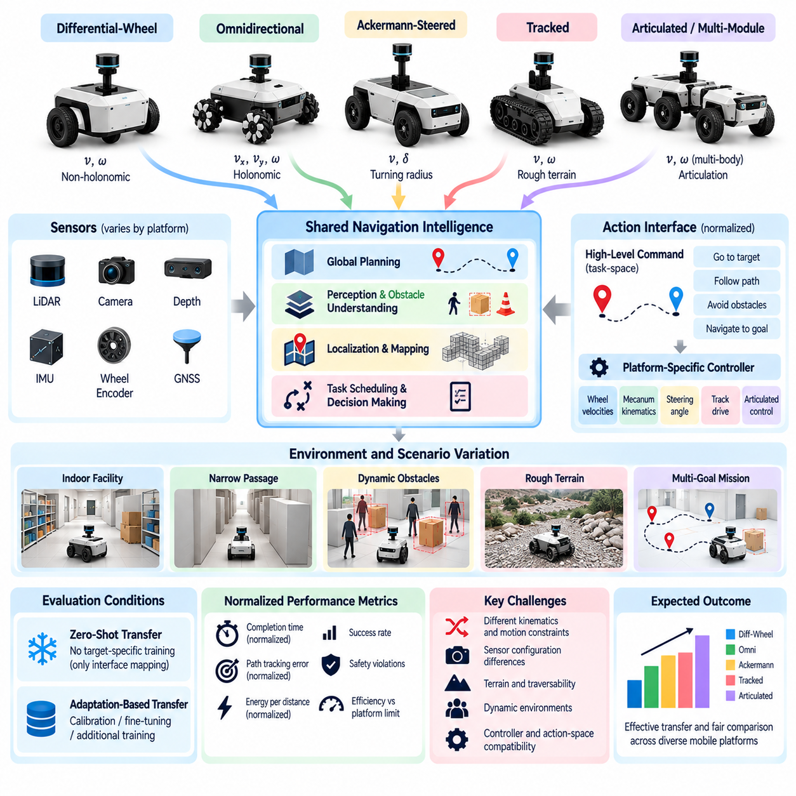{width="7.268055555555556in" height="7.268055555555556in"}

Transfer evaluation across autonomous mobile robots (AMRs) and mobile platforms examines whether learned navigation and decision-making capabilities remain effective when deployed on robots with different mechanical configurations. Wheeled, tracked, omnidirectional, and articulated mobile bases exhibit distinct motion characteristics. Cross-platform evaluation must determine whether shared intelligence can adapt to these differences without requiring complete retraining for every robot configuration.

AMR transfer involves separating platform-independent navigation intelligence from embodiment-specific motion control. Global route planning, obstacle interpretation, semantic localization, and task scheduling can often share common representations. However, wheel geometry, steering mechanisms, acceleration limits, and braking characteristics influence how planned actions are executed. Evaluation should distinguish transferable planning competence from the effectiveness of platform-specific controllers.

Mobile platforms differ substantially in their kinematic constraints. Differential-drive robots cannot translate laterally without changing orientation, whereas omnidirectional platforms can move sideways while maintaining heading. Ackermann-steered vehicles require turning radii compatible with their steering geometry. A shared navigation policy must respect these constraints when generating executable trajectories. Transfer performance should therefore be evaluated through feasible motion rather than identical control outputs.

Action-space normalization provides a bridge between heterogeneous mobile platforms. High-level commands can specify target poses, desired paths, or local navigation objectives, while platform-specific controllers translate them into wheel velocities and steering angles. This architecture allows a common policy to operate across different drive mechanisms. Evaluation should document the action interface and determine whether observed performance improvements originate from the shared policy or the underlying controller.

Sensor configurations introduce another major source of transfer difficulty. AMRs may combine LiDAR, stereo cameras, depth sensors, inertial measurement units, wheel encoders, and satellite positioning systems. Differences in sensor placement, field of view, measurement noise, and update frequency affect environmental perception. Cross-platform benchmarks should evaluate whether shared representations remain reliable despite these variations and should document any sensor-specific adaptation.

Localization transfer is particularly important because different robots may operate with distinct sensor arrangements and motion models. A localization method developed for a differential-drive platform may experience different error characteristics when deployed on an omnidirectional or tracked robot. Evaluation should measure position drift, heading error, recovery after localization loss, and robustness to environmental changes. Mapping quality and localization performance should be analyzed separately from navigation success.

Obstacle avoidance provides a practical measure of transferable perception and planning. A navigation policy must identify static obstacles, moving pedestrians, narrow passages, and unexpected obstructions across multiple robot configurations. However, the same obstacle arrangement may impose different collision risks depending on platform dimensions and stopping distance. Evaluation should account for robot footprints, safety margins, and dynamic constraints while preserving consistent definitions of collision avoidance.

Terrain interaction creates additional challenges when transferring policies between mobile platforms. Wheeled robots may perform efficiently on smooth floors but struggle with loose gravel, steep slopes, or discontinuous surfaces. Tracked platforms may provide improved traction under certain conditions while introducing different turning resistance and energy costs. Evaluation should characterize terrain difficulty, wheel or track slip, traversability, and recovery behavior under comparable environmental conditions.

Dynamic performance normalization is necessary because mobile platforms possess different maximum velocities, acceleration capabilities, payload limits, and braking distances. Comparing navigation completion time alone may favor faster hardware rather than more effective intelligence. Capability-relative metrics can measure progress against validated platform-specific references. Absolute travel time, tracking error, and energy consumption should remain visible to preserve practical deployment relevance.

Navigation transfer should be evaluated across increasingly unfamiliar environments. Initial experiments may use shared maps and known obstacle configurations, followed by changes in corridor geometry, lighting, surface conditions, and pedestrian activity. More demanding tests can introduce previously unseen facilities and altered route connectivity. This progression helps determine whether successful transfer reflects reusable spatial reasoning or dependence on memorized environmental patterns.

Zero-shot transfer and adaptation-based transfer represent different evaluation conditions. Zero-shot evaluation deploys a trained policy on a new platform without updating its learned parameters, although predefined interface mappings may still be necessary. Adaptation-based evaluation permits controlled calibration, fine-tuning, or additional training. Reports should specify adaptation data, computational cost, controller modifications, and engineering effort to avoid overstating generalization.

Long-horizon navigation tasks provide stronger evidence of transferable autonomy than isolated waypoint-following experiments. An AMR may need to visit multiple destinations, avoid temporary obstructions, recover from localization errors, and resume interrupted deliveries. Evaluation should measure mission completion, accumulated navigation error, recovery success, intervention frequency, and task execution continuity. These measurements reveal whether transferred policies remain reliable throughout extended operations.

Safety evaluation must account for the physical consequences of transferring navigation policies between platforms. A trajectory that is safe for a lightweight robot may create unacceptable stopping-distance or collision-force risks for a heavier platform. Emergency braking, obstacle clearance, speed restrictions, and human proximity should therefore be assessed under embodiment-specific constraints. Common safety objectives must be maintained without assuming identical physical risk profiles.

Benchmark reliability depends on controlled experimental design and transparent reporting. Each platform should be evaluated through repeated trials with documented initial conditions, payloads, sensor configurations, and environmental disturbances. Shared test scenarios should be supplemented with platform-feasible variations where necessary. Statistical comparisons should report uncertainty and distinguish failures caused by hardware limitations, perception errors, planning decisions, and low-level control.

Cross-platform evaluation should also consider operational integration. Real AMRs interact with fleet-management systems, building infrastructure, communication networks, and task allocation services. A transferred navigation policy may perform well in isolated experiments but encounter failures involving communication delays, docking interfaces, or traffic coordination. Evaluation should examine these dependencies while distinguishing platform-independent autonomy from integration-specific engineering requirements.

Ultimately, AMR and mobile-platform transfer evaluation measures whether navigation intelligence can generalize across heterogeneous mobility systems while respecting their physical differences. Reliable assessment combines action normalization, sensor robustness, localization accuracy, motion feasibility, safety, and long-horizon task performance. By reporting absolute outcomes alongside capability-normalized metrics and adaptation costs, researchers can identify genuine transferability and the remaining barriers to scalable Physical AI deployment.

## 07.08. Manipulator and Mobile Manipulator Transfer

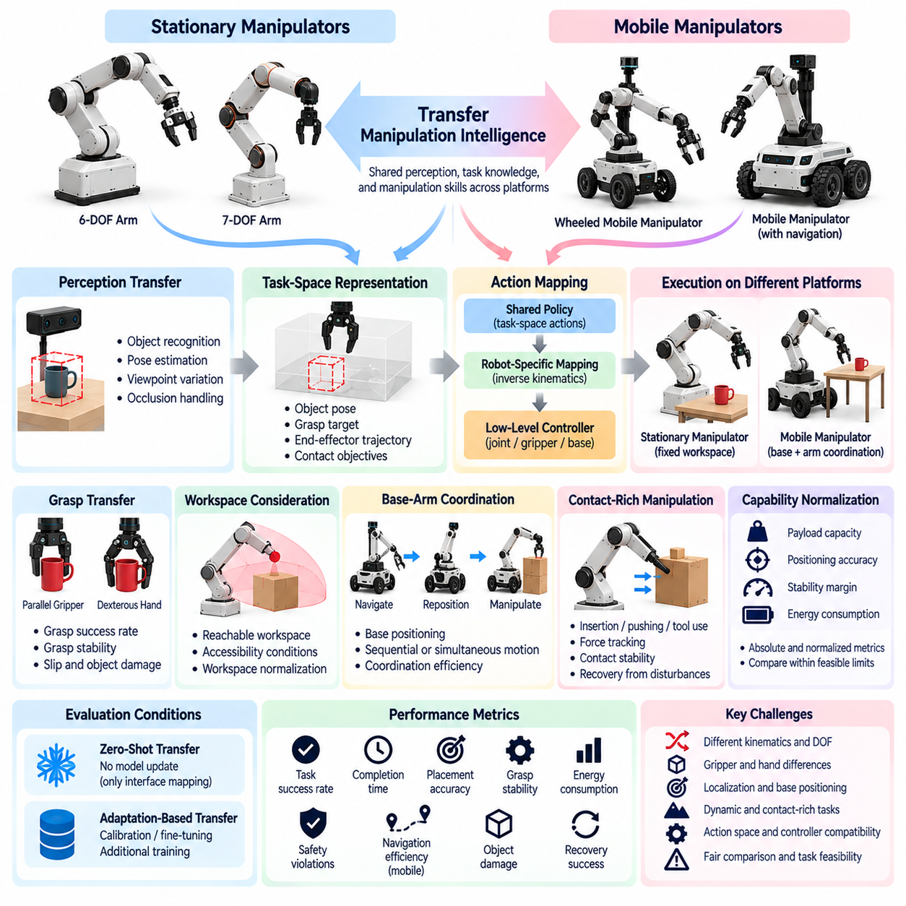{width="7.268055555555556in" height="7.268055555555556in"}

Transfer evaluation between stationary manipulators and mobile manipulators examines whether learned manipulation intelligence remains effective across robots with different kinematic structures, workspaces, and mobility capabilities. Stationary arms operate within fixed workspaces, while mobile manipulators combine articulated arms with movable bases. Evaluation must determine which aspects of perception, grasp planning, and object interaction transfer across platforms and which depend on embodiment-specific control.

Manipulator transfer is complicated by differences in degrees of freedom, joint arrangements, link lengths, actuator limits, and end-effector designs. Two robots may achieve the same object-placement objective through substantially different joint trajectories. Direct comparison of joint commands is therefore insufficient. Cross-embodiment evaluation should emphasize functional task outcomes while documenting the kinematic and dynamic constraints that shape each robot\'s execution strategy.

Task-space representations provide a common interface for transferring manipulation policies. Object poses, grasp targets, end-effector trajectories, and desired contact conditions can describe intended behavior independently of specific joint configurations. Robot-specific inverse kinematics and motion controllers translate these objectives into executable commands. Evaluation should measure whether transferred policies preserve task intent despite differences in motion generation and control implementation.

Grasp transfer presents a significant challenge because robotic hands and grippers differ in geometry, contact surfaces, force capacity, and available sensing. A parallel-jaw gripper may secure an object using opposing contact forces, while a dexterous hand coordinates multiple fingers. Shared grasp representations should describe object-relative contact objectives rather than assuming identical finger motions. Evaluation should measure grasp success, stability, slip, and object damage across compatible grasping conditions.

Mobile manipulators introduce additional degrees of freedom through their mobile bases. Unlike stationary manipulators, they can reposition themselves to expand their effective workspaces and approach objects from different directions. However, mobility introduces localization uncertainty, base positioning error, and additional collision constraints. Evaluation should distinguish improvements arising from intelligent base-arm coordination from advantages provided by increased physical reachability.

Base-arm coordination is a central component of mobile manipulation transfer. A robot must determine when to reposition its base, adjust its arm configuration, or combine both movements to complete a task. Different platforms may use sequential navigation and manipulation or simultaneous whole-body motion. Evaluation should examine coordination efficiency, trajectory feasibility, task completion time, and the ability to recover from positioning errors without assuming identical motion strategies.

Workspace normalization is necessary when comparing stationary and mobile manipulators. A stationary arm has a bounded reachable workspace, whereas a mobile manipulator can extend its operational coverage by moving its base. Normalized tasks should define object locations, accessibility conditions, and required interaction regions. Performance within shared feasible regions should be distinguished from absolute workspace coverage so that normalization does not conceal the operational benefits of mobility.

Perception transfer is affected by differences in camera placement, viewing geometry, sensor resolution, and robot movement. A stationary manipulator may rely on fixed external cameras, while a mobile manipulator uses onboard sensors whose viewpoints change during navigation. Shared perception models must maintain object recognition and pose estimation under these variations. Evaluation should measure detection reliability, pose accuracy, occlusion handling, and the benefits of active viewpoint selection.

Contact-rich manipulation introduces challenges that cannot be resolved through geometric normalization alone. Insertion, pushing, sliding, and tool-use tasks depend on force regulation, compliance, friction, and contact transitions. Robots with different actuator stiffness and force-sensing capabilities may respond differently to the same interaction objective. Evaluation should examine force tracking, contact stability, task success, and recovery from unexpected interactions while respecting platform-specific safety limits.

Payload capacity and mechanical compliance also influence manipulation transfer. A heavy industrial arm may maintain high positioning accuracy under substantial loads, while a lightweight mobile manipulator may experience structural deflection or base instability. Capability-normalized metrics can compare execution relative to validated platform limits. Absolute payload, positioning error, and stability margins must also be reported because these properties determine practical application suitability.

Action-space transfer requires careful separation between shared policy outputs and robot-specific execution interfaces. A common policy may generate Cartesian displacement commands, object-centric actions, or learned latent action representations. Individual platforms decode these outputs into joint motion, gripper control, and base movement. Evaluation should document mapping methods, controller capabilities, and adaptation requirements to identify whether successful transfer originates from reusable policy knowledge.

Zero-shot transfer provides a stringent test of generalization when a policy is deployed on a new manipulator without updating its learned parameters. However, predefined kinematic mappings, calibration, and compatible action interfaces may still be necessary. Adaptation-based transfer permits additional demonstrations, fine-tuning, or controller adjustment. Evaluation should report adaptation data, training cost, engineering effort, and performance improvement separately to avoid overstating zero-shot capability.

Long-horizon manipulation tasks provide stronger evidence of transfer than isolated grasping experiments. A mobile manipulator may navigate to a workstation, identify an object, grasp it, transport it, and place it at another location. Failures can propagate across perception, navigation, manipulation, and task planning stages. Evaluation should measure subgoal completion, recovery success, cumulative error, intervention frequency, and overall mission success across different robot configurations.

Safety evaluation must account for differences in arm mass, payload, base stability, collision geometry, and contact forces. A motion that is acceptable for a lightweight manipulator may create excessive collision risk when executed by a heavier industrial arm. Mobile manipulators also face tipping hazards and unintended base movement during interaction. Shared safety objectives should be combined with embodiment-specific constraints, including force limits, stability margins, and emergency stopping behavior.

Benchmark design should include repeated trials across representative objects, grasp configurations, workspace layouts, and environmental disturbances. Comparisons must document robot geometry, sensing arrangements, control frequencies, and task eligibility. Statistical analysis should separate failures caused by perception, grasp planning, motion generation, base positioning, and hardware limitations. Reporting both absolute and capability-normalized results helps preserve fairness without obscuring meaningful physical differences.

Ultimately, manipulator and mobile-manipulator transfer evaluation determines whether learned object-interaction capabilities can generalize across heterogeneous robotic systems. Reliable assessment combines task-space normalization, grasp robustness, perception transfer, base-arm coordination, contact dynamics, safety, and long-horizon performance. By distinguishing shared intelligence from embodiment-specific execution and adaptation costs, evaluation can identify the practical limits of transferable manipulation policies in Physical AI.

## 07.09. Quadruped and Legged Robot Transfer

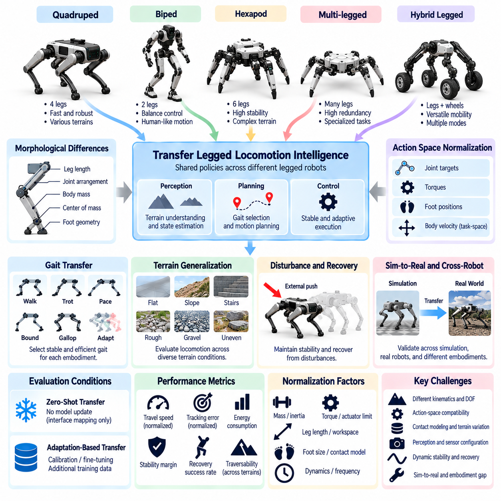{width="7.268055555555556in" height="7.268055555555556in"}

Transfer evaluation across quadruped and other legged robots examines whether learned locomotion intelligence remains effective when deployed on platforms with different morphologies, actuator configurations, and dynamic characteristics. Quadrupeds, bipeds, and multi-legged robots differ in balance requirements, contact patterns, and movement capabilities. Cross-embodiment evaluation must determine whether shared policies preserve locomotion competence without assuming identical joint structures or gait mechanisms.

Legged locomotion transfer is particularly challenging because movement depends on continuous interaction between the robot and its environment. Foot placement, ground reaction forces, body momentum, and contact timing jointly determine stability. Small differences in limb geometry or actuator response can produce substantially different motion outcomes. Evaluation should therefore emphasize closed-loop execution and physical stability rather than similarity between commanded joint trajectories.

Morphological differences influence the transferability of locomotion policies. Leg length, joint arrangement, body mass, center of mass, and foot geometry determine feasible movement patterns. A quadruped with relatively short legs may require different stepping strategies from a taller platform. Normalization should describe these physical properties explicitly while evaluating whether learned policies adapt their behavior to the available mechanical capabilities.

Gait transfer provides a practical benchmark for cross-embodiment locomotion. Walking, trotting, pacing, bounding, and other movement patterns involve different sequences of foot contacts and body motion. Not every gait is appropriate or feasible for every legged robot. Evaluation should measure whether a transferred policy selects stable and efficient locomotion patterns under comparable task demands rather than requiring identical gait sequences across platforms.

Action-space normalization is essential because legged robots often possess different numbers of joints and actuator interfaces. Policies may output joint targets, motor torques, desired foot positions, or high-level velocity commands. Shared task-space representations can express desired body velocity, heading, and foothold objectives independently of specific joint configurations. Robot-specific controllers then translate these objectives into feasible actuator commands.

Dynamic normalization must account for differences in mass, inertia, actuator bandwidth, torque limits, and contact mechanics. Two quadrupeds executing the same velocity command may experience different acceleration, body oscillation, and energy consumption. Dimensionless measures and capability-relative references can support comparisons across platforms of different sizes. However, absolute speed, payload capacity, and stability limits must remain visible for practical deployment assessment.

Terrain generalization is a central objective of legged robot transfer evaluation. Robots may encounter stairs, slopes, gravel, grass, uneven ground, and discontinuous footholds. Different embodiments respond differently to these conditions because of variations in foot size, leg reach, and traction. Evaluation should measure traversability, slip frequency, body stability, and recovery performance across representative terrain categories and controlled difficulty levels.

Balance and disturbance recovery provide important evidence of transferable control intelligence. External pushes, unexpected foothold changes, and sudden contact losses can destabilize a walking robot. A transferred policy must detect disturbances and adjust foot placement, body posture, or movement speed to maintain stability. Evaluation should measure recovery success, maximum tolerable disturbance, stabilization time, and the frequency of falls under documented safety conditions.

Contact modeling introduces additional transfer challenges because legged locomotion relies on intermittent and sometimes uncertain ground contact. Differences in surface friction, compliance, and foot construction influence force transmission and slip behavior. A policy trained with simplified contact assumptions may fail when deployed on another robot. Evaluation should distinguish errors caused by contact-model mismatch from limitations in perception, planning, and feedback control.

Perception transfer is necessary when locomotion policies use cameras, depth sensors, LiDAR, or proprioceptive measurements. Sensor placement and body motion affect the quality and timing of terrain observations. A camera mounted on a tall quadruped may provide different visual information from one mounted on a compact platform. Evaluation should examine terrain interpretation, state-estimation accuracy, sensor degradation, and robustness to viewpoint changes.

Simulation-to-real transfer becomes more difficult when a policy must generalize across both simulated dynamics and different physical embodiments. Domain randomization can expose policies to variations in mass, friction, actuator response, and joint configuration during training. Nevertheless, successful simulation performance does not guarantee real-world stability. Evaluation should quantify transfer degradation and validate behavior through progressively challenging physical experiments.

Zero-shot locomotion transfer tests whether a trained policy can operate on a new legged robot without updating its learned parameters. This setting may require predefined observation mappings, action adapters, and safety controllers. Adaptation-based transfer allows additional demonstrations, parameter tuning, or fine-tuning on the target platform. Evaluation should report adaptation budgets, training data, engineering effort, and performance improvements to distinguish generalization from platform-specific optimization.

Energy efficiency and endurance are important because legged locomotion often requires substantial actuator power. A policy that achieves high speed through aggressive joint motion may increase energy consumption, thermal loading, and mechanical wear. Evaluation should measure energy per distance, cost of transport, actuator utilization, and sustained operating duration. These metrics should be interpreted alongside task success and stability rather than optimized independently.

Long-horizon locomotion tasks reveal limitations that short walking trials may overlook. A robot may need to traverse multiple terrain types, negotiate obstacles, maintain navigation objectives, and recover from unexpected disturbances over extended periods. Evaluation should measure mission completion, accumulated tracking error, intervention frequency, fall rate, and recovery continuity. Such tests reveal whether transferred locomotion intelligence remains reliable beyond isolated gait demonstrations.

Safety evaluation must reflect embodiment-specific risks associated with legged movement. Falls, uncontrolled limb motion, actuator overheating, and loss of balance can damage equipment or endanger nearby people. Robots with different masses and joint capabilities require different operating limits and emergency responses. Evaluation should maintain common safety objectives while applying platform-specific constraints and documenting protective interventions that affect observed performance.

Ultimately, quadruped and legged robot transfer evaluation measures whether locomotion intelligence can generalize across diverse mechanical structures and physical operating conditions. Reliable assessment combines morphology-aware normalization, gait adaptability, dynamic stability, terrain generalization, disturbance recovery, energy efficiency, and long-horizon reliability. Transparent reporting of absolute performance, capability-relative metrics, and adaptation requirements helps distinguish genuine transferable intelligence from embodiment-specific control advantages.

## 07.10. Humanoid Transfer and Generalization

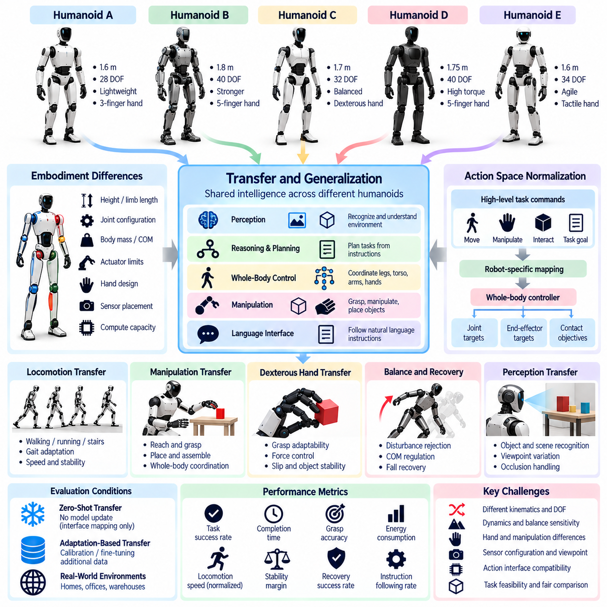{width="7.268055555555556in" height="7.268055555555556in"}

Humanoid transfer and generalization evaluation examines whether learned intelligence can operate across humanoid robots with different body proportions, joint configurations, actuator systems, and sensing capabilities. Although humanoids share a broadly human-like structure, their mechanical and computational characteristics vary considerably. Evaluation must determine whether locomotion, manipulation, and task-planning capabilities transfer between platforms without requiring complete policy redesign.

Humanoid embodiment differences include height, limb length, body mass, joint degrees of freedom, hand structure, and center-of-mass distribution. These properties influence balance, reachability, movement efficiency, and physical interaction. Two humanoids may accomplish the same task through different postures and trajectories. Cross-embodiment evaluation should therefore compare functional outcomes while documenting the morphological constraints that determine feasible execution strategies.

Whole-body coordination is a defining challenge in humanoid transfer. Walking, reaching, lifting, and object manipulation frequently require simultaneous control of the legs, torso, arms, and hands. A policy trained on one humanoid may depend on specific joint couplings or balance strategies that do not transfer directly. Evaluation should measure whether shared control representations preserve coordinated behavior across different kinematic and dynamic structures.

Action-space normalization provides a foundation for transferring humanoid policies. Joint-level commands are difficult to share because robots differ in actuator arrangements and available degrees of freedom. Higher-level representations can describe desired body poses, end-effector targets, contact objectives, and locomotion commands. Robot-specific inverse kinematics and whole-body controllers translate these objectives into executable actions while respecting physical constraints.

Balance and dynamic stability are critical because humanoids operate with relatively narrow support regions during standing and walking. Differences in foot geometry, mass distribution, actuator response, and joint limits influence stability margins. A transferred policy must adapt its posture and movement to these characteristics. Evaluation should measure balance recovery, center-of-mass regulation, foot placement accuracy, and stability during transitions between locomotion and manipulation.

Bipedal locomotion transfer involves adapting walking policies to different leg geometries, joint torque limits, and gait dynamics. A walking strategy effective on a lightweight humanoid may become unstable on a heavier platform with slower actuators. Evaluation should consider walking speed, step consistency, energy consumption, disturbance recovery, and fall frequency. Comparisons should normalize task demands without concealing differences in absolute mobility capabilities.

Humanoid manipulation transfer extends beyond simple arm motion because object interaction often depends on coordinated body posture and balance. Reaching for a distant object may require torso rotation, weight shifting, or stepping. Differences in arm reach, wrist mobility, and hand dexterity affect feasible manipulation strategies. Evaluation should measure grasp success, placement accuracy, contact stability, and the ability to maintain balance during object interaction.

Dexterous hand transfer presents a distinct challenge within humanoid evaluation. Robotic hands vary in finger count, joint coupling, tactile sensing, grip strength, and mechanical compliance. A manipulation policy based on specific finger trajectories may not generalize to another hand design. Object-centric grasp representations and contact objectives provide more transferable interfaces. Evaluation should assess grasp adaptability, slip resistance, force regulation, and object handling quality.

Perception transfer is influenced by differences in sensor placement, head motion, body height, and field of view. Humanoids may use head-mounted cameras, depth sensors, tactile sensors, and proprioceptive measurements to understand their surroundings. Changes in viewing geometry can alter object localization and scene interpretation. Evaluation should examine recognition accuracy, spatial consistency, occlusion handling, and perception robustness during whole-body movement.

Human-centered environments provide meaningful benchmarks because humanoids are often designed to operate around furniture, tools, doors, and workstations intended for people. However, human-like appearance does not guarantee human-equivalent capabilities. Differences in reach, strength, dexterity, and mobility can make certain tasks infeasible. Evaluation should define task eligibility and physical accessibility before comparing performance across humanoid platforms.

Language-conditioned task transfer introduces another dimension of humanoid generalization. A robot may receive instructions to retrieve objects, organize a workspace, or perform a sequence of household activities. Successful execution requires connecting semantic understanding with perception, planning, and physical control. Evaluation should determine whether instruction interpretation remains consistent across platforms while separating reasoning failures from embodiment-specific execution limitations.

Zero-shot humanoid transfer tests whether a learned policy can operate on an unfamiliar humanoid without updating its model parameters. Compatible observation interfaces, action mappings, and safety controllers may still be necessary. Adaptation-based transfer permits calibration, demonstrations, fine-tuning, or controller adjustments. Evaluation should report adaptation data, computational cost, engineering effort, and performance gains to distinguish reusable intelligence from platform-specific optimization.

Long-horizon humanoid evaluation should combine locomotion, manipulation, navigation, and task reasoning within complete missions. A humanoid may need to approach a workstation, identify tools, manipulate objects, and recover from unexpected disturbances. Errors can accumulate across perception, planning, and whole-body control. Evaluation should measure mission completion, subgoal reliability, intervention frequency, recovery success, and sustained autonomous operation.

Safety evaluation must account for humanoid-specific risks associated with height, mass, balance loss, and human proximity. Falls and uncontrolled limb movements may create substantial collision hazards. Different humanoids require different force limits, stability thresholds, emergency stopping procedures, and protective behaviors. Evaluation should preserve common safety objectives while applying embodiment-specific constraints and documenting safety interventions that influence task performance.

Benchmark design should include representative humanoid platforms, standardized task objectives, controlled environmental variations, and repeated trials. Robot morphology, sensing configurations, control interfaces, and adaptation procedures must be documented. Performance should be reported through absolute outcomes and capability-normalized metrics. Statistical analysis should distinguish failures caused by perception, reasoning, locomotion, manipulation, balance, and hardware limitations.

Ultimately, humanoid transfer and generalization evaluation determines whether learned intelligence can support reusable capabilities across diverse humanoid embodiments. Reliable assessment integrates morphology-aware normalization, whole-body coordination, locomotion, dexterous manipulation, perception, language grounding, safety, and long-horizon autonomy. Transparent comparison of task success, physical capability, adaptation cost, and failure mechanisms reveals the practical boundaries of general-purpose humanoid intelligence.

## 07.11. Aerial and Ground Cross Embodiment Transfer

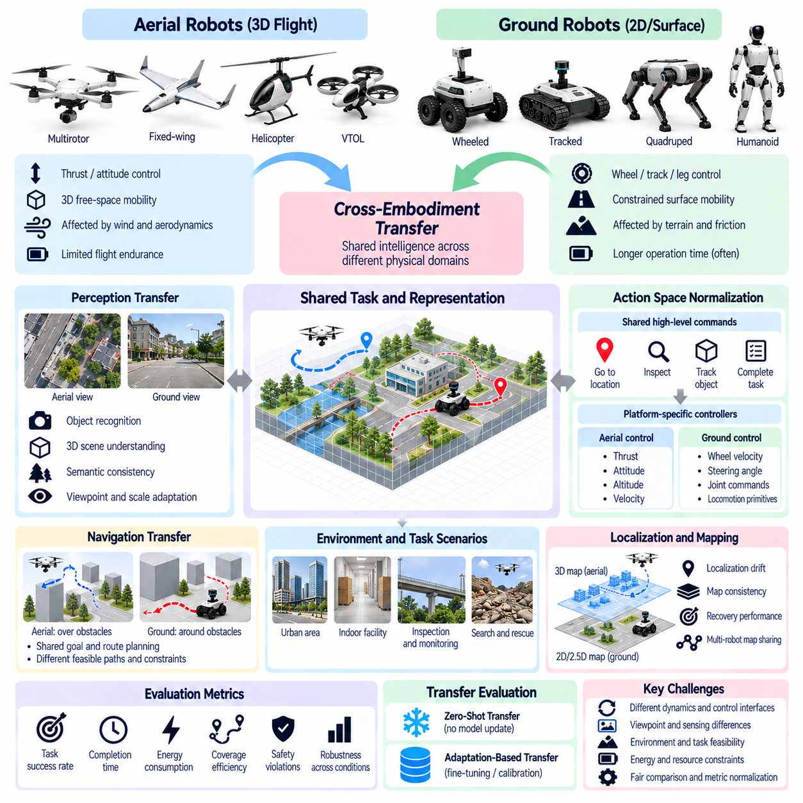{width="7.268055555555556in" height="7.268055555555556in"}

Aerial and ground cross-embodiment transfer evaluation examines whether learned intelligence can generalize between robots operating in fundamentally different physical domains. Unmanned aerial vehicles navigate three-dimensional airspace, while ground robots move across constrained surfaces. Their motion dynamics, sensing conditions, and safety requirements differ substantially. Evaluation must identify which perception, planning, and decision-making capabilities transfer despite these differences in physical embodiment.

The primary challenge arises from the distinction between aerial flight dynamics and ground locomotion dynamics. Aerial robots regulate thrust, attitude, and altitude while responding to gravity and aerodynamic disturbances. Ground robots depend on wheel, track, or leg contact with supporting surfaces. Direct transfer of low-level control commands is generally infeasible. Cross-embodiment evaluation should therefore focus on shared task objectives and abstract decision representations.

Spatial representation transfer provides an important foundation for aerial-ground generalization. Aerial robots frequently construct three-dimensional maps, while ground robots may use two-dimensional occupancy grids or elevation-aware representations. Shared geometric models can encode obstacles, traversable regions, semantic landmarks, and environmental connectivity. Evaluation should measure whether these representations preserve useful spatial relationships across different viewpoints and mobility constraints.

Navigation transfer requires distinguishing shared route-planning intelligence from platform-specific trajectory generation. An aerial robot may cross obstacles vertically, whereas a ground robot must navigate around them or identify traversable passages. The same destination can therefore require fundamentally different paths. Evaluation should compare goal achievement, route feasibility, planning efficiency, and adaptation to mobility constraints rather than identical trajectory geometry.

Action-space normalization is essential because aerial and ground platforms operate through different control interfaces. Aerial vehicles may receive thrust, attitude, velocity, or waypoint commands, while ground robots use steering, wheel velocity, or locomotion commands. A shared policy can instead express target locations, desired observations, and task-level intentions. Platform-specific controllers translate these objectives into executable actions while enforcing dynamic and safety constraints.

Perception transfer is complicated by differences in altitude, camera orientation, motion speed, and sensor coverage. Aerial robots often observe environments from elevated or downward-facing viewpoints, whereas ground robots primarily perceive obstacles from near-surface perspectives. These differences alter object appearance, occlusion patterns, and spatial scale. Evaluation should measure recognition consistency, geometric alignment, and robustness to viewpoint-dependent distribution shifts.

Localization and mapping transfer must account for distinct motion models and environmental reference frames. Ground robots may rely on wheel odometry, LiDAR localization, and visual-inertial estimation, while aerial platforms frequently combine inertial sensing, visual odometry, and satellite positioning. Their uncertainty characteristics differ during rapid movement or signal loss. Evaluation should measure localization drift, map consistency, recovery performance, and the influence of estimation errors on task execution.

Environmental constraints create substantial differences in cross-embodiment task feasibility. Aerial robots must consider wind, flight restrictions, ceiling height, and available airspace, while ground robots face slopes, surface friction, stairs, and physical obstacles. A task feasible for one platform may be impossible for another. Evaluation should define common mission objectives while separating shared feasible tasks from embodiment-specific operating capabilities.

Semantic task transfer offers a meaningful way to compare aerial and ground intelligence. Both platforms may receive instructions to inspect equipment, locate objects, monitor infrastructure, or survey designated areas. Although their movement strategies differ, they can share semantic goals and environmental understanding. Evaluation should determine whether transferred policies interpret task requirements consistently and select appropriate platform-specific execution strategies.

Active perception introduces an important distinction between aerial and ground exploration. Aerial robots can adjust altitude and viewing direction to inspect objects from multiple perspectives, while ground robots must reposition within accessible surface regions. Both require decisions about where to observe next. Evaluation should measure information gain, observation efficiency, target visibility, and task-relevant uncertainty reduction under each platform\'s physical constraints.

Energy and resource constraints significantly influence transfer performance. Aerial robots often have limited flight endurance because continuous lift requires substantial power, while ground robots may operate longer but encounter traction and terrain-dependent energy costs. Identical mission durations may therefore impose unequal demands. Evaluation should report energy per completed task, mission coverage, computational load, and capability-relative endurance alongside absolute operational limits.

Simulation-based evaluation can provide controlled conditions for studying aerial-ground transfer. Shared virtual environments allow identical semantic objectives while preserving distinct flight and ground-contact dynamics. Researchers can vary obstacles, sensor noise, environmental disturbances, and navigation complexity. However, simulation fidelity differs between aerodynamic and contact models. Real-world validation remains necessary to establish whether observed transfer survives physical deployment.

Zero-shot transfer evaluates whether shared perception or planning policies can operate on a new mobility domain without updating learned parameters. Predefined observation mappings, coordinate transformations, and platform-specific controllers may still be required. Adaptation-based transfer permits additional training or calibration using target-platform data. Evaluation should document these dependencies and report adaptation cost separately from final task performance.

Long-horizon missions provide stronger evidence of transferable autonomy than isolated navigation trials. An aerial robot and a ground robot may both inspect multiple infrastructure locations, respond to unexpected obstacles, and revise mission plans. Their routes and sensing strategies will differ, but mission objectives can remain comparable. Evaluation should measure task completion, coverage quality, replanning effectiveness, intervention frequency, and recovery from operational failures.

Safety evaluation must reflect the distinct hazards associated with flight and ground movement. Aerial platforms face collision, uncontrolled descent, and loss-of-flight risks, while ground robots encounter pedestrian interaction, tipping, and surface-related failures. Shared safety objectives should address collision avoidance, operational boundaries, and safe recovery. Platform-specific safety limits must remain explicit, and protective interventions should be recorded when comparing autonomous performance.

Ultimately, aerial and ground cross-embodiment transfer evaluation determines whether spatial understanding, semantic reasoning, planning, and task execution intelligence can generalize across fundamentally different mobility domains. Reliable assessment combines shared mission definitions, representation alignment, feasible action interfaces, perception robustness, safety, and long-horizon performance. Transparent reporting of capability differences, adaptation requirements, and failure causes reveals the practical boundaries of transferable Physical AI.

## 07.12. Shared Representation Transfer Evaluation

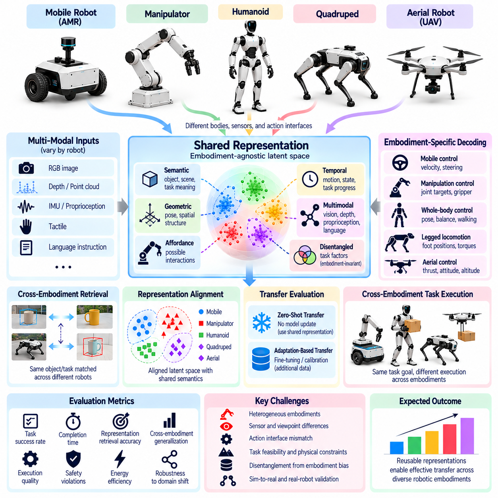{width="7.268055555555556in" height="7.268055555555556in"}

Shared representation transfer evaluation examines whether knowledge encoded by a Physical AI model remains useful across robots with different bodies, sensors, and action interfaces. Rather than transferring identical motor commands, shared representations capture task-relevant information that can support multiple embodiments. Evaluation must determine whether these representations preserve semantic meaning, spatial structure, and decision utility when deployed on previously unseen robotic platforms.

A shared representation provides an intermediate abstraction between raw observations and embodiment-specific actions. It may encode object identities, geometric relationships, environmental states, task goals, or interaction possibilities. Different robots can interpret this information through their own perception and control systems. Transfer evaluation should distinguish genuinely reusable knowledge from representations that implicitly depend on the morphology or sensor configuration of the training robot.

Representation transfer can occur at multiple levels of abstraction. Low-level visual features may support object recognition, while geometric embeddings describe positions, orientations, and spatial relationships. Higher-level representations can encode affordances, task progress, and action intentions. Evaluation should identify which abstraction levels transfer effectively and whether improvements at one level produce measurable benefits during closed-loop physical execution.

Semantic representation transfer concerns the consistency of object, scene, and task understanding across embodiments. A mobile robot, manipulator, and humanoid may recognize the same object while possessing different interaction capabilities. Shared semantic knowledge should preserve object identity and functional meaning without assuming identical physical access. Evaluation should measure semantic accuracy, task relevance, and the ability to distinguish recognition from executable interaction.

Geometric representation transfer requires consistent treatment of coordinate frames, spatial scale, and reference relationships. Robots with different camera positions, body dimensions, and workspace constraints observe the same environment from different perspectives. Object-centric and world-centric representations can reduce dependence on specific sensor arrangements. Evaluation should examine geometric alignment, pose consistency, transformation accuracy, and sensitivity to calibration errors.

Affordance representations describe possible interactions between an agent and its environment. However, an action feasible for one embodiment may be impossible for another because of differences in reach, payload, mobility, or dexterity. Shared representations should distinguish general interaction opportunities from embodiment-conditioned feasibility. Evaluation should measure whether a model correctly predicts which actions remain executable after transferring to a different robotic platform.

Temporal representation transfer addresses the ability to preserve information about changing environments and ongoing tasks. Physical AI systems must track moving objects, contact transitions, task progress, and the consequences of previous actions. Different embodiments observe and influence these processes at different rates. Evaluation should examine temporal consistency, state prediction, memory retention, and whether transferred representations support reliable decisions over extended interaction sequences.

Multimodal representation transfer introduces challenges when robots possess different combinations of vision, depth sensing, tactile feedback, proprioception, and language interfaces. A representation trained with rich sensor inputs may degrade when transferred to a platform with fewer modalities. Evaluation should measure robustness to missing sensors, modality substitution, and inconsistent observation quality. Performance gains should be separated from advantages provided by additional sensing hardware.

Latent representation alignment provides a mechanism for mapping heterogeneous observations into a common feature space. Encoders may transform camera images, point clouds, robot states, or language instructions into embeddings that support shared reasoning. However, geometric proximity in latent space does not necessarily imply equivalent physical meaning. Evaluation should test whether aligned representations preserve task distinctions and support successful downstream control.

Representation quality can initially be assessed through offline diagnostic tasks. Linear probes, retrieval tests, cross-platform correspondence measurements, and state prediction benchmarks can reveal whether encoded features contain transferable information. These measurements are useful but insufficient because high diagnostic accuracy does not guarantee effective robotic behavior. Closed-loop evaluation must determine whether representation quality translates into improved physical task performance.

Cross-embodiment retrieval provides a practical test of shared representation consistency. Observations from different robots performing equivalent tasks can be embedded and compared to identify corresponding objects, states, or task phases. Successful retrieval suggests that the representation captures relationships beyond platform appearance. Evaluation should control for background similarity, repeated environments, and training-data overlap to prevent misleading conclusions about transferability.

Disentanglement is important because shared representations may mix task-relevant information with embodiment-specific characteristics. Robot geometry, sensor viewpoint, and actuator configuration can become correlated with particular training tasks. A model may therefore rely on platform identity instead of learning reusable environmental structure. Evaluation should use controlled embodiment changes and diagnostic interventions to determine whether task knowledge remains stable when these correlations are disrupted.

Zero-shot representation transfer evaluates whether a frozen encoder or shared latent model supports a previously unseen robot without additional representation learning. Platform-specific observation adapters or control decoders may still be necessary. Adaptation-based evaluation permits limited fine-tuning or alignment using target-platform data. Reports should distinguish encoder updates, adapter training, controller changes, and total adaptation cost when comparing transfer performance.

Task-conditioned evaluation is essential because representation transferability depends on the decisions a robot must make. Features sufficient for object classification may be inadequate for grasp planning, collision avoidance, or contact-rich manipulation. A shared representation should therefore be tested across tasks requiring different spatial, semantic, and dynamic information. Evaluation should measure task success, sample efficiency, robustness, and performance degradation across embodiments.

Benchmark design should include multiple source and target embodiments, controlled sensor variations, unseen tasks, and repeated trials. Training and test splits must prevent leakage through shared environments, object instances, or robot-specific demonstrations. Strong baselines should include embodiment-specific representations and shared models trained under comparable data budgets. Statistical reporting should separate representation limitations from failures introduced by downstream controllers.

Ultimately, shared representation transfer evaluation determines whether Physical AI systems learn reusable knowledge rather than embodiment-dependent correlations. Reliable assessment combines semantic consistency, geometric alignment, affordance feasibility, temporal prediction, multimodal robustness, and closed-loop task outcomes. By documenting adaptation requirements, representation failures, and downstream performance, researchers can establish whether shared latent knowledge supports scalable intelligence across heterogeneous robots.

## 07.13. Cross Embodiment VLA and Policy Evaluation

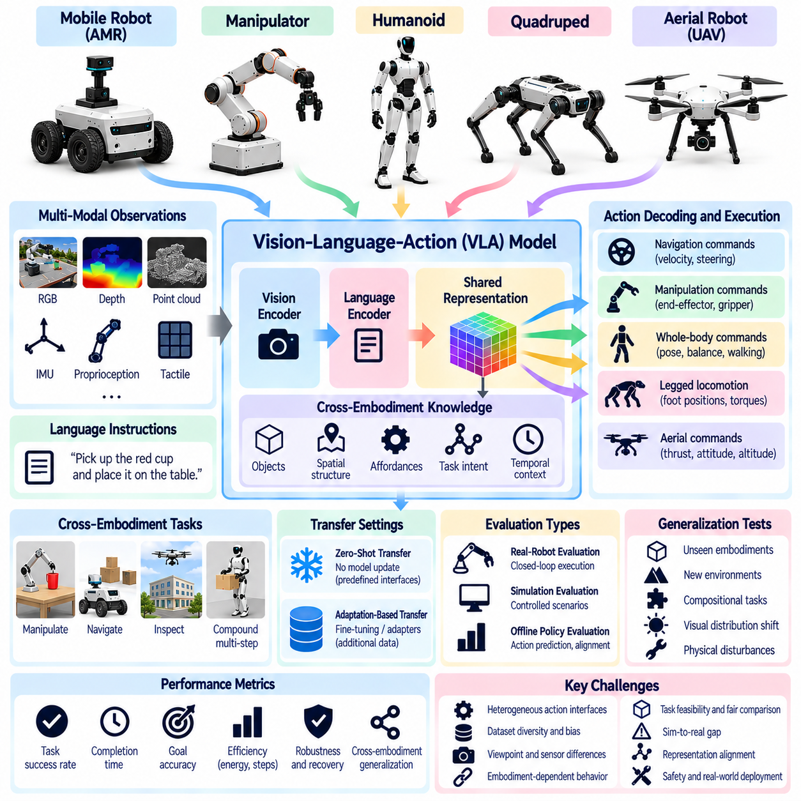{width="7.268055555555556in" height="7.268055555555556in"}

Cross-embodiment Vision-Language-Action (VLA) and policy evaluation examines whether models trained on one robotic platform can interpret instructions and execute tasks across different embodiments. VLA models integrate visual perception, language understanding, and action generation within a shared learning framework. Evaluation must determine whether these capabilities transfer beyond the morphology, sensors, and action interfaces represented in training data.

A central challenge is separating transferable intelligence from embodiment-dependent behavior. A VLA model may correctly identify an object and understand an instruction while generating actions unsuitable for the target robot. Differences in joint structure, workspace, mobility, and actuator limits can prevent execution. Evaluation should distinguish semantic reasoning failures from action-mapping errors, control limitations, and physical infeasibility.

Cross-embodiment policy evaluation requires a common definition of task success. Robots with different capabilities may accomplish the same objective through different action sequences and movement strategies. A mobile manipulator may reposition its base, while a fixed manipulator must operate within a limited workspace. Evaluation should compare functional outcomes and constraint satisfaction rather than requiring identical trajectories or joint commands.

Observation normalization is necessary because VLA policies receive heterogeneous sensor inputs. Robots may differ in camera placement, image resolution, depth sensing, proprioceptive measurements, and available tactile feedback. Shared observation interfaces can standardize coordinate conventions, timestamps, and semantic descriptions. Evaluation should measure robustness to sensor differences while documenting preprocessing and modality-specific adapters.

Action representation is a major determinant of policy transferability. Joint-level commands are closely tied to robot morphology, whereas end-effector poses, object-relative movements, and task-level actions can provide more reusable interfaces. However, abstract commands still require embodiment-specific execution mechanisms. Evaluation should document inverse kinematics, action decoders, controller dependencies, and the constraints enforced during execution.

Language grounding must remain consistent across robotic platforms. Instructions such as opening a drawer, moving an object, or inspecting equipment describe intended outcomes rather than particular motor commands. Different robots may require distinct physical strategies to satisfy these instructions. Evaluation should examine instruction interpretation, object referencing, spatial reasoning, and whether policies select feasible actions for each embodiment.

Visual grounding transfer is affected by differences in sensor viewpoints and robot operating environments. A wrist-mounted camera, head-mounted camera, and mobile robot camera can produce substantially different observations of the same task. VLA models may overfit to training viewpoints or familiar backgrounds. Evaluation should test object localization, scene understanding, occlusion robustness, and performance under controlled visual distribution shifts.

Policy architecture influences how cross-embodiment knowledge is shared. Some systems employ a common visual-language backbone with robot-specific action heads, while others use unified action tokens or latent action representations. These approaches impose different assumptions about embodiment compatibility. Evaluation should compare their transfer performance under matched training data, model capacity, adaptation budgets, and controller conditions.

Training data diversity is essential when evaluating claims of general-purpose robotic intelligence. A policy trained on demonstrations from multiple robots may learn transferable task structure, but performance can also reflect uneven dataset coverage. Robot types, task frequencies, sensor configurations, and demonstration quality should be documented. Evaluation should distinguish generalization to unseen embodiments from interpolation among familiar training platforms.

Zero-shot policy transfer tests whether a trained VLA model can control a new robot without updating its learned parameters. Robot-specific interfaces and safety controllers may still be required, so zero-shot claims must clearly define permitted configuration changes. Adaptation-based evaluation allows fine-tuning, demonstrations, or adapter training. Reports should separate adaptation data, computational cost, engineering effort, and resulting performance improvements.

Closed-loop evaluation is necessary because successful action prediction does not guarantee successful physical execution. Small perception or control errors can accumulate as the robot interacts with objects and changing environments. Policies must respond to unexpected contact, object displacement, and incomplete actions. Evaluation should measure task completion, corrective behavior, recovery success, intervention frequency, and stability across repeated trials.

Offline policy metrics provide useful diagnostics but cannot replace embodied testing. Action prediction error, imitation loss, language-action alignment, and trajectory similarity can reveal modeling weaknesses. However, multiple valid actions may achieve the same objective, making reference-action agreement an incomplete measure. Evaluation should connect offline measurements with online task success and analyze disagreements between predictive accuracy and physical performance.

Compositional generalization tests whether VLA policies can combine previously learned skills into unfamiliar tasks. A robot may need to locate an object, navigate toward it, manipulate it, and verify completion through perception. Different embodiments require different decompositions and control strategies. Evaluation should measure subtask reliability, instruction sequencing, skill reuse, and recovery when intermediate objectives fail.

Safety and physical constraints must remain explicit during cross-embodiment policy evaluation. A transferred policy may propose actions that exceed joint limits, violate collision boundaries, or create unstable contact conditions. Safety filters and low-level controllers can prevent these failures but may also conceal policy deficiencies. Evaluation should record rejected actions, controller interventions, constraint violations, and safety-related task interruptions.

Benchmark protocols should include multiple source and target robots, shared task definitions, controlled environmental variations, and standardized reporting procedures. Results should include absolute success rates, capability-normalized performance, adaptation requirements, and uncertainty estimates. Training-test separation must prevent leakage through repeated demonstrations or familiar environments. Failure analysis should identify perception, language, planning, action decoding, and control limitations.

Ultimately, cross-embodiment VLA and policy evaluation determines whether learned robot intelligence can be reused across heterogeneous physical platforms. Reliable assessment integrates language grounding, shared perception, action abstraction, closed-loop control, adaptation efficiency, safety, and long-horizon task execution. Transparent comparison of success, failure mechanisms, and embodiment-specific dependencies reveals the practical generalization limits of foundation policies for Physical AI.

## 07.14. Zero Shot vs Adapted Cross Embodiment Performance

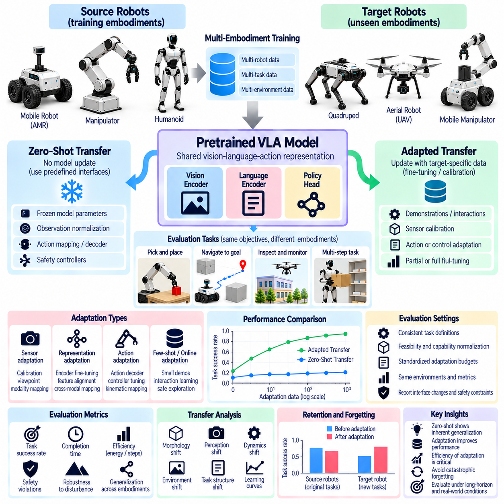{width="7.268055555555556in" height="7.268055555555556in"}

Zero-shot and adapted cross-embodiment performance evaluation examines how effectively learned robotic intelligence transfers to unfamiliar platforms with and without additional learning. Zero-shot transfer applies a pretrained model without updating its learned parameters, while adapted transfer permits target-specific modifications. Comparing these conditions reveals the extent to which a model has acquired reusable capabilities rather than relying on platform-specific training.

The distinction between zero-shot and adapted transfer must be defined carefully because deployment often requires robot-specific interfaces. Observation normalization, coordinate transformations, action decoding, and safety controllers may be necessary even when model parameters remain frozen. These components can influence performance substantially. Evaluation protocols should document permitted modifications and distinguish interface configuration from learned policy adaptation.

Zero-shot evaluation measures the immediate transferability of a model to a target embodiment that was not represented during training. The target robot may differ in morphology, sensor placement, actuator dynamics, and available actions. Successful transfer indicates that learned representations and decision mechanisms tolerate these differences. Evaluation should measure task completion, execution stability, constraint violations, and performance degradation relative to familiar platforms.

Adapted transfer evaluates how additional target-platform information improves execution. Adaptation may involve sensor calibration, action-space alignment, policy fine-tuning, controller adjustment, or demonstrations collected from the target robot. These methods differ in computational requirements and engineering effort. Evaluation should identify which components change and measure performance gains relative to a clearly defined zero-shot baseline.

Adaptation efficiency is as important as final task success because extensive retraining can conceal limited generalization. A model that reaches high performance after thousands of demonstrations may be less transferable than one requiring only a small calibration dataset. Evaluation should measure learning curves against target demonstrations, interaction steps, computation, and elapsed adaptation time. Final performance must be interpreted alongside the resources needed to achieve it.

Fair comparison requires consistent task definitions and equivalent evaluation conditions. Source and target robots may possess different physical capabilities, making identical action sequences inappropriate. Common objectives should be normalized for reachability, payload, mobility, and environmental access. Evaluation should report absolute task outcomes and capability-normalized results while excluding tasks that are physically infeasible for a given embodiment.

Adaptation budgets should be standardized to prevent misleading comparisons between competing methods. Budgets may specify the number of demonstrations, target-domain interaction episodes, optimization steps, or computational resources. Methods using additional human intervention or engineering changes should disclose these dependencies. Evaluation should compare performance under matched budgets and provide separate results when adaptation resources differ substantially.

Representation adaptation and control adaptation should be evaluated independently whenever possible. Updating a visual encoder may improve perception under new camera viewpoints, while modifying an action decoder may address differences in robot kinematics. Joint fine-tuning can improve overall performance but obscures the source of improvement. Controlled ablation studies should identify whether transfer gains arise from perception, planning, action mapping, or low-level control.

Few-shot transfer provides an intermediate evaluation condition between zero-shot deployment and extensive adaptation. A small number of demonstrations or interaction episodes can reveal how rapidly a model adjusts to unfamiliar embodiment characteristics. Performance should be measured at multiple adaptation budgets rather than at a single endpoint. This approach exposes whether models possess reusable priors that support rapid specialization.

Online adaptation introduces additional challenges because robots learn while interacting with physical environments. Exploration may generate collisions, unstable movements, or hardware wear, especially when action mappings are uncertain. Safe adaptation procedures should restrict hazardous actions and record protective interventions. Evaluation must consider cumulative task reward, adaptation speed, safety violations, and the operational cost of learning.

Distribution shift should be analyzed across morphology, perception, dynamics, and task structure. A model may generalize across camera viewpoints but fail when actuator response or contact dynamics change. Other models may tolerate mechanical differences while struggling with unfamiliar environments. Evaluation should isolate these shift categories through controlled experiments and determine whether adaptation benefits generalize beyond the specific target conditions used during training.

Retention of source-domain capabilities is important when models are adapted to new embodiments. Fine-tuning on a target robot may improve local performance while degrading capabilities previously learned on other platforms. This phenomenon can limit the scalability of shared robotic policies. Evaluation should measure source-task retention, cross-platform regression, and catastrophic forgetting after adaptation, particularly when models are intended to serve multiple embodiments.

Long-horizon evaluation reveals differences that short isolated tasks may conceal. A zero-shot policy might perform individual manipulation actions successfully but accumulate errors during extended missions. Adaptation may improve recovery, temporal consistency, and coordinated task execution. Evaluation should measure mission completion, subgoal reliability, intervention frequency, failure recovery, and sustained autonomous performance under both transfer conditions.

Statistical reliability requires repeated trials across multiple target embodiments and environmental variations. A single successful transfer demonstration provides limited evidence of generalization. Confidence intervals, failure distributions, and performance variability should accompany average success rates. Evaluation should also distinguish adaptation improvements that are consistent across robot families from gains confined to a single target platform.

Benchmark reporting should include training exposure, target embodiment characteristics, adaptation procedures, resource budgets, and evaluation conditions. Results should present zero-shot performance, adapted performance, improvement magnitude, and adaptation efficiency together. Strong baselines should include target-specific policies and shared models trained under comparable conditions. Transparent documentation enables reproducible comparisons and prevents exaggerated generalization claims.

Ultimately, zero-shot versus adapted cross-embodiment evaluation measures both the immediate portability and the adaptability of Physical AI systems. Strong generalization is demonstrated by reliable zero-shot behavior, efficient adaptation, and retained performance across diverse embodiments. Combining task success, capability normalization, adaptation cost, safety, and failure analysis reveals whether learned robotic intelligence can scale beyond individual hardware platforms.

## 07.15. Cross Embodiment Evaluation Matrix [w/Code]

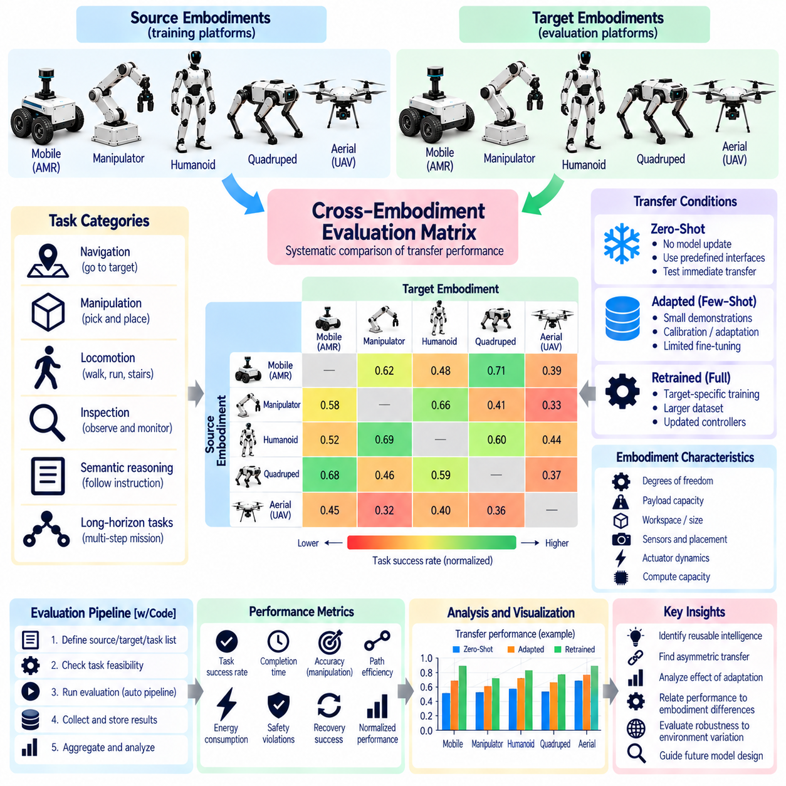{width="7.268055555555556in" height="7.268055555555556in"}

A cross-embodiment evaluation matrix provides a systematic framework for comparing Physical AI performance across robots with different morphologies, sensors, actuators, and control interfaces. Instead of relying on isolated success rates, the matrix organizes evaluation results by source embodiment, target embodiment, task category, and transfer condition. Its purpose is to distinguish reusable intelligence from capabilities that depend on particular robotic hardware.

The matrix should represent source and target embodiments as explicit evaluation dimensions. Source platforms may include mobile robots, manipulators, humanoids, quadrupeds, and aerial vehicles, while target platforms may belong to the same or different families. Each source-target pairing defines a transfer experiment. Evaluating multiple directions is important because successful transfer from one robot to another does not guarantee equivalent performance in reverse.

Task categories form another essential dimension of the evaluation matrix. Navigation, object manipulation, locomotion, inspection, semantic reasoning, and long-horizon missions require different capabilities. A shared task objective should remain consistent while execution methods may vary between robots. Each matrix entry should identify task eligibility, environmental constraints, required sensing, and the physical capabilities necessary for successful completion.

Embodiment characteristics must be recorded to explain differences in observed performance. Relevant properties include degrees of freedom, workspace dimensions, payload capacity, mobility constraints, sensor placement, and actuator dynamics. These variables determine whether a task is feasible and how difficult its execution becomes. The matrix should connect performance outcomes with measurable embodiment differences rather than treating all robots as interchangeable systems.

Capability normalization enables meaningful comparisons between platforms with unequal physical resources. Absolute task success remains important, but normalized measurements should account for reachability, speed, payload, operating endurance, and task accessibility. Normalization must not conceal fundamental capability differences or reward platforms for avoiding difficult conditions. Each matrix entry should report both absolute outcomes and clearly defined capability-adjusted measurements.

Transfer conditions should distinguish zero-shot execution, limited adaptation, and target-specific retraining. Zero-shot evaluation preserves learned model parameters while permitting explicitly documented interface configuration. Adapted evaluation may include calibration, demonstrations, fine-tuning, or controller modifications. The matrix should record adaptation data, computation, engineering effort, and final performance so that transferability is not confused with extensive platform-specific optimization.

Shared representation transfer should be evaluated separately from complete policy transfer. A model may preserve semantic understanding or geometric reasoning across embodiments while failing to generate executable actions. Conversely, a platform-specific controller may compensate for weaknesses in the shared representation. The matrix should therefore include diagnostic measurements for perception, spatial alignment, affordance prediction, action decoding, and closed-loop execution.

Performance metrics should capture multiple dimensions of robotic competence rather than a single aggregate score. Task completion rate, execution time, path efficiency, manipulation accuracy, energy consumption, recovery success, and intervention frequency provide complementary information. Safety violations and constraint breaches should remain visible even when tasks succeed. Metric selection should reflect task relevance and be consistent across comparable matrix entries.

A transfer performance matrix can be interpreted as a directed relationship between source and target embodiments. Each entry describes how a model trained on a source platform performs on a specified target under controlled conditions. Directional asymmetry may arise from differences in training coverage, sensor richness, or mechanical capability. Evaluation should examine both transfer directions whenever feasible and identify systematic patterns across robot families.

Environmental variation is necessary to distinguish robust transfer from memorization of familiar conditions. Matrix experiments should vary object properties, scene layouts, lighting, surface characteristics, and disturbances according to task requirements. Training and evaluation environments must remain appropriately separated. Results should identify whether failures arise from embodiment changes, environmental distribution shifts, or interactions between the two.

A structured evaluation record should contain model identity, source platform, target platform, task identifier, transfer mode, adaptation budget, and trial configuration. It should also store measured outcomes, uncertainty estimates, safety events, and failure categories. Machine-readable records support automated aggregation, filtering, and reproducibility. Consistent metadata is essential because missing configuration details can make otherwise similar results incomparable.

Automated matrix generation can reduce evaluation errors and improve coverage. A benchmark system may enumerate valid source-target-task combinations, verify task eligibility, configure platform adapters, and execute repeated trials. Invalid combinations should be marked as infeasible rather than counted as failures. Automated validation should detect missing metrics, inconsistent units, incompatible interfaces, and incomplete adaptation records before results are aggregated.

Statistical analysis should account for variation across trials, tasks, and robotic platforms. Mean performance alone may conceal unreliable transfer or rare but severe failures. Confidence intervals, success distributions, and paired comparisons provide stronger evidence of generalization. Aggregate scores should be accompanied by task-level and embodiment-level results, allowing researchers to identify whether apparent improvements depend on a small number of favorable conditions.

Matrix coverage is itself an important evaluation property. A benchmark containing many trials on similar manipulators may provide limited evidence about transfer to mobile or legged robots. Coverage should be assessed across morphology families, task types, sensor configurations, and transfer conditions. Missing combinations should remain visible, and conclusions about general-purpose intelligence should be restricted to the evaluated regions of the matrix.

Benchmark versioning and reproducibility are necessary when evaluation matrices evolve. Changes in robot hardware, simulation models, datasets, controller software, or task definitions can alter performance independently of model improvements. Each evaluation record should reference the applicable benchmark version and configuration. Repeated baseline testing and controlled regression analysis help determine whether reported gains reflect genuine advances in transferable intelligence.

Ultimately, a cross-embodiment evaluation matrix transforms isolated robotic experiments into a coherent assessment of Physical AI generalization. By integrating task feasibility, embodiment characteristics, zero-shot performance, adaptation efficiency, representation quality, safety, and statistical reliability, it exposes both transferable capabilities and their limitations. Transparent matrix reporting provides a foundation for comparing models and measuring progress toward reusable intelligence across diverse robotic platforms.
