**Volume 11. Physical AI Evaluation and Benchmarking**

# Chapter 08. Leaderboards and Standardization

## 08.01. Why Physical AI Needs Common Benchmarks

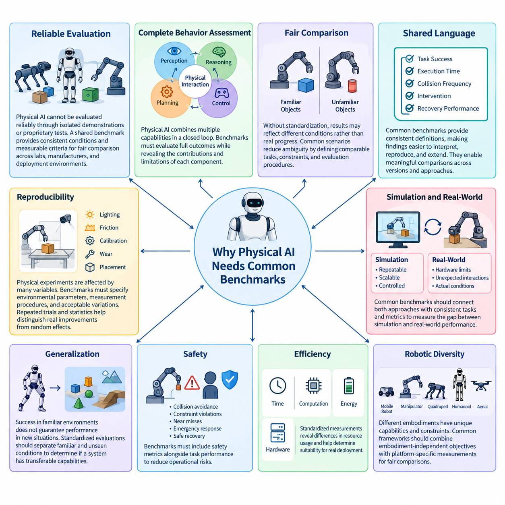{width="7.268055555555556in" height="7.268055555555556in"}

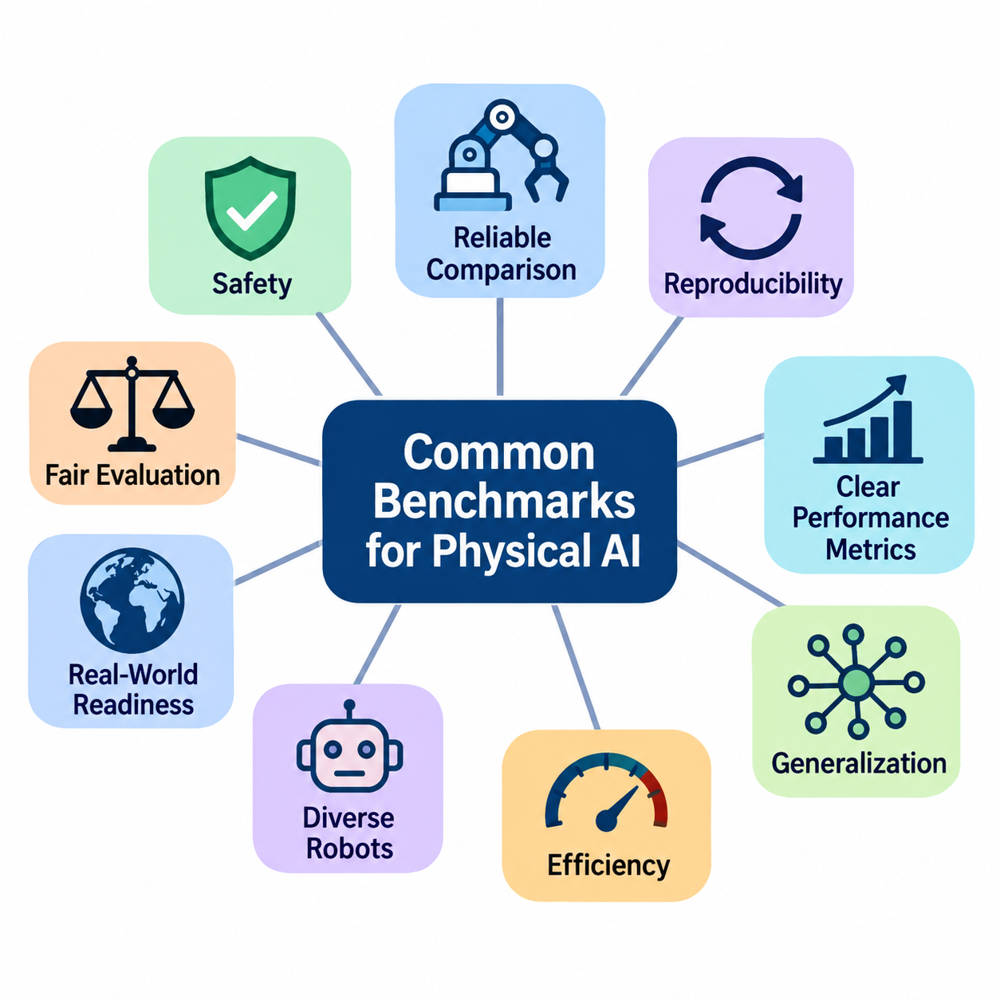{width="7.268055555555556in" height="7.268055555555556in"}

피지컬 인공지능(Physical AI)에 공통 벤치마크(Common Benchmarks)가 필요한 이유는 물리적 세계(Physical World)에서 나타나는 지능적 행동(Intelligent Behavior)을 개별적인 시연이나 독자적인 시험 절차만으로 신뢰성 있게 평가하기 어렵기 때문이다. 로봇은 서로 다른 환경 조건(Environmental Conditions), 하드웨어 구성(Hardware Configurations), 작업 정의(Task Definitions)에서 작동하므로 성능을 직접 비교하기 어렵다. 공통 벤치마킹 프레임워크(Common Benchmarking Framework)는 연구기관, 제조업체, 실제 운영 환경에서 시스템을 비교하기 위한 일관된 평가 조건과 측정 가능한 기준을 확립한다.

기존 기계학습(Machine Learning)과 달리 피지컬 인공지능(Physical AI)은 인식(Perception), 추론(Reasoning), 계획(Planning), 제어(Control), 물리적 상호작용(Physical Interaction)을 폐루프 시스템(Closed-Loop System) 안에서 통합한다. 성능은 예측 정확도(Prediction Accuracy)뿐만 아니라 실행 품질(Execution Quality), 응답 지연시간(Response Latency), 기계적 능력(Mechanical Capabilities), 환경 불확실성(Environmental Uncertainty)에 의해서도 결정된다. 따라서 공통 벤치마크는 전체 행동 결과를 평가하면서 개별 시스템 구성요소의 기여와 한계를 식별할 수 있는 충분한 정보를 유지해야 한다.

표준화된 벤치마크(Standardized Benchmarks)가 없다면 보고된 성과는 실제 지능의 발전보다는 실험 조건의 차이를 반영할 수 있다. 익숙한 물체를 사용하여 시험한 조작 시스템(Manipulation System)은 처음 접하는 물체와 무작위 구성을 사용하여 평가한 다른 시스템과 공정하게 비교하기 어렵다. 마찬가지로 비어 있는 실험실에서 측정한 내비게이션 성능(Navigation Performance)은 혼잡한 환경에서의 능력을 입증하지 못한다. 표준화된 시나리오(Standardized Scenarios)는 비교 가능한 작업, 제약조건, 평가 절차를 정의함으로써 이러한 모호성을 줄인다.

공통 벤치마크(Common Benchmarks)는 피지컬 인공지능(Physical AI)의 능력을 설명하기 위한 공통 언어(Common Language)를 제공한다. 연구자는 작업 성공률(Task Success Rate), 실행 시간(Execution Time), 충돌 빈도(Collision Frequency), 개입 요구사항(Intervention Requirements), 복구 성능(Recovery Performance)에 대한 일관된 정의를 사용하여 결과를 전달할 수 있다. 이러한 정의는 실험 결과의 해석, 재현, 확장을 용이하게 하며, 주관적인 시연에 전적으로 의존하지 않고 연속적인 모델 버전과 경쟁 접근법을 의미 있게 비교할 수 있도록 한다.

재현성(Reproducibility)은 물리적 실험(Physical Experiments)이 통제되지 않은 다양한 변수의 영향을 받기 때문에 특히 중요하다. 조명 조건(Lighting Conditions), 표면 마찰(Surface Friction), 센서 보정(Sensor Calibration), 액추에이터 마모(Actuator Wear), 물체 배치(Object Placement)는 로봇 행동에 상당한 영향을 줄 수 있다. 벤치마크는 관련 환경 매개변수(Environmental Parameters), 측정 절차(Measurement Procedures), 허용 가능한 변동 범위를 명시해야 한다. 반복 시험(Repeated Trials)과 통계적 보고(Statistical Reporting)는 체계적인 성능 개선을 무작위 변동이나 유리한 실험 조건과 구별하는 데 도움이 된다.

피지컬 인공지능 벤치마킹(Physical AI Benchmarking)은 시뮬레이션(Simulation)과 실제 환경 실행(Real-World Execution)의 차이도 다루어야 한다. 시뮬레이션은 반복 가능한 조건, 확장 가능한 실험, 희귀 사건(Rare Events)에 대한 통제된 노출을 제공하며, 물리적 시험(Physical Testing)은 하드웨어의 한계와 예상하지 못한 환경 상호작용을 드러낸다. 공통 평가 프레임워크(Common Evaluation Framework)는 일관된 작업 정의와 비교 가능한 지표를 통해 이러한 상호보완적 접근법을 연결하고, 연구자가 시뮬레이션과 현실 사이의 성능 차이(Simulation-to-Reality Performance Gap)를 정량화할 수 있도록 해야 한다.

일반화(Generalization)는 공통 벤치마크가 필요한 또 다른 근본적인 이유이다. 익숙한 환경에서 반복적으로 성공하는 로봇도 새로운 물체, 배치, 지형, 명령을 만나면 실패할 수 있다. 표준화된 평가(Standardized Evaluation)는 익숙한 조건에서의 성능과 이전에 경험하지 못한 조건에서의 성능을 구분해야 한다. 신중하게 분리된 학습 및 시험 시나리오(Training and Testing Scenarios)는 시스템이 전이 가능한 능력(Transferable Capabilities)을 습득했는지, 아니면 제한된 실험 분포에 단순히 적응했는지를 판단하는 데 도움이 된다.

안전성 고려사항(Safety Considerations)은 피지컬 인공지능(Physical AI)의 표준화를 더욱 중요하게 만든다. 물리적 시스템(Physical Systems)은 인식, 계획, 제어에 실패할 경우 장비를 손상시키거나 운영을 방해하거나 사람에게 상해를 입힐 수 있다. 작업 완료(Task Completion)에만 초점을 맞춘 벤치마크는 운영 위험(Operational Risk)을 증가시키는 공격적인 행동에 높은 점수를 부여할 수 있다. 따라서 공통 평가 프로토콜(Common Evaluation Protocols)은 기존 작업 성능 측정과 함께 충돌 회피(Collision Avoidance), 제약조건 위반(Constraint Violations), 아차 사고(Near Misses), 비상 대응(Emergency Responses), 안전 복구 행동(Safe Recovery Behavior)을 포함해야 한다.

효율성(Efficiency) 역시 피지컬 지능(Physical Intelligence)이 실제 자원 제약(Resource Constraints) 아래에서 작동하므로 반드시 고려해야 한다. 두 시스템이 동일한 작업 성공률(Task Success Rate)을 달성하더라도 실행 시간, 계산 자원(Computational Resources), 에너지 소비(Energy Consumption)는 상당히 다를 수 있다. 지연시간(Latency), 전력 사용량(Power Usage), 동작 효율(Motion Efficiency), 하드웨어 활용률(Hardware Utilization)에 대한 표준화된 측정은 이러한 차이를 드러낸다. 이러한 지표는 특정 접근법이 임베디드 배포(Embedded Deployment), 연속 운영(Continuous Operation), 대규모 로봇 군집(Large-Scale Robotic Fleets)에 적합한지 판단하는 데 도움이 된다.

로봇 구현 형태(Robotic Embodiments)의 다양성은 추가적인 벤치마킹 과제를 발생시킨다. 자율이동로봇(Autonomous Mobile Robots), 매니퓰레이터(Manipulators), 사족보행로봇(Quadrupeds), 휴머노이드(Humanoids), 비행로봇(Aerial Robots)은 서로 다른 이동 능력, 행동 공간(Action Spaces), 물리적 제약조건(Physical Constraints)을 가진다. 범용 벤치마크(Universal Benchmark)는 동일한 하드웨어나 실행 메커니즘을 가정할 수 없다. 대신 공통 프레임워크는 구현 형태에 독립적인 목표(Embodiment-Independent Objectives)와 플랫폼별 측정(Platform-Specific Measurements)을 결합하여 실행 가능한 행동을 결정하는 물리적 특성을 무시하지 않으면서 의미 있는 비교를 지원해야 한다.

작업 명세(Task Specifications)는 신뢰할 수 있는 벤치마킹의 기초를 형성한다. 각 평가는 초기 조건(Initial Conditions), 사용 가능한 관측 정보(Available Observations), 허용된 행동(Permitted Actions), 완료 기준(Completion Criteria), 시간 제한(Time Limits), 실패 조건(Failure Conditions)을 정의해야 한다. 모호한 명령은 시스템이 유사한 행동을 수행하더라도 일관되지 않은 결과를 초래할 수 있다. 명시적인 시나리오 정의(Scenario Definitions)와 참조 구현(Reference Implementations)은 해석상의 차이를 줄이고 독립적인 기관이 동등한 조건에서 실험을 재현할 수 있도록 한다.

공통 벤치마크(Common Benchmark)는 성공적인 결과뿐만 아니라 그러한 결과에 도달하는 과정도 측정해야 한다. 어떤 로봇은 반복적인 충돌, 과도한 재시도, 상당한 인간의 지원을 거쳐 작업을 완료하는 반면, 다른 시스템은 동일한 작업을 자율적이고 효율적으로 완료할 수 있다. 중간 이벤트(Intermediate Events), 개입(Interventions), 궤적 품질(Trajectory Quality), 복구 행동(Recovery Actions)을 기록하면 이진 성공 여부(Binary Success)보다 능력에 대한 더욱 풍부한 정보를 얻을 수 있다. 이러한 관측은 실패 분석(Failure Analysis)과 시스템 개선(System Improvement)도 지원한다.

장기 작업(Long-Horizon Tasks)은 개별 성능 측정만으로 충분하지 않은 이유를 더욱 분명하게 보여준다. 로봇은 개별 조작 또는 내비게이션 기술을 안정적으로 수행하더라도 장시간 임무(Extended Mission)에서 여러 기술을 조정해야 할 때 실패할 수 있다. 작은 오류가 누적되고, 환경에 대한 가정이 오래되며, 예상하지 못한 사건으로 재계획(Replanning)이 필요해진다. 따라서 공통 벤치마크는 완전한 운영 과정에서 지속적 자율성(Sustained Autonomy), 하위 목표 완료(Subgoal Completion), 메모리 일관성(Memory Consistency), 개입 빈도(Intervention Frequency), 복구 능력을 평가해야 한다.

표준화된 리더보드(Standardized Leaderboards)는 공통 평가 조건에서 방법론을 투명하게 비교할 수 있도록 하여 연구 발전을 가속할 수 있다. 그러나 순위(Rankings)는 제출 결과가 호환 가능한 프로토콜(Compatible Protocols)을 따르고 관련 실험 가정을 공개할 때만 의미를 가진다. 학습 데이터(Training Data), 계산 예산(Computational Budgets), 하드웨어 구성(Hardware Configurations), 허용된 적응(Allowed Adaptation)의 차이는 결과에 영향을 줄 수 있다. 벤치마크 운영자는 이러한 요소를 문서화하고 직접 비교 가능한 제출 결과와 실질적으로 다른 조건에서 수행된 평가를 구분해야 한다.

벤치마크 표준화(Benchmark Standardization)는 오해를 유발하는 최적화(Misleading Optimization)의 위험도 줄인다. 연구자가 고정된 공개 시험 세트(Public Test Set)에 대해 시스템을 반복적으로 조정하면 성능 향상이 광범위한 능력보다는 벤치마크에 특화된 적응(Benchmark-Specific Adaptation)을 반영할 수 있다. 비공개 평가 시나리오(Hidden Evaluation Scenarios), 통제된 제출 절차(Controlled Submission Procedures), 주기적으로 갱신되는 시험 분포(Test Distributions), 독립적인 검증(Independent Validation)은 이러한 문제를 완화할 수 있다. 이러한 메커니즘은 예측 가능한 점수 산정 조건에 주로 최적화된 해결책보다 강건한 능력(Robust Capabilities)의 개발을 장려한다.

통계적 엄밀성(Statistical Rigor)은 물리적 성능 측정이 상당한 변동성을 보이는 경우가 많기 때문에 필수적이다. 관측된 최고 성공률이나 소수의 유리한 시연만 보고하면 신뢰성(Reliability)이 과장될 수 있다. 공통 프로토콜(Common Protocols)은 적절한 시험 횟수(Trial Counts), 표본 추출 절차(Sampling Procedures), 신뢰구간(Confidence Intervals), 불확실성 보고(Uncertainty Reporting)를 확립해야 한다. 특히 경쟁 시스템 사이의 성능 차이가 작을 때 통계적 비교(Statistical Comparisons)는 작업 난이도와 환경 변동성의 차이를 고려해야 한다.

벤치마크 거버넌스(Benchmark Governance) 역시 과학적 신뢰성(Scientific Credibility)을 유지하는 데 중요하다. 공유 데이터셋(Shared Datasets), 평가 소프트웨어(Evaluation Software), 점수 산정 규칙(Scoring Rules), 시나리오 명세(Scenario Specifications)에는 문서화된 소유권(Ownership), 접근 정책(Access Policies), 변경 관리(Change Management)가 필요하다. 버전 관리(Version Control)는 특정 결과를 생성한 벤치마크 구성을 연구자가 식별할 수 있도록 한다. 투명한 거버넌스(Transparent Governance)는 로봇 기술과 평가 요구사항이 발전함에 따라 오류 수정, 커뮤니티 참여, 장기적인 유지관리도 지원한다.

개방형 벤치마크 인프라(Open Benchmark Infrastructure)는 연구자가 작업 정의를 검토하고, 점수 산정 절차를 재현하며, 개선에 기여할 수 있도록 하여 접근성과 협력적 발전을 촉진한다. 그러나 평가 시나리오에 대한 무제한 접근은 시험 세트 오염(Test-Set Contamination)의 가능성을 높일 수 있다. 균형 잡힌 아키텍처(Balanced Architecture)는 개방형 개발 환경(Open Development Environments)을 제공하면서 일부 시험 조건을 독립적인 평가를 위해 별도로 유지할 수 있다. 이러한 조합은 비교 평가의 무결성(Integrity)을 훼손하지 않으면서 재현성(Reproducibility)을 지원한다.

산업계 도입(Industry Adoption)은 공통 벤치마크가 필요한 또 다른 강력한 동기를 제공한다. 피지컬 인공지능 시스템(Physical AI Systems)을 구매하거나 배포하는 조직은 광고된 능력이 실제 운영 성능(Operational Performance)으로 이어진다는 증거가 필요하다. 표준화된 평가(Standardized Evaluation)는 구매 의사결정(Procurement Decisions), 배포 계획(Deployment Planning), 신뢰성 평가(Reliability Assessment), 기술 인수 시험(Technical Acceptance Testing)을 지원할 수 있다. 벤치마크 결과가 현장별 검증(Site-Specific Validation)을 대체할 수는 없지만, 비용이 많이 드는 현장 시험(Field Trials)에 앞서 후보 시스템을 비교하기 위한 일관된 기초를 제공한다.

공통 벤치마크(Common Benchmarks)는 피지컬 인공지능(Physical AI)의 능력 수준(Capability Levels)을 개발하는 데에도 기여할 수 있다. 단일 지능 점수(Single Intelligence Score)를 부여하는 대신 평가 프레임워크는 인식(Perception), 조작(Manipulation), 이동성(Mobility), 일반화(Generalization), 안전성(Safety), 지속적 자율성(Sustained Autonomy)에 걸친 역량을 특성화할 수 있다. 능력 프로파일(Capability Profiles)은 시스템이 어떤 작업을 안정적으로 수행하며 어떠한 조건에서 그 능력이 유지되는지를 나타낼 수 있다. 이러한 프로파일은 범용 인공지능(General-Purpose Intelligence)에 대한 광범위한 주장보다 실제 활용에 도움이 되는 정보를 제공한다.

궁극적으로 피지컬 인공지능(Physical AI)에 공통 벤치마크(Common Benchmarks)가 필요한 이유는 개별적인 기술 성과를 축적 가능한 과학적·공학적 발전(Cumulative Scientific and Engineering Progress)으로 전환하기 위해서이다. 공유 작업 정의(Shared Task Definitions), 재현 가능한 실험(Reproducible Experiments), 다차원 지표(Multidimensional Metrics), 투명한 리더보드(Transparent Leaderboards), 조정된 거버넌스(Coordinated Governance)는 성능에 대한 주장을 더욱 신뢰할 수 있고 비교 가능하게 만든다. 표준화(Standardization)는 실험을 배제하거나 혁신을 제한하는 것이 아니라, 점점 더 발전하는 피지컬 지능(Physical Intelligence)을 평가하고 이해하며 책임감 있게 배포할 수 있는 안정적인 기준을 제공해야 한다.

## 08.02. Benchmark Task and Scenario Specification

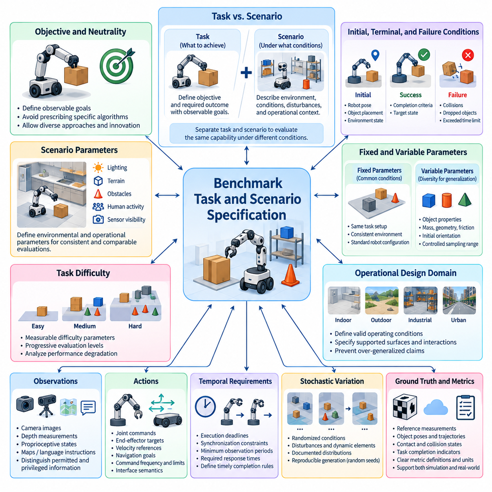{width="7.268055555555556in" height="7.268055555555556in"}

벤치마크 작업 및 시나리오 명세(Benchmark Task and Scenario Specification)는 피지컬 인공지능(Physical AI) 시스템을 일관되고 재현 가능하며 의미 있게 평가하기 위한 기초를 제공한다. 작업(Task)은 의도된 목표와 요구되는 결과를 정의하고, 시나리오(Scenario)는 해당 작업이 수행되어야 하는 조건을 설명한다. 이러한 개념을 분리하면 연구자는 근본적인 목표를 변경하지 않으면서 서로 다른 환경, 외란(Disturbances), 운영 제약조건(Operational Constraints)에서 동일한 능력을 평가할 수 있다.

벤치마크 작업(Benchmark Task)은 특정 알고리즘(Algorithm)이나 제어 전략(Control Strategy)을 규정하기보다는 관측 가능한 목표(Observable Goals)를 설명해야 한다. 예를 들어 이동로봇(Mobile Robot)은 장애물을 회피하고 안전 제약조건(Safety Constraints)을 준수하면서 물체를 한 위치에서 다른 위치로 운반하도록 요구받을 수 있다. 명세는 특정 내비게이션 계획기(Navigation Planner), 인식 아키텍처(Perception Architecture), 동작 제어기(Motion Controller)를 요구하지 않으면서 성공적인 운반의 기준을 정의해야 한다. 이러한 접근법은 방법론적 중립성(Methodological Neutrality)을 유지하고 혁신을 장려한다.

작업 명세(Task Specifications)는 명확한 초기 조건(Initial Conditions), 종료 조건(Terminal Conditions), 실패 기준(Failure Criteria)을 확립해야 한다. 초기 조건에는 로봇 자세(Robot Pose), 물체 배치(Object Placement), 환경 구성(Environment Configuration), 관련 시스템 상태(System States)가 포함된다. 종료 조건은 성공적인 실행이 달성된 시점을 식별하며, 실패 기준은 충돌(Collisions), 물체 낙하(Dropped Objects), 시간 제한 초과(Exceeded Time Limits)와 같이 허용할 수 없는 결과를 설명한다. 명시적인 정의는 독립적인 구현 사이에서 발생하는 일관되지 않은 해석을 방지한다.

시나리오 명세(Scenario Specifications)는 환경 및 운영 맥락(Environmental and Operational Context)을 설명함으로써 작업 정의(Task Definitions)를 확장한다. 관련 매개변수에는 조명(Lighting), 지형(Terrain), 장애물 밀도(Obstacle Density), 물체 속성(Object Properties), 인간 활동(Human Activity), 센서 가시성(Sensor Visibility)이 포함될 수 있다. 시뮬레이션(Simulation)에서는 이러한 조건을 프로그래밍 방식으로 생성할 수 있지만, 실제 환경 평가(Real-World Evaluation)에는 통제된 설정 절차와 문서화된 측정이 필요하다. 일관된 시나리오 설명은 가상 환경과 물리적 시험 환경 사이의 비교를 가능하게 한다.

잘 설계된 벤치마크(Well-Designed Benchmark)는 고정 매개변수(Fixed Parameters)와 가변 매개변수(Variable Parameters)를 구분한다. 고정 매개변수는 공통 평가 조건을 확립하고, 가변 매개변수는 적응성(Adaptability)과 일반화(Generalization)를 평가하기 위한 통제된 다양성을 도입한다. 예를 들어 조작 벤치마크(Manipulation Benchmark)는 동일한 작업 목표를 유지하면서 물체 질량(Object Mass), 형상(Geometry), 마찰(Friction), 초기 방향(Initial Orientation)을 변화시킬 수 있다. 공정한 비교를 지원하기 위해 허용되는 매개변수 범위와 표본 추출 절차(Sampling Procedures)를 문서화해야 한다.

작업 난이도(Task Difficulty)는 주관적인 등급만이 아니라 측정 가능한 특성(Measurable Characteristics)을 통해 표현해야 한다. 내비게이션 난이도(Navigation Difficulty)는 경로 길이(Route Length), 장애물 밀도(Obstacle Density), 통로 폭(Passage Width), 환경 동역학(Environmental Dynamics)에 따라 달라질 수 있다. 조작 난이도(Manipulation Difficulty)는 물체 복잡성(Object Complexity), 파지 접근성(Grasp Accessibility), 요구 정밀도(Required Precision), 접촉 불확실성(Contact Uncertainty)을 포함할 수 있다. 명시적인 난이도 매개변수는 벤치마크 설계자가 단계적인 평가 수준을 구성하고 난이도가 증가함에 따른 성능 저하를 분석할 수 있도록 한다.

운영 설계 영역(Operational Design Domain, ODD)은 벤치마크 결과가 유효하다고 간주되는 범위를 정의한다. 매끄러운 실내 바닥에서 평가된 로봇이 고르지 않은 실외 지형에서도 자동으로 충분한 능력을 갖추었다고 판단해서는 안 된다. 따라서 시나리오 명세는 지원되는 표면(Supported Surfaces), 환경 조건(Environmental Conditions), 상호작용 유형(Interaction Types), 운영 제한사항(Operational Restrictions)을 식별해야 한다. 이러한 경계는 벤치마크 점수가 제한 없는 실제 환경 능력(Unrestricted Real-World Capability)의 증거로 해석되는 것을 방지한다.

관측 명세(Observation Specifications)는 평가 대상 시스템이 실행 중 접근할 수 있는 정보를 결정한다. 입력에는 카메라 영상(Camera Images), 깊이 측정값(Depth Measurements), 고유수용감각 상태(Proprioceptive States), 지도(Maps), 언어 명령(Language Instructions), 외부 위치추정 신호(External Localization Signals)가 포함될 수 있다. 벤치마크는 허용된 관측 정보(Permitted Observations)와 평가 인프라(Evaluation Infrastructure)에서만 사용할 수 있는 특권 정보(Privileged Information)를 구분해야 한다. 이러한 구분은 불공정한 이점을 방지하고 서로 다른 인식 및 의사결정 접근법을 의미 있게 비교할 수 있도록 한다.

행동 명세(Action Specifications)는 피지컬 인공지능(Physical AI) 시스템이 환경과 상호작용하는 인터페이스(Interface)를 설명한다. 플랫폼에 따라 행동은 관절 명령(Joint Commands), 말단효과기 목표(End-Effector Targets), 속도 참조값(Velocity References), 내비게이션 목표(Navigation Goals), 고수준 기술 요청(High-Level Skill Requests)으로 구성될 수 있다. 벤치마크 프로토콜(Benchmark Protocols)은 행동 주파수(Action Frequency), 명령 제한(Command Limits), 지연시간 가정(Latency Assumptions), 인터페이스 의미론(Interface Semantics)을 문서화해야 한다. 제어 권한(Control Authority)의 차이가 관측된 성능에 상당한 영향을 줄 수 있기 때문에 이러한 세부사항은 필수적이다.

시간적 요구사항(Temporal Requirements)은 작업 명세(Task Specification)의 또 다른 중요한 구성요소이다. 물리적 작업(Physical Tasks)에는 실행 마감시간(Execution Deadlines), 동기화 제약조건(Synchronization Constraints), 최소 관측 기간(Minimum Observation Periods), 요구 응답시간(Required Response Times)이 포함될 수 있다. 작업을 정확하게 완료하더라도 지나치게 느린 로봇은 의도된 응용 분야에 적합하지 않을 수 있다. 따라서 벤치마크 정의는 작업 완료(Task Completion)와 시간 내 완료(Timely Completion)를 구분하고 실행 시간 및 시간적 위반(Temporal Violations)을 측정하기 위한 일관된 규칙을 확립해야 한다.

시나리오 설계(Scenario Design)는 재현성(Reproducibility)을 훼손하지 않으면서 확률적 변동(Stochastic Variation)을 고려해야 한다. 무작위 물체 배치(Randomized Object Placement), 환경 외란(Environmental Disturbances), 동적 장애물(Dynamic Obstacles)은 결정론적 시나리오(Deterministic Scenarios)에서 드러나지 않는 약점을 노출할 수 있다. 그러나 무작위성(Randomness)은 문서화된 분포(Distributions), 제한된 매개변수 범위(Bounded Parameter Ranges), 재현 가능한 생성 절차(Reproducible Generation Procedures)를 따라야 한다. 난수 시드(Random Seeds)와 시나리오 구성(Scenario Configurations)을 기록하면 통계적 다양성을 유지하면서 실험을 반복할 수 있다.

실측 기준값 정의(Ground-Truth Definitions)는 벤치마크 목표가 달성되었는지 판단하는 데 필요하다. 참조 측정값(Reference Measurements)에는 물체 자세(Object Poses), 로봇 궤적(Robot Trajectories), 접촉 이벤트(Contact Events), 충돌 상태(Collision States), 작업 완료 지표(Task Completion Indicators)가 포함될 수 있다. 시뮬레이션에서는 환경 모델(Environment Model)에서 실측 기준값(Ground Truth)을 직접 얻을 수 있지만, 물리적 실험에는 보정된 측정 시스템(Calibrated Measurement Systems)이 필요하다. 벤치마크 설계자는 잘못된 성능 추정(Misleading Performance Estimates)을 방지하기 위해 측정 정확도(Measurement Accuracy), 동기화(Synchronization), 불확실성(Uncertainty)을 문서화해야 한다.

안전 제약조건(Safety Constraints)은 선택적인 평가 항목으로 취급하지 않고 작업 및 시나리오 명세(Task and Scenario Specifications)에 직접 통합해야 한다. 로봇은 이격거리(Separation Distances)를 유지하고, 힘 제한(Force Limits)을 준수하며, 제한 구역(Restricted Regions)을 회피하거나 불확실성이 과도해지면 정지하도록 요구받을 수 있다. 이러한 요구사항은 명확하게 정의된 위반 기준(Violation Criteria)을 가진 측정 가능한 조건(Measurable Conditions)으로 표현해야 한다. 성공적인 작업 실행이 허용할 수 없는 안전 행동(Unacceptable Safety Behavior)을 상쇄해서는 안 된다.

벤치마크에 협업 또는 상호작용 작업(Collaborative or Interactive Tasks)이 포함되는 경우 인간의 참여(Human Involvement)도 명시해야 한다. 인간 참가자(Human Participants)는 명령을 제공하거나, 공유 물체를 조작하거나, 외란을 발생시키거나, 실패 중에 개입할 수 있다. 평가 프로토콜(Evaluation Protocols)은 참가자의 역할(Participant Roles), 허용된 지원(Permitted Assistance), 통신 채널(Communication Channels), 개입 기록(Intervention Recording)을 정의해야 한다. 이러한 통제가 없다면 인간 행동의 변동이 측정된 시스템 성능을 지배하여 재현성을 저하시킬 수 있다.

장기 벤치마크 작업(Long-Horizon Benchmark Tasks)에는 하위 목표(Subgoals), 의존관계(Dependencies), 허용 가능한 실행 순서(Acceptable Execution Sequences)에 대한 명시적인 설명이 필요하다. 창고 로봇(Warehouse Robot)은 물품을 식별하고, 보관 위치로 이동하고, 물품을 집어 올리고, 운반한 후 배송을 완료해야 할 수 있다. 일부 하위 작업(Subtasks)은 엄격한 순서 제약조건(Ordering Constraints)을 가지지만, 다른 작업은 대안적인 전략(Alternative Strategies)을 허용할 수 있다. 명세는 자율 계획(Autonomous Planning)을 공정하게 평가하기 위해 필수 결과(Mandatory Outcomes)와 유연한 실행 경로(Flexible Execution Paths)를 구분해야 한다.

서로 다른 로봇 구현 형태를 평가하는 교차 구현 형태 벤치마킹(Cross-Embodiment Benchmarking)은 물리적 능력이 다른 로봇에 대해 동등한 작업(Equivalent Tasks)을 정의해야 하는 과제를 제기한다. 이동형 매니퓰레이터(Mobile Manipulator)와 휴머노이드(Humanoid)는 서로 다른 이동 및 조작 전략을 사용하여 동일한 운반 목표를 달성할 수 있다. 벤치마크 명세는 공통 기능 목표(Common Functional Goals)를 유지하면서 구현 형태별 제약조건(Embodiment-Specific Constraints)과 사용 가능한 행동 인터페이스(Action Interfaces)를 문서화해야 한다. 이러한 접근법은 인위적인 기계적 동등성(Artificial Mechanical Equivalence)을 강요하지 않으면서 능력 비교를 지원한다.

시나리오 포괄 범위(Scenario Coverage)는 벤치마크가 의도된 운영 영역(Operational Domain)을 얼마나 포괄적으로 나타내는지를 결정한다. 소수의 유리한 조건만으로 구성된 평가는 중요한 실패 유형(Failure Modes)을 드러내지 못한 채 높은 성공률을 산출할 수 있다. 설계자는 대표적인 정상 조건(Nominal Conditions), 경계 사례(Boundary Cases), 환경 외란(Environmental Disturbances), 발생 가능한 희귀 사건(Plausible Rare Events)을 포함해야 한다. 포괄 범위 문서(Coverage Documentation)는 어떤 변동이 포함되고 제외되는지, 선택된 시나리오가 예상 배포 조건(Expected Deployment Conditions)과 어떻게 관련되는지를 설명해야 한다.

벤치마크 명세(Benchmark Specifications)는 개발 시나리오(Development Scenarios)와 평가 시나리오(Evaluation Scenarios)를 구분해야 한다. 공개 개발 환경(Public Development Environments)은 연구자가 구현을 디버깅(Debugging)하고 작업 요구사항을 이해하도록 지원하며, 별도로 보존된 평가 시나리오(Reserved Evaluation Scenarios)는 일반화(Generalization)에 대한 더 강력한 증거를 제공한다. 고정된 시험 조건에 지나치게 노출되면 벤치마크 특화 최적화(Benchmark-Specific Optimization)가 촉진될 수 있다. 통제된 시나리오 생성(Controlled Scenario Generation)과 독립적인 평가 절차(Independent Evaluation Procedures)는 보고된 결과의 신뢰성을 유지하는 데 도움이 된다.

기계 판독 가능한 명세(Machine-Readable Specifications)는 일관성을 높이고 자동화된 벤치마크 실행(Automated Benchmark Execution)을 가능하게 한다. 구조화된 구성 파일(Structured Configuration Files)은 작업 식별자(Task Identifiers), 환경 매개변수(Environment Parameters), 로봇 인터페이스(Robot Interfaces), 성공 조건(Success Conditions), 점수 산정 요구사항(Scoring Requirements)을 설명할 수 있다. 검증 도구(Validation Tools)는 실험이 시작되기 전에 누락된 필드(Missing Fields), 호환되지 않는 설정(Incompatible Settings), 유효하지 않은 매개변수 범위(Invalid Parameter Ranges)를 탐지할 수 있다. 이러한 인프라는 수동 설정 오류(Manual Setup Errors)를 줄이고 다양한 시뮬레이션 엔진(Simulation Engines)과 로봇 플랫폼(Robotic Platforms)에 걸친 대규모 평가를 지원한다.

버전 관리(Versioning)는 작업 정의(Task Definitions)나 시나리오 분포(Scenario Distributions)의 변경이 벤치마크 난이도를 바꾸고 과거 비교 결과를 무효화할 수 있기 때문에 필수적이다. 각 벤치마크 릴리스(Benchmark Release)는 명세 버전(Specification Version), 지원 인터페이스(Supported Interfaces), 시나리오 구성(Scenario Configurations), 평가 규칙(Evaluation Rules)을 식별해야 한다. 수정사항은 예상되는 영향에 대한 명확한 설명과 함께 문서화해야 한다. 재현 가능한 과거 구성(Reproducible Historical Configurations)을 유지하면 연구자는 실제 알고리즘 개선(Genuine Algorithmic Improvements)과 평가 조건 변경을 구분할 수 있다.

궁극적으로 엄밀한 작업 및 시나리오 명세(Rigorous Task and Scenario Specification)는 피지컬 인공지능 벤치마킹(Physical AI Benchmarking)을 느슨하게 정의된 시연에서 체계적인 실험 평가(Systematic Experimental Evaluation)로 전환한다. 명확한 목표(Clear Objectives), 통제된 조건(Controlled Conditions), 문서화된 인터페이스(Documented Interfaces), 측정 가능한 제약조건(Measurable Constraints), 재현 가능한 시나리오 생성(Reproducible Scenario Generation)은 신뢰할 수 있는 성능 비교의 기초를 확립한다. 이러한 명세는 자동화된 점수 산정(Automated Scoring), 투명한 리더보드(Transparent Leaderboards), 통계 분석(Statistical Analysis), 피지컬 인공지능 생태계(Physical AI Ecosystem) 전반에 걸친 상호운용 가능한 평가 표준(Interoperable Evaluation Standards)의 점진적인 발전도 지원한다.

## 08.03. Dataset and Test Set Governance

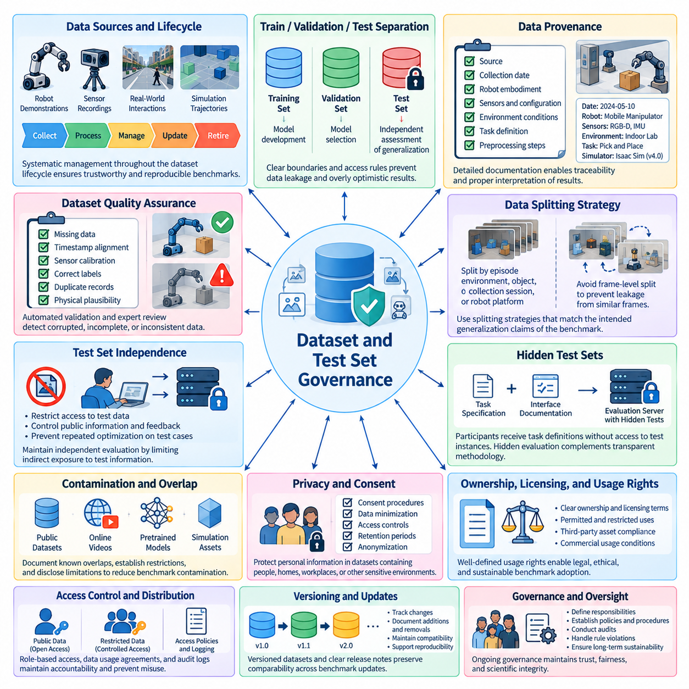{width="7.268055555555556in" height="7.268055555555556in"}

데이터셋 및 테스트 세트 거버넌스(Dataset and Test Set Governance)는 신뢰할 수 있는 피지컬 인공지능(Physical AI) 벤치마크를 유지하는 데 필요한 규칙, 책임, 절차를 확립한다. 물리적 시스템은 로봇 시연(Robot Demonstrations), 센서 기록(Sensor Recordings), 시뮬레이션 궤적(Simulation Trajectories), 실제 환경 상호작용(Real-World Interactions) 등 다양한 출처에서 학습하므로, 벤치마크 데이터셋(Benchmark Datasets)은 전체 수명주기(Lifecycle)에 걸쳐 체계적으로 관리되어야 한다. 효과적인 거버넌스는 평가의 무결성(Evaluation Integrity)과 과학적 재현성(Scientific Reproducibility)을 유지하면서 데이터의 수집, 문서화, 저장, 접근, 검증, 갱신, 폐기 방법을 정의한다.

벤치마크 거버넌스(Benchmark Governance)의 근본적인 원칙은 학습 데이터(Training Data), 검증 데이터(Validation Data), 테스트 데이터(Test Data)를 명확하게 분리하는 것이다. 학습 데이터셋(Training Datasets)은 모델 개발을 지원하고, 검증 데이터셋(Validation Datasets)은 모델 선택을 안내하며, 테스트 데이터셋(Test Datasets)은 일반화(Generalization)를 독립적으로 평가한다. 테스트 세트(Test Set)의 정보가 학습이나 반복적인 최적화에 유입되면 보고된 성능이 지나치게 낙관적으로 나타날 수 있다. 따라서 거버넌스 절차는 명시적인 데이터 경계(Data Boundaries), 접근 권한(Access Permissions), 각 데이터셋의 사용 방식을 규정하는 규칙을 확립해야 한다.

피지컬 인공지능(Physical AI) 데이터셋은 기존의 디지털 기계학습(Digital Machine Learning)에서는 상대적으로 덜 두드러지는 과제를 제시한다. 센서 관측값(Sensor Observations)과 로봇 궤적(Robot Trajectories)은 물리적 환경, 하드웨어 구성, 제어 정책(Control Policies), 상호작용 이력(Interaction Histories)에 따라 달라진다. 두 데이터셋은 서로 다른 것처럼 보이더라도 실제로는 거의 동일한 장면이나 궤적을 포함할 수 있다. 따라서 거버넌스는 파일 단위의 분리에만 의존하지 않고 기록 간의 관계, 반복 시연, 환경 구성, 작업 인스턴스를 고려해야 한다.

데이터 출처 및 이력(Data Provenance)은 추적 가능한 평가(Traceable Evaluation)의 기반을 제공한다. 각 데이터셋에는 출처, 수집 날짜, 기록 장비, 로봇 구현 형태(Robot Embodiment), 센서 구성(Sensor Configuration), 환경 조건, 작업 정의, 관련 전처리 작업(Preprocessing Operations)을 문서화해야 한다. 시뮬레이션 데이터셋(Simulation Datasets)에는 시뮬레이터, 물리 설정(Physics Configuration), 자산 버전(Asset Versions), 시나리오 생성 절차(Scenario-Generation Procedures)도 명시해야 한다. 이러한 정보는 연구자가 데이터셋이 의도된 운영 영역(Operational Domain)을 대표하는지, 결과 차이가 모델의 능력보다는 데이터 수집 과정에서 비롯되었을 가능성이 있는지를 판단하도록 돕는다.

데이터 품질 보증(Data Quality Assurance)은 손상되거나 불완전하거나 일관성 없이 라벨링된 데이터가 벤치마크의 타당성(Benchmark Validity)을 훼손할 수 있기 때문에 필수적이다. 거버넌스 절차는 누락된 관측값, 타임스탬프 불일치(Timestamp Misalignment), 센서 보정 오류(Sensor Calibration Errors), 잘못된 작업 라벨(Task Labels), 중복 기록(Duplicate Records), 물리적으로 타당하지 않은 측정값을 검사하는 기준을 정의해야 한다. 자동화된 검증(Automated Validation)은 많은 기술적 결함을 식별할 수 있으며, 모호한 상호작용이나 복잡한 실패 사례에는 전문가 검토(Expert Review)가 필요할 수 있다. 데이터셋 개정이 감사 가능하도록 품질 요구사항(Quality Requirements)을 일관되게 문서화해야 한다.

데이터 분할(Data Splitting)은 벤치마크가 평가하려는 일반화 주장을 반영해야 한다. 동일한 기록에서 추출한 개별 프레임을 학습과 테스트 데이터에 무작위로 나누면 심각한 데이터 누출(Data Leakage)이 발생할 수 있다. 인접한 프레임은 시각적·물리적 정보가 거의 동일한 경우가 많기 때문이다. 더 신뢰할 수 있는 방법은 전체 에피소드(Episodes), 환경, 물체, 수집 세션(Collection Sessions), 로봇 플랫폼(Robot Platforms)을 기준으로 데이터를 분리하는 것이다. 적절한 분할 전략은 벤치마크가 새로운 장면, 익숙하지 않은 물체, 서로 다른 구현 형태, 더 광범위한 운영 조건 중 무엇에 대한 일반화를 목표로 하는지에 따라 달라진다.

테스트 세트의 독립성(Test Set Independence)은 학습 및 평가 파일을 별도의 폴더에 배치하는 것만으로 확보되지 않는다. 개발자는 공개 시연, 다운로드 가능한 궤적, 반복적인 리더보드 제출, 상세한 평가 피드백을 통해 간접적으로 테스트 정보를 접할 수 있다. 벤치마크 거버넌스는 어떤 정보가 공개되는지, 어떤 정보가 제한되는지, 반복적인 접근을 어떻게 통제하는지를 정의해야 한다. 이러한 조치는 시스템이 전이 가능한 물리적 능력(Transferable Physical Capabilities)을 개발하는 대신 알려진 평가 사례에 특화되는 가능성을 줄인다.

비공개 테스트 세트(Hidden Test Sets)는 선택된 시나리오, 궤적, 환경 구성을 통제된 평가를 위해 별도로 보존함으로써 벤치마크의 독립성을 강화할 수 있다. 참가자는 작업 명세와 인터페이스 문서를 제공받되, 실제 테스트 인스턴스에는 직접 접근하지 못할 수 있다. 평가 서버(Evaluation Server)는 제출된 시스템을 이러한 비공개 사례에 적용하고 표준화된 결과를 반환할 수 있다. 그러나 비공개 평가는 투명한 방법론(Transparent Methodology)을 대체하는 것이 아니라 이를 보완해야 한다. 연구자가 벤치마크의 범위를 이해하고 보고된 성능을 해석할 수 있을 만큼 충분한 정보는 여전히 제공되어야 한다.

데이터셋 거버넌스(Dataset Governance)는 서로 중복되는 출처로 인해 발생하는 벤치마크 오염(Benchmark Contamination)도 다루어야 한다. 공개 로보틱스 데이터셋, 온라인 동영상, 사전학습 모델(Pretrained Models), 시뮬레이션 자산에는 평가 시나리오와 관련된 정보가 포함될 수 있다. 대규모의 이질적인 데이터 모음을 사용하는 경우 오염을 완전히 방지하기는 어렵다. 거버넌스는 알려진 중복 관계를 문서화하고, 평가 데이터 사용에 합리적인 제한을 설정하며, 관련 한계를 공개하여 벤치마크 결과가 적절한 주의를 기울여 해석되도록 해야 한다.

데이터셋에 사람, 주거 공간, 작업장 또는 기타 민감한 환경이 포함되는 경우 개인정보 보호(Privacy)와 동의(Consent)는 특히 중요하다. 카메라 기록(Camera Recordings), 오디오(Audio), 위치 추적 기록(Location Traces), 인간 상호작용 로그(Human Interaction Logs)는 이름을 제거하더라도 개인정보를 드러낼 수 있다. 거버넌스는 적절한 동의 절차(Consent Procedures), 데이터 최소화(Data Minimization), 접근 통제(Access Controls), 보존 기간(Retention Periods), 익명화 요구사항(Anonymization Requirements)을 정의해야 한다. 필요한 경우 유효한 과학적 평가에 필요한 정보를 보존하면서 민감한 기록을 제한하거나 변환한 후 공개해야 한다.

소유권(Ownership), 라이선스(Licensing), 사용 권한(Usage Rights)은 벤치마크 데이터셋을 재배포하거나 수정하거나 상업적으로 사용할 수 있는지를 결정한다. 연구기관, 산업 파트너, 계약업체, 인간 참가자가 수집한 데이터에는 서로 다른 법적·계약상 제한이 적용될 수 있다. 데이터 문서에는 적용되는 라이선스, 출처 표시 요건(Attribution Requirements), 허용된 사용 범위, 재배포 제한을 명시해야 한다. 명확한 권리 관리는 공개된 벤치마크를 기반으로 연구하거나 제품을 개발하려는 연구자와 조직의 불확실성을 줄인다.

피지컬 인공지능(Physical AI) 데이터셋에는 위험한 로봇 행동, 충돌 사건(Collision Events), 액추에이터 고장(Actuator Failures), 사람 주변에서 발생한 상호작용 등 안전에 중요한 정보(Safety-Critical Information)가 포함될 수 있다. 이러한 기록은 성공적인 시연만으로는 드러나지 않는 한계를 보여주므로 가치가 있다. 거버넌스는 적절한 경우 실패 데이터를 보존하고, 위험한 조건을 정확하게 라벨링하며, 무제한 배포가 위험을 초래할 수 있는 경우 접근 통제를 마련해야 한다. 모든 실패 사례를 제거하면 평가 분포(Evaluation Distribution)가 왜곡되고 시스템 신뢰성(System Reliability)에 대한 오해를 유발하는 결론이 나올 수 있다.

데이터셋의 대표성(Dataset Representativeness)도 중요한 거버넌스 문제이다. 단일 로봇 플랫폼, 지리적 지역, 조명 조건, 물체 범주, 운영 절차에 편중된 데이터 모음은 의도된 배포 환경의 다양성을 제대로 반영하지 못할 수 있다. 거버넌스 검토에서는 관련 환경 및 운영 차원에 걸친 데이터 포괄 범위(Coverage)를 살펴보고, 충분히 대표되지 않은 조건을 식별하며, 알려진 한계를 문서화해야 한다. 대표성은 모든 데이터셋이 가능한 모든 물리적 상황을 다루어야 한다는 비현실적인 기대가 아니라, 명시된 벤치마크 목적에 비추어 평가해야 한다.

클래스 불균형(Class Imbalance)과 시나리오별 발생 빈도의 불균형은 데이터셋 라벨이 정확하더라도 벤치마크 결과에 영향을 줄 수 있다. 쉬운 작업이 대부분인 테스트 세트는 어려운 조건이나 안전에 중요한 상황에 대한 증거가 거의 없으면서도 높은 평균 성공률을 산출할 수 있다. 거버넌스는 시나리오별 빈도, 표본 추출 방법(Sampling Methods), 평가에 사용되는 가중치 부여 절차(Weighting Procedures)를 문서화해야 한다. 계층화된 보고(Stratified Reporting)는 시스템이 다양한 조건에서 일관되게 작동하는지, 아니면 일부 유리한 조건에 의존하여 전체 점수를 얻는지를 보여줄 수 있다.

데이터셋 버전 관리(Dataset Versioning)와 변경 관리(Change Management)는 수정된 기록, 새로운 데이터 수집, 개정된 라벨, 확장된 시나리오 범위가 평가 결과를 바꿀 수 있기 때문에 필요하다. 각 릴리스(Release)는 버전, 데이터 구성, 전처리 규칙, 알려진 한계, 이전 릴리스와의 변경 사항을 명시해야 한다. 테스트 세트가 실질적으로 변경되는 경우 벤치마크 운영자는 과거 점수를 직접 비교할 수 있는지 설명해야 한다. 가능한 경우 이전 버전을 보존하면 연구자가 과거 결과를 재현하고 실제 모델 개선과 평가 데이터 변경을 구분할 수 있다.

접근 거버넌스(Access Governance)는 과학적 개방성과 독립적인 평가를 보호해야 할 필요성 사이에서 균형을 유지해야 한다. 공개 학습 데이터와 개발 데이터셋은 폭넓은 연구 참여를 지원할 수 있으며, 접근이 제한된 테스트 세트는 평가 사례의 직접적인 노출을 줄일 수 있다. 접근 정책은 이용 자격(Eligibility), 인증 요건(Authentication Requirements), 제출 횟수 제한(Submission Limits), 오용 처리 절차(Procedures for Handling Misuse)를 정의해야 한다. 이러한 통제는 벤치마크의 위험 수준에 비례해야 하며 정당한 연구팀에 불필요한 장벽을 만들어서는 안 된다.

거버넌스에는 명확한 기관별 책임(Institutional Responsibilities)도 필요하다. 벤치마크 관리자는 누가 데이터셋 변경을 승인하고, 품질 문제를 검토하며, 접근 요청을 관리하고, 보고된 오류에 대응하며, 평가 절차에 관한 분쟁을 해결하는지 정의해야 한다. 독립적인 감독(Independent Oversight)은 벤치마크 결과가 연구 자금 지원, 상업적 조달, 인증 관련 논의, 로봇 능력에 관한 공개적 주장에 영향을 미치는 경우 신뢰도를 높일 수 있다. 문서화된 의사결정 절차(Decision Processes)는 거버넌스 결정이 일관되고 투명하게 유지되도록 돕는다.

데이터 보존 및 폐기 정책(Data Retention and Retirement Policies)은 벤치마크 인프라의 장기적인 지속 가능성을 지원한다. 허가 기간 만료, 개인정보 보호 우려, 보안 위험, 복구할 수 없는 품질 문제로 인해 일부 기록을 삭제해야 할 수 있다. 반면 새로운 버전이 출시된 이후에도 과거 비교를 위해 계속 가치가 있는 데이터셋이 존재할 수 있다. 거버넌스는 보존 기준(Retention Criteria), 보관 절차(Archival Procedures), 사용 종료 정책(Deprecation Policies)을 정의하여 벤치마크가 발전하더라도 과거 실험을 재현할 수 있는 능력이 불필요하게 사라지지 않도록 해야 한다.

자동화된 거버넌스 도구(Automated Governance Tools)는 대규모 환경에서 데이터셋 규칙을 시행할 수 있다. 검증 파이프라인(Validation Pipelines)은 데이터셋이 공개되거나 점수 산정에 사용되기 전에 파일 무결성(File Integrity), 스키마 준수(Schema Compliance), 메타데이터 완전성(Metadata Completeness), 중복 탐지(Duplicate Detection), 접근 권한, 버전 일관성을 확인할 수 있다. 기계 판독 가능한 매니페스트(Machine-Readable Manifests)와 감사 로그(Audit Logs)는 각 평가 산출물(Evaluation Artifact)의 출처와 적용된 변환 과정을 기록할 수 있다. 자동화는 행정적 오류를 줄이지만 윤리적 판단, 모호한 라벨링, 분쟁이 있는 데이터 권리에 대해서는 여전히 사람의 검토가 중요하다.

효과적인 데이터셋 및 테스트 세트 거버넌스(Dataset and Test Set Governance)는 궁극적으로 데이터 관리(Data Management)와 과학적 무결성(Scientific Integrity)을 연결한다. 명확하게 분리된 데이터셋, 추적 가능한 출처 이력, 신뢰할 수 있는 품질 관리, 적절한 개인정보 보호, 투명한 라이선스, 통제된 테스트 접근은 피지컬 인공지능(Physical AI) 평가의 신뢰성을 높인다. 벤치마크 데이터를 구조화되지 않은 파일 모음이 아니라 체계적으로 관리되는 과학적 자원(Governed Scientific Resource)으로 취급함으로써 연구 공동체는 재현성을 개선하고 평가 데이터 누출을 줄이며 공정한 비교를 지원하고 물리적 지능(Physical Intelligence)을 측정하기 위한 더욱 신뢰할 수 있는 기반을 구축할 수 있다.

## 08.04. Hidden Test Sets and Evaluation Servers

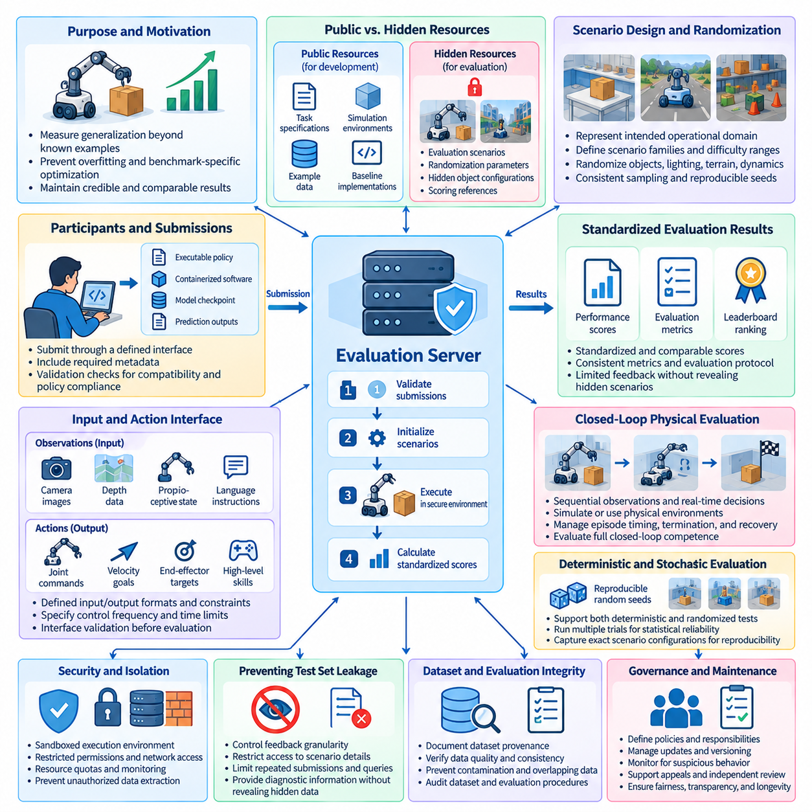{width="7.268055555555556in" height="7.268055555555556in"}

비공개 테스트 세트(Hidden Test Sets)와 평가 서버(Evaluation Servers)는 피지컬 인공지능(Physical AI) 벤치마크의 신뢰성을 유지하기 위한 핵심 메커니즘이다. 공개 벤치마크(Public Benchmarks)는 재현 가능한 개발을 지원하지만, 평가 사례에 제한 없이 접근할 수 있으면 과적합(Overfitting)과 벤치마크 특화 최적화(Benchmark-Specific Optimization)가 발생할 수 있다. 비공개 테스트 세트는 선택된 시나리오, 궤적, 환경 구성을 공개하지 않음으로써 독립적인 평가를 보장한다. 평가 서버는 통제된 실행과 표준화된 점수 산정(Standardized Scoring)을 제공하여 연구자가 보호된 테스트 데이터에 직접 접근하지 않고도 시스템을 비교할 수 있도록 한다.

비공개 테스트 세트(Hidden Test Set)의 주요 목적은 개발 과정에서 명시적으로 제공되지 않은 조건에 대한 일반화(Generalization)를 측정하는 것이다. 연구자가 테스트 시나리오를 반복적으로 확인하면 모델은 전이 가능한 능력(Transferable Capabilities)을 습득하기보다 해당 사례에 특화될 수 있다. 이러한 문제는 로봇 행동이 물체 형상(Object Geometry), 환경 동역학(Environmental Dynamics), 센서 특성(Sensor Characteristics), 상호작용 이력(Interaction Histories)에 의존하는 피지컬 인공지능에서 특히 중요하다. 비공개 평가는 이러한 세부정보에 대한 직접적인 노출을 줄이면서 공통된 비교 기준을 유지한다.

견고한 벤치마크 아키텍처(Robust Benchmark Architecture)는 공개 개발 자원(Public Development Resources)과 접근이 제한된 평가 자원(Restricted Evaluation Resources)을 분리한다. 공개 자원에는 작업 명세(Task Specifications), 시뮬레이션 환경(Simulation Environments), 예제 궤적(Example Trajectories), 참조 인터페이스(Reference Interfaces), 기준선 구현(Baseline Implementations)이 포함될 수 있다. 제한된 자원에는 평가 시나리오, 무작위화 매개변수(Randomization Parameters), 비공개 물체 구성(Hidden Object Configurations), 점수 산정 참조정보(Scoring References)가 포함된다. 이러한 분리는 참가자가 전체 평가 분포(Evaluation Distribution)에 직접 최적화하지 않으면서 벤치마크 요구사항을 이해하도록 한다.

평가 서버(Evaluation Servers)는 제출된 시스템과 보호된 테스트 환경 사이에서 신뢰할 수 있는 중개자(Trusted Intermediaries) 역할을 수행한다. 참가자는 벤치마크 아키텍처에 따라 실행 가능한 정책(Executable Policies), 컨테이너화된 소프트웨어(Containerized Software), 모델 체크포인트(Model Checkpoints), 표준화된 예측 출력(Standardized Prediction Outputs)을 제출할 수 있다. 서버는 제출물을 검증하고 평가 시나리오를 초기화하며 필요한 시험을 실행하고 성능 지표(Performance Metrics)를 계산한다. 중앙집중식 실행(Centralized Execution)은 소프트웨어 의존성, 시나리오 구성, 점수 산정 구현의 차이를 줄여 일관성을 향상시킨다.

공정한 평가를 지원하려면 제출 인터페이스(Submission Interfaces)를 명확하게 정의해야 한다. 피지컬 인공지능 벤치마크는 시스템이 카메라 영상(Camera Images), 고유수용감각 측정값(Proprioceptive Measurements), 언어 명령(Language Instructions), 구조화된 관측값(Structured Observations)을 입력받고 지정된 인터페이스를 통해 행동(Actions)을 반환하도록 요구할 수 있다. 입력 형식(Input Formats), 출력 제약조건(Output Constraints), 제어 주파수(Control Frequencies), 실행 시간 제한(Execution Time Limits)을 문서화해야 한다. 인터페이스 검증(Interface Validation)은 비용이 많이 드는 평가를 시작하기 전에 호환되지 않는 제출물을 거부하여 모델 능력과 무관한 운영 실패를 줄여야 한다.

피지컬 인공지능 평가 서버(Physical AI Evaluation Servers)는 기존 기계학습 벤치마크보다 복잡한 과제에 직면한다. 상호작용형 로봇 정책(Interactive Robot Policies)은 순차적인 관측(Sequential Observations), 실시간 의사결정(Real-Time Decisions), 동적 환경(Dynamic Environments)과의 지속적인 상호작용을 필요로 한다. 따라서 평가 인프라는 시뮬레이션 상태(Simulation State), 행동 타이밍(Action Timing), 에피소드 종료(Episode Termination), 실패 복구(Failure Recovery)를 관리해야 한다. 정적인 예측만 평가하는 서버는 특히 계획 오류나 지연된 행동이 이후의 물리적 상태에 영향을 미치는 경우 폐루프 능력(Closed-Loop Competence)을 완전하게 평가할 수 없다.

비공개 시나리오(Hidden Scenarios)는 임의로 공개하지 않은 과제가 아니라 의도된 운영 영역(Operational Domain)을 대표해야 한다. 벤치마크 운영자는 개별 테스트 인스턴스를 공개하지 않으면서 시나리오 계열(Scenario Families), 난이도 범위(Difficulty Ranges), 환경 변동(Environmental Variations), 평가 목표(Evaluation Objectives)를 정의해야 한다. 참가자는 어떤 능력이 측정되고 어떤 제약조건이 적용되는지 이해할 수 있어야 한다. 투명성과 비공개성 사이의 이러한 균형은 비공개 평가가 실제 피지컬 인공지능 요구사항과 동떨어진 예측 불가능한 경쟁으로 변질되는 것을 방지한다.

시나리오 무작위화(Scenario Randomization)는 통제된 분포(Controlled Distributions)에서 여러 유효한 인스턴스를 생성함으로써 비공개 평가를 강화할 수 있다. 물체 위치(Object Positions), 조명 조건(Lighting Conditions), 지형 특성(Terrain Properties), 장애물 움직임(Obstacle Movements), 물리 매개변수(Physical Parameters)는 에피소드마다 달라질 수 있다. 무작위화는 암기된 구성(Memorized Configurations)에 대한 의존성을 줄이고 적응 능력의 약점을 드러낸다. 그러나 표본 추출 절차(Sampling Procedures)는 제출물 전반에서 일관성을 유지해야 하며, 평가 기록에는 재현성을 위해 사용된 정확한 시나리오 구성이 보존되어야 한다.

결정론적 실행(Deterministic Execution)은 디버깅(Debugging)과 통제된 비교에 유용하지만, 확률적 평가(Stochastic Evaluation)는 강건한 행동(Robust Behavior)을 측정하기 위해 필요한 경우가 많다. 피지컬 인공지능 시스템은 센서, 접촉 동역학(Contact Dynamics), 액추에이터 변동(Actuator Variation), 환경 외란(Environmental Disturbances)에서 발생하는 불확실성에 직면한다. 평가 서버는 재현 가능한 난수 시드(Random Seeds)를 지원하면서 여러 독립적인 시험(Independent Trials)의 결과를 수집해야 한다. 이러한 접근법은 단 한 번의 성공적인 실행이 신뢰할 수 있는 성능을 나타낸다고 가정하지 않으면서 통계적 비교(Statistical Comparisons)를 가능하게 한다.

보안(Security)은 평가 서버가 외부에서 제출된 소프트웨어를 실행할 때 반드시 충족해야 하는 기본 요구사항이다. 신뢰할 수 없는 코드(Untrusted Code)는 허가되지 않은 파일 접근(Unauthorized File Access), 네트워크 통신(Network Communication), 자원 고갈(Resource Exhaustion), 비공개 평가 정보 추출을 시도할 수 있다. 샌드박스 실행(Sandboxed Execution), 제한된 권한(Restricted Permissions), 자원 할당량(Resource Quotas), 네트워크 격리(Network Isolation)는 이러한 위험을 줄일 수 있다. 보안 통제는 정상적인 로봇 정책이 실행에 필요한 계산 자원(Computational Resources)에 접근할 수 있도록 하면서 우발적인 실패로부터 평가 인프라도 보호해야 한다.

테스트 세트 누출(Test Set Leakage)을 방지하려면 직접적 정보 경로뿐만 아니라 간접적 정보 경로에도 주의를 기울여야 한다. 상세한 오류 메시지(Error Messages), 다운로드 가능한 로그(Downloadable Logs), 시각화 출력(Visualization Outputs), 점수 패턴을 드러내는 반복 제출을 통해 비공개 시나리오가 노출될 수 있다. 평가 서버는 피드백의 상세 수준(Feedback Granularity)을 통제하고 보호된 시나리오 정보에 대한 접근을 제한해야 한다. 공개 진단 정보(Public Diagnostic Information)는 유용성을 유지하되, 참가자가 체계적인 탐색(Systematic Probing)을 통해 비공개 테스트 분포를 재구성할 수 없도록 해야 한다.

제출 횟수 제한(Submission Limits)은 비공개 결과를 이용한 반복 최적화 기회를 줄여 벤치마크의 독립성을 유지하는 데 도움이 된다. 리더보드(Leaderboard)는 평가 빈도를 제한하거나 등록을 요구하거나 개발용 제출(Development Submissions)과 공식 제출(Official Submissions)을 구분할 수 있다. 이러한 정책은 투명하고 일관되게 적용되어야 한다. 지나치게 제한적인 접근은 참여를 저해할 수 있지만, 무제한 제출은 비공개 평가를 간접적인 학습 과정(Indirect Training Process)으로 변형시킬 수 있다. 거버넌스(Governance)는 접근성과 평가 무결성(Evaluation Integrity) 사이의 균형을 유지해야 한다.

점수 산정 프로토콜(Scoring Protocols)은 제출된 구현과 독립적으로 유지되어야 한다. 평가 서버는 작업 성공(Task Success), 실행 시간(Execution Time), 충돌(Collisions), 제약조건 위반(Constraint Violations), 개입 요구사항(Intervention Requirements)에 대해 일관된 정의를 적용해야 한다. 다목적 피지컬 인공지능 벤치마크(Multi-Objective Physical AI Benchmarks)의 경우 성능을 설명되지 않은 단일 점수로 압축하기보다 관련된 여러 차원에 걸쳐 보고해야 한다. 표준화된 점수 산정 구현(Standardized Scoring Implementations)은 일관되지 않은 해석의 가능성을 줄이고 리더보드 비교의 신뢰도를 높인다.

하드웨어 다양성(Hardware Diversity)은 비공개 평가에 추가적인 복잡성을 가져온다. 일부 벤치마크는 표준화된 시뮬레이션 로봇(Standardized Simulated Robots)에서 정책을 평가하지만, 다른 벤치마크는 서로 다른 센서, 액추에이터, 기계적 능력을 가진 완전한 물리적 시스템(Complete Physical Systems)을 평가한다. 평가 서버는 로봇 구현 형태의 특성(Embodiment Characteristics)을 기록하고 알고리즘 성능(Algorithmic Performance)과 하드웨어에 의존하는 이점(Hardware-Dependent Advantages)을 구분해야 한다. 직접적인 비교가 적절하지 않은 경우 결과를 플랫폼 유형(Platform Class)별로 분류하거나 명확하게 문서화된 능력 제약조건(Capability Constraints)을 사용하여 정규화할 수 있다.

실제 환경의 비공개 평가(Real-World Hidden Evaluation)는 물리적 환경을 항상 완벽하게 초기화하거나 재현할 수 없기 때문에 특수한 절차가 필요하다. 독립적인 시험 시설(Independent Test Facilities)은 문서화된 안전 조건을 유지하면서 공개되지 않은 물체 배치, 무작위 작업 순서(Randomized Task Sequences), 통제된 외란(Controlled Disturbances)을 사용할 수 있다. 인간 운영자(Human Operators)는 실행을 감독하고 개입을 기록할 수 있다. 순수한 디지털 평가와 달리 물리적 시험에는 장비 유지관리(Equipment Maintenance), 보정(Calibration), 비상 정지 절차(Emergency Stopping Procedures), 일관된 환경 준비(Consistent Environmental Preparation)도 필요하다.

평가 인프라(Evaluation Infrastructure)는 감사(Auditing)와 과학적 분석(Scientific Analysis)을 위해 상세한 실행 기록(Execution Records)을 보존해야 한다. 관련 산출물에는 소프트웨어 버전(Software Versions), 모델 식별자(Model Identifiers), 시나리오 구성(Scenario Configurations), 난수 시드(Random Seeds), 타임스탬프(Timestamps), 행동 궤적(Action Trajectories), 센서 요약(Sensor Summaries), 실패 이벤트(Failure Events), 점수 산정 결과(Scoring Outputs)가 포함된다. 이러한 기록을 통해 벤치마크 관리자는 예상하지 못한 결과를 조사하고 보고된 순위를 검증할 수 있다. 민감한 비공개 정보는 보호하면서도 재현성과 분쟁 해결(Dispute Resolution)을 지원하기에 충분한 메타데이터(Metadata)는 제공되어야 한다.

통계적 신뢰성(Statistical Reliability)은 리더보드 순위가 작은 성능 차이에 의해 결정될 때 필수적이다. 평가 서버는 성공 확률(Success Probabilities)과 시나리오 전반의 변동성(Variability)을 추정할 수 있을 만큼 충분한 시험을 실행해야 한다. 신뢰구간(Confidence Intervals), 표준편차(Standard Deviations), 계층화된 성능 요약(Stratified Performance Summaries)은 겉으로 나타난 순위 차이가 의미 있는지를 보여줄 수 있다. 벤치마크 운영자는 특히 물리적 상호작용으로 인해 결과 변동성이 큰 경우 불안정한 순위( unstable Rankings)를 우월성에 대한 결정적인 증거로 제시하지 않아야 한다.

평가 서버는 버전 관리(Version Control)와 벤치마크 수명주기 관리(Benchmark Lifecycle Management)도 지원해야 한다. 시뮬레이션 엔진(Simulation Engines), 물리 매개변수(Physics Parameters), 비공개 시나리오, 점수 산정 로직(Scoring Logic), 하드웨어 구성의 변경은 보고된 성능을 바꿀 수 있다. 따라서 모든 공식 결과는 특정 벤치마크 버전(Benchmark Version)과 평가 프로토콜(Evaluation Protocol)을 참조해야 한다. 중대한 변경이 발생하면 비교 가능성을 유지하기 위해 새로운 리더보드를 구축하거나 이전 제출물을 재평가해야 할 수 있다.

테스트 인스턴스가 기밀로 유지되더라도 투명성(Transparency)은 중요하다. 벤치마크 문서는 평가 목표(Evaluation Objectives), 지원 인터페이스(Supported Interfaces), 지표 정의(Metric Definitions), 시나리오 포괄 범위(Scenario Coverage), 제출 요구사항(Submission Requirements), 거버넌스 정책(Governance Policies)을 설명해야 한다. 독립적인 감사(Independent Audits)는 보호된 사례를 노출하지 않으면서 비공개 평가가 공개된 절차를 따르는지 검증할 수 있다. 투명한 방법론(Transparent Methodology)과 기밀 테스트 콘텐츠(Confidential Test Content)를 구분하는 것은 표준화된 피지컬 인공지능 평가에 대한 신뢰를 구축하는 핵심 원칙이다.

자동화된 평가 서버(Automated Evaluation Servers)는 벤치마크 실행에 필요한 관리 부담을 줄여 연구를 가속할 수 있다. 지속적 통합 파이프라인(Continuous Integration Pipelines)은 제출물을 검증하고, 계산 자원을 할당하며, 평가 에피소드(Evaluation Episodes)를 예약하고, 지표를 집계하며, 승인된 리더보드 결과를 게시할 수 있다. 자동화된 모니터링(Automated Monitoring)은 실행 실패, 비정상적인 자원 소비, 일관되지 않은 출력을 탐지할 수 있다. 그러나 보안 사고(Security Incidents), 결과 분쟁(Disputed Results), 예외적인 하드웨어 고장(Exceptional Hardware Failures), 평가 정책 변경에는 여전히 인간의 감독(Human Oversight)이 필요하다.

궁극적으로 비공개 테스트 세트(Hidden Test Sets)와 평가 서버(Evaluation Servers)는 실제 피지컬 인공지능 능력(Genuine Physical AI Competence)과 익숙한 사례에 최적화된 성능을 구분하는 데 필요한 인프라를 제공한다. 그 효과는 신중하게 설계된 시나리오 분포(Scenario Distributions), 안전한 실행(Secure Execution), 통제된 피드백(Controlled Feedback), 재현 가능한 점수 산정(Reproducible Scoring), 통계적 엄밀성(Statistical Rigor), 투명한 거버넌스(Transparent Governance)에 달려 있다. 독립적인 시험(Independent Testing)과 접근 가능한 개발 자원(Accessible Development Resources)을 결합함으로써 이러한 메커니즘은 신뢰할 수 있는 리더보드(Trustworthy Leaderboards)와 다양한 로봇 시스템 전반의 물리적 지능(Physical Intelligence)에 대한 더욱 신뢰성 높은 평가를 지원한다.

## 08.05. Metric Definitions and Scoring Protocols

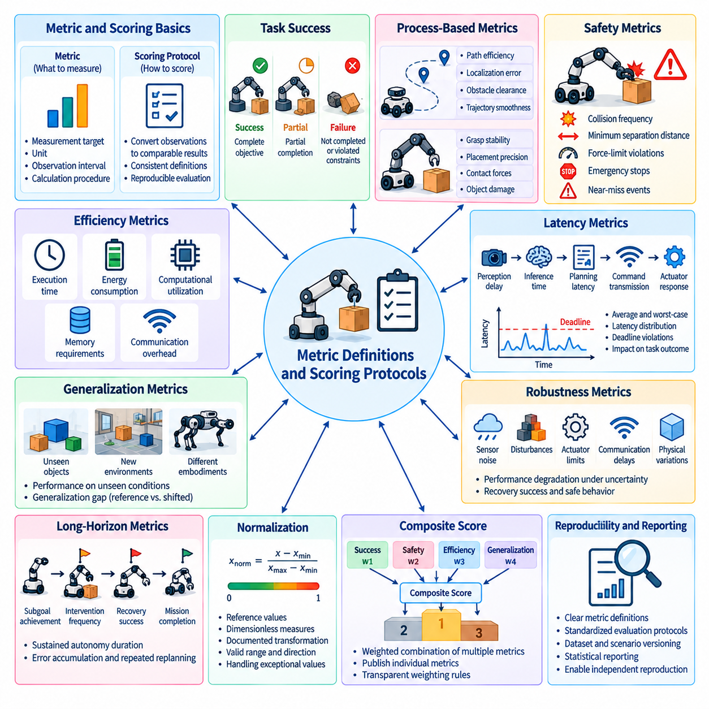{width="7.268055555555556in" height="7.268055555555556in"}

지표 정의(Metric Definitions)와 점수 산정 프로토콜(Scoring Protocols)은 신뢰할 수 있는 피지컬 인공지능(Physical AI) 벤치마킹의 정량적 기반(Quantitative Foundation)을 확립한다. 지표(Metric)는 시스템 행동의 어떤 측면을 측정하는지 규정하며, 점수 산정 프로토콜은 관측값을 비교 가능한 결과로 변환하는 방법을 결정한다. 일관된 정의가 없으면 동일한 로봇 행동도 연구실이나 평가 플랫폼에 따라 서로 다른 점수를 받을 수 있다. 표준화(Standardization)는 보고된 성능이 측정이나 해석의 차이가 아니라 실제 시스템 능력(Actual Capability)을 반영하도록 보장한다.

잘 정의된 지표(Well-Defined Metric)는 측정 대상(Measurement Target), 측정 단위(Unit), 관측 구간(Observation Interval), 계산 절차(Calculation Procedure)를 명확히 해야 한다. 예를 들어 작업 성공률(Task Success Rate)은 성공적인 완료의 명시적인 정의와 분모에 포함되는 유효 시험(Valid Trials)의 수를 필요로 한다. 실행 시간(Execution Time)은 측정이 언제 시작되고 종료되는지, 초기화(Initialization)나 복구 구간(Recovery Periods)이 포함되는지를 규정해야 한다. 이러한 세부사항은 모호성을 방지하고 독립적인 평가자(Independent Evaluators)가 보고된 결과를 재현할 수 있도록 한다.

작업 성공(Task Success)은 기본적인 지표이지만, 이진적 완료 여부(Binary Completion)만으로는 실행 품질(Execution Quality)에 관한 제한적인 정보만 제공한다. 로봇은 과도한 재시도(Retries), 불안정한 움직임(Unstable Movements), 운영 제약조건 위반(Operational Constraint Violations)을 수반하면서도 목표를 달성할 수 있다. 점수 산정 프로토콜은 이러한 구분이 의미 있는 경우 완전한 성공(Complete Success), 부분 완료(Partial Completion), 실패(Failure)를 구별해야 한다. 부분 점수(Partial Credit)는 결과를 관찰한 후 도입된 주관적 판단이 아니라 사전에 정의된 기준(Predefined Criteria)을 따라야 한다.

과정 기반 지표(Process-Based Metrics)는 작업이 어떻게 수행되었는지를 설명함으로써 결과 기반 평가(Outcome-Based Evaluation)를 보완한다. 내비게이션 벤치마크(Navigation Benchmarks)는 경로 효율성(Path Efficiency), 위치 추정 오차(Localization Error), 장애물 이격 거리(Obstacle Clearance), 궤적 부드러움(Trajectory Smoothness)을 측정할 수 있다. 조작 벤치마크(Manipulation Benchmarks)는 파지 안정성(Grasp Stability), 배치 정밀도(Placement Precision), 접촉력(Contact Forces), 물체 손상(Object Damage)을 평가할 수 있다. 이러한 측정은 최종 결과가 비슷하더라도 운영 특성(Operational Characteristics)이 크게 다른 시스템 간의 차이를 드러낸다.

안전 지표(Safety Metrics)는 허용할 수 없는 물리적 행동을 일반적인 성능 절충(Performance Tradeoff)으로 취급할 수 없기 때문에 특히 정밀한 정의가 필요하다. 충돌 빈도(Collision Frequency), 최소 이격 거리(Minimum Separation Distance), 힘 제한 위반(Force-Limit Violations), 비상 정지(Emergency Stops), 아차 사고(Near-Miss Events)는 문서화된 임계값(Documented Thresholds)을 사용하여 측정해야 한다. 점수 산정 규칙은 경미한 편차(Minor Deviations)와 위험한 실패(Hazardous Failures)를 구별하고, 특정 위반이 작업 완료 여부와 관계없이 전체 시험을 무효화하는지를 명시해야 한다.

효율성 지표(Efficiency Metrics)는 특정 결과를 달성하는 데 필요한 자원을 설명한다. 실행 시간(Execution Duration), 에너지 소비(Energy Consumption), 계산 자원 활용률(Computational Utilization), 메모리 요구사항(Memory Requirements), 통신 오버헤드(Communication Overhead)는 모두 실제 배포 가능성(Deployment Feasibility)에 영향을 미칠 수 있다. 비교할 때는 작업 부하(Task Workload)와 하드웨어 구성(Hardware Configuration)의 차이를 고려해야 한다. 완료된 작업당 에너지(Energy per Completed Task)나 성공한 에피소드당 계산량(Computation per Successful Episode)과 같은 정규화된 측정값(Normalized Measures)은 분모와 측정 조건이 명확하게 정의된 경우 해석 가능성을 높일 수 있다.

지연시간 지표(Latency Metrics)는 폐루프 피지컬 인공지능 시스템(Closed-Loop Physical AI Systems)을 평가하는 데 필수적이다. 인식 지연(Perception Delay), 추론 시간(Inference Time), 계획 지연시간(Planning Latency), 명령 전송(Command Transmission), 액추에이터 응답(Actuator Response)은 변화하는 환경에 반응하는 능력에 종합적으로 영향을 미친다. 평균 지연시간(Average Latency)만으로는 어려운 상호작용 중 발생하는 위험한 지연을 파악하지 못할 수 있다. 따라서 점수 산정 프로토콜은 지연시간 분포(Latency Distributions), 최악 조건에서의 행동(Worst-Case Behavior), 마감시간 위반(Deadline Violations), 응답 타이밍과 작업 결과 사이의 관계를 고려해야 한다.

일반화 지표(Generalization Metrics)는 시스템이 익숙한 학습 조건을 벗어나서도 성능을 유지하는지를 판단한다. 평가는 학습에서 보지 못한 물체(Unseen Objects), 환경, 작업, 센서 구성(Sensor Configurations), 로봇 구현 형태(Robot Embodiments)에 걸친 결과를 비교할 수 있다. 일반화 격차(Generalization Gap)는 기준 조건(Reference Conditions)과 분포가 변화한 조건(Shifted Conditions) 사이의 성능 저하를 나타낼 수 있다. 그러나 의미 있는 해석을 위해서는 일관된 작업 정의(Task Definitions)와 문서화된 분포 변화(Distribution Changes)가 필요하며, 이를 통해 난이도 증가를 일반화 능력 자체의 실패로 잘못 판단하지 않도록 해야 한다.

강건성 지표(Robustness Metrics)는 외란(Disturbances), 불확실성(Uncertainty), 구성요소 성능 저하(Component Degradation)가 발생하는 상황에서의 성능을 특성화한다. 시나리오에는 센서 잡음(Sensor Noise), 액추에이터 제한(Actuator Limitations), 예상하지 못한 장애물(Unexpected Obstacles), 통신 지연(Communication Delays), 물리 매개변수 변동(Physical Parameter Variations)이 도입될 수 있다. 평가는 성능 저하(Performance Degradation)와 안전하게 복구하는 능력(Safe Recovery Capability)을 모두 측정해야 한다. 작업 완료를 유지하더라도 안전 제약조건(Safety Constraints)을 반복적으로 위반하는 시스템은 외란이 발생하는 동안 허용 가능한 행동을 유지하는 시스템과 동일한 강건성 평가를 받아서는 안 된다.

장기 지평 평가(Long-Horizon Evaluation)는 고립된 행동(Isolated Actions)이 아니라 확장된 행동 시퀀스(Extended Sequences) 전반을 포착하는 지표를 필요로 한다. 관련 측정값에는 임무 완료율(Mission Completion Rate), 하위 목표 달성(Subgoal Achievement), 개입 빈도(Intervention Frequency), 복구 성공률(Recovery Success), 지속적인 자율 운용 시간(Sustained Autonomy Duration)이 포함된다. 오류 누적(Error Accumulation)과 반복적인 재계획(Repeated Replanning)은 짧은 에피소드에서는 드러나지 않는 약점을 보여줄 수 있다. 점수 산정 프로토콜은 일시적인 실패(Temporary Failures), 인간의 지원(Human Assistance), 부분적인 임무 완료(Partial Mission Completion)가 최종 결과에 영향을 미치는지를 명시해야 한다.

지표 정규화(Metric Normalization)는 서로 다른 규모와 운영 조건을 가진 작업 간의 비교를 가능하게 한다. 거리(Distance), 시간(Time), 에너지(Energy), 정밀도(Precision) 측정값은 집계(Aggregation) 전에 기준값(Reference Values)이나 무차원 변환(Dimensionless Transformations)이 필요할 수 있다. 그러나 기준 조건이 부적절하게 선택되면 정규화는 해석을 왜곡할 수 있다. 모든 변환은 수학적 정의(Mathematical Definition), 유효 범위(Valid Range), 개선 방향(Direction of Improvement), 예외값 처리 방식(Treatment of Exceptional Values)을 문서화해야 한다.

복합 점수(Composite Scores)는 여러 성능 차원을 하나의 요약값으로 결합하지만, 이를 구성할 때는 신중한 정당화가 필요하다. 성공(Success), 안전(Safety), 효율성(Efficiency), 일반화(Generalization)에 가중치를 적용하여 결합하면 리더보드 순위(Leaderboard Ranking)를 단순화할 수 있지만 중요한 절충관계(Tradeoffs)를 감출 수 있다. 벤치마크 설계자는 집계 점수(Aggregate Scores)와 함께 개별 지표값(Individual Metric Values)을 공개해야 한다. 가중치 선택(Weight Selection)은 명시적인 평가 목표(Evaluation Objectives)를 반영해야 하며, 민감도 분석(Sensitivity Analysis)을 통해 가중치의 작은 변화가 순위를 크게 바꾸는지 확인해야 한다.

점수 산정 프로토콜(Scoring Protocols)은 무효 시험(Invalid Trials)과 예외적인 사건(Exceptional Events)을 처리하는 방법을 정의해야 한다. 시뮬레이션 충돌 종료(Simulation Crashes), 하드웨어 고장(Hardware Faults), 통신 중단(Communication Interruptions), 운영자 실수(Operator Mistakes), 환경 설정 실패(Environmental Setup Failures)는 평가 결과에 서로 다른 영향을 미칠 수 있다. 사전에 정의된 규칙 없이 실패한 시험을 제외하면 체계적인 편향(Systematic Bias)이 발생할 수 있다. 프로토콜은 실제 작업 실패(Legitimate Task Failures)와 인프라 실패(Infrastructure Failures)를 구분하면서 제외된 시험(Exclusions), 재시도(Retries), 중단된 평가(Interrupted Evaluations)에 대한 투명한 기록을 유지해야 한다.

통계적 보고(Statistical Reporting)는 피지컬 인공지능 성능이 시험, 환경, 하드웨어 조건에 따라 달라지기 때문에 필요하다. 평균값(Mean Values)에는 표준편차(Standard Deviations)나 신뢰구간(Confidence Intervals)과 같은 적절한 산포도 및 불확실성 측정값(Measures of Dispersion and Uncertainty)이 함께 제시되어야 한다. 성공률(Success Rates)은 의미 있는 해석을 뒷받침할 만큼 충분한 표본 크기(Sample Sizes)를 필요로 한다. 시스템이 유사한 시나리오 분포(Scenario Distributions)를 경험하는 경우 대응 평가 조건(Paired Evaluation Conditions)과 반복 측정(Repeated Measurements)은 비교의 품질을 향상시킬 수 있다.

점수 산정 구현(Scoring Implementations)은 동일한 평가 기록을 동일한 프로토콜로 처리할 때 가능한 한 결정론적(Deterministic)이어야 한다. 자동화된 평가기(Automated Evaluators)는 사전에 정의된 규칙을 사용하여 작업 결과(Task Outcomes), 제약조건 위반(Constraint Violations), 시간 측정값(Timing Measurements), 집계 통계(Aggregate Statistics)를 계산할 수 있다. 참조 구현(Reference Implementations)과 검증 시험(Validation Tests)은 점수 산정 환경 사이의 불일치를 식별하는 데 도움이 된다. 모호한 결과(Ambiguous Outcomes)에 대해서는 인간의 판단(Human Judgment)이 여전히 필요할 수 있지만, 판정 절차(Adjudication Procedures)는 문서화되고 독립적으로 검토할 수 있어야 한다.

정답 데이터의 품질(Ground-Truth Quality)은 지표의 신뢰성(Metric Reliability)에 직접적인 영향을 미친다. 위치 오차(Position Error), 충돌 탐지(Collision Detection), 접촉력(Contact Force), 작업 완료(Task Completion)는 보정된 센서(Calibrated Sensors)나 시뮬레이션 기준 상태(Simulation Reference States)에 의존할 수 있다. 측정 불확실성(Measurement Uncertainty), 동기화 오류(Synchronization Errors), 누락된 관측값(Missing Observations)은 최종 점수에 영향을 전파할 수 있다. 벤치마크 프로토콜은 기준 측정 정확도(Reference Measurement Accuracy)를 문서화하고, 불확실하거나 사용할 수 없는 정답 데이터가 평가 타당성(Evaluation Validity)에 어떤 영향을 미치는지 정의해야 한다.

서로 다른 로봇 구현 형태 간 점수 산정(Cross-Embodiment Scoring)에서는 보편적인 목표(Universal Objectives)와 플랫폼에 의존하는 능력(Platform-Dependent Capabilities)을 구분해야 한다. 서로 다른 로봇은 상이한 이동 전략(Movement Strategies), 센서 구성(Sensing Configurations), 구동 메커니즘(Actuation Mechanisms)을 사용하여 동등한 작업을 완료할 수 있다. 공통 지표(Shared Metrics)는 기능적 성공(Functional Success)과 안전을 평가할 수 있으며, 구현 형태별 지표(Embodiment-Specific Metrics)는 기계적 효율성(Mechanical Efficiency)이나 실행 품질(Execution Quality)을 설명할 수 있다. 직접적인 순위 비교(Direct Rankings)는 물리적·운영적 관점에서 비교가 의미 있는 조건으로 제한해야 한다.

지표 설계(Metric Design)는 점수 산정 규칙이 만들어내는 유인(Incentives)도 고려해야 한다. 속도를 강조하는 벤치마크는 공격적인 움직임(Aggressive Movement)을 유도할 수 있으며, 작업 완료만 보상하는 벤치마크는 과도한 에너지 소비(Excessive Energy Consumption)나 인간 개입(Human Intervention)을 간과할 수 있다. 따라서 부적절하게 설계된 지표는 수치적으로는 우수하지만 실제 운영 기대사항(Operational Expectations)을 충족하지 못하는 행동을 촉진할 수 있다. 벤치마크 설계자는 지표 악용(Metric Gaming)의 가능성을 검토하고, 최적화 과정에서 중요한 제약조건(Critical Constraints)을 우회할 수 없도록 해야 한다.

버전 관리(Version Control)는 임계값(Thresholds), 정규화 규칙(Normalization Rules), 집계 가중치(Aggregation Weights), 실패 정의(Failure Definitions)의 변경이 리더보드 결과를 바꿀 수 있기 때문에 필수적이다. 모든 공식 점수(Official Scores)는 특정 지표 명세(Metric Specification)와 점수 산정 구현(Scoring Implementation)을 참조해야 한다. 과거 결과 비교(Historical Comparisons)에서는 동일한 프로토콜이 적용되었는지를 명시해야 한다. 점수 산정 방식에 중대한 변경이 발생하면 이전 제출물을 재평가하거나 서로 다른 벤치마크 버전(Benchmark Versions)으로 분리해야 할 수 있다.

궁극적으로 지표 정의(Metric Definitions)와 점수 산정 프로토콜(Scoring Protocols)은 피지컬 인공지능 관측값(Physical AI Observations)을 시스템 능력(System Capability)에 관한 재현 가능한 증거(Reproducible Evidence)로 변환한다. 정밀한 측정 규칙(Precise Measurement Rules), 투명한 집계(Transparent Aggregation), 안전을 고려한 점수 산정(Safety-Aware Scoring), 통계적 엄밀성(Statistical Rigor), 검증된 구현(Validated Implementations)은 모델과 로봇 플랫폼 전반에 걸친 신뢰할 수 있는 비교를 가능하게 한다. 견고한 평가 프레임워크(Strong Evaluation Framework)는 다차원 성능 정보(Multidimensional Performance Information)를 보존하면서 일관된 요약 결과(Consistent Summaries)를 제공하여 과학적 발전(Scientific Progress), 공학적 의사결정(Engineering Decisions), 피지컬 인공지능 시스템의 책임 있는 배포(Responsible Deployment)를 지원한다.

## 08.06. Single Metric vs Multi Dimensional Scorecards

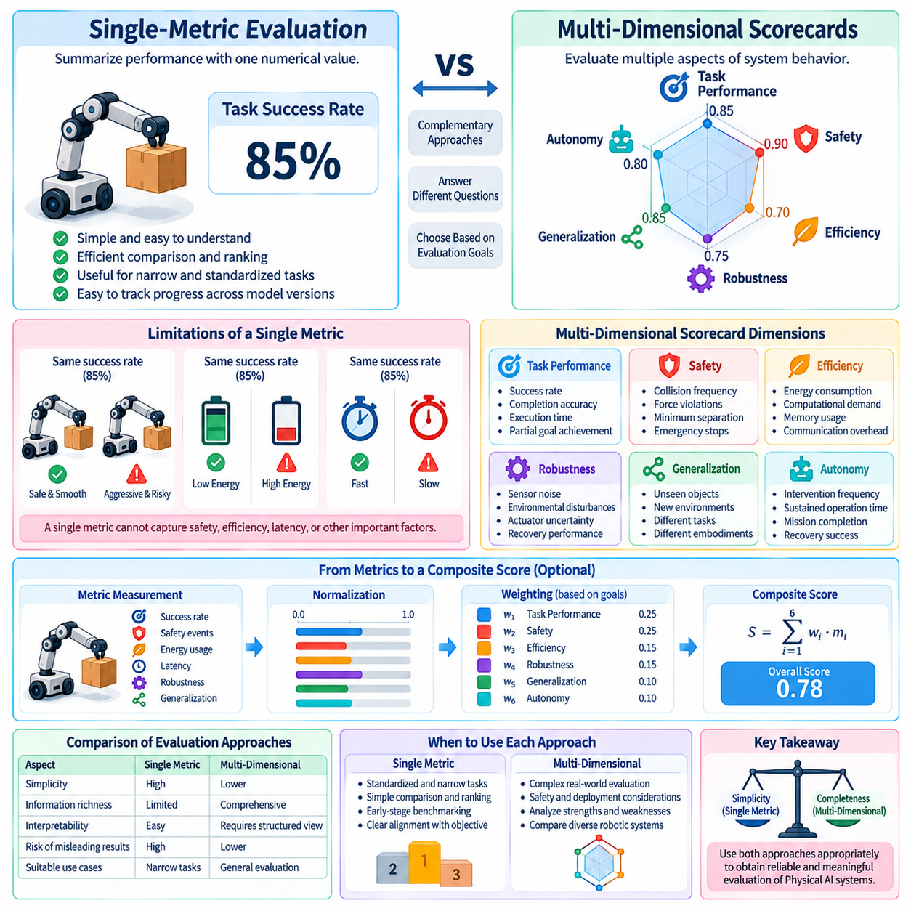{width="7.268055555555556in" height="7.268055555555556in"}

단일 지표 평가(Single-Metric Evaluation)와 다차원 스코어카드(Multi-Dimensional Scorecards)는 피지컬 인공지능(Physical AI)의 능력을 측정하는 두 가지 상호보완적인 접근법이다. 단일 지표(Single Metric)는 하나의 수치로 성능을 요약하는 반면, 다차원 스코어카드는 시스템 행동의 여러 측면을 독립적으로 보존한다. 두 접근법 모두 벤치마킹(Benchmarking)을 지원하지만 서로 다른 질문에 답한다. 적절한 평가 구조를 선택하려면 수치적 단순성(Numerical Simplicity), 해석 가능성(Interpretability), 안전성(Safety), 운영 관련성(Operational Relevance)이 로봇 시스템 간 비교에 어떤 영향을 미치는지 이해해야 한다.

단일 지표 평가(Single-Metric Evaluation)는 알고리즘을 비교하고 제출된 시스템의 순위를 결정하는 간단한 방법을 제공한다. 작업 성공률(Task Success Rate), 평균 완료 시간(Average Completion Time), 누적 보상(Cumulative Reward)과 같은 측정값은 실험 결과를 효율적으로 요약할 수 있다. 하나의 수치는 전달하기 쉽고, 모델 버전 간 변화를 추적하기 편리하며, 공개 리더보드(Public Leaderboards)에 표시하기에도 적합하다. 이러한 단순성은 평가 목표가 제한적이고, 작업 조건이 표준화되어 있으며, 선택한 지표가 조사하려는 능력을 정확하게 대표할 때 특히 유용하다.

그러나 단일 지표(Single Metric)는 물리적 지능(Physical Intelligence)의 전체적인 복잡성을 포착하기 어렵다. 두 로봇이 동일한 성공률을 달성하더라도 안전성(Safety), 에너지 소비(Energy Consumption), 응답 지연시간(Response Latency), 복구 행동(Recovery Behavior)에서는 상당한 차이를 보일 수 있다. 공격적인 움직임(Aggressive Movements)을 통해 작업을 빠르게 완료하는 로봇은 운영 위험(Operational Risks)을 발생시키면서도 높은 점수를 받을 수 있다. 이러한 사례는 수치적 성능(Numerical Performance)만으로 시스템이 동적인 물리적 환경(Dynamic Physical Environments)에 배포하기 적합한지를 판단할 수 없음을 보여준다.

다차원 스코어카드(Multi-Dimensional Scorecards)는 여러 능력 차원(Capability Dimensions)을 독립적으로 평가함으로써 이러한 한계를 해결한다. 일반적인 피지컬 인공지능 스코어카드(Physical AI Scorecard)에는 작업 성능(Task Performance), 안전성(Safety), 효율성(Efficiency), 강건성(Robustness), 일반화(Generalization), 자율성(Autonomy)이 포함될 수 있다. 각 차원에는 표준화된 평가 절차(Standardized Evaluation Procedures)에서 도출된 측정 가능한 지표(Measurable Indicators)가 포함된다. 모든 관측값을 하나의 숫자로 축소하는 대신, 스코어카드는 서로 다른 로봇 시스템의 강점, 약점, 운영상 절충관계(Operational Tradeoffs)를 구조적으로 표현한다.

작업 성능(Task Performance)은 로봇이 의미 있는 목표를 달성해야 한다는 점에서 스코어카드의 핵심 차원으로 유지된다. 관련 지표에는 작업 성공률(Task Success Rate), 완료 정확도(Completion Accuracy), 실행 시간(Execution Time), 부분 목표 달성(Partial Goal Achievement)이 포함된다. 이러한 측정값은 시스템이 지정된 조건에서 의도된 기능을 수행할 수 있는지를 확인한다. 그러나 작업 완료가 반드시 효율적이고 안전하며 신뢰할 수 있는 운영을 의미하지는 않으므로, 작업 성능은 다른 차원과 함께 해석해야 한다.

안전성(Safety)은 집계 성능 점수(Aggregate Performance Score) 안에 감추어져서는 안 되는 독립적인 차원이다. 충돌 빈도(Collision Frequency), 힘 제한 위반(Force-Limit Violations), 사람과의 최소 이격 거리(Minimum Human Separation), 비상 개입(Emergency Interventions), 위험한 실패율(Hazardous Failure Rates)은 물리적 위험(Physical Risk)에 관한 근거를 제공한다. 안전 필수 응용 분야(Safety-Critical Applications)에서는 특정 위반이 빠른 실행으로 상쇄할 수 있는 감점 요소가 아니라 실격 조건(Disqualifying Conditions)이 될 수 있다. 스코어카드는 이러한 제약조건을 명확하게 드러내고 명시적인 안전 수용 기준(Safety Acceptance Criteria)을 지원한다.

효율성(Efficiency)은 유용한 작업을 수행하는 동안 소비되는 자원을 측정한다. 완료된 작업당 에너지(Energy per Completed Task), 계산 요구량(Computational Demand), 메모리 사용량(Memory Usage), 통신 오버헤드(Communication Overhead), 실행 시간(Execution Duration)은 중요한 배포 제약조건(Deployment Constraints)을 드러낼 수 있다. 성공률이 비슷한 시스템도 배터리 지속시간(Battery Endurance)이나 하드웨어 요구사항(Hardware Requirements)에서 상당한 차이를 보일 수 있다. 효율성을 독립적으로 보고하면 알고리즘 능력(Algorithmic Capability)과 자원 집약적인 성능(Resource-Intensive Performance)을 구분할 수 있으며, 실제 배포와 관련된 비교를 지원한다.

강건성(Robustness)과 일반화(Generalization) 역시 서로 구별되는 차원으로 표현해야 한다. 강건성은 외란(Disturbances), 센서 잡음(Sensor Noise), 액추에이터 불확실성(Actuator Uncertainty), 예상하지 못한 사건(Unexpected Events)에서의 성능을 평가한다. 일반화는 익숙하지 않은 물체, 환경, 작업, 로봇 구현 형태(Embodiments)에 걸친 행동을 조사한다. 두 능력은 관련되어 있지만 동일하지는 않다. 시스템은 익숙한 환경에서 외란을 견디면서도 새로운 환경에서는 낮은 성능을 보일 수 있으므로, 두 차원을 분리하여 보고하는 것이 필수적이다.

자율성(Autonomy)과 장기 지평 능력(Long-Horizon Competence)은 단기 작업 성공 지표(Short-Task Success Metrics)만으로 충분히 표현할 수 없는 추가적인 평가 차원을 제공한다. 개입 빈도(Intervention Frequency), 지속 운용 시간(Sustained Operation Time), 복구 성공률(Recovery Success), 하위 목표 완료(Subgoal Completion), 임무 수준 신뢰성(Mission-Level Reliability)은 시스템이 장시간 독립적으로 작동할 수 있는지를 설명한다. 로봇은 개별 행동을 정확하게 수행하면서도 복잡한 임무에서는 빈번한 인간 지원(Human Assistance)을 필요로 할 수 있다. 다차원 보고(Multi-Dimensional Reporting)는 단기적인 강점을 감추지 않으면서 이러한 한계를 드러낸다.

다차원 스코어카드(Multi-Dimensional Scorecards)의 주요 과제는 지표 수가 증가하더라도 해석 가능성(Interpretability)을 유지하는 것이다. 지나치게 많은 지표는 단편화된 보고서(Fragmented Reports), 중복 측정(Overlapping Measurements), 의미 있는 개선 사항을 식별하기 어려운 문제를 초래할 수 있다. 스코어카드 설계자는 지표를 일관된 능력 범주(Capability Categories)로 구성하고 불필요한 중복을 피해야 한다. 각 차원은 명확한 운영적 해석(Operational Interpretation), 문서화된 측정 절차(Measurement Procedures), 벤치마크 목표(Benchmark Objectives)와의 정의된 관계를 가져야 한다.

지표 정규화(Metric Normalization)는 스코어카드 차원들이 서로 다른 측정 단위(Measurement Units)와 수치 범위(Numerical Ranges)를 사용할 때 필요하다. 성공률(Success Rates), 에너지 소비(Energy Consumption), 지연시간(Latency), 위치 오차(Positioning Error)는 적절한 변환 없이 직접 결합할 수 없다. 정규화는 문서화된 기준 조건(Reference Conditions)이나 허용 가능한 성능 임계값(Acceptable Performance Thresholds)을 사용하여 측정값을 공통 척도(Common Scales)로 변환할 수 있다. 그러나 변환은 개선 방향(Direction of Improvement)을 보존하고 시스템 간의 작은 차이를 과장하지 않아야 한다.

가중치 부여(Weighting)는 여러 차원을 복합 점수(Composite Score)로 결합할 때 추가적인 설계 의사결정을 요구한다. 벤치마크는 사람과 상호작용하는 로보틱스(Human-Facing Robotics)에서 안전성을 더 중요하게 평가하거나, 자원이 제한된 모바일 플랫폼(Resource-Constrained Mobile Platforms)에서 효율성에 더 높은 비중을 부여할 수 있다. 이러한 가중치는 지능의 보편적인 척도(Universal Measures of Intelligence)가 아니라 응용 분야의 우선순위(Application Priorities)를 반영한다. 따라서 스코어카드는 가중치 규칙(Weighting Rules)을 공개하고 원시 지표값(Raw Metric Values)을 유지하여 독자가 서로 다른 운영 가정(Operational Assumptions)에서도 순위가 의미 있는지 평가할 수 있도록 해야 한다.

복합 점수(Composite Score)는 다차원 평가(Multi-Dimensional Evaluation)의 세부정보를 유지하면서 편리한 요약을 제공할 수 있다. 예를 들어 벤치마크 운영자는 전체 순위(Overall Ranking)와 함께 성능, 안전성, 강건성, 효율성에 대한 상세 점수를 공개할 수 있다. 이러한 계층적 접근법(Layered Approach)은 기술적 투명성(Technical Transparency)을 희생하지 않으면서 빠른 비교를 지원한다. 그러나 집계(Aggregation)는 허용할 수 없는 안전 실패(Unacceptable Safety Failures)가 관련 없는 차원에서 얻은 높은 점수로 자동 상쇄되도록 허용해서는 안 된다.

파레토 분석(Pareto Analysis)은 모든 시스템을 하나의 수치적 순위(Numerical Ranking)로 강제하는 대신 사용할 수 있는 대안이다. 다른 시스템이 고려된 모든 차원에서 동일하거나 더 높은 성능을 보이고, 적어도 하나의 차원에서 더 우수하다면 해당 로봇은 파레토 지배를 받는 상태(Pareto-Dominated)에 있다고 한다. 파레토 프런티어(Pareto Frontier)에 위치한 시스템들은 추가적인 선호 기준 없이는 우열을 결정할 수 없는 서로 다른 절충관계를 나타낸다. 이러한 관점은 보편적으로 우수한 구성이 존재하지 않는 상황에서 서로 다른 운영 우선순위(Operational Priorities)를 위해 설계된 로봇을 비교할 때 유용하다.

스코어카드 해석(Scorecard Interpretation)은 측정 불확실성(Measurement Uncertainty)과 통계적 변동성(Statistical Variability)을 고려해야 한다. 평가 결과가 시험마다 달라지는 경우 시스템 간의 작은 차이는 의미 있는 능력 향상을 나타내지 않을 수 있다. 신뢰구간(Confidence Intervals), 반복 실험(Repeated Experiments), 시나리오 수준 성능 분포(Scenario-Level Performance Distributions)는 보고된 값에 대한 해석적 맥락을 제공한다. 다차원 불확실성 분석(Multi-Dimensional Uncertainty Analysis)은 평가 조건이나 표본 변동성(Sampling Variability)을 고려하면 특정 차원에서 나타난 우월성이 사라질 수 있기 때문에 특히 중요하다.

서로 다른 로봇 구현 형태 간 평가(Cross-Embodiment Evaluation)는 다차원 보고의 필요성을 더욱 강화한다. 바퀴형 로봇(Wheeled Robots), 매니퓰레이터(Manipulators), 다족형 플랫폼(Legged Platforms), 휴머노이드 시스템(Humanoid Systems)은 서로 다른 물리적 능력과 제약조건을 가진다. 공통 지표(Shared Indicators)는 기능적 성공(Functional Success), 안전성, 신뢰성(Reliability)을 설명할 수 있으며, 구현 형태별 지표(Embodiment-Specific Indicators)는 이동 효율성(Locomotion Efficiency), 조작 정밀도(Manipulation Precision), 기계적 안정성(Mechanical Stability)을 특성화할 수 있다. 공통 스코어카드 프레임워크(Common Scorecard Framework)는 모든 측정값이 모든 플랫폼에 동일하게 적용된다고 가정하지 않으면서 비교를 지원할 수 있다.

벤치마크 설계자는 스코어카드가 시스템 최적화(System Optimization)에 미치는 영향도 고려해야 한다. 리더보드가 하나의 수치적 목표(Numerical Objective)만 강조하면 개발자는 보고되지 않는 행동을 소홀히 하면서 해당 지표만 개선할 수 있다. 여러 차원을 공개하면 균형 잡힌 개발(Balanced Development)을 장려하고 바람직하지 않은 절충관계를 더 명확하게 드러낼 수 있다. 그러나 중요한 제약조건이 누락되거나 평가 조건을 예측할 수 있게 되면 다차원 스코어카드도 악용될 수 있다. 따라서 주기적인 지표 검토(Periodic Metric Reviews)와 비공개 시험(Hidden Testing)은 여전히 필요하다.

스코어카드 거버넌스(Scorecard Governance)는 일관된 정의(Consistent Definitions), 버전 관리(Version Control), 보고 요구사항(Reporting Requirements)을 확립해야 한다. 모든 지표에는 문서화된 계산 방법(Calculation Method), 측정 단위(Measurement Unit), 유효 범위(Valid Range), 해석 기준(Interpretation)이 필요하다. 정규화 규칙(Normalization Rules), 가중치 체계(Weighting Schemes), 능력 범주(Capability Categories)의 변경은 과거 순위(Historical Rankings)를 바꿀 수 있다. 따라서 벤치마크 관리자는 버전별 스코어카드 명세(Versioned Scorecard Specifications)를 보존하고 서로 다른 프로토콜에서 생성된 결과를 비교할 수 있는지 설명해야 한다.

실용적인 평가 시스템(Practical Evaluation Systems)은 상세한 측정값을 더 넓은 능력 범주와 연결하는 계층적 스코어카드(Hierarchical Scorecards)를 사용할 수 있다. 개별 지표(Individual Metrics)는 관측 가능한 행동(Observable Behavior)을 설명하고, 범주별 점수(Category Scores)는 관련 능력을 요약하며, 선택적인 전체 점수(Optional Overall Score)는 상위 수준의 의사소통(High-Level Communication)을 지원한다. 이러한 계층 구조는 연구자가 특정 실패를 조사할 수 있도록 하면서 엔지니어와 의사결정자(Decision-Makers)가 배포 준비도(Deployment Readiness)를 평가하도록 돕는다. 또한 독립적인 재현(Independent Reproduction)과 비판적 검토(Critical Review)가 가능하도록 충분한 투명성을 유지해야 한다.

궁극적으로 단일 지표 평가(Single-Metric Evaluation)와 다차원 스코어카드(Multi-Dimensional Scorecards)는 경쟁적인 접근법이 아니라 상호보완적인 접근법으로 이해해야 한다. 단일 지표는 명확하게 제한된 목표에 대해 간결성과 효율적인 순위 산정(Efficient Ranking)을 제공하는 반면, 스코어카드는 신뢰할 수 있는 피지컬 인공지능 운영(Trustworthy Physical AI Operation)에 필요한 폭넓은 특성을 드러낸다. 간결한 요약(Concise Summaries)과 투명하고 안전을 고려하며 통계적 근거를 갖춘 능력 프로파일(Transparent, Safety-Aware, Statistically Grounded Capability Profiles)을 결합하면 벤치마킹(Benchmarking), 시스템 선정(System Selection), 책임 있는 배포(Responsible Deployment)를 위한 더욱 견고한 기반을 구축할 수 있다.

## 08.07. Performance Safety Efficiency and Generalization Scores

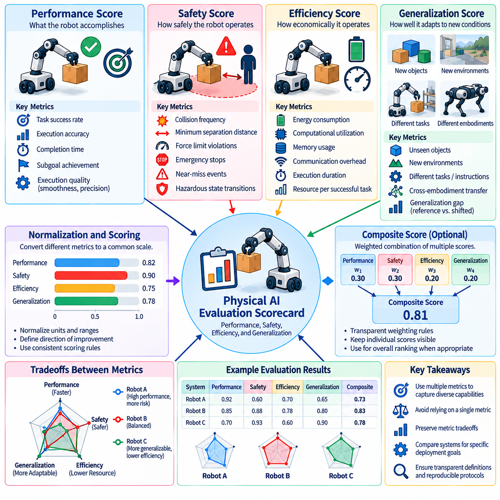{width="7.268055555555556in" height="7.268055555555556in"}

성능(Performance), 안전성(Safety), 효율성(Efficiency), 일반화(Generalization) 점수는 피지컬 인공지능(Physical AI) 시스템을 평가하기 위한 다차원적 기반(Multidimensional Foundation)을 형성한다. 각 점수는 로봇 능력(Robotic Capability)의 서로 다른 측면을 측정하여 벤치마크 결과가 단순한 작업 완료 이상의 정보를 나타내도록 한다. 성능은 시스템이 무엇을 달성하는지를 설명하고, 안전성은 행동과 관련된 위험을 측정하며, 효율성은 자원 소비를 평가하고, 일반화는 적응 능력(Adaptability)을 조사한다. 이러한 차원은 함께 다양한 로봇과 운영 환경(Operational Environments) 전반에서 의미 있는 비교를 지원한다.

성능 점수 산정(Performance Scoring)은 명시적인 작업 목표(Task Objectives)와 측정 가능한 성공 기준(Measurable Success Criteria)에서 시작된다. 일반적인 지표에는 작업 완료율(Task Completion Rate), 실행 정확도(Execution Accuracy), 완료 시간(Completion Time), 중간 목표(Intermediate Goals)에 대한 진행 정도가 포함된다. 조작 시스템(Manipulation System)은 파지 성공률(Grasp Success)과 배치 정밀도(Placement Precision)를 통해 평가할 수 있으며, 모바일 로봇(Mobile Robot)은 내비게이션 정확도(Navigation Accuracy)와 목적지 도착(Destination Arrival)을 통해 평가할 수 있다. 성능 지표는 사전에 정의된 점수 산정 규칙(Predefined Scoring Rules)을 사용하여 성공적인 결과, 부분 완료(Partial Completion), 실패(Failure)를 구분해야 한다.

작업 성능(Task Performance)은 이진적 성공 여부(Binary Success)에만 의존하지 않고 실행 품질(Execution Quality)도 고려해야 한다. 두 로봇이 동일한 작업을 완료하더라도 궤적 부드러움(Trajectory Smoothness), 위치 오차(Positioning Errors), 복구 요구사항(Recovery Requirements)에서 차이를 보일 수 있다. 품질을 고려한 점수 산정(Quality-Sensitive Scoring)은 연속적인 측정값(Continuous Measurements)을 통해 이러한 차이를 드러낼 수 있다. 그러나 품질 지표(Quality Metrics)는 운영 목표(Operational Objectives)와 연결되어야 하며, 수학적으로 유리한 행동이 실질적인 이점 없이 불필요한 보상을 받지 않도록 해야 한다.

안전성 점수 산정(Safety Scoring)은 피지컬 인공지능 시스템이 허용 가능한 물리적·운영적 제약조건(Physical and Operational Constraints) 내에서 작동하는지를 평가한다. 관련 지표에는 충돌 빈도(Collision Frequency), 과도한 접촉력(Excessive Contact Forces), 최소 이격 거리(Minimum Separation Distances), 비상 정지(Emergency Stops), 위험 상태 전이(Hazardous State Transitions)가 포함된다. 안전성 평가는 실제 사고(Actual Incidents)뿐만 아니라 위험 증가를 나타내는 전조 사건(Precursor Events)도 고려해야 한다. 명시적인 임계값(Explicit Thresholds)과 표준화된 측정 절차(Standardized Measurement Procedures)는 일관되지 않은 정의가 잘못된 안전성 비교를 초래할 수 있기 때문에 필수적이다.

안전성 점수(Safety Scores)는 경미한 제약조건 이탈(Minor Constraint Deviations)과 중대한 위반(Critical Violations)을 구분해야 한다. 작은 위치 오차(Positioning Error)는 제한적인 감점을 정당화할 수 있지만, 사람과의 위험한 접촉(Dangerous Human Contact)은 즉각적인 시험 종료(Immediate Trial Termination)를 요구할 수 있다. 특정 안전 요구사항(Safety Requirements)은 높은 작업 성능으로 상쇄할 수 있는 점수 구성요소가 아니라 강제 제약조건(Hard Constraints)으로 작동해야 한다. 이러한 접근법은 안전하지 않은 시스템이 속도나 완료 정확도(Completion Accuracy)만으로 허용 가능한 전체 평가 결과를 얻는 것을 방지한다.

효율성 점수 산정(Efficiency Scoring)은 로봇이 계산 자원(Computational Resources)과 물리적 자원(Physical Resources)을 얼마나 경제적으로 유용한 작업으로 전환하는지를 측정한다. 중요한 지표에는 에너지 소비(Energy Consumption), 실행 시간(Execution Duration), 프로세서 활용률(Processor Utilization), 메모리 요구량(Memory Demand), 통신 대역폭(Communication Bandwidth)이 포함된다. 자원 측정값(Resource Measurements)은 명확하게 정의된 작업 부하(Workloads)와 하드웨어 구성(Hardware Configurations)에 연결되어야 한다. 효율성 비교는 시스템이 충분히 유사한 운영 조건에서 동등한 작업을 수행할 때 의미를 가진다.

정규화된 효율성 지표(Normalized Efficiency Measures)는 서로 다른 작업 시간과 작업 부하 규모(Workload Sizes)에 걸친 비교를 개선할 수 있다. 성공한 작업당 에너지(Energy per Successful Task), 완료된 에피소드당 계산량(Computation per Completed Episode), 효율적인 기준 경로(Efficient Reference Path) 대비 이동 거리(Distance Traveled)는 해석 가능한 지표를 제공한다. 그러나 정규화(Normalization)는 실패한 시도(Unsuccessful Attempts)나 반복적인 복구 행동(Repeated Recovery Actions)을 감추어서는 안 된다. 벤치마크 프로토콜(Benchmark Protocols)은 실패한 시험이 전체 자원 소비량(Resource Totals)에 포함되는지를 명시하여 비용이 많이 드는 실패를 제외함으로써 시스템이 효율적으로 보이는 현상을 방지해야 한다.

일반화 점수 산정(Generalization Scoring)은 평가 조건이 학습 과정에서 경험한 조건과 다를 때에도 능력을 유지하는 정도를 측정한다. 테스트 시나리오(Test Scenarios)에는 익숙하지 않은 물체(Unfamiliar Objects), 새로운 환경(New Environments), 변경된 조명(Altered Lighting), 서로 다른 물리적 특성(Different Physical Properties), 변경된 작업 명령(Changed Task Instructions)이 도입될 수 있다. 익숙한 구성(Familiar Configurations)에서만 높은 성능을 보이는 시스템은 제한적인 일반화 능력(Limited Generalization)을 나타낸다. 따라서 평가는 명시적으로 정의된 기준 분포(Reference Distributions)와 변화된 분포(Shifted Distributions) 전반의 성능을 비교해야 한다.

일반화 격차(Generalization Gaps)는 익숙한 조건과 익숙하지 않은 조건 사이의 성능 변화를 정량화하는 한 가지 방법이다. 작은 일반화 격차는 효과적인 전이(Effective Transfer)를 나타낼 수 있지만, 두 조건 모두에서 성능이 낮다면 반드시 높은 능력을 의미하지는 않는다. 따라서 일반화 점수(Generalization Scores)는 상대적인 성능 저하(Relative Degradation)와 함께 절대 성능(Absolute Performance)을 보고해야 한다. 이러한 구분은 원래부터 제한적인 성능을 가진 시스템이 성능 변화가 거의 없다는 이유만으로 유리한 평가를 받는 것을 방지한다.

일반화(Generalization)는 구분되지 않은 하나의 특성으로 취급하기보다 여러 차원에 걸쳐 조사해야 한다. 물체 일반화(Object Generalization)는 익숙하지 않은 형상(Shapes)과 재료(Materials)를 다루고, 환경 일반화(Environmental Generalization)는 새로운 장면(Scenes)과 외란(Disturbances)을 다루며, 작업 일반화(Task Generalization)는 목표(Goals)나 명령(Instructions)의 변화를 평가한다. 로봇 구현 형태 간 일반화(Cross-Embodiment Generalization)는 서로 다른 로봇 플랫폼(Robot Platforms) 사이의 전이(Transfer)를 조사한다. 각 차원을 분리하여 보고하면 적응이 성공하는 영역과 추가적인 학습 또는 공학적 개선이 필요한 영역을 식별할 수 있다.

성능(Performance), 안전성(Safety), 효율성(Efficiency), 일반화(Generalization)는 서로 연결되어 있지만 한 차원의 개선이 다른 차원의 개선을 보장하지는 않는다. 빠른 실행(Faster Execution)은 충돌 위험(Collision Risk)을 증가시킬 수 있고, 보수적인 행동(Conservative Behavior)은 처리량(Throughput)을 감소시킬 수 있으며, 고도로 특화된 정책(Highly Specialized Policies)은 익숙한 작업에서 범용 시스템(General-Purpose Systems)보다 높은 성능을 보일 수 있다. 벤치마크 스코어카드(Benchmark Scorecards)는 모든 목표를 동시에 최대화할 수 있다고 가정하지 않으면서 이러한 관계를 보존해야 한다. 명시적인 절충관계 분석(Tradeoff Analysis)은 응용 분야별 의사결정(Application-Specific Decisions)을 지원한다.

점수 정규화(Score Normalization)는 서로 다른 차원을 비교 가능한 수치 척도(Numerical Scales)로 표시할 수 있도록 한다. 충돌 횟수(Collision Counts), 에너지 소비(Energy Consumption), 완료율(Completion Rates), 위치 오차(Positioning Errors)와 같은 원시 측정값(Raw Measurements)은 서로 다른 단위와 개선 방향(Directions of Improvement)을 가진다. 변환 규칙(Transformation Rules)은 기준값(Reference Values), 허용 범위(Acceptable Ranges), 극단적인 결과(Extreme Outcomes)의 처리 방법을 명시해야 한다. 정규화된 점수(Normalized Scores)는 잘못된 해석을 방지하기 위해 원래 측정값(Original Measurements)까지 추적할 수 있어야 한다.

집계 점수 산정(Aggregate Scoring)은 다차원 결과(Multidimensional Results)를 요약할 수 있지만, 그 설계는 명확하게 선언된 우선순위(Priorities)를 반영해야 한다. 가중 결합(Weighted Combinations)은 인간 상호작용 로봇(Human-Interactive Robots)에서는 안전성을, 배터리 구동 플랫폼(Battery-Powered Platforms)에서는 효율성을 강조할 수 있다. 그러나 가중치(Weights)는 물리적 지능(Physical Intelligence)의 보편적인 정의가 아니라 평가 선호도(Evaluation Preferences)를 나타낸다. 복합 결과(Composite Results)와 함께 개별 차원 점수(Individual Dimension Scores)를 공개하면 연구자가 해당 순위가 의도된 응용 분야에 적절한지를 검토할 수 있다.

안전 필수 임계값(Safety-Critical Thresholds)은 일반적인 점수 집계(Score Aggregation)를 적용하기 전에 평가해야 한다. 의무적인 충돌 제한(Mandatory Collision Limits)이나 인간 보호 요구사항(Human Protection Requirements)을 위반하는 시스템은 다른 점수와 관계없이 안전 수용 기준(Safety Acceptance)을 충족하지 못한 것으로 분류될 수 있다. 이러한 제약조건을 충족하는 시스템들 사이에서는 성능과 효율성을 활용하여 추가적인 비교를 수행할 수 있다. 이러한 계층적 접근법(Hierarchical Approach)은 안전 요구사항을 보존하면서 허용 가능한 해결책(Acceptable Solutions) 간의 의미 있는 차별화를 가능하게 한다.

통계적 불확실성(Statistical Uncertainty)은 모든 점수 산정 차원에 영향을 미친다. 작업 결과(Task Outcomes)는 시나리오에 따라 달라지고, 안전 사고(Safety Incidents)는 드물게 발생할 수 있으며, 자원 소비(Resource Consumption)는 작업 부하에 따라 변동하고, 일반화는 표본으로 선택된 조건(Sampled Conditions)에 의존한다. 따라서 신뢰할 수 있는 평가(Reliable Evaluation)를 위해서는 반복 시험(Repeated Trials), 문서화된 표본 크기(Documented Sample Sizes), 적절한 불확실성 추정값(Uncertainty Estimates)이 필요하다. 신뢰구간(Confidence Intervals)과 분포 요약(Distributional Summaries)은 관측된 점수 차이가 실제 능력 향상(Genuine Capability Improvements)을 반영하는지 판단하는 데 도움이 된다.

시나리오 포괄 범위(Scenario Coverage) 역시 중요하다. 집계 점수(Aggregate Scores)는 어려운 운영 조건(Difficult Operating Conditions)에서 나타나는 약점을 감출 수 있기 때문이다. 로봇은 평균적으로 높은 성능을 달성하면서도 열악한 조명(Poor Lighting), 미끄러운 표면(Slippery Surfaces), 특이한 물체(Unusual Objects), 예상하지 못한 외란(Unexpected Disturbances)에서는 실패할 수 있다. 계층화된 점수 산정(Stratified Scoring)은 관련 시나리오 범주(Scenario Categories)와 난이도 수준(Difficulty Levels)별 결과를 보고해야 한다. 이러한 접근법은 높은 전체 점수가 광범위하게 신뢰할 수 있는 행동을 나타내는지, 아니면 유리한 조건에 집중된 성공을 나타내는지를 드러낸다.

서로 다른 로봇 구현 형태 간 비교(Cross-Embodiment Comparisons)에서는 점수 산정 차원을 신중하게 해석해야 한다. 매니퓰레이터(Manipulators), 모바일 로봇(Mobile Robots), 사족보행 로봇(Quadrupeds), 휴머노이드(Humanoids)는 서로 다른 기계적 구조(Mechanical Structures), 센싱 능력(Sensing Capabilities), 에너지 요구사항(Energy Requirements)을 가진다. 기능적 성공(Functional Success)과 안전성은 공통 평가 원칙(Common Evaluation Principles)을 지원할 수 있지만, 효율성과 동작 품질(Motion Quality)은 플랫폼별 기준(Platform-Specific References)을 필요로 하는 경우가 많다. 벤치마크 설계자는 전이 가능한 능력(Transferable Capabilities)과 주로 하드웨어 구성(Hardware Configuration)에서 비롯되는 이점을 구분해야 한다.

점수 거버넌스(Score Governance)는 시간의 흐름에 따라 일관성을 유지하는 데 필요한 절차를 확립한다. 지표 정의(Metric Definitions), 측정 장비(Measurement Equipment), 정규화 매개변수(Normalization Parameters), 집계 가중치(Aggregation Weights), 안전 임계값(Safety Thresholds)은 버전 관리(Versioning)되고 문서화되어야 한다. 이러한 요소가 변경되면 실제 로봇 능력(Underlying Robot Capabilities)이 변하지 않더라도 리더보드 순위(Leaderboard Rankings)가 달라질 수 있다. 공식 보고서(Official Reports)는 적용된 점수 산정 프로토콜(Scoring Protocol)을 명시하고 독립적인 검증(Independent Verification)에 필요한 충분한 기록을 보존해야 한다.

자동화된 점수 산정 인프라(Automated Scoring Infrastructure)는 이러한 차원을 재현 가능한 평가 파이프라인(Reproducible Evaluation Pipelines)으로 통합할 수 있다. 작업 모니터(Task Monitors)는 완료 결과(Completion Outcomes)를 판단하고, 안전 모니터(Safety Monitors)는 위반을 탐지하며, 자원 모니터(Resource Monitors)는 효율성 측정값(Efficiency Measurements)을 수집하고, 시나리오 관리자(Scenario Managers)는 일반화 시험(Generalization Trials)을 구성한다. 중앙집중식 점수 산정 서비스(Centralized Scoring Service)는 기록을 검증하고 차원별 점수(Dimension Scores)를 계산하며 표준화된 보고서(Standardized Reports)를 게시할 수 있다. 모호한 사고(Ambiguous Incidents), 보정 문제(Calibration Problems), 분쟁이 있는 결과(Disputed Outcomes)에 대해서는 여전히 인간의 감독(Human Oversight)이 필요하다.

궁극적으로 성능(Performance), 안전성(Safety), 효율성(Efficiency), 일반화(Generalization) 점수는 피지컬 인공지능의 능력(Physical AI Capability)과 배포 준비도(Deployment Readiness)에 관한 상호보완적인 근거를 제공한다. 성능은 기능적 역량(Functional Competence)을 확립하고, 안전성은 허용 가능한 운영(Acceptable Operation)을 결정하며, 효율성은 실제 자원 요구사항(Practical Resource Requirements)을 드러내고, 일반화는 익숙한 조건을 넘어서는 적응 능력(Adaptability)을 측정한다. 신뢰할 수 있는 벤치마크(Trustworthy Benchmark)는 이러한 구분을 유지하면서 투명한 집계(Transparent Aggregation), 통계적으로 신뢰할 수 있는 비교(Statistically Reliable Comparisons), 다양한 로봇 플랫폼에 걸친 정보에 기반한 공학적 의사결정(Informed Engineering Decisions)을 지원한다.

## 08.08. Statistical Reporting and Uncertainty

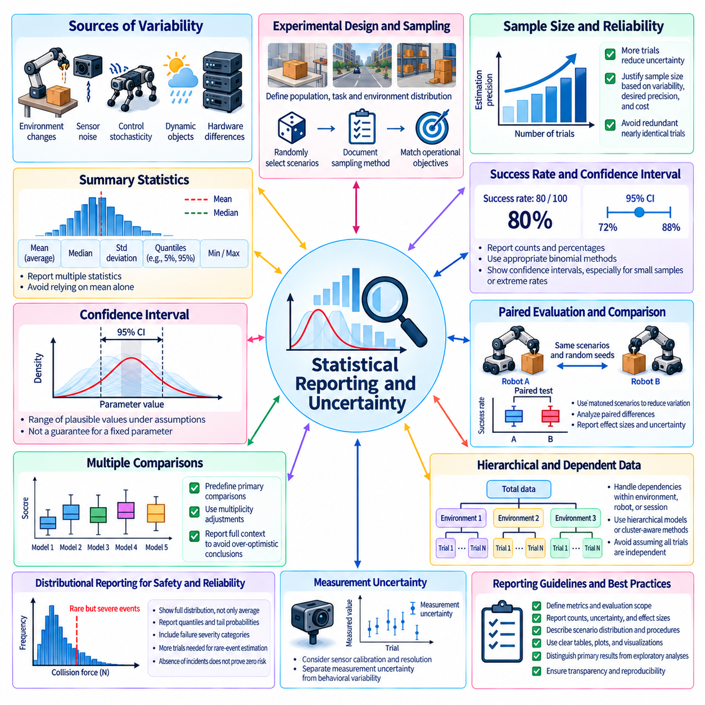{width="7.268055555555556in" height="7.268055555555556in"}

통계적 보고(Statistical Reporting)와 불확실성 분석(Uncertainty Analysis)은 피지컬 인공지능(Physical AI) 벤치마크 결과를 신뢰성 있게 해석하는 데 필수적이다. 로봇의 성능은 환경 조건(Environmental Conditions), 센서 잡음(Sensor Noise), 제어의 확률적 특성(Control Stochasticity), 하드웨어 차이(Hardware Differences), 동적 물체(Dynamic Objects)와의 상호작용에 따라 달라진다. 하나의 수치 점수(Single Numerical Score)만으로는 이러한 변동성을 충분히 표현할 수 없다. 따라서 통계적 보고는 추정된 성능(Estimated Performance)과 해당 추정값을 둘러싼 불확실성(Uncertainty)을 함께 설명하여 연구자가 실제 능력 차이(Genuine Capability Differences)와 실험적 변동(Experimental Fluctuations)을 구분할 수 있도록 한다.

통계적 평가(Statistical Evaluation)의 기반은 명확하게 정의된 실험 모집단(Experimental Population)과 표본 추출 절차(Sampling Procedure)이다. 벤치마크 시험(Benchmark Trials)은 성능 주장이 적용되는 작업, 환경, 운영 조건(Operating Conditions)을 대표해야 한다. 무작위로 선택된 시나리오(Randomly Selected Scenarios)는 평가 범위(Coverage)를 개선할 수 있지만, 표본 추출은 벤치마크의 운영 목표(Operational Objectives)를 반영해야 한다. 연구자는 보고된 통계가 알려진 평가 범위(Evaluation Scope) 내에서 해석될 수 있도록 시나리오 분포(Scenario Distributions), 시험 선택 방법(Trial Selection Methods), 제외 기준(Exclusion Criteria)을 문서화해야 한다.

표본 크기(Sample Size)는 벤치마크 결론의 신뢰성(Reliability)에 큰 영향을 미친다. 적은 수의 시험에서 성공한 로봇은 실제 성공 확률(True Success Probability)이 여전히 불확실하더라도 높은 능력을 가진 것처럼 보일 수 있다. 독립적인 시험(Independent Trials)의 수를 늘리면 일반적으로 추정 정밀도(Estimation Precision)가 향상되지만, 거의 동일한 조건에서 반복된 측정은 추가적인 정보를 제한적으로 제공한다. 벤치마크 프로토콜(Benchmark Protocols)은 예상 변동성(Expected Variability), 목표 정밀도(Desired Precision), 실제 평가 비용(Practical Evaluation Costs)을 고려하여 시험 횟수(Trial Counts)의 타당성을 설명해야 한다.

평균 성능(Mean Performance)은 실험 결과를 간결하게 요약하기 때문에 널리 보고된다. 평균 완료 시간(Average Completion Time), 위치 오차(Positioning Error), 에너지 소비(Energy Consumption), 누적 보상(Cumulative Reward)이 대표적인 예이다. 그러나 평균값(Mean Values)은 극단적인 실패(Extreme Failures)나 변동성이 큰 행동(Highly Variable Behavior)을 감출 수 있다. 중앙값(Median Values), 표준편차(Standard Deviations), 분위수(Quantiles), 최솟값 또는 최댓값(Minimum or Maximum Observations)은 보완적인 정보를 제공한다. 요약 통계량(Summary Statistics)의 선택은 측정 변수(Measured Variable)의 분포와 운영상 중요성(Operational Significance)을 반영해야 한다.

성공률(Success Rates)은 이산적인 결과(Discrete Outcomes)로부터 확률을 추정하기 때문에 특별한 주의가 필요하다. 100회의 시험 중 80회 성공했다고 보고하는 것은 단순히 성공률이 80%라고 보고하는 것보다 더 많은 정보를 제공한다. 신뢰구간(Confidence Intervals)은 추정된 확률(Estimated Probability)과 관련된 불확실성을 전달한다. 특히 표본 크기가 작거나 관측된 성공률이 0 또는 1에 가까운 경우에는 적절한 이항분포 기반 방법(Binomial Methods)을 사용해야 한다. 이러한 조건에서는 단순한 정규근사(Normal Approximations)의 신뢰성이 떨어질 수 있기 때문이다.

신뢰구간(Confidence Intervals)은 특정 통계적 가정(Statistical Assumptions) 아래에서 추정된 성능 매개변수(Estimated Performance Parameter)에 대해 타당하다고 볼 수 있는 값의 범위를 제공한다. 95% 신뢰구간(Ninety-Five Percent Confidence Interval)은 고정된 매개변수(Fixed Parameter)가 계산된 구간 안에 존재할 확률이 95%라는 의미가 아니다. 대신 해당 절차가 반복적인 표본 추출(Repeated Sampling)에서 명시된 포함률(Coverage)을 달성하도록 설계되었다는 의미이다. 올바른 해석은 불확실성 추정값(Uncertainty Estimates)이 미래 로봇 행동(Future Robotic Behavior)에 대한 보장으로 제시되는 것을 방지한다.

피지컬 인공지능 실험(Physical AI Experiments)에는 계층적인 변동 원인(Hierarchical Sources of Variation)이 존재하는 경우가 많다. 여러 에피소드(Episodes)가 동일한 환경, 로봇 하드웨어(Robot Hardware), 운영자(Operator), 난수 시드 계열(Random Seed Family)을 공유할 수 있으므로 결과가 통계적으로 종속적(Statistically Dependent)일 수 있다. 모든 관측값을 독립적인 것으로 취급하면 불확실성을 과소평가하고 신뢰도를 과장할 수 있다. 계층적 모델(Hierarchical Models), 군집 구조를 고려한 부트스트랩 절차(Cluster-Aware Bootstrap Procedures), 환경 또는 세션 수준의 집계(Aggregation at the Environment or Session Level)는 해당 가정이 적절한 경우 이러한 종속성을 반영할 수 있다.

대응 평가(Paired Evaluation)는 경쟁하는 시스템이 동일한 시나리오와 무작위화 조건(Randomization Conditions)을 경험할 때 비교의 품질을 향상시킨다. 이 경우 일치시킨 시험(Matched Trials) 내에서 결과 차이를 분석할 수 있으므로 시나리오 난이도(Scenario Difficulty)로 인한 변동을 줄일 수 있다. 그러나 통계 분석(Statistical Analysis) 전반에서 대응 관계(Pairing)를 유지해야 하며, 동일한 난수 시드(Shared Seeds)를 사용하더라도 정책(Policies)이 달라진 이후에는 물리적 궤적(Physical Trajectories)이 동일하다고 보장할 수 없다. 벤치마크 보고서는 대응 전략(Pairing Strategy)을 설명하고 대응 비교(Matched Comparisons)와 독립 실험(Independent Experiments)을 구분해야 한다.

가설 검정(Hypothesis Testing)은 관측된 성능 차이가 특정 귀무가설(Null Hypothesis)과 양립할 수 있는지를 평가할 수 있다. 그러나 통계적 유의성(Statistical Significance)만으로 실질적인 우월성(Practical Superiority)이 입증되는 것은 아니다. 충분한 시험이 수행되면 매우 작은 개선도 통계적으로 탐지할 수 있지만, 실제 배포(Deployment)에서는 중요하지 않을 수 있다. 따라서 보고서는 확률값(Probability Values)이나 유의성 임계값(Significance Thresholds)에만 의존하지 않고 효과 크기(Effect Sizes), 불확실성 구간(Uncertainty Intervals), 응용 분야별 성능 요구사항(Application-Specific Performance Requirements)을 포함해야 한다.

다중 비교(Multiple Comparisons)는 많은 모델, 지표, 시나리오를 동시에 조사할 때 추가적인 불확실성을 발생시킨다. 수많은 실험에서 가장 좋은 결과만 선택하면 의도적인 조작이 없더라도 지나치게 낙관적인 결론(Overly Optimistic Conclusions)이 도출될 수 있다. 벤치마크 운영자는 사전에 정의된 주요 비교(Predefined Primary Comparisons)와 탐색적 분석(Exploratory Analyses)을 구분하고 적절한 다중성 보정(Multiplicity Adjustments)을 고려해야 한다. 전체 평가 맥락(Full Evaluation Context)을 보고하면 일부 유리한 결과가 일반적인 개선으로 잘못 해석될 위험을 줄일 수 있다.

분포 기반 보고(Distributional Reporting)는 안전성(Safety)과 신뢰성(Reliability)을 평가할 때 특히 중요하다. 평균 충돌 빈도(Average Collision Frequency)는 드물지만 심각한 사고(Rare but Severe Incidents)를 감출 수 있으며, 평균 실행 시간(Average Execution Time)은 허용할 수 없는 지연(Unacceptable Delays)을 숨길 수 있다. 분위수(Quantiles), 꼬리 확률(Tail Probabilities), 실패 심각도 범주(Failure Severity Categories), 시나리오별 요약(Scenario-Specific Summaries)은 평균값으로 파악하기 어려운 운영 위험(Operational Risks)을 드러낼 수 있다. 희귀 사건 추정(Rare-Event Estimation)은 일반적인 성공률 측정보다 훨씬 많은 관측 기회를 필요로 하는 경우가 많으며, 사고가 관측되지 않았다는 사실이 위험이 전혀 없다는 것을 입증하지는 않는다.

불확실성(Uncertainty)은 확률적 행동(Stochastic Behavior)뿐만 아니라 측정 과정(Measurement Processes)에서도 발생한다. 센서 보정 오류(Sensor Calibration Errors), 타임스탬프 불일치(Timestamp Misalignment), 불완전한 정답 데이터(Imperfect Ground Truth), 시뮬레이션 근사(Simulation Approximations)는 보고된 지표에 체계적 오류(Systematic Errors)나 무작위 오류(Random Errors)를 유발할 수 있다. 반복 시험만으로는 체계적 편향(Systematic Bias)을 제거할 수 없다. 평가 프로토콜(Evaluation Protocols)은 측정 정확도(Measurement Accuracy), 보정 절차(Calibration Procedures), 알려진 편향(Known Biases), 파생 성능 지표(Derived Performance Indicators)를 계산할 때 관련된 불확실성 전파(Uncertainty Propagation)를 문서화해야 한다.

시뮬레이션(Simulation)과 실제 환경 실험(Real-World Experiments)은 불확실성을 서로 다르게 해석해야 한다. 시뮬레이션은 통제된 무작위화(Controlled Randomization)와 광범위한 반복 시험(Extensive Repetition)을 허용하지만, 추정된 변동성(Estimated Variability)에는 모델링되지 않은 물리적 효과(Unmodeled Physical Effects)가 누락될 수 있다. 실제 환경 시험(Real-World Testing)은 실제 하드웨어와 환경의 상호작용을 포착하지만 비용이 많이 들고 재현하기 어려울 수 있다. 보고서는 각 평가 영역(Evaluation Domain) 내부의 불확실성과 시뮬레이션 및 현실 사이의 차이(Discrepancies Between Simulation and Reality)를 구분해야 하며, 시뮬레이션 신뢰구간이 실제 환경의 신뢰성을 입증한다는 근거 없는 주장을 피해야 한다.

일반화 평가(Generalization Evaluation)는 익숙하지 않은 조건 전반의 불확실성을 고려해야 한다. 성능 추정값(Performance Estimates)은 학습에서 보지 못한 물체(Unseen Objects), 새로운 환경(New Environments), 변경된 물리적 특성(Altered Physical Properties), 서로 다른 로봇 구현 형태(Robot Embodiments)에 따라 상당히 달라질 수 있다. 전체 평균(Overall Average)만 보고하면 특정 분포에서 나타나는 중요한 약점(Distribution-Specific Weaknesses)을 감출 수 있다. 계층화된 추정값(Stratified Estimates)과 불확실성 구간(Uncertainty Intervals)은 관련된 각 조건을 설명해야 하며, 집계 결과(Aggregate Results)에는 시나리오 범주(Scenario Categories)에 부여된 가중치(Weighting)를 문서화해야 한다.

장기 지평 작업(Long-Horizon Tasks)은 결과가 서로 상관관계를 가진 의사결정 시퀀스(Sequences of Correlated Decisions)에 의존하기 때문에 추가적인 통계적 과제를 발생시킨다. 임무 완료(Mission Completion), 실패까지의 시간(Time to Failure), 복구 빈도(Recovery Frequency), 개입 요구사항(Intervention Requirements)은 개별 행동 정확도(Isolated Action Accuracy)보다 더 유용한 근거를 제공할 수 있다. 성공이나 실패가 관측되기 전에 평가가 종료되는 중도절단 시험(Censored Trials)은 명시적으로 처리해야 한다. 벤치마크가 지속적인 자율성(Sustained Autonomy)이나 운영 지속 능력(Operational Endurance)을 측정하는 경우 생존 분석(Survival Analysis)과 사건 발생 시간 분석(Time-to-Event Methods)이 적절할 수 있다.

리더보드 순위(Leaderboard Rankings)는 모든 수치적 차이를 결정적인 것으로 취급하지 않고 불확실성을 반영해야 한다. 성능 추정 구간(Performance Estimate Intervals)이 겹치는 두 시스템은 구별하기 어려울 수 있지만, 구간의 중첩만으로 두 시스템 간 차이에 대한 공식적인 검정(Formal Test)이 이루어진 것은 아니다. 순위 불확실성(Rank Uncertainty), 대응 비교(Paired Comparisons), 민감도 분석(Sensitivity Analysis)은 순서에 관한 더 강한 근거를 제공할 수 있다. 벤치마크 관리자는 작은 점수 차이가 피지컬 인공지능 능력(Physical AI Capability)의 안정적인 서열(Stable Hierarchy)을 확립한다는 인상을 주지 않아야 한다.

재현 가능한 통계적 보고(Reproducible Statistical Reporting)를 위해서는 평가 프로토콜(Evaluation Protocols), 지표 정의(Metric Definitions), 표본 수(Sample Counts), 무작위화 절차(Randomization Procedures), 분석 방법(Analysis Methods)에 접근할 수 있어야 한다. 기밀 유지(Confidentiality)가 허용하는 경우 익명화된 시험 단위 결과(Anonymized Trial-Level Results)와 참조 분석 코드(Reference Analysis Code)는 독립적인 검증(Independent Verification)을 지원할 수 있다. 비공개 테스트 세트(Hidden Test Sets)는 정보 공개를 제한해야 할 수 있지만, 벤치마크 운영자는 불확실성을 설명하기에 충분한 집계 정보(Aggregated Information)를 여전히 공개할 수 있다. 버전 관리된 분석 파이프라인(Versioned Analysis Pipelines)은 벤치마크가 발전하더라도 비교 가능성(Comparability)을 유지하는 데 도움이 된다.

통계적 계획(Statistical Planning)은 결과를 관측한 이후가 아니라 평가 이전에 이루어져야 한다. 연구자는 주요 지표(Primary Metrics), 의도된 비교(Intended Comparisons), 최소 시험 횟수(Minimum Trial Counts), 중단 규칙(Stopping Rules), 불확실성 추정 방법(Uncertainty Estimation Methods)을 사전에 정의해야 한다. 순차 검정(Sequential Testing)과 적응형 표본 추출(Adaptive Sampling)은 평가 비용을 줄일 수 있지만, 이로 인한 통계적 영향(Statistical Consequences)을 명시적으로 다루어야 한다. 사전에 정의된 절차(Predefined Procedures)는 선택적 보고(Selective Reporting)를 제한하고 유리한 결과가 나타날 때까지 실험을 계속하려는 유인을 줄인다.

자동화된 평가 인프라(Automated Evaluation Infrastructure)는 표준화된 시험 기록(Standardized Trial Records)을 수집하고 재현 가능한 요약(Reproducible Summaries)을 생성함으로써 통계적 일관성(Statistical Consistency)을 향상시킬 수 있다. 평가 서버(Evaluation Servers)는 검증된 분석 파이프라인(Validated Analysis Pipelines)을 사용하여 신뢰구간(Confidence Intervals), 계층화된 통계(Stratified Statistics), 효과 크기(Effect Sizes), 품질 관리 지표(Quality-Control Indicators)를 계산할 수 있다. 자동화된 검사(Automated Checks)는 누락된 시험(Missing Trials), 비정상적인 관측값(Unusual Observations), 일관되지 않은 메타데이터(Inconsistent Metadata)를 식별할 수 있다. 통계적 가정(Statistical Assumptions)이 충족되지 않거나 예상하지 못한 물리적 사건(Unexpected Physical Events)이 해석을 복잡하게 만드는 경우에는 여전히 인간의 검토(Human Review)가 필요하다.

궁극적으로 통계적 보고(Statistical Reporting)와 불확실성 분석(Uncertainty Analysis)은 벤치마크 점수(Benchmark Scores)를 과학적·공학적 의사결정(Scientific and Engineering Decisions)을 지원할 수 있는 근거로 전환한다. 신뢰할 수 있는 평가(Reliable Evaluation)를 위해서는 대표성 있는 표본 추출(Representative Sampling), 충분한 시험 횟수(Sufficient Trials), 종속성의 적절한 처리(Appropriate Treatment of Dependence), 투명한 측정 가정(Transparent Measurement Assumptions), 성능 차이에 대한 신중한 해석(Careful Interpretation of Performance Differences)이 필요하다. 능력 추정값(Capability Estimates)과 그 한계(Limitations)를 함께 보고함으로써 피지컬 인공지능 벤치마크(Physical AI Benchmarks)는 더욱 신뢰할 수 있는 리더보드(Credible Leaderboards), 안전한 배포 의사결정(Safer Deployment Decisions), 다양한 로봇 플랫폼에 걸친 재현 가능한 발전(Reproducible Progress)을 지원할 수 있다.

## 08.09. Reproducibility and Submission Requirements

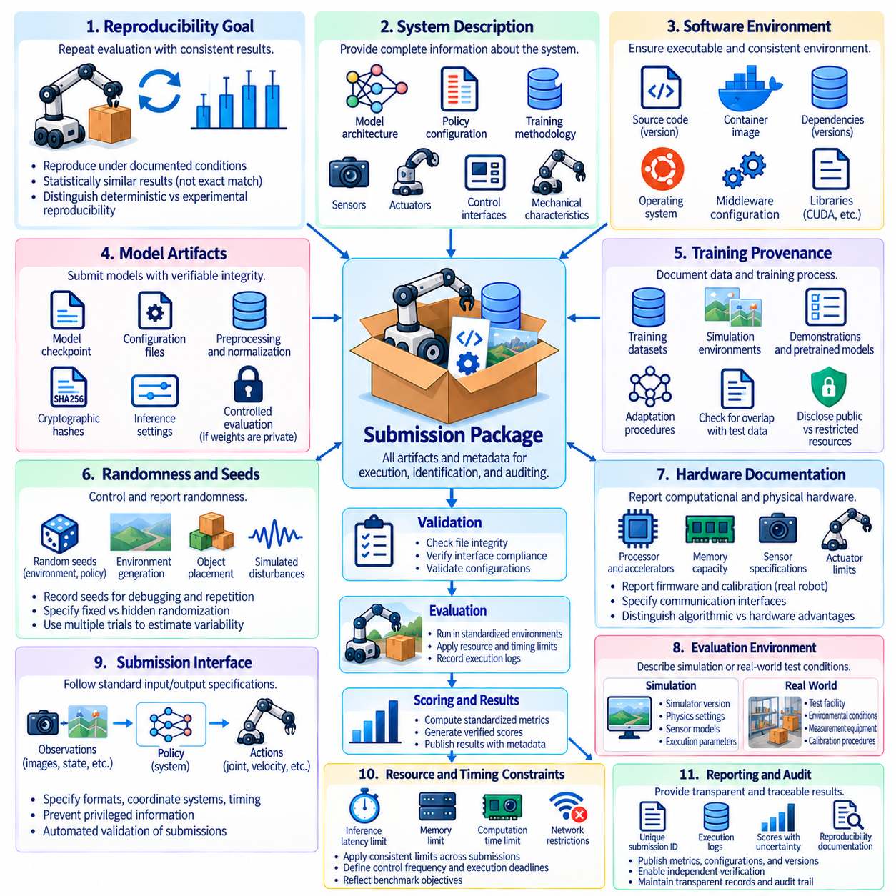{width="7.268055555555556in" height="7.268055555555556in"}

재현성(Reproducibility)과 제출 요구사항(Submission Requirements)은 신뢰할 수 있는 피지컬 인공지능(Physical AI) 벤치마킹(Benchmarking)의 기본 요소이다. 벤치마크 결과(Benchmark Result)는 독립적인 평가자(Independent Evaluators)가 결과가 어떻게 생성되었는지 검증하고 비교 가능한 결과를 얻을 수 있는지 판단할 수 있을 때 과학적 의미를 가진다. 피지컬 인공지능은 결과가 소프트웨어(Software), 하드웨어(Hardware), 환경(Environments), 물리적 상호작용(Physical Interactions)에 의존하기 때문에 추가적인 복잡성을 가진다. 표준화된 제출 절차(Standardized Submission Procedures)는 시스템을 일관되게 평가하는 데 필요한 근거를 확립한다.

재현성(Reproducibility)은 문서화된 조건(Documented Conditions)에서 평가를 반복했을 때 예상되는 불확실성(Expected Uncertainty) 범위 내에서 일관된 결과를 얻을 수 있음을 의미한다. 물리적 시스템(Physical Systems)은 센서 잡음(Sensor Noise), 기계적 변동(Mechanical Variation), 환경 외란(Environmental Disturbances)을 경험하므로 정확히 동일한 수치 결과를 재현하는 것이 항상 가능하지는 않다. 따라서 재현성은 동일한 궤적(Identical Trajectories)이 아니라 통계적으로 비교 가능한 결과(Statistically Comparable Outcomes)를 통해 평가해야 한다. 벤치마크 프로토콜(Benchmark Protocols)은 결정론적 복제(Deterministic Replication)와 실험적 재현성(Experimental Reproducibility)을 구분해야 한다.

유효한 제출(Valid Submission)은 평가 대상 시스템(Evaluated System)에 대한 완전한 설명에서 시작된다. 필수 정보에는 모델 아키텍처(Model Architecture), 정책 구성(Policy Configuration), 학습 방법론(Training Methodology), 소프트웨어 의존성(Software Dependencies), 추론 설정(Inference Settings)이 포함될 수 있다. 로봇 시스템의 경우 센서(Sensors), 액추에이터(Actuators), 제어 인터페이스(Control Interfaces), 관련 기계적 특성(Mechanical Characteristics)도 명시해야 한다. 이러한 문서화는 평가자가 관측된 성능이 인공지능 모델(AI Model), 하드웨어 이점(Hardware Advantages), 시스템 통합(System Integration) 중 어디에서 비롯되는지 이해할 수 있도록 한다.

소프트웨어 재현성(Software Reproducibility)을 위해서는 코드(Code)와 실행 환경(Execution Environment)을 정확하게 식별해야 한다. 소스 코드 리비전(Source Revisions), 의존성 버전(Dependency Versions), 운영체제(Operating Systems), 미들웨어 구성(Middleware Configurations), 수치 연산 라이브러리(Numerical Libraries)는 결과에 영향을 미칠 수 있다. 컨테이너 이미지(Container Images)와 환경 명세(Environment Specifications)는 평가 장비 간 차이를 줄이는 데 도움이 된다. 그러나 컨테이너는 하드웨어 드라이버(Hardware Drivers), 가속기 아키텍처(Accelerator Architectures), 실시간 스케줄링(Real-Time Scheduling), 외부 서비스(External Services)로 인한 변동을 제거하지 못하므로 이러한 요소는 별도로 문서화해야 한다.

모델 산출물(Model Artifacts)은 그 정체성(Identity)과 의도된 실행 동작(Intended Execution Behavior)을 검증할 수 있는 충분한 정보와 함께 제출되어야 한다. 체크포인트(Checkpoints), 구성 파일(Configuration Files), 전처리 매개변수(Preprocessing Parameters), 행동 정규화 규칙(Action Normalization Rules), 추론 정밀도 설정(Inference Precision Settings)은 모두 성능에 영향을 미칠 수 있다. 암호학적 해시(Cryptographic Hashes)는 산출물 무결성(Artifact Integrity)을 확인하고 의도하지 않은 변경을 탐지할 수 있다. 모델 가중치(Model Weights)를 공개할 수 없는 경우 통제된 실행 환경(Controlled Execution Environments)이나 독립적인 평가 서비스(Independent Evaluation Services)가 대체 검증 수단을 제공할 수 있다.

학습 이력(Training Provenance)은 벤치마크 타당성(Benchmark Validity)이 학습 정보(Training Information)와 평가 데이터(Evaluation Data)의 분리에 의존하기 때문에 중요하다. 제출 자료는 학습 데이터셋(Training Datasets), 시뮬레이션 환경(Simulation Environments), 시연 데이터(Demonstrations), 사전학습 모델(Pretrained Models), 적응 절차(Adaptation Procedures)를 적절한 상세 수준으로 설명해야 한다. 평가자는 보호된 테스트 시나리오(Protected Test Scenarios)와의 잠재적인 중복(Potential Overlap)을 식별해야 한다. 공개 요구사항(Disclosure Requirements)은 허용된 공개 자원(Permitted Public Resources)과 비공개 평가(Hidden Evaluations)를 훼손할 수 있는 제한된 정보(Restricted Information)를 구분해야 한다.

무작위성(Randomness)은 평가에 실질적인 영향을 미치는 경우 통제하고 보고해야 한다. 난수 시드(Random Seeds)는 환경 생성(Environment Generation), 정책 샘플링(Policy Sampling), 물체 배치(Object Placement), 시뮬레이션 외란(Simulated Disturbances)을 제어할 수 있다. 시드를 기록하면 디버깅(Debugging)과 반복 실험(Repeated Experiments)을 지원할 수 있지만, 동일한 시드가 동일한 물리적 결과(Identical Physical Outcomes)를 보장하지는 않는다. 벤치마크 운영자는 어떤 무작위화 설정(Randomization Settings)을 고정하고, 어떤 설정을 비공개로 유지하며, 변동성 추정(Variability Estimation)을 위해 반복 시험을 어떻게 표본 추출하는지 명시해야 한다.

하드웨어 문서화(Hardware Documentation)는 계산 능력(Computational Capabilities)과 기계적 능력(Mechanical Capabilities)이 관측된 성능에 영향을 미치기 때문에 피지컬 인공지능에서 특히 중요하다. 제출 자료에는 프로세서 유형(Processor Type), 가속기 구성(Accelerator Configuration), 메모리 용량(Memory Capacity), 센서 사양(Sensor Specifications), 액추에이터 제한(Actuator Limits), 통신 인터페이스(Communication Interfaces)를 보고해야 할 수 있다. 실제 환경 시험(Real-World Testing)에서는 로봇 보정(Robot Calibration)과 펌웨어 버전(Firmware Versions)도 중요할 수 있다. 하드웨어 정보 공개(Hardware Disclosure)는 알고리즘 개선(Algorithmic Improvements)과 물리적 자원(Physical Resources)의 차이를 구분하는 데 도움이 된다.

평가 환경(Evaluation Environments)에도 이에 상응하는 문서화가 필요하다. 시뮬레이션 제출(Simulation Submissions)은 시뮬레이터 버전(Simulator Versions), 물리 엔진 설정(Physics Settings), 센서 모델(Sensor Models), 관련 실행 매개변수(Execution Parameters)를 명시해야 한다. 실제 환경 제출(Real-World Submissions)은 시험 시설(Test Facilities), 환경 조건(Environmental Conditions), 측정 장비(Measurement Equipment), 보정 절차(Calibration Procedures)를 설명해야 한다. 표준화된 시나리오 명세(Standardized Scenario Specifications)는 통제되지 않은 변동(Uncontrolled Variation)을 줄이며, 환경 기록(Environmental Records)은 정확한 물리적 재현(Exact Physical Replication)이 불가능할 때 해석에 필요한 맥락을 제공한다.

제출 인터페이스(Submission Interfaces)는 시스템이 관측값(Observations)을 수신하고 행동(Actions)을 출력하는 방식을 정의해야 한다. 공통 인터페이스(Common Interfaces)는 관측 형식(Observation Formats), 좌표계 규약(Coordinate Conventions), 행동 표현(Action Representations), 시간 제약조건(Timing Constraints), 통신 프로토콜(Communication Protocols)을 명시할 수 있다. 명확한 인터페이스 계약(Interface Contracts)은 특권 정보(Privileged Information)나 호환되지 않는 제어 가정(Incompatible Control Assumptions)으로 인해 우발적인 이점이 발생하는 것을 방지한다. 자동화된 검증(Automated Validation)은 공식 점수 산정(Official Scoring)이 시작되기 전에 잘못된 출력(Malformed Outputs), 지원되지 않는 연산(Unsupported Operations), 실행 제한 위반(Execution Limit Violations)을 탐지할 수 있다.

자원 및 시간 제약조건(Resource and Timing Constraints)은 모든 제출에 일관되게 적용되어야 한다. 평가 서버(Evaluation Servers)는 추론 지연시간(Inference Latency), 메모리 사용량(Memory Usage), 계산 시간(Computation Time), 네트워크 접근(Network Access), 외부 의존성(External Dependencies)에 제한을 부과할 수 있다. 물리적 로봇(Physical Robots)에는 제한된 제어 주파수(Bounded Control Frequencies)와 비상 대응 행동(Emergency Response Behavior)이 추가로 요구될 수 있다. 이러한 제약조건은 벤치마크 목표(Benchmark Objectives)를 반영해야 하며 제출 전에 공개되어야 한다. 이를 통해 순위가 제한 없는 자원 소비(Unrestricted Resource Consumption)에 보상을 제공하지 않도록 해야 한다.

제출 패키지(Submission Package)에는 실행(Execution), 식별(Identification), 감사(Auditing)에 필요한 산출물과 메타데이터(Artifacts and Metadata)가 포함되어야 한다. 벤치마크 정책(Benchmark Policy)에 따라 실행 가능한 코드(Executable Code), 모델 파일(Model Files), 환경 정의(Environment Definitions), 하드웨어 설명(Hardware Descriptions), 표준화된 결과 명세 파일(Standardized Result Manifests)이 포함될 수 있다. 각 제출에는 소프트웨어 및 모델 버전(Software and Model Versions)과 연결된 고유 식별자(Unique Identifier)가 부여되어야 한다. 변경 불가능한 기록(Immutable Records)은 이후 수정된 구성이 이전에 평가된 구성과 혼동되는 것을 방지한다.

자동화된 사전 제출 검사(Automated Pre-Submission Checks)는 신뢰성을 향상시키고 평가 비용(Evaluation Costs)을 줄인다. 검증 절차(Validation Procedures)는 패키지 구조(Package Structure), 의존성 호환성(Dependency Compatibility), 인터페이스 준수(Interface Compliance), 자원 제한(Resource Limits), 기본 실행 동작(Basic Execution Behavior)을 확인할 수 있다. 예비 시험(Preliminary Tests)은 비공개 평가 데이터(Hidden Evaluation Data)의 노출을 방지하기 위해 공개 시나리오(Public Scenarios) 또는 보호되지 않는 시나리오(Nonprotected Scenarios)를 사용해야 한다. 검증 통과(Passing Validation)는 기술적 적격성(Technical Eligibility)을 확립하지만, 높은 작업 성능(Task Performance), 일반화(Generalization), 운영 안전성(Operational Safety)을 의미하지는 않는다.

공식 평가(Official Evaluations)는 참가자가 시험 실행(Test Execution)에 미치는 영향을 제한하는 사전 정의된 프로토콜(Predefined Protocols)을 따라야 한다. 비공개 시나리오(Hidden Scenarios), 통제된 무작위화(Controlled Randomization), 독립적인 점수 산정 서비스(Independent Scoring Services)는 선택적 보고(Selective Reporting)의 기회를 줄인다. 평가 로그(Evaluation Logs)는 시험 식별자(Trial Identifiers), 결과(Outcomes), 시간 정보(Timing Information), 자원 측정값(Resource Measurements), 관련 안전 사건(Safety Events)을 기록해야 한다. 물리적 로봇에서 시험을 수행하는 경우 승인된 운영자(Authorized Operators)는 개입(Interventions)과 규정된 절차에서 벗어난 사항(Deviations from the Prescribed Procedure)을 문서화해야 한다.

통계적 보고 요구사항(Statistical Reporting Requirements)은 모든 공식 제출(Official Submission)에 포함되어야 한다. 리더보드 항목(Leaderboard Entry)은 표본 수(Sample Counts), 집계 점수(Aggregate Scores), 불확실성 추정값(Uncertainty Estimates), 관련 시나리오 수준 결과(Scenario-Level Results)를 제공해야 한다. 벤치마크 규칙(Benchmark Rules)은 실패한 시험(Failed Trials), 시간 초과(Timeouts), 중단된 에피소드(Aborted Episodes), 안전 위반(Safety Violations)이 점수 산정에 포함되는지를 명시해야 한다. 불완전한 관측값(Incomplete Observations)을 일관되게 처리하면 참가자가 불리한 결과를 선택적으로 제외하여 보고 점수를 개선하는 것을 방지할 수 있다.

재현성 검증(Reproducibility Verification)에는 독립적인 재실행(Independent Reruns), 산출물 검사(Artifact Inspection), 제출된 로그와 평가 서버 기록(Evaluation-Server Records) 간 비교가 포함될 수 있다. 반복 평가 사이에 큰 차이가 나타나면 소프트웨어 변경(Software Changes), 보정 편차(Calibration Drift), 환경 변동(Environmental Variation), 통계적 불확실성(Statistical Uncertainty)을 조사해야 한다. 검증 절차(Verification Procedures)는 일반적인 실험 변동성(Ordinary Experimental Variability)과 프로토콜 위반(Protocol Violations)을 구분해야 한다. 재현성에 관한 주장(Reproducibility Claim)은 실제로 조사한 조건으로 범위를 제한해야 한다.

보안 및 기밀 유지 요구사항(Security and Confidentiality Requirements)은 제출된 코드가 신뢰할 수 없는 코드(Untrusted Code)이거나 보호된 평가 자원(Protected Evaluation Resources)을 사용하는 경우 필요하다. 샌드박스 실행(Sandboxed Execution), 제한된 네트워크 권한(Restricted Network Permissions), 접근 제어(Access Controls), 감사 로깅(Audit Logging)은 운영 위험(Operational Risks)을 줄일 수 있다. 독점 모델(Proprietary Models)은 기밀 평가 방식(Confidential Evaluation Arrangements)을 필요로 할 수 있지만, 기밀 유지가 책임성(Accountability)을 제거해서는 안 된다. 벤치마크 운영자는 보호된 지식재산권(Protected Intellectual Property)을 불필요하게 노출하지 않으면서 실패를 조사하고 분쟁을 해결하는 절차를 확립해야 한다.

제출 거버넌스(Submission Governance)는 참가 자격(Eligibility), 재제출 제한(Resubmission Limits), 정보 공개 의무(Disclosure Obligations), 오류 수정 절차(Error Correction Procedures)를 정의해야 한다. 지나치게 많은 반복 제출(Excessive Repeated Submissions)은 비공개 테스트 세트(Hidden Test Sets)에 대한 적응을 조장할 수 있으며, 문서화되지 않은 변경(Undocumented Changes)은 비교의 신뢰성을 훼손한다. 버전 관리된 제출 규칙(Versioned Submission Rules)과 투명한 검토 절차(Transparent Review Procedures)는 공정성(Fairness)을 유지하는 데 도움이 된다. 공개된 결과를 수정할 때는 과거 기록(Historical Records)을 보존하고 점수 변경(Score Revisions)의 이유를 명확하게 식별해야 한다.

서로 다른 플랫폼 간 재현성(Cross-Platform Reproducibility)은 동일한 정책(Identical Policies)도 로봇 구현 형태(Robot Embodiments)와 하드웨어 구성(Hardware Configurations)에 따라 다르게 동작할 수 있기 때문에 특별한 주의가 필요하다. 평가자는 소프트웨어 수준 재현성(Software-Level Reproducibility)과 시스템 수준 성능 일관성(System-Level Performance Consistency)을 구분해야 한다. 두 플랫폼에서 올바르게 실행되는 정책이라도 제어 안정성(Control Stability)이나 작업 성공률(Task Success)에서는 차이를 보일 수 있다. 따라서 보고서는 지원되는 로봇 구현 형태(Supported Embodiments)를 명시하고 제한적인 시험 결과를 근거로 보편적인 재현성(Universal Reproducibility)을 주장하지 않아야 한다.

궁극적으로 재현성(Reproducibility)과 제출 요구사항(Submission Requirements)은 벤치마크 참여(Benchmark Participation)를 검증 가능한 과학적 과정(Verifiable Scientific Process)으로 전환한다. 완전한 시스템 설명(Complete System Descriptions), 통제된 실행(Controlled Execution), 표준화된 인터페이스(Standardized Interfaces), 문서화된 불확실성(Documented Uncertainty), 독립적인 검증(Independent Verification)은 보고된 결과에 대한 신뢰(Confidence)를 확립한다. 각 리더보드 항목(Leaderboard Entry)을 추적 가능한 근거(Traceable Evidence) 및 명확하게 정의된 평가 프로토콜(Evaluation Protocol)과 연결함으로써 피지컬 인공지능 벤치마크(Physical AI Benchmarks)는 신뢰할 수 있는 비교(Credible Comparisons), 누적적 연구(Cumulative Research), 책임 있는 배포 의사결정(Responsible Deployment Decisions)을 지원할 수 있다.

## 08.10. Leaderboard Design and Ranking

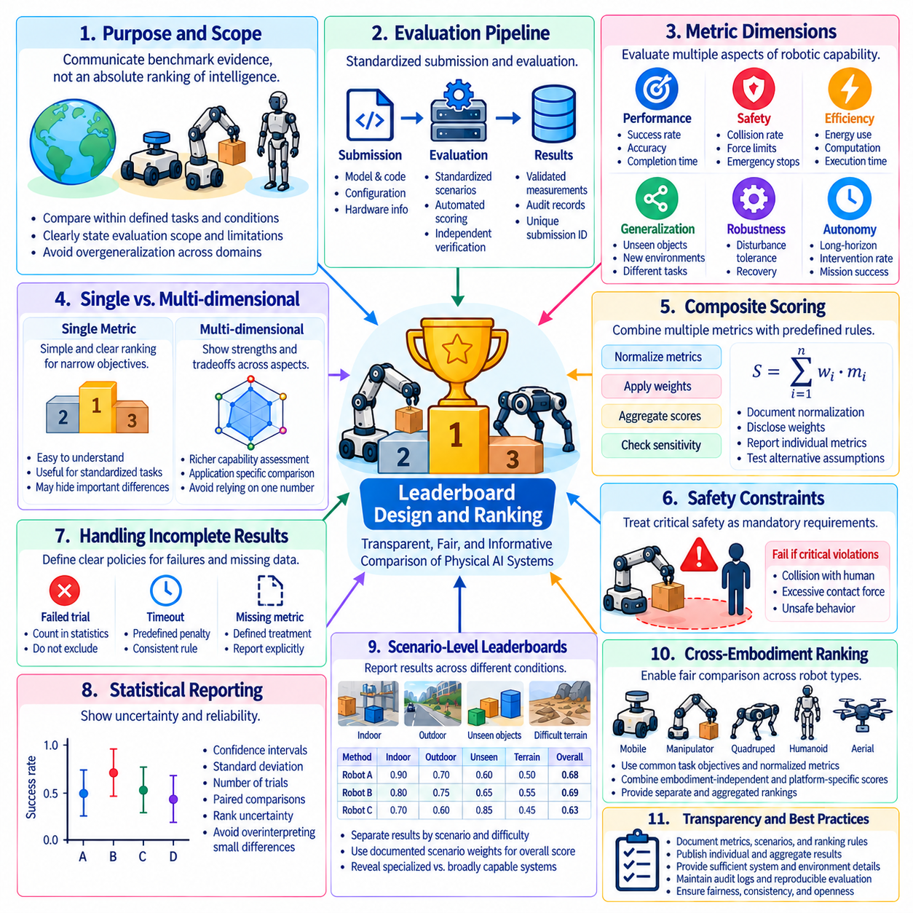{width="7.268055555555556in" height="7.268055555555556in"}

리더보드 설계(Leaderboard Design)와 순위 산정(Ranking)은 피지컬 인공지능(Physical AI) 벤치마크 결과를 로봇 능력(Robotic Capability)에 대한 의미 있는 비교로 전환하는 핵심 요소이다. 리더보드는 평가 결과(Evaluation Outcomes)를 체계적으로 구성하여 연구자, 개발자, 시스템 운영자가 강점(Strengths), 약점(Weaknesses), 측정 가능한 발전(Measurable Progress)을 식별할 수 있도록 한다. 기존 소프트웨어 벤치마크(Conventional Software Benchmarks)와 달리 피지컬 인공지능 리더보드는 물리적 상호작용(Physical Interactions), 안전 제약조건(Safety Constraints), 하드웨어 차이(Hardware Differences), 환경 변동성(Environmental Variability)을 고려해야 한다. 따라서 효과적인 설계에는 투명한 점수 산정 규칙(Transparent Scoring Rules)과 명확하게 정의된 평가 목표(Evaluation Objectives)가 필요하다.

리더보드(Leaderboard)의 주요 목적은 지능(Intelligence)의 절대적인 서열(Absolute Hierarchy)을 확립하는 것이 아니라 벤치마크 근거(Benchmark Evidence)를 전달하는 것이다. 순위(Rankings)는 지정된 작업(Tasks), 시나리오(Scenarios), 운영 조건(Operating Conditions) 내에서 성능을 요약한다. 창고 내비게이션(Warehouse Navigation)에서 1위를 차지한 로봇이 실외 이동(Outdoor Mobility)이나 조작(Manipulation)에서도 다른 시스템보다 우수한 것은 아니다. 따라서 리더보드 설명(Leaderboard Descriptions)은 평가 대상 능력(Capabilities Being Evaluated)을 정의하고 벤치마크의 운영 범위(Operational Scope)를 넘어 결과를 일반화하는 데 따르는 한계를 설명해야 한다.

리더보드 아키텍처(Leaderboard Architecture)는 표준화된 제출 및 평가 파이프라인(Standardized Submission and Evaluation Pipeline)에서 시작된다. 각 참가 시스템(Participating System)은 모델 버전(Model Version), 소프트웨어 구성(Software Configuration), 하드웨어 정보(Hardware Information), 평가 프로토콜(Evaluation Protocol)을 포함하는 고유한 제출 기록(Unique Submission Record)으로 식별되어야 한다. 공식 점수(Official Scores)는 검증되지 않은 자체 보고(Unverified Self-Reports)가 아니라 검증된 측정값(Validated Measurements)에서 생성되어야 한다. 자동화된 평가 서비스(Automated Evaluation Services)는 지표를 일관되게 계산할 수 있으며, 독립적인 검증(Independent Verification)과 감사 기록(Audit Records)은 공개된 순위에 대한 신뢰를 뒷받침한다.

벤치마크 목표(Benchmark Objective)가 제한적이고 명확하게 정의된 경우 리더보드는 하나의 주요 지표(Primary Metric)를 사용할 수 있다. 작업 성공률(Task Success Rate), 내비게이션 완료(Navigation Completion), 조작 정확도(Manipulation Accuracy), 임무 성공률(Mission Success)은 이해하기 쉬운 순위 기준(Ranking Criteria)을 제공할 수 있다. 그러나 하나의 지표에만 의존하면 안전성(Safety), 효율성(Efficiency), 일반화(Generalization)의 중요한 차이를 감출 수 있다. 따라서 피지컬 인공지능 벤치마크는 단일 값이 표시 순위(Displayed Ranking)를 결정하더라도 이를 보완하는 지표(Supporting Indicators)를 함께 공개해야 한다.

다차원 리더보드(Multidimensional Leaderboards)는 시스템 능력(System Capability)을 더욱 폭넓게 표현한다. 성능(Performance), 안전성(Safety), 효율성(Efficiency), 강건성(Robustness), 자율성(Autonomy), 일반화(Generalization)를 별도의 점수 범주(Score Categories)로 제시할 수 있다. 이러한 접근법은 사용자가 전체 순위(Overall Rank)에만 의존하지 않고 운영 우선순위(Operational Priorities)에 따라 시스템을 비교할 수 있도록 한다. 작업 성능은 보통 수준이지만 안전성이 뛰어난 플랫폼은 보수적인 행동(Conservative Behavior)이 요구되는 인간 대면 응용 분야(Human-Facing Applications)에 더 적합할 수 있다.

복합 순위 산정 방법(Composite Ranking Methods)은 사전에 정의된 집계 규칙(Aggregation Rules)을 사용하여 여러 차원을 하나의 수치 점수(Numerical Score)로 결합한다. 가중 평균(Weighted Averages), 정규화된 효용 함수(Normalized Utility Functions), 계층적 점수 산정 구조(Hierarchical Scoring Structures)가 가능한 접근법이다. 그러나 집계 가중치(Aggregation Weights)는 명시적인 평가 목표(Evaluation Objectives)를 반영해야 하며 로봇 지능(Robotic Intelligence)의 보편적인 척도(Universal Measures)로 제시되어서는 안 된다. 벤치마크 운영자는 정규화 절차(Normalization Procedures), 가중치(Weights), 대안적인 순위 산정 가정(Alternative Ranking Assumptions)에 대한 민감도(Sensitivity)를 공개해야 한다.

안전 요구사항(Safety Requirements)은 일반적인 순위 구성요소(Ordinary Ranking Components)가 아니라 참가 적격성 제약조건(Eligibility Constraints)으로 작동해야 할 수 있다. 중대한 충돌 제한(Critical Collision Limits)이나 인간 보호 요구사항(Human Protection Requirements)을 위반한 시스템이 빠른 실행(Faster Execution)만으로 이러한 실패를 자동으로 상쇄해서는 안 된다. 리더보드는 안전 적격 시스템(Safety-Qualified Systems)과 필수 수용 기준(Mandatory Acceptance Criteria)을 충족하지 못한 제출을 구분할 수 있다. 적격 시스템 간의 순위는 필수 안전 요구사항을 약화하지 않으면서 성능과 효율성을 강조할 수 있다.

순위 산정 정책(Ranking Policies)은 누락된 측정값(Missing Measurements), 불완전한 평가(Incomplete Evaluations), 실패한 시험(Unsuccessful Trials)을 처리해야 한다. 실패한 에피소드(Failed Episodes)를 제외하면 보고된 성능이 인위적으로 향상될 수 있으며, 사용할 수 없는 차원(Unavailable Dimensions)에 임의의 점수(Arbitrary Scores)를 부여하면 비교가 왜곡될 수 있다. 벤치마크 프로토콜(Benchmark Protocols)은 평가 전에 시간 초과(Timeouts), 중단된 임무(Aborted Missions), 유효하지 않은 제출(Invalid Submissions), 사용할 수 없는 지표(Unavailable Metrics)의 처리 방법을 정의해야 한다. 명확한 규칙은 모든 참가자가 불완전하거나 실패한 실행에 대해 일관된 결과를 적용받도록 보장한다.

통계적 불확실성(Statistical Uncertainty)은 작은 수치 차이가 의미 있는 능력 차이(Meaningful Capability Differences)를 나타내지 않을 수 있으므로 리더보드 보고에 명확하게 표시되어야 한다. 신뢰구간(Confidence Intervals), 시험 횟수(Trial Counts), 표준편차(Standard Deviations), 대응 비교(Paired Comparisons)는 사용자가 순위의 신뢰성(Ranking Reliability)을 평가하는 데 도움이 된다. 리더보드는 수치적 순서(Numerical Ordering)를 표시하면서도 인접한 시스템들이 통계적으로 구별하기 어렵다는 사실을 나타낼 수 있다. 순위 불확실성(Rank Uncertainty)과 민감도 분석(Sensitivity Analysis)은 평가 표본(Evaluation Samples)에 따라 순서가 안정적으로 유지되는지를 추가로 보여줄 수 있다.

동점(Ties)과 근소한 점수 차이(Near-Ties)에는 명시적인 순위 산정 정책(Ranking Policies)이 필요하다. 표시된 점수(Displayed Scores)가 동일한 시스템도 더 높은 수치 정밀도(Numerical Precision)에서는 차이가 있을 수 있지만, 지나치게 높은 정밀도는 근거 없는 확실성(Unsupported Certainty)을 암시할 수 있다. 운영자는 반올림 규칙(Rounding Conventions), 동점 처리 규칙(Tie-Breaking Rules), 의미 있는 최소 차이(Minimum Meaningful Differences)를 확립해야 한다. 시스템을 구분하기에 근거가 충분하지 않은 경우 공동 순위(Shared Ranks)나 통계적 근거를 고려한 순위 그룹(Statistically Informed Ranking Groups)이 인위적으로 엄격한 순서보다 결과를 정확하게 전달할 수 있다.

시나리오 수준 리더보드(Scenario-Level Leaderboards)는 집계 점수(Aggregate Scores)에 감추어진 성능 차이를 드러내는 데 도움이 된다. 별도의 평가 화면(Separate Views)은 익숙한 환경(Familiar Environments), 학습에서 보지 못한 물체(Unseen Objects), 어려운 지형(Difficult Terrain), 센서 성능 저하(Sensor Degradation), 장기 지평 임무(Long-Horizon Missions)에 대한 결과를 보고할 수 있다. 계층화된 보고(Stratified Reporting)는 높은 전체 성능이 광범위한 역량(Broad Competence)을 반영하는지, 아니면 유리한 조건(Favorable Conditions)에 집중된 성공을 반영하는지 보여준다. 집계 점수는 시나리오 구성(Scenario Composition)의 변화가 순위 해석을 조용히 바꾸지 않도록 시나리오 가중치(Scenario Weights)를 문서화해야 한다.

로봇 구현 형태 간 순위 산정(Cross-Embodiment Ranking)은 로봇 플랫폼이 서로 다른 물리적 능력(Physical Capabilities)과 운영 제약조건(Operating Constraints)을 가지기 때문에 추가적인 과제를 발생시킨다. 매니퓰레이터(Manipulators), 모바일 로봇(Mobile Robots), 사족보행 로봇(Quadrupeds), 휴머노이드(Humanoids)는 항상 동일한 작업 지표(Task Metrics)로 비교할 수 있는 것은 아니다. 공통 기능 목표(Common Functional Objectives)는 제한적인 비교를 지원할 수 있으며, 구현 형태별 범주(Embodiment-Specific Categories)는 의미 있는 공학적 차이(Engineering Distinctions)를 보존한다. 리더보드는 하드웨어에 의존하는 이점(Hardware-Dependent Advantages)을 보편적으로 우수한 인공지능 능력(Universally Superior AI Capability)의 근거로 제시하지 않아야 한다.

하드웨어 인식 리더보드(Hardware-Aware Leaderboards)는 계산 자원(Computational Resources), 액추에이터 사양(Actuator Specifications), 센서 구성(Sensor Configurations), 에너지 요구사항(Energy Requirements)을 보고함으로써 투명성을 향상시킬 수 있다. 별도의 순위 범주(Ranking Categories)는 자원 제한이 없는 시스템(Unrestricted Systems)과 자원 제약이 있는 배포(Resource-Constrained Deployments)를 구분할 수 있다. 이를 통해 근본적으로 서로 다른 계산 예산(Computational Budgets)에서 작동하는 시스템 간 비교가 순수한 알고리즘 성과(Algorithmic Achievements)로 해석되는 것을 방지한다. 하드웨어 메타데이터(Hardware Metadata)는 실제 배포 비용(Practical Deployment Costs) 대비 성능 분석도 지원한다.

제출 빈도(Submission Frequency)와 평가 접근 권한(Evaluation Access)은 벤치마크 시험에 대한 과도한 적응(Excessive Adaptation)을 방지하도록 관리해야 한다. 비공개 평가 서버(Hidden Evaluation Servers)에 무제한으로 제출하면 반복적인 점수 피드백(Repeated Score Feedback)을 통해 정보가 노출될 수 있다. 제출 횟수 제한(Submission Limits), 평가 할당량(Evaluation Quotas), 통제된 결과 공개(Controlled Result Disclosure), 주기적인 테스트 갱신(Periodic Test Refreshes)은 이러한 위험을 줄일 수 있다. 운영자는 탐색적 개발 제출(Exploratory Development Submissions)과 공식 리더보드 항목(Official Leaderboard Entries)을 구분하고 투명한 참가 규칙(Participation Rules)을 유지해야 한다.

리더보드 무결성(Leaderboard Integrity)은 신뢰할 수 있는 식별 관리(Identity Management), 결과 출처 추적(Result Provenance), 감사 가능성(Auditability)에 의존한다. 공개된 각 항목(Published Entry)은 특정 시스템 구성(System Configuration), 평가 버전(Evaluation Version), 검증된 결과 기록(Verified Result Record)과 연결되어야 한다. 결과 수정(Corrections)은 이전 점수를 조용히 덮어쓰는 대신 과거 정보(Historical Information)를 보존해야 한다. 자동화된 이상 탐지(Automated Anomaly Detection)는 의심스러운 제출(Suspicious Submissions), 일관되지 않은 메타데이터(Inconsistent Metadata), 예상하지 못한 성능 변화(Unexpected Performance Changes)를 식별할 수 있지만, 이의가 제기된 결과(Disputed Outcomes)는 문서화된 검토 절차(Documented Review Procedures)를 필요로 한다.

벤치마크 버전 관리(Benchmark Versioning)는 작업, 환경, 점수 산정 규칙(Scoring Rules), 평가 인프라(Evaluation Infrastructure)가 지속적으로 발전하기 때문에 필수적이다. 하나의 벤치마크 버전(Benchmark Version)에서 얻은 점수는 다른 버전에서 생성된 점수와 직접 비교할 수 없을 수 있다. 리더보드는 프로토콜 버전(Protocol Versions)을 명확하게 식별하고 중요한 변경이 발생하면 과거 스냅샷(Historical Snapshots)을 유지해야 한다. 마이그레이션 절차(Migration Procedures)에는 참조 시스템(Reference Systems)의 재평가가 포함될 수 있으며, 이를 통해 호환되지 않는 점수 산정 프로토콜(Incompatible Scoring Protocols) 사이의 동등성을 암시하지 않으면서 연속성(Continuity)을 확보할 수 있다.

공개 리더보드(Public Leaderboards)와 비공개 리더보드(Private Leaderboards)는 서로 다른 목적을 수행할 수 있다. 공개 순위(Public Rankings)는 커뮤니티 참여(Community Participation)를 장려하고 가시적인 발전 지표(Visible Progress Indicators)를 제공하는 반면, 접근이 제한된 평가 기록(Restricted Evaluation Records)은 비공개 테스트(Hidden Tests)와 민감한 시스템 정보(Sensitive System Information)를 보호한다. 일부 벤치마크는 통제된 실행 서비스(Controlled Execution Services)를 통해 기밀 제출(Confidential Submissions)을 허용할 수 있다. 공개 수준(Disclosure Level)에 관계없이 공식 순위는 정보에 기반한 해석(Informed Interpretation)과 절차적 책임성(Procedural Accountability)을 지원할 만큼 충분한 방법론적 정보(Methodological Information)를 제공해야 한다.

리더보드 표시 방식(Leaderboard Presentation)은 시각적 복잡성(Visual Complexity)보다 명확성(Clarity)을 우선해야 한다. 사용자는 주요 점수(Primary Scores), 보조 차원(Supporting Dimensions), 불확실성 추정값(Uncertainty Estimates), 평가 버전(Evaluation Versions), 하드웨어 범주(Hardware Categories)를 모호함 없이 식별할 수 있어야 한다. 필터링 및 비교 기능(Filtering and Comparison Functions)은 응용 분야별 분석(Application-Specific Analysis)을 지원할 수 있으며, 다운로드 가능한 결과(Downloadable Results)는 독립적인 연구(Independent Research)를 가능하게 한다. 설명 문구(Explanatory Notes)는 지표의 개선 방향(Metric Direction), 참가 적격성 조건(Eligibility Conditions), 범주 간 비교의 한계(Limitations of Comparisons Across Categories)를 명확하게 해야 한다.

리더보드 거버넌스(Leaderboard Governance)는 벤치마크 관리자(Benchmark Maintainers)와 참여 커뮤니티(Participating Communities)의 지속적인 감독(Oversight)을 필요로 한다. 정책은 지표 변경(Metric Changes), 참가 자격(Participant Eligibility), 이의신청(Appeals), 이해충돌(Conflicts of Interest), 오래된 평가의 폐기(Retirement of Outdated Evaluations)를 다루어야 한다. 투명한 의사결정 기록(Transparent Decision Records)은 순위가 변경되거나 제출이 실격 처리될 때 신뢰를 유지하는 데 도움이 된다. 커뮤니티 피드백(Community Feedback)은 벤치마크의 적절성(Benchmark Relevance)을 개선할 수 있지만, 변경은 과학적 일관성(Scientific Consistency)을 보존하는 문서화된 절차(Documented Procedures)를 따라야 한다.

궁극적으로 피지컬 인공지능 리더보드 설계(Physical AI Leaderboard Design)는 개별 수치 순위(Numerical Positions)를 둘러싼 경쟁보다 신뢰할 수 있는 근거(Credible Evidence)를 강조해야 한다. 신뢰성 있는 순위(Reliable Rankings)는 표준화된 평가(Standardized Evaluation), 투명한 점수 산정(Transparent Scoring), 안전성을 고려한 적격성 판정(Safety-Aware Qualification), 통계적 불확실성(Statistical Uncertainty), 하드웨어 정보 공개(Hardware Disclosure), 버전 관리된 거버넌스(Versioned Governance)를 결합한다. 잘 설계된 리더보드는 비교 결과(Comparative Results)와 그 한계(Limitations)를 함께 제시함으로써 연구 우선순위(Research Priorities)를 안내하고 공학적 의사결정(Engineering Decisions)을 지원하며, 실제 배포 가능한 로봇 지능(Deployable Robotic Intelligence)을 향한 책임 있는 발전(Responsible Progress)을 장려할 수 있다.

## 08.11. Preventing Overfitting and Benchmark Gaming

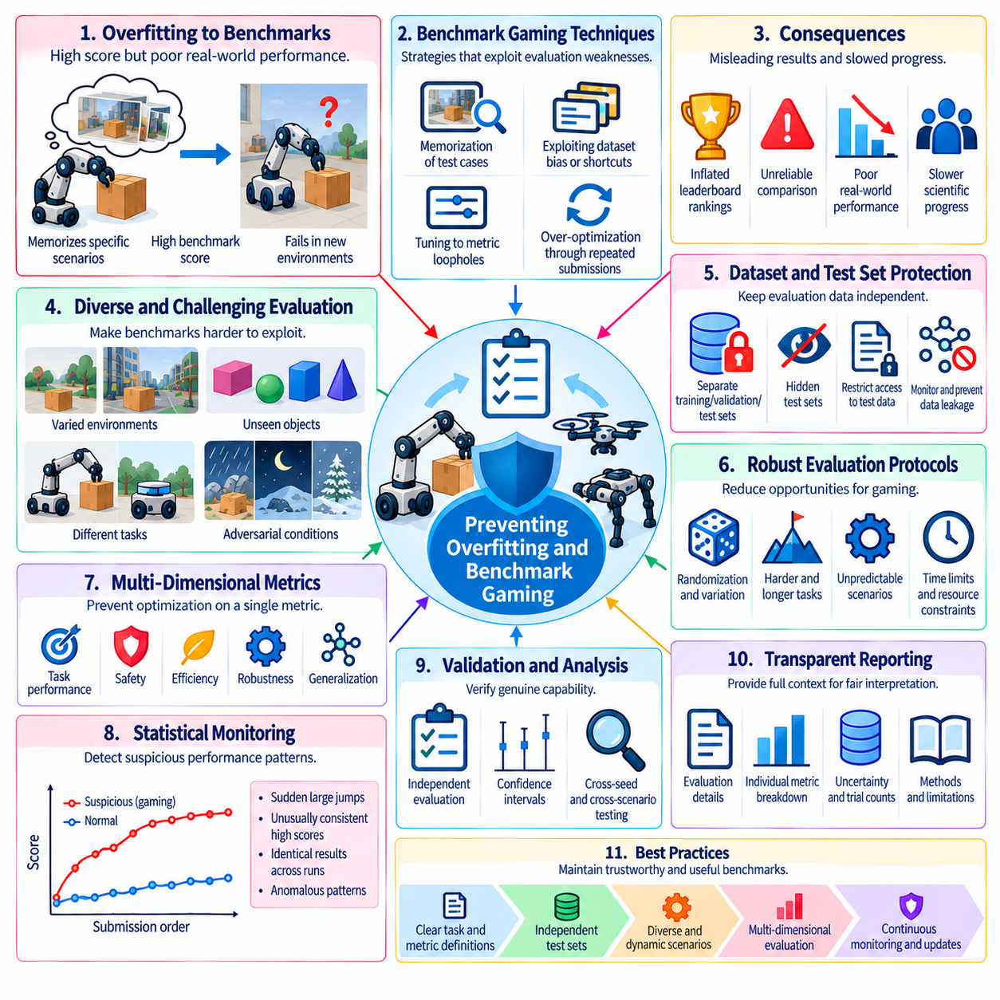{width="7.268055555555556in" height="7.268055555555556in"}

과적합(Overfitting)과 벤치마크 편법 최적화(Benchmark Gaming)를 방지하는 것은 피지컬 인공지능(Physical AI) 평가가 특정 시험에 대한 적응이 아니라 실제 로봇 능력(Genuine Robotic Capability)을 측정하도록 보장하는 데 필수적이다. 과적합은 시스템이 익숙한 벤치마크 조건에서는 우수한 성능을 보이지만 의미 있는 조건 변화에서는 실패할 때 발생한다. 벤치마크 편법 최적화는 의도된 능력을 향상시키지 않으면서 점수 산정 규칙(Scoring Rules)이나 평가의 취약점(Evaluation Weaknesses)을 이용하는 최적화에서 발생한다. 두 문제 모두 잘못된 순위(Misleading Rankings)와 신뢰할 수 없는 배포 의사결정(Unreliable Deployment Decisions)을 초래할 수 있다.

피지컬 인공지능 벤치마크(Physical AI Benchmarks)는 작업이 인식(Perception), 제어(Control), 하드웨어(Hardware), 환경(Environment) 사이의 복잡한 상호작용을 포함하기 때문에 이러한 문제에 특히 취약하다. 로봇은 물체 위치(Object Locations)를 암기하거나 예측 가능한 장애물 패턴(Predictable Obstacle Patterns)을 이용하거나 시뮬레이터에 특화된 동역학(Simulator-Specific Dynamics)에 의존할 수 있다. 이러한 전략은 강건한 지능(Robust Intelligence)을 입증하지 못하면서도 인상적인 점수를 달성할 수 있다. 따라서 평가 설계(Evaluation Design)는 작업 수행 능력(Task Competence)과 특정 장면(Scenes), 궤적(Trajectories), 실험 구성(Experimental Configurations)에 대한 익숙함을 구분해야 한다.

벤치마크 시나리오(Benchmark Scenarios)에 반복적으로 노출되면 평가 데이터(Evaluation Data)는 점차 개발 정보(Development Information)로 전환된다. 연구자는 비공개 예제(Hidden Examples)에 직접 접근하지 않더라도 공개된 테스트 결과(Public Test Results)를 관찰한 후 모델을 조정할 수 있다. 시간이 지나면서 집단적인 실험(Collective Experimentation)은 널리 사용되는 벤치마크에 방법론이 특화되는 커뮤니티 수준의 과적합(Community-Level Overfitting)을 초래할 수 있다. 독립적인 테스트 분포(Independent Test Distributions)를 유지하고 새로운 시나리오를 주기적으로 도입하면 이전에 보지 못한 능력(Unseen Capabilities)을 측정하는 기능을 보존하는 데 도움이 된다.

데이터셋 오염(Dataset Contamination)은 벤치마크 타당성(Benchmark Validity)을 위협하는 또 다른 주요 요인이다. 학습 말뭉치(Training Corpora)에는 보호된 테스트(Protected Tests)와 중복되는 평가 이미지(Evaluation Images), 로봇 시연 데이터(Robot Demonstrations), 환경 지도(Environment Maps), 작업 설명(Task Descriptions)이 포함될 수 있다. 대규모 이종 데이터셋(Large Heterogeneous Datasets)으로 학습된 파운데이션 모델(Foundation Models)은 완전하게 감사하기가 특히 어렵다. 벤치마크 운영자는 데이터 출처 요구사항(Provenance Requirements), 오염 검사(Contamination Checks), 정보 공개 정책(Disclosure Policies)을 확립해야 하며, 불완전한 학습 기록(Training Records)이 확정적인 결론을 제한할 수 있다는 점도 인식해야 한다.

비공개 테스트 세트(Hidden Test Sets)는 직접적인 암기(Direct Memorization)를 줄이지만 벤치마크 편법 최적화를 완전히 제거하지는 못한다. 반복적인 제출(Repeated Submissions)은 집계 점수(Aggregate Scores), 오류 메시지(Error Messages), 상세 피드백(Detailed Feedback)을 통해 정보를 노출할 수 있다. 참가자는 보호된 조건(Protected Conditions)에서 어떤 전략이 성공하는지 점진적으로 추론할 수 있다. 제출 할당량(Submission Quotas), 제한된 피드백(Restricted Feedback), 통제된 평가 접근(Controlled Evaluation Access)은 이러한 정보 유출을 줄인다. 비공개 테스트는 과적합에 대한 유일한 방어 수단이 아니라 더욱 폭넓은 평가 다양성(Evaluation Diversity)을 보완하는 수단이어야 한다.

시나리오 다양성(Scenario Diversity)은 제한적인 특화(Narrow Specialization)를 방지하는 가장 강력한 보호 수단 중 하나이다. 평가는 물체 형상(Object Geometry), 재질(Materials), 조명(Lighting), 지형(Terrain), 센서 잡음(Sensor Noise), 장애물 배치(Obstacle Arrangements), 상호작용 동역학(Interaction Dynamics)을 변화시켜야 한다. 무작위화(Randomization)는 작업 타당성(Task Validity)을 유지하면서 학습 조건과 의미 있는 차이를 도입해야 한다. 관련된 물리적 과제(Physical Challenges)를 변경하지 않고 표면적인 외형(Superficial Appearances)만 변화시키는 벤치마크는 일반화(Generalization)를 과대평가하고 시각적으로는 강건하지만 물리적으로는 취약한 해결책을 장려할 수 있다.

절차적 생성(Procedural Generation)은 고정된 테스트 사례(Fixed Test Instances)에 대한 의존성을 줄이면서 대규모 평가 시나리오(Evaluation Scenarios)를 생성할 수 있다. 매개변수화된 환경(Parameterized Environments)은 실내 배치(Room Layouts), 물체 위치(Object Placements), 움직임 패턴(Motion Patterns), 물리적 특성(Physical Properties)을 변화시킬 수 있다. 그러나 절차적 생성기(Procedural Generators)의 분포가 제한적이거나 공개적으로 복제되는 경우 생성기 자체가 예측 가능해질 수 있다. 벤치마크 운영자는 생성된 시나리오가 익숙한 템플릿(Familiar Templates)의 단순한 조합이 아니라 실제적인 작업 변동(Genuine Task Variation)을 나타내는지 평가해야 한다.

분포 이동 시험(Distribution Shift Testing)은 평가 조건이 개발 과정의 가정(Development Assumptions)에서 벗어날 때 성능이 어떻게 변하는지 측정한다. 동일 분포 평가 결과(In-Distribution Results)는 학습에서 보지 못한 물체(Unseen Objects), 익숙하지 않은 환경(Unfamiliar Environments), 변경된 동역학(Altered Dynamics), 센서 성능 저하(Sensor Degradation)를 포함하는 시험으로 보완해야 한다. 성능 저하 곡선(Performance Degradation Curves)은 단일 집계 점수(Aggregate Score)보다 능력의 경계(Capability Boundaries)를 효과적으로 드러낼 수 있다. 평가 보고서는 예상되는 운영 조건 변화(Expected Operational Variation)와 의도된 배포 영역(Intended Deployment Domain)을 벗어나는 극단적인 조건(Extreme Conditions)을 구분해야 한다.

지표 편법 최적화(Metric Gaming)는 시스템이 근본적인 목표(Underlying Objective)를 소홀히 하면서 측정되는 수량(Measured Quantity)만 최적화할 때 발생한다. 내비게이션 정책(Navigation Policy)은 안전하지 않은 지름길(Unsafe Shortcuts)을 이용하여 이동 시간을 최소화할 수 있으며, 매니퓰레이터(Manipulator)는 의도된 물리적 작업을 완료하지 않고 성공 감지기(Success Detector)를 작동시킬 수 있다. 이러한 실패는 점수 산정 함수(Scoring Functions)가 작업 품질(Task Quality)을 불완전하게 대리 측정하기 때문에 발생한다. 따라서 지표에는 관련성이 있는 경우 독립적인 결과 검증(Independent Outcome Verification), 안전 제약조건(Safety Constraints), 실행 품질(Execution Quality)을 포함해야 한다.

보상 해킹(Reward Hacking)은 학습 기반 로봇 시스템(Learning-Based Robotic Systems)에서 발생하는 관련 문제이다. 에이전트(Agent)는 인간의 기대(Human Expectations)를 충족하지 않으면서 보상(Reward)을 최대화하는 의도하지 않은 행동(Unintended Behaviors)을 발견할 수 있다. 시뮬레이션(Simulation)에서는 이러한 행동이 충돌 모델(Collision Models), 수치 근사(Numerical Approximations), 초기화 메커니즘(Reset Mechanisms)을 악용할 수 있다. 평가 프로토콜(Evaluation Protocols)은 대표적인 궤적(Representative Trajectories)을 검사하고 학습 보상(Training Rewards)과 독립적으로 물리적 작업 완료(Physical Task Completion)를 검증해야 한다. 성공적인 보상 최적화(Reward Optimization)를 성공적인 작업 실행(Task Execution)으로 자동 해석해서는 안 된다.

안전성을 고려한 평가(Safety-Aware Evaluation)는 더 높은 성능 점수를 얻기 위해 허용할 수 없는 위험(Unacceptable Risk)을 감수하는 가능성을 제한한다. 필수 충돌 제약조건(Mandatory Collision Constraints), 힘 제한(Force Limits), 작업공간 경계(Workspace Boundaries), 비상 정지 요구사항(Emergency-Stop Requirements)은 작업 완료 여부와 관계없이 유효하게 유지되어야 한다. 안전 위반(Safety Violations)은 독립적으로 기록되어야 하며, 다른 측면에서는 성공한 시험이라도 무효화할 수 있다. 이러한 접근법은 실패에 대한 벌점이 충분하지 않다는 이유만으로 공격적인 정책(Aggressive Policies)이 순위를 지배하는 것을 방지한다.

시뮬레이터 간 평가(Cross-Simulator Evaluation)는 특정 물리 엔진(Physics Engines)이나 렌더링 파이프라인(Rendering Pipelines)에 대한 의존성을 드러낼 수 있다. 하나의 시뮬레이터에서 학습하고 평가한 정책(Policy)은 접촉 근사(Contact Approximations), 결정론적 시간 처리(Deterministic Timing), 센서 인공 산물(Sensor Artifacts)을 이용할 수 있다. 독립적으로 구성된 시뮬레이션 환경(Simulation Environments) 전반에서 시험하면 전이 가능성(Transferability)에 대한 근거를 제공할 수 있지만, 시뮬레이터 간 결과의 일치가 실제 환경 타당성(Real-World Validity)을 입증하는 것은 아니다. 실제 로봇 배포(Actual Robotic Deployment)에 관한 주장을 위해서는 여전히 물리적 실험(Physical Experiments)이 필요하다.

실제 환경 평가(Real-World Evaluation)는 시뮬레이션에 특화된 과적합(Simulation-Specific Overfitting)을 방지하는 중요한 수단이지만, 물리적 시험 장소(Physical Test Sites) 역시 익숙해질 수 있다. 동일한 실험실(Laboratory)에서 반복적으로 시험하면 바닥 조건(Floor Conditions), 물체 배치(Object Arrangements), 환경 랜드마크(Environmental Landmarks)를 암기하도록 유도할 수 있다. 시험 구성(Test Configurations)을 순환시키고 장비를 변경하며 독립적인 시설(Independent Facilities)을 사용하면 이러한 의존성을 줄일 수 있다. 다만 환경 변동(Environmental Variation)은 해석 가능한 비교(Interpretable Comparisons)를 지원할 수 있을 만큼 충분히 통제되어야 한다.

로봇 구현 형태 간 평가(Cross-Embodiment Testing)는 학습된 능력(Learned Capabilities)이 특정 하드웨어 구성(Hardware Configurations)에 의존하는지 조사하는 또 다른 방법을 제공한다. 서로 다른 매니퓰레이터(Manipulators), 모바일 베이스(Mobile Bases), 센서 구성(Sensor Arrangements)으로 전이되는 정책은 더욱 폭넓은 표현 학습(Representation Learning)을 입증할 수 있다. 그러나 전이(Transfer)는 실행 가능한 작업(Feasible Tasks)과 문서화된 적응 예산(Adaptation Budgets)을 기준으로 평가해야 한다. 물리적으로 호환되지 않는 플랫폼(Physically Incompatible Platforms)에서 성능이 낮다는 사실이 반드시 벤치마크 과적합이나 불충분한 지능(Inadequate Intelligence)을 의미하는 것은 아니다.

벤치마크 편법 최적화(Benchmark Gaming)는 선택적 보고(Selective Reporting)와 실험적 선택(Experimental Choices)을 통해서도 발생할 수 있다. 참가자는 유리한 난수 시드(Favorable Random Seeds)만 공개하거나 어려운 에피소드(Difficult Episodes)를 제외하거나 광범위한 평가 시도(Extensive Evaluation Attempts)에서 가장 좋은 체크포인트(Best Checkpoint)만 보고할 수 있다. 표준화된 시험 횟수(Standardized Trial Counts), 사전 정의된 중단 규칙(Predefined Stopping Rules), 완전한 실패 기록(Complete Failure Accounting)은 이러한 기회를 줄인다. 공식 점수(Official Scores)는 참가자가 선택한 결과 일부(Participant-Selected Subsets)가 아니라 통제된 평가 기록(Controlled Evaluation Records)에서 계산되어야 한다.

통계적 보호 장치(Statistical Safeguards)는 무작위 변동(Random Variation)이나 반복 비교(Repeated Comparisons)로 인해 발생하는 겉보기 개선(Apparent Improvements)을 방지하는 데 도움이 된다. 신뢰구간(Confidence Intervals), 대응 평가(Paired Evaluations), 다중 비교 보정(Multiple-Comparison Adjustments), 독립적인 재현(Independent Replication)은 강건한 성능 향상(Robust Gains)과 우연한 결과(Accidental Outcomes)를 구분할 수 있다. 불확실성이 상당한 경우 작은 점수 향상을 의미 있는 개선으로 취급해서는 안 된다. 평가 운영자는 빈번한 리더보드 갱신(Frequent Leaderboard Updates)이 통계적 잡음(Statistical Noise)에 대한 최적화를 장려하는지도 감시해야 한다.

적대적 시험(Adversarial Testing)과 스트레스 시험(Stress Testing)은 정상 조건(Normal Conditions)에서는 우수하게 작동하지만 가정이 흔들릴 때 실패하는 전략을 식별할 수 있다. 시험에는 예상하지 못한 장애물(Unexpected Obstacles), 지연된 관측값(Delayed Observations), 통신 중단(Communication Interruptions), 비정상적인 물체 상호작용(Unusual Object Interactions)이 도입될 수 있다. 이러한 시나리오는 임의의 난이도(Arbitrary Difficulty)가 아니라 실제 발생 가능한 실패 메커니즘(Plausible Failure Mechanisms)을 대상으로 해야 한다. 목적은 운영 위험(Operational Risks)과의 명확한 연관성을 유지하면서 의사결정(Decision-Making)과 제어(Control)의 약점을 드러내는 것이다.

벤치마크 거버넌스(Benchmark Governance)는 시스템이 점점 더 특화됨에 따라 발전해야 한다. 테스트 세트 갱신(Test-Set Refreshes), 버전 관리된 프로토콜(Versioned Protocols), 독립적인 감사(Independent Audits), 문서화된 제출 정책(Documented Submission Policies)은 평가 무결성(Evaluation Integrity)을 유지하는 데 도움이 된다. 새로운 벤치마크 버전(Benchmark Versions)은 의미 있는 과제(Meaningful Challenges)를 도입하면서도 발전을 해석할 수 있도록 충분한 참조 측정값(Reference Measurements)을 유지해야 한다. 운영자는 특정 참가자에게 불이익을 주기 위한 목적으로만 평가 규칙을 변경해서는 안 되며, 공정성(Fairness)과 과학적 일관성(Scientific Consistency)은 커뮤니티 신뢰(Community Trust)에 필수적이다.

궁극적으로 과적합(Overfitting)과 벤치마크 편법 최적화(Benchmark Gaming)를 방지하려면 다양한 시나리오(Diverse Scenarios), 보호된 평가(Protected Evaluations), 엄격한 지표(Rigorous Metrics), 통계적 통제(Statistical Controls), 독립적인 검증(Independent Verification)을 결합해야 한다. 어떤 단일 보호 장치(Single Safeguard)도 높은 벤치마크 점수가 일반적인 로봇 역량(General Robotic Competence)을 나타낸다고 보장할 수 없다. 강력한 평가 시스템(Strong Evaluation Systems)은 측정된 개선(Measured Improvements)이 익숙한 조건을 넘어 전이되는지 지속적으로 조사한다. 그 목적은 개별 점수 산정 절차(Isolated Scoring Procedures)에 대한 숙련도가 아니라 신뢰할 수 있는 피지컬 인공지능 능력(Reliable Physical AI Capabilities)에 보상을 제공하는 것이다.

## 08.12. Benchmark Versioning and Lifecycle

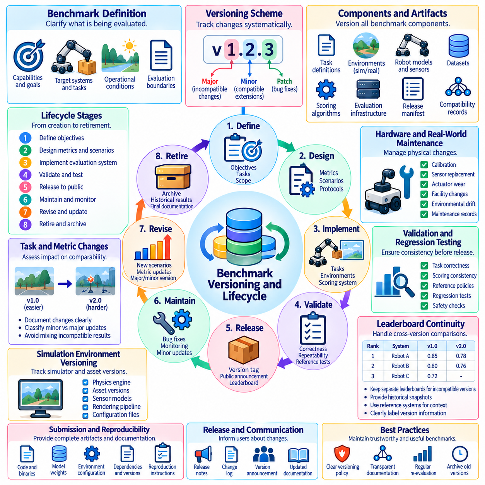{width="7.268055555555556in" height="7.268055555555556in"}

벤치마크 버전 관리(Benchmark Versioning)와 수명주기 관리(Lifecycle Management)는 피지컬 인공지능(Physical AI) 평가의 과학적 타당성(Scientific Validity)과 장기적인 유용성(Long-Term Usefulness)을 유지하는 데 필수적이다. 벤치마크는 로봇 능력(Robotic Capabilities), 시뮬레이션 기술(Simulation Technologies), 하드웨어 플랫폼(Hardware Platforms), 운영 요구사항(Operational Requirements)의 변화에 따라 발전해야 한다. 그러나 통제되지 않은 변경(Uncontrolled Modifications)은 과거 결과와의 비교(Historical Comparisons)를 무효화하고 리더보드 신뢰성(Leaderboard Credibility)을 훼손할 수 있다. 체계적인 수명주기(Structured Lifecycle)는 평가 개선사항이 추적 가능하고 재현 가능하며 기존 목표와 일관성을 유지하도록 보장한다.

벤치마크 수명주기(Benchmark Lifecycle)는 의도된 능력(Intended Capabilities), 대상 시스템(Target Systems), 운영 조건(Operational Conditions), 평가 범위(Evaluation Boundaries)를 정의하는 것에서 시작된다. 개발자는 측정 대상 작업(Tasks), 예상되는 변동 원인(Sources of Variability), 점수 산정 절차(Scoring Procedures)의 기본 가정을 식별해야 한다. 이러한 명세(Specifications)는 향후 변경사항을 평가할 수 있는 기준(Reference)을 확립한다. 안정적인 초기 정의(Stable Initial Definition)가 없다면 후속 변경이 명확한 문서화 없이 벤치마크 점수(Benchmark Scores)의 의미를 바꿀 수 있다.

벤치마크 개발(Benchmark Development)은 일반적으로 설계(Design), 구현(Implementation), 검증(Validation), 배포(Release), 유지보수(Maintenance), 개정(Revision), 최종 폐기(Retirement)의 단계를 거친다. 설계 단계에서는 평가 목표(Evaluation Objectives)와 지표(Metrics)를 확립한다. 구현 단계에서는 명세를 실행 가능한 작업(Executable Tasks)과 점수 산정 서비스(Scoring Services)로 전환한다. 검증 단계에서는 정확성(Correctness), 반복 가능성(Repeatability), 관련 능력에 대한 민감도(Sensitivity)를 조사한다. 공개 배포(Public Release)는 통제된 참여(Controlled Participation)를 도입하며, 유지보수는 결함(Defects)과 새롭게 나타나는 평가 요구사항(Emerging Evaluation Needs)을 처리한다.

버전 식별자(Version Identifiers)는 벤치마크 구성(Benchmark Configurations)을 체계적으로 구분하는 방법을 제공한다. 시맨틱 버전 관리(Semantic Versioning) 접근법은 변경사항을 주요 변경(Major), 부가 변경(Minor), 수정 변경(Corrective)으로 분류할 수 있지만, 정확한 규칙은 벤치마크 거버넌스(Benchmark Governance)에서 정의해야 한다. 주요 버전(Major Versions)은 호환되지 않는 점수 산정 규칙(Incompatible Scoring Rules)이나 작업 분포(Task Distributions)를 도입할 수 있다. 부가 버전(Minor Versions)은 호환 가능한 평가 범위(Evaluation Coverage)를 확장할 수 있으며, 수정 릴리스(Corrective Releases)는 측정 대상 개념(Measured Construct)을 의도적으로 변경하지 않으면서 구현 결함(Implementation Defects)을 해결한다.

피지컬 인공지능 벤치마크는 여러 상호 연결된 구성요소(Interconnected Components)에 의존하므로 버전 관리는 소프트웨어 코드(Software Code)를 넘어 확장되어야 한다. 관련 산출물(Artifacts)에는 시나리오 정의(Scenario Definitions), 시뮬레이션 환경(Simulation Environments), 로봇 모델(Robot Models), 센서 구성(Sensor Configurations), 데이터셋(Datasets), 점수 산정 알고리즘(Scoring Algorithms), 평가 인프라(Evaluation Infrastructure)가 포함된다. 각 구성요소는 식별 가능한 개정 버전(Identifiable Revision)과 문서화된 호환성 관계(Compatibility Relationship)를 가져야 한다. 벤치마크 릴리스 명세서(Benchmark Release Manifest)는 이러한 개정 버전을 재현 가능한 평가 구성(Reproducible Evaluation Configuration)으로 연결할 수 있다.

작업 정의(Task Definitions)의 변경은 측정되는 능력(Capabilities Being Measured)을 수정할 수 있으므로 신중하게 평가해야 한다. 내비게이션 난이도(Navigation Difficulty)를 높이거나 조작 허용오차(Manipulation Tolerances)를 변경하거나 새로운 안전 제약조건(Safety Constraints)을 도입하면 점수 산정 소프트웨어가 동일하더라도 벤치마크 결과가 달라질 수 있다. 이러한 변경은 비교 가능성(Comparability)에 미치는 영향에 따라 분류해야 한다. 작업 분포(Task Distribution)가 크게 변경되면 과거 점수(Historical Scores)를 직접적으로 상호 교환 가능한 값으로 취급해서는 안 된다.

지표 버전 관리(Metric Versioning)도 중요하다. 점수 산정 정의(Scoring Definitions)는 관측된 행동(Observed Behavior)이 수치적 근거(Numerical Evidence)로 변환되는 방식을 결정하기 때문이다. 성공 임계값(Success Thresholds), 정규화 방법(Normalization Methods), 벌점 가중치(Penalty Weights), 집계 공식(Aggregation Formulas)을 변경하면 로봇 성능(Robot Performance)이 변하지 않아도 순위가 달라질 수 있다. 벤치마크 관리자는 각 지표 개정(Metric Revision)을 문서화하고 참조 제출(Reference Submissions)을 사용하여 영향을 평가해야 한다. 점수 산정의 의미(Scoring Semantics)가 변경되면 일반적으로 새로운 점수 계열(Score Series)이나 벤치마크 버전(Benchmark Version)이 필요하다.

시뮬레이션 환경(Simulation Environments)은 추가적인 버전 의존성(Version Dependencies)을 발생시킨다. 물리 엔진(Physics Engines), 충돌 처리(Collision Handling), 렌더링 파이프라인(Rendering Pipelines), 센서 모델(Sensor Models)의 업데이트는 로봇 행동(Robotic Behavior)에 영향을 미칠 수 있다. 현실성(Realism)을 개선하기 위한 변경조차 이전 결과와의 비교를 무효화할 수 있다. 평가팀은 시뮬레이터 호환성 기록(Simulator Compatibility Records)을 유지하고 대표적인 정책(Representative Policies)을 사용하여 회귀 시험(Regression Tests)을 수행해야 한다. 중요한 변경사항은 수치적 연속성(Numerical Continuity)을 가정하는 대신 통제된 재검증(Controlled Revalidation)을 필요로 한다.

실제 환경 벤치마크(Real-World Benchmarks)는 물리적 장비(Physical Equipment)와 환경 변화(Environmental Drift)와 관련된 수명주기 과제(Lifecycle Challenges)에 직면한다. 로봇 마모(Robot Wear), 센서 재보정(Sensor Recalibration), 액추에이터 교체(Actuator Replacement), 시설 변경(Facility Modifications), 표면 조건 변화(Changing Surface Conditions)는 측정된 성능을 바꿀 수 있다. 유지보수 기록(Maintenance Records)은 이러한 변경사항을 식별하고 참조 측정값(Reference Measurements)이 여전히 유효한지 판단해야 한다. 주기적인 보정(Periodic Calibration)과 표준화된 검사 절차(Standardized Inspection Procedures)는 실제 시스템 개선(Genuine System Improvements)과 평가 장치(Evaluation Apparatus)의 변화를 구분하는 데 도움이 된다.

벤치마크 검증(Benchmark Validation)은 모든 공식 릴리스(Official Release) 전에 수행되어야 한다. 시험 절차(Test Procedures)는 작업 정확성(Task Correctness), 점수 산정 일관성(Scoring Consistency), 인터페이스 호환성(Interface Compatibility), 통계적 특성(Statistical Behavior), 안전 제어(Safety Controls)를 확인해야 한다. 서로 다른 성능 수준(Performance Levels)을 대표하는 참조 시스템(Reference Systems)은 예상하지 못한 순위 변화(Unexpected Ranking Changes)를 드러낼 수 있다. 검증은 새로운 시나리오가 의도하지 않은 지름길(Unintended Shortcuts)이나 불가능한 조건(Impossible Conditions)을 도입하는지도 조사해야 한다. 릴리스 승인(Release Approval)은 단순히 실행에 성공했다는 사실이 아니라 문서화된 근거(Documented Evidence)에 기반해야 한다.

회귀 시험(Regression Testing)은 벤치마크 개정(Benchmark Revisions) 사이의 연속성(Continuity)을 제공한다. 안정적인 참조 정책(Reference Policies)과 테스트 시나리오(Test Scenarios)의 집합은 소프트웨어 업데이트나 환경 변경으로 인해 발생하는 결과 변화를 탐지할 수 있다. 차이가 발견되면 수정된 점수(Revised Scores)를 공개하기 전에 조사해야 한다. 그러나 회귀 시험은 특히 평가 분포(Evaluation Distributions)가 변경되는 경우 버전 간 완전한 동등성(Full Equivalence)을 입증할 수 없다. 회귀 시험의 목적은 예상하지 못한 동작(Unexpected Behavior)을 식별하고 정보에 근거한 호환성 판단(Informed Compatibility Decisions)을 지원하는 것이다.

리더보드 연속성(Leaderboard Continuity)을 유지하려면 버전 간 결과 비교(Comparing Results Across Versions)에 대한 명시적인 정책이 필요하다. 호환되지 않는 프로토콜(Incompatible Protocols)에서 생성된 점수는 별도로 표시하거나 과거 결과(Historical Results)임을 명확하게 표시해야 한다. 선택된 참조 시스템(Reference Systems)을 재평가하면 릴리스 간 맥락적 연결(Contextual Links)을 제공할 수 있지만, 충분한 근거 없이 점수 변환 공식(Conversion Formulas)이 유효하다고 가정해서는 안 된다. 과거 리더보드 스냅샷(Historical Leaderboard Snapshots)은 연구 기록(Research Records)을 보존하고 사용자가 각 평가 체계(Evaluation Regime) 내에서 이루어진 발전을 이해할 수 있도록 한다.

벤치마크가 포화 상태(Saturation)에 도달하거나 과적합(Overfitting)에 취약해지면 테스트 세트 갱신(Test-Set Refreshes)이 필요하다. 새로운 시나리오(New Scenarios)는 평가 난이도(Evaluation Difficulty)를 회복하고 널리 암기된 사례(Widely Memorized Examples)에 대한 의존성을 줄일 수 있다. 그러나 갱신 절차(Refresh Procedures)는 임의의 새로운 요소(Arbitrary Novelty)를 도입하는 대신 벤치마크가 의도한 측정 개념(Intended Construct)을 보존해야 한다. 운영자는 보호된 홀드아웃 세트(Protected Holdout Sets)를 유지하거나 시나리오 계열(Scenario Families)을 순환시키거나 새로운 도전 평가 트랙(Challenge Tracks)을 도입하면서 평가 범위(Evaluation Scope)의 변화를 문서화할 수 있다.

하위 호환성(Backward Compatibility)은 변경사항이 핵심 평가 의미(Essential Evaluation Semantics)에 영향을 미치지 않는 경우 도입 비용(Adoption Costs)을 줄일 수 있다. 안정적인 제출 인터페이스(Stable Submission Interfaces), 문서화된 마이그레이션 경로(Documented Migration Paths), 전환기 지원(Transitional Support)은 연구자가 기존 시스템을 업데이트할 수 있도록 한다. 그러나 호환성 유지가 안전성(Safety), 타당성(Validity), 측정 품질(Measurement Quality)의 필수적인 개선을 방해해서는 안 된다. 벤치마크 관리자는 인터페이스 호환성(Interface Compatibility)과 점수 비교 가능성(Score Comparability)을 구분해야 한다. 인터페이스가 변경되지 않았다고 해서 동등한 평가 결과(Equivalent Evaluation Outcomes)가 보장되는 것은 아니기 때문이다.

지원 중단 정책(Deprecation Policies)은 오래된 벤치마크 버전(Outdated Benchmark Versions)을 단계적으로 폐기하는 방법을 확립한다. 지원 중단이 선언된 버전(Deprecated Version)은 과거 결과의 재현(Historical Reproduction)을 위해 접근 가능한 상태로 유지되더라도 더 이상 공식 제출(Official Submissions)을 허용하지 않을 수 있다. 운영자는 폐기 일정(Retirement Schedules)을 공지하고 대체 버전(Replacement Versions)을 식별하며 필수 문서(Essential Documentation)를 보존해야 한다. 가능하다면 보관된 평가 환경(Archived Evaluation Environments)과 참조 산출물(Reference Artifacts)을 계속 사용할 수 있도록 해야 한다. 다만 보안(Security), 라이선스(Licensing), 인프라 제약조건(Infrastructure Limitations)이 장기적인 실행 지원(Long-Term Execution Support)을 제한할 수 있다.

수명주기 거버넌스(Lifecycle Governance)에는 명확한 소유권(Ownership)과 문서화된 의사결정 권한(Decision-Making Authority)이 필요하다. 관리자는 변경 제안(Proposing Changes), 기술적 근거 검토(Reviewing Technical Evidence), 릴리스 승인(Approving Releases), 분쟁 해결(Resolving Disputes)에 대한 절차를 정의해야 한다. 커뮤니티 참여(Community Participation)는 새롭게 등장하는 능력(Emerging Capabilities)과 벤치마크의 약점(Benchmark Weaknesses)을 식별하는 데 도움이 되며, 독립적인 검토(Independent Review)는 이해충돌(Conflicts of Interest)을 줄일 수 있다. 버전 변경(Version Changes)은 특정 리더보드 참가자(Leaderboard Participants)에 선택적으로 대응하기보다 공개된 기준(Published Criteria)을 따라야 한다.

변경 문서화(Change Documentation)는 과학적 추적 가능성(Scientific Traceability)에 필수적이다. 릴리스 노트(Release Notes)는 수정된 작업(Tasks), 지표(Metrics), 환경(Environments), 인터페이스(Interfaces), 점수 산정 절차(Scoring Procedures)와 예상되는 영향(Expected Effects)을 설명해야 한다. 기계 판독 가능한 명세서(Machine-Readable Manifests)는 자동화된 호환성 검사(Automated Compatibility Checks)와 보관 작업 흐름(Archival Workflows)을 지원할 수 있다. 공개된 모든 점수(Published Scores)는 평가에 사용된 정확한 벤치마크 구성(Exact Benchmark Configuration)을 참조해야 한다. 이러한 연결을 통해 미래의 연구자는 보고된 성능(Reported Performance)이 얻어진 조건을 재구성할 수 있다.

장기적인 벤치마크 유지보수(Long-Term Benchmark Maintenance)에는 적절성(Relevance)에 대한 지속적인 감시도 필요하다. 대부분의 시스템이 거의 완벽한 점수(Near-Perfect Scores)에 도달하거나 작업이 더 이상 배포 요구사항(Deployment Needs)을 반영하지 못하거나 새로운 로봇 아키텍처(Emerging Robot Architectures)가 원래 평가 범위를 넘어서는 경우 벤치마크의 정보적 가치(Informative Value)가 감소할 수 있다. 능력 범위 분석(Capability Coverage Analysis), 실패 패턴 검토(Failure-Pattern Reviews), 이해관계자 피드백(Stakeholder Feedback)은 개정 방향을 안내할 수 있다. 지속적인 수정이 벤치마크의 원래 목적(Original Purpose)을 근본적으로 바꾸는 경우에는 폐기(Retirement)가 더 적절할 수 있다.

궁극적으로 벤치마크 버전 관리(Benchmark Versioning)와 수명주기 관리(Lifecycle Management)는 과학적 연속성(Scientific Continuity)과 기술 발전(Technological Progress) 사이의 균형을 유지한다. 안정적인 식별자(Stable Identifiers), 통제된 릴리스(Controlled Releases), 회귀 시험(Regression Testing), 투명한 거버넌스(Transparent Governance), 과거 기록 보관소(Historical Archives)는 평가 결과(Evaluation Results)의 의미를 보존한다. 동시에 계획된 업데이트(Planned Updates)는 벤치마크가 새로운 피지컬 인공지능 능력(Physical AI Capabilities)과 운영 위험(Operational Risks)을 다룰 수 있도록 한다. 잘 관리된 수명주기는 리더보드가 서로 비교할 수 없는 점수(Incomparable Scores)의 집합이 아니라 신뢰할 수 있는 발전 기록(Credible Records of Progress)으로 유지되도록 보장한다.

## 08.13. Open vs Closed Benchmark Infrastructure

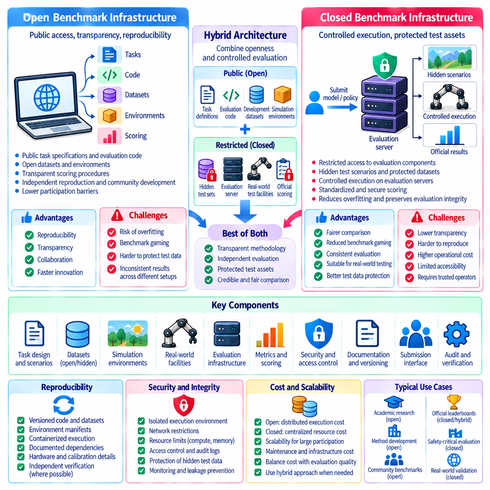{width="7.268055555555556in" height="7.268055555555556in"}

개방형 벤치마크 인프라(Open Benchmark Infrastructure)와 폐쇄형 벤치마크 인프라(Closed Benchmark Infrastructure)는 피지컬 인공지능(Physical AI) 평가를 구성하고 실행하며 관리하는 서로 다른 접근법을 나타낸다. 개방형 인프라는 접근성(Accessibility), 투명성(Transparency), 독립적인 재현(Independent Reproduction)을 강조하는 반면, 폐쇄형 인프라는 통제된 실행(Controlled Execution), 보호된 테스트 자산(Protected Test Assets), 평가 무결성(Evaluation Integrity)을 강조한다. 어느 접근법도 보편적으로 우수하지 않다. 적합성은 벤치마크 목표(Benchmark Objectives), 안전 요구사항(Safety Requirements), 지식재산권 제약조건(Intellectual Property Constraints), 공식 성능 주장(Official Performance Claims)에 요구되는 신뢰 수준에 따라 결정된다.

개방형 벤치마크 인프라(Open Benchmark Infrastructure)는 일반적으로 작업 명세(Task Specifications), 평가 코드(Evaluation Code), 시뮬레이션 환경(Simulation Environments), 데이터셋(Datasets), 점수 산정 절차(Scoring Procedures)에 대한 공개 접근을 제공한다. 연구자는 구현 세부사항(Implementation Details)을 검토하고 실험을 재현하며 호환 가능한 평가 도구(Evaluation Tools)를 개발할 수 있다. 이러한 개방성(Openness)은 협업(Collaboration)을 장려하고 방법론적 개선(Methodological Improvements)을 가속화한다. 그러나 평가 자료(Evaluation Materials)에 대한 제한 없는 접근은 과적합(Overfitting)과 벤치마크 특화 최적화(Benchmark-Specific Optimization)의 위험도 증가시킬 수 있다.

폐쇄형 벤치마크 인프라(Closed Benchmark Infrastructure)는 비공개 테스트 시나리오(Hidden Test Scenarios), 보호된 데이터셋(Protected Datasets), 실행 환경(Execution Environments), 점수 산정 서비스(Scoring Services)를 포함한 일부 평가 구성요소(Evaluation Components)에 대한 접근을 제한한다. 참가자는 전체 테스트 구성(Test Configuration)을 확인하지 않고도 모델(Models)이나 실행 가능한 정책(Executable Policies)을 통제된 평가 서버(Controlled Evaluation Server)에 제출할 수 있다. 이러한 구성은 독립적인 평가(Independent Assessment)를 보존하고 직접적인 암기(Direct Memorization)를 제한하는 데 도움이 된다. 그러나 제한된 접근(Restricted Access)은 투명성을 낮추고 외부 검증(External Verification)을 복잡하게 만들 수 있다.

개방형 인프라와 폐쇄형 인프라의 구분이 반드시 이분법적(Binary)인 것은 아니다. 벤치마크는 작업 정의(Task Definitions)와 점수 산정 알고리즘(Scoring Algorithms)을 공개하면서 최종 평가 시나리오(Final Evaluation Scenarios)는 보호할 수 있다. 다른 벤치마크는 개발 데이터셋(Development Datasets)을 공개하되 공식 시험(Official Testing)을 위한 물리적 하드웨어 시설(Hardware Facilities)은 비공개로 유지할 수 있다. 하이브리드 아키텍처(Hybrid Architectures)는 투명한 방법론(Transparent Methodology)과 통제된 테스트 실행(Controlled Test Execution)을 결합한다. 이러한 설계에서는 어떤 구성요소가 공개되거나 제한되거나 독립적으로 감사 가능하거나 승인된 운영자(Authorized Operators)에게만 제공되는지를 명시해야 한다.

재현 가능성(Reproducibility)은 개방형 벤치마크 시스템(Open Benchmark Systems)의 주요 장점이다. 공개 소프트웨어 저장소(Public Software Repositories), 버전 관리된 데이터셋(Versioned Datasets), 환경 명세서(Environment Manifests), 문서화된 의존성(Documented Dependencies)을 통해 독립적인 연구 그룹이 평가 조건(Evaluation Conditions)을 재구성할 수 있다. 컨테이너 기반 실행(Containerized Execution)과 표준화된 인터페이스(Standardized Interfaces)는 구성 차이(Configuration Differences)를 더욱 줄인다. 그러나 재현 가능성을 확보하려면 코드 공개(Code Availability)만으로는 충분하지 않다. 하드웨어 가정(Hardware Assumptions), 난수 시드(Random Seeds), 보정 절차(Calibration Procedures), 시뮬레이터 버전(Simulator Versions)도 문서화해야 한다.

폐쇄형 평가 시스템(Closed Evaluation Systems)은 통제된 실행(Controlled Execution)과 엄격한 내부 기록(Rigorous Internal Records)을 통해 재현 가능성(Reproducibility)을 지원할 수 있다. 동일한 인프라 구성(Infrastructure Configurations), 고정된 점수 산정 절차(Fixed Scoring Procedures), 표준화된 제출 인터페이스(Standardized Submission Interfaces)는 참가자 간 변동성(Variability)을 줄인다. 독립적인 감사자(Independent Auditors)는 보호된 자산(Protected Assets)에 대한 제한 없는 접근 권한을 받지 않고도 구현 무결성(Implementation Integrity)을 검증할 수 있다. 이러한 구성은 절차적 재현 가능성(Procedural Reproducibility)을 제공하지만, 공개적으로 검토 가능한 실험적 근거(Publicly Inspectable Experimental Evidence)를 완전히 대체할 수는 없다.

공식 순위(Official Rankings)가 연구 자금(Research Funding), 조달 의사결정(Procurement Decisions), 상업적 도입(Commercial Adoption)에 영향을 미치는 경우 벤치마크 보안(Benchmark Security)은 더욱 중요해진다. 공개된 테스트 자료(Open Test Materials)는 참가자가 평가 사례(Evaluation Instances)에 직접 최적화하도록 만들 수 있다. 폐쇄형 시스템은 이러한 노출을 줄이지만 무단 접근(Unauthorized Access), 정보 유출(Information Leakage), 인프라 침해(Infrastructure Compromise)와 관련된 위험을 발생시킨다. 보안 정책(Security Policies)은 제출 실행 격리(Submission Isolation), 접근 권한(Access Permissions), 감사 로그(Audit Logging), 기밀 평가 자산(Confidential Evaluation Assets)의 보호를 다루어야 한다.

비공개 평가 서버(Hidden Evaluation Servers)는 통제된 벤치마크 인프라(Controlled Benchmark Infrastructure)의 일반적인 구현 방식이다. 참가자는 학습된 모델(Trained Models), 정책(Policies), 실행 가능한 컨테이너(Executable Containers)를 업로드하고, 서버는 보호된 시나리오(Protected Scenarios)에 대해 이를 평가한다. 서버는 표준화된 지표(Standardized Metrics)를 계산하고 승인된 결과(Approved Results)를 반환한다. 실행 환경(Execution Environments)은 자원 제한(Resource Limits), 네트워크 제한(Network Restrictions), 필요한 경우 결정론적 구성(Deterministic Configuration)을 적용해야 한다. 이러한 통제는 무단 데이터 추출(Unauthorized Data Extraction)과 일관되지 않은 평가 조건(Inconsistent Evaluation Conditions)을 방지하는 데 도움이 된다.

피지컬 인공지능(Physical AI)은 기존 기계학습 벤치마크(Conventional Machine Learning Benchmarks)를 넘어서는 인프라 과제(Infrastructure Challenges)를 발생시킨다. 로봇 평가(Robotic Evaluation)에는 실시간 제어(Real-Time Control), 물리 시뮬레이션(Physics Simulation), 센서 동기화(Sensor Synchronization), 액추에이터 인터페이스(Actuator Interfaces), 물리적 안전 감시(Physical Safety Monitoring)가 필요할 수 있다. 중앙집중형 평가 플랫폼(Centralized Evaluation Platform)은 특정 아키텍처에 체계적인 이점(Systematic Advantages)을 제공하지 않으면서 이러한 요구사항을 지원해야 한다. 따라서 하드웨어 호환성(Hardware Compatibility)과 시간 제약조건(Timing Constraints)을 명시적인 벤치마크 설계 매개변수(Benchmark Design Parameters)로 취급해야 한다.

실제 환경의 폐쇄형 시험 시설(Real-World Closed Testing Facilities)은 표준화된 로봇 장비(Standardized Robotic Equipment)와 통제된 운영 환경(Controlled Operational Environments)을 제공할 수 있다. 독립적인 실험실(Independent Laboratories)은 보정된 센서(Calibrated Sensors), 일관된 작업 배치(Consistent Task Arrangements), 감독된 안전 절차(Supervised Safety Procedures)를 사용하여 제출된 시스템을 평가할 수 있다. 이러한 시설은 직접적인 물리적 상호작용(Direct Physical Interaction)이 성능을 결정하는 경우 가치가 높다. 그러나 제한된 시설 수용 능력(Facility Capacity), 장비 비용(Equipment Costs), 지리적 접근성(Geographic Accessibility), 일정 제약조건(Scheduling Constraints)은 참여를 제한하고 평가 주기(Evaluation Cycles)를 지연시킬 수 있다.

개방형 인프라(Open Infrastructure)는 로컬 실험(Local Experimentation)과 분산형 시험(Decentralized Testing)을 가능하게 하여 참여 장벽(Participation Barriers)을 낮출 수 있다. 제한된 자원(Modest Resources)을 가진 연구자도 공개적으로 이용 가능한 시뮬레이터(Publicly Available Simulators)와 참조 작업(Reference Tasks)을 사용하여 알고리즘을 평가할 수 있다. 분산된 기여(Distributed Contributions)는 시나리오 범위(Scenario Coverage)를 확대하고 구현 결함(Implementation Defects)을 식별하는 데 도움이 된다. 그러나 적합성 요구사항(Conformance Requirements)과 검증 절차(Validation Procedures)가 시행되지 않으면 컴퓨팅 하드웨어(Computing Hardware), 시뮬레이터 구성(Simulator Configurations), 물리적 장비(Physical Equipment)의 차이로 인해 일관되지 않은 결과(Inconsistent Results)가 발생할 수 있다.

비용(Cost)과 확장성(Scalability)은 인프라 선택(Infrastructure Selection)에 큰 영향을 미친다. 개방형 벤치마크(Open Benchmarks)는 실행 비용(Execution Costs)을 참가자들에게 분산하지만 문서화(Documentation)와 소프트웨어 호환성(Software Compatibility)을 유지하는 데 상당한 노력이 필요할 수 있다. 폐쇄형 벤치마크(Closed Benchmarks)는 컴퓨팅 자원(Computing Resources), 저장장치(Storage), 보안(Security), 운영 지원(Operational Support)을 포함한 평가 비용(Evaluation Expenses)을 중앙에 집중시킨다. 물리적 시험(Physical Testing)은 장비 유지보수(Equipment Maintenance)와 인력 비용(Personnel Costs)을 추가한다. 지속 가능한 거버넌스(Sustainable Governance)는 불필요한 참여 장벽을 만들지 않으면서 평가 품질(Evaluation Quality)을 유지하는 자금 조달 모델(Funding Models)을 확립해야 한다.

독점적인 로봇 시스템(Proprietary Robotic Systems)을 평가할 때는 투명성(Transparency)과 기밀성(Confidentiality) 사이의 균형을 유지해야 한다. 상업적 참가자(Commercial Participants)는 모델 가중치(Model Weights), 제어 소프트웨어(Control Software), 상세한 하드웨어 설계(Hardware Designs)를 공개하기를 원하지 않을 수 있다. 폐쇄형 실행 환경(Closed Execution Environments)은 민감한 제출물(Sensitive Submissions)을 보호하면서 독립적으로 검증된 결과(Independently Verified Results)를 생성할 수 있다. 그러나 기밀성이 필수 평가 조건(Essential Evaluation Conditions), 지표 정의(Metric Definitions), 한계(Limitations)의 공개를 방해해서는 안 된다. 공개적인 성능 주장(Public Claims)에는 의미 있는 해석(Meaningful Interpretation)을 위한 충분한 근거가 필요하다.

공정성(Fairness)은 일관된 접근 규칙(Consistent Access Rules)과 동등한 평가 기회(Equivalent Evaluation Opportunities)에 달려 있다. 폐쇄형 인프라(Closed Infrastructures)는 제출 횟수 제한(Submission Limits), 참가 자격 요건(Eligibility Requirements), 평가 일정(Evaluation Schedules), 이의신청 절차(Appeal Procedures)를 공개해야 한다. 개방형 인프라(Open Infrastructures)는 지원되는 구성(Supported Configurations)과 참조 구현(Reference Implementations)에서 허용되는 차이(Acceptable Deviations)를 문서화해야 한다. 두 접근법 모두 특권적인 참가자(Privileged Participants)가 공개되지 않은 정보(Undisclosed Information)나 우대 조치(Preferential Treatment)를 받지 못하도록 해야 한다. 독립적인 거버넌스(Independent Governance)는 평가 운영(Evaluation Operations)의 중립성(Neutrality)에 대한 신뢰를 강화할 수 있다.

데이터 거버넌스(Data Governance)는 라이선스(Licensing), 개인정보 보호(Privacy), 지식재산권(Intellectual Property), 보존 정책(Retention Policies)과 관련된 추가적인 고려사항을 발생시킨다. 개방형 데이터셋(Open Datasets)은 명확한 재배포 권한(Redistribution Rights)과 수집 조건(Collection Conditions)에 대한 문서화가 필요하다. 폐쇄형 데이터셋(Closed Datasets)은 안전한 저장(Secure Storage), 승인된 접근(Authorized Access), 정의된 보존 기간(Defined Retention Periods)을 필요로 한다. 피지컬 인공지능 기록(Physical AI Recordings)에는 사람, 시설, 민감한 운영 환경(Sensitive Operational Environments)에 관한 정보가 포함될 수 있다. 벤치마크 인프라는 적절한 접근 통제(Access Controls)와 데이터 최소화 관행(Data Minimization Practices)을 포함해야 한다.

실용적인 하이브리드 아키텍처(Practical Hybrid Architecture)는 개발(Development), 적격성 검증(Qualification), 공식 평가(Official Evaluation) 단계를 분리할 수 있다. 공개 시뮬레이션 작업(Public Simulation Tasks)은 알고리즘 개발(Algorithm Development)과 예비 비교(Preliminary Comparison)를 지원한다. 제한된 검증 시나리오(Restricted Validation Scenarios)는 강건성(Robustness)을 평가하고 벤치마크 특화 과적합(Benchmark-Specific Overfitting)을 탐지한다. 이후 공식 평가에서는 보호된 테스트 분포(Protected Test Distributions)나 감독된 물리적 실험(Supervised Physical Experiments)을 사용한다. 이러한 계층적 접근법(Layered Approach)은 재현 가능성을 장려하면서 최종 순위(Final Rankings)에 대한 독립적인 근거(Independent Evidence)를 유지한다.

인프라 상호운용성(Infrastructure Interoperability)은 벤치마크의 장기적인 도입(Long-Term Benchmark Adoption)에 중요하다. 표준화된 제출 인터페이스(Standardized Submission Interfaces), 기계 판독 가능한 메타데이터(Machine-Readable Metadata), 공통 지표 스키마(Common Metric Schemas), 이식 가능한 실행 패키지(Portable Execution Packages)는 평가 시스템 간 결과와 산출물(Artifacts)의 교환을 가능하게 한다. 기존 로봇 미들웨어(Robotics Middleware) 및 시뮬레이션 형식(Simulation Formats)과의 호환성(Compatibility)은 통합 비용(Integration Costs)을 줄일 수 있다. 그러나 인터페이스 표준화(Interface Standardization)가 물리적 구현 형태(Physical Embodiment), 자원 예산(Resource Budgets), 평가 가정(Evaluation Assumptions)의 차이를 가려서는 안 된다.

궁극적으로 개방형 및 폐쇄형 벤치마크 인프라(Open and Closed Benchmark Infrastructures)는 생성해야 하는 근거(Evidence)와 통제해야 하는 위험(Risks)에 따라 선택해야 한다. 개방형 시스템(Open Systems)은 접근성(Accessibility), 투명성(Transparency), 협력적 개선(Collaborative Improvement)을 촉진하는 반면, 폐쇄형 시스템(Closed Systems)은 독립적인 시험(Independent Testing)과 민감한 평가 자산(Sensitive Evaluation Assets)을 보호한다. 하이브리드 설계(Hybrid Designs)는 공개 명세(Public Specifications), 통제된 실행(Controlled Execution), 독립적인 감사(Independent Auditing)를 통해 두 접근법의 장점을 결합할 수 있다. 신뢰할 수 있는 피지컬 인공지능 벤치마킹(Credible Physical AI Benchmarking)은 명확하게 문서화된 경계(Documented Boundaries), 일관된 절차(Consistent Procedures), 신뢰할 수 있는 거버넌스(Trustworthy Governance)에 달려 있다.

## 08.14. Standards Organizations and Community Benchmarks

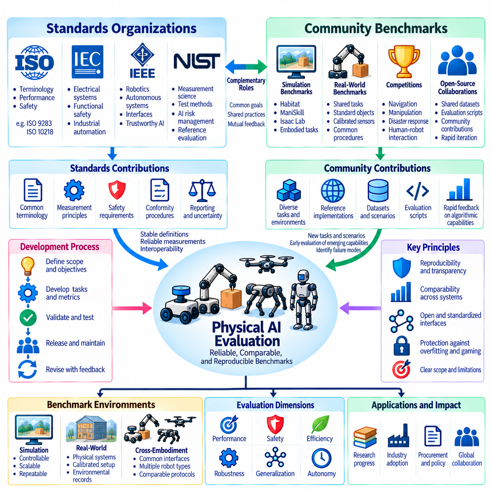{width="7.268055555555556in" height="7.268055555555556in"}

표준화 기구(Standards Organizations)와 커뮤니티 벤치마크(Community Benchmarks)는 피지컬 인공지능(Physical AI)의 신뢰할 수 있는 평가 관행(Evaluation Practices)을 확립하는 데 상호 보완적인 역할을 수행한다. 표준화 기구는 공통 용어(Shared Terminology), 측정 원칙(Measurement Principles), 안전 요구사항(Safety Requirements), 적합성 평가 절차(Conformity Procedures)를 개발하는 반면, 연구 커뮤니티는 실험적 작업(Experimental Tasks)과 빠르게 발전하는 벤치마크 모음(Benchmark Suites)을 만든다. 이들의 협력은 개별적인 연구 결과를 기관, 플랫폼, 배포 환경 전반에서 비교 가능한 로봇 능력(Robotic Capability)의 근거로 전환할 수 있다.

표준화(Standardization)는 피지컬 인공지능이 인공지능(Artificial Intelligence)과 기계 시스템(Mechanical Systems), 센싱(Sensing), 구동(Actuation), 환경 상호작용(Environmental Interaction)을 결합하기 때문에 특히 중요하다. 평가 결과(Evaluation Results)는 학습 알고리즘(Learned Algorithms)뿐만 아니라 하드웨어 구성(Hardware Configurations), 운영 조건(Operational Conditions), 실험 절차(Experimental Procedures)에 따라 달라진다. 공통 정의(Common Definitions)가 없으면 동일한 지표 이름(Metric Names)이 서로 다른 측정값을 나타낼 수 있다. 표준(Standards)은 평가 범위(Evaluation Boundaries), 시험 조건(Test Conditions), 불확실성(Uncertainty), 보고 요구사항(Reporting Requirements)을 명세하기 위한 기반을 제공한다.

국제표준화기구(International Organization for Standardization, ISO)는 용어(Terminology), 안전성(Safety), 성능 측정(Performance Measurement)을 포함하여 산업용 로봇(Industrial Robots)과 서비스 로봇(Service Robots)에 관련된 표준을 개발한다. ISO 9283은 산업용 로봇의 성능 기준(Performance Criteria)과 관련 시험 방법(Test Methods)을 다루며, ISO 10218은 산업용 로봇 안전(Industrial Robot Safety)에 관한 표준이다. 이러한 표준은 포괄적인 인공지능 지능 벤치마크(AI Intelligence Benchmarks)를 구성하지는 않지만, 반복 가능한 물리적 측정(Repeatable Physical Measurements)과 안전 요구사항이 체계적인 로봇 평가(Systematic Robotic Evaluation)를 어떻게 지원할 수 있는지 보여준다.

국제전기기술위원회(International Electrotechnical Commission, IEC)는 전기 시스템(Electrical Systems), 기능 안전(Functional Safety), 산업 자동화(Industrial Automation)에 관련된 표준에 기여한다. ISO와 IEC는 인공지능 및 관련 기술을 다루는 공동 기술 조직(Joint Technical Structures)을 통해 협력하기도 한다. 피지컬 인공지능에서 이러한 활동은 알고리즘 평가(Algorithmic Evaluation)와 신뢰할 수 있는 시스템 운영(Dependable System Operation)을 연결하는 중요한 기반을 제공한다. 벤치마크 설계자는 기존 표준에 대한 준수(Compliance)와 학습된 로봇 역량(Learned Robotic Competence)에 대한 실험적 근거(Experimental Evidence)를 구분해야 한다.

전기전자공학자협회(Institute of Electrical and Electronics Engineers, IEEE)는 로봇공학(Robotics), 자율 시스템(Autonomous Systems), 소프트웨어 공학(Software Engineering), 신뢰할 수 있는 인공지능(Trustworthy AI)에 관련된 표준과 기술 이니셔티브(Technical Initiatives)에 기여한다. IEEE의 활동은 이종 시스템(Heterogeneous Systems) 전반에서 공통 인터페이스(Common Interfaces), 용어(Terminology), 평가 원칙(Evaluation Principles)을 확립하는 데 도움이 될 수 있다. 이러한 활동의 관련성은 구체적인 표준과 응용 분야(Application Domain)에 따라 달라진다. 벤치마크 개발자는 조직과의 연관성을 공식 인증(Formal Certification)의 근거로 취급하기보다 적용 가능한 공개 요구사항(Published Requirements)을 식별해야 한다.

미국 국립표준기술연구소(National Institute of Standards and Technology, NIST)는 로봇공학과 인공지능에 관련된 측정 과학(Measurement Science), 참조 방법(Reference Methods), 평가 프레임워크(Evaluation Frameworks)에 기여한다. 로봇 성능 측정(Robot Performance Measurement), 시험 방법(Test Methods), 인공지능 위험 관리(AI Risk Management)에 관한 연구는 재현 가능한 절차(Reproducible Procedures)와 문서화된 불확실성(Documented Uncertainty)의 가치를 보여준다. 이러한 프레임워크는 작업별 검증(Task-Specific Validation)을 대체하지 않으면서 피지컬 인공지능 벤치마크 설계에 활용될 수 있다. 독립적인 측정 방법(Independent Measurement Methods)은 벤치마크 결과가 조달(Procurement)이나 배포 의사결정(Deployment Decisions)에 영향을 미칠 때 특히 중요하다.

표준화 기구(Standards Organizations)와 학술 벤치마크 커뮤니티(Academic Benchmark Communities)는 일반적으로 서로 다른 개발 주기(Development Timescales)로 운영된다. 공식 표준(Formal Standards)은 체계적인 검토(Structured Review), 이해관계자 합의(Stakeholder Consensus), 통제된 개정(Controlled Revision)을 필요로 하지만, 커뮤니티 벤치마크는 연구 발전에 따라 새로운 작업을 신속하게 도입할 수 있다. 빠른 실험(Rapid Experimentation)은 새롭게 등장하는 능력(Emerging Capabilities)을 평가하는 데 유용하지만, 불안정한 프로토콜(Unstable Protocols)은 비교 가능성(Comparability)을 약화시킬 수 있다. 생산적인 협력 관계는 커뮤니티 실험을 통해 유용한 측정 방법을 식별한 후, 검증된 관행을 표준화된 절차(Standardized Procedures)로 발전시킬 수 있도록 한다.

커뮤니티 벤치마크(Community Benchmarks)는 대학(Universities), 연구소(Research Laboratories), 오픈소스 협업(Open-Source Collaborations), 로봇 경진대회(Robotics Competitions)에서 자주 등장한다. 이러한 벤치마크는 공유 환경(Shared Environments), 작업 정의(Task Definitions), 참조 구현(Reference Implementations), 평가 스크립트(Evaluation Scripts)를 제공하여 연구 그룹 간 중복 작업을 줄인다. 공개 참여(Public Participation)는 어려운 시나리오(Difficult Scenarios)와 알고리즘의 약점(Algorithmic Weaknesses)을 신속하게 식별할 수 있도록 한다. 그러나 커뮤니티 내 인기도(Community Popularity)만으로 측정 타당성(Measurement Validity), 통계적 신뢰성(Statistical Reliability), 안전 필수 응용 분야(Safety-Critical Applications)에 대한 적합성이 입증되는 것은 아니다.

해비타트(Habitat), 매니스킬(ManiSkill), 아이작 랩(Isaac Lab)과 같은 시뮬레이션 벤치마크 생태계(Simulation Benchmark Ecosystems)는 체화된 내비게이션(Embodied Navigation), 조작(Manipulation), 로봇 학습(Robotic Learning)을 평가하는 서로 다른 접근법을 보여준다. 이러한 환경은 반복 가능한 실험(Repeatable Experiments)과 구조화된 작업 변동(Structured Task Variation)을 지원하지만, 평가 목표(Objectives)와 점수 산정 규칙(Scoring Conventions)은 서로 다르다. 따라서 벤치마크 비교(Benchmark Comparisons)에서는 시뮬레이션 가정(Simulation Assumptions), 로봇 구현 형태 제약조건(Embodiment Constraints), 데이터셋 구성(Dataset Composition)을 고려해야 한다. 하나의 생태계에서 얻은 결과를 다른 생태계의 결과와 자동으로 동등하게 해석해서는 안 된다.

실제 환경 커뮤니티 벤치마크(Real-World Community Benchmarks)는 물리적 재현 가능성(Physical Reproducibility)과 실험 자원(Experimental Resources)에 관련된 추가적인 과제를 발생시킨다. 공유 조작 작업(Shared Manipulation Tasks), 표준화된 물체(Standardized Objects), 보정된 센서(Calibrated Sensors), 공통 시험 절차(Common Trial Procedures)는 실험실 간 비교를 개선할 수 있다. 그러나 로봇 마모(Robot Wear), 조명(Lighting), 바닥 조건(Floor Conditions), 운영자 개입(Operator Intervention)의 차이는 결과에 영향을 미칠 수 있다. 커뮤니티 프로토콜(Community Protocols)은 이러한 요인을 기록하고 허용 가능한 공차(Acceptable Tolerances)를 확립하여 성능 차이를 적절한 신뢰 수준(Confidence)으로 해석할 수 있도록 해야 한다.

로봇 경진대회(Robotics Competitions)는 평가 관행(Evaluation Practices)을 발전시키는 또 다른 메커니즘을 제공한다. 자율 내비게이션(Autonomous Navigation), 조작(Manipulation), 재난 대응(Disaster Response), 인간-로봇 상호작용(Human-Robot Interaction)을 포함하는 도전 과제는 시스템을 복잡한 운영 조건(Operational Conditions)에 노출시킨다. 경쟁 행사는 통제된 실험실 시험(Controlled Laboratory Tests)에서 간과되는 실패 유형(Failure Modes)을 드러낼 수 있다. 그러나 경진대회 점수(Competition Scores)는 행사별 제약조건(Event-Specific Constraints), 하드웨어 투자(Hardware Investment), 전술적 최적화(Tactical Optimization)를 반영할 수도 있다. 과학적 벤치마크(Scientific Benchmarks)로서의 가치는 투명한 규칙(Transparent Rules)과 재현 가능한 평가 근거(Reproducible Evaluation Evidence)에 달려 있다.

표준화의 핵심 과제(Central Standardization Challenge)는 서로 다른 로봇 구현 형태(Robot Embodiments) 간의 차이를 억제하지 않으면서 공통 지표(Common Metrics)를 정의하는 것이다. 성공률(Success Rate), 완료 시간(Completion Time), 충돌 빈도(Collision Frequency), 에너지 소비(Energy Consumption), 개입 횟수(Intervention Count)는 유용한 공통 측정값(Shared Measurements)을 제공할 수 있다. 그러나 이러한 지표의 해석은 작업 난이도(Task Difficulty), 적재 하중(Payload), 이동 구성(Mobility Configuration), 운영 맥락(Operational Context)에 따라 달라진다. 표준은 응용 분야별 임계값(Application-Specific Thresholds)과 구현 형태를 고려한 평가 범주(Embodiment-Aware Evaluation Categories)를 허용하면서 측정 의미(Measurement Semantics)와 보고 요구사항(Reporting Requirements)을 명세해야 한다.

벤치마크 인프라 간 상호운용성(Interoperability)은 공통 데이터 스키마(Common Data Schemas), 기계 판독 가능한 작업 설명(Machine-Readable Task Descriptions), 표준화된 제출 인터페이스(Standardized Submission Interfaces), 명시적인 메타데이터 요구사항(Metadata Requirements)을 통해 개선할 수 있다. 궤적(Trajectories), 관측값(Observations), 행동(Actions), 실패(Failures), 환경 조건(Environmental Conditions)에 대한 공유 표현(Shared Representations)은 플랫폼 간 분석(Cross-Platform Analysis)을 촉진한다. 그러나 공통 형식(Common Formats)이 동등한 물리적 의미(Equivalent Physical Meaning)를 보장하지는 않는다. 잘못된 비교를 방지하려면 좌표계 규칙(Coordinate Conventions), 제어 주파수(Control Frequencies), 센서 보정(Sensor Calibration), 액추에이터 제한(Actuator Limits)을 명시적으로 유지해야 한다.

거버넌스(Governance)는 참여가 증가함에 따라 커뮤니티 벤치마크(Community Benchmarks)가 신뢰성을 유지할 수 있는지를 결정한다. 투명한 정책(Transparent Policies)은 데이터셋 접근(Dataset Access), 제출 횟수 제한(Submission Limits), 지표 개정(Metric Revisions), 분쟁 해결(Conflict Resolution), 벤치마크 폐기(Benchmark Retirement)를 다루어야 한다. 독립적인 검토 위원회(Independent Review Committees)는 제안된 변경사항을 평가하고 비정상적인 결과(Irregular Results)를 조사할 수 있다. 표준화 기구는 절차적 지침(Procedural Guidance)을 제공할 수 있으며, 연구 커뮤니티는 실질적인 구현 경험(Practical Implementation Experience)을 제공한다. 효과적인 거버넌스는 개방적인 참여(Open Participation)를 불필요하게 제한하지 않으면서 명확한 권한(Clear Authority)을 확보해야 한다.

벤치마크 인증(Benchmark Certification)과 공식 적합성 평가(Formal Conformity Assessment)는 일반적인 리더보드 참여(Leaderboard Participation)와 구분해야 한다. 높은 점수(High Score)는 지정된 평가 조건(Specified Evaluation Conditions)에서의 성능을 입증하지만, 안전 규정(Safety Regulations)이나 기술 표준(Technical Standards)의 준수를 자동으로 확립하지는 않는다. 공식적인 적합성 주장(Formal Conformity Claims)에는 적용 가능한 요구사항(Applicable Requirements), 문서화된 근거(Documented Evidence), 적절한 평가 절차(Assessment Procedures)가 필요하다. 피지컬 인공지능 평가 프레임워크(Physical AI Evaluation Frameworks)는 연구 성능 순위(Research Performance Rankings), 공학적 적격성 검증(Engineering Qualification), 규제 준수(Regulatory Compliance)를 명확하게 구분해야 한다.

국제 협력(International Collaboration)은 지역 및 기관별 벤치마킹 이니셔티브(Benchmarking Initiatives) 사이의 파편화(Fragmentation)를 줄일 수 있다. 공유 용어(Shared Terminology), 참조 작업(Reference Tasks), 보고 양식(Reporting Templates), 보정 절차(Calibration Procedures)는 실험실 간 결과를 더욱 쉽게 해석할 수 있도록 한다. 기관 간 재현(Cross-Institutional Replication)은 숨겨진 가정(Hidden Assumptions)과 측정 편향(Measurement Biases)을 드러낼 수 있다. 그러나 국제적인 조정(Global Coordination)은 서로 다른 규제 환경(Regulatory Environments), 사용 가능한 하드웨어(Available Hardware), 응용 분야의 우선순위(Application Priorities)를 수용해야 한다. 단일한 보편적 벤치마크(Universal Benchmark)를 강제하는 것보다 공통 원칙(Common Principles)을 확립하는 것이 지속 가능할 때가 많다.

미래의 표준화 활동(Future Standardization Efforts)은 적응형 정책(Adaptive Policies), 파운데이션 모델(Foundation Models), 시각-언어-행동 시스템(Vision-Language-Action Systems), 장기 지평 자율 행동(Long-Horizon Autonomous Behavior)을 점점 더 중요하게 다루어야 할 것이다. 기존 로봇 성능 측정(Traditional Robot Performance Measurements)은 여전히 필요하지만 학습(Learning), 일반화(Generalization), 복구(Recovery), 불확실성 하의 의사결정(Decision-Making Under Uncertainty)을 완전하게 특성화할 수는 없다. 커뮤니티 벤치마크는 실험적 프로토콜(Experimental Protocols)을 통해 이러한 새로운 평가 차원(Emerging Evaluation Dimensions)을 탐색할 수 있다. 성숙한 방법론(Mature Methods)은 타당성(Validity), 반복 가능성(Repeatability), 운영 관련성(Operational Relevance)이 확립되면 더 광범위한 표준화를 지원할 수 있다.

궁극적으로 신뢰할 수 있는 피지컬 인공지능 평가(Trustworthy Physical AI Evaluation)에는 공식 표준(Formal Standards)의 안정성과 커뮤니티 벤치마크(Community Benchmarks)의 적응성이 모두 필요하다. 표준은 일관된 용어(Consistent Terminology), 엄격한 측정 체계(Measurement Discipline), 안전 기대사항(Safety Expectations), 거버넌스 원칙(Governance Principles)을 제공한다. 커뮤니티 이니셔티브(Community Initiatives)는 도전적인 작업(Challenging Tasks), 개방적인 실험(Open Experimentation), 신속한 방법론적 혁신(Rapid Methodological Innovation)을 제공한다. 이들의 통합은 벤치마크 점수가 책임 있는 로봇 개발(Responsible Robotic Development)을 위한 재현 가능하고(Reproducible), 해석 가능하며(Interpretable), 유용한 근거(Useful Evidence)가 되는 평가 생태계(Evaluation Ecosystem)를 확립할 수 있다.

## 08.15. Toward Physical AI Capability Levels

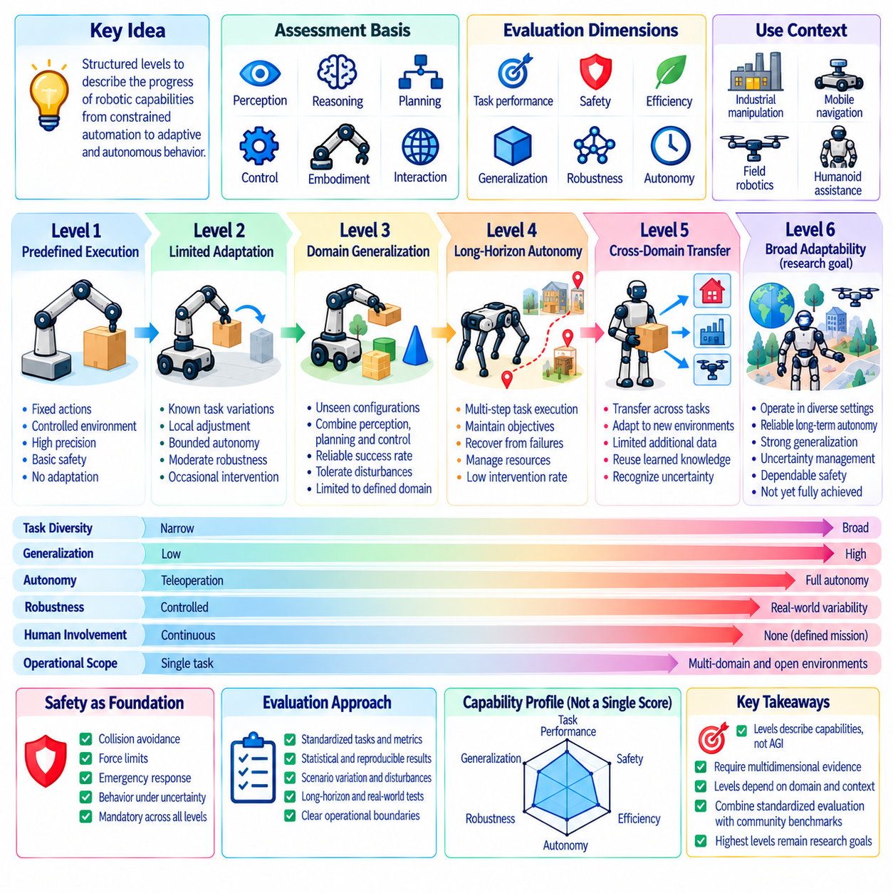{width="7.268055555555556in" height="7.268055555555556in"}

피지컬 인공지능 능력 수준(Physical AI Capability Levels)은 로봇 시스템이 제한된 자동화(Narrowly Constrained Automation)에서 점차 적응적이고 자율적인 행동(Adaptive and Autonomous Behavior)으로 발전하는 과정을 설명하는 체계적인 접근법을 제공한다. 기존의 성능 순위(Performance Rankings)와 달리 능력 수준은 입증된 역량(Demonstrated Competence)의 범위(Scope), 신뢰성(Reliability), 독립성(Independence)을 특성화하는 것을 목표로 한다. 유용한 프레임워크(Framework)는 일반 지능(General Intelligence)에 대한 근거 없는 주장을 피하면서 측정 가능한 평가 결과(Measurable Evaluation Outcomes)를 운영상의 의미(Operational Meaning)와 연결해야 한다.

로봇 지능(Robotic Intelligence)은 인식(Perception), 추론(Reasoning), 계획(Planning), 제어(Control), 체화(Embodiment), 물리적 상호작용(Physical Interaction)에 의존하기 때문에 능력 분류(Capability Classification)는 어려운 과제이다. 시스템은 고급 조작 능력(Advanced Manipulation)을 보여주면서도 내비게이션(Navigation)이나 환경 이해(Environmental Understanding)에서는 제한적일 수 있다. 따라서 능력 수준은 단일 벤치마크 점수(Single Benchmark Score)만으로 추론해서는 안 된다. 작업 다양성(Task Diversity), 일반화(Generalization), 안전성(Safety), 자율성(Autonomy), 운영 강건성(Operational Robustness)을 포함한 여러 차원의 근거가 필요하다.

능력 프레임워크(Capability Framework)는 평가 영역(Assessment Domain)과 의도된 배포 맥락(Intended Deployment Context)을 정의하는 것에서 시작해야 한다. 산업용 조작(Industrial Manipulation), 모바일 내비게이션(Mobile Navigation), 현장 로봇공학(Field Robotics), 휴머노이드 지원(Humanoid Assistance)은 서로 다른 물리적 요구사항(Physical Requirements)을 가진다. 공통 평가 원칙(Common Evaluation Principles)은 비교를 지원할 수 있지만, 동일한 임계값(Thresholds)이 모든 로봇 구현 형태(Embodiments)에 적합하지는 않을 수 있다. 각 능력 등급(Capability Designation)은 적용 대상 작업, 환경, 하드웨어 가정(Hardware Assumptions), 운영 경계(Operational Boundaries)를 명시해야 한다.

예시적인 초기 수준(Initial Level)은 엄격하게 통제된 조건(Tightly Controlled Conditions)에서 사전 정의된 행동(Predefined Actions)을 실행하는 시스템을 설명할 수 있다. 이러한 시스템은 고정된 궤적(Fixed Trajectories), 구조화된 작업공간(Structured Workspaces), 명시적인 인간 감독(Explicit Human Supervision)에 의존한다. 상당한 적응 능력(Substantial Adaptation)을 보여주지 않더라도 높은 정밀도(Precision)와 반복 가능성(Repeatability)을 달성할 수 있다. 이 수준의 평가는 결정론적 실행(Deterministic Execution), 기본 안전 준수(Basic Safety Compliance), 제한적으로 정의된 작업의 신뢰할 수 있는 완료(Reliable Completion)를 강조한다.

그다음 수준(Subsequent Level)은 알려진 작업 계열(Known Task Families) 내에서 제한적인 적응(Limited Adaptation)이 가능한 시스템을 나타낼 수 있다. 이러한 로봇은 완전한 재프로그래밍(Complete Reprogramming) 없이 물체 배치(Object Placement), 환경 형상(Environmental Geometry), 센서 관측값(Sensor Observations)의 중간 정도 변화에 대응할 수 있다. 자율성(Autonomy)은 사전 정의된 절차(Predefined Procedures)와 복구 선택지(Recovery Options)에 의해 제한된다. 벤치마크는 변화에 대한 허용 능력(Variation Tolerance), 성공적인 국소 조정(Successful Local Adjustments), 필요한 인간 개입(Human Intervention)의 빈도를 측정해야 한다.

중간 능력 수준(Intermediate Capability Level)은 정의된 운영 영역(Operational Domain) 내에서 익숙하지 않은 구성(Unfamiliar Configurations)으로 일반화할 수 있는 로봇을 설명할 수 있다. 이러한 시스템은 인식(Perception), 계획(Planning), 피드백 제어(Feedback Control)를 결합하여 이전에 보지 못한 작업 사례(Unseen Task Instances)를 처리할 수 있다. 평가에는 개발 과정에서 명시적으로 제시되지 않은 홀드아웃 환경(Held-Out Environments), 변경된 물체 속성(Changed Object Properties), 외란(Disturbances)이 포함되어야 한다. 성공은 유리한 사례(Favorable Examples)에 의존하는 것이 아니라 통계적으로 신뢰할 수 있어야 한다.

더 높은 능력 수준(Higher Capability Levels)은 장기 지평 자율성(Long-Horizon Autonomy)과 상호 의존적인 여러 작업(Multiple Interdependent Tasks)의 조정된 실행(Coordinated Execution)을 포함할 수 있다. 로봇은 장시간 운영(Extended Operation) 동안 목표(Objectives)를 유지하고 진행 상황(Progress)을 감시하며 국소적인 실패(Local Failures)에서 복구하고 자원(Resources)을 관리해야 한다. 평가는 임무 완료(Mission Completion), 개입 빈도(Intervention Frequency), 복구 효과성(Recovery Effectiveness), 누적 위험(Accumulated Risk)을 조사해야 한다. 짧은 시간 동안의 우수한 성능(Strong Short-Duration Performance)만으로 지속적인 자율 운영(Continuous Autonomous Operation)의 역량을 입증할 수는 없다.

더욱 발전된 수준(More Advanced Level)은 작업 계열(Task Families), 환경(Environments), 호환 가능한 로봇 구현 형태(Compatible Embodiments) 사이에서 지식을 전이(Transfer)할 수 있는 시스템을 특성화할 수 있다. 이러한 로봇은 학습된 표현(Learned Representations)을 재사용하고 제한된 추가 데이터(Limited Additional Data)로 정책(Policies)을 적응시키며 기존 지식(Prior Knowledge)이 충분하지 않은 상황을 인식할 수 있다. 전이 성능(Transfer Performance)은 명시적인 적응 예산(Adaptation Budgets)과 이전에 보지 못한 조건(Unseen Conditions)을 사용하여 측정해야 한다. 일반화 주장(Generalization Claims)은 실제 지식 전이(Genuine Knowledge Transfer)와 광범위한 재학습(Extensive Retraining) 또는 숨겨진 작업별 엔지니어링(Hidden Task-Specific Engineering)을 구분해야 한다.

제안 가능한 최고 능력 범주(Highest Proposed Capability Categories)는 신뢰할 수 있는 안전성(Dependable Safety)과 자율성(Autonomy)을 유지하면서 다양한 물리적 상황(Diverse Physical Situations)에서 작동하는 폭넓은 적응 능력을 갖춘 로봇 시스템(Broadly Adaptable Robotic Systems)을 대상으로 할 수 있다. 이러한 범주는 확립된 보편적 인증(Established Universal Certifications)이 아니라 연구 목표(Research Objectives)에 해당한다. 평가에는 작업 전이(Task Transfer), 불확실성 관리(Uncertainty Management), 복구(Recovery), 운영 신뢰성(Operational Reliability)에 대한 광범위한 근거가 필요하다. 현재의 어떤 벤치마크 모음(Benchmark Suite)도 제한 없는 물리적 지능(Unrestricted Physical Intelligence)을 입증하기에 충분하다고 가정해서는 안 된다.

능력 수준(Capability Levels)은 엄격한 지능의 단계적 서열(Rigid Ladder of Intelligence)이 아니라 다차원 프로파일(Multidimensional Profiles)로 이해해야 한다. 로봇은 내비게이션(Navigation)에서 높은 자율성(High Autonomy)을 보이면서 조작 일반화(Manipulation Generalization)에서는 제한적일 수 있으며, 작업 다양성(Task Diversity)이 제한적이더라도 뛰어난 안전 성능(Safety Performance)을 보일 수 있다. 개별 능력 차원(Separate Capability Dimensions)을 보고하면 이러한 차이를 보존할 수 있다. 복합 능력 수준(Composite Levels)은 의사소통에 유용할 수 있지만, 집계 규칙(Aggregation Rules)과 최소 적격성 요구사항(Minimum Qualification Requirements)은 투명해야 한다.

안전성(Safety)은 모든 능력 수준에서 기본적인 적격성 요구사항(Foundational Qualification Requirement)으로 작동해야 한다. 자율성(Autonomy)이 증가하면 잘못된 의사결정(Incorrect Decisions), 안전하지 않은 상호작용(Unsafe Interactions), 부적절한 복구 메커니즘(Inadequate Recovery Mechanisms)의 결과도 확대된다. 따라서 평가는 충돌 회피(Collision Avoidance), 힘 제한(Force Limitations), 비상 대응(Emergency Responses), 불확실성 하의 행동(Behavior Under Uncertainty)을 고려해야 한다. 높은 작업 성공률(Task Success)은 허용할 수 없는 위험(Unacceptable Risk)을 자동으로 상쇄할 수 없으며, 능력 수준의 향상(Capability Advancement)에는 신뢰할 수 있는 안전 제어(Dependable Safety Controls)에 대한 근거가 필요하다.

인간의 개입(Human Involvement)은 운영 독립성(Operational Independence)을 나타내는 중요한 지표를 제공한다. 시스템은 지속적인 원격조작(Continuous Teleoperation), 간헐적인 감독 명령(Occasional Supervisory Commands), 예외 처리(Exception Handling)를 필요로 하거나 정의된 임무(Defined Mission) 동안 개입 없이 작동할 수 있다. 능력 평가(Capability Assessment)는 이러한 지원 형태(Forms of Assistance)를 구분하고 빈도(Frequency), 지속 시간(Duration), 운영상 중요성(Operational Significance)을 기록해야 한다. 빈번한 인간의 수정(Human Corrections)을 통해 성공하는 로봇이 동등한 작업을 독립적으로 완료하는 로봇과 동일한 자율성 등급(Autonomy Designation)을 받아서는 안 된다.

일반화 경계(Generalization Boundaries)는 능력 수준을 부여할 때 마찬가지로 중요하다. 평가는 운영 관련성(Operational Relevance)을 유지하면서 작업 사례(Task Instances), 물체 속성(Object Properties), 환경 조건(Environmental Conditions), 외란 패턴(Disturbance Patterns)을 변화시켜야 한다. 비공개 테스트(Hidden Tests)와 독립적인 시험 시설(Independent Facilities)은 벤치마크 특화(Benchmark-Specific Specialization)를 줄일 수 있다. 능력 주장(Capability Claims)은 성능이 입증된 영역과 근거가 여전히 불충분한 영역을 명시해야 한다. 정의된 운영 범위(Defined Operational Envelope)는 제한 없는 자율성이라는 명칭(Unrestricted Autonomy Label)보다 더 많은 정보를 제공한다.

통계적 적격성 검증(Statistical Qualification)은 개별 시연(Isolated Demonstrations)을 안정적인 능력(Stable Capability)으로 오인하는 것을 방지한다. 각 수준은 관련 시나리오(Relevant Scenarios) 전반에서 충분한 시험 횟수(Sufficient Trials), 불확실성 추정값(Uncertainty Estimates), 반복 가능성(Repeatability)을 요구해야 한다. 신뢰구간(Confidence Intervals)과 실패 분포(Failure Distributions)는 특히 분류 경계(Classification Boundaries) 부근에서 임계값 판단(Threshold Decisions)을 지원할 수 있다. 독립적인 재현(Independent Replication)은 관측된 성능이 유리한 평가 조건(Favorable Evaluation Conditions)이나 실험적 선택(Experimental Selection)이 아니라 시스템 역량(System Competence)을 반영한다는 신뢰를 강화한다.

능력 평가(Capability Assessment)는 하드웨어 제약조건(Hardware Constraints)과 로봇 구현 형태의 차이(Embodiment Differences)도 고려해야 한다. 센서 품질(Sensor Quality), 액추에이터 성능(Actuator Performance), 컴퓨팅 자원(Computing Resources), 기계적 형태(Morphology)는 달성 가능한 행동(Achievable Behavior)에 영향을 미친다. 분류 프로토콜(Classification Protocols)은 이러한 요인을 공개하고 관측된 모든 성능을 학습된 지능(Learned Intelligence)에 귀속시키지 않아야 한다. 영역별 능력 평가 트랙(Domain-Specific Capability Tracks)은 자율성(Autonomy), 안전성(Safety), 강건성(Robustness), 적응(Adaptation)에 대한 공통 보고 원칙(Common Reporting Principles)을 유지하면서 더욱 공정한 비교를 제공할 수 있다.

실용적인 적격성 검증 절차(Practical Qualification Process)는 시뮬레이션 선별 평가(Simulation Screening), 통제된 물리적 시험(Controlled Physical Testing), 장시간 운영 시험(Extended Operational Trials)을 결합할 수 있다. 시뮬레이션은 광범위한 시나리오 범위(Broad Scenario Coverage)와 반복 가능한 스트레스 시험(Repeatable Stress Testing)을 지원하며, 물리적 실험(Physical Experiments)은 실제 환경 상호작용(Real-World Interaction)에 대한 근거를 확립한다. 장시간 시험(Long-Duration Trials)은 누적된 실패(Accumulated Failures)와 개입 요구사항(Intervention Requirements)을 드러낸다. 수준 간 승급(Advancement Between Levels)은 하나의 인상적인 시연(Single Impressive Demonstration)이 아니라 이러한 단계 전반에서 문서화된 기준(Documented Criteria)을 충족하는지에 따라 결정되어야 한다.

거버넌스(Governance)는 능력 등급(Capability Labels)이 근거와 분리된 마케팅 주장(Marketing Claims)으로 변질되는 것을 방지하는 데 필요하다. 표준화 기구(Standards Organizations), 벤치마크 관리자(Benchmark Maintainers), 독립적인 실험실(Independent Laboratories), 응용 분야 이해관계자(Application Stakeholders)는 적격성 기준(Qualification Criteria)을 정의하는 데 기여할 수 있다. 버전 관리된 프로토콜(Versioned Protocols)은 작업(Tasks), 임계값(Thresholds), 평가 절차(Assessment Procedures)의 변경사항을 문서화해야 한다. 공식적으로 확립된 능력 인증서(Capability Certificates)가 있다면 연구 리더보드 순위(Research Leaderboard Rankings) 및 규제 안전 승인(Regulatory Safety Approvals)과 구분하여 관리해야 한다.

궁극적으로 피지컬 인공지능 능력 수준(Physical AI Capability Levels)은 복잡한 벤치마크 근거(Benchmark Evidence)를 해석 가능한 운영 역량(Interpretable Operational Competence)의 설명으로 전환해야 한다. 그 가치는 측정 가능한 기준(Measurable Criteria), 다차원 보고(Multidimensional Reporting), 명시적인 안전 요구사항(Explicit Safety Requirements), 명확하게 제한된 일반화 주장(Clearly Bounded Generalization Claims)에 달려 있다. 로봇공학(Robotics)이 발전함에 따라 분류 프레임워크(Classification Frameworks)도 독립적인 검증(Independent Validation)과 투명한 거버넌스(Transparent Governance)를 통해 발전해야 한다. 목적은 보편적인 지능 등급(Universal Intelligence Labels)을 부여하는 것이 아니라, 지정된 물리적 조건(Specified Physical Conditions)에서 로봇 시스템이 무엇을 신뢰성 있게 수행할 수 있는지 전달하는 것이다.

## 08.16. Automated Leaderboard and Scoring [w/Code]

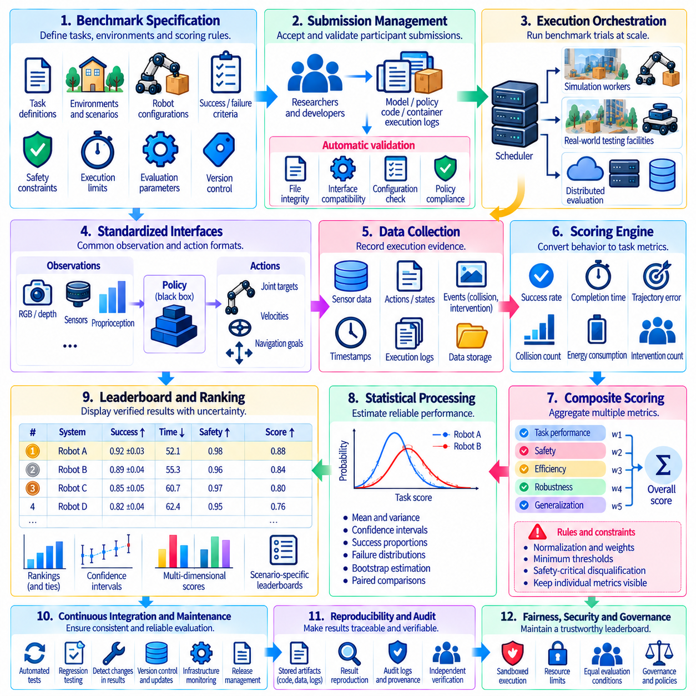{width="7.268055555555556in" height="7.268055555555556in"}

자동화된 리더보드 및 점수 산정 인프라(Automated Leaderboard and Scoring Infrastructure)는 피지컬 인공지능(Physical AI) 시스템을 대규모로 평가하기 위한 체계적인 기반을 제공한다. 이 인프라는 로봇 실행 기록(Robotic Execution Records)을 표준화된 성능 측정값(Standardized Performance Measurements), 검증된 점수(Verified Scores), 지속적으로 관리되는 순위(Rankings)로 변환한다. 자동화(Automation)는 수동 계산 오류(Manual Calculation Errors)를 줄이고 제출 결과 간 일관성(Consistency)을 향상시킨다. 그러나 신뢰할 수 있는 결과를 얻으려면 자동화된 계산 이상의 요소가 필요하며, 평가 프로토콜(Evaluation Protocols), 데이터 무결성(Data Integrity), 통계적 타당성(Statistical Validity), 거버넌스(Governance)를 명시적으로 정의해야 한다.

자동화된 평가 파이프라인(Automated Evaluation Pipeline)은 작업(Tasks), 환경(Environments), 로봇 구성(Robot Configurations), 점수 산정 기준(Scoring Criteria)을 설명하는 공식적인 벤치마크 명세(Formal Benchmark Specification)에서 시작된다. 각 작업은 초기 조건(Initial Conditions), 완료 요구사항(Completion Requirements), 실패 조건(Failure Conditions), 안전 제약조건(Safety Constraints), 실행 제한(Execution Limits)을 정의해야 한다. 기계 판독 가능한 명세(Machine-Readable Specifications)를 사용하면 평가 서비스(Evaluation Services)가 이러한 요구사항을 일관되게 해석할 수 있다. 버전 식별자(Version Identifiers)는 제출된 결과가 시험에 사용된 정확한 벤치마크 구성(Benchmark Configuration)과 연결되도록 보장한다.

제출 관리(Submission Management)는 참여 시스템(Participating Systems)의 진입점을 확립한다. 연구자는 벤치마크 요구사항(Benchmark Requirements)에 따라 학습된 모델(Trained Models), 실행 가능한 정책(Executable Policies), 소프트웨어 컨테이너(Software Containers), 검증된 실행 로그(Verified Execution Logs)를 제공할 수 있다. 각 제출물(Submission)에는 알고리즘(Algorithm), 소프트웨어 의존성(Software Dependencies), 하드웨어 가정(Hardware Assumptions), 허용된 계산 자원(Computational Resources)을 식별하는 메타데이터(Metadata)가 포함되어야 한다. 자동화된 검증(Automated Validation)은 평가를 시작하기 전에 파일 무결성(File Integrity), 인터페이스 호환성(Interface Compatibility), 구성의 완전성(Configuration Completeness), 제출 정책(Submission Policies) 준수 여부를 확인한다.

실행 오케스트레이션(Execution Orchestration)은 시뮬레이션 환경(Simulation Environments)이나 물리적 시험 시설(Physical Testing Facilities) 전반에서 벤치마크 시험(Benchmark Trials)을 조정한다. 스케줄러(Scheduler)는 작업을 할당하고 환경을 초기화하며 정책(Policies)을 실행하고 실행 결과(Execution Outcomes)를 기록한다. 분산 작업자(Distributed Workers)는 독립적인 시나리오를 동시에 평가하여 대규모 벤치마크 모음(Benchmark Suites)의 처리량(Throughput)을 향상시킬 수 있다. 그러나 스케줄링 정책(Scheduling Policies)은 자원 경합(Resource Contention), 타이밍 간섭(Timing Interference), 불균등한 계산 조건(Unequal Computational Conditions)이 참가자 사이에 체계적인 이점(Systematic Advantages)을 발생시키지 않도록 해야 한다.

표준화된 실행 인터페이스(Standardized Execution Interfaces)는 로봇 정책(Robotic Policies)을 벤치마크 인프라(Benchmark Infrastructure)와 분리한다. 관측 메시지(Observation Messages)에는 카메라 이미지(Camera Images), 깊이 측정값(Depth Measurements), 고유수용감각 상태(Proprioceptive States), 환경 정보(Environmental Information)가 포함될 수 있다. 행동 인터페이스(Action Interfaces)는 관절 목표값(Joint Targets), 속도(Velocities), 힘(Forces), 내비게이션 목표(Navigation Goals)와 같은 명령을 지정한다. 인터페이스 계약(Interface Contracts)은 좌표계(Coordinate Systems), 제어 주파수(Control Frequencies), 타이밍 요구사항(Timing Requirements), 오류 처리(Error Handling)를 정의해야 한다. 이러한 명세는 이종 알고리즘(Heterogeneous Algorithms)이 비교 가능한 조건에서 평가에 참여할 수 있도록 한다.

자동화된 데이터 수집(Automated Data Collection)은 점수 산정(Scoring)과 독립적인 검증(Independent Verification)에 필요한 근거를 확보한다. 평가 기록(Evaluation Records)에는 센서 관측값(Sensor Observations), 발행된 행동 명령(Issued Actions), 로봇 상태(Robot States), 충돌 이벤트(Collision Events), 작업 상태 전이(Task Transitions), 타임스탬프(Timestamps), 개입 로그(Intervention Logs)가 포함될 수 있다. 구조화된 이벤트 스키마(Structured Event Schemas)는 시나리오 전반에서 일관된 해석을 지원한다. 가능한 경우 원시 기록(Raw Records)을 보존해야 하며, 파생 요약 데이터(Derived Summaries)는 저장 요구량(Storage Requirements)을 줄인다. 데이터 출처 추적(Data Provenance)은 보고된 모든 점수를 기반이 되는 실행 근거(Execution Evidence)와 연결한다.

점수 산정 엔진(Scoring Engine)은 기록된 행동(Recorded Behavior)을 측정 가능한 작업 결과(Measurable Task Outcomes)로 변환한다. 성공률(Success Rates), 완료 시간(Completion Times), 궤적 오차(Trajectory Errors), 충돌 빈도(Collision Frequencies), 에너지 소비(Energy Consumption), 개입 횟수(Intervention Counts)는 표준화된 이벤트 스트림(Standardized Event Streams)에서 계산할 수 있다. 각 지표(Metric)에는 측정 단위(Measurement Units), 유효 범위(Valid Ranges), 정규화 규칙(Normalization Rules), 실패 처리 방법(Treatment of Failures)을 포함한 정확한 정의가 필요하다. 점수 산정 구현(Scoring Implementations)은 가능한 경우 결정론적(Deterministic)이어야 하며, 알려진 참조 사례(Reference Cases)를 기준으로 독립적인 시험을 거쳐야 한다.

복합 점수 산정(Composite Scoring)은 벤치마크가 종합 성능 지표(Overall Performance Indicator)를 요구할 때 여러 평가 차원(Evaluation Dimensions)을 결합한다. 정규화된 작업 점수(Normalized Task Scores)는 사전에 정의된 가중치(Weights), 최소 임계값(Minimum Thresholds), 계층적 규칙(Hierarchical Rules)을 사용하여 집계할 수 있다. 안전 필수 실패(Safety-Critical Failures)는 일반적인 수치적 벌점(Numerical Penalties)이 아니라 실격(Disqualification)을 유발할 수 있다. 집계 절차(Aggregation Procedures)는 복합 순위(Composite Rankings)가 중요한 약점을 감추지 않도록 개별 지표(Individual Metrics)에 대한 접근을 유지해야 한다. 가중치 선택(Weight Selection)은 명시된 평가 목표(Evaluation Objectives)를 반영해야 한다.

자동화된 점수 산정(Automated Scoring)은 불완전하거나 비정상적인 실행(Incomplete and Abnormal Executions)을 일관되게 처리해야 한다. 시간 초과(Timeouts), 통신 장애(Communication Failures), 시뮬레이터 충돌(Simulator Crashes), 정책 예외(Policy Exceptions), 비상 정지(Emergency Stops)에는 서로 다른 상태 분류(Status Classifications)가 필요하다. 일부 실패는 시스템의 한계(System Limitations)를 나타내지만, 다른 실패는 통제된 재시험(Controlled Reruns)이 필요한 인프라 결함(Infrastructure Faults)을 의미한다. 평가 정책(Evaluation Policies)은 시험 전에 이러한 차이를 정의해야 한다. 실행 기록이 불완전하다는 이유만으로 실패한 시험(Unsuccessful Trials)을 점수 계산에서 제외해서는 안 된다.

통계적 처리(Statistical Processing)는 반복된 시험 결과(Repeated Trial Outcomes)를 신뢰할 수 있는 성능 추정값(Performance Estimates)으로 변환한다. 평균 점수(Mean Scores), 성공 비율(Success Proportions), 분산(Variance), 신뢰구간(Confidence Intervals), 실패 분포(Failure Distributions)를 자동으로 계산할 수 있다. 대응 시나리오(Paired Scenarios)와 통제된 난수 시드(Controlled Random Seeds)는 시스템 간 비교를 개선한다. 적절한 경우 부트스트랩 추정(Bootstrap Estimation)은 불확실성 분석(Uncertainty Analysis)을 지원할 수 있다. 리더보드 서비스(Leaderboard Services)는 작은 수치 차이를 우월성(Superiority)의 확정적인 근거로 취급하기보다 표본 크기(Sample Sizes)와 불확실성(Uncertainty)을 보고해야 한다.

순위 산정 서비스(Ranking Services)는 공개된 리더보드 규칙(Leaderboard Rules)에 따라 검증된 결과(Validated Results)를 구성한다. 주요 지표(Primary Metric)는 순서를 결정할 수 있으며, 보조 차원(Secondary Dimensions)은 안전성(Safety), 효율성(Efficiency), 강건성(Robustness), 일반화(Generalization)를 설명한다. 동점(Ties)과 통계적으로 구별하기 어려운 결과(Statistically Indistinguishable Results)는 투명한 처리 방법이 필요하다. 별도의 순위 범주(Ranking Categories)는 시뮬레이션 성능(Simulation Performance), 실제 환경 시험(Real-World Testing), 하드웨어 예산(Hardware Budgets), 로봇 구현 형태(Robot Embodiments)를 구분할 수 있다. 표시된 모든 순위는 평가 프로토콜(Evaluation Protocol)과 검증된 점수 기록(Verified Score Record)으로 추적 가능해야 한다.

지속적 통합(Continuous Integration)은 벤치마크 인프라가 평가 동작(Evaluation Behavior)을 조용히 변경하지 않으면서 발전할 수 있도록 한다. 자동화된 시험(Automated Tests)은 소프트웨어 업데이트 이후 점수 산정 함수(Scoring Functions), 제출 인터페이스(Submission Interfaces), 시나리오 정의(Scenario Definitions), 실행 환경(Execution Environments)을 검증해야 한다. 참조 정책(Reference Policies)은 회귀 시험(Regression Testing)을 통해 예상하지 못한 지표 변화(Unexpected Metric Changes)를 탐지할 수 있다. 릴리스 파이프라인(Release Pipelines)은 중요한 검증 검사(Critical Validation Checks)가 실패하면 결과 공개를 차단해야 한다. 벤치마크 버전 관리(Benchmark Versioning)는 과거 결과의 비교 가능성(Historical Comparability)을 보존하고 호환되지 않는 점수 계열(Incompatible Score Series)을 분리한다.

참가자가 실행 가능한 코드(Executable Code)를 중앙집중형 평가 서버(Centralized Evaluation Servers)에 제출하는 경우 보안 통제(Security Controls)는 필수적이다. 샌드박스 컨테이너(Sandboxed Containers), 제한된 네트워크 접근(Restricted Network Access), 자원 할당량(Resource Quotas), 권한 경계(Permission Boundaries)는 무단 접근(Unauthorized Access)이나 데이터 추출(Data Extraction)의 위험을 줄인다. 비공개 테스트 시나리오(Hidden Test Scenarios)는 참가자가 제어하는 프로세스(Participant-Controlled Processes)로부터 격리된 상태를 유지해야 한다. 제출 빈도 제한(Submission Rate Limits)과 통제된 피드백(Controlled Feedback)은 벤치마크 편법 최적화(Benchmark Gaming)를 줄일 수 있다. 보안 감시(Security Monitoring)는 보호된 평가 자산(Protected Evaluation Assets)을 노출하지 않으면서 감사 기록(Audit Records)을 생성해야 한다.

물리적 시험(Physical Testing)에는 시뮬레이션에서 사용하는 보호 장치 외에 추가적인 안전 조치(Safeguards)가 필요하다. 자동화된 제어기(Automated Controllers)는 액추에이터 제한(Actuator Limits), 충돌 경계(Collision Boundaries), 비상 정지 시스템(Emergency-Stop Systems), 감독 권한(Supervisory Authority)을 준수해야 한다. 인간 운영자(Human Operators)는 실행을 승인하거나 안전하지 않은 조건(Unsafe Conditions)이 발생할 때 개입해야 할 수 있다. 평가 인프라(Evaluation Infrastructure)는 이러한 개입(Interventions)을 기록하고 안전 정지(Safety Shutdowns)와 일반적인 작업 실패(Ordinary Task Failures)를 구분해야 한다. 자동화된 점수 산정(Automated Scoring)이 독립적인 물리적 안전 메커니즘(Independent Physical Safety Mechanisms)을 무시하거나 우회해서는 안 된다.

리더보드 공개(Leaderboard Publication)는 검증된 평가 결과(Verified Evaluation Outcomes)를 접근 가능한 연구 정보(Accessible Research Information)와 연결한다. 대시보드(Dashboard)는 시스템 식별자(System Identifiers), 벤치마크 버전(Benchmark Versions), 주요 점수(Primary Scores), 신뢰구간(Confidence Intervals), 안전 지표(Safety Indicators), 평가 날짜(Evaluation Dates)를 표시할 수 있다. 필터링(Filtering)과 다운로드 가능한 결과 기록(Downloadable Result Records)은 독립적인 분석(Independent Analysis)을 지원한다. 공개 화면(Public Views)에서는 기밀 모델(Confidential Models), 보호된 테스트 세부사항(Protected Test Details), 민감한 운영 데이터(Sensitive Operational Data)를 제외해야 한다. 과거 스냅샷(Historical Snapshots)은 사용자가 서로 다른 프로토콜에서 얻은 결과를 혼동하지 않고 발전 과정을 살펴볼 수 있도록 한다.

거버넌스 메커니즘(Governance Mechanisms)은 자동화된 평가(Automated Evaluation) 전반에서 공정성(Fairness)과 책임성(Accountability)을 유지한다. 제출 자격(Submission Eligibility), 평가 할당량(Evaluation Quotas), 이의신청(Appeals), 점수 수정(Score Corrections), 벤치마크 업데이트(Benchmark Updates)는 문서화된 정책(Documented Policies)을 따라야 한다. 자동화된 이상 탐지(Automated Anomaly Detection)는 의심스러운 점수 변화(Suspicious Score Changes), 일관되지 않은 메타데이터(Inconsistent Metadata), 비정상적인 실행 패턴(Unusual Execution Patterns)을 식별할 수 있다. 그러나 실격(Disqualification)과 같이 중대한 영향을 미치는 결정(Consequential Decisions)에는 적절한 인간 검토(Human Review)가 가능해야 한다. 공식 결과가 어떻게 생성되었는지 설명하려면 감사 가능성(Auditability)이 필수적이다.

실용적인 구현(Practical Implementation)은 제출 서비스(Submission Services), 실행 작업자(Execution Workers), 점수 산정 모듈(Scoring Modules), 결과 데이터베이스(Result Databases), 리더보드 표시 기능(Leaderboard Presentation)을 독립적으로 유지보수할 수 있는 구성요소(Components)로 분리할 수 있다. 표준화된 응용 프로그램 인터페이스(Application Programming Interfaces, APIs)와 기계 판독 가능한 스키마(Machine-Readable Schemas)는 이러한 서비스를 연결한다. 컨테이너 기반 작업자(Containerized Workers)는 확장 가능한 시뮬레이션(Scalable Simulation)을 지원하며, 특수 어댑터(Specialized Adapters)는 물리적 로봇(Physical Robots)과 실험실 장비(Laboratory Equipment)를 통합한다. 모듈형 아키텍처(Modular Architecture)는 유지보수를 단순화하지만, 전체 파이프라인(Complete Pipeline)에서 일관된 결과를 보장하려면 종단 간 검증(End-to-End Validation)이 여전히 필요하다.

궁극적으로 자동화된 리더보드 및 점수 산정 시스템(Automated Leaderboard and Scoring Systems)은 피지컬 인공지능 벤치마킹(Physical AI Benchmarking)을 재현 가능하고(Reproducible) 지속적으로 검증 가능한(Continuously Verifiable) 평가 프로세스로 전환해야 한다. 신뢰성(Credibility)은 표준화된 실행(Standardized Execution), 정확한 지표(Precise Metrics), 통계적 보호 장치(Statistical Safeguards), 안전한 인프라(Secure Infrastructure), 투명한 거버넌스(Transparent Governance)에 달려 있다. 자동화(Automation)는 더 큰 규모의 평가 캠페인(Evaluation Campaigns)과 신속한 연구 피드백(Research Feedback)을 가능하게 하지만, 신중한 벤치마크 설계(Careful Benchmark Design)를 대체할 수는 없다. 목적은 단순히 수치적 순위(Numerical Rankings)를 생성하는 것이 아니라 로봇 역량(Robotic Competence)에 대한 신뢰할 수 있는 근거(Trustworthy Evidence)를 생산하는 것이다.
