**Volume 11. Physical AI Evaluation and Benchmarking**


# Chapter 09. Case Studies

##  

## 09.01. AMR Navigation and Mobility Benchmark

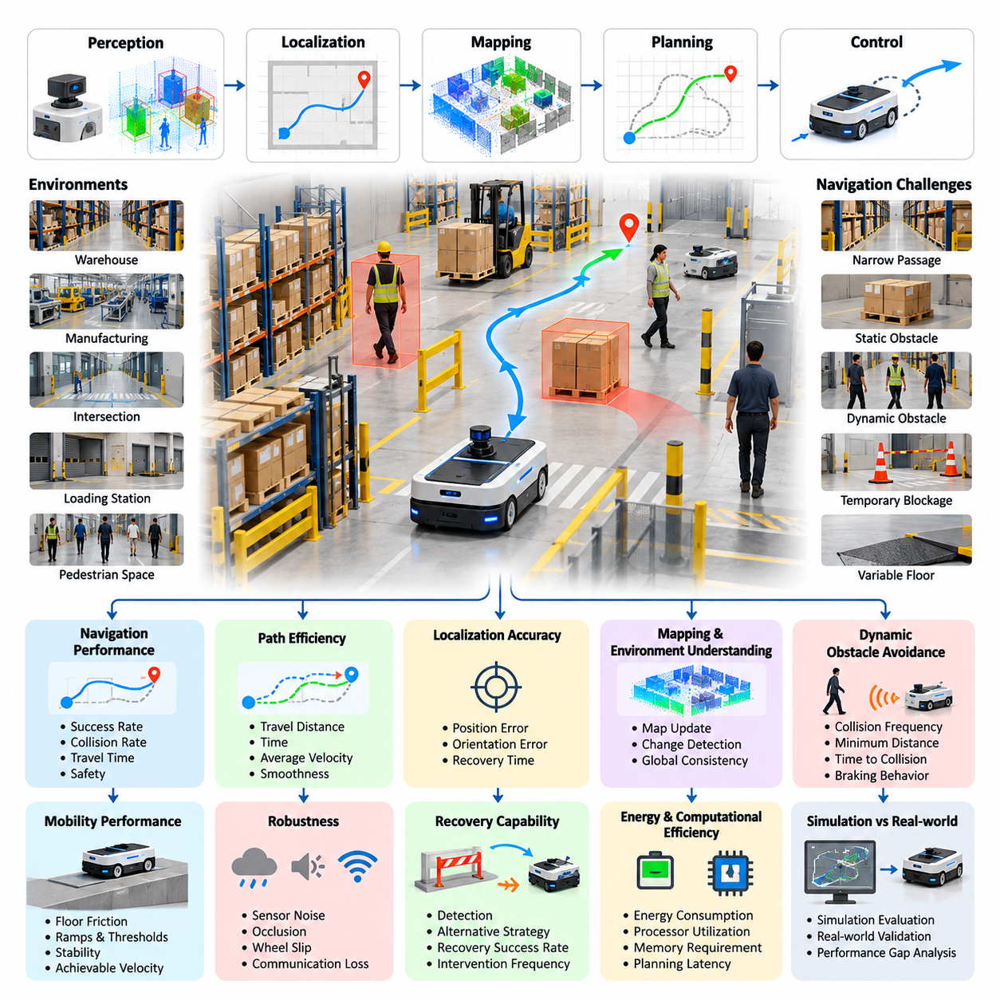{width="7.268055555555556in" height="7.268055555555556in"}

Autonomous Mobile Robot (AMR) navigation and mobility benchmarking evaluates how effectively a robotic platform perceives its surroundings, estimates its position, plans feasible routes, and executes safe movement under operational constraints. Unlike isolated algorithm testing, an AMR benchmark examines the complete closed-loop system, where perception errors, localization uncertainty, planning decisions, and actuator behavior jointly determine mission outcomes.

A representative benchmark environment includes warehouse aisles, manufacturing corridors, intersections, loading stations, and shared pedestrian spaces. These environments introduce navigation challenges involving narrow passages, static obstacles, moving personnel, temporary blockages, and variable floor conditions. The benchmark must represent both predictable operating situations and disturbances that require the robot to adapt its behavior without compromising safety.

The evaluation begins by defining the operational design domain, including permitted surfaces, maximum travel speeds, obstacle characteristics, lighting conditions, and pedestrian activity. Each test scenario specifies an initial robot pose, destination, environmental configuration, and completion criteria. These definitions establish comparable testing conditions while ensuring that measured performance corresponds to realistic deployment requirements.

Navigation capability is evaluated through repeated point-to-point missions in which the AMR must reach designated destinations without collisions or unauthorized intervention. Mission success rate represents the proportion of trials completed within specified tolerances and time limits. However, successful arrival alone is insufficient because a robot may reach its destination through inefficient, unstable, or potentially unsafe movement patterns.

Path efficiency measures the relationship between the distance traveled by the robot and an appropriate reference path. The reference may represent the shortest collision-free route or a feasible route satisfying the robot\'s kinematic constraints. Additional measurements include travel time, average velocity, stopping frequency, unnecessary detours, and trajectory smoothness, providing a multidimensional assessment of navigation quality.

Localization accuracy is a fundamental component of AMR benchmarking because navigation depends on reliable estimates of position and orientation. Reference measurements may be obtained through motion capture, surveyed landmarks, laser tracking, or independently validated positioning systems. Absolute trajectory error, relative pose error, orientation deviation, and localization recovery time reveal how accurately the robot maintains spatial awareness during movement.

Mapping and environmental understanding are evaluated by introducing changes between initial map construction and subsequent navigation trials. Temporary storage pallets, relocated equipment, blocked corridors, and newly accessible passages test whether the AMR can distinguish persistent environmental structure from transient obstacles. Effective systems update local representations and adjust routes while maintaining consistency with the global navigation objective.

Dynamic obstacle avoidance introduces pedestrians, other mobile robots, and moving industrial equipment into controlled scenarios. The benchmark measures collision frequency, minimum separation distance, time to collision, braking behavior, and the ability to resume progress after an obstacle clears. Evaluation should distinguish legitimate safety stops from excessive hesitation that unnecessarily reduces operational throughput.

Mobility performance also depends on the interaction between the robot\'s mechanical configuration and the surrounding terrain. Floor friction, surface transitions, ramps, thresholds, and uneven ground influence traction, braking distance, stability, and achievable velocity. Testing across these conditions helps identify whether navigation failures originate from planning algorithms, motion control, mechanical limitations, or interactions among these subsystems.

Robustness testing introduces controlled disturbances such as sensor noise, partial occlusion, wheel slip, temporary communication loss, and degraded localization confidence. Each disturbance is applied at documented severity levels to measure performance degradation. A robust AMR should recognize uncertainty, modify its operating behavior, and enter an appropriate safe state when reliable navigation cannot be maintained.

Recovery capability is assessed through scenarios involving blocked routes, localization loss, unexpected obstacles, and interrupted missions. The evaluation records whether the robot detects the problem, identifies an alternative strategy, and resumes progress without external assistance. Recovery success rate, recovery duration, intervention frequency, and repeated-failure behavior help distinguish resilient autonomous navigation from systems dependent on operator supervision.

Energy and computational efficiency provide additional dimensions of mobility performance. Measurements include energy consumption per completed mission, energy per traveled distance, processor utilization, memory requirements, and planning latency. These metrics reveal whether improved navigation performance requires disproportionate computational or electrical resources, particularly for battery-powered AMRs operating continuously in industrial facilities.

Simulation-based evaluation enables extensive scenario coverage before physical deployment. Digital environments can reproduce facility layouts, obstacle trajectories, sensor configurations, and mobility constraints while systematically varying environmental parameters. Nevertheless, simulated performance must be compared with real-world trials because imperfect friction models, sensor artifacts, actuator dynamics, and human behavior can produce significant simulation-to-reality gaps.

Real-world validation uses controlled laboratory courses and representative operational facilities to verify simulation findings. Repeated trials should preserve essential experimental conditions while introducing documented variations in traffic density, payload, illumination, and route complexity. Hardware configuration, software version, calibration status, and environmental measurements must be recorded to support reproducibility and meaningful comparisons between navigation systems.

Statistical analysis is necessary because navigation outcomes vary across routes, environmental conditions, and repeated executions. Benchmark reports should include sample sizes, success proportions, confidence intervals, and distributions of completion time and path efficiency. Stratified results reveal performance differences between simple corridors, congested intersections, narrow passages, and disturbance scenarios that aggregate scores might otherwise conceal.

A practical AMR benchmark scorecard combines mission success, localization accuracy, path efficiency, collision avoidance, recovery capability, energy consumption, and operational reliability. Safety-critical violations should be reported independently rather than hidden within a weighted performance score. This approach prevents improvements in speed or efficiency from compensating for unacceptable collision risks or failures to maintain safe separation.

Generalization is examined by evaluating the same navigation system in previously unseen layouts, altered obstacle configurations, and different operating conditions. Performance differences between familiar and unfamiliar environments indicate the system\'s dependence on specific maps, traffic patterns, or environmental assumptions. Zero-shot trials and adaptation trials should be reported separately to distinguish immediate transfer capability from improvement through additional calibration or learning.

Long-duration evaluation extends individual navigation trials into continuous operational missions involving repeated deliveries, charging cycles, changing traffic conditions, and accumulated localization uncertainty. Measurements include mission completion consistency, autonomous operating duration, mean time between interventions, and failure recovery effectiveness. Such testing reveals reliability problems that may remain invisible during short, isolated demonstrations.

The resulting benchmark provides an evidence-based foundation for comparing AMR navigation architectures, identifying system weaknesses, and establishing deployment readiness. Its principal value lies not in producing a single ranking but in explaining where, how, and under which conditions autonomous mobility succeeds or fails. Standardized scenarios, transparent metrics, and reproducible procedures transform navigation testing into a systematic engineering process.

자율이동로봇(Autonomous Mobile Robot, AMR)의 내비게이션 및 이동성 벤치마킹(Navigation and Mobility Benchmarking)은 로봇 플랫폼(Robot Platform)이 주변 환경을 인식하고, 자신의 위치를 추정하며, 실행 가능한 경로를 계획하고, 운영 제약조건(Operational Constraints) 내에서 안전하게 이동하는 능력을 평가한다. 개별 알고리즘 시험과 달리 AMR 벤치마크(AMR Benchmark)는 인식 오류, 위치 추정 불확실성, 경로 계획 결정, 구동기 동작이 임무 결과에 복합적으로 영향을 미치는 전체 폐루프 시스템(Closed-Loop System)을 평가한다.

대표적인 벤치마크 환경(Benchmark Environment)에는 창고 통로, 제조시설 복도, 교차로, 적재 작업장, 보행자와 공유하는 공간 등이 포함된다. 이러한 환경에서는 좁은 통로, 정적 장애물, 이동하는 작업자, 일시적인 경로 차단, 다양한 바닥 상태와 관련된 내비게이션 문제가 발생한다. 벤치마크는 예측 가능한 운영 상황뿐만 아니라 로봇이 안전성을 유지하면서 동작을 조정해야 하는 외란(Disturbance)도 반영해야 한다.

평가는 허용되는 주행 표면, 최대 이동 속도, 장애물 특성, 조명 조건, 보행자 활동 등을 포함하는 운영설계영역(Operational Design Domain, ODD)을 정의하는 것으로 시작한다. 각 시험 시나리오(Test Scenario)는 로봇의 초기 자세, 목적지, 환경 구성, 완료 기준을 명시한다. 이러한 정의는 측정된 성능이 실제 배치 요구사항(Deployment Requirements)에 부합하도록 하면서 시험 조건의 비교 가능성을 확보한다.

내비게이션 능력(Navigation Capability)은 AMR이 충돌이나 허용되지 않은 외부 개입 없이 지정된 목적지에 도달해야 하는 반복적인 지점 간 임무(Point-to-Point Mission)를 통해 평가한다. 임무 성공률(Mission Success Rate)은 정해진 허용오차와 시간 제한 내에 완료된 시험의 비율을 나타낸다. 그러나 로봇이 비효율적이거나 불안정하거나 잠재적으로 위험한 이동 경로를 통해 목적지에 도달할 수도 있으므로 도착 성공만으로 충분하지 않다.

경로 효율성(Path Efficiency)은 로봇이 실제 이동한 거리와 적절한 기준 경로(Reference Path) 사이의 관계를 측정한다. 기준 경로는 충돌이 없는 최단 경로 또는 로봇의 운동학적 제약조건(Kinematic Constraints)을 만족하는 실행 가능한 경로를 의미할 수 있다. 추가적인 측정 항목에는 이동 시간, 평균 속도, 정지 빈도, 불필요한 우회, 궤적 평활성(Trajectory Smoothness)이 포함되며, 이를 통해 내비게이션 품질을 다차원적으로 평가한다.

위치 추정 정확도(Localization Accuracy)는 내비게이션이 위치와 방향에 대한 신뢰할 수 있는 추정값에 의존하기 때문에 AMR 벤치마킹의 핵심 구성요소이다. 기준 측정값은 모션 캡처(Motion Capture), 측량된 랜드마크(Surveyed Landmarks), 레이저 추적(Laser Tracking), 독립적으로 검증된 위치 측정 시스템을 통해 확보할 수 있다. 절대 궤적 오차(Absolute Trajectory Error), 상대 자세 오차(Relative Pose Error), 방향 편차, 위치 추정 복구 시간은 로봇이 이동 중 공간 인식을 얼마나 정확하게 유지하는지 보여준다.

지도 작성 및 환경 이해(Mapping and Environmental Understanding)는 초기 지도 생성과 후속 내비게이션 시험 사이에 환경 변화를 도입하여 평가한다. 임시 보관 팔레트, 이동된 장비, 차단된 복도, 새롭게 접근 가능한 통로는 AMR이 지속적인 환경 구조와 일시적인 장애물을 구분할 수 있는지 시험한다. 효과적인 시스템은 전역 내비게이션 목표(Global Navigation Objective)와의 일관성을 유지하면서 지역 환경 표현(Local Representation)을 갱신하고 경로를 조정한다.

동적 장애물 회피(Dynamic Obstacle Avoidance)는 통제된 시나리오에 보행자, 다른 이동로봇, 이동하는 산업 장비를 도입하여 평가한다. 벤치마크는 충돌 빈도, 최소 이격거리(Minimum Separation Distance), 충돌까지의 예상 시간(Time to Collision), 제동 동작, 장애물이 사라진 이후 이동을 재개하는 능력을 측정한다. 평가는 정당한 안전 정지(Safety Stop)와 운영 처리량(Operational Throughput)을 불필요하게 감소시키는 과도한 주저 동작을 구분해야 한다.

이동성 성능(Mobility Performance)은 로봇의 기계적 구성과 주변 지형 사이의 상호작용에도 영향을 받는다. 바닥 마찰, 표면 전환 구간, 경사로, 문턱, 불균일한 지면은 접지력(Traction), 제동거리, 안정성, 달성 가능한 속도에 영향을 미친다. 이러한 조건에서의 시험은 내비게이션 실패가 경로 계획 알고리즘, 운동 제어, 기계적 한계 또는 이들 하위 시스템 사이의 상호작용 중 어디에서 발생하는지 식별하는 데 도움이 된다.

강건성 시험(Robustness Testing)은 센서 잡음, 부분 가림(Partial Occlusion), 바퀴 미끄러짐(Wheel Slip), 일시적인 통신 손실, 위치 추정 신뢰도 저하와 같은 통제된 외란을 도입한다. 각 외란은 문서화된 심각도 수준(Severity Level)에 따라 적용하여 성능 저하를 측정한다. 강건한 AMR은 불확실성을 인식하고 운영 동작을 조정하며, 신뢰할 수 있는 내비게이션을 유지할 수 없을 때 적절한 안전 상태(Safe State)로 전환해야 한다.

복구 능력(Recovery Capability)은 경로 차단, 위치 추정 실패, 예상하지 못한 장애물, 임무 중단과 관련된 시나리오를 통해 평가한다. 평가에서는 로봇이 문제를 감지하고 대체 전략을 식별하며 외부 지원 없이 이동을 재개할 수 있는지 기록한다. 복구 성공률(Recovery Success Rate), 복구 소요 시간, 개입 빈도, 반복 실패 동작은 복원력 있는 자율 내비게이션과 운영자 감독에 의존하는 시스템을 구분하는 데 도움이 된다.

에너지 및 계산 효율성(Energy and Computational Efficiency)은 이동성 성능의 추가적인 평가 차원을 제공한다. 측정 항목에는 완료된 임무당 에너지 소비량, 이동 거리당 에너지 소비량, 프로세서 사용률(Processor Utilization), 메모리 요구량, 경로 계획 지연시간(Planning Latency)이 포함된다. 이러한 지표는 특히 산업시설에서 연속적으로 운영되는 배터리 기반 AMR의 내비게이션 성능 향상이 과도한 계산 자원이나 전력 소비를 요구하는지 보여준다.

시뮬레이션 기반 평가(Simulation-Based Evaluation)는 실제 장비를 배치하기 전에 광범위한 시나리오를 시험할 수 있도록 한다. 디지털 환경(Digital Environment)은 시설 배치, 장애물 이동 궤적, 센서 구성, 이동성 제약조건을 재현하면서 환경 매개변수를 체계적으로 변화시킬 수 있다. 그러나 불완전한 마찰 모델, 센서 인공오차(Sensor Artifacts), 구동기 동역학, 인간 행동은 상당한 시뮬레이션과 현실 사이의 격차(Simulation-to-Reality Gap)를 발생시킬 수 있으므로 실제 시험과의 비교가 필요하다.

실제 환경 검증(Real-World Validation)은 통제된 실험실 주행 코스와 대표적인 운영시설을 활용하여 시뮬레이션 결과를 확인한다. 반복 시험은 핵심 실험 조건을 유지하면서 교통 밀도, 적재 하중(Payload), 조도, 경로 복잡성에 문서화된 변화를 도입해야 한다. 하드웨어 구성, 소프트웨어 버전, 보정 상태(Calibration Status), 환경 측정값을 기록하여 재현성(Reproducibility)과 내비게이션 시스템 사이의 의미 있는 비교를 지원해야 한다.

통계 분석(Statistical Analysis)은 내비게이션 결과가 경로, 환경 조건, 반복 실행에 따라 달라지기 때문에 필요하다. 벤치마크 보고서(Benchmark Report)에는 표본 크기, 성공 비율, 신뢰구간(Confidence Interval), 완료 시간과 경로 효율성의 분포가 포함되어야 한다. 계층별 분석 결과(Stratified Results)는 단순한 복도, 혼잡한 교차로, 좁은 통로, 외란 시나리오 사이의 성능 차이를 보여주며, 종합 점수(Aggregate Score)가 이러한 차이를 가리는 문제를 방지한다.

실용적인 AMR 벤치마크 평가표(AMR Benchmark Scorecard)는 임무 성공률, 위치 추정 정확도, 경로 효율성, 충돌 회피, 복구 능력, 에너지 소비량, 운영 신뢰성(Operational Reliability)을 결합한다. 안전에 중대한 영향을 미치는 위반사항(Safety-Critical Violations)은 가중 성능 점수(Weighted Performance Score)에 포함하여 감추지 않고 독립적으로 보고해야 한다. 이러한 접근방식은 속도나 효율성 향상이 허용할 수 없는 충돌 위험 또는 안전 이격거리 유지 실패를 상쇄하는 것을 방지한다.

일반화(Generalization)는 이전에 경험하지 못한 시설 배치, 변경된 장애물 구성, 서로 다른 운영 조건에서 동일한 내비게이션 시스템을 평가하여 검증한다. 익숙한 환경과 새로운 환경 사이의 성능 차이는 시스템이 특정 지도, 교통 패턴, 환경 가정에 얼마나 의존하는지 나타낸다. 제로샷 시험(Zero-Shot Trials)과 적응 시험(Adaptation Trials)은 즉각적인 전이 능력(Transfer Capability)과 추가 보정 또는 학습을 통한 성능 향상을 구분할 수 있도록 별도로 보고해야 한다.

장시간 평가(Long-Duration Evaluation)는 개별 내비게이션 시험을 반복 배송, 충전 주기, 변화하는 교통 조건, 누적되는 위치 추정 불확실성을 포함하는 연속 운영 임무로 확장한다. 측정 항목에는 임무 완료 일관성, 자율 운영 지속시간(Autonomous Operating Duration), 개입 간 평균 시간(Mean Time Between Interventions), 실패 복구 효과성이 포함된다. 이러한 시험은 짧고 독립적인 시연에서는 드러나지 않을 수 있는 신뢰성 문제를 식별한다.

최종 벤치마크는 AMR 내비게이션 아키텍처(Navigation Architecture)를 비교하고, 시스템의 취약점을 식별하며, 실제 배치 준비도(Deployment Readiness)를 판단하기 위한 증거 기반의 토대를 제공한다. 핵심 가치는 단일 순위를 산출하는 것이 아니라 자율 이동성이 어디에서, 어떻게, 어떤 조건에서 성공하거나 실패하는지 설명하는 데 있다. 표준화된 시나리오, 투명한 평가 지표, 재현 가능한 절차는 내비게이션 시험을 체계적인 엔지니어링 프로세스(Systematic Engineering Process)로 발전시킨다.

##  

## 09.02. Outdoor Robot Generalization Benchmark

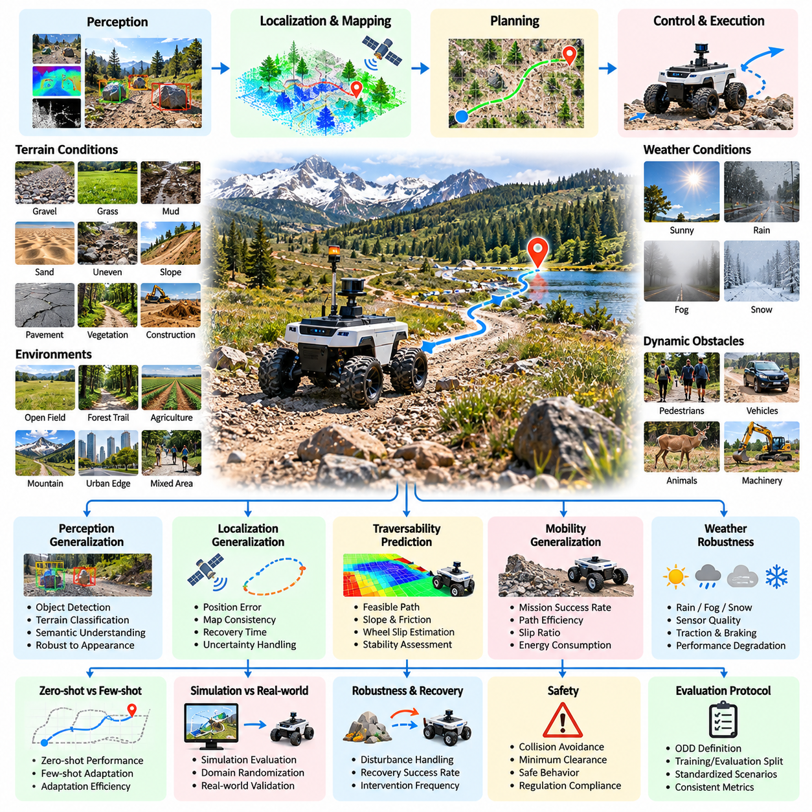{width="7.268055555555556in" height="7.268055555555556in"}

Outdoor robot generalization benchmarking evaluates whether autonomous robotic systems can maintain reliable performance across unfamiliar environments, terrain conditions, weather patterns, and operational scenarios. Unlike controlled indoor navigation, outdoor autonomy must address substantial environmental variability. The central objective is to measure how effectively learned perception, planning, and control capabilities transfer beyond the conditions represented during development.

Outdoor environments introduce complex variations in geometry, appearance, and physical interaction. Robots may encounter gravel roads, grass, mud, sand, uneven pavement, slopes, vegetation, and irregular obstacles. Each surface presents different traction, stability, and traversability characteristics. A meaningful benchmark must therefore examine whether the robot adapts its mobility decisions to changing environmental conditions rather than relying on memorized routes.

The benchmark begins by defining an operational design domain that specifies permitted terrain, weather conditions, visibility, speed limits, and expected obstacle categories. Test environments are divided into familiar development conditions and previously unseen evaluation conditions. This separation enables researchers to distinguish performance within the training distribution from genuine generalization to novel environmental configurations.

Scenario design should incorporate variations in terrain geometry, surface friction, obstacle density, illumination, and environmental dynamics. Test routes may include open fields, forest trails, construction areas, agricultural paths, and mixed pedestrian environments. Each scenario requires clearly defined starting positions, destinations, environmental constraints, and success criteria to support consistent comparisons across different robotic platforms.

Perception generalization is evaluated by exposing the robot to unfamiliar visual appearances and sensing conditions. Changes in sunlight, shadows, precipitation, dust, vegetation density, and seasonal appearance can substantially alter sensor observations. Evaluation measures whether object detection, terrain classification, obstacle recognition, and semantic understanding remain reliable despite differences from previously observed environments.

Localization and mapping generalization examine whether robots can maintain accurate spatial awareness when familiar landmarks are unavailable or environmental structure changes. Outdoor navigation may involve degraded satellite positioning, repetitive vegetation, moving foliage, and poorly defined boundaries. Position estimation error, map consistency, localization recovery time, and uncertainty calibration provide important evidence of spatial robustness.

Traversability prediction is a critical component of outdoor robot evaluation because visually similar surfaces may possess different mechanical properties. Dry soil, wet soil, loose gravel, and compacted ground can produce substantially different mobility outcomes. The benchmark assesses whether the robot correctly predicts feasible paths while accounting for terrain slope, surface compliance, wheel slip, ground clearance, and stability constraints.

Mobility generalization evaluates the ability to execute movement across terrain conditions not encountered during training. Performance measurements include mission completion rate, distance traveled, path efficiency, slip ratio, stability, and energy consumption. Tests should distinguish failures caused by perception or planning from limitations imposed by the robot\'s mechanical design, actuator capabilities, or available traction.

Weather robustness introduces controlled or naturally occurring variations in rain, fog, wind, temperature, and surface moisture. These factors affect sensor quality, traction, braking behavior, and environmental visibility. Performance should be reported separately for different weather conditions because a system that operates reliably in clear weather may exhibit substantial degradation under adverse environmental conditions.

Dynamic outdoor scenarios introduce pedestrians, vehicles, animals, moving machinery, and unexpected obstacles. The robot must predict potential interactions, maintain appropriate separation distances, and modify its trajectory when necessary. Evaluation considers collision avoidance, response latency, minimum clearance, unnecessary stopping, and recovery after disturbances while preserving mission progress and operational safety.

Generalization testing requires a carefully controlled separation between training, validation, and evaluation environments. Geographic locations, terrain configurations, visual textures, and obstacle arrangements should be partitioned to reduce information leakage. Repeated exposure to evaluation environments can unintentionally convert unseen scenarios into familiar ones, weakening the benchmark\'s ability to measure genuine transfer capability.

Zero-shot generalization measures performance when a robot encounters a new environment without additional training or adaptation. Few-shot adaptation evaluates improvement after limited observations, demonstrations, or calibration procedures. These evaluation modes should remain separate because immediate transfer and adaptation efficiency represent different capabilities. Reporting both provides a clearer understanding of the system\'s ability to operate beyond its original training conditions.

Simulation-based benchmarking enables systematic variation of terrain geometry, material properties, illumination, weather, and obstacle distributions. Domain randomization can expose robotic policies to combinations of conditions that are difficult to reproduce consistently in physical experiments. However, simulation results require real-world validation because terrain deformation, wheel-ground interaction, vegetation contact, and sensor degradation may be imperfectly represented.

Real-world field trials provide direct evidence of generalization under authentic environmental uncertainty. Test sites should include multiple geographic locations and terrain categories, with repeated trials conducted under documented conditions. Reference positioning systems, onboard telemetry, environmental measurements, and operator observations support accurate assessment of navigation performance, physical interaction, and failure mechanisms.

Robustness analysis examines how performance changes as environmental difficulty increases. Terrain slope, obstacle density, surface irregularity, sensor degradation, and visibility can be varied independently where practical. Performance degradation curves reveal operational boundaries and identify conditions where success rates decline sharply. Such analysis is more informative than evaluating robots exclusively under favorable or average conditions.

Uncertainty-aware evaluation determines whether the robot recognizes situations beyond its reliable operating capability. Perception confidence, localization uncertainty, traversability uncertainty, and predicted collision risk should correspond meaningfully to observed outcomes. A well-calibrated system can reduce speed, request assistance, select an alternative route, or enter a safe state when environmental uncertainty exceeds acceptable limits.

Safety evaluation considers collisions, rollovers, excessive slip, uncontrolled movement, and hazardous interactions with humans or equipment. Safety-critical outcomes must be reported independently of navigation efficiency and mission success. The benchmark should also measure fallback effectiveness, emergency stopping behavior, and recovery capability to determine whether generalization failures are managed without creating unacceptable physical risks.

Statistical evaluation requires sufficient trials across independent environments and environmental conditions. Reports should include success rates, confidence intervals, performance distributions, and differences between familiar and unfamiliar scenarios. Hierarchical analysis can separate variation associated with geographic location, terrain type, weather, and individual trials, reducing the risk of drawing conclusions from a narrow collection of favorable examples.

A comprehensive outdoor generalization scorecard combines navigation success, perception reliability, localization accuracy, traversability prediction, mobility efficiency, robustness, safety, and adaptation capability. Results should be organized by environmental category and difficulty level rather than compressed into a single aggregate score. This structure makes it possible to identify both transferable capabilities and specific weaknesses requiring further development.

The resulting benchmark establishes a systematic framework for evaluating outdoor robotic intelligence beyond controlled demonstrations. By combining unseen environments, diverse physical conditions, rigorous measurement, and real-world validation, it reveals whether robotic autonomy remains dependable when environmental assumptions change. Its ultimate purpose is to characterize generalization boundaries and support safer, more reliable deployment across diverse outdoor applications.

실외 로봇 일반화 벤치마킹(Outdoor Robot Generalization Benchmarking)은 자율 로봇 시스템(Autonomous Robotic Systems)이 익숙하지 않은 환경, 지형 조건, 기상 패턴, 운영 시나리오 전반에서 신뢰할 수 있는 성능을 유지할 수 있는지 평가한다. 통제된 실내 내비게이션(Indoor Navigation)과 달리 실외 자율성(Outdoor Autonomy)은 상당한 환경 변동성(Environmental Variability)에 대응해야 한다. 핵심 목표는 학습된 인식, 계획, 제어 능력이 개발 과정에서 경험한 조건을 넘어 얼마나 효과적으로 전이(Transfer)되는지 측정하는 것이다.

실외 환경(Outdoor Environments)은 지형 형상, 외관, 물리적 상호작용에서 복잡한 변화를 발생시킨다. 로봇은 자갈길, 잔디, 진흙, 모래, 고르지 않은 포장도로, 경사면, 식생, 불규칙한 장애물을 만날 수 있다. 각 표면은 서로 다른 접지력(Traction), 안정성(Stability), 주행 가능성(Traversability) 특성을 가진다. 따라서 의미 있는 벤치마크는 로봇이 암기된 경로에 의존하는 대신 변화하는 환경 조건에 맞추어 이동 결정을 조정하는지 평가해야 한다.

벤치마크는 허용되는 지형, 기상 조건, 가시성, 속도 제한, 예상 장애물 범주를 명시하는 운영설계영역(Operational Design Domain, ODD)을 정의하는 것으로 시작한다. 시험 환경은 개발 과정에서 경험한 익숙한 조건과 이전에 경험하지 못한 평가 조건으로 구분한다. 이러한 분리는 연구자가 학습 분포 내 성능(In-Distribution Performance)과 새로운 환경 구성에 대한 실제 일반화(Generalization)를 구별할 수 있도록 한다.

시나리오 설계(Scenario Design)에는 지형 형상, 표면 마찰, 장애물 밀도, 조도, 환경 동역학(Environmental Dynamics)의 변화가 포함되어야 한다. 시험 경로에는 개방된 들판, 산림 탐방로, 건설 현장, 농업용 통로, 보행자와 공유하는 혼합 환경이 포함될 수 있다. 각 시나리오는 서로 다른 로봇 플랫폼(Robot Platform) 사이의 일관된 비교를 지원하도록 초기 위치, 목적지, 환경 제약조건, 성공 기준을 명확하게 정의해야 한다.

인식 일반화(Perception Generalization)는 로봇을 익숙하지 않은 시각적 외관과 센싱 조건(Sensing Conditions)에 노출하여 평가한다. 햇빛, 그림자, 강수, 먼지, 식생 밀도, 계절에 따른 외관 변화는 센서 관측값(Sensor Observations)을 크게 변화시킬 수 있다. 평가는 이전에 관측한 환경과 차이가 존재하더라도 객체 탐지(Object Detection), 지형 분류(Terrain Classification), 장애물 인식(Obstacle Recognition), 의미적 이해(Semantic Understanding)가 신뢰성을 유지하는지 측정한다.

위치 추정 및 지도 작성 일반화(Localization and Mapping Generalization)는 익숙한 랜드마크(Landmarks)를 사용할 수 없거나 환경 구조가 변화할 때 로봇이 정확한 공간 인식(Spatial Awareness)을 유지할 수 있는지 평가한다. 실외 내비게이션에서는 위성 위치 측정 성능 저하, 반복적인 식생 구조, 움직이는 나뭇잎, 불명확한 경계가 발생할 수 있다. 위치 추정 오차, 지도 일관성(Map Consistency), 위치 추정 복구 시간, 불확실성 보정(Uncertainty Calibration)은 공간적 강건성(Spatial Robustness)을 판단하는 중요한 근거를 제공한다.

주행 가능성 예측(Traversability Prediction)은 시각적으로 유사한 표면이라도 서로 다른 기계적 특성을 가질 수 있기 때문에 실외 로봇 평가의 핵심 구성요소이다. 건조한 토양, 젖은 토양, 느슨한 자갈, 다져진 지면은 상당히 다른 이동 결과를 발생시킬 수 있다. 벤치마크는 지형 경사, 표면 순응성(Surface Compliance), 바퀴 미끄러짐(Wheel Slip), 지상고(Ground Clearance), 안정성 제약조건을 고려하면서 로봇이 실행 가능한 경로를 정확하게 예측하는지 평가한다.

이동성 일반화(Mobility Generalization)는 학습 과정에서 경험하지 못한 지형 조건에서도 이동을 수행할 수 있는 능력을 평가한다. 성능 측정 항목에는 임무 완료율(Mission Completion Rate), 이동 거리, 경로 효율성(Path Efficiency), 미끄러짐 비율(Slip Ratio), 안정성, 에너지 소비량이 포함된다. 시험에서는 인식이나 계획에서 발생한 실패와 로봇의 기계적 설계, 구동기 성능, 가용 접지력의 한계로 인해 발생한 실패를 구분해야 한다.

기상 강건성(Weather Robustness)은 비, 안개, 바람, 온도, 표면 습도에 대한 통제된 변화 또는 자연적으로 발생하는 변화를 도입한다. 이러한 요소는 센서 품질, 접지력, 제동 동작, 환경 가시성에 영향을 미친다. 맑은 날씨에서 안정적으로 작동하는 시스템도 악천후(Adverse Weather Conditions)에서는 상당한 성능 저하를 보일 수 있으므로, 성능은 서로 다른 기상 조건별로 구분하여 보고해야 한다.

동적 실외 시나리오(Dynamic Outdoor Scenarios)에는 보행자, 차량, 동물, 이동하는 기계장비, 예상하지 못한 장애물이 포함된다. 로봇은 잠재적인 상호작용을 예측하고 적절한 이격거리를 유지하며 필요할 때 이동 궤적(Trajectory)을 수정해야 한다. 평가는 임무 진행과 운영 안전성(Operational Safety)을 유지하면서 충돌 회피, 반응 지연시간(Response Latency), 최소 이격거리(Minimum Clearance), 불필요한 정지, 외란 이후 복구 능력을 고려한다.

일반화 시험(Generalization Testing)은 학습, 검증, 평가 환경 사이의 신중하게 통제된 분리를 요구한다. 지리적 위치, 지형 구성, 시각적 텍스처(Visual Textures), 장애물 배치는 정보 누출(Information Leakage)을 줄이도록 분할해야 한다. 평가 환경에 반복적으로 노출되면 이전에 경험하지 못한 시나리오가 의도하지 않게 익숙한 시나리오로 바뀔 수 있으며, 이는 실제 전이 능력(Transfer Capability)을 측정하는 벤치마크의 유효성을 약화시킨다.

제로샷 일반화(Zero-Shot Generalization)는 로봇이 추가 학습이나 적응 없이 새로운 환경을 만났을 때의 성능을 측정한다. 퓨샷 적응(Few-Shot Adaptation)은 제한된 관측, 시연 또는 보정 절차 이후의 성능 향상을 평가한다. 즉각적인 전이(Immediate Transfer)와 적응 효율성(Adaptation Efficiency)은 서로 다른 능력을 나타내므로 두 평가 방식은 분리하여 유지해야 한다. 두 결과를 모두 보고하면 원래 학습 조건을 벗어난 환경에서 시스템이 작동하는 능력을 더욱 명확하게 이해할 수 있다.

시뮬레이션 기반 벤치마킹(Simulation-Based Benchmarking)은 지형 형상, 재료 특성, 조명, 날씨, 장애물 분포를 체계적으로 변화시킬 수 있도록 한다. 도메인 무작위화(Domain Randomization)는 실제 실험에서 일관되게 재현하기 어려운 조건 조합에 로봇 정책(Robotic Policies)을 노출할 수 있다. 그러나 지형 변형, 바퀴와 지면의 상호작용, 식생 접촉, 센서 성능 저하가 불완전하게 표현될 수 있으므로 시뮬레이션 결과는 실제 환경 검증(Real-World Validation)이 필요하다.

실제 현장 시험(Real-World Field Trials)은 실제 환경의 불확실성 아래에서 일반화 능력을 직접적으로 검증하는 근거를 제공한다. 시험 장소에는 여러 지리적 위치와 지형 범주가 포함되어야 하며, 문서화된 조건에서 반복 시험을 수행해야 한다. 기준 위치 측정 시스템(Reference Positioning Systems), 로봇 내부 원격측정 데이터(Onboard Telemetry), 환경 측정값, 운영자 관찰 기록은 내비게이션 성능, 물리적 상호작용, 실패 메커니즘(Failure Mechanisms)을 정확하게 평가하도록 지원한다.

강건성 분석(Robustness Analysis)은 환경 난이도가 증가함에 따라 성능이 어떻게 변화하는지 조사한다. 가능한 경우 지형 경사, 장애물 밀도, 표면 불규칙성, 센서 성능 저하, 가시성을 독립적으로 변화시킬 수 있다. 성능 저하 곡선(Performance Degradation Curves)은 운영 한계(Operational Boundaries)를 보여주고 성공률이 급격하게 감소하는 조건을 식별한다. 이러한 분석은 유리하거나 평균적인 조건에서만 로봇을 평가하는 것보다 더 많은 정보를 제공한다.

불확실성 인식 평가(Uncertainty-Aware Evaluation)는 로봇이 자신의 신뢰 가능한 운영 능력을 벗어나는 상황을 인식하는지 판단한다. 인식 신뢰도(Perception Confidence), 위치 추정 불확실성(Localization Uncertainty), 주행 가능성 불확실성(Traversability Uncertainty), 예측 충돌 위험(Predicted Collision Risk)은 실제 관측 결과와 의미 있게 일치해야 한다. 적절하게 보정된 시스템은 환경 불확실성이 허용 한계를 초과할 때 속도를 줄이거나, 지원을 요청하거나, 대체 경로를 선택하거나, 안전 상태(Safe State)로 전환할 수 있다.

안전성 평가(Safety Evaluation)는 충돌, 전복(Rollover), 과도한 미끄러짐, 제어되지 않은 이동, 사람이나 장비와의 위험한 상호작용을 고려한다. 안전에 중대한 영향을 미치는 결과(Safety-Critical Outcomes)는 내비게이션 효율성과 임무 성공 여부와 독립적으로 보고해야 한다. 또한 벤치마크는 일반화 실패가 허용할 수 없는 물리적 위험을 발생시키지 않도록 관리되는지 판단하기 위해 대체 안전 동작(Fallback)의 효과성, 비상 정지 동작(Emergency Stopping Behavior), 복구 능력(Recovery Capability)을 측정해야 한다.

통계적 평가(Statistical Evaluation)는 독립적인 환경과 환경 조건 전반에서 충분한 시험 횟수를 요구한다. 보고서에는 성공률, 신뢰구간(Confidence Intervals), 성능 분포(Performance Distributions), 익숙한 시나리오와 새로운 시나리오 사이의 성능 차이가 포함되어야 한다. 계층적 분석(Hierarchical Analysis)은 지리적 위치, 지형 유형, 날씨, 개별 시험과 관련된 변동성을 분리하여 제한된 유리한 사례만으로 결론을 도출할 위험을 줄일 수 있다.

포괄적인 실외 일반화 평가표(Outdoor Generalization Scorecard)는 내비게이션 성공률, 인식 신뢰성(Perception Reliability), 위치 추정 정확도(Localization Accuracy), 주행 가능성 예측, 이동 효율성(Mobility Efficiency), 강건성, 안전성, 적응 능력(Adaptation Capability)을 결합한다. 결과는 단일 종합 점수(Aggregate Score)로 압축하기보다 환경 범주와 난이도 수준에 따라 구성해야 한다. 이러한 구조는 전이 가능한 능력(Transferable Capabilities)과 추가 개발이 필요한 구체적인 취약점을 모두 식별할 수 있도록 한다.

최종 벤치마크는 통제된 시연을 넘어 실외 로봇 지능(Outdoor Robotic Intelligence)을 평가하기 위한 체계적인 프레임워크(Systematic Framework)를 구축한다. 이전에 경험하지 못한 환경, 다양한 물리적 조건, 엄격한 측정, 실제 환경 검증을 결합함으로써 환경에 대한 가정이 변화할 때에도 로봇 자율성(Robotic Autonomy)이 신뢰성을 유지하는지 확인할 수 있다. 궁극적인 목적은 일반화 한계(Generalization Boundaries)를 규명하고 다양한 실외 응용 분야에서 더욱 안전하고 신뢰할 수 있는 로봇 배치를 지원하는 것이다.

##  

## 09.03. Manipulator Task Benchmark

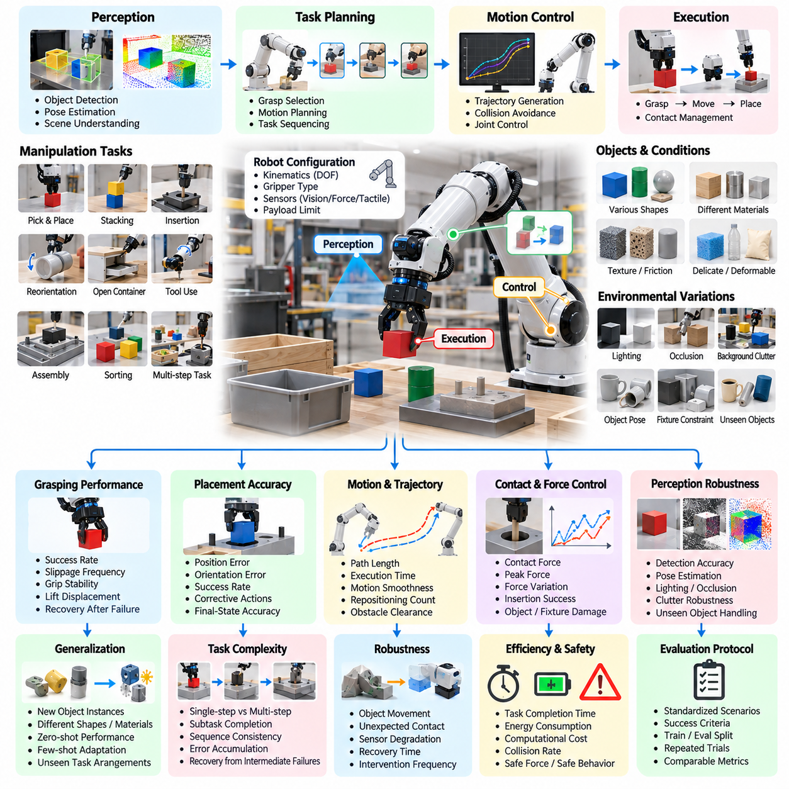{width="7.268055555555556in" height="7.268055555555556in"}

Manipulator task benchmarking evaluates how reliably and accurately a robotic manipulator performs physical tasks involving object detection, grasping, movement, placement, and interaction with the environment. Rather than measuring isolated motion accuracy alone, the benchmark assesses the complete manipulation process, including perception, task planning, motion control, contact management, and successful completion under realistic operational constraints.

A representative benchmark includes object picking, placement, stacking, insertion, reorientation, opening containers, tool use, and assembly operations. These tasks require different combinations of geometric reasoning, force control, dexterity, and environmental understanding. A well-designed benchmark should cover both simple repetitive operations and tasks involving uncertain object positions, constrained access, delicate materials, or complex sequences of physical interaction.

The benchmark begins by defining the robot configuration, including arm kinematics, degrees of freedom, gripper type, available sensors, and payload limits. Task specifications describe the initial scene, target objects, required final states, and permitted actions. Standardizing these conditions enables meaningful comparisons between manipulation systems while preserving the physical constraints that determine whether a task is feasible for a particular robotic platform.

Grasping performance is evaluated by measuring whether the manipulator securely acquires an object and maintains control throughout subsequent movement. Relevant measurements include grasp success rate, object displacement during lifting, slippage frequency, grasp stability, and recovery after failed attempts. Evaluation should account for object geometry, mass, surface friction, compliance, and orientation because these properties strongly influence grasp feasibility.

Placement accuracy measures whether an object reaches its intended destination within specified positional and rotational tolerances. Tasks may require placing components into fixtures, arranging objects on shelves, or positioning items within narrow containers. Measurements include translational error, angular deviation, placement success rate, and the number of corrective actions. Final-state accuracy should be assessed independently from the speed of execution.

Manipulation quality also depends on trajectory planning and motion execution. The benchmark measures path length, movement duration, joint motion smoothness, unnecessary repositioning, and proximity to obstacles. Efficient movement should minimize avoidable motion while respecting joint limits, collision constraints, and task-specific requirements. These metrics help distinguish accurate manipulation from behavior that achieves the same result through inefficient or unnecessarily complicated trajectories.

Contact-rich tasks require the robot to manage forces and physical constraints during interaction. Examples include inserting connectors, fitting components, tightening mechanisms, and manipulating objects that must remain in contact with a surface. Evaluation may measure contact force, peak force, force variation, insertion success, and damage to objects or fixtures. Successful execution requires sufficient force to complete the task without producing excessive pressure or unstable contact.

Force and tactile sensing are particularly important when visual observations cannot fully reveal the physical state of an interaction. A benchmark may introduce variations in friction, object stiffness, insertion resistance, or contact location to determine whether the robot adjusts its actions appropriately. Performance should reflect not only task completion but also the ability to detect contact events, respond to unexpected resistance, and maintain controlled interaction.

Perception robustness is assessed by varying object appearance, lighting, occlusion, background clutter, and object placement. The manipulator may encounter previously unseen objects or familiar objects presented in unfamiliar orientations. Evaluation measures whether the system identifies relevant object properties, estimates poses accurately, and selects suitable grasp configurations. Perception errors should be recorded separately from failures caused by planning, control, or mechanical limitations.

Generalization testing examines whether manipulation policies remain effective when object instances, task arrangements, or environmental conditions differ from those encountered during training. Changes in object size, shape, material, texture, and position can expose overdependence on memorized configurations. Zero-shot trials should be distinguished from tests involving additional demonstrations, calibration, or fine-tuning because these represent different levels of generalization and adaptation capability.

Task complexity should increase from isolated manipulation primitives to multi-step operations requiring coordinated actions. A simple benchmark may evaluate picking and placing a single object, whereas a more demanding scenario may require selecting components, aligning them, inserting them, and verifying the completed assembly. Long sequences reveal whether errors accumulate, whether intermediate states are maintained correctly, and whether the robot can recover when an earlier action fails.

Robustness evaluation introduces disturbances such as object movement, unexpected contact, partial sensor failure, and small changes in fixture geometry. The benchmark records task completion, recovery time, repeated failure frequency, and dependence on human intervention. A robust manipulator should detect when its current strategy is no longer appropriate, revise its actions when feasible, and avoid continuing movements that could damage equipment or create unsafe conditions.

Efficiency metrics include task completion time, energy consumption, motion distance, grasp attempts, and computational latency. These measurements are important in manufacturing, logistics, and service applications where productivity and resource utilization affect operational viability. However, efficiency should not be optimized independently of precision, reliability, and safety, since faster execution may increase object damage, placement errors, or failure rates.

Simulation-based evaluation supports large-scale testing across object geometries, material properties, initial configurations, and task variations. Simulated environments allow researchers to repeat experiments under controlled conditions and identify difficult cases before physical testing. Nevertheless, contact dynamics, friction, deformation, tactile sensing, and actuator behavior may differ between simulation and reality, requiring physical validation before benchmark results can support deployment decisions.

Real-world testing should use repeatable experimental procedures and accurately documented hardware and software configurations. Trials should record object properties, environmental conditions, robot calibration, sensor status, and task outcomes. Repeated executions across multiple objects and configurations help distinguish consistent capability from occasional success and provide evidence for reproducibility across different laboratories and robotic platforms.

Statistical reporting should include success rates, confidence intervals, sample sizes, and distributions of execution time and accuracy. Results should be separated by task category, object characteristics, and difficulty level to prevent aggregate scores from concealing important weaknesses. For example, high performance on uncomplicated pick-and-place operations should not obscure poor reliability during precision insertion or delicate contact-rich manipulation.

Safety evaluation considers excessive contact forces, dropped objects, collisions, damage to fixtures, and hazardous interactions with nearby humans. Safety-critical failures should be reported independently from ordinary task failures and efficiency metrics. The benchmark should also assess emergency stopping, controlled release, and recovery behavior when unexpected contact or unstable object handling creates a potential hazard.

A comprehensive manipulator benchmark combines task success, grasp reliability, placement accuracy, trajectory quality, force regulation, generalization, efficiency, and safety. Results should be presented as a multidimensional performance profile rather than relying exclusively on a single ranking. This approach reveals the conditions under which a system performs well, the tasks that remain difficult, and the trade-offs between speed, precision, adaptability, and reliability.

The resulting benchmark provides a systematic foundation for comparing manipulation algorithms, robotic hardware configurations, and learning-based policies. By combining standardized tasks, controlled variations, repeated physical trials, and transparent metrics, it supports rigorous evaluation beyond isolated demonstrations. Its ultimate purpose is to establish whether a manipulator can perform useful physical work reliably, safely, and efficiently across the range of conditions expected in practical deployment.

조작기 작업 벤치마킹(Manipulator Task Benchmarking)은 로봇 조작기(Robotic Manipulator)가 물체 탐지(Object Detection), 파지(Grasping), 이동(Movement), 배치(Placement), 환경과의 상호작용(Interaction with the Environment)을 포함하는 물리적 작업을 얼마나 신뢰성 있고 정확하게 수행하는지 평가한다. 벤치마크는 개별적인 동작 정확도만 측정하는 것이 아니라 인식(Perception), 작업 계획(Task Planning), 운동 제어(Motion Control), 접촉 관리(Contact Management), 현실적인 운영 제약조건하에서의 작업 완료를 포함하는 전체 조작 과정을 평가한다.

대표적인 벤치마크에는 물체 집기(Object Picking), 배치, 쌓기(Stacking), 삽입(Insertion), 방향 재조정(Reorientation), 용기 열기, 도구 사용(Tool Use), 조립 작업(Assembly Operations)이 포함된다. 이러한 작업에는 기하학적 추론(Geometric Reasoning), 힘 제어(Force Control), 손재주(Dexterity), 환경 이해(Environmental Understanding)의 다양한 조합이 필요하다. 잘 설계된 벤치마크는 단순하고 반복적인 작업뿐만 아니라 불확실한 물체 위치, 제한된 접근 공간, 취약한 재료, 복잡한 물리적 상호작용 순서를 포함하는 작업도 다루어야 한다.

벤치마크는 관절 운동학(Arm Kinematics), 자유도(Degrees of Freedom), 그리퍼 유형(Gripper Type), 사용 가능한 센서, 페이로드 한계(Payload Limits)를 포함하는 로봇 구성을 정의하는 것으로 시작한다. 작업 명세(Task Specification)는 초기 장면, 대상 물체, 필요한 최종 상태, 허용되는 동작을 설명한다. 이러한 조건을 표준화하면 특정 로봇 플랫폼에서 작업의 실행 가능성을 결정하는 물리적 제약조건을 유지하면서 조작 시스템 간의 의미 있는 비교를 수행할 수 있다.

파지 성능(Grasping Performance)은 조작기가 물체를 안정적으로 잡고 이후 이동 과정에서도 제어 상태를 유지하는지 측정하여 평가한다. 관련 측정 항목에는 파지 성공률(Grasp Success Rate), 들어 올리는 동안의 물체 변위(Object Displacement), 미끄러짐 빈도(Slippage Frequency), 파지 안정성(Grasp Stability), 파지 실패 이후의 복구 능력이 포함된다. 물체의 형상, 질량, 표면 마찰, 순응성(Compliance), 방향을 고려해야 한다. 이러한 특성은 파지의 실행 가능성에 큰 영향을 미치기 때문이다.

배치 정확도(Placement Accuracy)는 물체가 지정된 위치 및 회전 허용오차 내에서 목표 지점에 도달하는지를 측정한다. 작업에는 부품을 고정구(Fixture)에 삽입하거나, 선반에 물체를 정렬하거나, 좁은 용기 안에 물체를 배치하는 과정이 포함될 수 있다. 측정 항목에는 위치 이동 오차(Translational Error), 각도 편차(Angular Deviation), 배치 성공률, 수정 동작 횟수가 포함된다. 최종 상태의 정확도는 실행 속도와 독립적으로 평가해야 한다.

조작 품질(Manipulation Quality)은 궤적 계획(Trajectory Planning)과 동작 실행(Motion Execution)에도 영향을 받는다. 벤치마크는 경로 길이, 이동 시간, 관절 동작의 평활성(Joint Motion Smoothness), 불필요한 위치 재조정, 장애물과의 근접성을 측정한다. 효율적인 동작은 관절 한계(Joint Limits), 충돌 제약조건(Collision Constraints), 작업별 요구사항을 준수하면서 불필요한 움직임을 최소화해야 한다. 이러한 지표는 정확한 조작과 비효율적이거나 불필요하게 복잡한 궤적을 통해 동일한 결과를 달성하는 동작을 구별하는 데 도움이 된다.

접촉이 중요한 작업(Contact-Rich Tasks)에서는 상호작용 중 힘과 물리적 제약조건을 관리해야 한다. 커넥터 삽입, 부품 결합, 기계장치 조임, 표면과의 접촉을 유지해야 하는 물체 조작 등이 그 예이다. 평가는 접촉력(Contact Force), 최대 힘(Peak Force), 힘의 변화량(Force Variation), 삽입 성공률, 물체 또는 고정구의 손상 여부를 측정할 수 있다. 성공적인 실행을 위해서는 작업을 완료할 수 있을 만큼 충분한 힘을 가하면서도 과도한 압력이나 불안정한 접촉을 유발하지 않아야 한다.

시각적 관측만으로 상호작용의 물리적 상태를 완전히 파악할 수 없는 경우에는 힘 및 촉각 센싱(Force and Tactile Sensing)이 특히 중요하다. 벤치마크는 마찰, 물체 강성(Object Stiffness), 삽입 저항(Insertion Resistance), 접촉 위치에 변화를 도입하여 로봇이 동작을 적절하게 조정하는지 평가할 수 있다. 성능은 작업 완료 여부뿐만 아니라 접촉 사건을 감지하고 예상하지 못한 저항에 대응하며 제어된 상호작용을 유지하는 능력도 반영해야 한다.

인식 강건성(Perception Robustness)은 물체의 외관, 조명, 가림(Occlusion), 배경의 복잡성, 물체 배치에 변화를 주어 평가한다. 조작기는 이전에 접하지 못한 물체나 익숙한 물체의 낯선 방향을 마주할 수 있다. 평가는 시스템이 관련 물체 특성을 식별하고 자세(Pose)를 정확하게 추정하며 적절한 파지 구성을 선택하는지 측정한다. 인식 오류는 계획, 제어 또는 기계적 한계로 인해 발생하는 실패와 구분하여 기록해야 한다.

일반화 시험(Generalization Testing)은 학습 과정에서 경험한 것과 물체 인스턴스, 작업 배치, 환경 조건이 달라져도 조작 정책(Manipulation Policies)이 효과를 유지하는지 평가한다. 물체의 크기, 형상, 재료, 질감, 위치를 변경하면 기억된 구성에 대한 과도한 의존성이 드러날 수 있다. 제로샷 시험(Zero-Shot Trials)은 추가 시연, 보정 또는 미세 조정(Fine-Tuning)을 수행하는 시험과 구분해야 한다. 이러한 시험은 서로 다른 수준의 일반화 및 적응 능력을 나타내기 때문이다.

작업 복잡성(Task Complexity)은 독립적인 조작 기본 동작(Manipulation Primitives)에서 여러 동작을 조정해야 하는 다단계 작업으로 점진적으로 높여야 한다. 단순한 벤치마크는 하나의 물체를 집어 배치하는 작업을 평가할 수 있지만, 더 복잡한 시나리오에서는 부품을 선택하고 정렬한 뒤 삽입하고 조립 완료 여부를 확인해야 할 수 있다. 긴 작업 순서는 오류가 누적되는지, 중간 상태를 올바르게 유지하는지, 이전 동작이 실패했을 때 복구할 수 있는지를 보여준다.

강건성 평가(Robustness Evaluation)는 물체 이동, 예상하지 못한 접촉, 부분적인 센서 고장, 고정구 형상의 작은 변화와 같은 외란(Disturbance)을 도입한다. 벤치마크는 작업 완료 여부, 복구 시간, 반복 실패 빈도, 사람의 개입에 대한 의존도를 기록한다. 강건한 조작기는 현재 전략이 더 이상 적절하지 않은 상황을 감지하고 실행 가능한 경우 동작을 수정하며 장비 손상이나 안전하지 않은 상황을 유발할 수 있는 움직임을 지속하지 않아야 한다.

효율성 지표(Efficiency Metrics)에는 작업 완료 시간, 에너지 소비량, 이동 거리, 파지 시도 횟수, 계산 지연시간(Computational Latency)이 포함된다. 제조, 물류, 서비스 분야에서는 생산성과 자원 활용도가 운영 가능성(Operational Viability)에 영향을 미치므로 이러한 측정이 중요하다. 그러나 효율성은 정밀도, 신뢰성, 안전성과 독립적으로 최적화해서는 안 된다. 실행 속도가 빨라지면 물체 손상, 배치 오류, 실패율이 증가할 수 있기 때문이다.

시뮬레이션 기반 평가(Simulation-Based Evaluation)는 다양한 물체 형상, 재료 특성, 초기 구성, 작업 변형을 대상으로 대규모 시험을 지원한다. 시뮬레이션 환경(Simulated Environment)을 활용하면 통제된 조건에서 실험을 반복하고 실제 시험 전에 어려운 사례를 식별할 수 있다. 그러나 접촉 동역학(Contact Dynamics), 마찰, 변형, 촉각 센싱, 구동기 동작은 시뮬레이션과 현실 사이에 차이가 있을 수 있으므로 벤치마크 결과를 실제 배치 의사결정에 활용하기 전에 물리적 검증(Physical Validation)이 필요하다.

실제 환경 시험(Real-World Testing)은 반복 가능한 실험 절차와 정확하게 문서화된 하드웨어 및 소프트웨어 구성을 사용해야 한다. 시험에서는 물체 특성, 환경 조건, 로봇 보정 상태, 센서 상태, 작업 결과를 기록해야 한다. 여러 물체와 구성에서 반복 실행하면 일관된 능력과 우연한 성공을 구분할 수 있으며, 서로 다른 연구실과 로봇 플랫폼 간의 재현성을 뒷받침하는 근거를 확보할 수 있다.

통계적 보고(Statistical Reporting)에는 성공률, 신뢰구간(Confidence Intervals), 표본 크기, 실행 시간과 정확도의 분포가 포함되어야 한다. 종합 점수(Aggregate Score)가 중요한 취약점을 감추지 않도록 결과는 작업 범주, 물체 특성, 난이도 수준에 따라 구분해야 한다. 예를 들어 단순한 집기 및 배치 작업에서 높은 성능을 보이더라도 정밀 삽입이나 섬세한 접촉 중심 조작에서 신뢰성이 낮을 수 있으므로 이를 별도로 확인해야 한다.

안전성 평가(Safety Evaluation)는 과도한 접촉력, 물체 낙하, 충돌, 고정구 손상, 주변 사람과의 위험한 상호작용을 고려한다. 안전에 중대한 영향을 미치는 실패(Safety-Critical Failures)는 일반적인 작업 실패 및 효율성 지표와 독립적으로 보고해야 한다. 또한 예상하지 못한 접촉이나 불안정한 물체 취급으로 잠재적인 위험이 발생할 때 비상 정지(Emergency Stopping), 제어된 물체 해제(Controlled Release), 복구 동작(Recovery Behavior)이 효과적으로 작동하는지도 평가해야 한다.

포괄적인 조작기 벤치마크(Manipulator Benchmark)는 작업 성공률, 파지 신뢰성(Grasp Reliability), 배치 정확도, 궤적 품질, 힘 조절(Force Regulation), 일반화, 효율성, 안전성을 결합한다. 결과는 단일 순위에만 의존하기보다 다차원적인 성능 프로파일(Multidimensional Performance Profile)로 제시해야 한다. 이러한 접근방식은 시스템이 어떤 조건에서 우수한 성능을 보이는지, 어떤 작업이 여전히 어려운지, 속도와 정밀도, 적응성, 신뢰성 사이에 어떤 상충관계(Trade-off)가 존재하는지 보여준다.

최종 벤치마크는 조작 알고리즘, 로봇 하드웨어 구성, 학습 기반 정책(Learning-Based Policies)을 비교하기 위한 체계적인 토대(Systematic Foundation)를 제공한다. 표준화된 작업, 통제된 조건 변화, 반복적인 물리적 시험, 투명한 평가 지표를 결합함으로써 개별 시연을 넘어 엄밀한 평가를 지원한다. 궁극적인 목적은 조작기가 실제 배치에서 예상되는 다양한 조건 전반에 걸쳐 유용한 물리적 작업을 신뢰성 있고 안전하며 효율적으로 수행할 수 있는지 확인하는 것이다.

##  

## 09.04. Mobile Manipulator Benchmark

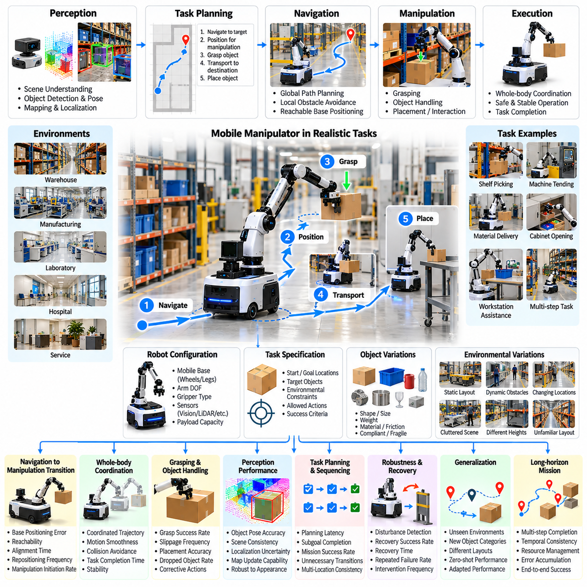{width="7.268055555555556in" height="7.268055555555556in"}

Mobile manipulator benchmarking evaluates the ability of a robotic system to combine autonomous navigation with physical manipulation in a coordinated and reliable manner. Unlike fixed-base manipulators or standalone mobile robots, mobile manipulators must continuously manage interactions between locomotion, positioning, perception, and object handling. Evaluation therefore focuses on complete task execution rather than treating navigation and manipulation as independent capabilities.

A representative benchmark environment includes warehouses, manufacturing facilities, laboratories, hospitals, and service environments where objects must be transported, retrieved, or manipulated across multiple locations. Typical tasks include shelf picking, machine tending, material delivery, cabinet opening, and workstation assistance. These scenarios require the robot to navigate toward a target, establish a suitable manipulation pose, perform physical interaction, and continue its mission.

Benchmark design begins by defining the mobile platform, manipulator configuration, sensor arrangement, payload capacity, and operational constraints. The specification includes wheel or leg mobility, arm degrees of freedom, gripper characteristics, and available perception modalities. Task definitions establish starting conditions, target locations, object properties, environmental restrictions, and success criteria, ensuring that comparisons account for differences in robotic embodiment.

Navigation-to-manipulation transition is a central evaluation component because successful object interaction depends on accurate positioning of the mobile base. The robot must select a base pose that provides sufficient arm reachability, collision clearance, and manipulation stability. Relevant measurements include base positioning error, target reachability, alignment time, repositioning frequency, and the probability of successfully initiating manipulation after navigation.

Whole-body coordination evaluates how effectively the mobile base and robotic arm operate as an integrated system. Some tasks require the platform to remain stationary while the arm moves, whereas others benefit from simultaneous base and arm motion. Benchmark metrics include coordinated trajectory accuracy, execution smoothness, collision avoidance, and task completion time. Evaluation should identify whether coordinated control improves performance without compromising stability or safety.

Perception performance is assessed across navigation and manipulation phases because the robot must maintain consistent environmental understanding at different spatial scales. Global mapping supports route planning, while local perception enables object localization, grasp selection, and contact management. The benchmark measures object pose estimation accuracy, scene consistency, localization uncertainty, and the ability to update spatial representations when the robot changes position.

Grasping and object handling are evaluated under conditions where mobile-base positioning errors influence manipulation accuracy. The benchmark measures grasp success rate, object slippage, placement precision, dropped-object frequency, and corrective action requirements. Object characteristics such as geometry, weight, surface friction, and compliance should vary systematically to determine whether the robot can compensate for uncertainty in both navigation and manipulation.

Task planning evaluation examines how the robot sequences navigation, positioning, grasping, transportation, and placement actions. A successful system must select feasible intermediate goals while respecting environmental and mechanical constraints. Metrics include planning latency, subgoal completion rate, unnecessary transitions, and overall mission success. Complex scenarios reveal whether the robot can maintain task consistency across multiple spatial locations and physical interactions.

Mobile manipulation introduces additional stability challenges because arm movements and payload changes can alter the robot\'s center of mass and load distribution. Evaluation should consider base displacement, body inclination, wheel traction, and stability margins during lifting, reaching, and transportation. Tasks involving elevated shelves or extended arm configurations are particularly useful for identifying mechanical and control limitations.

Dynamic environments introduce moving pedestrians, other robots, temporary obstacles, and changing object locations. The benchmark evaluates whether the mobile manipulator can adjust navigation routes, update manipulation targets, and resume interrupted operations. Collision avoidance, replanning latency, recovery success, and intervention frequency provide evidence of adaptability under realistic operational uncertainty.

Generalization testing examines performance across unfamiliar facility layouts, object categories, shelf configurations, and task sequences. A system trained on particular workstations may struggle when target objects appear at different heights or when access geometry changes. Zero-shot and adapted performance should be reported separately to distinguish immediate transfer capability from improvements achieved through additional demonstrations or calibration.

Robustness evaluation introduces controlled disturbances such as localization drift, partial sensor occlusion, grasp failure, unexpected object movement, and temporary communication loss. The robot should recognize unsuccessful actions and select appropriate recovery strategies. Evaluation measures disturbance detection, recovery duration, repeated failure frequency, and the proportion of missions completed without external assistance.

Long-horizon benchmarking combines multiple navigation and manipulation operations into extended missions. A representative sequence may require retrieving objects from several storage locations, transporting them to designated workstations, and verifying final placement. Performance measures include complete mission success, subtask consistency, cumulative positioning error, autonomous operating duration, and the number of human interventions required.

Efficiency evaluation considers travel distance, manipulation duration, energy consumption, computational latency, and unnecessary repositioning. Mobile manipulators must balance efficient navigation with accurate physical interaction, making optimization more complex than in single-function robots. Benchmark results should identify trade-offs between movement speed, manipulation precision, payload handling, and operational reliability.

Simulation-based evaluation enables systematic testing of facility layouts, object configurations, robot dynamics, and environmental disturbances. Digital environments can generate repeated trials and support comparisons between planning and control strategies. However, simulated contact dynamics, wheel-ground interaction, payload effects, and sensor behavior may differ from physical conditions, requiring careful validation of simulation-to-reality transfer.

Real-world validation should use repeatable tasks and documented experimental conditions. Measurements may combine external tracking systems, calibrated reference objects, onboard sensor logs, and independent observations. Repeated trials across different locations and task configurations provide evidence of reproducibility while revealing practical limitations associated with hardware calibration, environmental variability, and accumulated system errors.

Safety evaluation addresses collisions, unstable payload handling, excessive contact forces, dropped objects, and unsafe interactions with nearby personnel. Safety-critical outcomes must be reported independently from task efficiency and completion scores. Emergency stopping, controlled object release, protective separation, and safe recovery behavior should be evaluated to determine whether the robot maintains acceptable risk during integrated operation.

Statistical reporting should include mission success rates, confidence intervals, completion-time distributions, intervention frequency, and failure classifications. Results should distinguish navigation failures, manipulation failures, coordination failures, and environmental disturbances. This separation prevents a single aggregate score from concealing weaknesses and supports more precise comparisons between different mobile manipulation architectures.

A comprehensive mobile manipulator scorecard combines navigation accuracy, manipulation success, whole-body coordination, stability, efficiency, robustness, safety, and generalization. Performance should be reported across task difficulty levels and environmental categories. Multidimensional evaluation reveals whether improvements in one subsystem translate into meaningful gains in complete mission performance or introduce new limitations elsewhere.

The resulting benchmark establishes a systematic foundation for evaluating integrated robotic autonomy in practical environments. By combining standardized tasks, coordinated motion assessment, long-horizon missions, controlled disturbances, and real-world validation, it measures capabilities beyond isolated navigation or grasping demonstrations. Its ultimate purpose is to determine whether mobile manipulators can perform useful physical work reliably, safely, and efficiently across diverse operational conditions.

이동형 조작기 벤치마킹(Mobile Manipulator Benchmarking)은 로봇 시스템이 자율 내비게이션(Autonomous Navigation)과 물리적 조작(Physical Manipulation)을 조화롭고 신뢰성 있게 결합하는 능력을 평가한다. 고정형 조작기(Fixed-Base Manipulator)나 독립형 이동로봇(Standalone Mobile Robot)과 달리 이동형 조작기(Mobile Manipulator)는 이동, 위치 결정, 인식, 물체 취급 사이의 상호작용을 지속적으로 관리해야 한다. 따라서 평가는 내비게이션과 조작을 독립적인 능력으로 취급하기보다 전체 작업 실행(Complete Task Execution)에 초점을 맞춘다.

대표적인 벤치마크 환경(Benchmark Environment)에는 여러 위치에서 물체를 운반하거나 회수하거나 조작해야 하는 창고, 제조시설, 실험실, 병원, 서비스 환경이 포함된다. 일반적인 작업에는 선반에서 물체 집기(Shelf Picking), 기계 작업 지원(Machine Tending), 자재 운반(Material Delivery), 캐비닛 열기(Cabinet Opening), 작업대 지원(Workstation Assistance)이 포함된다. 이러한 시나리오에서는 로봇이 목표 지점까지 이동하고, 적절한 조작 자세(Manipulation Pose)를 확보하며, 물리적 상호작용을 수행한 후 임무를 계속 진행해야 한다.

벤치마크 설계(Benchmark Design)는 이동 플랫폼(Mobile Platform), 조작기 구성(Manipulator Configuration), 센서 배치(Sensor Arrangement), 적재 용량(Payload Capacity), 운영 제약조건(Operational Constraints)을 정의하는 것으로 시작한다. 명세에는 바퀴 또는 다리 기반 이동 방식, 로봇 팔의 자유도(Degrees of Freedom), 그리퍼 특성(Gripper Characteristics), 사용 가능한 인식 모달리티(Perception Modalities)가 포함된다. 작업 정의는 초기 조건, 목표 위치, 물체 특성, 환경 제한사항, 성공 기준을 설정하여 로봇 구현 형태(Embodiment)의 차이를 고려한 비교가 가능하도록 한다.

내비게이션에서 조작으로의 전환(Navigation-to-Manipulation Transition)은 성공적인 물체 상호작용이 이동 베이스(Mobile Base)의 정확한 위치 결정에 의존하기 때문에 핵심적인 평가 요소이다. 로봇은 충분한 팔 도달 가능성(Arm Reachability), 충돌 여유 공간(Collision Clearance), 조작 안정성(Manipulation Stability)을 확보할 수 있는 베이스 자세(Base Pose)를 선택해야 한다. 관련 측정 항목에는 베이스 위치 오차(Base Positioning Error), 목표 도달 가능성(Target Reachability), 정렬 시간(Alignment Time), 위치 재조정 빈도(Repositioning Frequency), 이동 완료 후 조작을 성공적으로 시작할 확률이 포함된다.

전신 협조 제어(Whole-Body Coordination)는 이동 베이스와 로봇 팔이 통합 시스템(Integrated System)으로 얼마나 효과적으로 작동하는지 평가한다. 일부 작업에서는 팔이 움직이는 동안 플랫폼이 정지 상태를 유지해야 하지만, 다른 작업에서는 베이스와 팔의 동시 움직임이 유리할 수 있다. 벤치마크 지표에는 협조 궤적 정확도(Coordinated Trajectory Accuracy), 실행 평활성(Execution Smoothness), 충돌 회피(Collision Avoidance), 작업 완료 시간이 포함된다. 평가는 협조 제어(Coordinated Control)가 안정성이나 안전성을 저해하지 않으면서 성능을 향상시키는지 식별해야 한다.

인식 성능(Perception Performance)은 로봇이 서로 다른 공간적 규모(Spatial Scales)에서 일관된 환경 이해(Environmental Understanding)를 유지해야 하므로 내비게이션과 조작 단계 전반에 걸쳐 평가한다. 전역 지도 작성(Global Mapping)은 경로 계획(Route Planning)을 지원하고, 지역 인식(Local Perception)은 물체 위치 추정(Object Localization), 파지 선택(Grasp Selection), 접촉 관리(Contact Management)를 가능하게 한다. 벤치마크는 물체 자세 추정 정확도(Object Pose Estimation Accuracy), 장면 일관성(Scene Consistency), 위치 추정 불확실성(Localization Uncertainty), 로봇 위치 변화에 따른 공간 표현(Spatial Representation)의 갱신 능력을 측정한다.

파지 및 물체 취급(Grasping and Object Handling)은 이동 베이스의 위치 결정 오차가 조작 정확도에 영향을 미치는 조건에서 평가한다. 벤치마크는 파지 성공률(Grasp Success Rate), 물체 미끄러짐(Object Slippage), 배치 정밀도(Placement Precision), 물체 낙하 빈도(Dropped-Object Frequency), 수정 동작 요구량(Corrective Action Requirements)을 측정한다. 물체의 형상, 무게, 표면 마찰, 순응성(Compliance)과 같은 특성을 체계적으로 변화시켜 로봇이 내비게이션과 조작 양쪽에서 발생하는 불확실성을 보상할 수 있는지 판단해야 한다.

작업 계획 평가(Task Planning Evaluation)는 로봇이 내비게이션, 위치 결정, 파지, 운반, 배치 동작을 어떤 순서로 수행하는지 조사한다. 성공적인 시스템은 환경적·기계적 제약조건을 준수하면서 실행 가능한 중간 목표(Intermediate Goals)를 선택해야 한다. 평가 지표에는 계획 지연시간(Planning Latency), 하위 목표 완료율(Subgoal Completion Rate), 불필요한 상태 전환(Unnecessary Transitions), 전체 임무 성공률(Overall Mission Success)이 포함된다. 복잡한 시나리오는 로봇이 여러 공간적 위치와 물리적 상호작용에 걸쳐 작업 일관성(Task Consistency)을 유지할 수 있는지 보여준다.

이동형 조작(Mobile Manipulation)은 로봇 팔의 움직임과 적재 하중의 변화가 무게중심(Center of Mass)과 하중 분포(Load Distribution)를 변화시킬 수 있기 때문에 추가적인 안정성 문제를 발생시킨다. 평가는 들어 올리기, 뻗기, 운반 과정에서 베이스 변위(Base Displacement), 본체 기울기(Body Inclination), 바퀴 접지력(Wheel Traction), 안정성 여유도(Stability Margins)를 고려해야 한다. 높은 선반이나 팔을 길게 뻗은 구성을 포함하는 작업은 기계적 한계와 제어 한계를 식별하는 데 특히 유용하다.

동적 환경(Dynamic Environments)에는 이동하는 보행자, 다른 로봇, 일시적인 장애물, 변화하는 물체 위치가 포함된다. 벤치마크는 이동형 조작기가 내비게이션 경로를 조정하고, 조작 목표를 갱신하며, 중단된 작업을 재개할 수 있는지 평가한다. 충돌 회피(Collision Avoidance), 재계획 지연시간(Replanning Latency), 복구 성공률(Recovery Success Rate), 개입 빈도(Intervention Frequency)는 현실적인 운영 불확실성(Operational Uncertainty) 아래에서 적응성을 판단하는 근거를 제공한다.

일반화 시험(Generalization Testing)은 익숙하지 않은 시설 배치, 물체 범주, 선반 구성, 작업 순서 전반에서 성능을 평가한다. 특정 작업대(Workstation)에서 학습된 시스템은 목표 물체가 다른 높이에 놓이거나 접근 공간의 기하학적 구조(Access Geometry)가 변화할 때 어려움을 겪을 수 있다. 제로샷 성능(Zero-Shot Performance)과 적응 후 성능(Adapted Performance)은 즉각적인 전이 능력(Immediate Transfer Capability)과 추가 시연 또는 보정을 통해 달성한 성능 향상을 구분하기 위해 별도로 보고해야 한다.

강건성 평가(Robustness Evaluation)는 위치 추정 드리프트(Localization Drift), 부분적인 센서 가림(Partial Sensor Occlusion), 파지 실패(Grasp Failure), 예상하지 못한 물체 이동, 일시적인 통신 손실(Temporary Communication Loss)과 같은 통제된 외란(Controlled Disturbances)을 도입한다. 로봇은 실패한 동작을 인식하고 적절한 복구 전략(Recovery Strategies)을 선택해야 한다. 평가는 외란 감지(Disturbance Detection), 복구 소요 시간(Recovery Duration), 반복 실패 빈도(Repeated Failure Frequency), 외부 지원 없이 완료된 임무의 비율을 측정한다.

장기 작업 벤치마킹(Long-Horizon Benchmarking)은 여러 내비게이션 및 조작 작업을 확장된 임무(Extended Missions)로 결합한다. 대표적인 작업 순서는 여러 보관 위치에서 물체를 회수하고, 지정된 작업대로 운반하며, 최종 배치 상태를 확인하는 과정으로 구성될 수 있다. 성능 측정 항목에는 전체 임무 성공률(Complete Mission Success), 하위 작업 일관성(Subtask Consistency), 누적 위치 오차(Cumulative Positioning Error), 자율 운영 지속시간(Autonomous Operating Duration), 필요한 사람의 개입 횟수가 포함된다.

효율성 평가(Efficiency Evaluation)는 이동 거리(Travel Distance), 조작 소요 시간(Manipulation Duration), 에너지 소비량(Energy Consumption), 계산 지연시간(Computational Latency), 불필요한 위치 재조정(Unnecessary Repositioning)을 고려한다. 이동형 조작기는 효율적인 내비게이션과 정확한 물리적 상호작용 사이에서 균형을 유지해야 하므로 단일 기능 로봇보다 최적화가 복잡하다. 벤치마크 결과는 이동 속도, 조작 정밀도(Manipulation Precision), 적재물 취급(Payload Handling), 운영 신뢰성(Operational Reliability) 사이의 상충관계(Trade-offs)를 식별해야 한다.

시뮬레이션 기반 평가(Simulation-Based Evaluation)는 시설 배치, 물체 구성, 로봇 동역학(Robot Dynamics), 환경 외란(Environmental Disturbances)을 체계적으로 시험할 수 있도록 한다. 디지털 환경(Digital Environments)은 반복 시험을 생성하고 계획 및 제어 전략(Planning and Control Strategies) 사이의 비교를 지원한다. 그러나 시뮬레이션된 접촉 동역학(Contact Dynamics), 바퀴와 지면의 상호작용(Wheel-Ground Interaction), 적재 하중 효과(Payload Effects), 센서 동작(Sensor Behavior)은 실제 물리적 조건과 다를 수 있으므로 시뮬레이션에서 현실로의 전이(Simulation-to-Reality Transfer)를 신중하게 검증해야 한다.

실제 환경 검증(Real-World Validation)은 반복 가능한 작업과 문서화된 실험 조건(Experimental Conditions)을 사용해야 한다. 측정에는 외부 추적 시스템(External Tracking Systems), 보정된 기준 물체(Calibrated Reference Objects), 로봇 내부 센서 로그(Onboard Sensor Logs), 독립적인 관찰 결과를 결합할 수 있다. 서로 다른 위치와 작업 구성에서 반복 시험을 수행하면 재현성(Reproducibility)에 대한 근거를 확보하는 동시에 하드웨어 보정(Hardware Calibration), 환경 변동성(Environmental Variability), 누적 시스템 오차(Accumulated System Errors)와 관련된 실제 한계를 파악할 수 있다.

안전성 평가(Safety Evaluation)는 충돌, 불안정한 적재물 취급(Unstable Payload Handling), 과도한 접촉력(Excessive Contact Forces), 물체 낙하(Dropped Objects), 주변 작업자와의 위험한 상호작용을 다룬다. 안전에 중대한 영향을 미치는 결과(Safety-Critical Outcomes)는 작업 효율성 및 완료 점수와 독립적으로 보고해야 한다. 비상 정지(Emergency Stopping), 제어된 물체 해제(Controlled Object Release), 보호 이격거리(Protective Separation), 안전 복구 동작(Safe Recovery Behavior)을 평가하여 로봇이 통합 운영 중 허용 가능한 위험 수준(Acceptable Risk)을 유지하는지 판단해야 한다.

통계적 보고(Statistical Reporting)에는 임무 성공률(Mission Success Rates), 신뢰구간(Confidence Intervals), 완료 시간 분포(Completion-Time Distributions), 개입 빈도(Intervention Frequency), 실패 분류(Failure Classifications)가 포함되어야 한다. 결과는 내비게이션 실패(Navigation Failures), 조작 실패(Manipulation Failures), 협조 제어 실패(Coordination Failures), 환경 외란(Environmental Disturbances)을 구분해야 한다. 이러한 분리는 단일 종합 점수(Aggregate Score)가 취약점을 감추는 것을 방지하고 서로 다른 이동형 조작 아키텍처(Mobile Manipulation Architectures) 사이의 더욱 정밀한 비교를 지원한다.

포괄적인 이동형 조작기 평가표(Mobile Manipulator Scorecard)는 내비게이션 정확도(Navigation Accuracy), 조작 성공률(Manipulation Success), 전신 협조 제어(Whole-Body Coordination), 안정성(Stability), 효율성(Efficiency), 강건성(Robustness), 안전성(Safety), 일반화(Generalization)를 결합한다. 성능은 작업 난이도 수준(Task Difficulty Levels)과 환경 범주(Environmental Categories)에 따라 보고해야 한다. 다차원 평가(Multidimensional Evaluation)는 특정 하위 시스템의 성능 향상이 전체 임무 성능의 실질적인 개선으로 이어지는지 또는 다른 영역에서 새로운 한계를 발생시키는지 보여준다.

최종 벤치마크는 실제 환경에서 통합 로봇 자율성(Integrated Robotic Autonomy)을 평가하기 위한 체계적인 토대(Systematic Foundation)를 구축한다. 표준화된 작업(Standardized Tasks), 협조 동작 평가(Coordinated Motion Assessment), 장기 임무(Long-Horizon Missions), 통제된 외란(Controlled Disturbances), 실제 환경 검증(Real-World Validation)을 결합함으로써 독립적인 내비게이션 또는 파지 시연을 넘어서는 능력을 측정한다. 궁극적인 목적은 이동형 조작기가 다양한 운영 조건에서 유용한 물리적 작업을 신뢰성 있고 안전하며 효율적으로 수행할 수 있는지 판단하는 것이다.

##  

## 09.05. Quadruped Locomotion Benchmark

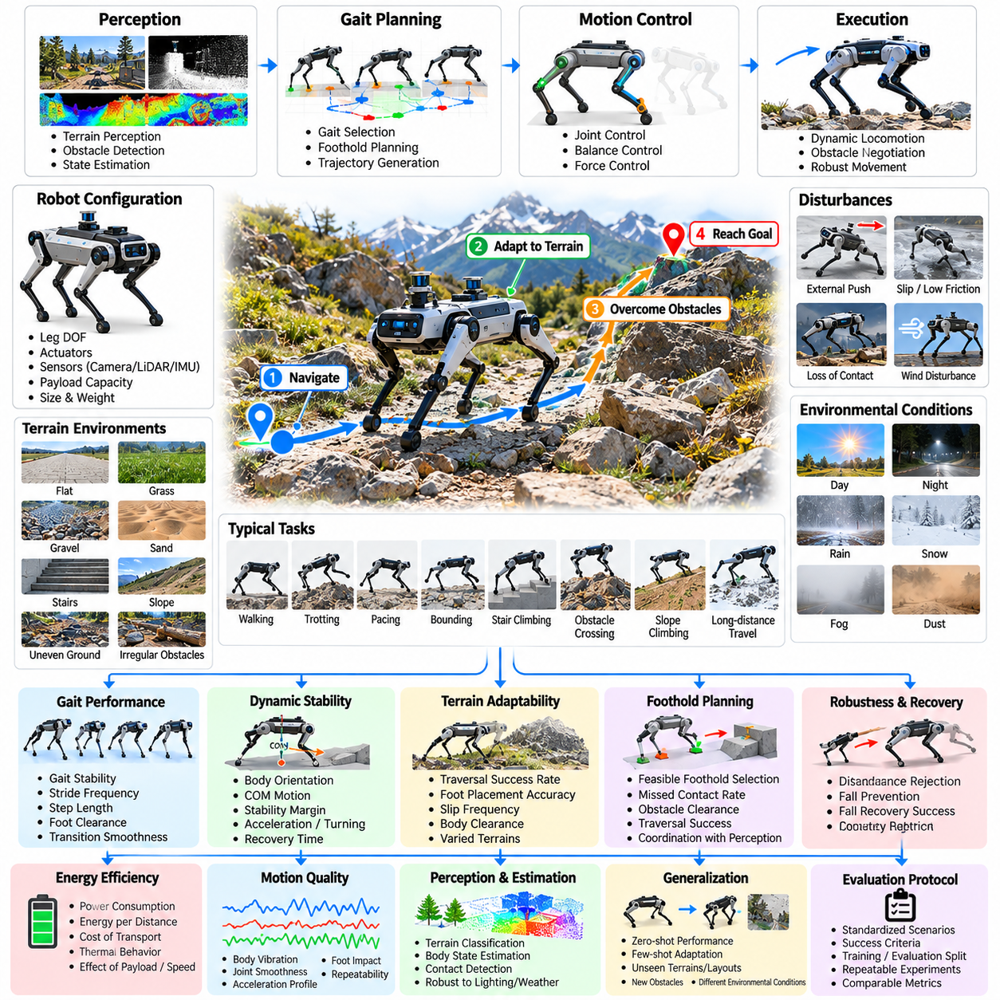{width="7.268055555555556in" height="7.268055555555556in"}

Quadruped locomotion benchmarking evaluates the ability of four-legged robotic systems to move reliably, efficiently, and safely across diverse terrain and environmental conditions. Unlike wheeled robots, quadrupeds must coordinate multiple articulated limbs while maintaining dynamic balance and managing intermittent ground contact. Evaluation therefore examines not only movement speed but also stability, terrain adaptability, energy efficiency, and recovery from disturbances.

A representative benchmark includes flat surfaces, slopes, stairs, gravel, grass, sand, uneven ground, and irregular obstacles. Each environment introduces different requirements for foothold selection, body stabilization, and gait adaptation. Testing should progress from controlled laboratory conditions to increasingly complex outdoor scenarios, allowing researchers to identify locomotion limitations and distinguish fundamental control capabilities from environment-specific performance.

Benchmark design begins by defining robot morphology, leg configuration, joint degrees of freedom, actuator characteristics, sensor placement, and payload capacity. Operational constraints include permitted velocities, terrain categories, environmental conditions, and safety boundaries. Standardized task descriptions specify starting positions, target destinations, route geometry, and completion criteria, enabling reproducible comparisons while accounting for differences in robotic embodiment.

Gait performance is evaluated through walking, trotting, pacing, bounding, and other locomotion patterns supported by the robot. Measurements include gait stability, stride frequency, step length, foot clearance, and transition smoothness. The benchmark should determine whether the robot selects appropriate movement patterns for different speeds and terrain conditions while maintaining coordinated limb motion and avoiding unnecessary oscillation or loss of balance.

Dynamic stability is a central evaluation dimension because quadruped locomotion frequently involves changing support configurations and rapid redistribution of body forces. Relevant measurements include body orientation, angular velocity, center-of-mass motion, foot contact timing, and stability margins. Performance should be assessed during acceleration, deceleration, turning, and sudden changes in terrain rather than only during steady movement.

Terrain adaptability measures whether the robot can modify its locomotion strategy when encountering changes in surface geometry and mechanical properties. Slopes, loose materials, slippery surfaces, and irregular footholds introduce different traction and balance requirements. Evaluation considers successful traversal, foot placement accuracy, slip frequency, body clearance, and the ability to maintain forward progress without excessive corrective movements.

Foothold planning is evaluated by introducing obstacles, gaps, stepping stones, and uneven support surfaces. The robot must identify feasible contact locations while respecting leg reachability, joint limits, and body stability constraints. Metrics include foothold selection accuracy, missed contacts, obstacle clearance, and traversal success. These tests reveal how effectively perception, planning, and low-level control cooperate during complex terrain negotiation.

Disturbance rejection is assessed through controlled external forces, unexpected terrain changes, and temporary loss of foot contact. The benchmark measures body displacement, recovery time, corrective stepping, and the probability of maintaining balance. Disturbances should be introduced at documented intensities under appropriate safety precautions, allowing researchers to characterize robustness boundaries without exposing equipment or personnel to unnecessary hazards.

Fall prevention and recovery represent distinct aspects of locomotion robustness. A robot may maintain balance under moderate disturbances but fail when encountering larger perturbations or unexpected obstacles. Evaluation should distinguish successful disturbance rejection from controlled falling and autonomous standing recovery. Recovery success rate, time to regain a stable posture, and external assistance requirements provide important indicators of operational resilience.

Energy efficiency is particularly important because legged locomotion requires continuous actuator coordination and repeated mechanical work. Measurements include electrical power consumption, energy per traveled distance, cost of transport, and thermal behavior. Results should account for robot mass, payload, speed, and terrain difficulty because direct comparisons without normalization can misrepresent differences between locomotion architectures.

Motion quality is evaluated through body vibration, joint velocity smoothness, acceleration profiles, and foot impact characteristics. Excessive oscillation can reduce sensor performance, increase mechanical wear, and compromise payload stability. The benchmark should therefore examine whether locomotion remains controlled and repeatable across different movement speeds and terrain conditions, even when the robot successfully reaches its destination.

Perception and state estimation are evaluated by introducing variations in lighting, surface appearance, sensor visibility, and terrain structure. Quadrupeds often rely on cameras, inertial sensors, joint encoders, and contact estimation to maintain situational awareness. Measurements include terrain classification accuracy, body-state estimation error, contact detection reliability, and performance degradation when sensing information becomes uncertain or incomplete.

Generalization testing examines whether locomotion policies transfer to terrain configurations, obstacle arrangements, and environmental conditions not encountered during training. Zero-shot performance should be distinguished from results obtained after adaptation or additional calibration. Testing across multiple terrain categories reveals whether a controller has learned broadly useful locomotion strategies or depends heavily on specific surface characteristics and familiar geometric patterns.

Payload evaluation measures how additional mass and changes in load distribution influence locomotion stability and efficiency. Test conditions may include different payload weights, mounting positions, and center-of-mass offsets. Performance measurements include speed degradation, joint torque demand, body inclination, energy consumption, and traversal success. Such evaluation is essential for quadrupeds intended to carry sensors, inspection equipment, or operational supplies.

Simulation-based benchmarking enables large-scale evaluation across randomized terrain, friction coefficients, actuator parameters, and external disturbances. Parallel simulation can expose locomotion policies to diverse scenarios before physical deployment. However, simulated contact mechanics, actuator dynamics, compliance, and terrain deformation may differ from reality. Real-world testing is therefore required to determine whether simulated robustness translates into dependable physical locomotion.

Real-world validation should use repeatable obstacle courses, calibrated terrain measurements, and documented environmental conditions. Reference tracking systems, onboard telemetry, force measurements, and video observations can support performance analysis. Repeated trials across different routes and terrain categories help establish reproducibility while revealing hardware limitations, controller inconsistencies, and failure mechanisms that may remain hidden in simulation.

Long-horizon evaluation extends isolated traversal tasks into continuous missions involving repeated terrain transitions, changing speeds, accumulated mechanical stress, and battery depletion. Metrics include mission completion rate, autonomous operating duration, intervention frequency, thermal stability, and mean time between locomotion failures. These tests reveal whether short-term agility and balance performance remain reliable during sustained operation.

Safety evaluation considers falls, collisions, uncontrolled movement, excessive joint loading, and hazardous interactions with nearby humans. Safety-critical failures should be reported independently of traversal speed and efficiency. Emergency stopping, safe posture transitions, actuator protection, and recovery procedures must be assessed to determine whether the robot maintains acceptable risk under challenging terrain and disturbance conditions.

Statistical reporting should include traversal success rates, confidence intervals, speed distributions, energy measurements, and failure classifications. Results should be separated by terrain category, difficulty level, gait type, and disturbance intensity. A multidimensional scorecard combining mobility, stability, robustness, efficiency, generalization, and safety provides a more informative assessment than a single aggregate locomotion score.

The resulting quadruped locomotion benchmark establishes a systematic foundation for comparing legged control algorithms, mechanical designs, and learning-based policies. By combining standardized terrain challenges, controlled disturbances, energy measurements, and physical validation, it evaluates capabilities beyond isolated demonstrations. Its ultimate purpose is to determine whether quadruped robots can sustain reliable, adaptive, and safe mobility across realistic operating environments.

사족보행 로봇 이동 벤치마킹(Quadruped Locomotion Benchmarking)은 네 개의 다리를 가진 로봇 시스템이 다양한 지형과 환경 조건에서 얼마나 신뢰성 있고 효율적이며 안전하게 이동할 수 있는지 평가한다. 바퀴형 로봇(Wheeled Robot)과 달리 사족보행 로봇(Quadruped Robot)은 지면과의 간헐적인 접촉(Intermittent Ground Contact)을 관리하면서 여러 관절형 다리(Articulated Limbs)를 협조 제어하고 동적 균형(Dynamic Balance)을 유지해야 한다. 따라서 평가는 이동 속도뿐만 아니라 안정성, 지형 적응성, 에너지 효율성, 외란으로부터의 복구 능력까지 포함한다.

대표적인 벤치마크에는 평탄한 표면, 경사면, 계단, 자갈, 잔디, 모래, 불균일한 지면, 불규칙한 장애물이 포함된다. 각 환경은 발 디딤 위치 선정(Foothold Selection), 몸체 안정화(Body Stabilization), 보행 패턴 적응(Gait Adaptation)에 서로 다른 요구사항을 부여한다. 시험은 통제된 실험실 조건에서 시작하여 점차 복잡한 실외 시나리오로 확장해야 하며, 이를 통해 연구자는 이동 능력의 한계를 식별하고 기본적인 제어 능력과 특정 환경에 의존하는 성능을 구분할 수 있다.

벤치마크 설계(Benchmark Design)는 로봇 형태(Robot Morphology), 다리 구성(Leg Configuration), 관절 자유도(Joint Degrees of Freedom), 구동기 특성(Actuator Characteristics), 센서 배치(Sensor Placement), 적재 용량(Payload Capacity)을 정의하는 것으로 시작한다. 운영 제약조건(Operational Constraints)에는 허용 속도, 지형 범주, 환경 조건, 안전 경계가 포함된다. 표준화된 작업 명세(Standardized Task Descriptions)는 초기 위치, 목표 지점, 경로 형상(Route Geometry), 완료 기준을 지정하여 로봇 구현 형태(Embodiment)의 차이를 고려하면서 재현 가능한 비교를 지원한다.

보행 성능(Gait Performance)은 로봇이 지원하는 걷기(Walking), 트로트 보행(Trotting), 페이스 보행(Pacing), 바운딩 보행(Bounding) 및 기타 이동 패턴을 통해 평가한다. 측정 항목에는 보행 안정성(Gait Stability), 보폭 주파수(Stride Frequency), 걸음 길이(Step Length), 발 들어 올림 높이(Foot Clearance), 보행 전환 평활성(Transition Smoothness)이 포함된다. 벤치마크는 로봇이 협조된 다리 움직임을 유지하고 불필요한 진동이나 균형 상실을 방지하면서 서로 다른 속도와 지형 조건에 적합한 이동 패턴을 선택하는지 판단해야 한다.

동적 안정성(Dynamic Stability)은 사족보행 이동에서 지지 구성(Support Configuration)이 빈번하게 변화하고 몸체에 작용하는 힘이 빠르게 재분배되기 때문에 핵심적인 평가 요소이다. 관련 측정 항목에는 몸체 자세(Body Orientation), 각속도(Angular Velocity), 무게중심 운동(Center-of-Mass Motion), 발 접촉 시점(Foot Contact Timing), 안정성 여유도(Stability Margins)가 포함된다. 성능은 일정한 속도의 이동뿐만 아니라 가속, 감속, 회전, 갑작스러운 지형 변화 중에도 평가해야 한다.

지형 적응성(Terrain Adaptability)은 표면 형상과 기계적 특성이 변화할 때 로봇이 이동 전략(Locomotion Strategy)을 수정할 수 있는지 측정한다. 경사면, 느슨한 재료, 미끄러운 표면, 불규칙한 발 디딤 지점은 서로 다른 접지력(Traction)과 균형 요구사항을 발생시킨다. 평가는 주행 성공 여부, 발 배치 정확도(Foot Placement Accuracy), 미끄러짐 빈도(Slip Frequency), 몸체 지상고(Body Clearance), 과도한 수정 동작 없이 전진을 유지하는 능력을 고려한다.

발 디딤 위치 계획(Foothold Planning)은 장애물, 틈새, 디딤돌(Stepping Stones), 불균일한 지지 표면을 도입하여 평가한다. 로봇은 다리 도달 가능성(Leg Reachability), 관절 한계(Joint Limits), 몸체 안정성 제약조건(Body Stability Constraints)을 준수하면서 실행 가능한 접촉 위치를 식별해야 한다. 평가 지표에는 발 디딤 위치 선정 정확도(Foothold Selection Accuracy), 접촉 실패(Missed Contacts), 장애물 통과 여유(Obstacle Clearance), 지형 통과 성공률(Traversal Success)이 포함된다. 이러한 시험은 복잡한 지형을 통과하는 과정에서 인식, 계획, 저수준 제어(Low-Level Control)가 얼마나 효과적으로 협력하는지 보여준다.

외란 거부 능력(Disturbance Rejection)은 통제된 외력(External Forces), 예상하지 못한 지형 변화, 일시적인 발 접촉 상실을 통해 평가한다. 벤치마크는 몸체 변위(Body Displacement), 복구 시간(Recovery Time), 균형 회복을 위한 보정 발걸음(Corrective Stepping), 균형 유지 확률을 측정한다. 외란은 적절한 안전 예방조치(Safety Precautions) 아래 문서화된 강도 수준으로 도입해야 하며, 이를 통해 장비나 작업자를 불필요한 위험에 노출하지 않으면서 강건성 한계(Robustness Boundaries)를 규명할 수 있다.

넘어짐 방지(Fall Prevention)와 복구(Recovery)는 이동 강건성(Locomotion Robustness)의 서로 다른 측면을 나타낸다. 로봇은 중간 수준의 외란에서는 균형을 유지할 수 있지만 더 큰 교란(Perturbations)이나 예상하지 못한 장애물에서는 실패할 수 있다. 평가는 성공적인 외란 거부, 제어된 넘어짐(Controlled Falling), 자율 기립 복구(Autonomous Standing Recovery)를 구분해야 한다. 복구 성공률(Recovery Success Rate), 안정된 자세를 회복하는 데 필요한 시간, 외부 지원 요구량은 운영 복원력(Operational Resilience)을 판단하는 중요한 지표이다.

에너지 효율성(Energy Efficiency)은 다리 기반 이동(Legged Locomotion)이 지속적인 구동기 협조 제어와 반복적인 기계적 작업을 요구하기 때문에 특히 중요하다. 측정 항목에는 전력 소비량(Electrical Power Consumption), 이동 거리당 에너지 소비량(Energy per Traveled Distance), 이동 비용(Cost of Transport), 열적 거동(Thermal Behavior)이 포함된다. 결과는 로봇 질량, 적재 하중(Payload), 속도, 지형 난이도를 고려해야 한다. 정규화(Normalization) 없이 직접 비교하면 이동 아키텍처(Locomotion Architectures) 사이의 차이를 잘못 해석할 수 있기 때문이다.

동작 품질(Motion Quality)은 몸체 진동(Body Vibration), 관절 속도 평활성(Joint Velocity Smoothness), 가속도 프로파일(Acceleration Profiles), 발 충격 특성(Foot Impact Characteristics)을 통해 평가한다. 과도한 진동은 센서 성능을 저하시키고 기계적 마모(Mechanical Wear)를 증가시키며 적재물 안정성(Payload Stability)을 손상시킬 수 있다. 따라서 벤치마크는 로봇이 목적지에 성공적으로 도달하더라도 서로 다른 이동 속도와 지형 조건에서 움직임이 제어되고 반복 가능하게 유지되는지 평가해야 한다.

인식 및 상태 추정(Perception and State Estimation)은 조명, 표면 외관, 센서 가시성(Sensor Visibility), 지형 구조에 변화를 도입하여 평가한다. 사족보행 로봇은 상황 인식(Situational Awareness)을 유지하기 위해 카메라, 관성 센서(Inertial Sensors), 관절 엔코더(Joint Encoders), 접촉 추정(Contact Estimation)에 의존하는 경우가 많다. 측정 항목에는 지형 분류 정확도(Terrain Classification Accuracy), 몸체 상태 추정 오차(Body-State Estimation Error), 접촉 감지 신뢰성(Contact Detection Reliability), 센싱 정보가 불확실하거나 불완전해질 때의 성능 저하가 포함된다.

일반화 시험(Generalization Testing)은 이동 정책(Locomotion Policies)이 학습 과정에서 경험하지 못한 지형 구성, 장애물 배치, 환경 조건으로 전이(Transfer)되는지 평가한다. 제로샷 성능(Zero-Shot Performance)은 적응(Adaptation)이나 추가 보정(Additional Calibration) 이후에 얻은 결과와 구분해야 한다. 여러 지형 범주에 걸친 시험은 제어기(Controller)가 폭넓게 활용할 수 있는 이동 전략을 학습했는지, 아니면 특정 표면 특성과 익숙한 기하학적 패턴에 크게 의존하는지 보여준다.

적재 하중 평가(Payload Evaluation)는 추가 질량과 하중 분포 변화가 이동 안정성(Locomotion Stability)과 효율성에 어떤 영향을 미치는지 측정한다. 시험 조건에는 서로 다른 적재물 무게, 장착 위치(Mounting Positions), 무게중심 오프셋(Center-of-Mass Offsets)이 포함될 수 있다. 성능 측정 항목에는 속도 저하(Speed Degradation), 관절 토크 요구량(Joint Torque Demand), 몸체 기울기(Body Inclination), 에너지 소비량, 지형 통과 성공률이 포함된다. 이러한 평가는 센서, 검사 장비, 운영 물품을 운반하도록 설계된 사족보행 로봇에 필수적이다.

시뮬레이션 기반 벤치마킹(Simulation-Based Benchmarking)은 무작위화된 지형(Randomized Terrain), 마찰계수(Friction Coefficients), 구동기 매개변수(Actuator Parameters), 외부 외란(External Disturbances)에 걸친 대규모 평가를 가능하게 한다. 병렬 시뮬레이션(Parallel Simulation)은 실제 배치 전에 이동 정책을 다양한 시나리오에 노출할 수 있다. 그러나 시뮬레이션된 접촉 역학(Contact Mechanics), 구동기 동역학(Actuator Dynamics), 순응성(Compliance), 지형 변형(Terrain Deformation)은 현실과 다를 수 있다. 따라서 시뮬레이션에서 확인된 강건성이 실제 물리적 이동에서도 신뢰성 있게 구현되는지 판단하려면 실제 환경 시험이 필요하다.

실제 환경 검증(Real-World Validation)은 반복 가능한 장애물 코스(Obstacle Courses), 보정된 지형 측정값(Calibrated Terrain Measurements), 문서화된 환경 조건을 사용해야 한다. 기준 추적 시스템(Reference Tracking Systems), 로봇 내부 원격측정 데이터(Onboard Telemetry), 힘 측정값(Force Measurements), 영상 관찰(Video Observations)은 성능 분석을 지원할 수 있다. 서로 다른 경로와 지형 범주에서 반복 시험을 수행하면 재현성(Reproducibility)을 확보하는 동시에 시뮬레이션에서 드러나지 않을 수 있는 하드웨어 한계, 제어기 불일치(Controller Inconsistencies), 실패 메커니즘(Failure Mechanisms)을 식별할 수 있다.

장기 평가(Long-Horizon Evaluation)는 독립적인 지형 통과 작업을 반복적인 지형 전환, 속도 변화, 누적 기계적 응력(Accumulated Mechanical Stress), 배터리 소모(Battery Depletion)를 포함하는 연속 임무(Continuous Missions)로 확장한다. 평가 지표에는 임무 완료율(Mission Completion Rate), 자율 운영 지속시간(Autonomous Operating Duration), 개입 빈도(Intervention Frequency), 열적 안정성(Thermal Stability), 이동 실패 간 평균 시간(Mean Time Between Locomotion Failures)이 포함된다. 이러한 시험은 단기적인 민첩성과 균형 성능이 지속적인 운영 중에도 신뢰성을 유지하는지 보여준다.

안전성 평가(Safety Evaluation)는 넘어짐, 충돌, 제어되지 않은 이동(Uncontrolled Movement), 과도한 관절 하중(Excessive Joint Loading), 주변 사람과의 위험한 상호작용을 고려한다. 안전에 중대한 영향을 미치는 실패(Safety-Critical Failures)는 지형 통과 속도와 효율성에서 독립적으로 보고해야 한다. 비상 정지(Emergency Stopping), 안전 자세 전환(Safe Posture Transitions), 구동기 보호(Actuator Protection), 복구 절차(Recovery Procedures)를 평가하여 어려운 지형과 외란 조건에서도 로봇이 허용 가능한 위험 수준(Acceptable Risk)을 유지하는지 판단해야 한다.

통계적 보고(Statistical Reporting)에는 지형 통과 성공률(Traversal Success Rates), 신뢰구간(Confidence Intervals), 속도 분포(Speed Distributions), 에너지 측정값(Energy Measurements), 실패 분류(Failure Classifications)가 포함되어야 한다. 결과는 지형 범주(Terrain Category), 난이도 수준(Difficulty Level), 보행 유형(Gait Type), 외란 강도(Disturbance Intensity)에 따라 구분해야 한다. 이동성(Mobility), 안정성(Stability), 강건성(Robustness), 효율성(Efficiency), 일반화(Generalization), 안전성(Safety)을 결합한 다차원 평가표(Multidimensional Scorecard)는 단일 종합 이동 점수(Aggregate Locomotion Score)보다 더 많은 정보를 제공한다.

최종 사족보행 로봇 이동 벤치마크(Quadruped Locomotion Benchmark)는 다리 기반 제어 알고리즘(Legged Control Algorithms), 기계적 설계(Mechanical Designs), 학습 기반 정책(Learning-Based Policies)을 비교하기 위한 체계적인 토대(Systematic Foundation)를 구축한다. 표준화된 지형 과제(Standardized Terrain Challenges), 통제된 외란(Controlled Disturbances), 에너지 측정(Energy Measurements), 물리적 검증(Physical Validation)을 결합하여 독립적인 시연을 넘어서는 능력을 평가한다. 궁극적인 목적은 사족보행 로봇이 현실적인 운영 환경 전반에서 신뢰성 있고 적응적이며 안전한 이동 능력을 지속적으로 유지할 수 있는지 판단하는 것이다.

##  

## 09.06. Humanoid Generalist Task Benchmark

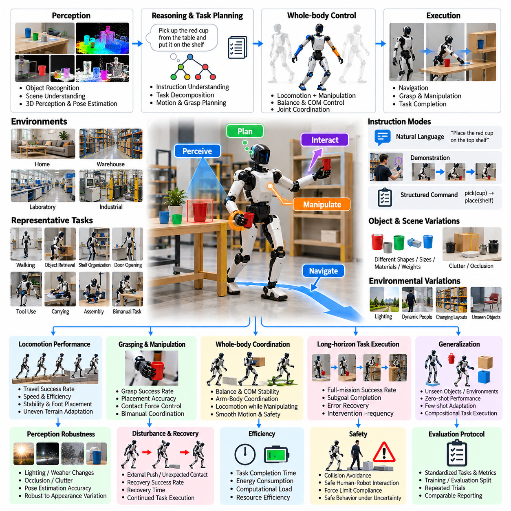{width="7.268055555555556in" height="7.268055555555556in"}

Humanoid generalist task benchmarking evaluates whether a humanoid robot can perform diverse physical tasks across changing environments without requiring a separately engineered controller for every activity. Unlike benchmarks focused exclusively on locomotion or manipulation, generalist evaluation examines the integration of perception, reasoning, planning, whole-body control, and interaction. The objective is to measure transferable competence rather than isolated task proficiency.

A representative benchmark includes walking, object retrieval, shelf organization, door opening, tool handling, carrying, and basic assembly. These activities combine mobility, dexterity, spatial understanding, and sequential decision-making. Evaluation environments may include homes, warehouses, laboratories, and industrial workspaces. Task diversity should reflect meaningful differences in physical requirements rather than superficial changes in object appearance.

Benchmark design begins by defining humanoid morphology, joint degrees of freedom, actuator capabilities, hand configuration, sensor modalities, and operational limitations. Each task specifies an initial scene, target outcome, permitted resources, and success conditions. Robot-specific physical constraints must be documented so that comparisons distinguish differences in intelligence and control from differences in reachability, payload capacity, or mechanical dexterity.

Generalist capability is evaluated through a task portfolio containing multiple skill categories and difficulty levels. Individual tasks may require navigation, grasping, bimanual coordination, object placement, or tool manipulation. More complex tasks combine these skills into complete workflows. Performance should be reported by category and across the full portfolio to determine whether a system demonstrates broad competence or exceptional performance in only a narrow subset.

Instruction following is an important evaluation dimension because generalist humanoids may receive goals through natural language, visual demonstrations, or structured commands. The benchmark measures whether the robot interprets task intent, identifies relevant objects, and converts instructions into executable actions. Ambiguous instructions, unfamiliar terminology, and multi-step requests can reveal weaknesses in grounding, contextual understanding, and action planning.

Perception evaluation examines the robot\'s ability to recognize objects, estimate spatial relationships, and maintain environmental awareness during movement and manipulation. Changes in lighting, clutter, occlusion, and object arrangement test perceptual robustness. Metrics include object localization accuracy, scene understanding consistency, target identification success, and recovery from incorrect observations. Perception quality should be linked to its effects on downstream physical execution.

Whole-body coordination is essential because humanoids must maintain balance while moving their arms, shifting weight, reaching, and interacting with objects. Evaluation considers posture stability, center-of-mass control, foot placement, joint coordination, and manipulation accuracy. Tasks involving elevated shelves, low objects, or simultaneous walking and carrying reveal whether locomotion and manipulation operate as an integrated control system.

Bimanual manipulation evaluates how effectively two hands cooperate during physical interaction. Representative tasks include holding a container while opening it, transferring objects between hands, stabilizing components during assembly, and carrying bulky items. Measurements include coordination accuracy, grasp stability, contact force, task completion time, and object damage. These tasks expose limitations that may remain hidden in single-arm manipulation benchmarks.

Long-horizon task evaluation examines whether the humanoid can complete sequences requiring persistent context, intermediate goals, and coordinated physical actions. A representative mission may involve locating an object, retrieving it, transporting it, organizing a workspace, and confirming completion. Metrics include full-mission success, subgoal completion, error accumulation, intervention frequency, and recovery effectiveness across extended execution periods.

Generalization testing evaluates performance on unseen objects, environments, instructions, and task combinations. Training and evaluation scenarios should be separated to prevent memorized solutions from appearing as transferable intelligence. Zero-shot performance measures immediate capability, while few-shot adaptation measures improvement after limited additional experience. Both results are necessary to characterize the breadth and adaptability of a generalist humanoid policy.

Compositional generalization examines whether previously learned skills can be recombined to solve unfamiliar tasks. A robot capable of opening drawers, grasping objects, and placing items should be tested on workflows requiring these abilities in new sequences. Evaluation measures successful skill composition, planning efficiency, and recovery when intermediate actions fail. This approach distinguishes reusable behavioral competence from memorization of complete task demonstrations.

Robustness evaluation introduces object displacement, unexpected contact, partial sensor degradation, communication interruptions, and environmental changes. The humanoid must recognize deviations from expected outcomes and modify its behavior appropriately. Measurements include disturbance detection accuracy, recovery time, repeated failure frequency, and successful completion without assistance. Robustness should reflect the ability to continue safely rather than merely tolerate minor perturbations.

Efficiency assessment considers task completion time, energy consumption, computational requirements, movement economy, and unnecessary actions. Humanoid robots may achieve identical outcomes through substantially different motion strategies and resource expenditures. Evaluation should identify trade-offs between speed, precision, stability, and energy efficiency. Excessively rapid execution should not receive favorable scores when it increases physical risk or reduces reliability.

Human-robot interaction is evaluated through shared-workspace scenarios involving communication, coordination, and safe physical proximity. Tasks may require accepting instructions, yielding space, handing over objects, or responding to human intervention. Metrics include instruction compliance, handover success, response latency, minimum separation distance, and inappropriate contact frequency. Evaluation must account for human safety and task usability rather than treating people as static obstacles.

Simulation-based benchmarking supports large-scale testing across diverse task configurations, object properties, environmental layouts, and disturbance conditions. Parallel simulation can reveal failure patterns and compare generalist policies under controlled variations. However, simulated contact mechanics, balance dynamics, tactile feedback, and human interaction may differ from reality. Physical validation remains necessary before simulation results can establish operational readiness.

Real-world evaluation should employ repeatable tasks, calibrated measurement systems, and documented robot configurations. Independent observers and automated logs can record outcomes, intervention events, physical errors, and safety incidents. Trials should include multiple objects, environments, and task arrangements to assess reproducibility. Results must distinguish genuine autonomous completion from success achieved through hidden assistance or task-specific preparation.

Safety evaluation considers falls, collisions, excessive contact forces, unstable object handling, and unsafe interactions with humans. Safety-critical violations should be reported independently from task success and efficiency. Emergency stopping, protective behavior, controlled object release, and recovery from unstable postures require explicit testing. A generalist humanoid should demonstrate safe failure behavior even when it cannot successfully complete an unfamiliar task.

Statistical analysis should report task success rates, confidence intervals, completion-time distributions, intervention frequency, and failure classifications. Results should be separated by skill category, task complexity, environmental novelty, and adaptation conditions. Aggregate scores may summarize broad performance, but they should not conceal major weaknesses in manipulation, mobility, instruction following, or safety-critical behavior.

A comprehensive humanoid generalist scorecard combines task diversity, instruction understanding, perception, locomotion, manipulation, coordination, long-horizon reliability, generalization, efficiency, and safety. Category-level results should accompany any overall score, and tasks should be weighted according to transparent evaluation objectives. This structure supports meaningful comparisons without assuming that success on a limited benchmark proves unrestricted general intelligence.

The resulting benchmark establishes a systematic foundation for evaluating humanoid robots as integrated physical intelligence systems. By combining diverse tasks, unseen conditions, compositional challenges, long-horizon missions, and real-world validation, it measures capabilities beyond isolated demonstrations. Its ultimate purpose is to determine whether humanoid robots can transfer learned skills into reliable, adaptive, and safe behavior across practical operating environments.

휴머노이드 범용 작업 벤치마킹(Humanoid Generalist Task Benchmarking)은 휴머노이드 로봇(Humanoid Robot)이 모든 활동에 대해 별도로 설계된 제어기(Controller)를 요구하지 않으면서 변화하는 환경에서 다양한 물리적 작업(Physical Tasks)을 수행할 수 있는지 평가한다. 이동(Locomotion)이나 조작(Manipulation)에만 초점을 맞춘 벤치마크와 달리 범용성 평가(Generalist Evaluation)는 인식(Perception), 추론(Reasoning), 계획(Planning), 전신 제어(Whole-Body Control), 상호작용(Interaction)의 통합을 검토한다. 평가의 목적은 개별 작업의 숙련도가 아니라 다른 작업으로 전이 가능한 역량(Transferable Competence)을 측정하는 것이다.

대표적인 벤치마크에는 보행(Walking), 물체 회수(Object Retrieval), 선반 정리(Shelf Organization), 문 열기(Door Opening), 도구 취급(Tool Handling), 물체 운반(Carrying), 기본 조립(Basic Assembly)이 포함된다. 이러한 활동은 이동성(Mobility), 정교한 조작 능력(Dexterity), 공간 이해(Spatial Understanding), 순차적 의사결정(Sequential Decision-Making)을 결합한다. 평가 환경에는 가정, 창고, 실험실, 산업 작업공간(Industrial Workspaces)이 포함될 수 있다. 작업 다양성(Task Diversity)은 단순히 물체의 외관이 달라지는 것이 아니라 물리적 요구사항의 실질적인 차이를 반영해야 한다.

벤치마크 설계(Benchmark Design)는 휴머노이드 형태(Humanoid Morphology), 관절 자유도(Joint Degrees of Freedom), 구동기 성능(Actuator Capabilities), 손 구성(Hand Configuration), 센서 모달리티(Sensor Modalities), 운영상의 제약조건(Operational Limitations)을 정의하는 것으로 시작한다. 각 작업은 초기 장면(Initial Scene), 목표 결과(Target Outcome), 허용 자원(Permitted Resources), 성공 조건(Success Conditions)을 명시한다. 로봇별 물리적 제약조건(Robot-Specific Physical Constraints)을 문서화하여 지능과 제어 능력의 차이를 도달 가능성(Reachability), 적재 용량(Payload Capacity), 기계적 정교성(Mechanical Dexterity)의 차이와 구분해야 한다.

범용 능력(Generalist Capability)은 여러 기술 범주(Skill Categories)와 난이도 수준(Difficulty Levels)을 포함하는 작업 포트폴리오(Task Portfolio)를 통해 평가한다. 개별 작업에는 내비게이션(Navigation), 파지(Grasping), 양손 협조 제어(Bimanual Coordination), 물체 배치(Object Placement), 도구 조작(Tool Manipulation)이 필요할 수 있다. 더욱 복잡한 작업은 이러한 기술을 완전한 작업 흐름(Complete Workflows)으로 결합한다. 시스템이 폭넓은 역량을 보여주는지 또는 제한된 일부 작업에서만 뛰어난 성능을 나타내는지 판단하기 위해 범주별 성능과 전체 포트폴리오 성능을 함께 보고해야 한다.

지시 이행(Instruction Following)은 범용 휴머노이드가 자연어(Natural Language), 시각적 시연(Visual Demonstrations), 구조화된 명령(Structured Commands)을 통해 목표를 전달받을 수 있기 때문에 중요한 평가 요소이다. 벤치마크는 로봇이 작업 의도(Task Intent)를 해석하고 관련 물체를 식별하며 지시를 실행 가능한 동작(Executable Actions)으로 변환하는지 측정한다. 모호한 지시(Ambiguous Instructions), 익숙하지 않은 용어(Unfamiliar Terminology), 다단계 요청(Multi-Step Requests)은 의미 연결(Grounding), 문맥 이해(Contextual Understanding), 동작 계획(Action Planning)의 취약점을 드러낼 수 있다.

인식 평가(Perception Evaluation)는 로봇이 물체를 인식하고 공간적 관계(Spatial Relationships)를 추정하며 이동과 조작 중 환경 인식(Environmental Awareness)을 유지하는 능력을 검토한다. 조명, 복잡한 배치(Clutter), 가림(Occlusion), 물체 배열(Object Arrangement)의 변화는 인식 강건성(Perceptual Robustness)을 시험한다. 평가 지표에는 물체 위치 추정 정확도(Object Localization Accuracy), 장면 이해 일관성(Scene Understanding Consistency), 목표 식별 성공률(Target Identification Success), 잘못된 관측으로부터의 복구 능력이 포함된다. 인식 품질은 이후 물리적 실행(Downstream Physical Execution)에 미치는 영향과 연결하여 평가해야 한다.

전신 협조 제어(Whole-Body Coordination)는 휴머노이드가 팔을 움직이고, 체중을 이동시키고, 팔을 뻗고, 물체와 상호작용하는 동안 균형을 유지해야 하므로 필수적이다. 평가는 자세 안정성(Posture Stability), 무게중심 제어(Center-of-Mass Control), 발 배치(Foot Placement), 관절 협조 제어(Joint Coordination), 조작 정확도(Manipulation Accuracy)를 고려한다. 높은 선반, 낮은 위치의 물체, 보행과 운반을 동시에 수행하는 작업은 이동과 조작이 통합 제어 시스템(Integrated Control System)으로 작동하는지 보여준다.

양손 조작(Bimanual Manipulation)은 물리적 상호작용 중 두 손이 얼마나 효과적으로 협력하는지 평가한다. 대표적인 작업에는 용기를 잡은 상태에서 열기, 양손 사이에서 물체 전달하기, 조립 중 부품 고정하기, 부피가 큰 물체 운반하기가 포함된다. 측정 항목에는 협조 정확도(Coordination Accuracy), 파지 안정성(Grasp Stability), 접촉력(Contact Force), 작업 완료 시간(Task Completion Time), 물체 손상(Object Damage)이 포함된다. 이러한 작업은 단일 팔 조작 벤치마크(Single-Arm Manipulation Benchmark)에서는 드러나지 않을 수 있는 한계를 보여준다.

장기 작업 평가(Long-Horizon Task Evaluation)는 휴머노이드가 지속적인 문맥(Persistent Context), 중간 목표(Intermediate Goals), 협조된 물리적 동작(Coordinated Physical Actions)이 필요한 작업 순서를 완료할 수 있는지 검토한다. 대표적인 임무에는 물체를 찾고, 회수하고, 운반하고, 작업공간을 정리한 후 완료 여부를 확인하는 과정이 포함될 수 있다. 평가 지표에는 전체 임무 성공률(Full-Mission Success), 하위 목표 완료율(Subgoal Completion), 오차 누적(Error Accumulation), 개입 빈도(Intervention Frequency), 장시간 실행에 걸친 복구 효과성(Recovery Effectiveness)이 포함된다.

일반화 시험(Generalization Testing)은 학습 과정에서 경험하지 못한 물체, 환경, 지시, 작업 조합에 대한 성능을 평가한다. 암기된 해결 방법(Memorized Solutions)이 전이 가능한 지능(Transferable Intelligence)으로 잘못 해석되지 않도록 학습 시나리오(Training Scenarios)와 평가 시나리오(Evaluation Scenarios)를 분리해야 한다. 제로샷 성능(Zero-Shot Performance)은 추가 경험 없이 즉시 발휘되는 능력을 측정하고, 퓨샷 적응(Few-Shot Adaptation)은 제한된 추가 경험 이후의 성능 향상을 측정한다. 두 결과 모두 범용 휴머노이드 정책(Generalist Humanoid Policy)의 적용 범위와 적응성을 규명하는 데 필요하다.

조합적 일반화(Compositional Generalization)는 이전에 학습한 기술을 재조합하여 익숙하지 않은 작업을 해결할 수 있는지 검토한다. 서랍 열기, 물체 파지, 물체 배치가 가능한 로봇이라면 이러한 능력을 새로운 순서로 수행해야 하는 작업 흐름을 통해 시험해야 한다. 평가는 성공적인 기술 조합(Skill Composition), 계획 효율성(Planning Efficiency), 중간 동작 실패 시 복구 능력을 측정한다. 이러한 접근법은 재사용 가능한 행동 역량(Reusable Behavioral Competence)을 완전한 작업 시연(Complete Task Demonstrations)의 암기와 구분한다.

강건성 평가(Robustness Evaluation)는 물체 위치 변화(Object Displacement), 예상하지 못한 접촉(Unexpected Contact), 부분적인 센서 성능 저하(Partial Sensor Degradation), 통신 중단(Communication Interruptions), 환경 변화를 도입한다. 휴머노이드는 예상 결과(Expected Outcomes)에서 벗어난 상황을 인식하고 행동을 적절하게 수정해야 한다. 측정 항목에는 외란 감지 정확도(Disturbance Detection Accuracy), 복구 시간(Recovery Time), 반복 실패 빈도(Repeated Failure Frequency), 외부 지원 없는 성공적인 작업 완료가 포함된다. 강건성은 단순히 작은 교란을 견디는 것이 아니라 안전하게 작업을 계속하는 능력을 반영해야 한다.

효율성 평가(Efficiency Assessment)는 작업 완료 시간(Task Completion Time), 에너지 소비량(Energy Consumption), 계산 요구량(Computational Requirements), 동작 경제성(Movement Economy), 불필요한 동작(Unnecessary Actions)을 고려한다. 휴머노이드 로봇은 동일한 결과를 달성하더라도 동작 전략(Motion Strategies)과 자원 소비(Resource Expenditures)에서 상당한 차이를 보일 수 있다. 평가는 속도, 정밀도(Precision), 안정성(Stability), 에너지 효율성 사이의 상충관계(Trade-offs)를 식별해야 한다. 지나치게 빠른 실행이 물리적 위험을 증가시키거나 신뢰성을 저하시킨다면 높은 점수를 부여해서는 안 된다.

인간-로봇 상호작용(Human-Robot Interaction)은 의사소통(Communication), 협력(Coordination), 안전한 물리적 근접성(Safe Physical Proximity)을 요구하는 공유 작업공간(Shared Workspace) 시나리오를 통해 평가한다. 작업에는 지시 수용, 공간 양보, 물체 전달, 사람의 개입에 대한 대응이 포함될 수 있다. 평가 지표에는 지시 준수율(Instruction Compliance), 물체 전달 성공률(Handover Success), 응답 지연시간(Response Latency), 최소 이격거리(Minimum Separation Distance), 부적절한 접촉 빈도(Inappropriate Contact Frequency)가 포함된다. 평가는 사람을 정적인 장애물로 취급하기보다 인간의 안전과 작업 사용성(Task Usability)을 고려해야 한다.

시뮬레이션 기반 벤치마킹(Simulation-Based Benchmarking)은 다양한 작업 구성(Task Configurations), 물체 특성(Object Properties), 환경 배치(Environmental Layouts), 외란 조건(Disturbance Conditions)에 걸친 대규모 시험을 지원한다. 병렬 시뮬레이션(Parallel Simulation)은 실패 패턴(Failure Patterns)을 발견하고 통제된 변화 조건에서 범용 정책(Generalist Policies)을 비교할 수 있도록 한다. 그러나 시뮬레이션된 접촉 역학(Contact Mechanics), 균형 동역학(Balance Dynamics), 촉각 피드백(Tactile Feedback), 인간 상호작용(Human Interaction)은 현실과 다를 수 있다. 따라서 시뮬레이션 결과로 운영 준비도(Operational Readiness)를 입증하기 전에 물리적 검증(Physical Validation)이 필요하다.

실제 환경 평가(Real-World Evaluation)는 반복 가능한 작업(Repeatable Tasks), 보정된 측정 시스템(Calibrated Measurement Systems), 문서화된 로봇 구성(Documented Robot Configurations)을 사용해야 한다. 독립적인 관찰자(Independent Observers)와 자동화된 로그(Automated Logs)는 작업 결과, 개입 사건(Intervention Events), 물리적 오차(Physical Errors), 안전 사고(Safety Incidents)를 기록할 수 있다. 재현성(Reproducibility)을 평가하기 위해 여러 물체, 환경, 작업 배치를 포함한 반복 시험을 수행해야 한다. 결과는 진정한 자율 완료(Genuine Autonomous Completion)와 숨겨진 지원(Hidden Assistance) 또는 작업별 사전 준비(Task-Specific Preparation)를 통해 달성한 성공을 구분해야 한다.

안전성 평가(Safety Evaluation)는 넘어짐(Falls), 충돌(Collisions), 과도한 접촉력(Excessive Contact Forces), 불안정한 물체 취급(Unstable Object Handling), 사람과의 위험한 상호작용을 고려한다. 안전에 중대한 영향을 미치는 위반(Safety-Critical Violations)은 작업 성공률 및 효율성과 독립적으로 보고해야 한다. 비상 정지(Emergency Stopping), 보호 행동(Protective Behavior), 제어된 물체 해제(Controlled Object Release), 불안정한 자세로부터의 복구(Recovery from Unstable Postures)를 명시적으로 시험해야 한다. 범용 휴머노이드는 익숙하지 않은 작업을 성공적으로 완료하지 못하더라도 안전한 실패 행동(Safe Failure Behavior)을 보여야 한다.

통계 분석(Statistical Analysis)은 작업 성공률(Task Success Rates), 신뢰구간(Confidence Intervals), 완료 시간 분포(Completion-Time Distributions), 개입 빈도(Intervention Frequency), 실패 분류(Failure Classifications)를 보고해야 한다. 결과는 기술 범주(Skill Category), 작업 복잡도(Task Complexity), 환경 신규성(Environmental Novelty), 적응 조건(Adaptation Conditions)에 따라 구분해야 한다. 종합 점수(Aggregate Scores)는 전체적인 성능을 요약할 수 있지만 조작, 이동, 지시 이행, 안전 필수 행동(Safety-Critical Behavior)의 주요 취약점을 감추어서는 안 된다.

포괄적인 휴머노이드 범용 평가표(Humanoid Generalist Scorecard)는 작업 다양성(Task Diversity), 지시 이해(Instruction Understanding), 인식(Perception), 이동(Locomotion), 조작(Manipulation), 협조 제어(Coordination), 장기 신뢰성(Long-Horizon Reliability), 일반화(Generalization), 효율성(Efficiency), 안전성(Safety)을 결합한다. 모든 종합 점수(Overall Score)에는 범주별 결과(Category-Level Results)가 함께 제시되어야 하며, 작업 가중치(Task Weights)는 투명한 평가 목표(Transparent Evaluation Objectives)에 따라 설정해야 한다. 이러한 구조는 제한된 벤치마크에서의 성공이 무제한적인 일반 지능(Unrestricted General Intelligence)을 입증한다고 가정하지 않으면서 의미 있는 비교를 지원한다.

최종 벤치마크는 휴머노이드 로봇을 통합 물리 지능 시스템(Integrated Physical Intelligence Systems)으로 평가하기 위한 체계적인 토대(Systematic Foundation)를 구축한다. 다양한 작업(Diverse Tasks), 미경험 조건(Unseen Conditions), 조합적 과제(Compositional Challenges), 장기 임무(Long-Horizon Missions), 실제 환경 검증(Real-World Validation)을 결합함으로써 독립적인 시연을 넘어서는 능력을 측정한다. 궁극적인 목적은 휴머노이드 로봇이 학습한 기술(Learned Skills)을 실제 운영 환경 전반에서 신뢰성 있고 적응적이며 안전한 행동으로 전이할 수 있는지 판단하는 것이다.

##  

## 09.07. Aerial Robot Benchmark

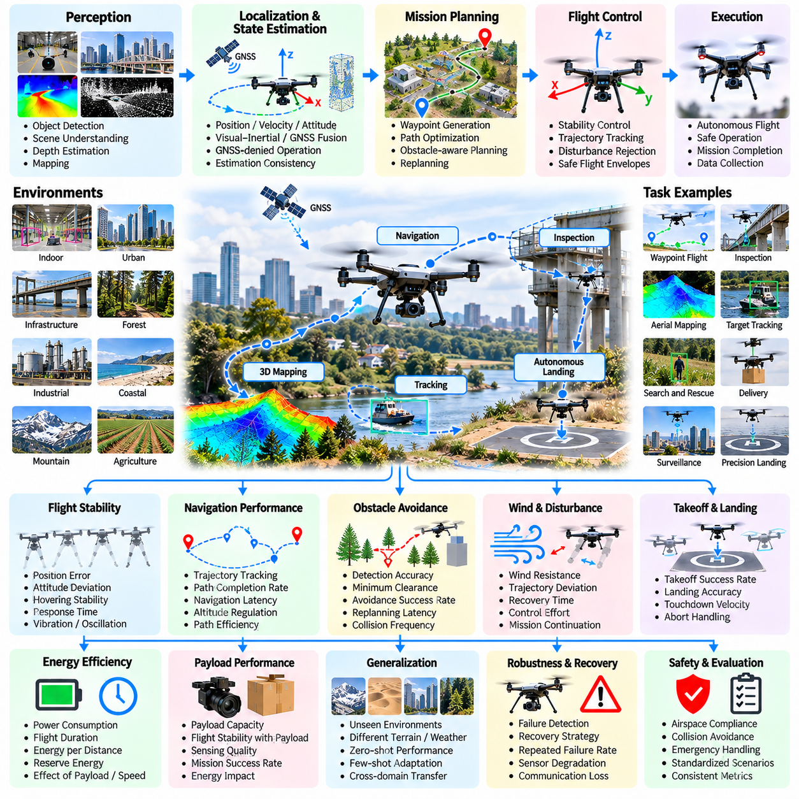{width="7.268055555555556in" height="7.268055555555556in"}

Aerial robot benchmarking evaluates the ability of autonomous flying systems to navigate, perceive, and complete missions safely under changing environmental conditions. Unlike ground robots, aerial platforms must continuously regulate three-dimensional motion while compensating for aerodynamic disturbances and limited energy reserves. Evaluation therefore considers flight stability, navigation accuracy, obstacle avoidance, mission reliability, and operational safety as interconnected capabilities.

A representative benchmark includes indoor navigation, outdoor waypoint following, infrastructure inspection, aerial mapping, target tracking, and autonomous landing. Test environments may contain narrow passages, elevated structures, vegetation, moving obstacles, and variable lighting. These scenarios introduce different requirements for perception, localization, flight control, and mission planning. Task diversity should reflect meaningful operational challenges rather than superficial environmental variations.

Benchmark design begins by specifying the aircraft configuration, propulsion system, sensor suite, payload capacity, and flight-control architecture. Multirotor, fixed-wing, and hybrid platforms have different maneuverability and endurance characteristics that must be considered during comparison. Standardized task descriptions define initial conditions, flight boundaries, environmental restrictions, target locations, and measurable completion criteria.

Flight stability is evaluated through hovering, acceleration, deceleration, turning, climbing, descending, and trajectory tracking. Measurements include position error, attitude deviation, angular velocity, oscillation amplitude, and settling time. Tests should examine both steady-state and transient behavior because an aircraft may maintain stable hovering while exhibiting significant control errors during aggressive maneuvers or sudden trajectory changes.

Three-dimensional navigation performance is assessed through waypoint tracking, corridor traversal, altitude regulation, and autonomous route execution. The benchmark measures trajectory deviation, path completion rate, navigation latency, and unnecessary route corrections. Complex routes may require the aircraft to coordinate horizontal movement, vertical transitions, and orientation changes while respecting obstacles, restricted regions, and vehicle dynamics.

Obstacle avoidance evaluation introduces static structures, narrow openings, suspended objects, and moving obstacles. The aircraft must detect hazards, estimate collision risk, and generate feasible avoidance trajectories within limited reaction time. Metrics include collision frequency, minimum obstacle clearance, avoidance success rate, and replanning latency. Evaluation should distinguish safe avoidance from excessive detours or unstable emergency maneuvers.

Localization and state estimation are critical because aerial robots depend on accurate position, velocity, and orientation estimates for stable flight. Benchmark conditions may include GNSS availability, GNSS-denied environments, visual degradation, and inertial sensor drift. Measurements include localization error, estimation consistency, recovery after tracking loss, and performance under sensor uncertainty. Results should reflect the effect of estimation errors on actual flight behavior.

Perception evaluation examines object detection, scene understanding, depth estimation, and environmental mapping during aerial motion. Rapid viewpoint changes, motion blur, changing illumination, and limited onboard computation can degrade perception quality. The benchmark measures detection accuracy, mapping consistency, obstacle recognition reliability, and perception latency. Perception performance should be evaluated together with downstream navigation and mission outcomes.

Wind resistance and disturbance rejection are evaluated through controlled airflow, gusts, turbulence, and changes in aerodynamic loading. Relevant measurements include trajectory deviation, attitude recovery time, control effort, and mission continuation success. Disturbance conditions should be documented and increased progressively within safe operating limits. These tests reveal whether the controller maintains stability without excessive energy consumption or unsafe corrective actions.

Autonomous takeoff and landing represent distinct safety-critical capabilities. Evaluation includes launch preparation, vertical ascent, landing-site identification, descent control, and touchdown stability. Landing scenarios may involve constrained platforms, uneven surfaces, or changing visual conditions. Metrics include landing position error, touchdown velocity, aborted landing frequency, and successful recovery when the designated landing area becomes unavailable.

Mission planning evaluates whether the aircraft can convert high-level objectives into feasible flight sequences while respecting endurance, airspace, and environmental constraints. Representative missions may involve visiting inspection points, collecting sensor measurements, and returning to a designated recovery location. Measurements include planning latency, waypoint coverage, mission completion rate, and the ability to revise plans when conditions change.

Energy efficiency and endurance are central evaluation dimensions because battery capacity directly limits aerial operating time. Measurements include electrical power consumption, flight duration, energy per traveled distance, and reserve energy at mission completion. Payload mass, flight speed, altitude changes, and wind conditions should be documented. Benchmark results must distinguish efficient flight strategies from approaches that achieve high performance through excessive energy expenditure.

Payload evaluation examines how additional equipment influences aircraft dynamics, maneuverability, and endurance. Representative payloads include cameras, inspection sensors, communication modules, and lightweight delivery packages. Measurements include stability degradation, control effort, flight-time reduction, and mission success. Testing different payload distributions helps identify whether the flight-control system can compensate for changes in mass and center-of-gravity location.

Generalization testing examines whether autonomous flight policies transfer to unfamiliar environments, obstacle configurations, lighting conditions, and disturbance patterns. Training and evaluation scenarios should remain separated to prevent memorized trajectories from being mistaken for adaptive navigation. Zero-shot performance and adaptation-assisted performance should be reported independently, revealing whether the system possesses transferable aerial autonomy.

Robustness evaluation introduces partial sensor failures, communication interruptions, localization uncertainty, unexpected obstacles, and changing weather conditions. The aircraft must recognize degraded operating conditions and select appropriate responses. Metrics include fault detection latency, safe mission termination, recovery success, and intervention frequency. Robustness should prioritize controlled behavior over uninterrupted mission completion when continued flight becomes unsafe.

Simulation-based benchmarking enables systematic testing across randomized environments, aerodynamic parameters, sensor noise, and disturbance conditions. Parallel simulation supports large-scale comparisons of navigation and control algorithms. However, simplified aerodynamic models, imperfect sensor representations, and uncertain environmental interactions can create simulation-to-reality gaps. Physical experiments remain necessary to validate the transfer of simulated performance.

Real-world validation should use documented flight environments, calibrated reference measurements, and repeatable mission procedures. Ground-truth tracking, onboard telemetry, environmental sensors, and synchronized video can support performance analysis. Repeated trials across different routes and operating conditions help establish reproducibility while revealing hardware limitations, environmental sensitivity, and failure mechanisms that simulations may overlook.

Long-horizon evaluation combines repeated navigation, sensing, inspection, and return operations into extended autonomous missions. Performance measures include mission completion rate, cumulative navigation error, energy reserve, intervention frequency, and successful return-to-home execution. These tests determine whether reliable short-duration flight behavior can be sustained across changing environmental conditions and progressively constrained energy availability.

Safety evaluation considers collisions, loss of control, uncontrolled descent, unsafe proximity to people, and violations of operational boundaries. Safety-critical outcomes must be reported independently from navigation efficiency and mission success. Emergency landing, geofencing, loss-of-link procedures, and controlled recovery should be explicitly tested. Evaluation must also respect applicable aviation regulations and authorized operating conditions.

A comprehensive aerial robot benchmark combines flight stability, navigation, perception, obstacle avoidance, disturbance robustness, endurance, generalization, and safety into a multidimensional scorecard. Statistical reporting should include success rates, confidence intervals, trajectory-error distributions, energy measurements, and failure classifications. The ultimate objective is to determine whether aerial robots can perform useful autonomous missions reliably and safely across realistic operational environments.

항공 로봇 벤치마킹(Aerial Robot Benchmarking)은 자율 비행 시스템(Autonomous Flying Systems)이 변화하는 환경 조건에서 안전하게 항행하고, 주변 환경을 인식하며, 임무를 완수하는 능력을 평가한다. 지상 로봇(Ground Robots)과 달리 항공 플랫폼(Aerial Platforms)은 공기역학적 외란(Aerodynamic Disturbances)과 제한된 에너지 저장량(Energy Reserves)을 보상하면서 3차원 운동(Three-Dimensional Motion)을 지속적으로 제어해야 한다. 따라서 평가는 비행 안정성(Flight Stability), 항행 정확도(Navigation Accuracy), 장애물 회피(Obstacle Avoidance), 임무 신뢰성(Mission Reliability), 운영 안전성(Operational Safety)을 상호 연결된 능력으로 고려한다.

대표적인 벤치마크에는 실내 항행(Indoor Navigation), 실외 경유점 추종(Outdoor Waypoint Following), 기반시설 검사(Infrastructure Inspection), 항공 지도 작성(Aerial Mapping), 목표 추적(Target Tracking), 자율 착륙(Autonomous Landing)이 포함된다. 시험 환경에는 좁은 통로, 높은 구조물, 식생(Vegetation), 이동 장애물(Moving Obstacles), 가변 조명(Variable Lighting)이 존재할 수 있다. 이러한 시나리오는 인식(Perception), 위치 추정(Localization), 비행 제어(Flight Control), 임무 계획(Mission Planning)에 서로 다른 요구사항을 부여한다. 작업 다양성(Task Diversity)은 피상적인 환경 변화가 아니라 실질적인 운영 과제(Operational Challenges)를 반영해야 한다.

벤치마크 설계(Benchmark Design)는 항공기 구성(Aircraft Configuration), 추진 시스템(Propulsion System), 센서 구성(Sensor Suite), 적재 용량(Payload Capacity), 비행 제어 아키텍처(Flight-Control Architecture)를 명시하는 것으로 시작한다. 멀티로터(Multirotor), 고정익(Fixed-Wing), 하이브리드 플랫폼(Hybrid Platforms)은 서로 다른 기동성(Maneuverability)과 비행 지속시간(Endurance) 특성을 가지므로 비교 과정에서 이를 고려해야 한다. 표준화된 작업 명세(Standardized Task Descriptions)는 초기 조건, 비행 경계(Flight Boundaries), 환경 제약조건(Environmental Restrictions), 목표 위치(Target Locations), 측정 가능한 완료 기준(Measurable Completion Criteria)을 정의한다.

비행 안정성(Flight Stability)은 제자리 비행(Hovering), 가속(Acceleration), 감속(Deceleration), 회전(Turning), 상승(Climbing), 하강(Descending), 궤적 추종(Trajectory Tracking)을 통해 평가한다. 측정 항목에는 위치 오차(Position Error), 자세 편차(Attitude Deviation), 각속도(Angular Velocity), 진동 진폭(Oscillation Amplitude), 정착 시간(Settling Time)이 포함된다. 항공기는 안정적인 제자리 비행을 유지하더라도 급격한 기동(Aggressive Maneuvers)이나 갑작스러운 궤적 변화(Sudden Trajectory Changes)에서는 상당한 제어 오차(Control Errors)를 보일 수 있으므로 정상 상태(Steady-State)와 과도 상태(Transient Behavior)를 모두 시험해야 한다.

3차원 항행 성능(Three-Dimensional Navigation Performance)은 경유점 추종(Waypoint Tracking), 통로 통과(Corridor Traversal), 고도 조절(Altitude Regulation), 자율 경로 실행(Autonomous Route Execution)을 통해 평가한다. 벤치마크는 궤적 편차(Trajectory Deviation), 경로 완료율(Path Completion Rate), 항행 지연시간(Navigation Latency), 불필요한 경로 수정(Unnecessary Route Corrections)을 측정한다. 복잡한 경로에서는 항공기가 장애물, 제한 구역(Restricted Regions), 기체 동역학(Vehicle Dynamics)을 준수하면서 수평 이동, 수직 전환, 방향 변화를 조화롭게 수행해야 할 수 있다.

장애물 회피 평가(Obstacle Avoidance Evaluation)는 고정 구조물(Static Structures), 좁은 개구부(Narrow Openings), 매달린 물체(Suspended Objects), 이동 장애물(Moving Obstacles)을 도입한다. 항공기는 제한된 반응 시간(Reaction Time) 안에 위험 요소를 감지하고 충돌 위험(Collision Risk)을 추정하며 실행 가능한 회피 궤적(Feasible Avoidance Trajectories)을 생성해야 한다. 평가 지표에는 충돌 빈도(Collision Frequency), 최소 장애물 이격거리(Minimum Obstacle Clearance), 회피 성공률(Avoidance Success Rate), 재계획 지연시간(Replanning Latency)이 포함된다. 평가는 안전한 회피와 과도한 우회 또는 불안정한 비상 기동(Unstable Emergency Maneuvers)을 구분해야 한다.

위치 추정 및 상태 추정(Localization and State Estimation)은 항공 로봇이 안정적인 비행을 위해 정확한 위치, 속도, 자세 추정값에 의존하기 때문에 매우 중요하다. 벤치마크 조건에는 위성항법시스템(GNSS) 사용 가능 환경, 위성항법시스템 비가용 환경(GNSS-Denied Environments), 시각 정보 품질 저하(Visual Degradation), 관성 센서 드리프트(Inertial Sensor Drift)가 포함될 수 있다. 측정 항목에는 위치 추정 오차(Localization Error), 추정 일관성(Estimation Consistency), 추적 손실 이후 복구(Recovery After Tracking Loss), 센서 불확실성(Sensor Uncertainty) 아래에서의 성능이 포함된다. 결과는 추정 오차가 실제 비행 동작에 미치는 영향을 반영해야 한다.

인식 평가(Perception Evaluation)는 항공 이동 중 물체 감지(Object Detection), 장면 이해(Scene Understanding), 깊이 추정(Depth Estimation), 환경 지도 작성(Environmental Mapping)을 검토한다. 빠른 시점 변화(Rapid Viewpoint Changes), 모션 블러(Motion Blur), 조명 변화(Changing Illumination), 제한된 탑재 계산 자원(Limited Onboard Computation)은 인식 품질을 저하시킬 수 있다. 벤치마크는 감지 정확도(Detection Accuracy), 지도 일관성(Mapping Consistency), 장애물 인식 신뢰성(Obstacle Recognition Reliability), 인식 지연시간(Perception Latency)을 측정한다. 인식 성능은 후속 항행 및 임무 결과(Downstream Navigation and Mission Outcomes)와 함께 평가해야 한다.

내풍성(Wind Resistance)과 외란 거부 능력(Disturbance Rejection)은 제어된 기류(Controlled Airflow), 돌풍(Gusts), 난류(Turbulence), 공기역학적 하중 변화(Changes in Aerodynamic Loading)를 통해 평가한다. 관련 측정 항목에는 궤적 편차(Trajectory Deviation), 자세 복구 시간(Attitude Recovery Time), 제어 노력(Control Effort), 임무 지속 성공률(Mission Continuation Success)이 포함된다. 외란 조건은 문서화하고 안전한 운영 한계(Safe Operating Limits) 안에서 점진적으로 증가시켜야 한다. 이러한 시험은 제어기가 과도한 에너지 소비나 위험한 보정 동작(Unsafe Corrective Actions) 없이 안정성을 유지할 수 있는지 보여준다.

자율 이륙 및 착륙(Autonomous Takeoff and Landing)은 서로 구별되는 안전 필수 능력(Safety-Critical Capabilities)이다. 평가에는 이륙 준비(Launch Preparation), 수직 상승(Vertical Ascent), 착륙 지점 식별(Landing-Site Identification), 하강 제어(Descent Control), 접지 안정성(Touchdown Stability)이 포함된다. 착륙 시나리오에는 제한된 플랫폼(Constrained Platforms), 불균일한 표면(Uneven Surfaces), 변화하는 시각 조건(Changing Visual Conditions)이 포함될 수 있다. 평가 지표에는 착륙 위치 오차(Landing Position Error), 접지 속도(Touchdown Velocity), 착륙 중단 빈도(Aborted Landing Frequency), 지정된 착륙 구역을 사용할 수 없을 때의 성공적인 복구가 포함된다.

임무 계획(Mission Planning)은 항공기가 비행 지속시간(Endurance), 공역(Airspace), 환경 제약조건(Environmental Constraints)을 준수하면서 상위 수준 목표(High-Level Objectives)를 실행 가능한 비행 순서(Feasible Flight Sequences)로 변환할 수 있는지 평가한다. 대표적인 임무에는 검사 지점(Inspection Points) 방문, 센서 측정값 수집, 지정된 회수 위치(Recovery Location)로의 복귀가 포함될 수 있다. 측정 항목에는 계획 지연시간(Planning Latency), 경유점 방문 범위(Waypoint Coverage), 임무 완료율(Mission Completion Rate), 조건 변화에 따른 계획 수정 능력이 포함된다.

에너지 효율성(Energy Efficiency)과 비행 지속시간(Endurance)은 배터리 용량(Battery Capacity)이 항공기의 운영 시간을 직접 제한하기 때문에 핵심적인 평가 요소이다. 측정 항목에는 전력 소비량(Electrical Power Consumption), 비행시간(Flight Duration), 이동 거리당 에너지 소비량(Energy per Traveled Distance), 임무 완료 시 잔여 에너지(Reserve Energy at Mission Completion)가 포함된다. 적재물 질량(Payload Mass), 비행 속도(Flight Speed), 고도 변화(Altitude Changes), 풍속 조건(Wind Conditions)을 문서화해야 한다. 벤치마크 결과는 효율적인 비행 전략과 과도한 에너지 소비를 통해 높은 성능을 달성하는 접근법을 구분해야 한다.

적재 하중 평가(Payload Evaluation)는 추가 장비가 항공기 동역학(Aircraft Dynamics), 기동성(Maneuverability), 비행 지속시간(Endurance)에 미치는 영향을 검토한다. 대표적인 적재물에는 카메라, 검사 센서(Inspection Sensors), 통신 모듈(Communication Modules), 경량 배송 화물(Lightweight Delivery Packages)이 포함된다. 측정 항목에는 안정성 저하(Stability Degradation), 제어 노력(Control Effort), 비행시간 감소(Flight-Time Reduction), 임무 성공률(Mission Success)이 포함된다. 서로 다른 적재물 분포(Payload Distributions)를 시험하면 비행 제어 시스템이 질량과 무게중심 위치(Center-of-Gravity Location)의 변화를 보상할 수 있는지 식별하는 데 도움이 된다.

일반화 시험(Generalization Testing)은 자율 비행 정책(Autonomous Flight Policies)이 익숙하지 않은 환경, 장애물 구성(Obstacle Configurations), 조명 조건(Lighting Conditions), 외란 패턴(Disturbance Patterns)으로 전이되는지 평가한다. 암기된 궤적(Memorized Trajectories)이 적응형 항행(Adaptive Navigation)으로 잘못 해석되지 않도록 학습 시나리오(Training Scenarios)와 평가 시나리오(Evaluation Scenarios)를 분리해야 한다. 제로샷 성능(Zero-Shot Performance)과 적응 지원 성능(Adaptation-Assisted Performance)은 독립적으로 보고해야 하며, 이를 통해 시스템이 전이 가능한 항공 자율성(Transferable Aerial Autonomy)을 보유하는지 확인할 수 있다.

강건성 평가(Robustness Evaluation)는 부분적인 센서 고장(Partial Sensor Failures), 통신 중단(Communication Interruptions), 위치 추정 불확실성(Localization Uncertainty), 예상하지 못한 장애물(Unexpected Obstacles), 변화하는 기상 조건(Changing Weather Conditions)을 도입한다. 항공기는 성능이 저하된 운영 조건(Degraded Operating Conditions)을 인식하고 적절한 대응을 선택해야 한다. 평가 지표에는 고장 감지 지연시간(Fault Detection Latency), 안전한 임무 종료(Safe Mission Termination), 복구 성공률(Recovery Success), 개입 빈도(Intervention Frequency)가 포함된다. 강건성은 비행을 계속하는 것이 위험해질 경우 중단 없는 임무 완료보다 제어된 동작(Controlled Behavior)을 우선해야 한다.

시뮬레이션 기반 벤치마킹(Simulation-Based Benchmarking)은 무작위화된 환경(Randomized Environments), 공기역학적 매개변수(Aerodynamic Parameters), 센서 잡음(Sensor Noise), 외란 조건(Disturbance Conditions)에 걸친 체계적인 시험을 가능하게 한다. 병렬 시뮬레이션(Parallel Simulation)은 항행 및 제어 알고리즘(Navigation and Control Algorithms)의 대규모 비교를 지원한다. 그러나 단순화된 공기역학 모델(Simplified Aerodynamic Models), 불완전한 센서 표현(Imperfect Sensor Representations), 불확실한 환경 상호작용(Uncertain Environmental Interactions)은 시뮬레이션과 현실 사이의 격차(Simulation-to-Reality Gaps)를 발생시킬 수 있다. 따라서 시뮬레이션 성능의 전이를 검증하려면 실제 물리적 실험이 필요하다.

실제 환경 검증(Real-World Validation)은 문서화된 비행 환경(Documented Flight Environments), 보정된 기준 측정값(Calibrated Reference Measurements), 반복 가능한 임무 절차(Repeatable Mission Procedures)를 사용해야 한다. 실제 기준값 추적(Ground-Truth Tracking), 기체 탑재 원격측정 데이터(Onboard Telemetry), 환경 센서(Environmental Sensors), 동기화된 영상(Synchronized Video)은 성능 분석을 지원할 수 있다. 서로 다른 경로와 운영 조건에서 반복 시험을 수행하면 재현성(Reproducibility)을 확보하는 동시에 시뮬레이션이 놓칠 수 있는 하드웨어 한계, 환경 민감도(Environmental Sensitivity), 실패 메커니즘(Failure Mechanisms)을 식별하는 데 도움이 된다.

장기 평가(Long-Horizon Evaluation)는 반복적인 항행, 센싱(Sensing), 검사(Inspection), 복귀 작업(Return Operations)을 확장된 자율 임무(Extended Autonomous Missions)로 결합한다. 성능 측정 항목에는 임무 완료율(Mission Completion Rate), 누적 항행 오차(Cumulative Navigation Error), 잔여 에너지(Energy Reserve), 개입 빈도(Intervention Frequency), 성공적인 출발지 자동 복귀(Return-to-Home Execution)가 포함된다. 이러한 시험은 단시간 비행에서 확인된 신뢰성 있는 동작이 변화하는 환경 조건과 점차 제한되는 에너지 가용성(Energy Availability) 아래에서도 지속될 수 있는지 판단한다.

안전성 평가(Safety Evaluation)는 충돌(Collisions), 제어 상실(Loss of Control), 제어되지 않은 하강(Uncontrolled Descent), 사람과의 위험한 근접(Unsafe Proximity to People), 운영 경계 위반(Violations of Operational Boundaries)을 고려한다. 안전에 중대한 영향을 미치는 결과(Safety-Critical Outcomes)는 항행 효율성과 임무 성공률에서 독립적으로 보고해야 한다. 비상 착륙(Emergency Landing), 지리적 비행 제한(Geofencing), 통신 연결 상실 대응 절차(Loss-of-Link Procedures), 제어된 복구(Controlled Recovery)를 명시적으로 시험해야 한다. 또한 평가는 적용 가능한 항공 규정(Aviation Regulations)과 허가된 운영 조건(Authorized Operating Conditions)을 준수해야 한다.

포괄적인 항공 로봇 벤치마크(Aerial Robot Benchmark)는 비행 안정성(Flight Stability), 항행(Navigation), 인식(Perception), 장애물 회피(Obstacle Avoidance), 외란 강건성(Disturbance Robustness), 비행 지속시간(Endurance), 일반화(Generalization), 안전성(Safety)을 다차원 평가표(Multidimensional Scorecard)로 결합한다. 통계적 보고(Statistical Reporting)에는 성공률(Success Rates), 신뢰구간(Confidence Intervals), 궤적 오차 분포(Trajectory-Error Distributions), 에너지 측정값(Energy Measurements), 실패 분류(Failure Classifications)가 포함되어야 한다. 궁극적인 목적은 항공 로봇이 현실적인 운영 환경 전반에서 유용한 자율 임무(Autonomous Missions)를 신뢰성 있고 안전하게 수행할 수 있는지 판단하는 것이다.

##  

## 09.08. World Model Evaluation Case Study

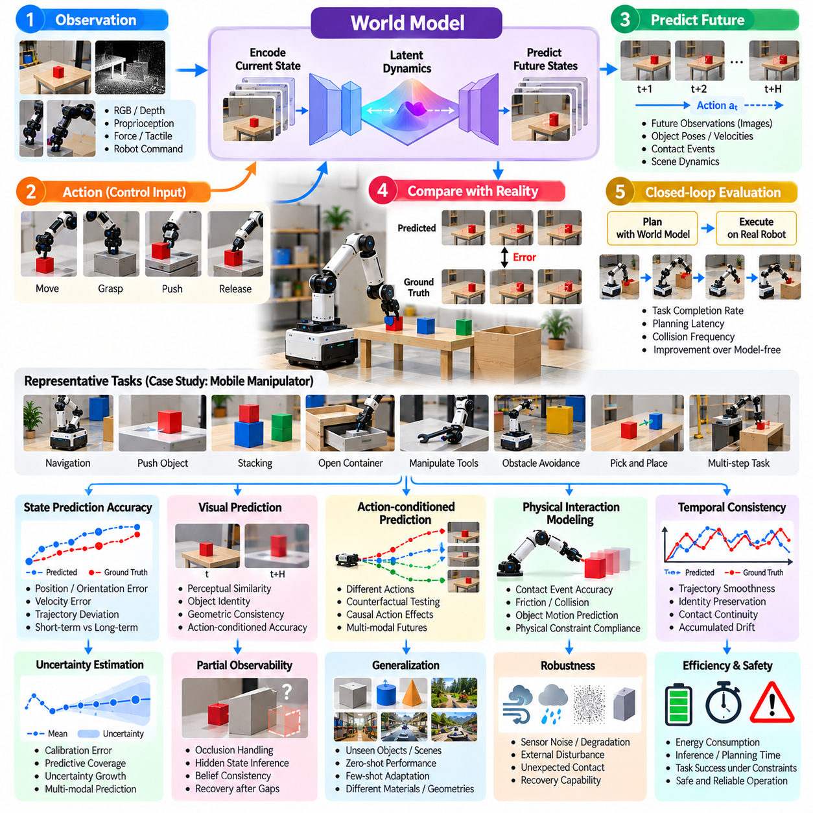{width="7.268055555555556in" height="7.268055555555556in"}

World model evaluation examines whether an intelligent robotic system can construct internal representations of its environment and predict how physical states evolve under actions. Unlike perception benchmarks that assess current observations, world model benchmarks evaluate predictive understanding, temporal consistency, and physical reasoning. The central objective is to determine whether learned dynamics support reliable planning and control beyond memorized visual patterns.

A representative case study involves a mobile manipulator operating in a workspace containing movable objects, obstacles, and changing task conditions. The robot observes the environment, predicts the consequences of candidate actions, and executes selected behaviors. Evaluation compares predicted future states with measured outcomes. Tasks include pushing objects, navigating around obstacles, manipulating containers, and responding to unexpected environmental changes.

Benchmark design begins by specifying observation modalities, action representations, prediction horizons, and environmental dynamics. Inputs may include images, depth measurements, proprioception, force signals, and robot commands. Outputs may represent future observations, object poses, contact events, or latent states. Standardized protocols define initial conditions, action sequences, prediction intervals, and reference measurements for reproducible evaluation.

State prediction accuracy measures how closely the world model estimates future positions, velocities, orientations, and interaction outcomes. Evaluation compares predicted trajectories with ground-truth measurements across multiple time horizons. Metrics may include position error, orientation error, velocity error, and trajectory deviation. Results should distinguish short-term prediction accuracy from long-term consistency because small modeling errors can accumulate over time.

Visual prediction evaluates whether generated future observations preserve object identity, scene geometry, and physically plausible motion. Pixel-level similarity alone is insufficient because visually convincing predictions may contain incorrect dynamics. Evaluation should combine perceptual similarity with object tracking, geometric consistency, and action-conditioned state accuracy. This approach prevents appearance quality from being mistaken for genuine physical understanding.

Action-conditioned prediction is essential because a useful world model must represent how different control inputs change future states. The benchmark evaluates predictions under alternative robot actions, including movement, grasping, pushing, and releasing objects. Counterfactual testing compares predicted outcomes for actions not executed in the observed trajectory. Such evaluation reveals whether the model captures causal action effects rather than passive temporal correlations.

Physical interaction modeling examines contact, friction, collision, gravity, and object motion. Representative tests include pushing objects across different surfaces, stacking items, opening articulated mechanisms, and manipulating objects with varying mass. Measurements include contact-event accuracy, motion prediction error, and violation of physical constraints. Performance should be evaluated across unfamiliar interaction conditions to assess transferable physical reasoning.

Temporal consistency measures whether successive predictions form coherent physical trajectories over extended horizons. A model may generate accurate individual frames while producing inconsistent object motion or sudden state changes. Evaluation considers trajectory smoothness, identity preservation, contact continuity, and accumulated prediction drift. Multi-horizon testing reveals the point at which predictions become unreliable for downstream decision-making.

Uncertainty estimation evaluates whether the world model recognizes ambiguity in observations and unpredictability in physical interactions. Probabilistic models may generate multiple plausible futures or estimate confidence intervals around predicted states. Metrics include calibration error, predictive coverage, and uncertainty growth across horizons. Reliable uncertainty estimates help planners avoid overconfident actions when the environment is partially observed.

Partial observability testing introduces occluded objects, limited camera viewpoints, delayed observations, and missing sensor measurements. The model must infer hidden states from previous observations while updating its beliefs when new evidence becomes available. Evaluation measures hidden-state prediction accuracy, belief consistency, and recovery after observation gaps. These tests distinguish persistent environmental understanding from immediate visual recognition.

Planning-oriented evaluation determines whether world model predictions improve action selection and task completion. The robot may use model predictive control or imagined rollouts to compare candidate action sequences. Benchmark results include task success rate, planning latency, collision frequency, and prediction-guided improvement over model-free baselines. Predictive accuracy should be linked to actual control benefits rather than reported as an isolated modeling achievement.

Generalization testing evaluates world model performance on unseen objects, geometries, materials, environments, and action sequences. Training and test conditions must be separated to prevent trajectory memorization or scene leakage. Zero-shot performance and adaptation-assisted performance should be reported independently. Systematic variations in physical properties reveal whether learned representations capture reusable dynamics or depend on familiar visual configurations.

Robustness evaluation introduces sensor noise, calibration errors, unexpected contacts, actuator uncertainty, and changes in environmental dynamics. The world model should update predictions when observations contradict expected outcomes. Measurements include prediction degradation, error detection latency, adaptation speed, and recovery of forecasting accuracy. Robustness is particularly important when inaccurate predictions could lead to unsafe physical actions.

Representation evaluation examines whether latent states preserve information necessary for prediction, planning, and physical interaction. Compact representations may improve computational efficiency but discard important geometric or dynamic details. Evaluation can use downstream state reconstruction, object tracking, contact prediction, and planning performance. The objective is not to maximize representation complexity but to retain task-relevant information across temporal horizons.

Simulation-based evaluation enables controlled experiments involving randomized physical parameters, object arrangements, and action sequences. Ground-truth simulator states provide precise references for analyzing prediction errors. However, a model may perform well under simulated dynamics while failing on real contact behavior or sensor characteristics. Simulation results should therefore be complemented by physical experiments that expose the simulation-to-reality gap.

Real-world validation should use calibrated sensors, synchronized action logs, reference tracking systems, and repeatable physical interactions. Each trial records observations, executed actions, predicted outcomes, and measured future states. Repeated experiments across different objects and environments help establish reproducibility. Evaluation should document model update frequency, computational latency, and hardware constraints that influence deployment feasibility.

Long-horizon evaluation examines whether a world model can maintain useful predictions across extended action sequences and changing environmental states. Representative missions may involve navigation, object retrieval, manipulation, and repeated interaction. Metrics include accumulated prediction error, planning success, state consistency, and intervention frequency. These tests reveal whether predictive representations remain useful when uncertainty compounds over time.

Safety evaluation examines the consequences of inaccurate predictions, unmodeled contacts, and excessive confidence in uncertain states. The benchmark should include collision-risk prediction, unsafe-action rejection, and fallback behavior when model confidence becomes insufficient. Safety-critical failures must be reported separately from average prediction accuracy. A useful world model should support conservative decisions when reliable physical forecasting is unavailable.

Statistical reporting should include prediction-error distributions, confidence intervals, calibration metrics, task success rates, and failure classifications. Results should be separated by prediction horizon, interaction type, environmental novelty, and disturbance intensity. Comparisons should use consistent observation budgets and computational constraints. This prevents differences in available information or processing resources from distorting conclusions about model quality.

A comprehensive world model scorecard combines state prediction, visual consistency, action conditioning, physical reasoning, uncertainty calibration, generalization, robustness, planning utility, and safety. No single metric can establish whether a model understands physical dynamics. The ultimate benchmark objective is to determine whether learned predictive representations enable robots to anticipate consequences, select effective actions, and operate reliably in unfamiliar physical environments.

월드 모델 평가(World Model Evaluation)는 지능형 로봇 시스템(Intelligent Robotic System)이 환경에 대한 내부 표현(Internal Representations)을 구축하고, 동작(Action)에 따라 물리적 상태(Physical States)가 어떻게 변화하는지 예측할 수 있는지 검토한다. 현재 관측(Current Observations)을 평가하는 인식 벤치마크(Perception Benchmarks)와 달리 월드 모델 벤치마크(World Model Benchmarks)는 예측적 이해(Predictive Understanding), 시간적 일관성(Temporal Consistency), 물리적 추론(Physical Reasoning)을 평가한다. 핵심 목적은 학습된 동역학(Learned Dynamics)이 암기된 시각적 패턴을 넘어 신뢰성 있는 계획(Planning)과 제어(Control)를 지원하는지 판단하는 것이다.

대표적인 사례 연구(Case Study)는 이동 가능한 물체, 장애물, 변화하는 작업 조건이 존재하는 작업공간에서 이동형 조작기(Mobile Manipulator)가 작동하는 상황을 다룬다. 로봇은 환경을 관측하고, 후보 동작(Candidate Actions)의 결과를 예측하며, 선택된 행동을 실행한다. 평가는 예측된 미래 상태(Predicted Future States)와 실제 측정 결과(Measured Outcomes)를 비교한다. 작업에는 물체 밀기(Object Pushing), 장애물 우회 항행(Obstacle Navigation), 용기 조작(Container Manipulation), 예상하지 못한 환경 변화에 대한 대응이 포함된다.

벤치마크 설계(Benchmark Design)는 관측 모달리티(Observation Modalities), 동작 표현(Action Representations), 예측 지평(Prediction Horizons), 환경 동역학(Environmental Dynamics)을 명시하는 것으로 시작한다. 입력에는 이미지(Images), 깊이 측정값(Depth Measurements), 고유수용감각(Proprioception), 힘 신호(Force Signals), 로봇 명령(Robot Commands)이 포함될 수 있다. 출력은 미래 관측(Future Observations), 물체 자세(Object Poses), 접촉 사건(Contact Events), 잠재 상태(Latent States)를 표현할 수 있다. 표준화된 프로토콜(Standardized Protocols)은 재현 가능한 평가를 위해 초기 조건, 동작 순서, 예측 간격, 기준 측정값(Reference Measurements)을 정의한다.

상태 예측 정확도(State Prediction Accuracy)는 월드 모델이 미래 위치, 속도, 방향, 상호작용 결과를 얼마나 정확하게 추정하는지 측정한다. 평가는 여러 시간 지평(Time Horizons)에 걸쳐 예측 궤적(Predicted Trajectories)과 실제 기준 측정값(Ground-Truth Measurements)을 비교한다. 평가 지표에는 위치 오차(Position Error), 방향 오차(Orientation Error), 속도 오차(Velocity Error), 궤적 편차(Trajectory Deviation)가 포함될 수 있다. 작은 모델링 오차(Modeling Errors)가 시간이 지남에 따라 누적될 수 있으므로 단기 예측 정확도(Short-Term Prediction Accuracy)와 장기 일관성(Long-Term Consistency)을 구분하여 보고해야 한다.

시각적 예측(Visual Prediction)은 생성된 미래 관측(Generated Future Observations)이 물체 정체성(Object Identity), 장면 기하학(Scene Geometry), 물리적으로 타당한 움직임(Physically Plausible Motion)을 유지하는지 평가한다. 시각적으로 설득력 있는 예측이라도 잘못된 동역학을 포함할 수 있으므로 픽셀 수준 유사도(Pixel-Level Similarity)만으로는 충분하지 않다. 평가는 지각적 유사도(Perceptual Similarity), 물체 추적(Object Tracking), 기하학적 일관성(Geometric Consistency), 동작 조건부 상태 정확도(Action-Conditioned State Accuracy)를 결합해야 한다. 이러한 접근법은 외관 품질(Appearance Quality)을 실제 물리적 이해(Genuine Physical Understanding)로 잘못 해석하는 것을 방지한다.

동작 조건부 예측(Action-Conditioned Prediction)은 유용한 월드 모델이 서로 다른 제어 입력(Control Inputs)이 미래 상태를 어떻게 변화시키는지 표현해야 하므로 필수적이다. 벤치마크는 이동(Movement), 파지(Grasping), 밀기(Pushing), 물체 놓기(Releasing Objects)를 포함한 대안적 로봇 동작(Alternative Robot Actions)에 대한 예측을 평가한다. 반사실적 시험(Counterfactual Testing)은 관측된 궤적에서 실제로 실행되지 않은 동작의 예측 결과를 비교한다. 이러한 평가는 모델이 수동적인 시간적 상관관계(Passive Temporal Correlations)가 아니라 동작의 인과적 효과(Causal Action Effects)를 포착하는지 보여준다.

물리적 상호작용 모델링(Physical Interaction Modeling)은 접촉(Contact), 마찰(Friction), 충돌(Collision), 중력(Gravity), 물체 운동(Object Motion)을 검토한다. 대표적인 시험에는 서로 다른 표면에서 물체 밀기, 물체 쌓기(Stacking), 관절형 기구 열기(Opening Articulated Mechanisms), 다양한 질량을 가진 물체 조작이 포함된다. 측정 항목에는 접촉 사건 정확도(Contact-Event Accuracy), 운동 예측 오차(Motion Prediction Error), 물리적 제약조건 위반(Violation of Physical Constraints)이 포함된다. 전이 가능한 물리적 추론(Transferable Physical Reasoning)을 평가하기 위해 익숙하지 않은 상호작용 조건에서도 성능을 시험해야 한다.

시간적 일관성(Temporal Consistency)은 연속적인 예측이 확장된 시간 지평(Extended Horizons)에 걸쳐 일관된 물리적 궤적(Coherent Physical Trajectories)을 형성하는지 측정한다. 모델은 개별 프레임(Individual Frames)을 정확하게 생성하면서도 물체 운동의 불일치(Inconsistent Object Motion)나 갑작스러운 상태 변화(Sudden State Changes)를 발생시킬 수 있다. 평가는 궤적 평활성(Trajectory Smoothness), 물체 정체성 유지(Identity Preservation), 접촉 연속성(Contact Continuity), 누적 예측 드리프트(Accumulated Prediction Drift)를 고려한다. 다중 지평 시험(Multi-Horizon Testing)은 후속 의사결정(Downstream Decision-Making)에 예측을 신뢰할 수 없게 되는 시점을 보여준다.

불확실성 추정(Uncertainty Estimation)은 월드 모델이 관측의 모호성(Ambiguity)과 물리적 상호작용의 예측 불가능성(Unpredictability)을 인식하는지 평가한다. 확률적 모델(Probabilistic Models)은 여러 개의 타당한 미래(Multiple Plausible Futures)를 생성하거나 예측 상태 주변의 신뢰구간(Confidence Intervals)을 추정할 수 있다. 평가 지표에는 보정 오차(Calibration Error), 예측 포함률(Predictive Coverage), 시간 지평에 따른 불확실성 증가(Uncertainty Growth)가 포함된다. 신뢰성 있는 불확실성 추정은 환경이 부분적으로 관측될 때 계획기(Planner)가 지나치게 확신하는 동작(Overconfident Actions)을 피하도록 지원한다.

부분 관측 가능성 시험(Partial Observability Testing)은 가려진 물체(Occluded Objects), 제한된 카메라 시점(Limited Camera Viewpoints), 지연된 관측(Delayed Observations), 누락된 센서 측정값(Missing Sensor Measurements)을 도입한다. 모델은 이전 관측으로부터 숨겨진 상태(Hidden States)를 추론하고 새로운 증거가 확보되면 신념 상태(Beliefs)를 갱신해야 한다. 평가는 숨겨진 상태 예측 정확도(Hidden-State Prediction Accuracy), 신념 일관성(Belief Consistency), 관측 공백 이후 복구(Recovery After Observation Gaps)를 측정한다. 이러한 시험은 지속적인 환경 이해(Persistent Environmental Understanding)를 즉각적인 시각 인식(Immediate Visual Recognition)과 구분한다.

계획 중심 평가(Planning-Oriented Evaluation)는 월드 모델의 예측이 동작 선택(Action Selection)과 작업 완료(Task Completion)를 개선하는지 판단한다. 로봇은 모델 예측 제어(Model Predictive Control) 또는 상상된 롤아웃(Imagined Rollouts)을 사용하여 후보 동작 순서(Candidate Action Sequences)를 비교할 수 있다. 벤치마크 결과에는 작업 성공률(Task Success Rate), 계획 지연시간(Planning Latency), 충돌 빈도(Collision Frequency), 모델 비사용 기준선(Model-Free Baselines) 대비 예측 기반 성능 향상(Prediction-Guided Improvement)이 포함된다. 예측 정확도는 독립적인 모델링 성과로만 보고하기보다 실제 제어 성능의 개선과 연결해야 한다.

일반화 시험(Generalization Testing)은 학습 과정에서 경험하지 못한 물체, 기하학적 구조(Geometries), 재료(Materials), 환경, 동작 순서에 대한 월드 모델의 성능을 평가한다. 궤적 암기(Trajectory Memorization)나 장면 정보 누출(Scene Leakage)을 방지하기 위해 학습 조건(Training Conditions)과 시험 조건(Test Conditions)을 분리해야 한다. 제로샷 성능(Zero-Shot Performance)과 적응 지원 성능(Adaptation-Assisted Performance)은 독립적으로 보고해야 한다. 물리적 특성(Physical Properties)의 체계적인 변화는 학습된 표현(Learned Representations)이 재사용 가능한 동역학(Reusable Dynamics)을 포착하는지 또는 익숙한 시각적 구성(Familiar Visual Configurations)에 의존하는지 보여준다.

강건성 평가(Robustness Evaluation)는 센서 잡음(Sensor Noise), 보정 오차(Calibration Errors), 예상하지 못한 접촉(Unexpected Contacts), 구동기 불확실성(Actuator Uncertainty), 환경 동역학의 변화(Changes in Environmental Dynamics)를 도입한다. 월드 모델은 관측 결과가 예상 결과(Expected Outcomes)와 모순될 때 예측을 갱신해야 한다. 측정 항목에는 예측 성능 저하(Prediction Degradation), 오류 감지 지연시간(Error Detection Latency), 적응 속도(Adaptation Speed), 예측 정확도 회복(Recovery of Forecasting Accuracy)이 포함된다. 강건성은 부정확한 예측이 위험한 물리적 동작(Unsafe Physical Actions)으로 이어질 수 있는 상황에서 특히 중요하다.

표현 평가(Representation Evaluation)는 잠재 상태(Latent States)가 예측, 계획, 물리적 상호작용에 필요한 정보를 보존하는지 검토한다. 압축된 표현(Compact Representations)은 계산 효율성(Computational Efficiency)을 향상시킬 수 있지만 중요한 기하학적 세부정보(Geometric Details)나 동역학 정보(Dynamic Details)를 손실할 수 있다. 평가는 후속 상태 재구성(Downstream State Reconstruction), 물체 추적(Object Tracking), 접촉 예측(Contact Prediction), 계획 성능(Planning Performance)을 활용할 수 있다. 목적은 표현의 복잡도(Representation Complexity)를 최대화하는 것이 아니라 여러 시간 지평에 걸쳐 작업 관련 정보(Task-Relevant Information)를 유지하는 것이다.

시뮬레이션 기반 평가(Simulation-Based Evaluation)는 무작위화된 물리 매개변수(Randomized Physical Parameters), 물체 배치(Object Arrangements), 동작 순서(Action Sequences)를 포함하는 통제된 실험(Controlled Experiments)을 가능하게 한다. 시뮬레이터의 실제 기준 상태(Ground-Truth Simulator States)는 예측 오차를 분석하기 위한 정밀한 기준값을 제공한다. 그러나 모델은 시뮬레이션 동역학(Simulated Dynamics)에서 높은 성능을 보이면서도 실제 접촉 동작(Real Contact Behavior)이나 센서 특성(Sensor Characteristics)에서는 실패할 수 있다. 따라서 시뮬레이션 결과는 시뮬레이션과 현실 사이의 격차(Simulation-to-Reality Gap)를 드러내는 물리적 실험으로 보완해야 한다.

실제 환경 검증(Real-World Validation)은 보정된 센서(Calibrated Sensors), 동기화된 동작 로그(Synchronized Action Logs), 기준 추적 시스템(Reference Tracking Systems), 반복 가능한 물리적 상호작용(Repeatable Physical Interactions)을 사용해야 한다. 각 시험은 관측, 실행된 동작, 예측 결과, 측정된 미래 상태(Measured Future States)를 기록한다. 서로 다른 물체와 환경에서 반복 실험을 수행하면 재현성(Reproducibility)을 확보하는 데 도움이 된다. 평가는 배치 가능성(Deployment Feasibility)에 영향을 미치는 모델 갱신 주기(Model Update Frequency), 계산 지연시간(Computational Latency), 하드웨어 제약조건(Hardware Constraints)을 문서화해야 한다.

장기 평가(Long-Horizon Evaluation)는 월드 모델이 확장된 동작 순서(Extended Action Sequences)와 변화하는 환경 상태(Changing Environmental States)에 걸쳐 유용한 예측을 유지할 수 있는지 검토한다. 대표적인 임무에는 내비게이션(Navigation), 물체 회수(Object Retrieval), 조작(Manipulation), 반복적인 상호작용(Repeated Interaction)이 포함될 수 있다. 평가 지표에는 누적 예측 오차(Accumulated Prediction Error), 계획 성공률(Planning Success), 상태 일관성(State Consistency), 개입 빈도(Intervention Frequency)가 포함된다. 이러한 시험은 시간이 지남에 따라 불확실성이 누적될 때 예측 표현(Predictive Representations)이 계속 유용한지 보여준다.

안전성 평가(Safety Evaluation)는 부정확한 예측(Inaccurate Predictions), 모델링되지 않은 접촉(Unmodeled Contacts), 불확실한 상태에 대한 과도한 확신(Excessive Confidence)이 초래하는 결과를 검토한다. 벤치마크에는 충돌 위험 예측(Collision-Risk Prediction), 위험한 동작 거부(Unsafe-Action Rejection), 모델 신뢰도(Model Confidence)가 불충분해질 때의 대체 동작(Fallback Behavior)이 포함되어야 한다. 안전에 중대한 영향을 미치는 실패(Safety-Critical Failures)는 평균 예측 정확도(Average Prediction Accuracy)와 별도로 보고해야 한다. 유용한 월드 모델은 신뢰성 있는 물리적 예측(Physical Forecasting)이 불가능할 때 보수적인 의사결정(Conservative Decisions)을 지원해야 한다.

통계적 보고(Statistical Reporting)에는 예측 오차 분포(Prediction-Error Distributions), 신뢰구간(Confidence Intervals), 보정 지표(Calibration Metrics), 작업 성공률(Task Success Rates), 실패 분류(Failure Classifications)가 포함되어야 한다. 결과는 예측 지평(Prediction Horizon), 상호작용 유형(Interaction Type), 환경 신규성(Environmental Novelty), 외란 강도(Disturbance Intensity)에 따라 구분해야 한다. 비교에는 일관된 관측 예산(Observation Budgets)과 계산 제약조건(Computational Constraints)을 적용해야 한다. 이를 통해 사용 가능한 정보나 처리 자원의 차이가 모델 품질(Model Quality)에 대한 결론을 왜곡하는 것을 방지할 수 있다.

포괄적인 월드 모델 평가표(World Model Scorecard)는 상태 예측(State Prediction), 시각적 일관성(Visual Consistency), 동작 조건화(Action Conditioning), 물리적 추론(Physical Reasoning), 불확실성 보정(Uncertainty Calibration), 일반화(Generalization), 강건성(Robustness), 계획 유용성(Planning Utility), 안전성(Safety)을 결합한다. 단일 지표만으로는 모델이 물리적 동역학(Physical Dynamics)을 이해하는지 입증할 수 없다. 궁극적인 벤치마크 목적은 학습된 예측 표현(Learned Predictive Representations)이 로봇으로 하여금 동작의 결과를 예상하고, 효과적인 동작을 선택하며, 익숙하지 않은 물리적 환경에서 신뢰성 있게 작동하도록 지원하는지 판단하는 것이다.

##  

## 09.09. VLA and Robot Foundation Model Benchmark

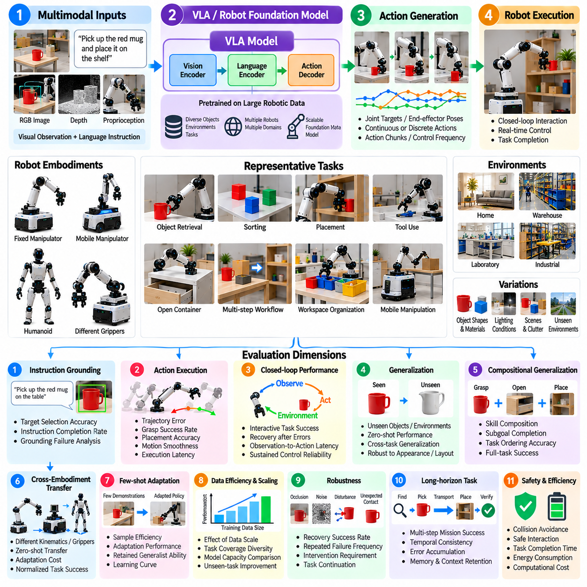{width="7.268055555555556in" height="7.268055555555556in"}

Vision-Language-Action (VLA) and robot foundation model benchmarking evaluates whether pretrained multimodal models can translate visual observations and language instructions into reliable physical actions. Unlike conventional robotic controllers designed for specific tasks, these models aim to transfer learned representations across objects, environments, and behaviors. Evaluation must therefore measure physical task success, generalization, adaptability, and safety rather than language understanding alone.

A representative benchmark involves robotic manipulators and mobile manipulators performing object retrieval, sorting, placement, tool handling, and multi-step workspace organization. Each task combines visual perception, instruction interpretation, and action execution. Test environments vary object categories, spatial arrangements, lighting, and physical properties. These variations reveal whether the model possesses transferable competence or relies on familiar training patterns.

Benchmark design begins by specifying the model architecture, observation modalities, action representations, robot embodiment, and inference configuration. Inputs may include RGB images, depth maps, proprioception, and natural-language commands. Outputs may consist of joint targets, end-effector poses, action tokens, or continuous control trajectories. Evaluation protocols must document control frequency, action horizon, preprocessing, and hardware constraints.

Instruction grounding measures whether the model correctly connects linguistic descriptions with physical objects, locations, and intended actions. Representative tasks include selecting an object by color, identifying a target through spatial relationships, and executing conditional instructions. Metrics include target selection accuracy, instruction completion rate, and grounding-related failures. Successful language interpretation must be verified through physical execution rather than textual responses.

Action generation evaluates whether predicted commands produce feasible, accurate, and stable robot movements. Different models may generate discrete action tokens, continuous actions, or temporally grouped action chunks. Measurements include trajectory error, grasp success, placement accuracy, action smoothness, and execution latency. Comparisons should account for action representation and control frequency because these choices strongly influence physical performance.

Closed-loop evaluation is essential because robotic actions change the environment and generate new observations. A model may perform well when predicting actions from recorded demonstrations but fail during autonomous execution. Benchmarking should therefore distinguish offline action prediction from interactive task success. Relevant metrics include recovery after execution errors, observation-to-action latency, corrective behavior, and sustained control reliability.

Generalization testing examines performance on unseen objects, environments, instructions, and task combinations. Training and evaluation distributions should be explicitly separated, with controlled variations in geometry, appearance, material, and spatial arrangement. Zero-shot performance measures immediate transfer without additional training. Results should identify whether success depends on memorized demonstrations or reusable perception-action representations.

Compositional generalization evaluates whether previously learned capabilities can be combined to solve unfamiliar instructions. A robot trained to grasp, transport, open, and place objects may be tested on new sequences involving those operations. Measurements include subgoal completion, task ordering accuracy, planning consistency, and full-task success. This evaluation distinguishes generalist behavior from memorization of complete action sequences.

Cross-embodiment transfer examines whether a foundation model can operate across robots with different kinematics, grippers, action spaces, and sensing configurations. Evaluation should distinguish direct zero-shot transfer from adaptation requiring additional robot-specific data. Metrics include normalized task success, calibration effort, adaptation cost, and performance degradation. Hardware capability differences must be documented to avoid misleading comparisons.

Few-shot adaptation evaluates how efficiently a pretrained model learns new tasks from limited demonstrations or interaction data. Benchmark protocols should specify demonstration counts, training steps, computational budgets, and permitted parameter updates. Performance is measured through adaptation curves, sample efficiency, and retained competence on previous tasks. This reveals whether task-specific improvement comes at the expense of broader generalist capabilities.

Data efficiency and scaling evaluation examine relationships between training diversity, model capacity, and downstream robotic performance. Comparisons may vary dataset size, task coverage, embodiment diversity, and demonstration quality. Evaluation should identify whether additional training data improves unseen-task success rather than merely familiar-task accuracy. Scaling conclusions require controlled experimental conditions and transparent reporting of training resources.

Robustness testing introduces visual occlusion, sensor noise, object displacement, ambiguous instructions, and unexpected contact. The model must recognize changes and revise its actions when initial predictions become inappropriate. Measurements include disturbance recovery, repeated failure frequency, intervention requirements, and task continuation success. Robustness should be evaluated during physical interaction rather than exclusively through static visual perturbations.

Long-horizon evaluation combines multiple perception, reasoning, and manipulation operations into extended missions. Representative tasks include locating several objects, reorganizing a workspace, and verifying completion conditions. Metrics include full-mission success, subgoal consistency, accumulated execution error, and intervention frequency. These tests reveal whether foundation models maintain task context and reliable behavior across extended action sequences.

Inference efficiency is important because large multimodal models may introduce substantial computational latency and memory requirements. Evaluation measures observation processing time, action generation latency, throughput, memory consumption, and energy usage. Edge deployment should be tested under realistic hardware limits. A model with high offline accuracy may remain unsuitable for physical control if its responses violate real-time operational constraints.

Safety evaluation examines unsafe action generation, collisions, excessive contact forces, unstable grasps, and failures to respect restricted regions. Safety-critical outcomes must be reported independently from task success. Runtime monitors, action constraints, emergency stopping, and fallback controllers should be evaluated as part of the complete system. High-level instruction compliance does not guarantee safe physical behavior.

Simulation-based benchmarking enables repeated testing across randomized objects, task layouts, robot configurations, and disturbances. Parallel environments support large-scale comparisons and systematic failure analysis. However, simulated contacts, tactile feedback, and actuator dynamics may differ from physical conditions. Real-world validation is therefore necessary to determine whether simulated improvements translate into reliable manipulation and autonomous task execution.

Real-world evaluation should use standardized objects, calibrated reference measurements, repeatable task procedures, and independently verified outcomes. Each trial should record instructions, observations, generated actions, intervention events, and final task states. Repeated testing across environments establishes reproducibility. Evaluation must disclose task-specific tuning, human assistance, and any training-data overlap that could influence reported performance.

Statistical reporting should include task success rates, confidence intervals, completion-time distributions, adaptation curves, and failure classifications. Results should be separated by task category, environmental novelty, embodiment, and evaluation mode. Model comparisons must account for observation budgets, control interfaces, and available computational resources. A single aggregate score cannot adequately represent the capabilities and limitations of a generalist robotic model.

A comprehensive VLA and robot foundation model scorecard combines instruction grounding, action accuracy, closed-loop performance, generalization, cross-embodiment transfer, adaptation efficiency, long-horizon reliability, computational efficiency, and safety. Category-level reporting prevents strong performance in familiar tasks from concealing critical weaknesses. The benchmark ultimately determines whether pretrained multimodal intelligence produces transferable, dependable, and safe physical behavior.

시각-언어-행동(Vision-Language-Action, VLA) 모델과 로봇 파운데이션 모델(Robot Foundation Model)의 벤치마킹(Benchmarking)은 사전학습된 멀티모달 모델(Pretrained Multimodal Models)이 시각적 관측(Visual Observations)과 언어 명령(Language Instructions)을 신뢰성 있는 물리적 동작(Physical Actions)으로 변환할 수 있는지 평가한다. 특정 작업을 위해 설계된 기존 로봇 제어기(Conventional Robotic Controllers)와 달리 이러한 모델은 학습된 표현(Learned Representations)을 다양한 물체, 환경, 행동으로 전이하는 것을 목표로 한다. 따라서 평가는 언어 이해(Language Understanding)뿐만 아니라 실제 작업 성공률(Physical Task Success), 일반화(Generalization), 적응성(Adaptability), 안전성(Safety)을 측정해야 한다.

대표적인 벤치마크는 로봇 조작기(Robotic Manipulators)와 이동형 조작기(Mobile Manipulators)가 물체 회수(Object Retrieval), 분류(Sorting), 배치(Placement), 도구 취급(Tool Handling), 다단계 작업공간 정리(Multi-Step Workspace Organization)를 수행하는 상황을 포함한다. 각 작업은 시각적 인식(Visual Perception), 명령 해석(Instruction Interpretation), 동작 실행(Action Execution)을 결합한다. 시험 환경은 물체 범주(Object Categories), 공간 배치(Spatial Arrangements), 조명(Lighting), 물리적 특성(Physical Properties)을 변화시킨다. 이러한 변화는 모델이 전이 가능한 능력(Transferable Competence)을 보유하는지 또는 익숙한 학습 패턴(Familiar Training Patterns)에 의존하는지 보여준다.

벤치마크 설계(Benchmark Design)는 모델 아키텍처(Model Architecture), 관측 모달리티(Observation Modalities), 동작 표현(Action Representations), 로봇 신체 구조(Robot Embodiment), 추론 구성(Inference Configuration)을 명시하는 것으로 시작한다. 입력에는 RGB 이미지(RGB Images), 깊이 지도(Depth Maps), 고유수용감각(Proprioception), 자연어 명령(Natural-Language Commands)이 포함될 수 있다. 출력은 관절 목표값(Joint Targets), 말단효과기 자세(End-Effector Poses), 동작 토큰(Action Tokens), 연속 제어 궤적(Continuous Control Trajectories)으로 구성될 수 있다. 평가 프로토콜(Evaluation Protocols)은 제어 주파수(Control Frequency), 동작 지평(Action Horizon), 전처리(Preprocessing), 하드웨어 제약조건(Hardware Constraints)을 문서화해야 한다.

명령 기반 의미 연결(Instruction Grounding)은 모델이 언어적 설명(Linguistic Descriptions)을 물리적 물체, 위치, 의도된 동작과 정확하게 연결하는지 측정한다. 대표적인 작업에는 색상에 따른 물체 선택, 공간적 관계(Spatial Relationships)를 통한 목표 식별, 조건부 명령(Conditional Instructions) 실행이 포함된다. 평가 지표에는 목표 선택 정확도(Target Selection Accuracy), 명령 완료율(Instruction Completion Rate), 의미 연결 관련 실패(Grounding-Related Failures)가 포함된다. 성공적인 언어 해석은 텍스트 응답이 아니라 실제 물리적 실행(Physical Execution)을 통해 검증해야 한다.

동작 생성(Action Generation)은 예측된 명령(Predicted Commands)이 실행 가능하고 정확하며 안정적인 로봇 움직임을 만들어내는지 평가한다. 서로 다른 모델은 이산 동작 토큰(Discrete Action Tokens), 연속 동작(Continuous Actions), 시간적으로 묶인 동작 청크(Temporally Grouped Action Chunks)를 생성할 수 있다. 측정 항목에는 궤적 오차(Trajectory Error), 파지 성공률(Grasp Success), 배치 정확도(Placement Accuracy), 동작 평활성(Action Smoothness), 실행 지연시간(Execution Latency)이 포함된다. 동작 표현과 제어 주파수는 실제 물리적 성능에 큰 영향을 미치므로 비교 과정에서 이를 고려해야 한다.

폐루프 평가(Closed-Loop Evaluation)는 로봇 동작이 환경을 변화시키고 새로운 관측을 생성하기 때문에 필수적이다. 모델은 기록된 시연(Recorded Demonstrations)으로부터 동작을 예측할 때 높은 성능을 보이더라도 자율 실행(Autonomous Execution)에서는 실패할 수 있다. 따라서 벤치마킹은 오프라인 동작 예측(Offline Action Prediction)과 상호작용 기반 작업 성공(Interactive Task Success)을 구분해야 한다. 관련 평가 지표에는 실행 오류 이후 복구(Recovery After Execution Errors), 관측에서 동작까지의 지연시간(Observation-to-Action Latency), 보정 행동(Corrective Behavior), 지속적인 제어 신뢰성(Sustained Control Reliability)이 포함된다.

일반화 시험(Generalization Testing)은 학습 과정에서 경험하지 못한 물체, 환경, 명령, 작업 조합에 대한 성능을 검토한다. 학습 분포(Training Distributions)와 평가 분포(Evaluation Distributions)를 명확하게 분리하고, 기하학적 구조(Geometry), 외관(Appearance), 재질(Material), 공간 배치(Spatial Arrangement)를 통제된 방식으로 변화시켜야 한다. 제로샷 성능(Zero-Shot Performance)은 추가 학습 없이 즉시 전이되는 능력을 측정한다. 평가 결과는 성공이 암기된 시연(Memorized Demonstrations)에 의존하는지 또는 재사용 가능한 인식-행동 표현(Reusable Perception-Action Representations)에 기반하는지 식별해야 한다.

조합적 일반화(Compositional Generalization)는 이전에 학습한 능력들을 결합하여 익숙하지 않은 명령을 해결할 수 있는지 평가한다. 물체 파지(Grasping), 운반(Transporting), 열기(Opening), 배치(Placing)를 학습한 로봇은 이러한 동작을 새로운 순서로 조합하는 작업에서 시험할 수 있다. 측정 항목에는 하위 목표 완료(Subgoal Completion), 작업 순서 정확도(Task Ordering Accuracy), 계획 일관성(Planning Consistency), 전체 작업 성공률(Full-Task Success)이 포함된다. 이러한 평가는 범용 행동(Generalist Behavior)과 완전한 동작 순서의 암기(Memorization of Complete Action Sequences)를 구분한다.

이종 신체 구조 간 전이(Cross-Embodiment Transfer)는 파지기(Grippers), 운동학적 구조(Kinematics), 동작 공간(Action Spaces), 센싱 구성(Sensing Configurations)이 서로 다른 로봇에서 파운데이션 모델이 작동할 수 있는지 검토한다. 평가는 직접적인 제로샷 전이(Direct Zero-Shot Transfer)와 추가적인 로봇별 데이터(Robot-Specific Data)가 필요한 적응(Adaptation)을 구분해야 한다. 평가 지표에는 정규화된 작업 성공률(Normalized Task Success), 보정 노력(Calibration Effort), 적응 비용(Adaptation Cost), 성능 저하(Performance Degradation)가 포함된다. 잘못된 비교를 방지하려면 하드웨어 능력 차이(Hardware Capability Differences)를 문서화해야 한다.

퓨샷 적응(Few-Shot Adaptation)은 사전학습된 모델이 제한된 시연(Limited Demonstrations)이나 상호작용 데이터(Interaction Data)로부터 새로운 작업을 얼마나 효율적으로 학습하는지 평가한다. 벤치마크 프로토콜은 시연 횟수(Demonstration Counts), 학습 단계(Training Steps), 계산 예산(Computational Budgets), 허용되는 매개변수 갱신(Permitted Parameter Updates)을 명시해야 한다. 성능은 적응 곡선(Adaptation Curves), 표본 효율성(Sample Efficiency), 기존 작업에 대한 능력 유지(Retained Competence)를 통해 측정한다. 이를 통해 작업별 성능 향상이 더 광범위한 범용 능력(Broader Generalist Capabilities)의 저하를 초래하는지 확인할 수 있다.

데이터 효율성 및 스케일링 평가(Data Efficiency and Scaling Evaluation)는 학습 데이터 다양성(Training Diversity), 모델 용량(Model Capacity), 후속 로봇 성능(Downstream Robotic Performance) 사이의 관계를 검토한다. 비교 과정에서는 데이터셋 크기(Dataset Size), 작업 범위(Task Coverage), 신체 구조 다양성(Embodiment Diversity), 시연 품질(Demonstration Quality)을 변화시킬 수 있다. 평가는 추가 학습 데이터가 익숙한 작업의 정확도만 높이는 것이 아니라 새로운 작업 성공률(Unseen-Task Success)을 향상시키는지 식별해야 한다. 스케일링에 관한 결론(Scaling Conclusions)을 도출하려면 통제된 실험 조건(Controlled Experimental Conditions)과 학습 자원(Training Resources)에 대한 투명한 보고가 필요하다.

강건성 시험(Robustness Testing)은 시각적 가림(Visual Occlusion), 센서 잡음(Sensor Noise), 물체 위치 변화(Object Displacement), 모호한 명령(Ambiguous Instructions), 예상하지 못한 접촉(Unexpected Contact)을 도입한다. 모델은 변화된 상황을 인식하고 초기 예측(Initial Predictions)이 적절하지 않게 되었을 때 동작을 수정해야 한다. 측정 항목에는 외란 복구(Disturbance Recovery), 반복 실패 빈도(Repeated Failure Frequency), 개입 요구량(Intervention Requirements), 작업 지속 성공률(Task Continuation Success)이 포함된다. 강건성은 정적인 시각적 교란(Static Visual Perturbations)만이 아니라 실제 물리적 상호작용(Physical Interaction) 중에도 평가해야 한다.

장기 평가(Long-Horizon Evaluation)는 여러 인식(Perception), 추론(Reasoning), 조작(Manipulation) 작업을 확장된 임무(Extended Missions)로 결합한다. 대표적인 작업에는 여러 물체 찾기, 작업공간 재정리(Reorganizing a Workspace), 완료 조건 검증(Verifying Completion Conditions)이 포함된다. 평가 지표에는 전체 임무 성공률(Full-Mission Success), 하위 목표 일관성(Subgoal Consistency), 누적 실행 오차(Accumulated Execution Error), 개입 빈도(Intervention Frequency)가 포함된다. 이러한 시험은 파운데이션 모델이 확장된 동작 순서(Extended Action Sequences)에 걸쳐 작업 맥락(Task Context)과 신뢰성 있는 행동(Reliable Behavior)을 유지하는지 보여준다.

추론 효율성(Inference Efficiency)은 대규모 멀티모달 모델(Large Multimodal Models)이 상당한 계산 지연시간(Computational Latency)과 메모리 요구량(Memory Requirements)을 발생시킬 수 있기 때문에 중요하다. 평가는 관측 처리 시간(Observation Processing Time), 동작 생성 지연시간(Action Generation Latency), 처리량(Throughput), 메모리 소비량(Memory Consumption), 에너지 사용량(Energy Usage)을 측정한다. 엣지 배포(Edge Deployment)는 현실적인 하드웨어 한계(Realistic Hardware Limits) 아래에서 시험해야 한다. 오프라인 정확도(Offline Accuracy)가 높은 모델이라도 응답이 실시간 운영 제약조건(Real-Time Operational Constraints)을 위반하면 물리적 제어(Physical Control)에 적합하지 않을 수 있다.

안전성 평가(Safety Evaluation)는 위험한 동작 생성(Unsafe Action Generation), 충돌(Collisions), 과도한 접촉력(Excessive Contact Forces), 불안정한 파지(Unstable Grasps), 제한 구역(Restricted Regions) 준수 실패를 검토한다. 안전에 중대한 영향을 미치는 결과(Safety-Critical Outcomes)는 작업 성공률(Task Success)과 독립적으로 보고해야 한다. 실행시간 감시기(Runtime Monitors), 동작 제약조건(Action Constraints), 비상 정지(Emergency Stopping), 대체 제어기(Fallback Controllers)를 전체 시스템(Complete System)의 일부로 평가해야 한다. 상위 수준 명령 준수(High-Level Instruction Compliance)가 안전한 물리적 행동(Safe Physical Behavior)을 보장하는 것은 아니다.

시뮬레이션 기반 벤치마킹(Simulation-Based Benchmarking)은 무작위화된 물체(Randomized Objects), 작업 배치(Task Layouts), 로봇 구성(Robot Configurations), 외란(Disturbances)에 걸친 반복 시험을 가능하게 한다. 병렬 환경(Parallel Environments)은 대규모 비교(Large-Scale Comparisons)와 체계적인 실패 분석(Systematic Failure Analysis)을 지원한다. 그러나 시뮬레이션된 접촉(Simulated Contacts), 촉각 피드백(Tactile Feedback), 구동기 동역학(Actuator Dynamics)은 실제 물리적 조건과 다를 수 있다. 따라서 시뮬레이션에서 확인된 개선이 신뢰성 있는 조작(Reliable Manipulation)과 자율 작업 실행(Autonomous Task Execution)으로 전이되는지 판단하려면 실제 환경 검증(Real-World Validation)이 필요하다.

실제 환경 평가(Real-World Evaluation)는 표준화된 물체(Standardized Objects), 보정된 기준 측정값(Calibrated Reference Measurements), 반복 가능한 작업 절차(Repeatable Task Procedures), 독립적으로 검증된 결과(Independently Verified Outcomes)를 사용해야 한다. 각 시험은 명령, 관측, 생성된 동작, 개입 사건(Intervention Events), 최종 작업 상태(Final Task States)를 기록해야 한다. 서로 다른 환경에서 반복 시험을 수행하면 재현성(Reproducibility)을 확보할 수 있다. 평가는 보고된 성능에 영향을 미칠 수 있는 작업별 조정(Task-Specific Tuning), 인간 지원(Human Assistance), 학습 데이터 중복(Training-Data Overlap)을 공개해야 한다.

통계적 보고(Statistical Reporting)에는 작업 성공률(Task Success Rates), 신뢰구간(Confidence Intervals), 완료 시간 분포(Completion-Time Distributions), 적응 곡선(Adaptation Curves), 실패 분류(Failure Classifications)가 포함되어야 한다. 결과는 작업 범주(Task Category), 환경 신규성(Environmental Novelty), 신체 구조(Embodiment), 평가 방식(Evaluation Mode)에 따라 구분해야 한다. 모델 비교에서는 관측 예산(Observation Budgets), 제어 인터페이스(Control Interfaces), 사용 가능한 계산 자원(Computational Resources)을 고려해야 한다. 단일 종합 점수(Single Aggregate Score)만으로는 범용 로봇 모델(Generalist Robotic Model)의 능력과 한계를 충분히 표현할 수 없다.

포괄적인 VLA 및 로봇 파운데이션 모델 평가표(VLA and Robot Foundation Model Scorecard)는 명령 기반 의미 연결(Instruction Grounding), 동작 정확도(Action Accuracy), 폐루프 성능(Closed-Loop Performance), 일반화(Generalization), 이종 신체 구조 간 전이(Cross-Embodiment Transfer), 적응 효율성(Adaptation Efficiency), 장기 신뢰성(Long-Horizon Reliability), 계산 효율성(Computational Efficiency), 안전성(Safety)을 결합한다. 범주별 보고(Category-Level Reporting)는 익숙한 작업에서의 높은 성능이 중대한 약점(Critical Weaknesses)을 가리는 것을 방지한다. 궁극적으로 벤치마크는 사전학습된 멀티모달 지능(Pretrained Multimodal Intelligence)이 전이 가능하고(Transferable), 신뢰할 수 있으며(Dependable), 안전한 물리적 행동(Safe Physical Behavior)을 생성하는지 판단한다.

##  

## 09.10. Long Horizon Autonomy Benchmark

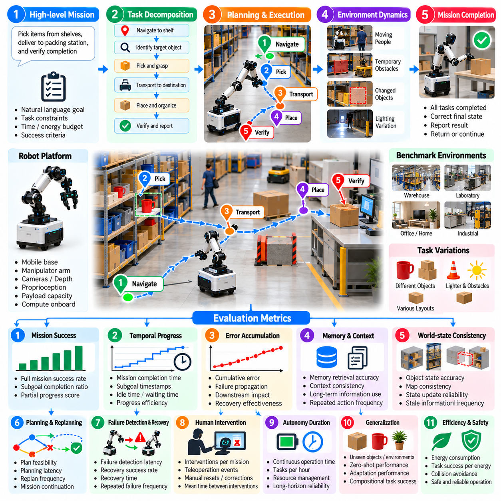{width="7.268055555555556in" height="7.268055555555556in"}

Long-horizon autonomy benchmarking evaluates whether a Physical AI system can sustain reliable decision-making and physical execution across extended missions. Unlike short-duration tests that measure isolated skills, long-horizon evaluation examines the accumulation of errors, changing environmental conditions, and dependencies between actions. Its central objective is to determine whether autonomous competence remains stable as task complexity and operating time increase.

A representative benchmark involves a mobile manipulator performing an extended warehouse mission that includes navigation, object identification, retrieval, transportation, placement, and verification. The robot must complete multiple dependent tasks without continuous human supervision. Evaluation environments introduce changing object locations, temporary obstacles, and operational interruptions to reveal whether the system can preserve mission objectives throughout execution.

Benchmark design begins by defining mission duration, task dependencies, operational boundaries, environmental variability, and acceptable intervention levels. A mission should contain measurable subgoals with explicit completion conditions. Standardized protocols specify initial states, resource limits, observation availability, and termination criteria. These definitions enable meaningful comparisons between systems with different planning and control architectures.

Task decomposition evaluation examines whether the robot can transform a high-level objective into an executable sequence of subgoals. The benchmark measures decomposition correctness, dependency satisfaction, and subgoal ordering accuracy. Tasks may require navigation before manipulation or inspection before delivery. Successful decomposition must reflect physical constraints rather than merely produce a logically plausible sequence of instructions.

Mission success is measured at both the complete-task and intermediate-subgoal levels. A robot may accomplish most subtasks but fail to deliver the final objective because of one unresolved dependency. Metrics include full-mission success rate, subgoal completion ratio, partial-progress score, and terminal-state correctness. Reporting intermediate progress separately prevents partial execution from being incorrectly classified as complete autonomy.

Temporal progress evaluation examines how efficiently a system advances toward its objectives throughout a mission. Measurements include elapsed mission time, subgoal completion timestamps, idle duration, and time spent recovering from failures. Progress curves reveal stagnation, repeated attempts, and inefficient execution patterns. Evaluation should distinguish deliberate waiting required by the task from unnecessary delays caused by planning or control failures.

Error accumulation is a defining challenge of long-horizon autonomy because small inaccuracies can propagate across dependent actions. Localization drift, grasping errors, incorrect object identification, and incomplete state updates may produce later failures. The benchmark tracks cumulative error, downstream failure propagation, and recovery effectiveness. These measurements identify whether the system detects and corrects deviations before they compromise mission completion.

Memory and context retention are evaluated through tasks requiring information collected earlier in the mission. The robot may need to remember object locations, completed inspections, temporary restrictions, or previously unsuccessful actions. Metrics include memory retrieval accuracy, context consistency, and repeated-action frequency. Long-horizon competence requires maintaining relevant information without allowing outdated observations to override current environmental evidence.

World-state consistency measures whether the robot maintains an accurate representation of its environment as objects move and tasks progress. Evaluation compares internal state estimates with independently measured conditions. Relevant metrics include object-state accuracy, map consistency, and stale-information frequency. A reliable autonomous system must revise its world representation when physical outcomes differ from predicted results.

Long-horizon planning evaluates whether the system can select action sequences that satisfy mission goals while respecting time, energy, and operational constraints. Unexpected obstacles, unavailable resources, or changed task priorities may require replanning. Metrics include planning latency, plan feasibility, replan frequency, and mission continuation success. Effective replanning should improve outcomes without producing excessive oscillation between competing strategies.

Failure detection and recovery are assessed by introducing controlled disturbances such as blocked routes, failed grasps, missing objects, and temporary sensor degradation. The robot must recognize unsuccessful execution and select an appropriate corrective action. Measurements include detection latency, recovery time, recovery success rate, and repeated failure frequency. Evaluation should distinguish autonomous recovery from interventions performed by human operators.

Human intervention is measured because nominal task completion does not necessarily indicate genuine autonomy. The benchmark records assistance requests, teleoperation events, manual resets, and operator corrections. Metrics include interventions per mission, interventions per operating hour, and mean time between interventions. Reports should distinguish safety-driven assistance from assistance required to overcome ordinary task execution failures.

Autonomy duration evaluates how long a robot can operate successfully without external assistance or mission-critical failure. Continuous-operation tests may involve repeated task cycles, changing workloads, and resource replenishment. Measurements include uninterrupted operating time, mean time between failures, and mission completion consistency. These metrics reveal reliability limitations that may remain invisible during isolated short trials.

Resource management becomes increasingly important during extended missions because energy, computation, storage, and communication availability may change. Evaluation measures energy consumption, charging decisions, computational utilization, and resource-related mission interruptions. The benchmark should determine whether the robot anticipates resource constraints and adjusts its plans before depletion prevents safe mission completion.

Robustness evaluation introduces environmental changes, uncertain observations, delayed communication, and unexpected human activity. The robot must preserve safe behavior while adapting to disturbances. Measurements include task degradation, disturbance recovery, and operational continuity. Testing should progressively increase difficulty within controlled safety limits to identify the boundaries of reliable autonomous performance.

Safety evaluation examines collisions, unsafe manipulation, restricted-area violations, and inappropriate continuation after critical failures. Safety events must be reported independently from mission completion and execution efficiency. Emergency stopping, safe fallback behavior, and controlled mission termination should be explicitly tested. A system that completes a mission through unsafe actions cannot be considered reliably autonomous.

Simulation-based benchmarking supports large numbers of long-duration trials across randomized task sequences, environmental conditions, and failure events. Parallel execution helps estimate rare failure probabilities and compare alternative planning strategies. However, simplified physical interactions and unrealistic disturbance distributions may distort reliability estimates. Real-world testing is necessary to validate whether simulated endurance transfers to operational environments.

Real-world validation should use repeatable mission definitions, synchronized logs, calibrated measurements, and documented intervention procedures. Each trial records task progress, robot state, resource consumption, environmental changes, and failure events. Repeated experiments across different mission lengths reveal how performance degrades over time. Statistical analysis should separate ordinary execution variability from systematic long-horizon failure patterns.

Benchmark reporting should include full-mission success, subgoal completion, autonomy duration, intervention rate, recovery performance, resource efficiency, and safety outcomes. Confidence intervals and failure distributions help distinguish meaningful improvements from experimental variation. Results should be stratified by mission length and difficulty. The ultimate objective is to establish whether Physical AI systems can sustain dependable autonomy throughout realistic, extended operations.

장기 자율성 벤치마킹(Long-Horizon Autonomy Benchmarking)은 피지컬 AI 시스템(Physical AI System)이 장시간 지속되는 임무(Extended Missions)에서 신뢰성 있는 의사결정(Decision-Making)과 물리적 실행(Physical Execution)을 유지할 수 있는지 평가한다. 개별 기술(Isolated Skills)을 측정하는 단기 시험(Short-Duration Tests)과 달리 장기 평가는 오차 누적(Error Accumulation), 변화하는 환경 조건(Changing Environmental Conditions), 동작 간 의존성(Dependencies Between Actions)을 검토한다. 핵심 목적은 작업 복잡도(Task Complexity)와 운영 시간(Operating Time)이 증가하더라도 자율 수행 능력(Autonomous Competence)이 안정적으로 유지되는지 판단하는 것이다.

대표적인 벤치마크는 이동형 조작기(Mobile Manipulator)가 항행(Navigation), 물체 식별(Object Identification), 물체 회수(Retrieval), 운반(Transportation), 배치(Placement), 검증(Verification)을 포함하는 장시간 창고 임무(Extended Warehouse Mission)를 수행하는 상황을 다룬다. 로봇은 지속적인 인간 감독(Human Supervision) 없이 상호 의존적인 여러 작업을 완료해야 한다. 평가 환경에는 변화하는 물체 위치, 일시적인 장애물(Temporary Obstacles), 운영 중단(Operational Interruptions)을 도입하여 시스템이 실행 과정 전반에서 임무 목표(Mission Objectives)를 유지할 수 있는지 확인한다.

벤치마크 설계(Benchmark Design)는 임무 지속시간(Mission Duration), 작업 의존성(Task Dependencies), 운영 경계(Operational Boundaries), 환경 변동성(Environmental Variability), 허용 가능한 개입 수준(Acceptable Intervention Levels)을 정의하는 것으로 시작한다. 임무에는 명시적인 완료 조건(Completion Conditions)을 가진 측정 가능한 하위 목표(Measurable Subgoals)가 포함되어야 한다. 표준화된 프로토콜(Standardized Protocols)은 초기 상태(Initial States), 자원 제한(Resource Limits), 관측 정보의 가용성(Observation Availability), 종료 기준(Termination Criteria)을 명시한다. 이러한 정의는 서로 다른 계획 및 제어 아키텍처(Planning and Control Architectures)를 사용하는 시스템 간의 의미 있는 비교를 가능하게 한다.

작업 분해 평가(Task Decomposition Evaluation)는 로봇이 상위 수준 목표(High-Level Objective)를 실행 가능한 하위 목표 순서(Executable Sequence of Subgoals)로 변환할 수 있는지 검토한다. 벤치마크는 분해 정확성(Decomposition Correctness), 의존성 충족(Dependency Satisfaction), 하위 목표 순서 정확도(Subgoal Ordering Accuracy)를 측정한다. 작업에 따라 조작(Manipulation) 이전에 항행이 필요하거나 배송(Delivery) 이전에 검사가 필요할 수 있다. 성공적인 작업 분해는 논리적으로 그럴듯한 명령 순서만 생성하는 것이 아니라 물리적 제약조건(Physical Constraints)을 반영해야 한다.

임무 성공(Mission Success)은 전체 작업(Complete Task)과 중간 하위 목표(Intermediate Subgoals) 수준에서 모두 측정한다. 로봇은 대부분의 하위 작업(Subtasks)을 수행하더라도 해결되지 않은 의존성(Unresolved Dependency) 하나로 인해 최종 목표(Final Objective)를 달성하지 못할 수 있다. 평가 지표에는 전체 임무 성공률(Full-Mission Success Rate), 하위 목표 완료 비율(Subgoal Completion Ratio), 부분 진행 점수(Partial-Progress Score), 최종 상태 정확성(Terminal-State Correctness)이 포함된다. 중간 진행 상황을 별도로 보고하면 부분적인 실행이 완전한 자율성(Complete Autonomy)으로 잘못 분류되는 것을 방지할 수 있다.

시간적 진행 평가(Temporal Progress Evaluation)는 시스템이 임무 수행 전반에서 목표를 향해 얼마나 효율적으로 진행하는지 검토한다. 측정 항목에는 경과 임무 시간(Elapsed Mission Time), 하위 목표 완료 시각(Subgoal Completion Timestamps), 유휴 시간(Idle Duration), 실패 복구에 소요된 시간(Time Spent Recovering from Failures)이 포함된다. 진행 곡선(Progress Curves)은 정체(Stagnation), 반복 시도(Repeated Attempts), 비효율적인 실행 패턴(Inefficient Execution Patterns)을 보여준다. 평가는 작업 수행에 필요한 의도적인 대기(Deliberate Waiting)와 계획 또는 제어 실패로 발생한 불필요한 지연(Unnecessary Delays)을 구분해야 한다.

오차 누적(Error Accumulation)은 작은 부정확성이 상호 의존적인 동작을 통해 전파될 수 있기 때문에 장기 자율성(Long-Horizon Autonomy)의 핵심 과제이다. 위치 추정 드리프트(Localization Drift), 파지 오차(Grasping Errors), 잘못된 물체 식별(Incorrect Object Identification), 불완전한 상태 갱신(Incomplete State Updates)은 후속 실패(Later Failures)를 유발할 수 있다. 벤치마크는 누적 오차(Cumulative Error), 후속 실패 전파(Downstream Failure Propagation), 복구 효과(Recovery Effectiveness)를 추적한다. 이러한 측정은 시스템이 편차(Deviations)를 감지하고 임무 완료에 영향을 미치기 전에 수정할 수 있는지 식별한다.

기억 및 맥락 유지(Memory and Context Retention)는 임무 초기에 수집한 정보가 나중에 필요한 작업을 통해 평가한다. 로봇은 물체 위치(Object Locations), 완료된 검사(Completed Inspections), 일시적인 제한사항(Temporary Restrictions), 이전에 실패한 동작(Previously Unsuccessful Actions)을 기억해야 할 수 있다. 평가 지표에는 기억 검색 정확도(Memory Retrieval Accuracy), 맥락 일관성(Context Consistency), 반복 동작 빈도(Repeated-Action Frequency)가 포함된다. 장기 자율 수행 능력(Long-Horizon Competence)은 오래된 관측(Outdated Observations)이 현재 환경 증거(Current Environmental Evidence)를 덮어쓰지 않도록 하면서 관련 정보를 유지하는 능력을 요구한다.

세계 상태 일관성(World-State Consistency)은 물체가 이동하고 작업이 진행되는 동안 로봇이 환경에 대한 정확한 표현(Accurate Representation)을 유지하는지 측정한다. 평가는 내부 상태 추정값(Internal State Estimates)을 독립적으로 측정된 조건(Independently Measured Conditions)과 비교한다. 관련 평가 지표에는 물체 상태 정확도(Object-State Accuracy), 지도 일관성(Map Consistency), 오래된 정보의 발생 빈도(Stale-Information Frequency)가 포함된다. 신뢰성 있는 자율 시스템(Reliable Autonomous System)은 물리적 결과(Physical Outcomes)가 예측 결과(Predicted Results)와 다를 때 세계 표현(World Representation)을 수정해야 한다.

장기 계획(Long-Horizon Planning)은 시스템이 시간(Time), 에너지(Energy), 운영 제약조건(Operational Constraints)을 준수하면서 임무 목표를 달성하는 동작 순서(Action Sequences)를 선택할 수 있는지 평가한다. 예상하지 못한 장애물, 사용할 수 없는 자원(Unavailable Resources), 변경된 작업 우선순위(Changed Task Priorities)는 재계획(Replanning)을 요구할 수 있다. 평가 지표에는 계획 지연시간(Planning Latency), 계획 실행 가능성(Plan Feasibility), 재계획 빈도(Replan Frequency), 임무 지속 성공률(Mission Continuation Success)이 포함된다. 효과적인 재계획은 경쟁하는 전략(Competing Strategies) 사이에서 과도한 진동(Excessive Oscillation)을 발생시키지 않으면서 결과를 개선해야 한다.

실패 감지 및 복구(Failure Detection and Recovery)는 차단된 경로(Blocked Routes), 파지 실패(Failed Grasps), 누락된 물체(Missing Objects), 일시적인 센서 성능 저하(Temporary Sensor Degradation)와 같은 통제된 외란(Controlled Disturbances)을 도입하여 평가한다. 로봇은 실행 실패(Unsuccessful Execution)를 인식하고 적절한 보정 동작(Corrective Action)을 선택해야 한다. 측정 항목에는 감지 지연시간(Detection Latency), 복구 시간(Recovery Time), 복구 성공률(Recovery Success Rate), 반복 실패 빈도(Repeated Failure Frequency)가 포함된다. 평가는 자율 복구(Autonomous Recovery)와 인간 운영자(Human Operators)가 수행한 개입을 구분해야 한다.

인간 개입(Human Intervention)은 명목상 작업 완료(Nominal Task Completion)가 반드시 진정한 자율성(Genuine Autonomy)을 의미하지는 않기 때문에 측정한다. 벤치마크는 지원 요청(Assistance Requests), 원격조작 사건(Teleoperation Events), 수동 초기화(Manual Resets), 운영자 보정(Operator Corrections)을 기록한다. 평가 지표에는 임무당 개입 횟수(Interventions per Mission), 운영 시간당 개입 횟수(Interventions per Operating Hour), 평균 개입 간격(Mean Time Between Interventions)이 포함된다. 보고서에서는 안전을 위한 지원(Safety-Driven Assistance)과 일반적인 작업 실행 실패를 극복하기 위해 필요한 지원을 구분해야 한다.

자율 운영 지속시간(Autonomy Duration)은 로봇이 외부 지원(External Assistance)이나 임무에 중대한 실패(Mission-Critical Failure) 없이 성공적으로 작동할 수 있는 시간을 평가한다. 연속 운영 시험(Continuous-Operation Tests)에는 반복적인 작업 주기(Repeated Task Cycles), 변화하는 작업 부하(Changing Workloads), 자원 보충(Resource Replenishment)이 포함될 수 있다. 측정 항목에는 중단 없는 운영 시간(Uninterrupted Operating Time), 평균 고장 간격(Mean Time Between Failures), 임무 완료 일관성(Mission Completion Consistency)이 포함된다. 이러한 지표는 개별 단기 시험(Isolated Short Trials)에서는 드러나지 않는 신뢰성 한계(Reliability Limitations)를 보여준다.

자원 관리(Resource Management)는 에너지(Energy), 계산 자원(Computation), 저장공간(Storage), 통신 가용성(Communication Availability)이 변화할 수 있기 때문에 장시간 임무에서 점점 더 중요해진다. 평가는 에너지 소비량(Energy Consumption), 충전 의사결정(Charging Decisions), 계산 자원 활용률(Computational Utilization), 자원 관련 임무 중단(Resource-Related Mission Interruptions)을 측정한다. 벤치마크는 로봇이 자원 제약조건(Resource Constraints)을 사전에 예측하고 자원 고갈(Resource Depletion)이 안전한 임무 완료를 방해하기 전에 계획을 조정하는지 판단해야 한다.

강건성 평가(Robustness Evaluation)는 환경 변화(Environmental Changes), 불확실한 관측(Uncertain Observations), 통신 지연(Delayed Communication), 예상하지 못한 인간 활동(Unexpected Human Activity)을 도입한다. 로봇은 외란(Disturbances)에 적응하면서 안전한 행동(Safe Behavior)을 유지해야 한다. 측정 항목에는 작업 성능 저하(Task Degradation), 외란 복구(Disturbance Recovery), 운영 연속성(Operational Continuity)이 포함된다. 시험은 통제된 안전 한계(Controlled Safety Limits) 안에서 난이도를 점진적으로 높여 신뢰성 있는 자율 성능(Reliable Autonomous Performance)의 경계를 식별해야 한다.

안전성 평가(Safety Evaluation)는 충돌(Collisions), 위험한 조작(Unsafe Manipulation), 제한 구역 위반(Restricted-Area Violations), 중대한 실패 이후 부적절한 작업 지속(Inappropriate Continuation After Critical Failures)을 검토한다. 안전 사건(Safety Events)은 임무 완료(Mission Completion) 및 실행 효율성(Execution Efficiency)과 독립적으로 보고해야 한다. 비상 정지(Emergency Stopping), 안전한 대체 행동(Safe Fallback Behavior), 제어된 임무 종료(Controlled Mission Termination)를 명시적으로 시험해야 한다. 위험한 동작을 통해 임무를 완료한 시스템은 신뢰성 있는 자율 시스템(Reliably Autonomous System)으로 간주할 수 없다.

시뮬레이션 기반 벤치마킹(Simulation-Based Benchmarking)은 무작위화된 작업 순서(Randomized Task Sequences), 환경 조건(Environmental Conditions), 실패 사건(Failure Events)에 걸쳐 다수의 장시간 시험(Long-Duration Trials)을 지원한다. 병렬 실행(Parallel Execution)은 드문 실패 확률(Rare Failure Probabilities)을 추정하고 대안적인 계획 전략(Alternative Planning Strategies)을 비교하는 데 도움이 된다. 그러나 단순화된 물리적 상호작용(Simplified Physical Interactions)과 비현실적인 외란 분포(Unrealistic Disturbance Distributions)는 신뢰성 추정값(Reliability Estimates)을 왜곡할 수 있다. 시뮬레이션에서 확인된 지속 운영 능력(Simulated Endurance)이 실제 운영 환경으로 전이되는지 검증하려면 실제 환경 시험(Real-World Testing)이 필요하다.

실제 환경 검증(Real-World Validation)은 반복 가능한 임무 정의(Repeatable Mission Definitions), 동기화된 로그(Synchronized Logs), 보정된 측정값(Calibrated Measurements), 문서화된 개입 절차(Documented Intervention Procedures)를 사용해야 한다. 각 시험은 작업 진행 상황(Task Progress), 로봇 상태(Robot State), 자원 소비(Resource Consumption), 환경 변화(Environmental Changes), 실패 사건(Failure Events)을 기록한다. 서로 다른 임무 길이(Mission Lengths)에 걸친 반복 실험은 시간이 지남에 따라 성능이 어떻게 저하되는지 보여준다. 통계 분석(Statistical Analysis)은 일반적인 실행 변동성(Ordinary Execution Variability)과 체계적인 장기 실패 패턴(Systematic Long-Horizon Failure Patterns)을 구분해야 한다.

벤치마크 보고(Benchmark Reporting)에는 전체 임무 성공률(Full-Mission Success), 하위 목표 완료율(Subgoal Completion), 자율 운영 지속시간(Autonomy Duration), 개입률(Intervention Rate), 복구 성능(Recovery Performance), 자원 효율성(Resource Efficiency), 안전성 결과(Safety Outcomes)가 포함되어야 한다. 신뢰구간(Confidence Intervals)과 실패 분포(Failure Distributions)는 의미 있는 개선(Meaningful Improvements)과 실험적 변동(Experimental Variation)을 구분하는 데 도움이 된다. 결과는 임무 길이(Mission Length)와 난이도(Difficulty)에 따라 계층화하여 보고해야 한다. 궁극적인 목적은 피지컬 AI 시스템이 현실적인 장시간 운영(Realistic Extended Operations) 전반에서 신뢰할 수 있는 자율성(Dependable Autonomy)을 지속적으로 유지할 수 있는지 확립하는 것이다.

##  

## 09.11. Heterogeneous Fleet Benchmark

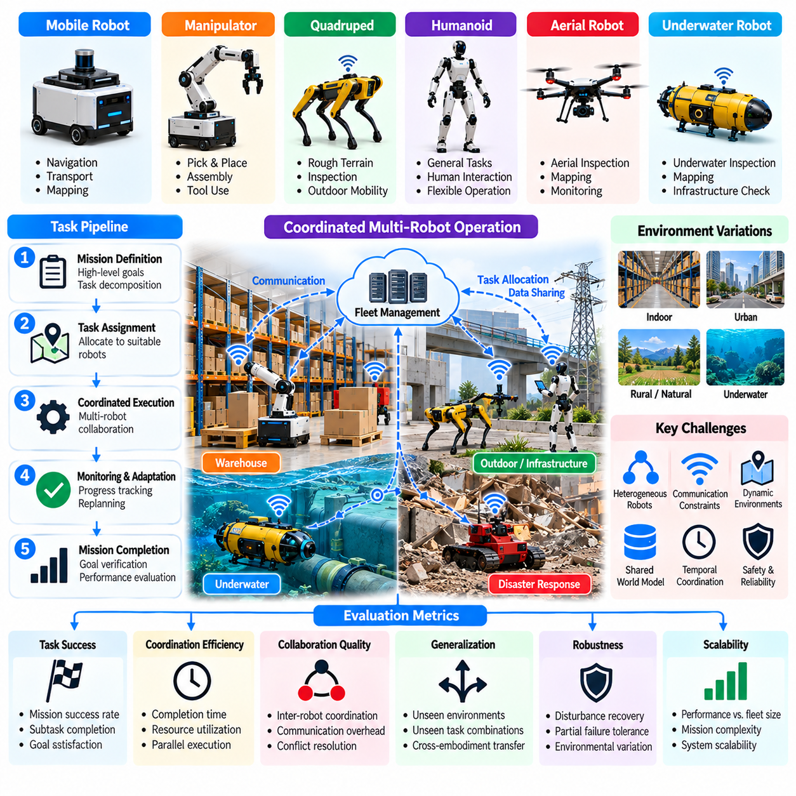{width="7.268055555555556in" height="7.268055555555556in"}

Heterogeneous fleet benchmarking evaluates whether robots with different physical capabilities can cooperate to complete shared missions efficiently, reliably, and safely. Unlike homogeneous fleets composed of similar platforms, heterogeneous systems combine mobile robots, manipulators, quadrupeds, aerial vehicles, and specialized machines. Evaluation must therefore consider individual competence, task allocation, coordination, communication, and collective mission performance.

A representative case study involves an industrial logistics facility where autonomous mobile robots transport materials, manipulators handle objects, and aerial robots inspect elevated structures. A quadruped may investigate areas inaccessible to wheeled platforms. The fleet must coordinate these activities while sharing operational space and information. Benchmark scenarios measure whether specialization improves mission outcomes beyond independent robot operation.

Benchmark design begins by defining fleet composition, robot capabilities, task dependencies, workspace constraints, and communication infrastructure. Each robot should have a documented capability profile describing mobility, payload, sensing, manipulation, and endurance. Standardized scenarios specify mission objectives, initial positions, resource availability, and completion conditions. These definitions establish comparable conditions across different fleet architectures.

Task allocation evaluation measures how effectively the fleet assigns activities according to robot capabilities, availability, and operational cost. Tasks may require specialized sensors, particular manipulators, or access to restricted environments. Metrics include assignment feasibility, allocation latency, task completion rate, and resource utilization. Evaluation should distinguish efficient specialization from excessive dependence on a small number of high-capability robots.

Coordination performance examines how multiple robots synchronize actions involving shared locations, objects, or sequential dependencies. A mobile robot may deliver materials before a manipulator can begin assembly, while an inspection robot verifies completion. Metrics include synchronization delay, dependency violations, waiting time, and coordinated task success. Effective coordination minimizes unnecessary idle periods without compromising operational safety.

Communication evaluation considers message delivery, network latency, bandwidth consumption, and information consistency across the fleet. Robots may exchange task status, object locations, environmental maps, and hazard notifications. Benchmark conditions introduce packet loss, delayed messages, and intermittent connectivity. Measurements include communication reliability, coordination degradation, and recovery after network interruptions.

Shared perception and mapping evaluation examines whether robots can combine observations into a consistent operational representation. Different sensing configurations may provide complementary information about obstacles, objects, and traversable regions. Metrics include map alignment accuracy, object-state consistency, information freshness, and shared-state update latency. Evaluation must identify whether information fusion improves decisions or introduces conflicting environmental estimates.

Heterogeneous navigation evaluates how robots with different locomotion mechanisms operate safely within shared spaces. Wheeled robots, legged platforms, and aerial vehicles may follow different routes while interacting at common transfer points. Metrics include collision frequency, traffic congestion, route completion, and spatial utilization. The benchmark should distinguish unavoidable physical constraints from coordination failures that reduce overall fleet efficiency.

Collaborative manipulation and handoff evaluation focuses on tasks requiring cooperation between platforms with different physical capabilities. A mobile robot may position a container for a stationary manipulator, or two robots may coordinate object transfer. Measurements include handoff success rate, alignment accuracy, synchronization error, and object damage frequency. Successful cooperation requires compatible interfaces and accurate estimates of shared task states.

Fleet-level planning evaluates whether a coordination system can convert mission objectives into feasible assignments and execution schedules. Planning must account for robot availability, travel time, energy reserves, and task dependencies. Metrics include scheduling efficiency, mission makespan, replanning latency, and deadline satisfaction. Evaluation should compare centralized, decentralized, and hybrid coordination strategies under equivalent operational constraints.

Dynamic reassignment evaluates the fleet\'s ability to redistribute tasks when robots become unavailable or mission priorities change. Benchmark scenarios may introduce equipment failures, charging requirements, blocked routes, or urgent inspection requests. Measurements include reassignment latency, recovered task coverage, mission delay, and workload balance. A resilient fleet should continue useful operations without relying on continuous human intervention.

Scalability evaluation examines how collective performance changes as fleet size, robot diversity, and task volume increase. Adding robots may improve throughput but also introduce communication overhead, congestion, and scheduling complexity. Metrics include throughput scaling, coordination latency, computational demand, and marginal productivity per added robot. Benchmark results should identify operating regions where additional robots no longer improve mission performance.

Resource efficiency evaluation measures fleet-wide energy consumption, charging utilization, equipment availability, and productive operating time. Different robot types have distinct energy profiles and maintenance requirements. Metrics include energy per completed task, fleet utilization, charging-related delays, and idle resource consumption. Evaluation should determine whether coordinated resource management improves efficiency compared with independent scheduling.

Robustness testing introduces sensor degradation, actuator failures, communication interruptions, and unexpected environmental changes. Failures may affect individual robots or propagate through shared dependencies. Metrics include mission degradation, fault isolation, recovery time, and remaining operational capacity. Testing should reveal whether the fleet can reorganize around failures while preserving essential services and safe operating conditions.

Human-fleet interaction evaluation examines how operators supervise multiple autonomous platforms and respond to exceptions. The benchmark measures intervention frequency, operator workload, alert clarity, and recovery effectiveness. Different autonomy levels may require different supervision arrangements. Evaluation should distinguish successful autonomous coordination from performance maintained through extensive human monitoring or manual task reassignment.

Safety evaluation considers inter-robot collisions, unsafe handoffs, shared-space conflicts, and hazardous interactions with people. Safety-critical events must be reported separately from throughput and mission completion. Emergency stopping, right-of-way rules, geofencing, and coordinated fallback behavior should be explicitly tested. Fleet safety requires evaluating interactions between robots rather than assessing each platform independently.

Simulation-based benchmarking supports large-scale testing of fleet composition, task demand, communication conditions, and failure scenarios. Parallel simulation enables repeated comparisons of allocation and coordination algorithms. However, simplified traffic behavior, physical interactions, and network models may distort performance estimates. Real-world experiments are necessary to verify that simulated improvements transfer to operational facilities.

Real-world validation should use documented fleet configurations, standardized task definitions, synchronized event logs, and independently measured outcomes. Each trial records robot assignments, task progress, communication events, interventions, and resource consumption. Repeated experiments across different workloads establish reproducibility. Evaluation should document hardware differences and environmental conditions that influence collective performance.

A comprehensive heterogeneous fleet scorecard combines mission success, task allocation, coordination efficiency, communication reliability, scalability, resource utilization, robustness, human intervention, and safety. Statistical reporting should include confidence intervals, workload-dependent performance curves, and failure classifications. The ultimate objective is to determine whether diverse robots can operate as a dependable coordinated system rather than merely as independent machines.

이종 로봇 군집 벤치마킹(Heterogeneous Fleet Benchmarking)은 서로 다른 물리적 능력(Physical Capabilities)을 가진 로봇들이 공동 임무(Shared Missions)를 효율적이고 신뢰성 있으며 안전하게 완수하기 위해 협력할 수 있는지 평가한다. 유사한 플랫폼으로 구성된 동종 로봇 군집(Homogeneous Fleets)과 달리 이종 시스템(Heterogeneous Systems)은 이동 로봇(Mobile Robots), 조작기(Manipulators), 사족보행 로봇(Quadrupeds), 항공 로봇(Aerial Vehicles), 특수 목적 기계(Specialized Machines)를 결합한다. 따라서 평가는 개별 수행 능력(Individual Competence), 작업 할당(Task Allocation), 협조(Coordination), 통신(Communication), 집단 임무 성능(Collective Mission Performance)을 고려해야 한다.

대표적인 사례 연구(Case Study)는 자율 이동 로봇(Autonomous Mobile Robots)이 자재를 운반하고, 조작기(Manipulators)가 물체를 취급하며, 항공 로봇(Aerial Robots)이 높은 구조물을 검사하는 산업 물류 시설(Industrial Logistics Facility)을 다룬다. 사족보행 로봇(Quadruped)은 바퀴형 플랫폼(Wheeled Platforms)이 접근할 수 없는 구역을 조사할 수 있다. 로봇 군집(Fleet)은 운영 공간(Operational Space)과 정보를 공유하면서 이러한 활동을 조정해야 한다. 벤치마크 시나리오(Benchmark Scenarios)는 전문화(Specialization)가 개별 로봇의 독립적인 운영(Independent Robot Operation)보다 임무 결과를 개선하는지 측정한다.

벤치마크 설계(Benchmark Design)는 로봇 군집 구성(Fleet Composition), 로봇 능력(Robot Capabilities), 작업 의존성(Task Dependencies), 작업공간 제약조건(Workspace Constraints), 통신 인프라(Communication Infrastructure)를 정의하는 것으로 시작한다. 각 로봇은 이동성(Mobility), 적재 능력(Payload), 센싱(Sensing), 조작(Manipulation), 지속 운영 능력(Endurance)을 설명하는 문서화된 능력 프로파일(Capability Profile)을 가져야 한다. 표준화된 시나리오(Standardized Scenarios)는 임무 목표(Mission Objectives), 초기 위치(Initial Positions), 자원 가용성(Resource Availability), 완료 조건(Completion Conditions)을 명시한다. 이러한 정의는 서로 다른 로봇 군집 아키텍처(Fleet Architectures) 사이에서 비교 가능한 조건을 확립한다.

작업 할당 평가(Task Allocation Evaluation)는 로봇의 능력, 가용성(Availability), 운영 비용(Operational Cost)에 따라 활동을 얼마나 효과적으로 배정하는지 측정한다. 작업에는 특수 센서(Specialized Sensors), 특정 조작기(Particular Manipulators), 제한된 환경에 대한 접근(Access to Restricted Environments)이 필요할 수 있다. 평가 지표에는 할당 실행 가능성(Assignment Feasibility), 할당 지연시간(Allocation Latency), 작업 완료율(Task Completion Rate), 자원 활용률(Resource Utilization)이 포함된다. 평가는 효율적인 전문화(Efficient Specialization)와 소수의 고성능 로봇(High-Capability Robots)에 대한 과도한 의존(Excessive Dependence)을 구분해야 한다.

협조 성능(Coordination Performance)은 여러 로봇이 공유 위치(Shared Locations), 물체 또는 순차적 의존성(Sequential Dependencies)이 포함된 동작을 어떻게 동기화하는지 검토한다. 이동 로봇(Mobile Robot)은 조작기가 조립(Assembly)을 시작하기 전에 자재를 전달할 수 있으며, 검사 로봇(Inspection Robot)은 작업 완료를 검증할 수 있다. 평가 지표에는 동기화 지연(Synchronization Delay), 의존성 위반(Dependency Violations), 대기 시간(Waiting Time), 협력 작업 성공률(Coordinated Task Success)이 포함된다. 효과적인 협조(Effective Coordination)는 운영 안전성(Operational Safety)을 저해하지 않으면서 불필요한 유휴 시간(Idle Periods)을 최소화한다.

통신 평가(Communication Evaluation)는 로봇 군집 전반의 메시지 전달(Message Delivery), 네트워크 지연시간(Network Latency), 대역폭 소비량(Bandwidth Consumption), 정보 일관성(Information Consistency)을 고려한다. 로봇은 작업 상태(Task Status), 물체 위치(Object Locations), 환경 지도(Environmental Maps), 위험 알림(Hazard Notifications)을 교환할 수 있다. 벤치마크 조건에는 패킷 손실(Packet Loss), 지연된 메시지(Delayed Messages), 간헐적인 연결(Intermittent Connectivity)을 도입한다. 측정 항목에는 통신 신뢰성(Communication Reliability), 협조 성능 저하(Coordination Degradation), 네트워크 중단 이후 복구(Recovery After Network Interruptions)가 포함된다.

공유 인식 및 지도 작성 평가(Shared Perception and Mapping Evaluation)는 로봇들이 관측 정보를 결합하여 일관된 운영 환경 표현(Consistent Operational Representation)을 구축할 수 있는지 검토한다. 서로 다른 센싱 구성(Sensing Configurations)은 장애물, 물체, 주행 가능 영역(Traversable Regions)에 대한 상호 보완적인 정보(Complementary Information)를 제공할 수 있다. 평가 지표에는 지도 정합 정확도(Map Alignment Accuracy), 물체 상태 일관성(Object-State Consistency), 정보 최신성(Information Freshness), 공유 상태 갱신 지연시간(Shared-State Update Latency)이 포함된다. 평가는 정보 융합(Information Fusion)이 의사결정을 개선하는지 또는 상충하는 환경 추정값(Conflicting Environmental Estimates)을 발생시키는지 식별해야 한다.

이종 로봇 항행(Heterogeneous Navigation)은 서로 다른 이동 메커니즘(Locomotion Mechanisms)을 가진 로봇들이 공유 공간(Shared Spaces)에서 안전하게 작동하는지 평가한다. 바퀴형 로봇(Wheeled Robots), 다족보행 플랫폼(Legged Platforms), 항공 로봇(Aerial Vehicles)은 서로 다른 경로를 따르면서 공통 인계 지점(Common Transfer Points)에서 상호작용할 수 있다. 평가 지표에는 충돌 빈도(Collision Frequency), 교통 혼잡(Traffic Congestion), 경로 완료율(Route Completion), 공간 활용률(Spatial Utilization)이 포함된다. 벤치마크는 불가피한 물리적 제약조건(Unavoidable Physical Constraints)과 전체 로봇 군집 효율성을 저하시키는 협조 실패(Coordination Failures)를 구분해야 한다.

협력 조작 및 인계 평가(Collaborative Manipulation and Handoff Evaluation)는 서로 다른 물리적 능력을 가진 플랫폼 사이의 협력이 필요한 작업에 초점을 맞춘다. 이동 로봇은 고정형 조작기(Stationary Manipulator)가 작업할 수 있도록 용기를 배치하거나, 두 로봇이 물체 전달(Object Transfer)을 협력하여 수행할 수 있다. 측정 항목에는 인계 성공률(Handoff Success Rate), 정렬 정확도(Alignment Accuracy), 동기화 오차(Synchronization Error), 물체 손상 빈도(Object Damage Frequency)가 포함된다. 성공적인 협력(Successful Cooperation)을 위해서는 호환 가능한 인터페이스(Compatible Interfaces)와 공유 작업 상태(Shared Task States)에 대한 정확한 추정이 필요하다.

로봇 군집 수준 계획(Fleet-Level Planning)은 협조 시스템(Coordination System)이 임무 목표를 실행 가능한 작업 배정(Feasible Assignments)과 실행 일정(Execution Schedules)으로 변환할 수 있는지 평가한다. 계획 과정에서는 로봇 가용성(Robot Availability), 이동 시간(Travel Time), 잔여 에너지(Energy Reserves), 작업 의존성(Task Dependencies)을 고려해야 한다. 평가 지표에는 일정 수립 효율성(Scheduling Efficiency), 임무 총 소요시간(Mission Makespan), 재계획 지연시간(Replanning Latency), 마감시간 충족률(Deadline Satisfaction)이 포함된다. 평가는 동일한 운영 제약조건(Equivalent Operational Constraints) 아래에서 중앙집중형(Centralized), 분산형(Decentralized), 하이브리드 협조 전략(Hybrid Coordination Strategies)을 비교해야 한다.

동적 재할당(Dynamic Reassignment)은 로봇을 사용할 수 없게 되거나 임무 우선순위(Mission Priorities)가 변경될 때 로봇 군집이 작업을 재분배할 수 있는지 평가한다. 벤치마크 시나리오에는 장비 고장(Equipment Failures), 충전 요구사항(Charging Requirements), 차단된 경로(Blocked Routes), 긴급 검사 요청(Urgent Inspection Requests)이 포함될 수 있다. 측정 항목에는 재할당 지연시간(Reassignment Latency), 복구된 작업 수행 범위(Recovered Task Coverage), 임무 지연(Mission Delay), 작업 부하 균형(Workload Balance)이 포함된다. 회복탄력성이 높은 로봇 군집(Resilient Fleet)은 지속적인 인간 개입(Human Intervention)에 의존하지 않고 유용한 운영을 계속할 수 있어야 한다.

확장성 평가(Scalability Evaluation)는 로봇 군집 규모(Fleet Size), 로봇 다양성(Robot Diversity), 작업량(Task Volume)이 증가함에 따라 집단 성능(Collective Performance)이 어떻게 변화하는지 검토한다. 로봇을 추가하면 처리량(Throughput)이 향상될 수 있지만 통신 오버헤드(Communication Overhead), 혼잡(Congestion), 일정 수립 복잡도(Scheduling Complexity)도 증가할 수 있다. 평가 지표에는 처리량 확장성(Throughput Scaling), 협조 지연시간(Coordination Latency), 계산 요구량(Computational Demand), 추가 로봇당 한계 생산성(Marginal Productivity per Added Robot)이 포함된다. 벤치마크 결과는 로봇을 추가하더라도 더 이상 임무 성능이 개선되지 않는 운영 영역(Operating Regions)을 식별해야 한다.

자원 효율성 평가(Resource Efficiency Evaluation)는 로봇 군집 전체의 에너지 소비량(Fleet-Wide Energy Consumption), 충전 설비 활용률(Charging Utilization), 장비 가용성(Equipment Availability), 생산적인 운영 시간(Productive Operating Time)을 측정한다. 서로 다른 로봇 유형은 고유한 에너지 특성(Energy Profiles)과 유지보수 요구사항(Maintenance Requirements)을 가진다. 평가 지표에는 완료 작업당 에너지 소비량(Energy per Completed Task), 로봇 군집 활용률(Fleet Utilization), 충전 관련 지연(Charging-Related Delays), 유휴 자원 소비량(Idle Resource Consumption)이 포함된다. 평가는 협력적인 자원 관리(Coordinated Resource Management)가 독립적인 일정 수립(Independent Scheduling)보다 효율성을 향상시키는지 판단해야 한다.

강건성 시험(Robustness Testing)은 센서 성능 저하(Sensor Degradation), 구동기 고장(Actuator Failures), 통신 중단(Communication Interruptions), 예상하지 못한 환경 변화(Unexpected Environmental Changes)를 도입한다. 실패는 개별 로봇에 영향을 미치거나 공유 의존성(Shared Dependencies)을 통해 전파될 수 있다. 평가 지표에는 임무 성능 저하(Mission Degradation), 고장 격리(Fault Isolation), 복구 시간(Recovery Time), 잔여 운영 능력(Remaining Operational Capacity)이 포함된다. 시험은 로봇 군집이 필수 서비스(Essential Services)와 안전한 운영 조건(Safe Operating Conditions)을 유지하면서 고장에 대응하여 재구성할 수 있는지 보여주어야 한다.

인간-로봇 군집 상호작용 평가(Human-Fleet Interaction Evaluation)는 운영자가 여러 자율 플랫폼(Autonomous Platforms)을 감독하고 예외 상황(Exceptions)에 대응하는 방식을 검토한다. 벤치마크는 개입 빈도(Intervention Frequency), 운영자 작업 부하(Operator Workload), 경고 명확성(Alert Clarity), 복구 효과(Recovery Effectiveness)를 측정한다. 서로 다른 자율성 수준(Autonomy Levels)은 서로 다른 감독 체계(Supervision Arrangements)를 요구할 수 있다. 평가는 성공적인 자율 협조(Autonomous Coordination)와 광범위한 인간 감시(Human Monitoring) 또는 수동 작업 재할당(Manual Task Reassignment)을 통해 유지되는 성능을 구분해야 한다.

안전성 평가(Safety Evaluation)는 로봇 간 충돌(Inter-Robot Collisions), 위험한 인계(Unsafe Handoffs), 공유 공간 충돌(Shared-Space Conflicts), 사람과의 위험한 상호작용(Hazardous Interactions with People)을 고려한다. 안전에 중대한 영향을 미치는 사건(Safety-Critical Events)은 처리량(Throughput)과 임무 완료(Mission Completion)와 별도로 보고해야 한다. 비상 정지(Emergency Stopping), 통행 우선권 규칙(Right-of-Way Rules), 지리적 운용 제한(Geofencing), 협력적 대체 행동(Coordinated Fallback Behavior)을 명시적으로 시험해야 한다. 로봇 군집 안전성(Fleet Safety)은 각 플랫폼을 독립적으로 평가하는 것이 아니라 로봇 간 상호작용(Interactions Between Robots)을 평가해야 한다.

시뮬레이션 기반 벤치마킹(Simulation-Based Benchmarking)은 로봇 군집 구성(Fleet Composition), 작업 수요(Task Demand), 통신 조건(Communication Conditions), 실패 시나리오(Failure Scenarios)에 대한 대규모 시험(Large-Scale Testing)을 지원한다. 병렬 시뮬레이션(Parallel Simulation)은 작업 할당 및 협조 알고리즘(Allocation and Coordination Algorithms)의 반복적인 비교를 가능하게 한다. 그러나 단순화된 교통 행동(Simplified Traffic Behavior), 물리적 상호작용(Physical Interactions), 네트워크 모델(Network Models)은 성능 추정값(Performance Estimates)을 왜곡할 수 있다. 시뮬레이션에서 확인된 개선이 실제 운영 시설(Operational Facilities)로 전이되는지 검증하려면 실제 환경 실험(Real-World Experiments)이 필요하다.

실제 환경 검증(Real-World Validation)은 문서화된 로봇 군집 구성(Documented Fleet Configurations), 표준화된 작업 정의(Standardized Task Definitions), 동기화된 이벤트 로그(Synchronized Event Logs), 독립적으로 측정된 결과(Independently Measured Outcomes)를 사용해야 한다. 각 시험은 로봇 배정(Robot Assignments), 작업 진행 상황(Task Progress), 통신 사건(Communication Events), 개입(Interventions), 자원 소비(Resource Consumption)를 기록한다. 서로 다른 작업 부하(Workloads)에 걸친 반복 실험은 재현성(Reproducibility)을 확보한다. 평가는 집단 성능(Collective Performance)에 영향을 미치는 하드웨어 차이(Hardware Differences)와 환경 조건(Environmental Conditions)을 문서화해야 한다.

포괄적인 이종 로봇 군집 평가표(Heterogeneous Fleet Scorecard)는 임무 성공률(Mission Success), 작업 할당(Task Allocation), 협조 효율성(Coordination Efficiency), 통신 신뢰성(Communication Reliability), 확장성(Scalability), 자원 활용률(Resource Utilization), 강건성(Robustness), 인간 개입(Human Intervention), 안전성(Safety)을 결합한다. 통계적 보고(Statistical Reporting)에는 신뢰구간(Confidence Intervals), 작업 부하에 따른 성능 곡선(Workload-Dependent Performance Curves), 실패 분류(Failure Classifications)가 포함되어야 한다. 궁극적인 목적은 다양한 로봇들이 단순히 독립적인 기계(Independent Machines)로 작동하는 것이 아니라 신뢰할 수 있는 협력 시스템(Dependable Coordinated System)으로 운영될 수 있는지 판단하는 것이다.

##  

## 09.12. End to End Physical AI Benchmark Suite [w/Code]

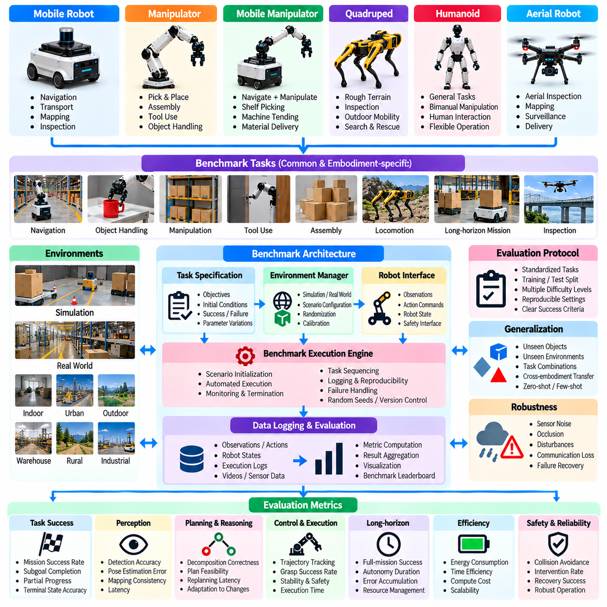{width="7.268055555555556in" height="7.268055555555556in"}

An end-to-end Physical AI benchmark suite evaluates the complete operational capability of intelligent robotic systems, from perception and reasoning to planning, control, and physical execution. Unlike isolated algorithm benchmarks, an integrated suite measures how individual components interact during realistic tasks. Its purpose is to establish reproducible evidence of task competence, generalization, robustness, efficiency, and safety across diverse embodiments.

The benchmark suite should cover autonomous mobile robots, manipulators, mobile manipulators, quadrupeds, humanoids, and aerial platforms. Each embodiment requires tasks reflecting its physical capabilities while sharing common evaluation principles. Representative scenarios include navigation, object handling, inspection, locomotion, and multi-step missions. This structure enables both platform-specific analysis and comparisons of general autonomous capabilities.

A standardized benchmark architecture separates task definitions, environment configurations, robot interfaces, evaluation controllers, data logging, and metric computation. Each layer should expose documented interfaces so different algorithms and hardware platforms can be evaluated consistently. The architecture must distinguish benchmark infrastructure from the system under test. This separation reduces hidden dependencies and improves reproducibility.

Task specifications define objectives, initial conditions, permitted actions, environmental constraints, and measurable completion criteria. Each task should include explicit success and failure conditions rather than relying on subjective operator judgments. Parameterized tasks allow systematic variation in object positions, obstacles, lighting, and physical properties. Difficulty levels should reflect measurable changes in complexity rather than arbitrary labels.

Environment management supports both simulation and real-world evaluation using consistent task semantics. Simulated environments provide repeatability, controlled disturbances, and large-scale testing, while physical environments reveal sensing errors, contact uncertainty, and hardware limitations. Calibration procedures align reference measurements across domains. Differences between simulated and physical outcomes should be recorded rather than concealed through score normalization.

Robot interface standardization enables different platforms to participate without requiring identical hardware or control architectures. Interfaces may expose observations, action commands, robot state, safety status, and execution feedback. Adapters translate these abstractions into platform-specific protocols. Evaluation must document action frequency, observation latency, sensor availability, and permitted control authority to ensure comparisons remain technically meaningful.

A benchmark execution engine manages scenario initialization, randomized trials, task sequencing, monitoring, and termination. Each run should record configuration identifiers, software versions, random seeds, and robot parameters. Automated execution reduces operator variability and supports repeated experiments. The engine must also detect invalid trials caused by infrastructure failures and distinguish them from legitimate system failures.

Perception evaluation measures object detection, localization, mapping, scene understanding, and state estimation under changing conditions. Metrics include detection accuracy, pose error, map consistency, and observation latency. However, component-level perception accuracy should be connected to downstream task outcomes. A perception model that performs well offline may still produce unsafe or ineffective decisions during physical interaction.

Planning and reasoning evaluation examines task decomposition, goal selection, constraint satisfaction, and adaptation to unexpected events. Scenarios may require sequential manipulation, navigation around blocked routes, or replanning after unsuccessful actions. Metrics include plan feasibility, subgoal completion, replanning latency, and mission success. Evaluation should verify actual execution outcomes instead of accepting plausible plans as successful behavior.

Control and physical execution evaluation measures whether planned actions produce accurate, stable, and safe movement. Relevant metrics include trajectory tracking error, grasp success, locomotion stability, collision frequency, and execution time. Control performance must be evaluated under realistic actuator limits, contact dynamics, and disturbances. The benchmark should identify whether failures originate in planning, perception, control, or their interactions.

Generalization testing separates training and evaluation distributions across objects, environments, tasks, and robot embodiments. Controlled novelty levels distinguish familiar conditions from unseen configurations. Zero-shot and adaptation-based results should be reported separately. Metrics include unseen-task success, performance degradation, adaptation data requirements, and cross-embodiment transfer. Transparent dataset boundaries are necessary to prevent misleading claims.

Robustness evaluation introduces sensor noise, occlusion, object displacement, communication interruptions, and actuator degradation. Each disturbance should have documented severity and reproducible application conditions. Measurements include recovery success, performance degradation, intervention frequency, and failure propagation. Robustness scores should reflect sustained task execution rather than accuracy under isolated perturbations alone.

Long-horizon evaluation combines multiple dependent tasks into extended missions requiring memory, state tracking, resource management, and autonomous recovery. Metrics include full-mission success, subgoal consistency, autonomy duration, and mean time between interventions. Extended trials reveal accumulated errors that short tests cannot expose. Mission progress should be logged continuously to distinguish partial completion from reliable autonomous operation.

Safety evaluation measures collisions, unsafe contact forces, restricted-zone violations, emergency stops, and failures to enter safe fallback states. Safety outcomes must remain visible even when task success is high. The suite should test protective mechanisms independently from nominal task execution. Evaluation protocols must define exposure limits and stop conditions so benchmark difficulty never overrides operational safety requirements.

Computational efficiency evaluation considers inference latency, control-loop timing, memory consumption, energy use, and hardware utilization. Measurements should include both algorithm-level costs and complete-system overhead. Real-time constraints vary across embodiments and tasks, making raw inference speed insufficient as a universal metric. Reports should document computational resources and identify whether performance remains acceptable under deployment conditions.

Statistical evaluation requires repeated trials, controlled randomization, confidence intervals, and explicit failure classification. Results should be stratified by task category, difficulty, embodiment, and environmental novelty. Aggregate scores may summarize performance but should not hide critical safety or reliability weaknesses. Missing trials, manual interventions, and unsuccessful runs must be reported transparently to prevent selective performance claims.

A practical benchmark suite can organize its implementation around reusable scenario files, robot adapters, execution scripts, event logs, and metric calculators. Machine-readable configurations specify tasks, environments, seeds, and evaluation settings. Automated pipelines validate configurations, execute trials, compute results, and generate reports. Versioned benchmark definitions ensure that algorithm improvements can be compared against stable experimental conditions.

Reproducibility requires preserving source code versions, model checkpoints, dataset references, calibration records, and hardware configurations. Benchmark results should include sufficient metadata for independent replication. Continuous integration can automate simulation regression tests, while physical validation follows controlled test schedules. Changes to task definitions or scoring procedures must be versioned because they may invalidate comparisons with earlier results.

A comprehensive Physical AI benchmark scorecard combines perception, planning, control, task success, generalization, robustness, long-horizon autonomy, efficiency, and safety. Category-level results should accompany any overall performance index. The ultimate objective is not merely to rank algorithms but to establish a trustworthy evaluation framework that connects laboratory measurements with dependable physical intelligence in real-world operations.

종단 간 피지컬 AI 벤치마크 스위트(End-to-End Physical AI Benchmark Suite)는 인식(Perception)과 추론(Reasoning)부터 계획(Planning), 제어(Control), 물리적 실행(Physical Execution)에 이르기까지 지능형 로봇 시스템(Intelligent Robotic Systems)의 전체 운영 능력(Operational Capability)을 평가한다. 개별 알고리즘 벤치마크(Isolated Algorithm Benchmarks)와 달리 통합 벤치마크 스위트(Integrated Benchmark Suite)는 현실적인 작업 수행 과정에서 개별 구성요소들이 어떻게 상호작용하는지 측정한다. 그 목적은 다양한 로봇 신체 구조(Embodiments)에 걸쳐 작업 수행 능력(Task Competence), 일반화(Generalization), 강건성(Robustness), 효율성(Efficiency), 안전성(Safety)에 대한 재현 가능한 증거(Reproducible Evidence)를 확립하는 것이다.

벤치마크 스위트(Benchmark Suite)는 자율 이동 로봇(Autonomous Mobile Robots), 조작기(Manipulators), 이동형 조작기(Mobile Manipulators), 사족보행 로봇(Quadrupeds), 휴머노이드(Humanoids), 항공 플랫폼(Aerial Platforms)을 포함해야 한다. 각 로봇 신체 구조(Embodiment)는 공통 평가 원칙(Common Evaluation Principles)을 공유하면서도 고유한 물리적 능력(Physical Capabilities)을 반영하는 작업이 필요하다. 대표적인 시나리오에는 항행(Navigation), 물체 취급(Object Handling), 검사(Inspection), 보행(Locomotion), 다단계 임무(Multi-Step Missions)가 포함된다. 이러한 구조는 플랫폼별 분석(Platform-Specific Analysis)과 일반적인 자율 수행 능력(General Autonomous Capabilities)의 비교를 모두 가능하게 한다.

표준화된 벤치마크 아키텍처(Standardized Benchmark Architecture)는 작업 정의(Task Definitions), 환경 구성(Environment Configurations), 로봇 인터페이스(Robot Interfaces), 평가 제어기(Evaluation Controllers), 데이터 로깅(Data Logging), 평가 지표 계산(Metric Computation)을 분리한다. 각 계층(Layer)은 문서화된 인터페이스(Documented Interfaces)를 제공하여 서로 다른 알고리즘과 하드웨어 플랫폼을 일관되게 평가할 수 있도록 해야 한다. 아키텍처는 벤치마크 인프라(Benchmark Infrastructure)와 평가 대상 시스템(System Under Test)을 구분해야 한다. 이러한 분리는 숨겨진 의존성(Hidden Dependencies)을 줄이고 재현성(Reproducibility)을 향상시킨다.

작업 명세(Task Specifications)는 목표(Objectives), 초기 조건(Initial Conditions), 허용되는 동작(Permitted Actions), 환경 제약조건(Environmental Constraints), 측정 가능한 완료 기준(Measurable Completion Criteria)을 정의한다. 각 작업에는 주관적인 운영자 판단(Subjective Operator Judgments)에 의존하지 않는 명시적인 성공 및 실패 조건(Success and Failure Conditions)이 포함되어야 한다. 매개변수화된 작업(Parameterized Tasks)은 물체 위치(Object Positions), 장애물(Obstacles), 조명(Lighting), 물리적 특성(Physical Properties)을 체계적으로 변화시킬 수 있도록 한다. 난이도 수준(Difficulty Levels)은 임의적인 분류(Arbitrary Labels)가 아니라 측정 가능한 복잡도 변화(Measurable Changes in Complexity)를 반영해야 한다.

환경 관리(Environment Management)는 일관된 작업 의미 체계(Consistent Task Semantics)를 사용하여 시뮬레이션(Simulation)과 실제 환경 평가(Real-World Evaluation)를 모두 지원한다. 시뮬레이션 환경(Simulated Environments)은 반복 가능성(Repeatability), 통제된 외란(Controlled Disturbances), 대규모 시험(Large-Scale Testing)을 제공하는 반면, 물리적 환경(Physical Environments)은 센싱 오차(Sensing Errors), 접촉 불확실성(Contact Uncertainty), 하드웨어 한계(Hardware Limitations)를 드러낸다. 보정 절차(Calibration Procedures)는 서로 다른 도메인(Domains)에서 기준 측정값(Reference Measurements)을 정렬한다. 시뮬레이션 결과와 실제 물리적 결과의 차이는 점수 정규화(Score Normalization)를 통해 감추지 않고 기록해야 한다.

로봇 인터페이스 표준화(Robot Interface Standardization)는 동일한 하드웨어나 제어 아키텍처(Control Architectures)를 요구하지 않으면서 서로 다른 플랫폼이 평가에 참여할 수 있도록 한다. 인터페이스는 관측값(Observations), 동작 명령(Action Commands), 로봇 상태(Robot State), 안전 상태(Safety Status), 실행 피드백(Execution Feedback)을 제공할 수 있다. 어댑터(Adapters)는 이러한 추상화(Abstractions)를 플랫폼별 프로토콜(Platform-Specific Protocols)로 변환한다. 평가는 기술적으로 의미 있는 비교를 보장하기 위해 동작 주파수(Action Frequency), 관측 지연시간(Observation Latency), 센서 가용성(Sensor Availability), 허용된 제어 권한(Permitted Control Authority)을 문서화해야 한다.

벤치마크 실행 엔진(Benchmark Execution Engine)은 시나리오 초기화(Scenario Initialization), 무작위화된 시험(Randomized Trials), 작업 순서 지정(Task Sequencing), 모니터링(Monitoring), 종료(Termination)를 관리한다. 각 실행(Run)은 구성 식별자(Configuration Identifiers), 소프트웨어 버전(Software Versions), 난수 시드(Random Seeds), 로봇 매개변수(Robot Parameters)를 기록해야 한다. 자동화된 실행(Automated Execution)은 운영자에 따른 변동성(Operator Variability)을 줄이고 반복 실험(Repeated Experiments)을 지원한다. 실행 엔진은 인프라 장애(Infrastructure Failures)로 인해 발생한 무효 시험(Invalid Trials)을 감지하고 이를 실제 시스템 실패(Legitimate System Failures)와 구분해야 한다.

인식 평가(Perception Evaluation)는 변화하는 조건에서 물체 탐지(Object Detection), 위치 추정(Localization), 지도 작성(Mapping), 장면 이해(Scene Understanding), 상태 추정(State Estimation)을 측정한다. 평가 지표에는 탐지 정확도(Detection Accuracy), 자세 오차(Pose Error), 지도 일관성(Map Consistency), 관측 지연시간(Observation Latency)이 포함된다. 그러나 구성요소 수준의 인식 정확도(Component-Level Perception Accuracy)는 후속 작업 결과(Downstream Task Outcomes)와 연결되어야 한다. 오프라인(Offline)에서 높은 성능을 보이는 인식 모델이라도 물리적 상호작용(Physical Interaction) 과정에서는 위험하거나 비효율적인 의사결정을 생성할 수 있다.

계획 및 추론 평가(Planning and Reasoning Evaluation)는 작업 분해(Task Decomposition), 목표 선택(Goal Selection), 제약조건 충족(Constraint Satisfaction), 예상하지 못한 사건에 대한 적응(Adaptation to Unexpected Events)을 검토한다. 시나리오에는 순차적 조작(Sequential Manipulation), 차단된 경로를 우회하는 항행(Navigation Around Blocked Routes), 실패한 동작 이후 재계획(Replanning After Unsuccessful Actions)이 필요할 수 있다. 평가 지표에는 계획 실행 가능성(Plan Feasibility), 하위 목표 완료율(Subgoal Completion), 재계획 지연시간(Replanning Latency), 임무 성공률(Mission Success)이 포함된다. 평가는 그럴듯한 계획(Plausible Plans)을 성공적인 행동으로 인정하는 대신 실제 실행 결과(Actual Execution Outcomes)를 검증해야 한다.

제어 및 물리적 실행 평가(Control and Physical Execution Evaluation)는 계획된 동작이 정확하고 안정적이며 안전한 움직임을 생성하는지 측정한다. 관련 평가 지표에는 궤적 추종 오차(Trajectory Tracking Error), 파지 성공률(Grasp Success), 보행 안정성(Locomotion Stability), 충돌 빈도(Collision Frequency), 실행 시간(Execution Time)이 포함된다. 제어 성능(Control Performance)은 현실적인 구동기 한계(Actuator Limits), 접촉 동역학(Contact Dynamics), 외란(Disturbances) 아래에서 평가해야 한다. 벤치마크는 실패가 계획, 인식, 제어 또는 이들 사이의 상호작용에서 발생하는지 식별해야 한다.

일반화 시험(Generalization Testing)은 물체(Objects), 환경(Environments), 작업(Tasks), 로봇 신체 구조(Robot Embodiments)에 걸쳐 학습 분포(Training Distributions)와 평가 분포(Evaluation Distributions)를 분리한다. 통제된 신규성 수준(Controlled Novelty Levels)은 익숙한 조건(Familiar Conditions)과 경험하지 못한 구성(Unseen Configurations)을 구분한다. 제로샷(Zero-Shot) 결과와 적응 기반(Adaptation-Based) 결과는 별도로 보고해야 한다. 평가 지표에는 미경험 작업 성공률(Unseen-Task Success), 성능 저하(Performance Degradation), 적응 데이터 요구량(Adaptation Data Requirements), 이종 신체 구조 간 전이(Cross-Embodiment Transfer)가 포함된다. 오해를 유발하는 성능 주장을 방지하려면 투명한 데이터셋 경계(Transparent Dataset Boundaries)가 필요하다.

강건성 평가(Robustness Evaluation)는 센서 잡음(Sensor Noise), 가림(Occlusion), 물체 위치 변화(Object Displacement), 통신 중단(Communication Interruptions), 구동기 성능 저하(Actuator Degradation)를 도입한다. 각 외란(Disturbance)은 문서화된 심각도(Severity)와 재현 가능한 적용 조건(Reproducible Application Conditions)을 가져야 한다. 측정 항목에는 복구 성공률(Recovery Success), 성능 저하(Performance Degradation), 개입 빈도(Intervention Frequency), 실패 전파(Failure Propagation)가 포함된다. 강건성 점수(Robustness Scores)는 개별적인 교란(Isolated Perturbations)에 대한 정확도뿐만 아니라 지속적인 작업 실행(Sustained Task Execution)을 반영해야 한다.

장기 평가(Long-Horizon Evaluation)는 기억(Memory), 상태 추적(State Tracking), 자원 관리(Resource Management), 자율 복구(Autonomous Recovery)가 필요한 여러 의존적 작업(Dependent Tasks)을 장시간 임무(Extended Missions)로 결합한다. 평가 지표에는 전체 임무 성공률(Full-Mission Success), 하위 목표 일관성(Subgoal Consistency), 자율 운영 지속시간(Autonomy Duration), 평균 개입 간격(Mean Time Between Interventions)이 포함된다. 장시간 시험(Extended Trials)은 단기 시험(Short Tests)에서 발견할 수 없는 누적 오차(Accumulated Errors)를 드러낸다. 부분 완료(Partial Completion)와 신뢰성 있는 자율 운영(Reliable Autonomous Operation)을 구분하기 위해 임무 진행 상황(Mission Progress)을 지속적으로 기록해야 한다.

안전성 평가(Safety Evaluation)는 충돌(Collisions), 위험한 접촉력(Unsafe Contact Forces), 제한 구역 위반(Restricted-Zone Violations), 비상 정지(Emergency Stops), 안전한 대체 상태(Safe Fallback States)로 전환하지 못하는 실패를 측정한다. 작업 성공률(Task Success)이 높더라도 안전성 결과(Safety Outcomes)는 명확하게 드러나야 한다. 벤치마크 스위트는 정상적인 작업 실행(Nominal Task Execution)과 독립적으로 보호 메커니즘(Protective Mechanisms)을 시험해야 한다. 평가 프로토콜(Evaluation Protocols)은 벤치마크 난이도(Benchmark Difficulty)가 운영 안전 요구사항(Operational Safety Requirements)보다 우선하지 않도록 노출 한계(Exposure Limits)와 정지 조건(Stop Conditions)을 정의해야 한다.

계산 효율성 평가(Computational Efficiency Evaluation)는 추론 지연시간(Inference Latency), 제어 루프 타이밍(Control-Loop Timing), 메모리 소비량(Memory Consumption), 에너지 사용량(Energy Use), 하드웨어 활용률(Hardware Utilization)을 고려한다. 측정에는 알고리즘 수준의 비용(Algorithm-Level Costs)과 전체 시스템 오버헤드(Complete-System Overhead)가 모두 포함되어야 한다. 실시간 제약조건(Real-Time Constraints)은 로봇 신체 구조와 작업에 따라 달라지므로 단순한 추론 속도(Raw Inference Speed)만으로는 보편적인 평가 지표(Universal Metric)가 될 수 없다. 보고서는 계산 자원(Computational Resources)을 문서화하고 실제 배포 조건(Deployment Conditions)에서도 성능이 허용 가능한 수준으로 유지되는지 식별해야 한다.

통계적 평가(Statistical Evaluation)에는 반복 시험(Repeated Trials), 통제된 무작위화(Controlled Randomization), 신뢰구간(Confidence Intervals), 명시적인 실패 분류(Explicit Failure Classification)가 필요하다. 결과는 작업 범주(Task Category), 난이도(Difficulty), 로봇 신체 구조(Embodiment), 환경 신규성(Environmental Novelty)에 따라 구분하여 보고해야 한다. 종합 점수(Aggregate Scores)는 성능을 요약할 수 있지만 중대한 안전성 또는 신뢰성 약점(Critical Safety or Reliability Weaknesses)을 감추어서는 안 된다. 선택적인 성능 주장(Selective Performance Claims)을 방지하기 위해 누락된 시험(Missing Trials), 수동 개입(Manual Interventions), 실패한 실행(Unsuccessful Runs)을 투명하게 보고해야 한다.

실용적인 벤치마크 스위트(Practical Benchmark Suite)는 재사용 가능한 시나리오 파일(Reusable Scenario Files), 로봇 어댑터(Robot Adapters), 실행 스크립트(Execution Scripts), 이벤트 로그(Event Logs), 평가 지표 계산기(Metric Calculators)를 중심으로 구현을 구성할 수 있다. 기계 판독 가능 구성 파일(Machine-Readable Configurations)은 작업, 환경, 난수 시드(Seeds), 평가 설정(Evaluation Settings)을 명시한다. 자동화된 파이프라인(Automated Pipelines)은 구성 검증(Configuration Validation), 시험 실행(Trial Execution), 결과 계산(Result Computation), 보고서 생성(Report Generation)을 수행한다. 버전 관리되는 벤치마크 정의(Versioned Benchmark Definitions)는 안정적인 실험 조건(Stable Experimental Conditions)을 기준으로 알고리즘 개선을 비교할 수 있도록 한다.

재현성(Reproducibility)을 확보하려면 소스 코드 버전(Source Code Versions), 모델 체크포인트(Model Checkpoints), 데이터셋 참조 정보(Dataset References), 보정 기록(Calibration Records), 하드웨어 구성(Hardware Configurations)을 보존해야 한다. 벤치마크 결과에는 독립적인 재현(Independent Replication)에 충분한 메타데이터(Metadata)가 포함되어야 한다. 지속적 통합(Continuous Integration)은 시뮬레이션 회귀 시험(Simulation Regression Tests)을 자동화할 수 있으며, 물리적 검증(Physical Validation)은 통제된 시험 일정(Controlled Test Schedules)에 따라 수행된다. 작업 정의(Task Definitions)나 채점 절차(Scoring Procedures)의 변경은 이전 결과와의 비교를 무효화할 수 있으므로 반드시 버전 관리되어야 한다.

포괄적인 피지컬 AI 벤치마크 평가표(Physical AI Benchmark Scorecard)는 인식(Perception), 계획(Planning), 제어(Control), 작업 성공률(Task Success), 일반화(Generalization), 강건성(Robustness), 장기 자율성(Long-Horizon Autonomy), 효율성(Efficiency), 안전성(Safety)을 결합한다. 전체 성능 지수(Overall Performance Index)를 제시하는 경우에도 범주별 결과(Category-Level Results)를 함께 제공해야 한다. 궁극적인 목적은 단순히 알고리즘의 순위를 매기는 것이 아니라 실험실 측정(Laboratory Measurements)을 실제 운영 환경(Real-World Operations)에서 신뢰할 수 있는 물리적 지능(Dependable Physical Intelligence)과 연결하는 신뢰성 있는 평가 프레임워크(Trustworthy Evaluation Framework)를 확립하는 것이다.
